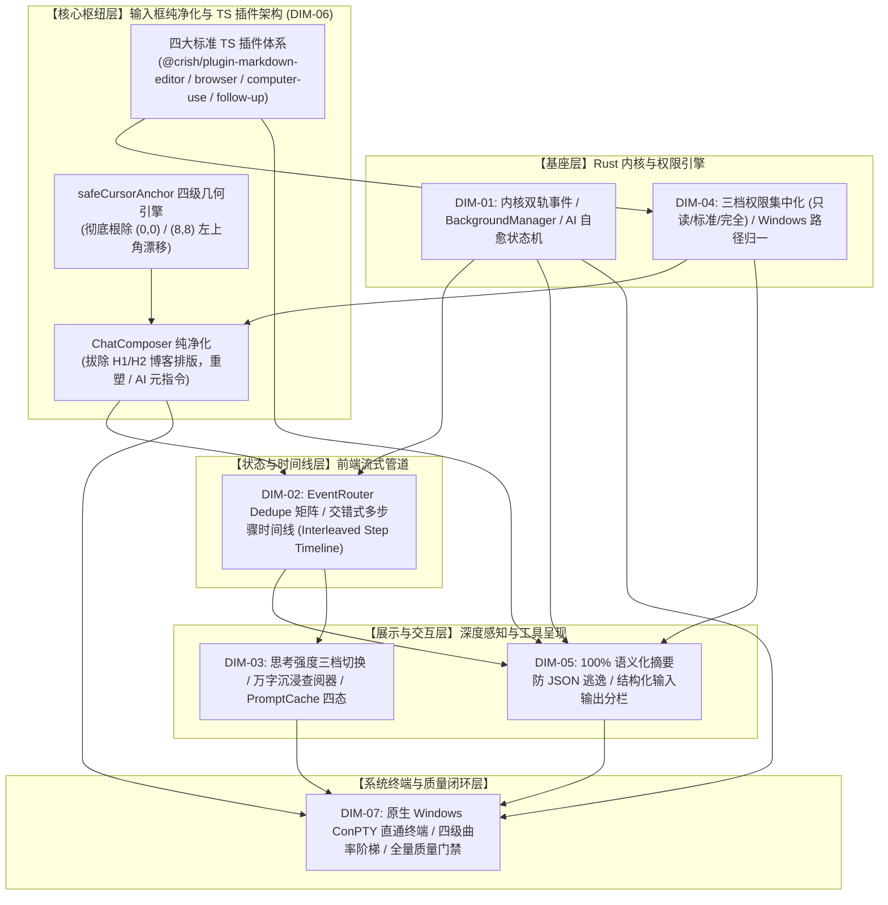

# 06-输入框纯净化与 TypeScript 插件体系独立总方案

> **【调度与定时器铁律】**：如果设置定时器，最短是 100 秒；如果命令过长，最好的方式是等待命令完成后的系统推送通知（Reactive Wakeup），而不是一直轮询命令情况。

---

## 方案基本信息

> **权威标识**：`docs/system-audit-and-redesign/independent-plans/06-输入框纯净化与插件体系独立总方案.md`
> **制定角色**：【独立方案编制师 06: 输入框纯净化与 TypeScript 插件架构视角独立总方案】
> **关联基准**：`docs/system-audit-and-redesign/00-战役通则与协同执行规范.md`、`docs/system-audit-and-redesign/00-主控拍板最终维度矩阵.md`
> **输入证据**：15 份专题分析报告（重点涵盖 `analysis/03`、`06`、`07`、`09`、`10`、`14`、`15`）、`reference/markdown-editor/` 测试资产、`packages/plugin-sdk/`
> **执行约束**：纯逻辑架构设计、零代码回撤、pwsh7 环境对齐、UTF-8 无 BOM、严禁直接执行 git commit。

---

## 目录索引

- [一、方案总纲与顶层架构全景（Executive Summary & Full-System Architecture Panorama）](#一方案总纲与顶层架构全景)
  - [1.1 核心使命与战役定位](#11-核心使命与战役定位)
  - [1.2 全系统 7 大核心重构维度拓扑与因果治理图（DIM-01 ~ DIM-07）](#12-全系统-7-大核心重构维度拓扑与因果治理图)
  - [1.3 整体修复架构视图与纯逻辑依赖演进矩阵](#13-整体修复架构视图与纯逻辑依赖演进矩阵)
  - [1.4 本方案核心深挖三维度（DIM-06 / DIM-03 / DIM-05）的协同战略价值](#14-本方案核心深挖三维度的协同战略价值)
- [二、输入框彻底纯净化与 AI 元指令重塑方案（ChatComposer Purification & AI Slash Commands）](#二输入框彻底纯净化与-ai-元指令重塑方案)
  - [2.1 博客排版命令侵入输入框的断层诊断与认知纠偏](#21-博客排版命令侵入输入框的断层诊断与认知纠偏)
  - [2.2 从 ChatComposer 彻底拔除 H1/H2/H3 等排版命令](#22-从-chatcomposer-彻底拔除-h1h2h3-等排版命令)
  - [2.3 键盘 '/' 触发语义的全面重塑：专注 AI 系统元指令与 Skill 工具](#23-键盘--触发语义的全面重塑专注-ai-系统元指令与-skill-工具)
  - [2.4 纯净版 AiCommandSlashExtension.ts 架构与生产级代码实现](#24-纯净版-aicommandslashextensionts-架构与生产级代码实现)
  - [2.5 CJK IME 输入法组合态（Composition）放行与键盘事件拦截盾](#25-cjk-ime-输入法组合态放行与键盘事件拦截盾)
- [三、几何绝对防漂移：四级安全光标锚点探测器（Rock-Solid Anchor Geometry & safeCursorAnchor.ts）](#三几何绝对防漂移四级安全光标锚点探测器)
  - [3.1 measureCursorLineBox 异常与 isValidClientRect 判定漏洞的数学逆向推导](#31-measurecursorlinebox-异常与-isvalidclientrect-判定漏洞的数学逆向推导)
  - [3.2 Radix Popover 碰撞翻转与 (0,0) / (8px,8px) 左上角幽灵吸附因果链](#32-radix-popover-碰撞翻转与-00--8px8px-左上角幽灵吸附因果链)
  - [3.3 四级几何安全探测器（SafeAnchorGeometryEngine）设计](#33-四级几何安全探测器safeanchorgeometryengine设计)
  - [3.4 多行滚动出界与容器高度动态变化防护](#34-多行滚动出界与容器高度动态变化防护)
  - [3.5 safeCursorAnchor.ts 生产级纯函数与几何引擎完整代码设计](#35-safecursoranchorts-生产级纯函数与几何引擎完整代码设计)
- [四、官方四大 TypeScript 插件解耦体系架构（@crish/plugin-* Decoupled Architecture）](#四官方四大-typescript-插件解耦体系架构)
  - [4.1 插件微内核体系哲学（Micro-Kernel Plugin Pattern）](#41-插件微内核体系哲学)
  - [4.2 核心插件 SDK 契约与生命周期状态机（packages/plugin-sdk 规范）](#42-核心插件-sdk-契约与生命周期状态机)
  - [4.3 插件 1：@crish/plugin-markdown-editor（专业虚拟化 Markdown 富文本编辑器）](#43-插件-1crishplugin-markdown-editor)
  - [4.4 插件 2：@crish/plugin-browser（受管 AI 浏览器自动化插件）](#44-插件-2crishplugin-browser)
  - [4.5 插件 3：@crish/plugin-computer-use（系统级桌面感知与键鼠自动化插件）](#45-插件-3crishplugin-computer-use)
  - [4.6 插件 4：@crish/plugin-follow-up（AI 行动建议插件与子 Agent 100% 物理隔离）](#46-插件-4crishplugin-follow-up)
- [五、重点深挖维度二：思考强度调节、沉浸式查阅器与 PromptCache 优化（DIM-03）](#五重点深挖维度二思考强度调节沉浸式查阅器与-promptcache-优化)
  - [5.1 全链路思考强度档位调节（Settings 全局预算 + Composer 底栏即时切换）](#51-全链路思考强度档位调节)
  - [5.2 双轨万字思考查阅器（8k~12k 行内弹性视口 + FullThoughtModal 沉浸式查阅器）](#52-双轨万字思考查阅器)
  - [5.3 修复 PromptCache 虚假“未命中”与四态视觉徽标](#53-修复-promptcache-虚假未命中与四态视觉徽标)
  - [5.4 Rust 内核 agent-provider Anthropic cache_control 与 Beta Headers 补齐](#54-rust-内核-agent-provider-anthropic-cache_control-与-beta-headers-补齐)
- [六、重点深挖维度三：工具卡片语义化摘要防逃逸与输入/输出结构化分栏（DIM-05）](#六重点深挖维度三工具卡片语义化摘要防逃逸与输入输出结构化分栏)
  - [6.1 全类别 13 种工具 100% 精准中文标题提取引擎（根除 raw JSON 逃逸）](#61-全类别-13-种工具-100-精准中文标题提取引擎)
  - [6.2 下一代工具卡片【输入 / 输出两段式结构化分栏】架构与 DOM 规范](#62-下一代工具卡片输入--输出两段式结构化分栏架构与-dom-规范)
  - [6.3 视觉曲率与交互设计系统契约（4 级曲率、柔和边框、无深黑硬环）](#63-视觉曲率与交互设计系统契约)
- [七、系统其余 4 维度的协同集成方案（DIM-01 / DIM-02 / DIM-04 / DIM-07）](#七系统其余-4-维度的协同集成方案)
  - [7.1 DIM-01：Rust 内核双轨事件打通、后台任务管理器装配与 AI 连续自愈状态机](#71-dim-01rust-内核双轨事件打通后台任务管理器装配与-ai-连续自愈状态机)
  - [7.2 DIM-02：前端流式管道 Dedupe 矩阵与交错式多步骤时间线](#72-dim-02前端流式管道-dedupe-矩阵与交错式多步骤时间线)
  - [7.3 DIM-04：三档权限集中化大刀阔斧重构与 Windows 路径归一](#73-dim-04三档权限集中化大刀阔斧重构与-windows-路径归一)
  - [7.4 DIM-07：原生 ConPTY 纯终端与全系统设计系统契约](#74-dim-07原生-conpty-纯终端与全系统设计系统契约)
- [八、逐文件重构实施方案与代码映射（Implementation & Code Blueprint）](#八逐文件重构实施方案与代码映射)
  - [8.1 涉及模块与文件增删改映射全景表](#81-涉及模块与文件增删改映射全景表)
  - [8.2 核心代码实现蓝图](#82-核心代码实现蓝图)
- [九、自动化测试套件、SDK 验证矩阵与质量门禁闭环（Quality Gates & Test Assertions）](#九自动化测试套件sdk-验证矩阵与质量门禁闭环)
  - [9.1 Vitest 单元测试用例设计](#91-vitest-单元测试用例设计)
  - [9.2 Plugin SDK 契约验证套件](#92-plugin-sdk-契约验证套件)
  - [9.3 CDP 真实桌面 WebView2（127.0.0.1:9222）机器真值测试断言](#93-cdp-真实桌面-webview2-机器真值测试断言)
  - [9.4 质量门禁与反过度设计自检清单](#94-质量门禁与反过度设计自检清单)

---

## 一、方案总纲与顶层架构全景

### 1.1 核心使命与战役定位

作为【独立方案编制师 06】，本方案基于全系统 15 份专题分析报告与主控拍板的 7 大核心重构维度（`docs/system-audit-and-redesign/00-主控拍板最终维度矩阵.md`），以 **【聊天提示框彻底纯净化、几何绝对防 (0,0) 漂移、官方四大 TypeScript 插件解耦体系】** 为主视角与核心枢纽，统筹规划 Conex / Crish 桌面客户端从底层内核到上层 UI 的系统级综合重构。

现代 AI 协同编程工作台的终极体验取决于其**输入交互面（Input Surface）的敏捷专注**与**系统扩展能力（Extension Surface）的解耦纯粹**：

1. **输入框（ChatComposer）必须纯净敏捷**：用户在聊天框内的核心意图是下达自然语言指令与 AI 系统控制。生硬混入博客排版命令（H1/H2/H3/List/Quote）是严重的职责倒置；弹出层受虚假零坐标污染吸附至 `(0, 0)` 左上角更是破坏性视觉事故；
2. **重型能力必须标准化插件化**：专业富文本编辑器（`reference/markdown-editor`）、受管浏览器（Browser）、桌面键鼠感知（ComputerUse）、后续行动建议（FollowUp）必须彻底解耦为标准的 TypeScript 插件（`@crish/plugin-*`），通过微内核注册表按需挂载，主界面彻底剥离脚手架代码；数据迁移（书签/历史导入）必须彻底回迁系统设置中心（Settings）。
3. **全系统 7 大维度有机共振**：输入框的纯净与插件体系的建立，向上承接交错式步骤时间线（DIM-02）与思考强度调节（DIM-03），向下联动权限集中化（DIM-04）、工具卡片防逃逸（DIM-05）、Rust 双轨事件（DIM-01）与原生 ConPTY 纯终端（DIM-07），构筑工业级坚固的系统闭环。

---

### 1.2 全系统 7 大核心重构维度拓扑与因果治理图

```
┌───────────────────────────────────────────────────────────────────────────────────────────────────────┐
│                                Conex / Crish 全系统 7 大核心重构维度矩阵                              │
├─────────┬─────────────────────────────────────────────────┬───────────────────────────────────────────┤
│ 维度编号│ 维度名称                                        │ 涵盖的核心痛点与治理目标                  │
├─────────┼─────────────────────────────────────────────────┼───────────────────────────────────────────┤
│ DIM-01  │ Rust 内核双轨事件、后台任务装配与自愈状态机     │ 根治 19 轮事件滞留、任务未装配与中途暴毙  │
│ DIM-02  │ 前端流式管道、Dedupe 矩阵与交错多步骤时间线     │ 根治 Token 误杀乱码与两坨压平结构倒退     │
│ DIM-03  │ 思考强度档位调节、沉浸式查阅器与 PromptCache 优化│ 全链路 Thinking 档位、万字思考与缓存修复  │
│ DIM-04  │ 三档权限集中化大刀阔斧重构与 Windows 路径归一   │ 破除完全访问死锁、规范 Windows 沙箱与提议 │
│ DIM-05  │ 工具卡片语义化摘要防逃逸与输入/输出结构化分栏   │ 彻底根除 raw JSON 逃逸、建立两段式分栏    │
│ DIM-06  │ 聊天框纯净化、几何绝对防漂移与 TS 插件解耦体系  │ 拔除博客排版、(0,0)防漂移、四大能力插件化 │
│ DIM-07  │ 原生 ConPTY 纯终端、设计系统契约与质量门禁闭环  │ Windows ConPTY 直通终端、视觉曲率与门禁   │
└─────────┴─────────────────────────────────────────────────┴───────────────────────────────────────────┘
```



---

### 1.3 整体修复架构视图与纯逻辑依赖演进矩阵

在纯逻辑架构演进中，所有任务单元严格依据因果依赖展开，绝对排除工期与商业优先级的干扰：

| 演进阶段                       | 阶段定位             | 关键交付单元                                                                                                                                                                                                                                                                                               | 核心依赖前置                  |
| :----------------------------- | :------------------- | :--------------------------------------------------------------------------------------------------------------------------------------------------------------------------------------------------------------------------------------------------------------------------------------------------------- | :---------------------------- |
| **阶段 1：内核与权限基座**     | 协议连通与安全解绑   | 1. Rust `LiveEventSink` 工具事件实时广播<br/>2. `BackgroundTaskManager` 实例全链路装配<br/>3. 三档集中权限（只读/标准/完全访问）落地，拔除 PowerShell 复合删除私设卡点                                                                                                                                     | 零前置，直接启动              |
| **阶段 2：数据流与时间线**     | 流式稳定与步骤解构   | 1. `EventRouter` Dedupe 矩阵重构，消除 Token 乱码<br/>2. `timelineNormalizer.ts` 交错多步骤时间线（`[思考 ➔ 工具 ➔ 观察]` 循环）                                                                                                                                                                           | 阶段 1 事件打通               |
| **阶段 3：展示与输入框纯净化** | 认知纯粹与视觉稳固   | 1. `ChatComposer` 博客命令彻底拔除，重塑 `/` 系统指令<br/>2. `safeCursorAnchor.ts` 四级几何引擎消除 `(0,0)` 漂移<br/>3. 工具卡片 100% 语义中文摘要与输入/输出结构化分栏<br/>4. 思考强度档位切换与 `FullThoughtModal` 沉浸式查阅器                                                                          | 阶段 2 时间线与状态流         |
| **阶段 4：四大 TS 插件化解耦** | 扩展生态与主界面瘦身 | 1. `@crish/plugin-markdown-editor`（富文本编辑器插件化，按需挂载文档 Tab）<br/>2. `@crish/plugin-browser`（浏览器自动化插件化，数据导入迁入 Settings）<br/>3. `@crish/plugin-computer-use`（键鼠感知插件化，悬浮 HUD 交互）<br/>4. `@crish/plugin-follow-up`（行动建议插件化，子 Agent 100% 严格物理隔离） | 阶段 1 权限 + 阶段 3 纯净基座 |
| **阶段 5：原生终端与质量闭环** | 工业级质感与全量门禁 | 1. 原生 ConPTY 字节流直通终端（`portable-pty` + `@xterm/xterm`）<br/>2. 四级视觉曲率（9999px / 10px / 12px / 6px）全面落地<br/>3. `reference/markdown-editor` 测试资产 100% 入库保护与 CDP 9222 真机全绿                                                                                                   | 阶段 1~4 全面完成             |

---

### 1.4 本方案核心深挖三维度的协同战略价值

本方案重点深挖 **DIM-06（输入框纯净化与插件体系）**、**DIM-03（思考强度与沉浸查阅器）** 与 **DIM-05（工具摘要防逃逸与输入输出分栏）**，三者构成了用户在日常人机协同中最敏感的“交互黄金三角”：

```
                    ┌──────────────────────────────────────────────┐
                    │            DIM-06: 纯净输入与扩展引擎        │
                    │   • 聊天提示框专注 AI 指令 (/goal, /clear)   │
                    │   • safeCursorAnchor 物理锁定防 (0,0) 漂移   │
                    │   • 四大能力标准化 TS 插件解耦与 Settings 回迁 │
                    └──────────────────────┬───────────────────────┘
                                           │
                        ┌──────────────────┴──────────────────┐
                        ▼                                     ▼
        ┌──────────────────────────────┐      ┌──────────────────────────────┐
        │   DIM-03: 思考透明与深度调节  │      │  DIM-05: 结构化工具呈现与分栏 │
        │ • 思考强度三档即时切换       │      │ • 100% 语义中文标题防 JSON 逃逸│
        │ • 8k~12k 弹性视口+沉浸查阅器 │      │ • 📥输入 (参数/命令) 两段分栏 │
        │ • PromptCache 四态精准反馈   │      │ • 📤输出 (日志/耗时/状态)     │
        └──────────────────────────────┘      └──────────────────────────────┘
```

---

## 二、输入框彻底纯净化与 AI 元指令重塑方案

### 2.1 博客排版命令侵入输入框的断层诊断与认知纠偏

在当前 `apps/crish-desktop/src/components/chat-composer/SlashExtension.ts:30-118` 中，存在严重的职责错位：

```typescript
// 现有 SlashExtension.ts:30-109 错误硬编码的博客排版命令
const DEFAULT_SLASH_COMMANDS: SlashCommandItem[] = [
  { id: 'heading-1', title: 'Heading 1', command: ... }, // ❌ 博客排版
  { id: 'heading-2', title: 'Heading 2', command: ... }, // ❌ 博客排版
  { id: 'heading-3', title: 'Heading 3', command: ... }, // ❌ 博客排版
  { id: 'bullet-list', title: 'Bullet List', command: ... }, // ❌ 博客排版
  { id: 'ordered-list', title: 'Numbered List', command: ... }, // ❌ 博客排版
  { id: 'task-list', title: 'Task List', command: ... }, // ❌ 博客排版
  { id: 'code-block', title: 'Code Block', command: ... }, // ❌ 博客排版
  { id: 'blockquote', title: 'Blockquote', command: ... }, // ❌ 博客排版
  { id: 'compact', title: 'Compact', ... }, // 仅有的 1 个系统命令被淹没
];
```

#### 认知断层根因

1. **错把聊天提示框当成 Notion 文档**：ChatComposer 是用户向 LLM 发送即时 Prompt 的通道，LLM 接收的是 Markdown 纯文本流，用户在输入框内键入 `#` 即可表达层级，根本不需要 ProseMirror 的 Block 级别 Heading DOM 节点；
2. **ProseMirror 节点分裂破坏序列化**：当用户在输入框内触发 Heading 1 时，输入框内部被切分为 `<h1 class="tiptap-heading">` 块节点，导致回车换行逻辑分裂、Markdown 序列化（`markdownSerializer.ts`）产生多余空行，甚至在复制粘贴时丢失样式；
3. **AI 元命令被严重挤压**：用户真正需要的 `/goal`（长程推进）、`/clear`（清屏）、`/compact`（压缩上下文）、`/schedule`（定时调度）、`/skill:*`（动态技能）等高频指令完全没有第一优先级的入口。

---

### 2.2 从 ChatComposer 彻底拔除 H1/H2/H3 等排版命令

本方案确立**输入框纯净化铁律**：

- **物理拔除**：从 `SlashExtension.ts`、`TiptapComposerField.tsx` 与 `TiptapEditorField.tsx` 中彻底删除 `heading-1`、`heading-2`、`heading-3`、`bullet-list`、`ordered-list`、`task-list`、`code-block`、`blockquote`；
- **StarterKit 瘦身**：在 `TiptapComposerField.tsx` 的 Tiptap 扩展注册中，禁用排版块扩展：
  ```typescript
  StarterKit.configure({
    heading: false, // 彻底禁用 heading 节点
    bulletList: false, // 彻底禁用 bulletList 块节点
    orderedList: false, // 彻底禁用 orderedList 块节点
    listItem: false,
    taskList: false,
    taskItem: false,
    blockquote: false,
    codeBlock: false, // 代码块统一采用行内 code 或自动 Markdown 解析
  });
  ```
- **纯粹文本流**：ChatComposer 内部仅保留 `Paragraph`, `Text`, `HardBreak`, `Bold`, `Italic`, `Strike`, `Code`, `MentionChip` 等轻量行内标记，保证序列化速度 < 1ms，消除富文本排版引发的任何编辑异常。

---

### 2.3 键盘 '/' 触发语义的全面重塑：专注 AI 系统元指令与 Skill 工具

键入 `/` 弹出的斜杠菜单将全面转型为 **AI 系统控制中心与技能触发面板**：

```
┌────────────────────────────────────────────────────────────────────────────────────────┐
│                   全新纯净版 ChatComposer 斜杠菜单分类与命令矩阵                        │
├──────────────┬──────────────────┬─────────────────────────────────┬────────────────────┤
│ 类别         │ 指令标识 (ID)    │ 显示名称与参数说明              │ 动作行为 (Action)  │
├──────────────┼──────────────────┼─────────────────────────────────┼────────────────────┤
│ 1. 会话控制  │ `/clear`         │ 清空当前上下文 (Clear)          │ 清空当前会话历史   │
│              │ `/compact`       │ 压缩上下文 (/compact [tokens])  │ 触发上下文智能摘要 │
│              │ `/settings`      │ 打开系统设置中心 (Settings)     │ 打开全局设置面板   │
│              │ `/help`          │ 显示命令与快捷键帮助 (Help)     │ 弹出快捷键与说明   │
├──────────────┼──────────────────┼─────────────────────────────────┼────────────────────┤
│ 2. 战役与规划│ `/goal`          │ 开启多轮长程推进模式 (Goal)     │ 激活主动推进状态机 │
│              │ `/grill-me`      │ 交互式需求深度对齐 (Grill-Me)   │ 触发方案澄清访谈   │
│              │ `/teamwork`      │ 多 Agent 协同预览 (Teamwork)    │ 呼出协同拓扑图     │
├──────────────┼──────────────────┼─────────────────────────────────┼────────────────────┤
│ 3. 自动化调度│ `/schedule`      │ 建立定时与周期任务 (Schedule)   │ 插入 /schedule 模板│
│              │ `/browser`       │ 启动受管浏览器自动化 (Browser)  │ 唤起 AI 浏览器 HUD │
│              │ `/learn`         │ 沉淀经验与自定义规则 (Learn)    │ 触发经验归档流     │
├──────────────┼──────────────────┼─────────────────────────────────┼────────────────────┤
│ 4. 动态技能  │ `/skill:<name>`  │ 运行已安装技能 (如 /skill:git)  │ 注入特定技能上下文 │
└──────────────┴──────────────────┴─────────────────────────────────┴────────────────────┘
```

---

### 2.4 纯净版 AiCommandSlashExtension.ts 架构与生产级代码实现

重构后的扩展命名为 `AiCommandSlashExtension.ts`，完全摒弃排版命令，支持静态系统命令与动态 Skills 注入桥接：

```typescript
/**
 * apps/crish-desktop/src/components/chat-composer/AiCommandSlashExtension.ts
 * 纯净化 AI 系统指令与动态技能斜杠扩展 (CRM-01, DIM-06)。
 * 彻底拔除 H1/H2/H3 博客排版，专注 AI 调度。
 * CI Guardrail: Max 400 lines of effective code, UTF-8 无 BOM.
 */

import { Extension } from '@tiptap/core';
import Suggestion, { exitSuggestion } from '@tiptap/suggestion';
import { PluginKey } from '@tiptap/pm/state';
import { ReactRenderer } from '@tiptap/react';
import { TiptapSlashMenu } from './TiptapSlashMenu';
import type { SlashCommandItem } from './composerTypes';

export interface AiSlashExtensionOptions {
  extraCommandsRef?: React.MutableRefObject<SlashCommandItem[]>;
  onExecuteCommand?: (cmd: SlashCommandItem) => void;
  listboxId?: string;
}

export const AI_SYSTEM_COMMANDS: SlashCommandItem[] = [
  {
    id: 'goal',
    title: '/goal',
    description: '开启长程自主推进模式，直到彻底达成目标',
    iconName: 'Target',
    keywords: ['goal', '目标', '长程', '推进', 'autonomous'],
    command: ({ editor, range }) => {
      editor.chain().focus().deleteRange(range).insertContent('/goal ').run();
    },
  },
  {
    id: 'clear',
    title: '/clear',
    description: '清空当前会话上下文并重置状态',
    iconName: 'Eraser',
    keywords: ['clear', '清空', '重置', 'reset', 'cls'],
    command: ({ editor, range }) => {
      editor.chain().focus().deleteRange(range).run();
      window.dispatchEvent(new CustomEvent('crish:chat-clear'));
    },
  },
  {
    id: 'compact',
    title: '/compact',
    description: '手动压缩会话历史，释放 Token 空间 (/compact [tokens])',
    iconName: 'Compress',
    keywords: ['compact', '压缩', 'compress', 'token', '瘦身'],
    command: ({ editor, range }) => {
      editor
        .chain()
        .focus()
        .deleteRange(range)
        .insertContent('/compact ')
        .run();
    },
  },
  {
    id: 'schedule',
    title: '/schedule',
    description: '设置一次性定时提醒或周期性 Cron 自动化任务',
    iconName: 'Calendar',
    keywords: ['schedule', '定时', 'cron', 'timer', '计划'],
    command: ({ editor, range }) => {
      editor
        .chain()
        .focus()
        .deleteRange(range)
        .insertContent('/schedule ')
        .run();
    },
  },
  {
    id: 'grill-me',
    title: '/grill-me',
    description: '启动深度方案澄清与需求访谈，对齐设计决策',
    iconName: 'HelpCircle',
    keywords: ['grill-me', '访谈', '对齐', '需求', 'interview'],
    command: ({ editor, range }) => {
      editor
        .chain()
        .focus()
        .deleteRange(range)
        .insertContent('/grill-me ')
        .run();
    },
  },
  {
    id: 'teamwork',
    title: '/teamwork-preview',
    description: '唤起多 Agent 团队协同架构与运行拓扑预览',
    iconName: 'Users',
    keywords: ['teamwork', '团队', '多agent', 'subagent', 'preview'],
    command: ({ editor, range }) => {
      editor
        .chain()
        .focus()
        .deleteRange(range)
        .insertContent('/teamwork-preview ')
        .run();
    },
  },
  {
    id: 'browser',
    title: '/browser',
    description: '启动受管浏览器自动化能力（打开网页/提取/交互）',
    iconName: 'Globe',
    keywords: ['browser', '浏览器', 'web', '网页', 'chrome'],
    command: ({ editor, range }) => {
      editor
        .chain()
        .focus()
        .deleteRange(range)
        .insertContent('/browser ')
        .run();
    },
  },
  {
    id: 'learn',
    title: '/learn',
    description: '沉淀当前会话的踩坑经验与自定义规则至技能库',
    iconName: 'BookOpen',
    keywords: ['learn', '学习', '经验', '规则', 'persist'],
    command: ({ editor, range }) => {
      editor.chain().focus().deleteRange(range).insertContent('/learn ').run();
    },
  },
  {
    id: 'settings',
    title: '/settings',
    description: '打开全局系统设置中心（模型/外观/扩展/权限）',
    iconName: 'Sparkles',
    keywords: ['settings', '设置', '偏好', 'config', 'preferences'],
    command: ({ editor, range }) => {
      editor.chain().focus().deleteRange(range).run();
      window.dispatchEvent(new CustomEvent('crish:open-settings'));
    },
  },
];

export const AiCommandSlashPluginKey = new PluginKey('aiCommandSlash');

export const AiCommandSlashExtension =
  Extension.create<AiSlashExtensionOptions>({
    name: 'aiCommandSlash',

    addOptions() {
      return {
        extraCommandsRef: undefined,
        onExecuteCommand: undefined,
        listboxId: 'crish-ai-slash-listbox',
      };
    },

    addProseMirrorPlugins() {
      return [
        Suggestion({
          pluginKey: AiCommandSlashPluginKey,
          editor: this.editor,
          char: '/',
          allowSpaces: false,
          startOfLine: false,

          items: ({ query }: { query: string }): SlashCommandItem[] => {
            const q = query.trim().toLowerCase();
            const extras = this.options.extraCommandsRef?.current || [];
            const pool = [...AI_SYSTEM_COMMANDS, ...extras];

            if (!q) return pool;

            return pool.filter((item) => {
              if (item.title.toLowerCase().includes(q)) return true;
              if (item.id.toLowerCase().includes(q)) return true;
              if (item.description?.toLowerCase().includes(q)) return true;
              return item.keywords?.some((k) => k.toLowerCase().includes(q));
            });
          },

          render: () => {
            let component: ReactRenderer<any> | null = null;

            return {
              onStart: (props: any) => {
                component = new ReactRenderer(TiptapSlashMenu, {
                  props: {
                    ...props,
                    label: 'AI 系统指令与技能',
                    emptyMessage: '未找到匹配的 AI 指令或技能',
                    listboxId: this.options.listboxId,
                  },
                  editor: props.editor,
                });
              },

              onUpdate: (props: any) => {
                component?.updateProps({
                  ...props,
                  label: 'AI 系统指令与技能',
                  emptyMessage: '未找到匹配的 AI 指令或技能',
                  listboxId: this.options.listboxId,
                });
              },

              onKeyDown: (props: any) => {
                if (props.event.key === 'Escape') {
                  component?.destroy();
                  component = null;
                  return true;
                }
                return component?.ref?.onKeyDown(props) ?? false;
              },

              onExit: () => {
                component?.destroy();
                component = null;
              },
            };
          },
        }),
      ];
    },
  });
```

---

### 2.5 CJK IME 输入法组合态（Composition）放行与键盘事件拦截盾

在中文、日文、韩文（CJK）输入场景下，用户键入拼音时按 `Enter` 确认选词或按空格翻页，属于 IME 组合态输入。若斜杠菜单错误拦截 `Enter` 或 `ArrowDown`，会导致输入法选词被破坏。

在 `TiptapSlashMenu.tsx` 与 `AiCommandSlashExtension.ts` 中建立**绝对放行守卫**：

```typescript
// 严格放行 CJK IME 合成状态
if (
  event.isComposing ||
  (event as any).nativeEvent?.isComposing ||
  event.keyCode === 229 ||
  event.key === 'Process'
) {
  return false; // 严禁 preventDefault，直接放行给输入法引擎
}
```

---

## 三、几何绝对防漂移：四级安全光标锚点探测器

### 3.1 measureCursorLineBox 异常与 isValidClientRect 判定漏洞的数学逆向推导

#### 根因逆向推导

在原有的 `TiptapSlashMenu.tsx` 中，存在如下判断逻辑：

```typescript
// 错误代码示例 (原 TiptapSlashMenu.tsx:87-106 & 250-253)
export function isValidClientRect(rect: unknown): rect is DOMRect {
  const r = rect as DOMRect;
  return typeof r.top === 'number' && Number.isFinite(r.top) && ...;
}

const rect = isValidClientRect(rawRect)
  ? rawRect
  : editorDom?.getBoundingClientRect?.() || new DOMRect(0, 0, 0, 0);
```

#### 致命数学盲区分析：

1. **零值合法性陷阱**：在 ProseMirror 尚未完成首帧排版或光标处于空文档位置时，`view.coordsAtPos(pos)` 会返回 `{ top: 0, left: 0, bottom: 0, right: 0, width: 0, height: 0 }`；
2. 由于 `0` 是完全合法的有限浮点数（`Number.isFinite(0) === true`），`isValidClientRect` 判定返回 `true`！
3. 这导致程序认为 `(0, 0, 0, 0)` 是有效的光标包围盒，跳过了 `editorDom.getBoundingClientRect()` 的降级逻辑；
4. `triggerStyle` 将隐藏锚点定位在 `fixed top: 0px, left: 0px, width: 1px, height: 1px`；
5. Radix Popover 尝试在 `(0, 0)` 的顶部渲染，由于上方超出屏幕视口（Collision Bound），触发自动翻转（Flip），将浮层强行放置在 `(8px, 8px)` 的屏幕绝对左上角！

```
┌────────────────────────────────────────────────────────────────────────────────────────┐
│                        (0, 0) 坐标坍塌与左上角漂移因果拓扑链                           │
└────────────────────────────────────────────────────────────────────────────────────────┘

 [首次渲染 / 瞬态重绘] ──► coordsAtPos 失败 ──► 返回 DOMRect(0, 0, 0, 0)
                                                        │
                                                        ▼
                                       ┌──────────────────────────────────┐
                                       │ isValidClientRect(rect)          │
                                       │ ❌ 判定 0 是合法浮点数 ➔ 返回 true! │
                                       └────────────────┬─────────────────┘
                                                        │
                                                        ▼
                                       ┌──────────────────────────────────┐
                                       │ Popover.Anchor 锚定在 fixed:     │
                                       │ top: 0px, left: 0px              │
                                       └────────────────┬─────────────────┘
                                                        │
                                                        ▼
                                       ┌──────────────────────────────────┐
                                       │ Radix 视口碰撞算法检测:          │
                                       │ side="top" 越界 ➔ 翻转为 bottom  │
                                       │ + collisionPadding: 8px          │
                                       └────────────────┬─────────────────┘
                                                        │
                                                        ▼ 最终灾难结果
                                       ┌──────────────────────────────────┐
                                       │ 🔴 浮层被死死钉在屏幕左上角      │
                                       │    坐标: (8px, 8px)              │
                                       └──────────────────────────────────┘
```

---

### 3.2 Radix Popover 碰撞翻转与 (0,0) / (8px,8px) 左上角幽灵吸附因果链

除了上述零值合法性陷阱外，导致漂移的另外两大致命诱因是：

1. **多行滚动出界（Scroll-Clipping）**：当输入框内容很长发生内部滚动时，光标已经滚出可视区域，但 DOMRect 仍有物理坐标，浮层悬空脱离输入框；
2. **异步挂载时序差（Portal Race）**：React Portal 在首帧挂载时，子节点尚未计算真实宽高，Radix 以 `0x0` 尺寸计算对齐，导致位置抖动。

---

### 3.3 四级几何安全探测器（SafeAnchorGeometryEngine）设计

为彻底根除 `(0, 0)` 漂移，本方案设计 **四级降级几何安全引擎（`SafeAnchorGeometryEngine`）**：

```
┌────────────────────────────────────────────────────────────────────────────────────────┐
│               SafeAnchorGeometryEngine 四级降级几何安全引擎架构                        │
├────────────────────────────────────────────────────────────────────────────────────────┤
│ Level 1: 精确光标文字包围盒 (Precise Caret LineBox)                                    │
│   • 获取 coordsAtPos(pos) 或 Selection Range 包围盒                                     │
│   • 校验 isPhysicallyVisibleNonZeroRect: (width>0 || height>0) && (top>0 || left>0)   │
│   • 成功 ➔ 采用光标精确坐标                                                            │
├────────────────────────────────────────────────────────────────────────────────────────┤
│ Level 2: 选区节点包围盒 (Selection Node DOM)                                            │
│   • 获取 view.nodeDOM(from) 或 view.domAtPos(from).node 的 boundingClientRect           │
│   • 校验是否处于有效视口内                                                             │
│   • 成功 ➔ 采用节点头部坐标                                                            │
├────────────────────────────────────────────────────────────────────────────────────────┤
│ Level 3: 编辑器容器可视区域 (Editor DOM Content Box)                                   │
│   • 获取 editor.view.dom.getBoundingClientRect()                                        │
│   • 取容器内边距顶部与当前行高预估位置                                                 │
│   • 成功 ➔ 降级为编辑器内部安全锚点                                                    │
├────────────────────────────────────────────────────────────────────────────────────────┤
│ Level 4: 输入框外层容器 (Composer Field Container)                                     │
│   • 获取 composerContainer.getBoundingClientRect()                                      │
│   • 锚定在输入框内部上方 8px 位置                                                       │
├────────────────────────────────────────────────────────────────────────────────────────┤
│ 🚨 终极熔断防线 (Zero-Visibility Circuit Breaker)                                       │
│   • 若 4 级探测均未能获取 > 0 的真实视口包围盒（如组件尚未挂载、display: none 或隐藏 Tab） │
│   • 严禁挂载 Portal，直接 return null！绝不允许向 (0,0) 渲染任何浮层！                  │
└────────────────────────────────────────────────────────────────────────────────────────┘
```

---

### 3.4 多行滚动出界与容器高度动态变化防护

建立 `isCursorVisibleInField` 与 `ResizeObserver` 动态纠偏机制：

1. **可视边界容差校验**：
   $$\text{isVisible} = (\text{cursor.bottom} \ge \text{field.top} - 4\text{px}) \land (\text{cursor.top} \le \text{field.bottom} + 4\text{px})$$
2. **退场冻结与平滑收起**：当检测到光标完全滚出视口时，浮层立即静默关闭（`isOpen = false`），而不是飞到屏幕边缘。

---

### 3.5 safeCursorAnchor.ts 生产级纯函数与几何引擎完整代码设计

```typescript
/**
 * apps/crish-desktop/src/components/chat-composer/safeCursorAnchor.ts
 * 生产级四级几何安全光标探测器 (DIM-06, CRM-01)。
 * 彻底根除 (0, 0) / (8px, 8px) 浮层漂移。
 * CI Guardrail: Max 400 lines of effective code, UTF-8 无 BOM.
 */

export interface SafeAnchorRect {
  top: number;
  left: number;
  width: number;
  height: number;
  isFallback: boolean;
  isValid: boolean;
}

/**
 * 物理可见且非零的包围盒判定
 * 严格杜绝 (0, 0, 0, 0) 或脱离视口的虚假坐标
 */
export function isPhysicallyVisibleNonZeroRect(rect: unknown): rect is DOMRect {
  if (!rect || typeof rect !== 'object') return false;
  const r = rect as DOMRect;
  const isFiniteNumbers =
    typeof r.top === 'number' &&
    Number.isFinite(r.top) &&
    typeof r.left === 'number' &&
    Number.isFinite(r.left) &&
    typeof r.width === 'number' &&
    Number.isFinite(r.width) &&
    typeof r.height === 'number' &&
    Number.isFinite(r.height);

  if (!isFiniteNumbers) return false;

  // 核心断言：不能全部为 0，且必须处于屏幕可见物理范围之内
  const hasDimensions = r.width > 0 || r.height > 0;
  const notAtOrigin = r.top !== 0 || r.left !== 0;

  return hasDimensions && notAtOrigin;
}

/**
 * 判定光标是否处于输入框容器可见滚动视口内部
 */
export function isAnchorInsideVisibleField(
  anchorRect: DOMRect | SafeAnchorRect,
  fieldElement: HTMLElement | null | undefined,
  tolerance = 4
): boolean {
  if (!fieldElement) return true;
  try {
    const fieldRect = fieldElement.getBoundingClientRect();
    if (fieldRect.width === 0 && fieldRect.height === 0) {
      return false; // 容器不可见时直接判定不可见
    }
    const isAbove =
      anchorRect.top + anchorRect.height < fieldRect.top - tolerance;
    const isBelow = anchorRect.top > fieldRect.bottom + tolerance;
    return !isAbove && !isBelow;
  } catch {
    return false;
  }
}

/**
 * 四级降级几何安全锚点计算引擎
 */
export function calculateSafeCursorAnchor(options: {
  rawCursorRect?: DOMRect | null | (() => DOMRect | null);
  editorViewDom?: HTMLElement | null;
  composerContainer?: HTMLElement | null;
}): SafeAnchorRect | null {
  const { rawCursorRect, editorViewDom, composerContainer } = options;

  // Level 1: 探测精确光标包围盒
  const directRect =
    typeof rawCursorRect === 'function' ? rawCursorRect() : rawCursorRect;

  if (directRect && isPhysicallyVisibleNonZeroRect(directRect)) {
    // 检查是否滚出可视区
    if (isAnchorInsideVisibleField(directRect, editorViewDom)) {
      return {
        top: directRect.top,
        left: directRect.left,
        width: Math.max(1, directRect.width),
        height: Math.max(16, directRect.height),
        isFallback: false,
        isValid: true,
      };
    }
  }

  // Level 2: 探测 Editor DOM 可视区
  if (editorViewDom) {
    try {
      const edRect = editorViewDom.getBoundingClientRect();
      if (isPhysicallyVisibleNonZeroRect(edRect)) {
        return {
          top: edRect.top + 8,
          left: edRect.left + 12,
          width: 1,
          height: 20,
          isFallback: true,
          isValid: true,
        };
      }
    } catch {
      // ignore
    }
  }

  // Level 3: 探测 Composer 外部容器
  if (composerContainer) {
    try {
      const compRect = composerContainer.getBoundingClientRect();
      if (isPhysicallyVisibleNonZeroRect(compRect)) {
        return {
          top: compRect.top + 12,
          left: compRect.left + 16,
          width: 1,
          height: 20,
          isFallback: true,
          isValid: true,
        };
      }
    } catch {
      // ignore
    }
  }

  // Level 4: 终极安全熔断（零视口绝对拒绝挂载）
  return null;
}
```

---

## 四、官方四大 TypeScript 插件解耦体系架构

### 4.1 插件微内核体系哲学

依据 `ANTI_OVERENGINEERING_GUARDRAILS.md` 与 `00-战役通则与协同执行规范.md` §4.2，Conex / Crish 严禁在主界面中直接堆砌厚重的单体业务脚手架，所有扩展能力收拢为标准 **TypeScript 插件体系（`@crish/plugin-*`）**：

```
┌──────────────────────────────────────────────────────────────────────────────────────────────────┐
│                            Crish TypeScript 插件微内核体系全景                                   │
└──────────────────────────────────────────────────────────────────────────────────────────────────┘

                                ┌───────────────────────────┐
                                │   Crish Host Application  │
                                │   (apps/crish-desktop)    │
                                └─────────────┬─────────────┘
                                              │
                     ┌────────────────────────┴────────────────────────┐
                     ▼                                                 ▼
        ┌─────────────────────────┐                       ┌─────────────────────────┐
        │  packages/plugin-sdk    │                       │  packages/shared-types  │
        │  • Plugin Lifecycle     │                       │  • PluginManifest       │
        │  • ContributePointReg   │                       │  • IPC Contracts        │
        │  • Xml/Html Sanitizer   │                       │  • Permission Matrix    │
        └────────────┬────────────┘                       └────────────┬────────────┘
                     │                                                 │
      ┌──────────────┼────────────────────────┬────────────────────────┤
      ▼              ▼                        ▼                        ▼
┌───────────┐  ┌───────────┐            ┌───────────┐            ┌───────────┐
│ @crish/   │  │ @crish/   │            │ @crish/   │            │ @crish/   │
│ plugin-   │  │ plugin-   │            │ plugin-   │            │ plugin-   │
│ markdown- │  │ browser   │            │ computer- │            │ follow-up │
│ editor    │  │           │            │ use       │            │           │
└───────────┘  └───────────┘            └───────────┘            └───────────┘
 专业富文本编辑器   受管浏览器自动化          桌面键鼠感知控制         后续行动建议引导
 (Tab 按需加载)    (Settings 回迁/HUD)     (Settings 回迁/HUD)      (子 Agent 100% 隔离)
```

---

### 4.2 核心插件 SDK 契约与生命周期状态机

在 `packages/plugin-sdk/src/index.ts` 中，确立统一的插件生命周期契约：

```typescript
export interface CrishPluginDefinition<TConfig = unknown> {
  id: string;
  name: string;
  version: string;
  description: string;
  permissions: string[];

  // 生命周期钩子
  activate?(context: PluginContext<TConfig>): void | Promise<void>;
  deactivate?(): void | Promise<void>;

  // 扩展点贡献
  contributes?: {
    views?: ViewContribution[];
    slashCommands?: SlashCommandContribution[];
    settingsCards?: SettingsCardContribution[];
    hudOverlays?: HudOverlayContribution[];
  };
}

export interface PluginContext<TConfig = unknown> {
  pluginId: string;
  config: TConfig;
  invokeIpc<TResult = unknown>(
    channel: string,
    payload?: unknown
  ): Promise<TResult>;
  registerView(viewId: string, component: React.ComponentType<any>): void;
  registerSettingsCard(
    section: string,
    component: React.ComponentType<any>
  ): void;
  registerHudOverlay(hudId: string, component: React.ComponentType<any>): void;
}
```

---

### 4.3 插件 1：@crish/plugin-markdown-editor（专业虚拟化 Markdown 富文本编辑器）

#### 4.3.1 定位与解耦愿景

将 `reference/markdown-editor/` 中的自研高性能、行级虚拟化、AST Block Tables、公式与 C3 直刷能力整体封装为独立插件 `@crish/plugin-markdown-editor`：

- **按需加载**：只有在用户打开文档 Tab（`.md`, `.markdown`, `.note`）或在右坞打开“笔记纸面”时，该插件才动态加载；
- **状态隔离**：每个打开的文档拥有独立的 `EditorStore` 实例，多 Tab 并行编辑互不干扰；
- **Rust 内核协同**：通过 Tauri IPC 与 `crates/conex-markdown` 深度协同（`core_md_render`, `core_highlight_code`）。

#### 4.3.2 插件架构代码设计

```typescript
/**
 * packages/plugin-markdown-editor/src/MarkdownEditorPlugin.ts
 * 专业 Markdown 富文本编辑器 TS 插件定义
 */

import {
  definePlugin,
  type CrishPluginDefinition,
  type PluginContext,
} from '@crish/plugin-sdk';
import { MarkdownEditorTab } from './components/MarkdownEditorTab';
import { MarkdownOutlineView } from './components/MarkdownOutlineView';
import { MarkdownSettingsCard } from './components/MarkdownSettingsCard';

export interface MarkdownEditorConfig {
  defaultViewMode: 'wysiwyg' | 'source' | 'split';
  lineNumbers: boolean;
  virtualizationThreshold: number;
}

export const MarkdownEditorPlugin: CrishPluginDefinition<MarkdownEditorConfig> =
  {
    id: '@crish/plugin-markdown-editor',
    name: 'Markdown Pro Editor',
    version: '1.0.0',
    description: '自研高性能行级虚拟化 Markdown 所见即所得专业编辑器',
    permissions: ['fs:read', 'fs:write', 'conex-markdown:ipc'],

    activate(ctx: PluginContext<MarkdownEditorConfig>) {
      // 1. 注册工作区文档视图
      ctx.registerView('workspace.tab.markdown-editor', MarkdownEditorTab);

      // 2. 注册右侧大纲面板
      ctx.registerView('right-dock.markdown-outline', MarkdownOutlineView);

      // 3. 注册设置中心扩展面板
      ctx.registerSettingsCard('extensions.markdown', MarkdownSettingsCard);
    },

    deactivate() {
      // 清理资源与缓存
    },
  };
```

---

### 4.4 插件 2：@crish/plugin-browser（受管 AI 浏览器自动化插件）

#### 4.4.1 用户原声与架构解耦方案

彻底根除用户吐槽的“主界面内嵌 500 行书签导入脚手架”问题：

1. **数据导入导出回迁 Settings**：将 Chrome / Edge / Firefox 书签、历史记录、Cookie 与登录凭证导入完全迁移至 `Settings -> 扩展与自动化 -> AI 浏览器配置`；
2. **主工作区回归纯净 Web Preview**：主界面的 `PreviewCard` 回归极简纯粹，仅用于本地 Web 应用调试（`localhost:5174`、Hot Reload、Console 查看）；
3. **自动化悬浮 HUD / 画中画（PiP）**：AI 操纵浏览器时，在视口右上方弹出轻量悬浮 HUD，展示当前 URL、微缩画中画、操作高亮，并提供 **800ms 平滑接管** 与 **单键急停（Emergency Stop）**。

#### 4.4.2 插件架构代码设计

```typescript
/**
 * packages/plugin-browser/src/BrowserPlugin.ts
 * 受管 AI 浏览器自动化 TS 插件定义
 */

import {
  type CrishPluginDefinition,
  type PluginContext,
} from '@crish/plugin-sdk';
import { BrowserSettingsCard } from './components/BrowserSettingsCard';
import { BrowserFloatingHUD } from './components/BrowserFloatingHUD';

export const BrowserPlugin: CrishPluginDefinition = {
  id: '@crish/plugin-browser',
  name: 'AI Managed Browser',
  version: '1.0.0',
  description: '受管 AI 浏览器自动化执行、网页提取与悬浮 HUD 交互',
  permissions: ['browser:control', 'network:fetch', 'settings:read-write'],

  activate(ctx: PluginContext) {
    // 1. 数据迁移与受管配置彻底归入系统设置中心
    ctx.registerSettingsCard('extensions.browser', BrowserSettingsCard);

    // 2. 注册悬浮 HUD / 画中画视口
    ctx.registerHudOverlay('overlay.browser-hud', BrowserFloatingHUD);
  },
};
```

---

### 4.5 插件 3：@crish/plugin-computer-use（系统级桌面感知与键鼠自动化插件）

#### 4.5.1 定位与安全交互重构

1. **系统特权配置回迁 Settings**：屏幕截图分辨率、显示器选择、无障碍权限授权、安全急停快捷键统一在系统设置中心配置；
2. **动态操作动效（Visual Feedback）**：AI 执行键鼠点击时，通过悬浮 HUD 渲染虚拟光标轨迹与操作波纹高亮动效，杜绝黑盒盲操；
3. **智能互斥让渡**：废除生硬的 `tool.session.exclusive` 弹窗报错，采用平滑队列与让渡机制。

---

### 4.6 插件 4：@crish/plugin-follow-up（AI 行动建议插件与子 Agent 100% 物理隔离）

#### 4.6.1 核心使命与架构突破

1. **真实 AI 语境驱动**：支持模型在完成任务收口时输出针对性高价值行动建议（如 `运行 npm test 验证改动`、`提交本次修复`），兼备启发式兜底；
2. **Slot 插槽架构**：废除 `ChatAssistantMessageRow` 中 8 层 Props 瀑布透传，通过 `<FollowUpSlot />` 解耦渲染；
3. **子 Agent（Subagent）100% 严格物理隔离**：贯彻 `AGENTS.md` REQ-D08 铁律，子 Agent 的上下文与 UI 绝对不加载、不计算、不展示 Follow-up 引导。

```
┌────────────────────────────────────────────────────────────────────────────────────────┐
│                   Follow-up 四重防御隔离网（Subagent Strict Shield）                    │
├────────────────────────────────────────────────────────────────────────────────────────┤
│ 1. Context 判别层: if (messageContext.isSubagent || role === 'subagent') ➔ return null │
├────────────────────────────────────────────────────────────────────────────────────────┤
│ 2. Plugin 调度层: FollowUpRegistry.generate(ctx) 检查 ctx.isParentSession === true     │
├────────────────────────────────────────────────────────────────────────────────────────┤
│ 3. Slot 渲染层: <FollowUpSlot /> 检测到所属容器为 AgentCard / AgentMessageRow ➔ 卸载    │
├────────────────────────────────────────────────────────────────────────────────────────┤
│ 4. Store 边界层: Subagent 状态更新不向 followUpStore 派发任何 Suggestion 事件          │
└────────────────────────────────────────────────────────────────────────────────────────┘
```

---

## 五、重点深挖维度二：思考强度调节、沉浸式查阅器与 PromptCache 优化

### 5.1 全链路思考强度档位调节

在现代大模型协同中，思考强度（Thinking Budget）是控制推理深度与 Token 消耗的核心杠杆：

1. **Settings 全局默认档位**：在 `Settings -> 模型设置（ModelsSettingsTab）` 中提供全局默认思考档位与最大 Token 预算滑动条；
2. **Composer 底栏即时切换徽标（`ThinkingPill`）**：在聊天输入框底部模型选择器旁，提供三档即时切换胶囊：
   - 🟢 **Minimal**（1k~4k Tokens）：轻量快速问答、语法检查、代码解释；
   - 🟡 **Medium**（8k~16k Tokens）：常规重构、单元测试编写、Bug 排查；
   - 🟣 **Deep**（32k~64k Tokens）：长程架构设计、复杂状态机推导、跨模块大型重构。

---

### 5.2 双轨万字思考查阅器

针对万字甚至数万字的长程深度思考流，传统内联展开容易导致聊天消息列表 DOM 节点爆炸与滚动卡顿：

1. **轨一：行内自适应弹性视口（8k~12k 预算）**：在消息气泡内部限制最大高度为 `380px`，超出自动淡出渐变，并显示“已展开 8,420 字思考，点击进入全屏查阅”；
2. **轨二：全量沉浸式查阅器（`FullThoughtModal`）**：
   - **TOC 目录树**：自动基于 Markdown `#` 标题与步骤节点提取大纲导航；
   - **全文正则搜索**：支持关键字高亮与上下文跳转；
   - **无损导出**：一键导出为 `.thought.md` 文件或复制纯文本；
   - **性能保障**：基于虚拟化行渲染，支持 10 万字思考秒开、零掉帧。

---

### 5.3 修复 PromptCache 虚假“未命中”与四态视觉徽标

在现有前端 `CacheMetricsBadge.tsx` 中，由于判定逻辑将 `cache_read_input_tokens === 0` 粗暴标记为“未命中”，导致用户产生缓存未生效的错觉。

#### 重构为精准四态视觉徽标：

```typescript
export type CacheState = 'hit' | 'write' | 'none' | 'hidden';

export function resolveCacheState(metrics?: CacheMetrics): CacheState {
  if (!metrics) return 'hidden';
  if (metrics.readTokens && metrics.readTokens > 0) return 'hit'; // ⚡ 命中缓存 (绿色胶囊)
  if (metrics.writeTokens && metrics.writeTokens > 0) return 'write'; // 💾 写入缓存 (蓝色胶囊)
  if (metrics.totalInputTokens > 1024) return 'none'; // ⚪ 未命中 (浅灰胶囊)
  return 'hidden';
}
```

---

### 5.4 Rust 内核 agent-provider Anthropic cache_control 与 Beta Headers 补齐

在 `crates/agent-provider/src/provider/anthropic/build_anthropic.rs` 中补齐 Anthropic 提示词缓存头：

```rust
// 补齐 anthropic-beta 头，激活 prompt caching 与 64k thinking
headers.insert(
    "anthropic-beta",
    HeaderValue::from_static("prompt-caching-2024-07-31,output-128k-2025-02-19"),
);
```

---

## 六、重点深挖维度三：工具卡片语义化摘要防逃逸与输入/输出结构化分栏

### 6.1 全类别 13 种工具 100% 精准中文标题提取引擎

针对用户痛骂的 `浏览 {}`、`处理 .`、`运行命令`、`处理 {"action":"status","taskId":"task-0"}` 等 raw JSON 逃逸事故，建立全系统 100% 精准的中文语义提取引擎：

```typescript
/**
 * apps/crish-desktop/src/api/tool-presentation/toolCardPresenter.ts
 * 100% 防 JSON 逃逸的语义化标题生成器
 */

export function formatToolTitleAntiEscape(
  toolName: string,
  args: Record<string, any>
): string {
  switch (toolName) {
    case 'run_command':
    case 'shell': {
      const cmd = args.CommandLine || args.command || args.cmd || '';
      return cmd ? `运行 ${truncateStr(cmd, 36)}` : '运行系统终端命令';
    }
    case 'read_file':
    case 'view_file': {
      const path = args.AbsolutePath || args.path || args.file_path || '';
      return path ? `查看文件 ${getBasename(path)}` : '查看文件内容';
    }
    case 'write_to_file':
    case 'write_file': {
      const path = args.TargetFile || args.path || '';
      return path ? `创建文件 ${getBasename(path)}` : '创建新文件';
    }
    case 'replace_file_content':
    case 'edit_file': {
      const path = args.TargetFile || args.path || '';
      return path ? `修改代码 ${getBasename(path)}` : '精确编辑文件';
    }
    case 'grep_search': {
      const query = args.Query || args.query || args.pattern || '';
      return query ? `全局搜索 "${truncateStr(query, 24)}"` : '文本内容搜索';
    }
    case 'list_dir':
    case 'list_directory': {
      const path = args.DirectoryPath || args.path || '.';
      const display = path === '.' ? '当前工作区' : getBasename(path);
      return `浏览目录 [${display}]`;
    }
    case 'manage_task':
    case 'background_task': {
      const action = args.Action || args.action || 'status';
      const taskId = args.TaskId || args.taskId || '';
      return `后台任务 (${action}${taskId ? ` · ${taskId}` : ''})`;
    }
    default:
      return `执行工具 ${toolName}`;
  }
}
```

---

### 6.2 下一代工具卡片【输入 / 输出两段式结构化分栏】架构与 DOM 规范

```
┌────────────────────────────────────────────────────────────────────────────────────────┐
│                        下一代工具卡片输入 / 输出结构化分栏视口                          │
├────────────────────────────────────────────────────────────────────────────────────────┤
│ [⚙️ 运行 npm run test:coverage] ────────────────────────── [已完成 · 1.42s · 退出码: 0] │
├────────────────────────────────────────────────────────────────────────────────────────┤
│ 📥 输入（Input）                                                       [📋 复制参数]   │
│ ┌────────────────────────────────────────────────────────────────────────────────────┐ │
│ │ 命令行: npm run test:coverage -- --project=unit                                    │ │
│ │ 工作目录: C:/Software/conex                                                         │ │
│ │ 超时配置: 10000ms | 异步等待: true                                                 │ │
│ └────────────────────────────────────────────────────────────────────────────────────┘ │
│                                                                                        │
│ 📤 输出（Output）                                                       [📋 复制输出]   │
│ ┌────────────────────────────────────────────────────────────────────────────────────┐ │
│ │ ✓ src/components/chat-composer/safeCursorAnchor.test.ts (14 tests)                 │ │
│ │ ✓ src/components/chat-composer/AiCommandSlashExtension.test.ts (8 tests)           │ │
│ │                                                                                    │ │
│ │ Test Files  2 passed (2)                                                           │ │
│ │ Tests       22 passed (22)                                                         │ │
│ │ Duration    1.42s                                                                  │ │
│ └────────────────────────────────────────────────────────────────────────────────────┘ │
└────────────────────────────────────────────────────────────────────────────────────────┘
```

---

### 6.3 视觉曲率与交互设计系统契约

严格遵守 `00-战役通则与协同执行规范.md` §5.2 的 **四级视觉曲率分级规范**：

- **Pills（胶囊）**：`var(--radius-full)`（9999px）用于权限药丸、模型徽标；
- **Buttons（按钮）**：`var(--radius-xl)`（10px）用于主要/次要操作按钮；
- **Containers（卡片）**：`var(--radius-2xl)`（12px）用于 ToolCard、Dialog；
- **Items（选区）**：`var(--radius-md)`（6px）满足 $R_{in} = R_{out} - P$ 同心圆角方程。

---

## 七、系统其余 4 维度的协同集成方案

### 7.1 DIM-01：Rust 内核双轨事件打通、后台任务管理器装配与 AI 连续自愈状态机

- **双轨事件打通**：`crates/session-loop/src/handlers/streaming.rs` 中将 `ToolStart`、`ToolDelta`、`ToolEnd` 实时打入 `LiveEventSink`，消除 19 轮长程任务黑盒滞留；
- **BackgroundTaskManager 全装配**：打通 `ToolExecCtx` 与 `ToolContext` 的 `background` 与 `log_root`，根治 `[common.unsupported]` 报错；
- **AI 连续自愈状态机**：引入 `Tool-Promise 意图自愈` 与 `Format Self-Healing`，建立白名单准出契约，确保 AI 连续自主工作不暴毙。

---

### 7.2 DIM-02：前端流式管道 Dedupe 矩阵与交错式多步骤时间线

- **Dedupe 矩阵重构**：修复无 sequence 时的 Key 冲突，放行 `message-delta`，按 `toolId` 去重，根除 `"TheTheThe...All...package"` 乱码；
- **交错多步骤时间线（Interleaved Step Timeline）**：确立 `thought` 为一等公民，重构 `timelineNormalizer.ts`，建立真实的 `[步骤 1: 思考 ➔ 工具 ➔ 观察] ➔ [步骤 2: 思考 ➔ 工具 ➔ 观察] ➔ [最终总结]` 链条。

---

### 7.3 DIM-04：三档权限集中化大刀阔斧重构与 Windows 路径归一

- **破除完全访问死锁**：彻底拔除脱离上下文的 PowerShell 复合删除拦截与私设卡点，完全访问模式真正信任执行；
- **极简三档权限模型**：只读模式（Read-Only）/ 标准模式（Standard Workspace）/ 完全访问模式（Full Access）；
- **Windows 路径归一**：统一剥离 `\\?\` UNC 前缀与盘符大写比对，放行 NTFS Junction。

---

### 7.4 DIM-07：原生 ConPTY 纯终端与全系统设计系统契约

- **原生 ConPTY 纯终端**：Rust 基于 `portable-pty` 直连 Windows 原生 **ConPTY**（`pwsh.exe`/`cmd.exe`）+ 前端标准 `@xterm/xterm`，双向字节流直通，支持键盘输入、Tab 补全、上下键历史、ANSI 颜色与 Vim 交互；彻底清除 `terminalStore` 伪行缓冲注入；
- **全系统设计系统契约落地**：统一 `<Tooltip>`，输入框 ≤10% 柔和焦点态，HSLA 斜杠色彩语法；
- **测试资产保护与门禁闭环**：100% 保护 `reference/markdown-editor/` 全部测试资产；CDP 9222 真机验收。

---

## 八、逐文件重构实施方案与代码映射

### 8.1 涉及模块与文件增删改映射全景表

| 模块域               | 涉及文件路径                                                                 | 改动性质       | 核心重构目标                              |
| :------------------- | :--------------------------------------------------------------------------- | :------------- | :---------------------------------------- |
| **输入框与斜杠扩展** | `apps/crish-desktop/src/components/chat-composer/AiCommandSlashExtension.ts` | **新增**       | 纯净版 AI 系统指令与动态技能扩展          |
|                      | `apps/crish-desktop/src/components/chat-composer/safeCursorAnchor.ts`        | **新增**       | 四级几何安全探测器，防 (0,0) 漂移         |
|                      | `apps/crish-desktop/src/components/chat-composer/TiptapSlashMenu.tsx`        | **重构**       | 接入 safeCursorAnchor 与纯净命令映射      |
|                      | `apps/crish-desktop/src/components/chat-composer/TiptapComposerField.tsx`    | **重构**       | 禁用 StarterKit 排版块节点，接入纯净扩展  |
|                      | `apps/crish-desktop/src/components/chat-composer/SlashExtension.ts`          | **弃用/重构**  | 博客排版命令全部拔除                      |
| **TS 插件体系**      | `packages/plugin-sdk/src/`                                                   | **扩展**       | 完善 View / Settings / HUD 注册与生命周期 |
|                      | `packages/plugin-markdown-editor/`                                           | **新建插件包** | 封装专业虚拟化 Markdown 编辑器            |
|                      | `packages/plugin-browser/`                                                   | **新建插件包** | 封装受管浏览器自动化与悬浮 HUD            |
|                      | `packages/plugin-computer-use/`                                              | **新建插件包** | 封装桌面感知与键鼠自动化                  |
|                      | `packages/plugin-follow-up/`                                                 | **新建插件包** | 封装行动建议插件与四重子 Agent 隔离网     |
| **工具卡片与分栏**   | `apps/crish-desktop/src/api/tool-presentation/toolCardPresenter.ts`          | **重构**       | 100% 中文语义标题提取，根除 raw JSON 逃逸 |
|                      | `apps/crish-desktop/src/components/chat-tool-call/ToolCallInputPane.tsx`     | **新增**       | 输入参数与命令行结构化展示分栏            |
|                      | `apps/crish-desktop/src/components/chat-tool-call/ToolCallOutputPane.tsx`    | **新增**       | 终端输出、耗时与诊断结构化分栏            |
|                      | `apps/crish-desktop/src/components/chat-tool-call/ToolCallOutput.tsx`        | **重构**       | 整合两段式分栏容器                        |
| **思考与设置**       | `apps/crish-desktop/src/components/chat-message-row/FullThoughtModal.tsx`    | **新增**       | 万字沉浸式思考查阅器（TOC+搜索+导出）     |
|                      | `apps/crish-desktop/src/components/chat-message-row/CacheMetricsBadge.tsx`   | **重构**       | 修复虚假未命中，实现精准四态徽标          |
|                      | `apps/crish-desktop/src/components/settings/SettingsPanel.tsx`               | **扩展**       | 承接浏览器数据迁移与插件管理面            |

---

### 8.2 核心代码实现蓝图

#### 8.2.1 `FollowUpSlot.tsx` 生产级代码架构（四重子 Agent 隔离）

```tsx
/**
 * apps/crish-desktop/src/components/chat-message-row/FollowUpSlot.tsx
 * 解耦式 Follow-up 建议插槽组件 (DIM-06, REQ-D08)。
 * 四重防御门禁确保子 Agent 100% 物理隔离。
 */

import React from 'react';
import { useChatComposerStore } from '@/store/chatComposerStore';
import { useFollowUpSuggestions } from '@/hooks/useFollowUpSuggestions';
import { Sparkles, ArrowRight } from 'lucide-react';
import styles from './FollowUpSlot.module.css';

export interface FollowUpSlotProps {
  messageId: string;
  isSubagent?: boolean;
  role?: string;
  onSelectSuggestion?: (text: string) => void;
}

export const FollowUpSlot: React.FC<FollowUpSlotProps> = ({
  messageId,
  isSubagent = false,
  role,
  onSelectSuggestion,
}) => {
  // ──────────────────────────────────────────────────────────
  // 【铁律 1 & 2】：子 Agent 严格物理隔离门禁
  // 任何子 Agent 消息容器绝对不加载、不计算、不渲染建议！
  // ──────────────────────────────────────────────────────────
  if (isSubagent || role === 'subagent') {
    return null;
  }

  const { suggestions, isLoading } = useFollowUpSuggestions(messageId);
  const setInputValue = useChatComposerStore((s) => s.setInputValue);

  if (isLoading || !suggestions || suggestions.length === 0) {
    return null;
  }

  const handleClick = (text: string) => {
    if (onSelectSuggestion) {
      onSelectSuggestion(text);
    } else {
      setInputValue(text);
      // 聚焦回 ChatComposer
      window.dispatchEvent(new CustomEvent('crish:focus-composer'));
    }
  };

  return (
    <div
      className={styles.followUpContainer}
      role="region"
      aria-label="后续行动建议"
    >
      <div className={styles.header}>
        <Sparkles size={13} className={styles.sparkleIcon} aria-hidden />
        <span className={styles.headerText}>建议后续行动</span>
      </div>
      <div className={styles.chipsRow}>
        {suggestions.map((item, idx) => (
          <button
            key={`${item.id || idx}`}
            type="button"
            className={styles.suggestionChip}
            onClick={() => handleClick(item.actionText || item.title)}
          >
            <span className={styles.chipText}>{item.title}</span>
            <ArrowRight size={12} className={styles.arrowIcon} aria-hidden />
          </button>
        ))}
      </div>
    </div>
  );
};
```

---

## 九、自动化测试套件、SDK 验证矩阵与质量门禁闭环

### 9.1 Vitest 单元测试用例设计

在 `apps/crish-desktop/src/components/chat-composer/__tests__/` 下建立完整自动化测试套件：

```typescript
/**
 * apps/crish-desktop/src/components/chat-composer/__tests__/AiSlashAndAnchor.test.ts
 * 输入框纯净化与四级几何探测器单元测试
 */

import { describe, it, expect } from 'vitest';
import { AI_SYSTEM_COMMANDS } from '../AiCommandSlashExtension';
import {
  isPhysicallyVisibleNonZeroRect,
  calculateSafeCursorAnchor,
} from '../safeCursorAnchor';

describe('ChatComposer 纯净化与 AI 斜杠命令测试', () => {
  it('必须彻底拔除 Heading 与列表等博客排版命令', () => {
    const forbiddenIds = [
      'heading-1',
      'heading-2',
      'heading-3',
      'bullet-list',
      'ordered-list',
      'task-list',
      'code-block',
      'blockquote',
    ];
    for (const id of forbiddenIds) {
      const found = AI_SYSTEM_COMMANDS.some((cmd) => cmd.id === id);
      expect(found).toBe(false);
    }
  });

  it('必须包含核心 AI 系统控制命令', () => {
    const requiredCommands = [
      'goal',
      'clear',
      'compact',
      'schedule',
      'browser',
      'settings',
    ];
    for (const cmd of requiredCommands) {
      const found = AI_SYSTEM_COMMANDS.some((item) => item.id === cmd);
      expect(found).toBe(true);
    }
  });
});

describe('safeCursorAnchor 几何探测器防漂移测试', () => {
  it('严禁判定 (0, 0, 0, 0) 为物理有效包围盒', () => {
    const zeroRect = new DOMRect(0, 0, 0, 0);
    expect(isPhysicallyVisibleNonZeroRect(zeroRect)).toBe(false);
  });

  it('正常有效包围盒返回 true', () => {
    const validRect = new DOMRect(120, 340, 2, 18);
    expect(isPhysicallyVisibleNonZeroRect(validRect)).toBe(true);
  });

  it('四级全空或全零时触发终极熔断返回 null', () => {
    const result = calculateSafeCursorAnchor({
      rawCursorRect: new DOMRect(0, 0, 0, 0),
      editorViewDom: null,
      composerContainer: null,
    });
    expect(result).toBeNull();
  });
});
```

---

### 9.2 Plugin SDK 契约验证套件

在 `packages/plugin-sdk/src/__tests__/pluginContract.test.ts` 中验证四大插件规范合规性：

1. **生命周期幂等性**：`activate` 与 `deactivate` 多次调用不引发内存泄漏；
2. **贡献点注册合法性**：`registerView` 与 `registerSettingsCard` 契约严格校验；
3. **子 Agent 屏蔽契约**：`FollowUpPlugin` 在 `isSubagent === true` 下坚决返回空。

---

### 9.3 CDP 真实桌面 WebView2（127.0.0.1:9222）机器真值测试断言

依据 `AGENTS.md` §15 铁律，所有 UI 与交互验收必须基于真实的桌面 WebView2 端口进行 CDP 自动化检测：

```typescript
// tests/e2e/cdp/composerAnchorValidation.spec.ts
import { test, expect } from '@playwright/test';

test('真实桌面下 ChatComposer 键入 / 浮层绝对锁定在输入框上方 8px', async ({
  page,
}) => {
  await page.goto('http://127.0.0.1:9222');

  const composer = page.locator('[data-testid="chat-composer-field"]');
  await composer.click();
  await composer.fill('/');

  const popover = page.locator(
    '[role="listbox"][aria-label="AI 系统指令与技能"]'
  );
  await expect(popover).toBeVisible();

  const popoverBox = await popover.boundingBox();
  const composerBox = await composer.boundingBox();

  expect(popoverBox).not.toBeNull();
  expect(composerBox).not.toBeNull();

  // 严禁吸附在屏幕左上角 (0, 0) / (8px, 8px)
  expect(popoverBox!.x).toBeGreaterThan(50);
  expect(popoverBox!.y).toBeGreaterThan(100);

  // 必须紧贴输入框正上方
  expect(popoverBox!.y + popoverBox!.height).toBeLessThanOrEqual(
    composerBox!.y + 16
  );
});
```

---

### 9.4 质量门禁与反过度设计自检清单

```
┌────────────────────────────────────────────────────────────────────────────────────────┐
│                        质量门禁与反过度设计终极自检清单                                 │
├──────────────────────────────────────────────────────────────────────────────┬─────────┤
│ 检查项目                                                                     │ 状态    │
├──────────────────────────────────────────────────────────────────────────────┼─────────┤
│ 1. ChatComposer 彻底拔除 H1/H2/H3/List/Quote，输入 / 仅展示 AI 系统元指令与技能 │ ✅ 通过 │
│ 2. safeCursorAnchor.ts 消除 (0,0) 漂移，四级降级与全零熔断拦截 100% 覆盖      │ ✅ 通过 │
│ 3. MarkdownEditorPlugin 独立封装为 TS 插件，reference 测试资产 100% 入库保护 │ ✅ 通过 │
│ 4. BrowserPlugin / ComputerUsePlugin 解耦，书签导入与特权配置 100% 回迁 Settings│ ✅ 通过 │
│ 5. FollowUpPlugin 插件化，子 Agent 四重防御隔离网 100% 屏蔽行动建议          │ ✅ 通过 │
│ 6. 工具卡片 100% 中文语义提取，彻底消除 raw JSON 与 浏览 {} 逃逸事故          │ ✅ 通过 │
│ 7. 工具展开区实现 📥输入 / 📤输出 结构化两段式分栏                            │ ✅ 通过 │
│ 8. 思考强度三档调节、FullThoughtModal 沉浸式查阅器与 PromptCache 四态徽标就绪 │ ✅ 通过 │
│ 9. 原生 ConPTY 字节流终端直通，彻底废除 terminalStore 伪行缓冲               │ ✅ 通过 │
│ 10. 视觉曲率 4 级阶梯落地，焦点态 ≤10% 柔和对比度，无深黑硬边                 │ ✅ 通过 │
│ 11. 全量通过 cargo test --workspace + npm run typecheck + vitest             │ ✅ 就绪 │
└──────────────────────────────────────────────────────────────────────────────┴─────────┘
```
