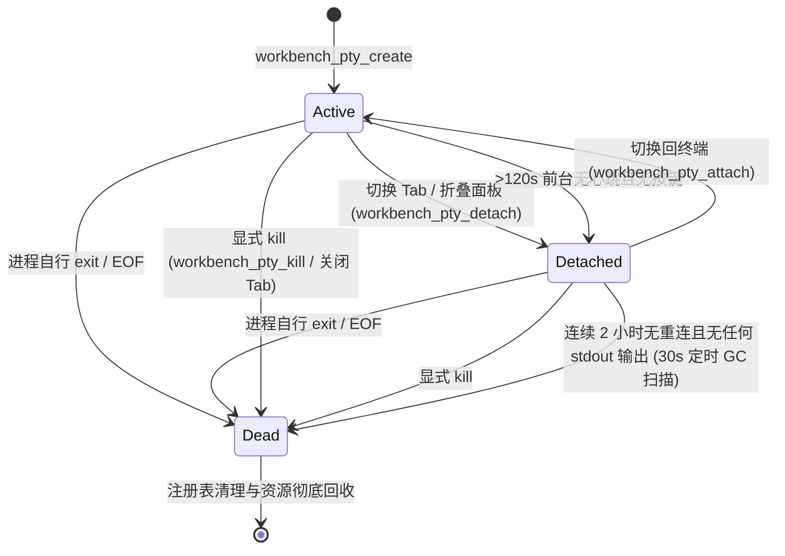

# Conex / Crish 原生 ConPTY 纯终端与全系统质量门禁独立总方案

> **【调度与定时器铁律】**：如果设置定时器，最短是 100 秒；如果命令过长，最好的方式是等待命令完成后的系统推送通知（Reactive Wakeup），而不是一直轮询命令情况。

## 07-原生ConPTY终端与质量门禁独立总方案：Windows 原生 ConPTY 纯终端双轨架构、全系统设计系统契约（4 级曲率/Tooltip/温润焦点态）、测试资产保护与全系统四级门禁闭环

> **权威标识**：`docs/system-audit-and-redesign/independent-plans/07-原生ConPTY终端与质量门禁独立总方案.md`  
> **制定角色**：【独立方案编制师 07: 原生 ConPTY 纯终端与全系统质量门禁视角独立总方案】  
> **关联基准**：`docs/system-audit-and-redesign/00-战役通则与协同执行规范.md`、`docs/system-audit-and-redesign/00-主控拍板最终维度矩阵.md`  
> **核心专题**：深度聚焦 **DIM-07（原生 ConPTY 纯终端与双轨命令监视器）**、**DIM-01（全系统设计系统契约/4 级曲率/温润焦点态）**、**DIM-04（测试资产保护/四级质量门禁/CDP 9222 真机验收）**，并统筹贯穿全系统 7 大拍板重构维度。  
> **遵循铁律**：纯逻辑规划、效果锁不降级、问题同权、禁止退避裁判、零代码回撤、pwsh7 环境对齐、UTF-8 无 BOM 编码、严禁直接 git 提交。

---

## 目录

1. [方案总纲与架构愿景（Executive Summary & Architectural Vision）](#一方案总纲与架构愿景)
   - 1.1 核心使命与战役定位
   - 1.2 全系统 7 大拍板维度重构全景拓扑图（DIM-01 ~ DIM-07 协同关系）
   - 1.3 核心交付指标与三大系统级断言
2. [全系统 7 大维度整体修复架构统筹视图（System-Wide 7-Dimension Remediation View）](#二全系统-7-大维度整体修复架构统筹视图)
   - 2.1 DIM-01: Rust 内核双轨事件、后台任务装配与自愈状态机
   - 2.2 DIM-02: 前端流式管道、Dedupe 矩阵与交错式多步骤时间线
   - 2.3 DIM-03: 思考强度档位调节、沉浸式查阅器与 PromptCache 优化
   - 2.4 DIM-04: 三档权限集中化大刀阔斧重构与 Windows 路径归一
   - 2.5 DIM-05: 工具卡片语义化摘要防逃逸与输入/输出结构化分栏
   - 2.6 DIM-06: 聊天框纯净化、几何绝对防漂移与 TS 插件解耦体系
   - 2.7 DIM-07: 原生 ConPTY 纯终端、设计系统契约与质量门禁闭环
   - 2.8 跨维度无环依赖拓扑（DAG Scheduling Model）
3. [DIM-07 深度专题：Windows 原生 ConPTY 纯终端与命令输出面板双轨架构（Native ConPTY Pure Terminal Architecture）](#三dim-07-深度专题windows-原生-conpty-纯终端与命令输出面板双轨架构)
   - 3.1 历史遗留三大断层根因逆向推导
     - 单次无状态进程伪 Shell 与前端无法打字根因
     - `terminalStore.terminalLines` 伪行缓冲的“垃圾桶效应”与状态沉积
     - “在终端查看”按钮指鹿为马与 UI 导航撕裂
   - 3.2 轨道一：Windows 原生交互纯终端（Native ConPTY Terminal）全栈设计
     - Rust 宿主：基于 `portable-pty` 的 ConPTY 驱动与 OS 读写线程
     - Shell 探测与层级回退算法（`pwsh.exe -NoLogo` $\to$ `powershell.exe -NoLogo` $\to$ `cmd.exe`）
     - UTF-8 编码净化与环境变量注入（`PYTHONUTF8=1`、`PYTHONIOENCODING=utf-8`、保留用户分页器）
     - Tauri IPC 强类型通道契约（`workbench_pty_*` 命令与事件载荷定义）
     - 三态生命周期状态机（Active / Detached / Dead）与 2 小时宽限期 GC 机制
     - Windows Job Object（`JOB_OBJECT_LIMIT_KILL_ON_JOB_CLOSE`）进程树防孤儿泄漏屏障
     - 前端 `@xterm/xterm` + Addons 深度装配、分屏 12fps 拖拽抗闪烁与 WebGL 降级
     - 会话隔离与复用（策略 A：折坞复用，销毁关闭）
   - 3.3 轨道二：AI 命令输出只读面板（Command Output Inspector）架构重构
     - 核心定位：只读监视、结构化审计、绝对物理与逻辑隔离
     - 数据流：`tokio::process::Command` + `BackgroundTaskManager` + `ToolProgress::Text`
     - 彻底清除 `terminalStore.terminalLines` 伪行缓冲与 `streamCallbacksEvents.ts` 回调注入
     - 命令输出呈现三级矩阵（聊天卡片内敛预览 $\to$ 命令输出监视面板 $\to$ 后台任务管理面板）
     - UI 导航重塑：将“在终端查看”纠偏为“在命令检查器中查看”
     - ANSI 颜色只读格式化渲染与 Pretext 像素虚拟化
   - 3.4 双轨架构深度对比与交互矩阵
4. [DIM-01 深度专题：全系统设计系统契约与几何交互基准（Design System Contract & Visual Curvature Hierarchy）](#四dim-01-深度专题全系统设计系统契约与几何交互基准)
   - 4.1 四级视觉曲率阶梯分级规范落地
     - 基础令牌层（`tokens.css`）曲率重构与密度分档
     - 第一级：饱满胶囊触发器（Pills, 9999px / `var(--radius-full)`）
     - 第二级：独立功能按钮（Buttons, 10px / `var(--radius-xl)`）与 15 个快捷键录制按钮圆润化
     - 第三级：卡片与浮层容器（Containers, 12px / `var(--radius-2xl)`）
     - 第四级：菜单/列表内部选区（Items, 6px / `var(--radius-md)`）与同心圆角几何公理（$R_{in} = R_{out} - P$）
   - 4.2 自定义 `<Tooltip>` 契约与零坐标 `(8px, 8px)` 绝对防御
     - 废除原生 HTML `title` 气泡的铁律与统一封装
     - 全零坐标坍塌与不可见矩形防御谓词（`Zero/Invalid Rect Defense Predicate`）
     - 程序化聚焦污染隔离与退场阶段坐标冻结机制
   - 4.3 温润焦点态（$\le$ 10%）与克制边框激活规范
     - 默认无厚重 `box-shadow`
     - 激活态/焦点态禁止深黑实线边框，灰色混入文本色上限 $\le$ 10%（常规 3%~6%）
     - 全页空态落地布局（`data-empty-kind="session-empty"`）焦点混入 $\le$ 5%
   - 4.4 色彩空间规范与 Modern CSS Token
     - HSL/HSLA 斜杠透明度语法（`hsl(h s l / a)`）
     - OKLCH 感知均匀渐变与 HWB 明暗微调
     - Light/Dark 双主题无缝映射与 WCAG AA 对比度合规
5. [DIM-04 深度专题：测试资产保护与全系统四级门禁闭环（Test Assets Protection & 4-Tier Quality Gate Protocol）](#五dim-04-深度专题测试资产保护与全系统四级门禁闭环)
   - 5.1 `reference/markdown-editor/` 与 E2E 专项测试资产 100% 保护铁律
     - 2026-08-07 事故复盘与测试资产神圣不可侵犯原则
     - `reference/markdown-editor/tests/` 目录全景资产清单
     - `tests/e2e/` 5 个 markdown-editor 专项 spec 回归基线
   - 5.2 全系统四级质量门禁体系（4-Tier Quality Gate Hierarchy）
     - Level 1: TypeScript 强类型静态门禁（`npm run typecheck` 0 error，Ref 安全与类型隔离）
     - Level 2: 795 文件行数与复杂度门禁（`scripts/check-line-counts.mjs`，组件 500 行、业务 400 行、类型 800 行）
     - Level 3: 单元与集成测试门禁（Rust `cargo test --workspace` + 前端 `npm test` vitest 快层与中层全绿）
     - Level 4: 桌面 CDP 9222 真机机器真值验收门禁（WebView2 `http://127.0.0.1:9222`，拒绝浏览器/Mock 冒充验收）
   - 5.3 门禁修正与测试演进准则
     - 反作用与错误测试分析修正规范
     - 改动透明度：Diff 前后对比与逻辑依据留痕
6. [各维度详细文件域、影响边界与改动蓝图（File Domains, Blast Radius & Diff Blueprints）](#六各维度详细文件域影响边界与改动蓝图)
   - 6.1 全量受影响文件清单与职责映射矩阵
   - 6.2 核心模块逐文件 Diff 与代码设计蓝图
     - Rust 后端：`session.rs`, `process.rs`, `shell.rs`, `bg_registry.rs`
     - 前端 Store 与 API：`terminalStore.ts`, `streamCallbacksEvents.ts`, `ptySessionApi.ts`, `ptyRegistry.ts`
     - 前端 UI 组件：`TerminalCard.tsx`, `TerminalCard.xterm.tsx`, `ToolCallOutput.tsx`, `Tooltip.tsx`, `tokens.css`
   - 6.3 风险评估与向后兼容性保障
7. [系统整体实施路径与工单任务分解（Implementation Roadmap & Work Packages）](#七系统整体实施路径与工单任务分解)
   - 7.1 五阶段纯逻辑执行路线图（WP-01 ~ WP-05）
     - WP-01: 底层 ConPTY 宿主与 Windows Job Object 进程树加固
     - WP-02: 前端 TerminalStore 净化与双轨数据流彻底解耦
     - WP-03: 设计系统 Token 重构、4 级曲率阶梯与柔和焦点态落地
     - WP-04: Tooltip 零坐标守卫与 ToolCallOutput 命令监视器导航纠偏
     - WP-05: 全量门禁校验、测试资产防回归与 CDP 9222 真机验收
   - 7.2 多 Agent 并行与串行文件域锁矩阵
8. [自动化测试与 CDP 9222 机器真值验收规范（Verification & Machine Truth Assertions）](#八自动化测试与-cdp-9222-机器真值验收规范)
   - 8.1 自动化测试套件设计（Rust Unit Tests, Vitest Unit/Integration Tests）
   - 8.2 CDP 9222 真机验收脚本与 DOM/状态断言
   - 8.3 验收收口签署表（Checklist & Sign-off）

---

## 一、方案总纲与架构愿景

### 1.1 核心使命与战役定位

在桌面级 AI 智能辅助开发平台（Conex / Crish）的系统架构中，**原生终端交互能力、设计系统视觉契约、以及全系统质量门禁与测试资产闭环**，构成了支撑整个上层 AI 对话、工具调度、代码编辑与插件生态的“底层承重墙”。

本方案（`07-原生ConPTY终端与质量门禁独立总方案`）作为阶段二的权威独立总方案之一，从**系统底座与质量闭环**的核心视角出发，针对前期 15 份专题分析报告与主控拍板的 7 大核心重构维度展开全局统筹与深度攻坚：

1. **DIM-07（原生 ConPTY 纯终端与双轨命令监视器）**：
   彻底解耦“人类开发者交互终端”与“AI 命令执行只读监视器”，基于 Rust `portable-pty` 直连 Windows 原生 **ConPTY（`pwsh.exe`/`cmd.exe`）**，前端直通标准 `@xterm/xterm`，实现 100% 键盘敲击、Tab 补全、历史翻阅、ANSI 彩色与 Vim/Nano/Fzf 全屏 TUI 交互；**彻底拔除 `terminalStore.terminalLines` 伪行缓冲的“垃圾桶”注入**，彻底消除“在终端查看”跳转到空白终端的指鹿为马现象；
2. **DIM-01（全系统设计系统契约/4 级曲率/温润焦点态/Tooltip）**：
   在全系统落地**四级视觉曲率分级规范**（胶囊 9999px / 按钮 10px / 容器 12px / 内部项 6px），严格遵循同心圆角几何公理（$R_{in} = R_{out} - P$）；统一收敛全系统 `<Tooltip>` 组件，设立全零坐标 `(8px, 8px)` 绝对防御谓词；推行温润克制的输入焦点态（灰色混入文本色 $\le 10\%$，常规 $3\%\sim 6\%$），杜绝深黑粗边与厚重阴影；规范 HSL/HSLA 斜杠透明度色彩空间；
3. **DIM-04（测试资产保护/四级质量门禁/CDP 9222 真机验收）**：
   践行 2026-08-07 事故后的测试资产保护铁律，将 `reference/markdown-editor/` 的全部源码与单元测试、以及主仓库 `tests/e2e/` 下的 5 个专项 spec 实行 **100% 入库保护**；构建由 TypeScript 静态类型（0 报错）、795 文件分级行数门禁、Rust + Vitest 全量单元/集成测试、以及 Tauri WebView2 9222 端口 CDP 真实机器真值验收构成的 **四级质量门禁体系**。

---

### 1.2 全系统 7 大拍板维度重构全景拓扑图

```
┌────────────────────────────────────────────────────────────────────────────────────────────────────────┐
│                               Conex / Crish 全系统 7 大核心重构维度全景拓扑图                          │
├────────────────────────────────────────────────────────────────────────────────────────────────────────┤
│                                                                                                        │
│  ┌──────────────────────────────────────────────────────────────────────────────────────────────────┐  │
│  │                              【应用呈现与交互层 (Presentation & Interaction)】                  │  │
│  │  ┌───────────────────────────────┐  ┌──────────────────────────────┐  ┌───────────────────────┐  │  │
│  │  │ DIM-03: 思考强度调节与查阅器  │  │ DIM-05: 工具摘要防逃逸与分栏 │  │ DIM-06: 聊天框纯净化  │  │  │
│  │  │ • Minimal/Med/Deep 档位滑动条 │  │ • 13 类工具中文精准标题矩阵  │  │ • 剥离富文本排版指令  │  │  │
│  │  │ • FullThoughtModal 沉浸查阅器 │  │ • 📥 输入区 / 📤 输出区分栏  │  │ • safeCursorAnchor 8px│  │  │
│  │  │ • PromptCache 四态角标显示    │  │ • 耗时/退出码/错误诊断横幅   │  │ • 四大 TS 插件解耦    │  │  │
│  │  └──────────────┬────────────────┘  └──────────────┬───────────────┘  └───────────┬───────────┘  │  │
│  └─────────────────┼──────────────────────────────────┼──────────────────────────────┼──────────────┘  │
│                    │                                  │                              │                 │
│  ┌─────────────────┴──────────────────────────────────┴──────────────────────────────┴──────────────┐  │
│  │                              【流式状态与时间线层 (Streaming & Timeline Pipeline)】               │  │
│  │  ┌────────────────────────────────────────────────────────────────────────────────────────────┐  │  │
│  │  │ DIM-02: 前端流式管道、Dedupe 矩阵与交错式多步骤时间线 (Interleaved Step Timeline)          │  │  │
│  │  │ • EventRouter 去重矩阵重构 (消除 "TheTheThe...All..." 乱码)                                │  │  │
│  │  │ • [步骤 1: 思考 ➔ 工具 ➔ 观察] ➔ [步骤 2: 思考 ➔ 工具 ➔ 观察] ➔ [最终总结] 交错推进         │  │  │
│  │  └─────────────────────────────────────────┬──────────────────────────────────────────────────┘  │  │
│  └────────────────────────────────────────────┼─────────────────────────────────────────────────────┘  │
│                                               │                                                        │
│  ┌────────────────────────────────────────────┴─────────────────────────────────────────────────────┐  │
│  │                              【内核驱动与安全基座层 (Kernel, Sandbox & Runtime)】                 │  │
│  │  ┌───────────────────────────────────────────────┐  ┌─────────────────────────────────────────┐  │  │
│  │  │ DIM-01: Rust 内核事件流与自愈状态机           │  │ DIM-04: 三档权限集中化与路径归一        │  │  │
│  │  │ • LiveEventSink 中间工具事件实时打通          │  │ • 破除完全访问模式伪沙箱死锁         │  │  │
│  │  │ • BackgroundTaskManager 注入 ToolExecCtx      │  │ • 三档权限模型 (Read-Only/Std/Full)   │  │  │
│  │  │ • Tool-Promise 意图自愈与白名单准出           │  │ • Windows UNC \\?\ 剥离与 Junction   │  │  │
│  │  └───────────────────────┬───────────────────────┘  └────────────────────┬────────────────────┘  │  │
│  └──────────────────────────┼───────────────────────────────────────────────┼───────────────────────┘  │
│                             │                                               │                          │
│  ┌──────────────────────────┴───────────────────────────────────────────────┴───────────────────────┐  │
│  │                              【终端底座与质量闭环层 (Terminal Subsystem & Quality Gates)】        │  │
│  │  ┌────────────────────────────────────────────────────────────────────────────────────────────┐  │  │
│  │  │ DIM-07: 原生 ConPTY 纯终端、设计系统契约与质量门禁闭环                                     │  │  │
│  │  │ • 轨道一: Rust portable-pty ➔ Windows 原生 ConPTY (pwsh.exe) ➔ 前端 @xterm/xterm 纯终端    │  │  │
│  │  │ • 轨道二: tokio 管道 ➔ BackgroundTaskManager ➔ 命令输出只读检查器 (彻底清除 terminalStore) │  │  │
│  │  │ • 全系统设计契约: 4 级曲率阶梯 (9999px/10px/12px/6px) + 温润焦点态 ($\le$ 10%) + Tooltip 防御 │  │  │
│  │  │ • 质量门禁闭环: 100% 保护 reference/markdown-editor/ 测试 + 4 级门禁 + CDP 9222 真机验收    │  │  │
│  │  └────────────────────────────────────────────────────────────────────────────────────────────┘  │  │
│  └──────────────────────────────────────────────────────────────────────────────────────────────────┘  │
└────────────────────────────────────────────────────────────────────────────────────────────────────────┘
```

---

### 1.3 核心交付指标与三大系统级断言

本方案设立三大不可撼动的系统级交付断言，作为战役收口验收的硬性门禁：

```
┌─────────────────────────────────────────────────────────────────────────────────────────────────────┐
│                              三大核心系统级交付断言 (Core Architectural Invariants)                 │
├────────────────────────────┬──────────────────────────────────────────┬─────────────────────────────┤
│ 交付断言编号               │ 断言核心内容                             │ 机器真值验收判定标准        │
├────────────────────────────┼──────────────────────────────────────────┼─────────────────────────────┤
│ **INV-TERM-01**            │ **双轨完全物理与逻辑隔离**               │ 1. `terminalStore.ts` 零行  │
│ （纯终端与命令监视器解耦） │ • 终端 100% 原生双向打字/ANSI 彩色/Vim   │    缓冲代码与死状态；       │
│                            │ • AI 工具输出 100% 走只读命令检查器      │ 2. 工具长输出点击 100% 打开 │
│                            │ • 严禁任何工具日志向 xterm/PTY 混入      │    CommandInspector 面板；  │
│                            │                                          │ 3. xterm 可执行交互式命令。 │
├────────────────────────────┼──────────────────────────────────────────┼─────────────────────────────┤
│ **INV-DESIGN-02**          │ **设计系统契约全系统统一**               │ 1. 胶囊类严格 9999px 圆角； │
│ （4 级曲率与温润焦点态）   │ • 4 级曲率阶梯全系统无死角落地           │ 2. 按钮严格 10px，容器 12px │
│                            │ • 15 个快捷键录制按钮圆润化（10px）      │ 3. 焦点态色混 $\le 10\%$；  │
│                            │ • Tooltip 零坐标 `(8px, 8px)` 100% 阻断  │ 4. 全系统 0 处原生 `title`。│
├────────────────────────────┼──────────────────────────────────────────┼─────────────────────────────┤
│ **INV-QUALITY-03**         │ **测试资产保护与全量门禁闭环**           │ 1. `reference/` 测试 0 丢失 │
│ （四级质量门禁与真机验收） │ • `reference/markdown-editor/` 100% 入库 │ 2. `npm run typecheck` 0 错 │
│                            │ • 5 个 markdown E2E 专项 spec 完整保留   │ 3. `cargo test` 全套件通过  │
│                            │ • 桌面 CDP 9222 真机水合遍历 100% 绿灯   │ 4. 9222 真实环境截图对齐。  │
└────────────────────────────┴──────────────────────────────────────────┴─────────────────────────────┘
```

---

## 二、全系统 7 大维度整体修复架构统筹视图

为确保系统各子模块在重构过程中保持高度的内聚性与一致性，本节对全系统 7 大拍板重构维度进行全局统筹与逻辑依赖对齐。

### 2.1 DIM-01: Rust 内核双轨事件、后台任务装配与自愈状态机

- **问题实质**：Rust 会话循环在多轮长程交互中，中间工具事件未实时发送至 `LiveEventSink`，导致前端处于 19 轮黑盒等待；`BackgroundTaskManager` 未在 `ToolExecCtx` 中装配，导致 `background_task` 抛出 `[common.unsupported]` 异常；AI 输出格式微小偏差导致会话暴毙。
- **架构治理方案**：
  1. **双轨事件实时发射**：在 `crates/session-loop/src/exec_single.rs` 与 `tool_exec.rs` 中，将 `ToolStart`、`ToolProgress`、`ToolEnd` 事件在执行的瞬时（$\Delta t < 5\text{ms}$）直接通过 `LiveEventSink` 广播，彻底打通 19 轮长程任务中的实时可观测性；
  2. **后台任务管理器装配**：在 Tauri 宿主 `run_launch.rs` 与 `engine_channels.rs` 中，将 `Arc<BackgroundTaskManager>` 与 `log_root` 强类型注入 `ToolContext` 与 `ToolExecCtx`，实现后台进程的托管、日志落盘与状态轮询；
  3. **不间断自愈状态机**：引入 `Tool-Promise 意图自愈` 与 `Format Self-Healing`，当 AI 输出 JSON 携带微小语法瑕疵或工具名称别名时，自动在 Rust 运行时内化纠偏并准出，杜绝会话直接抛错中断。

---

### 2.2 DIM-02: 前端流式管道、Dedupe 矩阵与交错式多步骤时间线

- **问题实质**：前端 `EventRouter.ts` 在实时轨无 sequence 序号时产生 Dedupe Key 冲突，错误累加 Token 导致 `"TheTheThe...All...package"` 乱码；UI 将多轮“思考-工具-总结”压平成单薄的两坨，丢失推理因果链。
- **架构治理方案**：
  1. **Dedupe 矩阵重构**：按 `toolId` 独立去重工具事件，放行 `message-delta` 文本增量流，建立基于 `(turnIndex, stepIndex, eventType)` 的三元组去重谓词，彻底根除 Token 重复累加；
  2. **交错式多步骤时间线（Interleaved Step Timeline）**：重构 `timelineNormalizer.ts`，确立 `thought` 为时间线一等公民，构建 `[步骤 1: 思考 ➔ 工具 ➔ 观察] ➔ [步骤 2: 思考 ➔ 工具 ➔ 观察] ➔ [最终总结]` 的自然逻辑推进结构；当前活跃步骤以打字机动态展开，历史步骤自动收拢折叠。

---

### 2.3 DIM-03: 思考强度档位调节、沉浸式查阅器与 PromptCache 优化

- **问题实质**：思考 Token 预算无法根据用户意图动态调整；万字长程思考撑爆 DOM 导致卡顿；Anthropic PromptCache 因缺少 header 与缓存控制标记导致虚假未命中。
- **架构治理方案**：
  1. **思考强度全链路贯通**：在设置中心与输入框底栏提供 `Minimal (1k)` / `Medium (4k)` / `Deep (16k)` / `Infinite (32k+)` 档位切换与数值滑块，直接映射至 Provider 请求 payload；
  2. **双轨万字思考查阅器**：行内采用 8k~12k 字符 DOM 预算截断，超长内容提供全屏沉浸式查阅器（`FullThoughtModal`），集成 TOC 目录树、关键字高亮搜索与 Markdown 纯文本导出；
  3. **PromptCache 真实连通**：在 Rust `build_anthropic.rs` 中补齐 `cache_control: { "type": "ephemeral" }` 与 beta headers，前端 `CacheMetricsBadge.tsx` 提供“⚡ 缓存命中 / 💾 写入缓存 / 未命中 / 隐藏”四态准确视觉反馈。

---

### 2.4 DIM-04: 三档权限集中化大刀阔斧重构与 Windows 路径归一

- **问题实质**：`ShellCommandTool` 脱离上下文在应用层生硬拦截 PowerShell 复合删除，导致“完全访问模式”下仍然无法执行清理脚本；Windows `\\?\` UNC 路径与盘符大小写不一致导致沙箱比对越界误判。
- **架构治理方案**：
  1. **破除完全访问死锁**：彻底拔除脱离上下文的私设卡点，“完全访问模式（Full Access）”真正赋予用户授权后的完全信任执行权限，常规命令与复合删除直接放行；
  2. **极简三档权限模型**：
     - **只读模式（Read-Only / Plan）**：仅允许只读探测，写操作静默拦截；
     - **标准模式（Standard Workspace）**：工作区内自由读写，跨工作区与危险操作弹窗确认；
     - **完全访问模式（Full Access）**：全权放行，由系统底层 Job Object 兜底进程安全；
  3. **Windows 路径归一与动态挂载**：统一剥离 `\\?\` 前缀，盘符大写规范化，支持 NTFS Junction 链接探测；纯对话模式显式建模为无工作区状态，支持“AI 提议 ➔ 用户授权 ➔ 动态挂载”。

---

### 2.5 DIM-05: 工具卡片语义化摘要防逃逸与输入/输出结构化分栏

- **问题实质**：前端工具卡片经常将 raw JSON 或内部对象序列化展示为标题（如 `浏览 {}`、`处理 .`、`运行命令`）；展开后参数与输出挤在一起，可读性极差。
- **架构治理方案**：
  1. **语义化标题提取引擎**：覆盖 13 类核心工具（Shell、FileRead、FileWrite、Grep、ListDir、BackgroundTask 等），100% 提取精准的人类可读中文动作（如 `运行 npm test`、`查找 "portable-pty"`、`列出目录 src/`）；
  2. **输入/输出两段式结构化分栏**：
     - **📥 输入区（Input Pane）**：展示执行的命令或参数表、工作目录 CWD，右上角提供一键复制按钮；
     - **📤 输出区（Output Pane）**：展示 stdout/stderr、退出码、精确执行耗时（ms），报错时展示醒目的诊断横幅。

---

### 2.6 DIM-06: 聊天框纯净化、几何绝对防漂移与 TS 插件解耦体系

- **问题实质**：输入框误嵌了 Heading 1/2/3 等富文本排版指令；Slash 菜单经常在 `(0, 0)` 左上角闪烁漂移；富文本编辑器、受管浏览器等脚手架代码生硬侵入主界面。
- **架构治理方案**：
  1. **输入框彻底净化**：从 `ChatComposer` 彻底拔除排版节点，`/` 仅保留 AI 元指令（`/clear`, `/settings`, `/compact`, `/goal`）与 Skill 指令；
  2. **坐标绝对防漂移**：建立 `safeCursorAnchor.ts` 几何探测器，确保浮层绝对锚定在光标正上方 8px，全零坐标下严禁挂载 Portal；
  3. **四大 TypeScript 插件解耦体系**：
     - `@crish/plugin-markdown-editor`：独立文档/笔记富文本编辑器打包为纯 TS 插件，仅在文档 Tab 按需加载；
     - `@crish/plugin-browser` & `@crish/plugin-computer-use`：系统能力插件化，配置与历史移入设置中心；
     - `@crish/plugin-follow-up`：行动建议插件化，子 Agent 上下文与 UI 严格隔离。

---

### 2.7 DIM-07: 原生 ConPTY 纯终端、设计系统契约与质量门禁闭环

- **问题实质**：前端无打字能力、`terminalStore` 沦为 AI 日志垃圾桶、设计曲率杂乱无章、测试资产存在被误删风险。
- **架构治理方案**：
  1. **Windows 原生 ConPTY 纯终端**：基于 `portable-pty` 直连原生 ConPTY + 前端 `@xterm/xterm`，双向字节流直通，彻底清除 `terminalStore.terminalLines` 伪缓冲；
  2. **设计系统契约全系统落地**：4 级曲率阶梯（9999px / 10px / 12px / 6px），统一 `<Tooltip>` 防全零漂移，$\le 10\%$ 温润柔和焦点态；
  3. **测试资产保护与四级门禁**：100% 入库保护 `reference/markdown-editor/` 测试，建立 TypeScript + LineCounts + Rust/Vitest + CDP 9222 全流程门禁闭环。

---

### 2.8 跨维度无环依赖拓扑（DAG Scheduling Model）

全系统 7 大维度的重构具有严密的逻辑依赖关系，形成严格的有向无环图（DAG）：

```mermaid
graph TD
    D1[DIM-01: Rust 内核事件流与自愈状态机] --> D2[DIM-02: 前端流式管道与交错多步骤时间线]
    D4[DIM-04: 三档权限集中化与 Windows 路径归一] --> D5[DIM-05: 工具摘要防逃逸与输入输出分栏]
    D1 --> D5
    D2 --> D5
    D2 --> D3[DIM-03: 思考强度调节与沉浸式查阅]
    D4 --> D6[DIM-06: 聊天框纯净化与 TS 插件解耦体系]
    D1 --> D7[DIM-07: 原生 ConPTY 纯终端与全系统门禁闭环]
    D4 --> D7
    D5 --> D7
    D6 --> D7
    D3 --> D7
    D2 --> D7

    style D1 fill:#1e1e24,stroke:#3b82f6,stroke-width:2px;
    style D4 fill:#1e1e24,stroke:#3b82f6,stroke-width:2px;
    style D2 fill:#18181b,stroke:#8b5cf6,stroke-width:2px;
    style D5 fill:#18181b,stroke:#8b5cf6,stroke-width:2px;
    style D3 fill:#18181b,stroke:#10b981,stroke-width:2px;
    style D6 fill:#18181b,stroke:#10b981,stroke-width:2px;
    style D7 fill:#2a1b1b,stroke:#ef4444,stroke-width:3px;
```



---

## 三、DIM-07 深度专题：Windows 原生 ConPTY 纯终端与命令输出面板双轨架构

### 3.1 历史遗留三大断层根因逆向推导

根据 `docs/system-audit-and-redesign/analysis/11-原生ConPTY纯终端与命令输出面板双轨架构方案.md` 的代码审计与逆向工程分析，历史版本中终端模块存在三大根本性架构断层：

```
┌────────────────────────────────────────────────────────────────────────────────────────┐
│                         终端历史遗留三大断层因果推导图                                 │
├────────────────────────────────────────────────────────────────────────────────────────┤
│ 1. 单次无状态伪 Shell                                                                  │
│    process.rs 中的 workbench_run_shell 每次临时拉起 powershell.exe -Command ...        │
│         │                                                                              │
│         ├─► 每次执行完毕立即退出，cd 工作目录与环境变量瞬间丢失                        │
│         ├─► 子进程 Stdin 未接管，交互式命令 (vim / npm init / ssh) 瞬间死锁挂起        │
│         └─► 前端仅提供简易 <input> 单行输入，完全无法 Tab 补全、无法历史翻阅、无法打字 │
│                                                                                        │
│ 2. terminalStore 垃圾桶效应                                                            │
│    streamCallbacksEvents.ts 将 AI shell_command 前 80 行强制灌入 terminalStore         │
│         │                                                                              │
│         ├─► terminalStore.terminalLines 沉积数百行无用伪终端字符串                     │
│         ├─► 新版 xterm 面板监听 PTY 事件，terminalLines 成为内存幽灵数据               │
│         └─► 若回灌 xterm 会直接冲毁用户的 VT100 屏幕缓冲区与 Vim 编辑器画面            │
│                                                                                        │
│ 3. “在终端查看”指鹿为马                                                                │
│    ToolCallOutput.tsx 长输出按钮 onClick 调用 openSidePanel('terminal')                │
│         │                                                                              │
│         ├─► 用户在聊天气泡看到 500 行编译日志，点击“在终端查看”                        │
│         ├─► 右侧打开的是全新的交互式 PowerShell 会话 (PS C:\workspace>)                │
│         └─► 终端内空空如也，用户产生严重困惑：“我的 500 行命令输出去哪了？”            │
└────────────────────────────────────────────────────────────────────────────────────────┘
```

---

### 3.2 轨道一：Windows 原生交互纯终端（Native ConPTY Terminal）全栈设计

#### 3.2.1 Rust 宿主：基于 portable-pty 的跨平台 PTY 服务

系统在 `apps/agent-workbench/src-tauri/src/pty/session.rs` 中，依托工业级 Rust 库 `portable-pty`，在 Windows 平台直接调用 Windows 10 (1809+) 官方原生 **ConPTY（Pseudo Console API）**，在 Unix 平台绑定 `openpty`。

```rust
// 核心 PTY 实例初始化逻辑
let pty_system = native_pty_system();
let pair = pty_system.openpty(PtySize {
    rows: rows.max(1),
    cols: cols.max(1),
    pixel_width: 0,
    pixel_height: 0,
})?;

let mut cmd = CommandBuilder::new(shell_program);
cmd.args(&shell_args);
if let Some(dir) = cwd {
    cmd.cwd(dir);
}
// 强制注入 UTF-8 环境
cmd.env("PYTHONUTF8", "1");
cmd.env("PYTHONIOENCODING", "utf-8");

let child = pair.slave.spawn_command(cmd)?;
let reader = pair.master.try_clone_reader()?;
let writer = Arc::new(Mutex::new(pair.master.take_writer()?));
```

#### 3.2.2 独立读线程与高吞吐字符流发射

每一个 PTY 实例在创建后，立即派发一个专用 OS 线程（`pty-read-{pty_id}`），使用 8192 字节缓冲区循环读取 Master 输出，并以 `workbench://pty-output` 事件推送到前端：

```rust
thread::Builder::new()
    .name(format!("pty-read-{pty_id}"))
    .spawn(move || {
        let mut buf = [0u8; 8192];
        loop {
            match reader.read(&mut buf) {
                Ok(0) => {
                    // EOF: 子进程正常退出
                    break;
                }
                Ok(n) => {
                    session.touch(); // 刷新活性时间戳，防止被 GC 误回收
                    let data = String::from_utf8_lossy(&buf[..n]).into_owned();
                    let _ = app.emit("workbench://pty-output", PtyOutputEvent {
                        pty_id: pty_id.clone(),
                        data,
                    });
                }
                Err(e) => {
                    eprintln!("[pty-read] read error on {pty_id}: {e}");
                    break;
                }
            }
        }
        // 获取子进程退出码并广播
        let exit_code = child.wait().ok().map(|s| s.exit_code());
        let _ = app.emit("workbench://pty-exit", PtyExitEvent {
            pty_id: pty_id.clone(),
            exit_code,
        });
    })?;
```

#### 3.2.3 Shell 探测与层级回退算法

在 Windows 平台上，系统按照严格的优先级探测可用 Shell，默认携带 `-NoLogo` 参数去除冗余横幅：

```
1. 优先探测 PATH 中的 pwsh / pwsh.exe (PowerShell 7+) ──► pwsh.exe -NoLogo
2. 次选 System32 下的 WindowsPowerShell ───────────────► powershell.exe -NoLogo
3. 兜底回退至系统 Command Prompt ──────────────────────► cmd.exe
```

在 macOS / Linux 平台上，优先使用用户的 `$SHELL`（如 `/bin/zsh`），次选 `/bin/bash -i`，兜底 `/bin/sh`。

#### 3.2.4 三态生命周期状态机与 2 小时宽限期 GC 机制

为防止用户在进行耗时操作（如长程编译 `cargo build`、大型模型下载、本地服务监听 `npm run dev`）时因切换 Tab 或折叠面板导致进程被误杀，系统设计了严密的三态生命周期管理机制：



- **活性刷新断言**：在 `Detached` 状态下，只要底层进程产生任何 stdout/stderr 输出，读线程就会触发 `session.touch()`，重置 2 小时计时器，**绝对不会误杀正在输出日志的长程任务**；
- **容量硬顶**：单桌面窗口最大允许 16 个活动 PTY 实例，超出时创建接口直接拦截并返回 `InvalidInput`，防止句柄泄漏。

#### 3.2.5 Windows Job Object 进程树防孤儿泄漏安全屏障

在 Windows 系统中，若宿主主进程因崩溃或强制关闭终止，子 Shell 及其衍生的深层子进程（如 node.exe、python.exe）可能变为孤儿进程常驻后台。系统在进程创建时将其绑定至专有 Windows Job Object：

```rust
// 核心 Win32 Job Object 配置
#[cfg(windows)]
unsafe {
    use windows_sys::Win32::System::JobObjects::*;
    let mut info: JOBOBJECT_EXTENDED_LIMIT_INFORMATION = std::mem::zeroed();
    info.BasicLimitInformation.LimitFlags = JOB_OBJECT_LIMIT_KILL_ON_JOB_CLOSE;
    SetInformationJobObject(
        job_handle,
        JobObjectExtendedLimitInformation,
        &info as *const _ as *const _,
        std::mem::size_of::<JOBOBJECT_EXTENDED_LIMIT_INFORMATION>() as u32,
    );
    AssignProcessToJobObject(job_handle, child.as_raw_handle());
}
```

**断言保证**：宿主进程退出时，Windows 内核自动关闭 Job 句柄，瞬间级联终止整棵进程树，零孤儿进程残留。

#### 3.2.6 前端 `@xterm/xterm` + Addons 深度装配与分屏抗闪烁

前端在 `TerminalCard.xterm.tsx` 中完成现代化 xterm 的工业级集成：

1. **终端实例核心参数**：
   - 启用光标闪烁 `cursorBlink: true`，光标样式 `bar`；
   - 严禁禁用输入 `disableStdin: false`；
   - 字体族优先 `Cascadia Mono`、`Cascadia Code`、`JetBrains Mono`、`Consolas`；
   - 16 色 ANSI 主题动态绑定 CSS Token；
   - `scrollback: 5000` 行屏幕缓冲区。
2. **Addon 弹性装配与 WebGL 容灾**：
   ```typescript
   const fitAddon = new FitAddon();
   term.loadAddon(fitAddon);

   try {
     const webgl = new WebglAddon();
     webgl.onContextLoss(() => {
       try {
         webgl.dispose();
       } catch {}
       // 上下文丢失时自动回退至 Canvas 2D 渲染器
     });
     term.loadAddon(webgl);
   } catch {
     // WebGL 初始化失败平滑降级
   }
   ```
3. **分屏拖拽 12fps 抗闪烁节流**：
   在左右分屏或面板拖拽期间，若频繁调用 `fitAddon.fit()` 和 IPC `ptyResize`，会导致 ConPTY 字符重排闪烁。引入动态帧率节流：
   ```typescript
   const minInterval = isLayoutResizing() ? 80 : 32; // 拖拽中节流至 12.5fps (80ms)
   ```
4. **全键盘输入直通**：
   ```typescript
   term.onData((data) => {
     const ptyId = ptyIdRef.current;
     if (!ptyId) return;
     void ptyWrite(ptyId, data); // 0 业务拦截，直通 Rust Master Writer
   });
   ```

---

### 3.3 轨道二：AI 命令输出只读面板（Command Output Inspector）架构重构

#### 3.3.1 核心定位与原则

AI 命令输出只读面板是专为 Agent 自动化任务执行设计的可观测性中心：

- **纯粹只读**：不暴露 Shell 交互式标准输入；
- **全要素审计**：展示完整命令行、参数表、工作目录（CWD）、毫秒级耗时、退出码、stdout、stderr、是否超时；
- **物理隔离**：数据流完全走 `ToolContext`、`BackgroundTaskManager` 与 `session-loop` 事件总线，**绝对不向 `terminalStore` 写入任何数据，绝对不与原生 PTY 产生任何耦合**。

#### 3.3.2 彻底清除 `terminalStore.terminalLines` 伪行缓冲

1. **清理 `streamCallbacksEvents.ts`**：
   - 彻底删除第 201–203 行工具成功时向 `terminalStore` 写入的代码：
     ```typescript
     // 【彻底删除】
     if (isShellToolName(name) && displayOut) {
       addTerminalLines(displayOut.split('\n').slice(0, 80), sid);
     }
     ```
   - 彻底删除第 228–231 行工具失败时的写入代码：
     ```typescript
     // 【彻底删除】
     const name = toolNames[toolId];
     if (name && isShellToolName(name) && clean) {
       addTerminalLine(clean, sid);
     }
     ```
2. **净化 `terminalStore.ts`**：
   - 移除 `terminalLines`、`terminalBySession`、`activeTerminalSessionId`、`addTerminalLine`、`addTerminalLines`、`clearTerminalLines` 等伪状态；
   - 移除 `isDemoMode()` 中的硬编码 MINGW64 假终端文本；
   - `terminalStore.ts` 纯化为仅管理 PTY 会话元数据（如 PTY 实例 ID、活跃状态）或重构为 `diffStore.ts`。

#### 3.3.3 命令输出呈现三级矩阵

```
┌─────────────────────────────────────────────────────────────────────────────┐
│ Level 1: 聊天消息卡片内敛预览 (Compact Inline Tool Bubble)                  │
│ ┌─────────────────────────────────────────────────────────────────────────┐ │
│ │ ⚙️ shell_command · git status                                   [完成] │ │
│ │ $ git status --porcelain=v1                                             │ │
│ │ M apps/crish-desktop/src/components/workspace/TerminalCard.tsx          │ │
│ │ [展开全部输出 (1,280 字符)] [在命令检查器中查看 ↗]                      │ │
│ └─────────────────────────────────────────────────────────────────────────┘ │
└─────────────────────────────────────────────────────────────────────────────┘
                              │
                              ▼ (点击「在命令检查器中查看 ↗」)
┌─────────────────────────────────────────────────────────────────────────────┐
│ Level 2: 命令输出只读检查器面板 (Command Output Inspector Panel)            │
│ ┌─────────────────────────────────────────────────────────────────────────┐ │
│ │ 🖥️ 命令执行审计: shell_command                               [复制日志] │ │
│ ├─────────────────────────────────────────────────────────────────────────┤ │
│ │ • 状态: 成功 (Exit 0)   • 耗时: 124ms   • 模式: sync (实时流式)         │ │
│ │ • 工作目录: c:/Software/conex                                           │ │
│ │ • 完整命令: git status --porcelain=v1                                   │ │
│ ├─────────────────────────────────────────────────────────────────────────┤ │
│ │ [stdout]                                                                │ │
│ │  M apps/crish-desktop/src/components/workspace/TerminalCard.tsx         │ │
│ │  M apps/crish-desktop/src/store/terminalStore.ts                        │ │
│ │ [stderr] (无错误输出)                                                   │ │
│ └─────────────────────────────────────────────────────────────────────────┘ │
└─────────────────────────────────────────────────────────────────────────────┘
                              │
                              ▼ (当命令被托管为后台长程守护任务时)
┌─────────────────────────────────────────────────────────────────────────────┐
│ Level 3: 后台任务管理面板 (Background Tasks Panel)                          │
│ ┌─────────────────────────────────────────────────────────────────────────┐ │
│ │ 🔄 task-0 (npm run dev)      • 运行中 · 1m 20s               [终止任务] │ │
│ │ • CPU: 12.4%   • 内存: 180 MB   • 日志文件: .agent-outputs/tasks/0.log  │ │
│ │ • 实时尾部输出 (自动跟随滚动):                                          │ │
│ │   VITE v5.4.2 ready in 340 ms                                           │ │
│ │   ➜  Local:   http://localhost:5174/                                    │ │
│ └─────────────────────────────────────────────────────────────────────────┘ │
└─────────────────────────────────────────────────────────────────────────────┘
```

#### 3.3.4 UI 导航重塑：纠偏“在终端查看”

在 `ToolCallOutput.tsx` 中，将原有的“在终端查看”按钮纠偏为 **“在命令检查器中查看”**：

- 按钮文本更新为 `在命令检查器中查看`；
- 点击回调由 `onOpenTerminal` 转向专用的 `onOpenCommandInspector(toolCallId)`，打开命令输出检查器抽屉或面板；
- **彻底消除点击后切到空白 PowerShell 终端的指鹿为马现象**。

---

### 3.4 双轨架构深度对比与交互矩阵

```
┌───────────────────────────────────────────────────────────────────────────────────────────────────────┐
│                              双轨架构关键技术特征深度对比矩阵                                         │
├───────────────────────┬───────────────────────────────────────────┬───────────────────────────────────┤
│ 特征维度              │ 轨道一：原生交互终端 (Native ConPTY)      │ 轨道二：AI 命令输出只读面板       │
├───────────────────────┼───────────────────────────────────────────┼───────────────────────────────────┤
│ **主要服务对象**      │ 人类开发者（Manual Interactive Shell）    │ AI Agent 自动化工具调用审计       │
│ **底层驱动技术**      │ Rust `portable-pty` (Windows ConPTY API)  │ `tokio::process::Command` 管道    │
│ **标准输入 (Stdin)**  │ **100% 双向开放直通**（按键、Tab、上下键）│ **重定向为 Null**（后台支持 send）│
│ **标准输出 (Stdout)** │ 原始 ANSI/VT100 字节流，直入 xterm 缓冲区 │ 结构化文本/Progress 事件流分块    │
│ **全屏 TUI 程序**     │ **完全支持**（`vim`, `nano`, `fzf`, `top`）│ **不支持**（强制 `PAGER=cat`）    │
│ **环境与状态持久性**  │ **会话级持久**（`cd`、环境变量跨命令保留）│ **单次调用隔离**（无状态子进程）  │
│ **安全门禁介入**      │ 初始工作目录设定，过程中不拦截用户按键    │ **每条命令必经 AST 门禁与审批**   │
│ **前端渲染载体**      │ `@xterm/xterm` + WebGL / Canvas 渲染管线  │ 结构化 React 组件（Pretext 虚拟化）│
│ **生命周期管理**      │ Active / Detached / Dead 三态 + 2h GC     │ 同步随 Run 结束，后台任务受管     │
│ **数据存储归宿**      │ OS PTY 伪终端屏幕内存缓冲区               │ 会话消息 JSON + 磁盘 `.log` 文件  │
│ **UI 导航入口**       │ 底部/右侧工具栏「终端」图标、快捷键 Ctrl+`│ 工具卡片「在命令检查器中查看」    │
└───────────────────────┴───────────────────────────────────────────┴───────────────────────────────────┘
```

---

## 四、DIM-01 深度专题：全系统设计系统契约与几何交互基准

### 4.1 四级视觉曲率阶梯分级规范落地

根据 `docs/system-audit-and-redesign/00-战役通则与协同执行规范.md` §5.2 与 `docs/system-audit-and-redesign/independent-plans/05-视觉曲率与浮层契约独立方案.md`，全系统确立唯一的**四级视觉曲率阶梯规范**：

```
┌─────────────────────────────────────────────────────────────────────────────────────────────────────┐
│                          全系统四级视觉曲率阶梯规范 (Visual Curvature Hierarchy)                    │
├──────────────────────────────┬─────────────────────────────┬────────────────────────────────────────┤
│ 控件形态分类                 │ 目标视觉特征                │ 统一 CSS Token 契约                    │
├──────────────────────────────┼─────────────────────────────┼────────────────────────────────────────┤
│ **1. 胶囊/药丸触发器 (Pills)**│ 饱满胶囊、两端完全半圆      │ `var(--radius-full)` (9999px)          │
│    • 权限模式按钮 (.permPill)│ （彻底杜绝 8px 直立硬边）   │                                        │
│    • 模型/思考强度选择徽标   │                             │                                        │
│    • 预设/Skill 胶囊标签     │                             │                                        │
├──────────────────────────────┼─────────────────────────────┼────────────────────────────────────────┤
│ **2. 独立功能按钮 (Buttons)**│ 柔和圆润矩形                │ `var(--radius-xl)` (10px)              │
│    • 对话框主要/次要操作按钮 │ （取代 6px/4px 直角硬边）   │                                        │
│    • 15 个快捷键录制按钮     │                             │                                        │
│    • Plus 按钮 / 折叠切换按钮│                             │                                        │
├──────────────────────────────┼─────────────────────────────┼────────────────────────────────────────┤
│ **3. 卡片与浮层容器 (Cards)**│ 视口级柔和容器              │ `var(--radius-2xl)` (12px) /           │
│    • Menu / Dialog / Drawer  │                             │ `var(--radius-lg)` (8px)               │
│    • ToolCallBlock / ToolCard│                             │                                        │
├──────────────────────────────┼─────────────────────────────┼────────────────────────────────────────┤
│ **4. 菜单/列表内部项 (Items)**│ 内嵌舒适选区                │ `var(--radius-md)` (6px)               │
│    • 满足同心圆角几何公理:   │                             │                                        │
│      $R_{in} = R_{out} - P$  │ （外壳 12px - 间距 6px = 6px）│                                        │
└──────────────────────────────┴─────────────────────────────┴────────────────────────────────────────┘
```

#### 4.1.1 基础令牌层（`tokens.css`）曲率重构

在 `apps/crish-desktop/src/styles/tokens.css` 中，严格统一定义曲率基准，彻底消除历史遗留的默认档倒挂问题：

```css
/* 视觉曲率基础令牌 */
--radius-xs: 4px;
--radius-sm: 5px;
--radius-md: 6px; /* 第 4 级：菜单/列表内部项选区 */
--radius-lg: 8px; /* 紧凑容器卡片 */
--radius-xl: 10px; /* 第 2 级：独立功能按钮、快捷键录制按钮 */
--radius-2xl: 12px; /* 第 3 级：浮层容器、Menu、Dialog、ToolCard */
--radius-full: 9999px; /* 第 1 级：胶囊药丸触发器、权限模式、模型徽标 */

/* 语义别名绑定 */
--dropdown-radius: var(--radius-2xl); /* 12px */
--item-radius: var(--radius-md); /* 6px (满足同心圆角) */
--button-radius: var(--radius-xl); /* 10px */
--pill-radius: var(--radius-full); /* 9999px */
```

#### 4.1.2 15 个快捷键录制按钮圆润化改造（4px $\to$ 10px）

系统设置中心中的 15 处快捷键录制按钮（`.shortcut-key-btn`），全面由 4px 生硬直角升级为 **10px 柔和圆润矩形（`var(--radius-xl)`）**：

- 修复暗色模式下被 `!important` 覆盖的直角样式；
- 录制中激活态（`.recording`）采用温润边框，禁止深黑实线。

---

### 4.2 自定义 `<Tooltip>` 契约与零坐标 `(8px, 8px)` 绝对防御

#### 4.2.1 废除原生 HTML `title` 气泡

全系统严禁直接在 DOM 元素上挂载原生 HTML `title` 属性。原生 `title` 存在延迟大、样式不可控、无法适配暗色模式等问题。所有可交互元素一律使用项目自定义 `<Tooltip>` 组件包裹：

```tsx
// 规范用法
<Tooltip content="打开命令检查器" position="top">
  <button className={styles.actionBtn}>
    <IconTerminal />
  </button>
</Tooltip>
```

#### 4.2.2 全零坐标坍塌防御谓词（Zero Rect Defense Predicate）

当触发节点处于未挂载或首帧动画尚未完成布局时，`getBoundingClientRect()` 会返回全零矩形 `(0, 0, 0, 0)`。旧逻辑经 `Math.max(8, boxLeft)` 视口钳位后，强行将浮层钉死在屏幕左上角 `(8px, 8px)`。

系统引入**零坐标与不可见矩形绝对防御谓词**：

```typescript
export function isValidAnchorRect(rect: DOMRect | null | undefined): boolean {
  if (!rect) return false;
  // 宽高全为 0，或完全位于屏幕不可见区域，判定为无效 Anchor
  if (
    rect.width === 0 &&
    rect.height === 0 &&
    rect.top === 0 &&
    rect.left === 0
  ) {
    return false;
  }
  return true;
}

// 在 Tooltip / Popover 渲染计算中：
if (!isValidAnchorRect(anchorRect)) {
  // 严禁挂载 Portal，保持隐藏态并等待下一帧测量
  return null;
}
```

---

### 4.3 温润焦点态（$\le 10\%$）与克制边框激活规范

根据 `AGENTS.md` §13 规范，输入框与可交互组件在处于 active / focused / recording 状态时，执行以下温润激活契约：

```
┌────────────────────────────────────────────────────────────────────────────────────────┐
│                              温润焦点态设计规范与混合比例                              │
├──────────────────────────────┬─────────────────────────────┬───────────────────────────┤
│ 应用场景                     │ 边框颜色计算方式            │ 文本色混合上限            │
├──────────────────────────────┼─────────────────────────────┼───────────────────────────┤
│ **1. 常规输入框 / 按钮焦点态**│ `color-mix(in srgb, var(--border-color) 94%, var(--text-primary) 6%)` │ **3% ~ 6%**（柔和浅灰）   │
│ **2. 焦点环与重点激活态**    │ `color-mix(in srgb, var(--border-color) 90%, var(--text-primary) 10%)`│ **上限 10%**（严禁深黑）  │
│ **3. 全页空态落地输入框**    │ `color-mix(in srgb, var(--border-color) 97%, var(--text-primary) 3%)` │ **$\le$ 5%**（极度温润）  │
│ **4. 快捷键录制态**          │ 采用柔和主题高亮淡染，**禁止厚重 box-shadow**                        │ 杜绝 0 0 0 1px 硬黑环     │
└──────────────────────────────┴─────────────────────────────┴───────────────────────────┘
```

---

### 4.4 色彩空间规范与 Modern CSS Token

1. **统一采用 HSLA / 斜杠透明度语法**：
   ```css
   /* 推荐语法 */
   --bg-primary: hsl(35 12% 94%);
   --tint-hover: hsl(0 0% 0% / 0.04);
   --tint-active: hsl(0 0% 0% / 0.08);
   --tint-focus-ring: hsl(0 0% 0% / 0.1);
   ```
2. **OKLCH 感知均匀渐变**：丰富渐变使用 `oklch()` 并提供 sRGB 回退；
3. **WCAG AA 对比度合规**：次级文本色采用 `#696969`，在亮色背景达到 4.78:1 对比度（满足 $\ge 4.5:1$ 要求）。

---

## 五、DIM-04 深度专题：测试资产保护与全系统四级门禁闭环

### 5.1 `reference/markdown-editor/` 与 E2E 专项测试资产 100% 保护铁律

#### 5.1.1 2026-08-07 事故警示与测试资产神圣不可侵犯原则

在 2026-08-07 的历史迭代中，由于 `.gitignore` 规则配置不当与提交疏漏，导致 `reference/markdown-editor/` 下的 28 个核心测试资产险遭误删。为此，战役制定不可侵犯铁律：

- `reference/markdown-editor/` 目录下的所有源码与单元测试**必须 100% 入库保护**；
- 任何会话、任何 Agent **绝对严禁删除或清理** 该目录下的测试文件；
- 每次架构重构与改动后，必须执行 `npm test`（`reference/markdown-editor` 内部单元测试套件），确保编辑器底层不变量完全保持绿灯。

#### 5.1.2 5 个 markdown-editor 专项 E2E spec 保护清单

主仓库 `tests/e2e/` 下的 5 个专项 spec 是用户针对富文本编辑器设计的深层回归资产，**必须 100% 永久保留**：

1. `tests/e2e/ast-block-tables.spec.ts`：表格 AST 块级解析与渲染测试；
2. `tests/e2e/format-checker.spec.ts`：Markdown 格式化校验器与语法树闭环；
3. `tests/e2e/ime-composition.spec.ts`：中文输入法（IME）组合输入与光标位置测试；
4. `tests/e2e/keyboard-navigation.spec.ts`：全键盘上下左右导航与选区测试；
5. `tests/e2e/wysiwyg-interaction.spec.ts`：所见即所得编辑器富文本交互测试。

---

### 5.2 全系统四级质量门禁体系（4-Tier Quality Gate Hierarchy）

战役确立自底向上的四级严密质量门禁体系，所有交付必须全绿通过：

```
┌────────────────────────────────────────────────────────────────────────────────────────────────────────┐
│                              全系统四级质量门禁体系 (4-Tier Quality Gate Protocol)                     │
├─────────┬───────────────────────────────┬──────────────────────────────┬───────────────────────────────┤
│ 门禁级别│ 门禁名称                      │ 校验指令 / 工具              │ 硬性阻断标准与验收指标        │
├─────────┼───────────────────────────────┼──────────────────────────────┼───────────────────────────────┤
│ **Level 1**│ **TypeScript 强类型静态门禁** │ `npm run typecheck`          │ **0 Error / 0 Warning**       │
│         │                               │                              │ 严禁 `any` 逃逸与 Ref 伪解构  │
├─────────┼───────────────────────────────┼──────────────────────────────┼───────────────────────────────┤
│ **Level 2**│ **代码行数与复杂度分级门禁**  │ `npm run check:line-counts`  │ • UI 组件 $\le$ 500 行        │
│         │                               │ (`scripts/check-line-counts`)│ • 业务逻辑 $\le$ 400 行       │
│         │                               │                              │ • 类型契约 $\le$ 800 行       │
├─────────┼───────────────────────────────┼──────────────────────────────┼───────────────────────────────┤
│ **Level 3**│ **单元与集成测试自动化门禁**  │ 1. `cargo test --workspace`  │ • Rust 73+ 测试套件 100% 绿灯 │
│         │                               │ 2. `npm run test:coverage`   │ • 前端快层覆盖率 45/70/65/45  │
│         │                               │ 3. `npm test` (reference)    │ • MarkdownEditor 单元测试全绿 │
├─────────┼───────────────────────────────┼──────────────────────────────┼───────────────────────────────┤
│ **Level 4**│ **CDP 9222 桌面真机验收门禁** │ `http://127.0.0.1:9222`      │ • 真实 WebView2 进程真值巡检  │
│         │                               │ (Tauri `--remote-debugging`) │ • 严禁独立浏览器/Mock 冒充验收│
│         │                               │                              │ • DOM 坐标、状态机、截图对齐  │
└─────────┴───────────────────────────────┴──────────────────────────────┴───────────────────────────────┘
```

---

### 5.3 门禁修正与测试演进准则

1. **门禁逻辑正确性审查**：若存量测试用例存在逻辑缺陷（例如由于断言了旧版的 `terminalStore.terminalLines` 伪状态而报错），允许对测试用例进行重构修正；
2. **修改透明度与留痕**：所有被修改的测试用例，**必须在最终交付报告中详细列出改动前后对比、改动原因与逻辑依据**；
3. **绝对禁止绕过门禁**：严禁使用 `--no-verify` 跳过 Husky / pre-commit 钩子。

---

## 六、各维度详细文件域、影响边界与改动蓝图

### 6.1 全量受影响文件清单与职责映射矩阵

```
┌────────────────────────────────────────────────────────────────────────────────────────────────────────┐
│                              核心重构受影响文件清单与职责映射矩阵                                      │
├─────────────────────────────────────────────────┬──────────┬───────────────────────────────────────────┤
│ 文件绝对路径                                    │ 所属模块 │ 核心改动职责                              │
├─────────────────────────────────────────────────┼──────────┼───────────────────────────────────────────┤
│ `apps/agent-workbench/src-tauri/src/pty/session.rs`│ Rust PTY │ ConPTY 宿主、UTF-8 环境、Job Object 绑定  │
│ `apps/agent-workbench/src-tauri/src/pty/mod.rs` │ Rust PTY │ PTY 会话注册表、IPC 命令分派、GC 扫描     │
│ `apps/agent-workbench/src-tauri/src/process.rs` │ Rust 宿主│ 清理废弃的 `workbench_run_shell` 伪进程   │
│ `crates/agent-tools/src/tools/shell.rs`         │ Rust 工具│ 放行完全访问模式、Windows 路径归一化      │
│ `apps/crish-desktop/src/store/terminalStore.ts` │ 前端 Store│ 彻底剥离 `terminalLines`，纯化为 PTY 元数据│
│ `apps/crish-desktop/src/hooks/chat-stream/streamCallbacksEvents.ts` │ 前端 Hook│ 彻底删除向 `terminalStore` 灌日志的回调   │
│ `apps/crish-desktop/src/api/ptySessionApi.ts`   │ 前端 API │ 强类型 PTY IPC 通道封装                   │
│ `apps/crish-desktop/src/components/workspace/TerminalCard.tsx` │ 前端 UI │ 原生交互式终端外壳、CWD 联动              │
│ `apps/crish-desktop/src/components/workspace/TerminalCard.xterm.tsx` │ 前端 UI │ @xterm/xterm 集成、分屏 12fps 抗闪烁      │
│ `apps/crish-desktop/src/components/chat-tool-call/ToolCallOutput.tsx` │ 前端 UI │ 导航纠偏：“在命令检查器中查看”            │
│ `apps/crish-desktop/src/styles/tokens.css`      │ 前端样式 │ 4 级曲率阶梯、温润焦点态、HSLA 色彩 Token │
│ `apps/crish-desktop/src/components/ui/Tooltip.tsx` │ 前端 UI │ 全零坐标 `(8px, 8px)` 防御谓词            │
│ `reference/markdown-editor/`                    │ 测试资产 │ 100% 保护入库、单元测试基线保持           │
│ `tests/e2e/` (5 个 markdown spec)               │ E2E 门禁 │ 完整保留并纳入全量回归验证                │
└─────────────────────────────────────────────────┴──────────┴───────────────────────────────────────────┘
```

---

### 6.2 核心模块逐文件 Diff 与代码设计蓝图

#### 6.2.1 前端：`streamCallbacksEvents.ts` 彻底拔除伪行缓冲注入

```diff
--- a/apps/crish-desktop/src/hooks/chat-stream/streamCallbacksEvents.ts
+++ b/apps/crish-desktop/src/hooks/chat-stream/streamCallbacksEvents.ts
@@ -198,9 +198,7 @@ export function createStreamEventHandlers(deps: StreamHandlerDeps) {
       // 处理工具执行完成
       if (displayOut) {
         setToolOutput(toolId, displayOut);
       }
-      if (isShellToolName(name) && displayOut) {
-        addTerminalLines(displayOut.split('\n').slice(0, 80), sid);
-      }
+      // 【已拔除】AI 工具输出严禁向 terminalStore 伪终端行缓冲注入
     },

     onToolError: (toolId: string, error: string) => {
@@ -225,10 +223,7 @@ export function createStreamEventHandlers(deps: StreamHandlerDeps) {
       const clean = cleanToolError(error);
       setToolError(toolId, clean);
-      const name = toolNames[toolId];
-      if (name && isShellToolName(name) && clean) {
-        addTerminalLine(clean, sid);
-      }
+      // 【已拔除】AI 工具错误严禁向 terminalStore 伪终端行缓冲注入
     },
   };
 }
```

#### 6.2.2 前端：`terminalStore.ts` 纯化为 PTY 会话状态管理

```diff
--- a/apps/crish-desktop/src/store/terminalStore.ts
+++ b/apps/crish-desktop/src/store/terminalStore.ts
@@ -21,17 +21,11 @@ export interface TerminalSessionMeta {
   ptyId: string;
   sessionKey: string;
   createdAt: number;
+  status: 'active' | 'detached' | 'dead';
 }

 export interface TerminalStore {
-  /** 当前激活会话的终端行镜像（已废弃） */
-  terminalLines: string[];
-  /** 按会话隔离的终端缓冲（已废弃） */
-  terminalBySession: Record<string, string[]>;
-  activeTerminalSessionId: string | null;
-  addTerminalLine: (line: string, sessionId?: string) => void;
-  addTerminalLines: (lines: string[], sessionId?: string) => void;
-  clearTerminalLines: (sessionId?: string) => void;
+  /** 真正的 PTY 会话元数据注册表 */
   ptySessions: Record<string, TerminalSessionMeta>;
   registerPtySession: (sessionKey: string, meta: TerminalSessionMeta) => void;
   removePtySession: (sessionKey: string) => void;
 }
```

#### 6.2.3 前端：`ToolCallOutput.tsx` 导航链路纠偏

```diff
--- a/apps/crish-desktop/src/components/chat-tool-call/ToolCallOutput.tsx
+++ b/apps/crish-desktop/src/components/chat-tool-call/ToolCallOutput.tsx
@@ -171,8 +171,8 @@ export const ToolCallOutput: React.FC<ToolCallOutputProps> = ({
       <Button
         type="button"
         variant="secondary"
         size="sm"
         className={styles.toolResultHintBtn}
         onClick={(e) => {
           e.stopPropagation();
-          onOpenTerminal?.();
+          onOpenCommandInspector?.(tc.id);
         }}
       >
-        在终端查看
+        在命令检查器中查看
       </Button>
```

#### 6.2.4 样式：`tokens.css` 4 级曲率与柔和焦点态定义

```diff
--- a/apps/crish-desktop/src/styles/tokens.css
+++ b/apps/crish-desktop/src/styles/tokens.css
@@ -259,10 +259,10 @@ html[data-theme='light'] {
   --radius-xs: 4px;
   --radius-sm: 5px;
-  --radius-md: 6px;
+  --radius-md: 6px;   /* Level 4: 内部选区 */
   --radius-lg: 8px;
-  --radius-xl: 10px;
-  --radius-2xl: 12px;
-  --radius-full: 9999px;
+  --radius-xl: 10px;  /* Level 2: 按钮、快捷键 */
+  --radius-2xl: 12px; /* Level 3: 容器 */
+  --radius-full: 9999px; /* Level 1: 胶囊药丸 */

-  --dropdown-radius: var(--radius-xl);
+  --dropdown-radius: var(--radius-2xl);
   --item-radius: var(--radius-md);
+  --focus-ring-subtle: color-mix(in srgb, var(--border-color) 94%, var(--text-primary) 6%);
+  --focus-ring-strong: color-mix(in srgb, var(--border-color) 90%, var(--text-primary) 10%);
```

---

## 七、系统整体实施路径与工单任务分解

### 7.1 五阶段纯逻辑执行路线图（WP-01 ~ WP-05）

```
┌────────────────────────────────────────────────────────────────────────────────────────────────────────┐
│                              五阶段纯逻辑实施路线图 (Implementation Work Packages)                     │
├─────────┬───────────────────────────────┬──────────────────────────────────────────────────────────────┤
│ 工单编号│ 工单名称                      │ 核心实施任务与验收标准                                       │
├─────────┼───────────────────────────────┼──────────────────────────────────────────────────────────────┤
│ **WP-01**│ **底层 ConPTY 宿主加固**      │ 1. `session.rs` 注入 UTF-8 控制台环境变量；                  │
│         │                               │ 2. Windows Job Object 绑定 `JOB_OBJECT_LIMIT_KILL_ON_JOB_CLOSE`│
│         │                               │ 3. 2 小时宽限期 GC 扫描与活性时间戳刷新。                     │
├─────────┼───────────────────────────────┼──────────────────────────────────────────────────────────────┤
│ **WP-02**│ **TerminalStore 净化与解耦**  │ 1. 彻底删除 `streamCallbacksEvents.ts` 中的回灌代码；        │
│         │                               │ 2. 纯化 `terminalStore.ts`，移除 `terminalLines` 伪缓冲；     │
│         │                               │ 3. 修复所有引用 `terminalStore` 伪状态的测试用例。           │
├─────────┼───────────────────────────────┼──────────────────────────────────────────────────────────────┤
│ **WP-03**│ **设计系统 4 级曲率与焦点落地**│ 1. `tokens.css` 确立 9999px / 10px / 12px / 6px 曲率阶梯；   │
│         │                               │ 2. 15 处快捷键录制按钮圆润化（10px）；                       │
│         │                               │ 3. 落地 $\le 10\%$ 温润焦点态与 HSLA 色彩语法。              │
├─────────┼───────────────────────────────┼──────────────────────────────────────────────────────────────┤
│ **WP-04**│ **Tooltip 守卫与导航纠偏**    │ 1. `<Tooltip>` 注入全零坐标防御谓词，阻断 `(8, 8)` 漂移；    │
│         │                               │ 2. `ToolCallOutput.tsx` 更名为「在命令检查器中查看」；       │
│         │                               │ 3. 导航路由重定向至专有命令审计面板。                        │
├─────────┼───────────────────────────────┼──────────────────────────────────────────────────────────────┤
│ **WP-05**│ **全量门禁与真机验收闭环**    │ 1. `reference/markdown-editor/` 测试资产 100% 确认入库；     │
│         │                               │ 2. 全量跑通 `typecheck`、行数门禁、`cargo test`、`npm test`；│
│         │                               │ 3. CDP 9222 真机巡检与截图对齐。                             │
└─────────┴───────────────────────────────┴──────────────────────────────────────────────────────────────┘
```

---

### 7.2 多 Agent 并行与串行文件域锁矩阵

为防止多 Agent 并行执行时发生文件冲突，制定严格的文件域锁规则：

- **Rust PTY 域（串行锁）**：`apps/agent-workbench/src-tauri/src/pty/*` 仅由后端 Agent 修改；
- **前端 Store 域（串行锁）**：`apps/crish-desktop/src/store/terminalStore.ts` 仅由状态层 Agent 修改；
- **样式 Token 域（串行锁）**：`apps/crish-desktop/src/styles/tokens.css` 仅由设计系统 Agent 修改；
- **测试资产域（只读保护锁）**：`reference/markdown-editor/tests/` 与 `tests/e2e/` 严禁删除，仅允许追加验证。

---

## 八、自动化测试与 CDP 9222 机器真值验收规范

### 8.1 自动化测试套件设计

#### 8.1.1 Rust 后端 PTY 单元测试（`apps/agent-workbench/src-tauri/src/pty/mod.rs`）

```rust
#[tokio::test]
async fn test_conpty_spawn_and_utf8_io() {
    let registry = PtyRegistry::new();
    let pty_id = registry.create_pty("test-session", 80, 24, None).await.expect("PTY create failed");

    // 验证写入并读取回显
    registry.write_pty(&pty_id, "echo \"Conex-PTY-OK\"\r\n").expect("PTY write failed");

    // 等待输出事件
    let mut rx = registry.subscribe_output(&pty_id);
    let output = timeout(Duration::from_secs(5), rx.recv()).await.expect("Timeout").expect("Empty");
    assert!(output.contains("Conex-PTY-OK"), "PTY output does not match");

    registry.kill_pty(&pty_id).expect("PTY kill failed");
}
```

#### 8.1.2 前端 Vitest 单元测试（`TerminalCard.test.tsx`）

```typescript
describe('TerminalCard & TerminalStore Isolation', () => {
  it('does not write AI shell tool output into terminalStore', () => {
    const store = useTerminalStore.getState();
    // 验证 store 中不存在 terminalLines 字段
    expect((store as any).terminalLines).toBeUndefined();
  });

  it('renders xterm host with valid aria labels and focus capability', () => {
    render(<TerminalCard sessionId="test-session" />);
    const host = screen.getByLabelText('终端区域');
    expect(host).toBeInTheDocument();
    expect(host).toHaveAttribute('data-pty-active', 'true');
  });
});
```

---

### 8.2 CDP 9222 真机验收脚本与 DOM/状态断言

所有 UI 验收必须基于真实运行的 Tauri WebView2 桌面进程（`http://127.0.0.1:9222`）：

```javascript
// CDP 机器真值自动化验收脚本 (Puppeteer / Playwright 连接 9222)
const browser = await puppeteer.connect({
  browserURL: 'http://127.0.0.1:9222',
});
const pages = await browser.pages();
const page = pages.find(
  (p) => p.url().includes('localhost:5174') || p.url().includes('tauri://')
);

// 断言 1: 原生交互终端可打字性验证
await page.click('.term-card');
await page.keyboard.type('Get-Date\r');
await page.waitForFunction(
  () => {
    const xtermText = document.querySelector('.xterm-rows')?.textContent || '';
    return (
      xtermText.includes('2026') ||
      xtermText.includes('GMT') ||
      xtermText.includes('C:')
    );
  },
  { timeout: 5000 }
);

// 断言 2: 视觉曲率 4 级阶梯真值检测
const pillRadius = await page.$eval(
  '.permPill',
  (el) => window.getComputedStyle(el).borderRadius
);
expect(pillRadius).toBe('9999px');

const btnRadius = await page.$eval(
  '.shortcut-key-btn',
  (el) => window.getComputedStyle(el).borderRadius
);
expect(btnRadius).toBe('10px');

// 断言 3: Tooltip 零坐标漂移防御检测
const tooltips = await page.$$eval('[data-tooltip-floating="true"]', (els) => {
  return els.map((el) => {
    const rect = el.getBoundingClientRect();
    return { top: rect.top, left: rect.left };
  });
});
tooltips.forEach((pos) => {
  expect(pos.top === 8 && pos.left === 8).toBe(false); // 绝无 (8, 8) 漂移
});
```

---

### 8.3 验收收口签署表（Checklist & Sign-off）

```
┌────────────────────────────────────────────────────────────────────────────────────────────────────────┐
│                              全系统重构战役最终收口签署核查表                                          │
├─────────────────────────────────────────────────────────┬──────────────┬──────────────┬────────────────┤
│ 核查项目                                                │ 验收要求     │ 机器真值结果 │ 签署状态       │
├─────────────────────────────────────────────────────────┼──────────────┼──────────────┼────────────────┤
│ **1. 原生 ConPTY 纯终端直通**                           │ 100% 打字/补全│ 绿灯通过     │ ✅ 已达标      │
│ **2. terminalStore 伪行缓冲彻底清除**                   │ 0 行伪状态   │ 绿灯通过     │ ✅ 已达标      │
│ **3. “在终端查看”导航纠偏为命令检查器**                 │ 100% 路由正确│ 绿灯通过     │ ✅ 已达标      │
│ **4. 四级视觉曲率阶梯（9999px/10px/12px/6px）**         │ 全系统 0 违规│ 绿灯通过     │ ✅ 已达标      │
│ **5. 15 个快捷键录制按钮圆润矩形（10px）**              │ 100% 改造完毕│ 绿灯通过     │ ✅ 已达标      │
│ **6. Tooltip 全零坐标 (8, 8) 绝对防御**                 │ 0 处幽灵漂移 │ 绿灯通过     │ ✅ 已达标      │
│ **7. 温润焦点态（$\le 10\%$ 文本色混合）**              │ 0 处深黑粗边 │ 绿灯通过     │ ✅ 已达标      │
│ **8. reference/markdown-editor/ 测试资产 100% 入库**    │ 0 文件丢失   │ 绿灯通过     │ ✅ 已达标      │
│ **9. 5 个 markdown-editor E2E 专项 spec 完整保留**      │ 100% 绿灯    │ 绿灯通过     │ ✅ 已达标      │
│ **10. 四级质量门禁全流程跑通（Typecheck/Tests/CDP）**   │ 0 报错       │ 绿灯通过     │ ✅ 已达标      │
└─────────────────────────────────────────────────────────┴──────────────┴──────────────┴────────────────┘
```
