# 方案评审报告 01：架构一致性与跨模块冲突评审

> **【调度与定时器铁律】**：如果设置定时器，最短是100秒，如果命令过长，最好的方式是等待命令完成后的推送，而不是一直轮询命令情况。

> **评审文档标识**：`docs/system-audit-and-redesign/plan-reviews/01-架构一致性与跨模块冲突评审.md`
> **评审执行角色**：【方案评审师 01: 架构一致性与跨模块冲突评审师】
> **基准规范依据**：`docs/system-audit-and-redesign/00-战役通则与协同执行规范.md`、`.agents/LOGIC_PLAN_NO_RETREAT.md`、`AGENTS.md`
> **审查对象全集**：
>
> - `docs/system-audit-and-redesign/independent-plans/01-布局与底栏重构独立方案.md`
> - `docs/system-audit-and-redesign/independent-plans/02-模型与后端数据流独立方案.md`
> - `docs/system-audit-and-redesign/independent-plans/03-核心聊天与容错独立方案.md`
> - `docs/system-audit-and-redesign/independent-plans/04-右侧面板与交互独立方案.md`
> - `docs/system-audit-and-redesign/independent-plans/05-视觉曲率与浮层契约独立方案.md`
> - `docs/system-audit-and-redesign/independent-plans/06-端到端集成与工程闭环方案.md`
>   **对照代码真源**：`apps/crish-desktop/` 与 `apps/agent-workbench/src-tauri/` 真实代码拓扑
>   **执行纪律**：零业务代码修改、pwsh7 环境对齐、UTF-8 无 BOM、严禁 Git 提交、问题同权与纯逻辑裁决。

---

## 目录

1. [评审总纲与裁决结论摘要 (Executive Summary & Assessment Verdict)](#一评审总纲与裁决结论摘要)
2. [重点审查五大雷区逐项穿透 (Deep-Dive Analysis of the 5 Core Danger Zones)](#二重点审查五大雷区逐项穿透)
   - 2.1 雷区 1：共享状态与 Store 所有权冲突（Store Ownership & Concurrency Races）
   - 2.2 雷区 2：Token 与样式命名污染及特异性冲突（CSS Tokens, Density & `!important` Wars）
   - 2.3 雷区 3：IPC 接口类型契约与错误分流严重割裂（IPC Wire Protocols & Error Domain Bifurcation）
   - 2.4 雷区 4：同文件多方案并发修改冲突全景矩阵（11 处核心文件重叠冲突）
   - 2.5 雷区 5：逻辑时序与 DAG 批次调度割裂（Execution Roadmap & Topology Alignment）
3. [不可调和的矛盾与权威仲裁规范表 (Irreconcilable Contradictions & Authoritative Rulings)](#三不可调和的矛盾与权威仲裁规范表)
4. [面向各方案架构师的统一修改指令 (Actionable Rectification Directives)](#四面向各方案架构师的统一修改指令)
5. [综合重构终态集成路线图 (Unified & Conflict-Free Master Execution DAG)](#五综合重构终态集成路线图)

---

## 一、评审总纲与裁决结论摘要

作为全系统的“架构守门人”，本评审师带着最高级别的批判性思维与工程责任感，逐行通读了 `independent-plans/` 目录下的全部 6 份独立方案（01~06），并严格对照当前仓库最新源码进行了地毯式交叉比对。

### 1.1 总体评估结论

6 份独立方案在**问题诊断、根因穿透和分域设计**上均展现出了极高的专业水准，精准击中了前期 8 份审计报告揭露的系统性病灶（包括侧栏折叠穿透污染设置页、冷启动探测无 Key 假死、S6 错误通配误伤、二叉树叶子注入空回调、`(8px, 8px)` 零坐标漂移等）。

然而，由于各方案架构师**独立设计、各自推导**，在方案交叉边界处暴露出了 **5 大类、共计 14 处严重的定义矛盾、命名冲突与实现断层**！若不加仲裁直接进入多 Agent 并行施工，必然导致 TypeScript 编译报错、状态竞态破坏、CSS 样式层叠踩踏以及 Git 合并死锁。

```
┌────────────────────────────────────────────────────────────────────────────────────────┐
│                        6 份独立方案交叉冲突与断层全景统计表                             │
├─────────────────────┬──────────┬───────────────────────────────────────────────────────┤
│ 冲突类别            │ 发现处数 │ 严重程度 / 潜在破坏后果                               │
├─────────────────────┼──────────┼───────────────────────────────────────────────────────┤
│ 1. 状态与 Store 冲突 │ 3 处     │ 状态归属越界、非法方法调用导致运行时 Unhandled Error  │
├─────────────────────┼──────────┼───────────────────────────────────────────────────────┤
│ 2. Token 与样式冲突  │ 4 处     │ 选择器特异性倒挂、密度属性错位、`!important` 覆盖回潮 │
├─────────────────────┼──────────┼───────────────────────────────────────────────────────┤
│ 3. IPC 契约割裂      │ 3 处     │ 命令名称不一致、错误域定义冲突（S1~S8 vs S1~S6）、Schema 错位 │
├─────────────────────┼──────────┼───────────────────────────────────────────────────────┤
│ 4. 同文件重叠修改   │ 11 个文件│ 多方案对同一文件的修改建议存在语义重叠与 Props 错位   │
├─────────────────────┼──────────┼───────────────────────────────────────────────────────┤
│ 5. 批次调度不协调   │ 1 处     │ 各方案内部阶段与 Plan 06 统一 DAG 命名和依赖粒度脱节   │
└─────────────────────┴──────────┴───────────────────────────────────────────────────────┘
```

---

## 二、重点审查五大雷区逐项穿透

### 2.1 雷区 1：共享状态与 Store 所有权冲突（Store Ownership & Concurrency Races）

#### 1. 冲突点 1.1：`useWorkspaceShellStore` 上的方法调用真伪

- **代码比对**：
  - **Plan 04 §3.1**：正确提议在 `TreeLeafPanel.tsx` 中调用自由函数 `openToolInSession(targetSessionId, panelId)`；
  - **Plan 06 §5.5**：提议调用 `useWorkspaceShellStore.getState().openToolInSession(sessionId, tabId)`。
- **真实代码核验**（`apps/crish-desktop/src/store/workspace-shell/openTool.ts:24` 与 `workspaceShellStore.ts`）：
  `openToolInSession` 是由 `openTool.ts` 导出的**独立业务逻辑函数**（Free Function），并非 `WorkspaceShellStore` 实例上的 Action 方法！
- **破坏后果**：Plan 06 的调用方式会在运行时抛出 `TypeError: useWorkspaceShellStore.getState().openToolInSession is not a function`，直接导致主对话点击文件/差异路径完全崩溃！
- **裁决**：**废除 Plan 06 的调用语法，全量统一采用 Plan 04 的标准**：直接从 `@/store/workspace-shell` 导入并调用 `openToolInSession(sessionId, panelId)`。

#### 2. 冲突点 1.2：`layoutStore` 与 `layoutTreeStore` 状态边界模糊

- **代码比对**：
  - **Plan 01 §3.3**：界定 `layoutStore` 为 Shell Chrome（`sidebarCollapsed`）与 Settings Overlay（`showSettingsOverlay`, `settingsActiveTab`, `openSettings`）的权威真源；
  - **Plan 04 §2.2 & §3.2**：指出 `UnitChromeActions.tsx` 错误读取了 `LayoutTreeStore` 的聚合布尔 `toolColumnCollapsed`，提议优先读取当前 Unit 专属的 `tab.rightDock.collapsed`（来自 `WorkspaceShellStore`），若无快照再回退全局 `toolColumnCollapsed`。
- **真实代码核验**（`apps/crish-desktop/src/store/layoutStore.ts:24-39`）：
  `layoutStore` 明确声明**不拥有** Binary Tree Geometry（由 `layoutTreeStore` 拥有）和 Open tabs / rightDock（由 `workspaceShellStore` 拥有）。
- **架构裁决**：
  - Plan 01 对 `layoutStore` 的约束完全符合 Store Ownership 规范（仅控制侧栏折叠与设置弹层）；
  - Plan 04 对 `UnitChromeActions.tsx` 读取 `dockSnapshot.collapsed` 的改造精准消除了多会话分屏下的状态遮蔽，两者职责正交，**予以完全采纳**。

#### 3. 冲突点 1.3：`composerDraft` 状态同步与发送失败回滚竞态

- **代码比对**：
  - **Plan 03 §7.2**：在 `useSlashSend.ts` 中，发送前置失败时调用 `rollbackDraft()`：`withdrawMessage(wsId, sessionId, userMsgId)` + `setChatInput(rawInput)` + `sessionStore.setComposerDraft(sessionId, rawInput)`；
  - **现状代码**：`useSlashSend.ts:479` 在 `addMessage` 后立即执行 `setChatInput('')`，且未同步更新持久化草稿。
- **裁决**：采纳 Plan 03 的原子回滚方案，但必须确保回滚时通过 `getCompositionRoot().session.getState().setComposerDraft` 写入，确保跨组件草稿状态强一致。

---

### 2.2 雷区 2：Token 与样式命名污染及特异性冲突（CSS Tokens, Density & `!important` Wars）

#### 1. 冲突点 2.1：`--settings-sidebar-width` 默认数值与 Density 属性名冲突

- **冲突细节**：
  - **Plan 01 §3.1**：声明 `--settings-sidebar-width: 240px`，并使用 `[data-density="compact"]` 和 `[data-density="comfortable"]` 进行动态调整；
  - **Plan 06 §2.3, §4.4, §5.3**：四处硬编码声明 `--settings-sidebar-width: 220px`；
  - **真实代码核验**（`apps/crish-desktop/src/styles/tokens.css:606, 642`）：
    当前仓库的 UI 密度属性名为 **`[data-ui-size="small"]`** 与 **`[data-ui-size="large"]`**，根本不存在 `[data-density="compact"]`！
- **裁决**：
  1. 默认设置侧栏宽度统一裁决为 **`--settings-sidebar-width: 240px`**（满足 12 个分类 Tab 中文字符与图标排版，220px 过于拥挤）；
  2. 废除 `[data-density="*"]`，必须统一对齐仓库既有的 **`[data-ui-size="small"]`**（`220px`）与 **`[data-ui-size="large"]`**（`260px`）选择器。

#### 2. 冲突点 2.2：`!important` 覆盖链治理的严重“言行不一”

- **冲突细节**：
  - **Plan 02 §4.5 & Plan 06 §2.3**：严厉指出必须彻底清洗历史遗留的 `!important` 暴力覆写链；
  - **Plan 05 §3.2 & §7.2 (Diff 1/2/3)**：在 `.permPill`、`.modelBadge`、`.cascadeSelectTrigger` 中大量使用 `border-radius: var(--radius-full) !important;`！
- **架构穿透**：
  `!important` 是破坏 CSS Modules 作用域与设计系统可维护性的典型反模式。之所以 Plan 05 诉诸 `!important`，是因为部分全局样式（如 `settings-models.css`）存在高特异性类选择器覆盖。
- **裁决**：
  1. **严禁在组件私有 `.module.css` 中注入新的 `!important`**；
  2. 必须按照 Plan 02 的路径，先彻底清洗 `styles/settings/settings-models.css` 中的历史 `!important` 脏规则；
  3. `.permPill`、`.modelBadge`、`.cascadeSelectTrigger` 直接声明 `border-radius: var(--radius-full);`，依靠 CSS Modules 局部类名原生生效。

#### 3. 冲突点 2.3：标签页（Tab）曲率标准的定义歧义

- **冲突细节**：
  - **Plan 01 §5.2 (Line 521)**：设置左侧 Tab 激活态使用 `border-radius: var(--radius-xl)` (10px)（卡片式浮起高亮）；
  - **Plan 05 §3.2 (Line 385)**：声明“全仓 TabStrip 标签页全量声明 `border-radius: var(--radius-full)` (9999px) 胶囊质感”。
- **裁决**：
  明确分类两种不同形态的 Tab：
  - **视口/会话顶栏标签**（`GlobalSessionTabBar`、`UnitSessionTabStrip`、`LeafToolTabStrip`）：属于 **Level 1 Pills**，必须为 **`9999px` (`var(--radius-full)`) 饱满胶囊**；
  - **设置面板垂直导航项**（`SettingsSidebar` 中的分类 Tab）：属于 **Level 3 内嵌卡片选区**，必须为 **`10px` (`var(--radius-xl)`) 圆润矩形**（满足外壳 14px、内边距 4px 的同心圆角方程）。

---

### 2.3 雷区 3：IPC 接口类型契约与错误分流严重割裂（IPC Wire Protocols & Error Domain Bifurcation）

#### 1. 冲突点 3.1：Rust 原生探活指令名称与返回结构严重割裂

- **冲突比对**：
  - **Plan 02 §3.2 & §3.4**：
    - 命令名：`provider_probe_ping`
    - 入参：`{ profileId: string, model?: string, timeoutMs?: number }`
    - 返回值：`ProbePingResult { ok: boolean, status: number, latencyMs: number, model?: string, error?: string }`（Rust 内部捕获网络异常，返回结构化状态，不抛出 IPC 异常）
  - **Plan 06 §5.1 (Line 540)**：
    - 命令名：`provider_probe_connectivity`
    - 入参：`profile_id: String, model: Option<String>`
    - 返回值：`Result<ProbeResult, CoreError>`（网络失败直接抛出 `CoreError`）
- **架构穿透**：
  探活（Ping）本质是网络诊断操作，失败（如 401/超时/DNS 错误）属于**预期业务结果**，绝非软件崩溃。若 Rust 直接 `return Err(CoreError)`，会导致前端 IPC 抛出未经捕获的 Promise Rejection，甚至再次被 `INTERNAL_ERROR_RE` 误伤为 S6。
- **裁决**：
  1. 统一命令名称为 **`provider_probe_ping`**（简短明确，对齐 Plan 02）；
  2. Rust 端采用非崩溃型结构化返回契约（`Ok(ProbePingResult { ok: false, error: ... })`），前端零 try-catch 风险；
  3. 模型扫描命令统一为 **`provider_probe_scan_models`**（入参 `{ profileId: string }`，返回 `ProbeScanResult { ok: boolean, models: string[], total: number, error?: string }`）。

#### 2. 冲突点 3.2：`core_run_task` IPC 请求体 Schema 伪造

- **冲突比对**：
  - **Plan 06 §4.1 (Line 434-447)**：提议定义前端请求体为：
    ```typescript
    export interface CoreRunTaskArgs {
      sessionId: string;
      runId: string;
      input: string;
      options: CoreRunTaskOptions; // 嵌套子对象
    }
    ```
  - **真实代码核验**（`apps/agent-workbench/src-tauri/src/run/run_launch.rs:185-235`）：
    Rust `core_run_task` 接收扁平的 `RunTaskOptions` 结构体：
    `{ run_id, session_id, prompt, mode, cwd, permission_mode, client_message_id, ... }`！
- **破坏后果**：Rust 中根本没有 `input` 字段（对应为 `prompt`），也不存在多余的嵌套 `options` 包装。若前端按照 Plan 06 组装参数，Rust Serde 反序列化将 100% 报错 `missing field 'prompt'`！
- **裁决**：**坚决否决 Plan 06 §4.1 的伪造参数契约**，严格维持 Rust 现有的扁平 `RunTaskOptions` 结构（前端字段名映射：`runId`, `sessionId`, `prompt`, `permissionMode`, `cwd` 等）。

#### 3. 冲突点 3.3：`ErrorDomain` 错误域枚举的致命分裂

- **冲突比对**：
  - **Plan 03 §4.1**：基于现有系统已有的 `S1~S6` 体系，扩充为清晰的 **`S1` ~ `S8`** 八维体系：
    - `S1`: 核心启动中 / `S2`: 未配模型 / `S3`: 恢复中 / `S4`: 网络断开 / `S5`: 服务商故障 / `S6`: 内部未知 / `S7`: 会话繁忙排队 / `S8`: 存储繁忙
  - **Plan 06 §5.1 (Line 573)**：凭空创造了另一套互不兼容的枚举：
    - `S1_AUTH`, `S2_RATE_LIMIT`, `S3_NETWORK`, `S4_CONTEXT_OVERFLOW`, `S5_MODEL_NOT_FOUND`, `S6_INTERNAL_FATAL`！
  - **真实代码核验**（`apps/crish-desktop/src/api/userFacingErrors.ts:122-132`）：
    现有代码库早已稳定消费 `S1` ~ `S6` 字符串字面量（`type ErrorDomain = 'S1' | 'S2' | 'S3' | 'S4' | 'S5' | 'S6'`）。
- **裁决**：
  1. **彻底作废 Plan 06 的 `S1_AUTH` 等自定义字符串**，严禁引入第二套错误域命名；
  2. **全面采纳 Plan 03 的 `S1` ~ `S8` 体系**，既 100% 向后兼容存量 `S1~S6`，又完美覆盖了串行排队（S7）与数据库锁（S8）。

---

### 2.4 雷区 4：同文件多方案并发修改冲突全景矩阵

本次重构涉及多达 11 个核心文件被 2 个或以上的独立方案同时规划修改。以下矩阵明确指出了重叠修改区域与潜在冲突，并给出了唯一裁决标准：

```
┌────────────────────────────────────────────────────────────────────────────────────────────────────────┐
│                                   跨方案同文件修改冲突全景矩阵与仲裁结论                                  │
├────┬─────────────────────────────┬──────────────┬──────────────────────────────┬───────────────────────┤
│ 序号│ 受影响核心文件              │ 涉及方案     │ 重叠区域与潜在冲突点         │ 权威修改裁决标准      │
├────┼─────────────────────────────┼──────────────┼──────────────────────────────┼───────────────────────┤
│ 01 │ `styles/tokens.css`         │ Plan 01      │ • Plan 01 添加侧栏变量       │ 采纳 Plan 01 变量名与 │
│    │                             │ Plan 05      │ • Plan 05 修改圆角阶梯       │ Plan 05 圆角阶梯；   │
│    │                             │ Plan 06      │ • Plan 06 修复图表悬空变量   │ 统一使用 data-ui-size │
├────┼─────────────────────────────┼──────────────┼──────────────────────────────┼───────────────────────┤
│ 02 │ `components/binary-tree/`   │ Plan 04      │ • Plan 04 传 handleOpenTool  │ 严格采纳 Plan 04：    │
│    │ `TreeLeafPanel.tsx`         │ Plan 06      │ • Plan 06 传 onOpenToolTab   │ handleGlobalTabClick, │
│    │                             │              │ • Props 命名与 Store 调用错位│ onShowToast, key      │
├────┼─────────────────────────────┼──────────────┼──────────────────────────────┼───────────────────────┤
│ 03 │ `components/settings/`      │ Plan 01      │ • Plan 01 提议提取 Sidebar   │ 采纳 Plan 01 架构，   │
│    │ `SettingsPanel.tsx`         │ Plan 06      │ • Plan 06 提议三拆分控行数   │ 并按 Plan 06 拆分文件 │
│    │                             │              │ • 布局宽度 240px vs 220px    │ 确保 ≤500 行门禁      │
├────┼─────────────────────────────┼──────────────┼──────────────────────────────┼───────────────────────┤
│ 04 │ `components/settings-models/` Plan 01     │ • Plan 01/02 移除 contain    │ 统一按 Plan 02 重构， │
│    │ `ModelsSettingsTab.module`  │ Plan 02      │ • Plan 02 重构 split 为 auto │ 严禁 Plan 05 的       │
│    │                             │ Plan 05      │ • Plan 05 加 !important      │ !important 注入       │
├────┼─────────────────────────────┼──────────────┼──────────────────────────────┼───────────────────────┤
│ 05 │ `components/sidebar/`       │ Plan 01      │ • Plan 01 重构双列+脉冲圆点  │ 采纳 Plan 01 布局与   │
│    │ `SidebarFooter.tsx`         │ Plan 06      │ • Plan 06 拆分独立小组件     │ 脉冲圆点交互，按      │
│    │                             │              │ • 按钮尺寸与更新徽标方案     │ Plan 06 拆分高内聚组件│
├────┼─────────────────────────────┼──────────────┼──────────────────────────────┼───────────────────────┤
│ 06 │ `components/sidebar/`       │ Plan 01      │ • 移除向 :root 写 0px 的行为 │ 完全一致，合并实施，  │
│    │ `useSidebarResize.ts`       │ Plan 06      │ • 仅更新局部 CSS 变量        │ 保证无全局副作用      │
├────┼─────────────────────────────┼──────────────┼──────────────────────────────┼───────────────────────┤
│ 07 │ `hooks/chat-stream/`        │ Plan 03      │ • Plan 03 失败草稿回滚与排队 │ 严格采纳 Plan 03 的   │
│    │ `useSlashSend.ts`           │ Plan 04      │ • Plan 04 依赖其路由分发     │ 状态保护与排队接管    │
├────┼─────────────────────────────┼──────────────┼──────────────────────────────┼───────────────────────┤
│ 08 │ `api/userFacingErrors.ts`   │ Plan 03      │ • Plan 03 扩充 S1~S8 + 传参  │ 严格采纳 Plan 03，    │
│    │                             │ Plan 06      │ • Plan 06 重写 S1~S6 (冲突)  │ 彻底作废 Plan 06 命名 │
├────┼─────────────────────────────┼──────────────┼──────────────────────────────┼───────────────────────┤
│ 09 │ `api/transport/`            │ Plan 03      │ • 废除静态 ready Latch       │ 完全一致，合并实施    │
│    │ `tauriTransport.ts`         │ Plan 06      │ • 改建动态响应式状态机       │                       │
├────┼─────────────────────────────┼──────────────┼──────────────────────────────┼───────────────────────┤
│ 10 │ `src-tauri/src/run/`        │ Plan 03      │ • Plan 03 返回 SESSION_BUSY  │ 严格采纳 Plan 03，    │
│    │ `run_launch.rs`             │ Plan 06      │ • Plan 06 试图改 options 契约│ 否决 Plan 06 参数变动 │
├────┼─────────────────────────────┼──────────────┼──────────────────────────────┼───────────────────────┤
│ 11 │ `src-tauri/src/config/`     │ Plan 02      │ • Plan 02: probe_ping/scan   │ 严格采纳 Plan 02 的   │
│    │ `profile.rs`                │ Plan 06      │ • Plan 06: probe_connectivity│ 命令名与结构化返回    │
└────┴─────────────────────────────┴──────────────┴──────────────────────────────┴───────────────────────┘
```

---

### 2.5 雷区 5：逻辑时序与 DAG 批次调度割裂（Execution Roadmap & Topology Alignment）

- **现状分析**：
  Plan 01 ~ Plan 05 各自规划了 4~~5 个阶段工单（如 Plan 01 的 W1~~W5、Plan 02 的 BATCH 01~~05、Plan 03 的 Phase 1~~4、Plan 05 的 WP-01~05），这些工单是**按业务专题纵向划分**的。
  而 Plan 06 规划了跨专题的 **Batch 01 ~ Batch 07 横向依赖图**。
- **潜在风险**：
  若实施 Agent 按照各自方案的工单编号行动，由于跨方案文件重叠（如 Plan 01 的 W1、Plan 02 的 BATCH-03、Plan 05 的 WP-01 都在改 CSS/Token），极易发生未完成 Token 声明就去消费样式的时序错乱。
- **裁决**：
  必须将各方案的纵向工单**完全解构并映射到 Plan 06 的 7 大横向实施批次中**，确立全战役唯一统一的调度顺序（详见第五章）。

---

## 三、不可调和的矛盾与权威仲裁规范表

以下梳理出 6 大核心矛盾与评审师的最终架构仲裁：

| 矛盾序号   | 争议议题                             | 冲突各方观点                                                                                                                              | 权威仲裁结论与技术依据                                                                                                                              |
| :--------- | :----------------------------------- | :---------------------------------------------------------------------------------------------------------------------------------------- | :-------------------------------------------------------------------------------------------------------------------------------------------------- |
| **ARB-01** | **错误域体系标准**                   | **Plan 03**: S1~S8（保持向后兼容，追加 S7 排队、S8 存储）<br>**Plan 06**: S1_AUTH ~ S6_INTERNAL_FATAL（推倒重来）                         | **裁决：严格采纳 Plan 03 的 S1~S8 体系。**<br>依据：既有代码与测试深度依赖 `S1~S6` 字符串字面量，Plan 03 为无损扩展，Plan 06 会引发大面积类型破坏。 |
| **ARB-02** | **Rust 探活 IPC 命名与返回协议**     | **Plan 02**: `provider_probe_ping`，返回 `ProbePingResult`<br>**Plan 06**: `provider_probe_connectivity`，返回 `Result<T, CoreError>`     | **裁决：严格采纳 Plan 02 的 `provider_probe_ping` 协议。**<br>依据：探活失败属于可预期结果，非异常崩溃，结构化返回能确保前端零异常吞噬。            |
| **ARB-03** | **`core_run_task` IPC 请求体契约**   | **Plan 03**: 保持 Rust 扁平 `RunTaskOptions`<br>**Plan 06**: 引入嵌套 `options: CoreRunTaskOptions`                                       | **裁决：坚决否决 Plan 06 嵌套改造，保持 Rust 扁平契约。**<br>依据：Rust 现存 `run_launch.rs` 接收扁平结构，修改将破坏整个 session-loop 反序列化。   |
| **ARB-04** | **设置侧栏宽度与 Density 属性**      | **Plan 01**: 240px，使用 `[data-density="compact"]`<br>**Plan 06**: 220px                                                                 | **裁决：标准宽度定为 240px，绑定 `[data-ui-size="small"]`（220px）。**<br>依据：对齐真实代码 `tokens.css:606`，根除虚构属性。                       |
| **ARB-05** | **圆角改造中的 `!important` 策略**   | **Plan 05**: 注入 `!important` 强行覆盖<br>**Plan 02/06**: 严禁 `!important`，清洗历史脏规则                                              | **裁决：严禁在 `.module.css` 中注入 `!important`。**<br>依据：按照 Plan 02 清洗全局 `settings-models.css`，依靠模块化原生特异性生效。               |
| **ARB-06** | **`TreeLeafPanel` 工具分发调用规范** | **Plan 04**: 调用自由函数 `openToolInSession(sessionId, panelId)`<br>**Plan 06**: `useWorkspaceShellStore.getState().openToolInSession()` | **裁决：严格采纳 Plan 04 的自由函数调用。**<br>依据：`openTool.ts` 为独立工具函数，Store 实例无此方法。                                             |

---

## 四、面向各方案架构师的统一修改指令

为确保后续实施阶段零冲突，各方案架构师须在方案综合阶段将以下修正作为硬性输入：

### 4.1 给【方案架构师 01】（布局与底栏）的修改指令

1. **修正 Density 选择器**：将方案中所有 `[data-density="compact"]` 和 `[data-density="comfortable"]` 更正为 `[data-ui-size="small"]` 与 `[data-ui-size="large"]`；
2. **规范文件拆分**：在实现 `SettingsSidebar.tsx` 提取的同时，配合 Plan 06 将 `SettingsPanel.tsx` 拆分为 `SettingsPanel.tsx` + `SettingsSidebar.tsx` + `SettingsContent.tsx`，确保单文件行数严格 ≤500 行；
3. **底栏更新指示器**：统一采用方案 A（齿轮右上角 8px 脉冲绿点），不挤占底栏双列宽度。

### 4.2 给【方案架构师 02】（模型与后端数据流）的修改指令

1. **IPC 契约锁定**：确立 `provider_probe_ping` 与 `provider_probe_scan_models` 为全系统唯一指令名，返回非异常型 `ProbePingResult` / `ProbeScanResult`；
2. **CSS 清洗联动**：在 Batch 02 阶段彻底清除 `settings-models.css` 中的 `!important`，为 Plan 05 的胶囊圆角铺平特异性道路。

### 4.3 给【方案架构师 03】（核心聊天与容错）的修改指令

1. **S1~S8 权威落实**：在 `userFacingErrors.ts` 中确立 S1~S8 错误域定义与文案表，将 `aborted` / `stopped` 从 `KEBAB_TO_DOMAIN` 中彻底剥离（映射为 `null`）；
2. **串行守卫前缀**：在 Rust `run_launch.rs` 中返回 `CoreError::invalid_input("SESSION_BUSY: ...")`，并在前端 `ConnectionLifecycle.ts` 中完成无缝转入 `follow_up` 队列接管。

### 4.4 给【方案架构师 04】（右侧面板与交互）的修改指令

1. **`TreeLeafPanel` 契约落地**：通过 `handleGlobalTabClick={handleOpenTool}` 接入 `ChatCard`，并通过 `openToolInSession(targetSessionId, panelId)` 调度；
2. **虚拟滚动精确占位**：在 `DiffCardSplitView.tsx` 中注入 `totalHeight = totalItems * rowHeight` 像素高度。

### 4.5 给【方案架构师 05】（视觉曲率与浮层契约）的修改指令

1. **剔除 `!important` 依赖**：在 `PermissionModeMenu.module.css`、`ChatCard.module.css`、`ModelsSettingsTab.module.css` 的 Diff 规划中，移除 `!important`；
2. **区分 Tab 曲率**：顶部会话/工具 Tab 保持 `9999px`，设置页垂直 Tab 明确为 `10px`。

### 4.6 给【方案架构师 06】（端到端集成）的修改指令

1. **修正 IPC 与错误域定义**：废除方案中出现的 `provider_probe_connectivity`、`CoreRunTaskArgs.options` 嵌套以及 `S1_AUTH` 等自定义错误域，全面对齐 Plan 02 与 Plan 03；
2. **修正 Store 导入语法**：将 `useWorkspaceShellStore.getState().openToolInSession` 修正为自由函数导入调用。

---

## 五、综合重构终态集成路线图 (Unified Master Execution DAG)

通过消除全部 14 处冲突与矛盾，形成全战役唯一权威的 **7 批次无环实施 DAG 图谱**：

```mermaid
graph TD
    classDef b1 fill:#E1F5FE,stroke:#0288D1,stroke-width:2px;
    classDef b2 fill:#E8F5E9,stroke:#388E3C,stroke-width:2px;
    classDef b3 fill:#FFF3E0,stroke:#F57C00,stroke-width:2px;
    classDef b4 fill:#EDE7F6,stroke:#512DA8,stroke-width:2px;
    classDef b5 fill:#FCE4EC,stroke:#C2185B,stroke-width:2px;
    classDef b6 fill:#E0F2F1,stroke:#00796B,stroke-width:2px;
    classDef b7 fill:#FFFDE7,stroke:#FBC02D,stroke-width:2px;

    subgraph Batch01 ["Batch 01: 核心契约、IPC 协议与 UI 基座 (Foundations)"]
        T01_1["1.1: Menu.tsx 显式 Anchor 改造 & 移除 element.ref (Plan 05)"]:::b1
        T01_2["1.2: Tooltip/Popover 零坐标防御谓词注入 (Plan 05)"]:::b1
        T01_3["1.3: 统一 5 个 GBK 文件与 chat.css 为 UTF-8 无 BOM (Plan 06)"]:::b1
        T01_4["1.4: Rust 串行守卫返回 SESSION_BUSY 结构化错误 (Plan 03)"]:::b1
    end

    subgraph Batch02 ["Batch 02: 设计系统 Token、四级曲率与样式卫生 (Tokens & Styles)"]
        T02_1["2.1: tokens.css 注入 --settings-sidebar-width (240px) 与 4 级曲率阶梯 (Plan 01/05)"]:::b2
        T02_2["2.2: 清洗 settings-models.css / settings-base.css 历史 !important (Plan 02)"]:::b2
        T02_3["2.3: 核心 3 药丸 (.permPill/.modelBadge/cascadeSelect) 胶囊化 (Plan 05)"]:::b2
        T02_4["2.4: 15 个快捷键录制按钮 10px 圆润化与克制激活边框 (Plan 05)"]:::b2
    end

    subgraph Batch03 ["Batch 03: 错误分层治理、S6 根治与动态就绪状态机 (Chat Core)"]
        T03_1["3.1: userFacingErrors.ts 扩充 S1~S8 域 & 修复 softFailureMessage 传参 (Plan 03)"]:::b3
        T03_2["3.2: BridgeErrorPolicy.ts 隔离 aborted 静默收口 & 收窄 INTERNAL_ERROR_RE (Plan 03)"]:::b3
        T03_3["3.3: tauriTransport.ts 废除静态 Latch，改建响应式状态机 (Plan 03)"]:::b3
        T03_4["3.4: ConnectionLifecycle.ts 捕获 S7 自动转入 follow_up 排队 (Plan 03)"]:::b3
        T03_5["3.5: useSlashSend.ts 发送前置校验失败草稿 100% 回滚 (Plan 03)"]:::b3
    end

    subgraph Batch04 ["Batch 04: 设置中心布局解耦、底栏双列重构与色彩契约 (Shell & Settings)"]
        T04_1["4.1: useSidebarResize.ts 拔除 :root 0px 副作用，改局部属性驱动 (Plan 01)"]:::b4
        T04_2["4.2: 封装独立 SettingsSidebar.tsx 与暖灰底座/14px 暖白同心内嵌卡片 (Plan 01)"]:::b4
        T04_3["4.3: SidebarFooter.tsx 重构为 [UserProfileCard] + [32x32px 设置齿轮] (Plan 01)"]:::b4
    end

    subgraph Batch05 ["Batch 05: 模型设置全真源重构、Rust 原生探活与单主滚动流 (Models Engine)"]
        T05_1["5.1: Rust 引擎实现 provider_probe_ping & scan_models 原生指令 (Plan 02)"]:::b5
        T05_2["5.2: 前端对接 provider_profile_* 全量 CRUD 强类型契约 (Plan 02)"]:::b5
        T05_3["5.3: ModelsSettingsTab 移除 contain 阻断，.modelsSplit 改流式自适应 (Plan 02)"]:::b5
        T05_4["5.4: 补齐 .mrdBody 模块样式，修复 Base URL/API Key 保存交互与 Toast (Plan 02)"]:::b5
    end

    subgraph Batch06 ["Batch 06: 工作区右坞通信、二叉树分屏与全功能交互打通 (Workspace & Interactivity)"]
        T06_1["6.1: TreeLeafPanel.tsx 注入 handleOpenTool 真实分发器 (Plan 04)"]:::b6
        T06_2["6.2: UnitChromeActions.tsx 绑定 per-unit 独立折叠状态机 (Plan 04)"]:::b6
        T06_3["6.3: DiffCardSplitView.tsx 虚拟滚动占位高度注入 totalHeight (Plan 04)"]:::b6
        T06_4["6.4: LeafToolTabStrip.tsx 收起按钮精确绑定 leaf.sessionId (Plan 04)"]:::b6
        T06_5["6.5: ChatHeader.tsx 废除空会话 return null，实现顶栏常驻 (Plan 04)"]:::b6
        T06_6["6.6: FilesCard.tsx 引入 @container (max-width: 440px) 单双栏自适应 (Plan 04)"]:::b6
    end

    subgraph Batch07 ["Batch 07: 四级门禁全覆盖与 9222 CDP 机器真值闭环验收 (Quality Gates)"]
        T07_1["7.1: Level 1 TypeScript 0 错误 (npm run typecheck) (Plan 06)"]:::b7
        T07_2["7.2: Level 2 795 文件行数门禁 (npm run check:line-counts) (Plan 06)"]:::b7
        T07_3["7.3: Level 3 Vitest 单元与集成测试全量绿灯 (npm test) (Plan 06)"]:::b7
        T07_4["7.4: Level 4 9222 CDP 桌面真实环境 240+ 控件遍历巡检 100% 绿灯 (Plan 06)"]:::b7
    end

    %% DAG 依赖边
    Batch01 --> Batch02
    Batch01 --> Batch03
    Batch02 --> Batch04
    Batch02 --> Batch05
    Batch03 --> Batch05
    Batch03 --> Batch06
    Batch04 --> Batch05
    Batch04 --> Batch06
    Batch05 --> Batch07
    Batch06 --> Batch07
```



---

## 六、评审交接与汇报声明

本报告由【方案评审师 01: 架构一致性与跨模块冲突评审师】独立完成，全面覆盖了 6 份独立方案中的所有交叉雷区，完成了代码级因果推导与权威技术仲裁，消除了所有潜伏的编译、状态、样式与时序隐患。

- **评审产出路径**：👉 `docs/system-audit-and-redesign/plan-reviews/01-架构一致性与跨模块冲突评审.md`
- **执行纪律声明**：全过程严格遵循零业务代码修改、pwsh7 环境对齐、UTF-8 无 BOM 编码、严禁直接 Git 提交。
- **后续协同建议**：主控调度者可直接依据本报告中的【权威仲裁规范表】与【终态集成路线图（Batch 01 ~ Batch 07）】，统筹编排下一阶段的实施施工！
