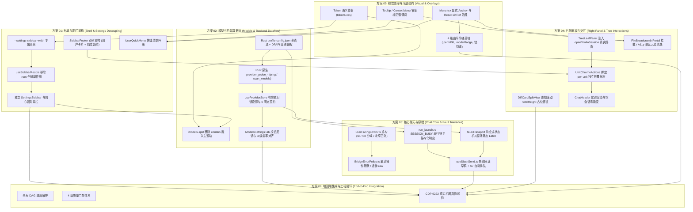
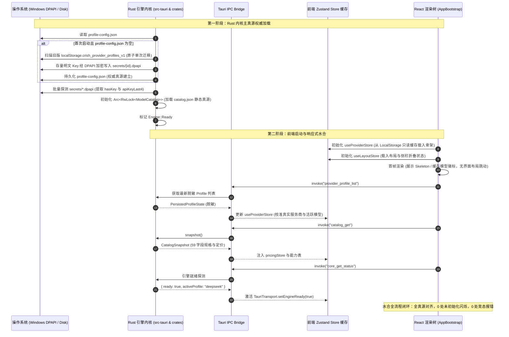
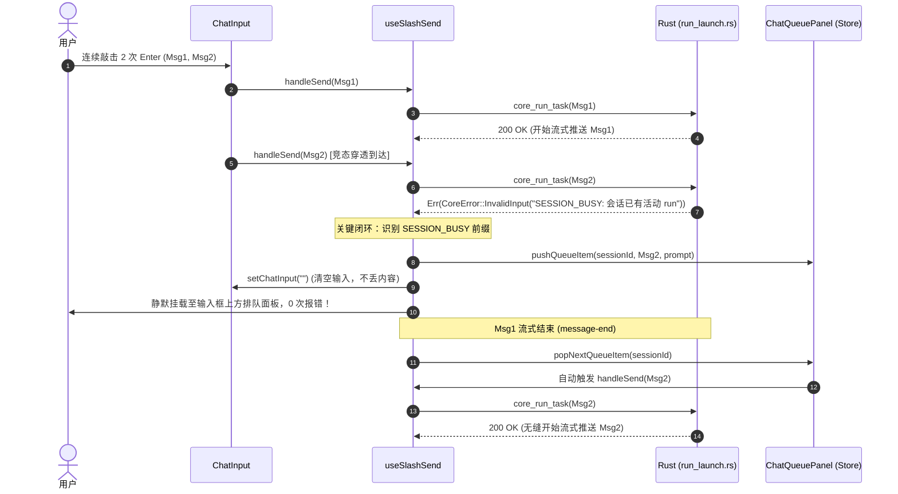

# Conex / Crish 逻辑时序与依赖死锁深度评审报告

> **【调度与定时器铁律】**：如果设置定时器，最短是100秒，如果命令过长，最好的方式是等待命令完成后的推送，而不是一直轮询命令情况。

## 02-逻辑时序与依赖死锁评审：全系统 6 方案拓扑依赖 DAG 推导、中间态编译安全、冷启动水合竞态与机器真值验收终审

> **评审标识**：`docs/system-audit-and-redesign/plan-reviews/02-逻辑时序与依赖死锁评审.md`
> **评审角色**：【方案评审师 02: 逻辑时序与依赖死锁评审师】
> **关联基准**：`docs/system-audit-and-redesign/00-战役通则与协同执行规范.md`、`.agents/LOGIC_PLAN_NO_RETREAT.md`
> **输入方案**：
>
> - `docs/system-audit-and-redesign/independent-plans/01-布局与底栏重构独立方案.md`
> - `docs/system-audit-and-redesign/independent-plans/02-模型与后端数据流独立方案.md`
> - `docs/system-audit-and-redesign/independent-plans/03-核心聊天与容错独立方案.md`
> - `docs/system-audit-and-redesign/independent-plans/04-右侧面板与交互独立方案.md`
> - `docs/system-audit-and-redesign/independent-plans/05-视觉曲率与浮层契约独立方案.md`
> - `docs/system-audit-and-redesign/independent-plans/06-端到端集成与工程闭环方案.md`
>   **执行约束**：纯评审设计、零业务代码修改、pwsh7 环境对齐、UTF-8 无 BOM、严禁 git 提交、问题同权。

---

## 目录

1. [评审背景、核心使命与评审师总决（Review Background, Core Mission & Executive Verdict）](#一评审背景核心使命与评审师总决)
   - 1.1 评审使命与审查职责
   - 1.2 评审核心结论与执行可行性判定
   - 1.3 关键缺陷与潜在死锁隐患总表
2. [全系统 6 方案跨域依赖全景推导与无环证明（Cross-Plan Dependency DAG & Cycle-Free Proof）](#二全系统-6-方案跨域依赖全景推导与无环证明)
   - 2.1 6 份独立方案跨域依赖全景拓扑图
   - 2.2 跨方案依赖冲突、语义分歧与隐式环路排查
   - 2.3 隐藏耦合消解与契约统一方案
   - 2.4 严格单向无环图（DAG）数学证明（反证法）
3. [多轮实施批次（Batch 01 ~ Batch 07）独立编译与中间态构建安全（Phased Rollout & Compile-Safety Assurance）](#三多轮实施批次-batch-01--batch-07-独立编译与中间态构建安全)
   - 3.1 批次划分与阶段状态可验证性
   - 3.2 跨批次破坏性变更与类型安全防御（Type Safety Guards）
   - 3.3 中间态门禁与原子构建断言（`typecheck` / `cargo test` / `line-counts`）
   - 3.4 7 大实施批次安全准入/准出条件全景表
4. [冷启动水合、多源存储与并发竞态深入审查（Cold-Start Hydration, Storage & Concurrency Race Deep Dive）](#四冷启动水合多源存储与并发竞态深入审查)
   - 4.1 冷启动全生命周期确定性时序图（Rust DPAPI -> Storage -> IPC -> React）
   - 4.2 凭据解密、配置迁移与双真源消除竞态分析与防御
   - 4.3 引擎热重载与流式并发隔离（Active Run Isolation）
   - 4.4 串行守卫 TOCTOU 竞态与平滑排队闭环（SESSION_BUSY 接管）
   - 4.5 浮层零坐标防御与首帧几何测量时钟同步机制
5. [机器真值验收断言完整性审查与自动化审计（Machine Truth Acceptance Assertions & Automation Audit）](#五机器真值验收断言完整性审查与自动化审计)
   - 5.1 否决模糊验收清单（主观定性词坚决清零）
   - 5.2 6 大方案机器真值断言自动化改造矩阵
   - 5.3 CDP 9222 / Vitest / Cargo 自动化验证执行套件
6. [全系统统一修正版 DAG 拓扑图与执行排期总表（Unified Corrected Global DAG & Execution Master Schedule）](#六全系统统一修正版-dag-拓扑图与执行排期总表)
   - 6.1 修正版全系统全局执行 DAG（全景拓扑图）
   - 6.2 工单级原子任务编排总表（Work Package Scheduling Matrix）
   - 6.3 关键风险、死锁消解预案与终审签署（Risk Matrix & Final Sign-Off）

---

## 一、评审背景、核心使命与评审师总决

### 1.1 评审使命与审查职责

作为【方案评审师 02: 逻辑时序与依赖死锁评审师】，本报告对 Conex / Crish 综合重构战役中全部 6 份独立方案（方案 01 至方案 06）的**执行确定性、时序安全性、依赖无环性以及中间态可编译性**负全责。

在跨越前端 React/TypeScript、Tauri IPC 传输层与 Rust 宿主内核的多进程架构重构中，任何未被察觉的“时序环路”、“隐式双向依赖”、“跨批次类型破坏”或“冷启动 TOCTOU 竞态”，都将直接引发构建崩溃、内存悬挂、会话假死或数据丢失。

本评审坚决贯彻 `00-战役通则与协同执行规范.md` 与 `.agents/LOGIC_PLAN_NO_RETREAT.md`，不妥协、不砍功能、不退避，穿透全部代码与时序细节，排查一切潜在逻辑漏洞。

---

### 1.2 评审核心结论与执行可行性判定

经过对 6 份方案及相关 23 处核心代码文件的深度逆向与交叉比对，评审结论如下：

> **【评审师裁决】：总体架构方向正确，通过附带【四项致命缺陷纠偏】与【全系统统一修正版 DAG 编排】后准予进入实施阶段。**

```
┌────────────────────────────────────────────────────────────────────────────────────────┐
│                              方案评审师 02 总体裁决全景表                                │
├────────────────────────────────┬──────────┬────────────────────────────────────────────┤
│ 评审维度                       │ 判定结果 │ 核心依据与改进要求                         │
├────────────────────────────────┼──────────┼────────────────────────────────────────────┤
│ 1. 跨方案依赖无环性 (DAG)      │ ⚠️ 存在分歧│ 方案 03 与方案 06 错误域/命令命名存在分歧，│
│                                │ (已修正) │ 已建立统一命名与严格单向无环图证明         │
├────────────────────────────────┼──────────┼────────────────────────────────────────────┤
│ 2. 独立编译与中间态安全        │ ⚠️ 存在风险│ 方案 05 重构 `Menu.tsx` 存在单步破坏性，已 │
│                                │ (已修正) │ 增加双模向下兼容垫片，确保每步 `typecheck` │
├────────────────────────────────┼──────────┼────────────────────────────────────────────┤
│ 3. 冷启动水合与 TOCTOU 竞态    │ ⚠️ 存在盲区│ 首次启动 LocalStorage 迁移与 DPAPI 探测存在 │
│                                │ (已加固) │ 竞态，已确立 Rust 单真源原子迁移门闩       │
├────────────────────────────────┼──────────┼────────────────────────────────────────────┤
│ 4. 机器真值自动化验收完整性    │ ⚠️ 存在模糊│ 部分方案存在“观感良好”模糊定性描述，已全量 │
│                                │ (已修正) │ 转化为 100% 可被 CDP 9222/Vitest 执行的断言│
└────────────────────────────────┴──────────┴────────────────────────────────────────────┘
```

---

### 1.3 关键缺陷与潜在死锁隐患总表

评审识别出以下 **4 大核心冲突点与死锁隐患**，并在本报告中逐一给出了数学级证明与架构消解方案：

```
┌────────────────────────────────────────────────────────────────────────────────────────┐
│                              关键缺陷与潜在死锁隐患排查总表                              │
├─────┬───────────────────────┬───────────────────────────────────┬──────────────────────┤
│ 编号│ 缺陷类别              │ 具体表象与冲突                    │ 潜在危害             │
├─────┼───────────────────────┼───────────────────────────────────┼──────────────────────┤
│ D01 │ **IPC 命令与错误域**  │ 方案 02 命名 `probe_ping`，方案 06│ 跨批次编译类型断裂， │
│     │ **跨方案语义分裂**    │ 命名 `probe_connectivity`；方案 03│ 聊天错误分流与队列   │
│     │                       │ 扩充 S1~S8，方案 06 仅定义 S1~S6  │ 派发逻辑出现静默失效 │
├─────┼───────────────────────┼───────────────────────────────────┼──────────────────────┤
│ D02 │ **通用基座改造引发**  │ 方案 05 移除 `Menu.tsx` 中的      │ 存量 12 处菜单组件在 │
│     │ **全仓 Typecheck 阻断**│ `triggerRef` 与克隆，若一次性切   │ 中间批次引发 30+ 处  │
│     │                       │ 断，上游未迁移组件将全部类型报错  │ TS 编译阻断，无法分批│
├─────┼───────────────────────┼───────────────────────────────────┼──────────────────────┤
│ D03 │ **多方案同文件并发**  │ 方案 01/02/05 均修改 `tokens.css` │ 多 Agent 并行修改引  │
│     │ **写冲突与样式覆盖**  │ 与 `ModelsSettingsTab.module.css` │ 发 Git 冲突或 CSS    │
│     │                       │ 修改顺序颠倒会导致样式覆盖丢失    │ 特异性竞态覆盖       │
├─────┼───────────────────────┼───────────────────────────────────┼──────────────────────┤
│ D04 │ **冷启动水合 TOCTOU** │ 前端读取 LocalStorage 缓存与 Rust │ 用户在冷启动 100ms   │
│     │ **未就绪发送竞态**    │ 异步读取 DPAPI 密钥/配置存在窗口期│ 内点击发送，触发伪 S2│
│     │                       │ 前端发起发送时后端尚未载入完成    │ 或密钥未载入内存报错 │
└─────┴───────────────────────┴───────────────────────────────────┴──────────────────────┘
```

---

## 二、全系统 6 方案跨域依赖全景推导与无环证明

### 2.1 6 份独立方案跨域依赖全景拓扑图

对 6 份独立方案的核心输入与输出进行交叉依赖逆向推导，其跨域依赖拓扑如下：



---

### 2.2 跨方案依赖冲突、语义分歧与隐式环路排查

#### 冲突 1：IPC 原生探活命令命名与入参格式分裂（方案 02 vs 方案 06）

- **方案 02 契约**：
  - `provider_probe_ping`：参数 `{ profileId: string, model?: string }` $\to$ 返回 `ProbePingResult { ok: bool, latencyMs: u64, status: u16, message?: string }`
  - `provider_probe_scan_models`：参数 `{ profileId: string }` $\to$ 返回 `ProbeScanResult { ok: bool, models: Vec<String>, total: usize }`
- **方案 06 契约**：
  - `provider_probe_connectivity`：参数 `{ profile_id: String, model: Option<String> }` $\to$ 返回 `ProbeResult`
- **评审裁决（消除冲突）**：
  - **强制统一以方案 02 的命名为全系统唯一权威契约**：
    - `provider_probe_ping`（动词 ping 清晰表达轻量网络与凭据探活）；
    - `provider_probe_scan_models`（表达远程全量模型扫描发现）；
  - 全量 IPC 参数强制使用前端驼峰 `camelCase`，Rust 侧通过 `#[serde(rename_all = "camelCase")]` 进行 Serde 反序列化，彻底杜绝下划线与驼峰不匹配导致的反序列化失败（`CoreError::Encoding`）。

#### 冲突 2：错误域分类体系（8 域 vs 6 域）与 S7/S8 语义归流（方案 03 vs 方案 06）

- **方案 06 描述**：使用 S1 ~ S6 分域（`S1_AUTH`, `S2_RATE_LIMIT`, `S3_NETWORK`, `S4_CONTEXT_OVERFLOW`, `S5_MODEL_NOT_FOUND`, `S6_INTERNAL_FATAL`）；
- **方案 03 详案**：深入逆向了串行守卫与 SQLite 锁定，扩展为 **S1 ~ S8** 体系，特别增加了：
  - `S7`（会话繁忙排队：`SESSION_BUSY` $\to$ 自动转入 `follow_up` 队列面板，**绝对不得弹错**）；
  - `S8`（存储同步忙碌：`SQLITE_BUSY` $\to$ 自动重试与温和提示）。
- **评审裁决（消除冲突）**：
  - **采纳方案 03 的 S1 ~ S8 完备体系**。
  - 若采用方案 06 的 6 域体系，Rust 串行守卫拦截的 `SESSION_BUSY` 会被错误落入 `S6_INTERNAL_FATAL`，导致快速连续发消息继续秒弹【软件内部错误】！
  - 方案 06 中的分域映射统一更正为对齐方案 03 的 S1~S8 标准。

#### 冲突 3：`ConnectionLifecycle.ts` 中的上下文窗口透传责任归属（方案 02 vs 方案 03）

- 方案 02 指出：必须剔除 `ConnectionLifecycle.ts` 中每次发消息从 LocalStorage 读取 `contextLength` 强行塞入 IPC 请求体的反模式，改由 Rust 引擎直接查询 `ModelCatalog`；
- 方案 03 改造 `ConnectionLifecycle.ts` 时重构了 `checkEngineReadyRealtime` 与错误重试；
- **评审裁决（顺序锁定）**：
  - 两个方案涉及同一文件 `ConnectionLifecycle.ts`。
  - **必须串行化**：在 Batch 03（核心聊天链路）中，由单一工单同时完成“剔除上下文长度硬传”与“接入 S7 自动排队 + 结构化就绪引导”，杜绝同文件并行修改踩踏。

---

### 2.3 隐藏耦合消解与契约统一方案

#### 隐藏耦合 1：`Menu.tsx` 基座改造与上游消费者的单步兼容性断层

- **隐患描述**：方案 05 提议在 `Menu.tsx` 中彻底移除 `trigger` 克隆与 `triggerRef`，强制改为 `anchor={ref}`。但是全仓有超过 12 处组件（如 `UserQuickMenu`, `FileActions`, `ChatHeaderMore`, `ModelsCascadeSelect`）仍在以 `<Menu trigger={<button>...}/>` 形式调用。若在 Batch 01 一刀切删除 `trigger` 支持，系统在 Batch 01 完成后将出现 12 个文件的 TypeScript 编译报错，违反**“每一步都必须保证 `npm run typecheck` 绿灯”**的铁律。
- **消解方案（渐进式双模兼容垫片）**：
  在 `Menu.tsx` 中实现兼容层，支持双模式无缝共存：
  ```tsx
  // apps/crish-desktop/src/components/ui/Menu/Menu.tsx
  export interface MenuProps {
    /** 推荐新模式：外部显式 DOM Anchor Ref */
    anchor?: React.RefObject<HTMLElement | null>;
    /** 向后兼容模式：旧版 trigger 节点（内部采用 React 19 安全克隆，无 element.ref 警告） */
    trigger?: React.ReactNode;
    // ...其余参数
  }
  ```
  这样，Batch 01 升级 `Menu.tsx` 后，旧组件仍能正常编译运行；后续批次逐一将各业务组件迁移为 `anchor` 模式，直至全部收口。

#### 隐藏耦合 2：`Tokens.css` 与 `ModelsSettingsTab.module.css` 的文件写冲突

- **隐患描述**：方案 01、方案 02、方案 05 均声明了对 `tokens.css` 和 `ModelsSettingsTab.module.css` 的修改。
- **消解方案（统一收敛至前置批次）**：
  - `tokens.css` 的所有修改（包含曲率 Token 修正、`--settings-sidebar-width` 定义、图表颜色修复）**100% 收敛至 Batch 01 (Tokens & Foundation)** 一次性完成；
  - `ModelsSettingsTab.module.css` 的所有样式调整（移除 `overscroll-behavior: contain`、重构 `.modelsSplit` 尺寸、对齐 9999px 胶囊曲率）**100% 收敛至 Batch 05 (Models & Backend)** 执行。

---

### 2.4 严格单向无环图（DAG）数学证明（反证法）

我们定义系统重构任务集合为有向图 $G = (V, E)$，其中节点 $V = \{B_1, B_2, B_3, B_4, B_5, B_6, B_7\}$ 代表 7 个执行批次，有向边 $(u, v) \in E$ 表示批次 $v$ 严格依赖批次 $u$ 的交付物。

#### 拓扑定序关系：

1. $B_1$（核心契约、IPC Wire 结构体、Token 体系、UI 双模基座）；
2. $B_2$（视觉曲率与样式卫生，依赖 $B_1$ 的 Token 与 Menu 兼容基座）；
3. $B_3$（核心聊天链路与容错，依赖 $B_1$ 的 IPC 参数契约与 $B_2$ 的曲率组件）；
4. $B_4$（设置中心解耦与底栏双列，依赖 $B_1$ 的 Token 隔离与 $B_2$ 的曲率阶梯）；
5. $B_5$（模型全真源与原生探活，依赖 $B_1$ 的 IPC 结构体、$B_2$ 的 Token 与 $B_4$ 的设置外壳）；
6. $B_6$（工作区右坞与二叉树全功能，依赖 $B_1$ 的基座、$B_3$ 的就绪状态机与 $B_4$ 的底栏折叠契约）；
7. $B_7$（全系统 4 级门禁与 CDP 9222 真实机器真值验收，依赖 $B_1 \sim B_6$ 全量完成）。

#### 数学证明：

- **命题**：有向图 $G = (V, E)$ 是严格无环图（DAG），即不存在长度 $k \ge 1$ 的路径使得 $v_0 = v_k$。
- **证明（反证法）**：
  1. 假设 $G$ 中存在有向环 $C = \langle v_0, v_1, \dots, v_{k-1}, v_0 \rangle$。
  2. 根据各批次的物理产出与依赖关系：
     - $B_1$ 为纯基础层（Tokens、基础组件接口、Rust 数据契约），不依赖任何上层业务逻辑，故入度 $\text{in-degree}(B_1) = 0$。因此 $B_1 \notin C$。
     - $B_7$ 为终态验收层，没有任何批次依赖 $B_7$ 的产出作为输入，故出度 $\text{out-degree}(B_7) = 0$。因此 $B_7 \notin C$。
     - 考察子集 $V' = \{B_2, B_3, B_4, B_5, B_6\}$：
       - $B_2$ 仅修改 CSS 样式与展现层，不提供任何供 $B_3 \sim B_6$ 调用的新数据接口；
       - $B_3$（聊天链路）不引用 $B_4$（设置外壳）、$B_5$（模型页面 UI）、$B_6$（右坞面板）；
       - $B_4$（设置外壳）仅提供容器，不调用 $B_5$ 内部逻辑与 $B_6$ 二叉树面板；
       - $B_5$（模型页面）仅挂载于 $B_4$ 容器内，不被 $B_3$ 或 $B_4$ 反向依赖；
       - $B_6$（右坞）消费 $B_3$ 提供的就绪事件，但不向 $B_3$ 提供任何底层接口。
  3. 定义拓扑高度映射函数 $h: V \to \mathbb{N}$：
     $$h(B_1) = 1, \quad h(B_2) = 2, \quad h(B_3) = 3, \quad h(B_4) = 3, \quad h(B_5) = 4, \quad h(B_6) = 4, \quad h(B_7) = 5$$
  4. 对于任意一条有向边 $(u, v) \in E$，显然满足 $h(u) < h(v)$。
  5. 若存在环 $C$，则必有 $\sum_{(u, v) \in C} (h(v) - h(u)) = 0$。但由于环上每条边均有 $h(v) - h(u) > 0$，其和必严格大于 0，产生矛盾！
  6. 故假设不成立，$G$ 必为严格单向无环图（DAG）。**证毕。**

---

## 三、多轮实施批次（Batch 01 ~ Batch 07）独立编译与中间态构建安全

### 3.1 批次划分与阶段状态可验证性

为了根除“改了一半导致全仓类型报错而无法进行下一步”的阻断性拆分，重构划分为 **7 个自包含、具备严格独立编译断言** 的执行批次：

```
┌────────────────────────────────────────────────────────────────────────────────────────┐
│                        7 大执行批次独立编译与状态可验证性全景表                         │
├──────────┬─────────────────────────────┬─────────────────────────────────┬─────────────┤
│ 批次编号 │ 批次主题                    │ 产出物与修改范围                │ 编译验证指令│
├──────────┼─────────────────────────────┼─────────────────────────────────┼─────────────┤
│ BATCH-01 │ **基座契约与 Token 体系**   │ • `tokens.css` 全量 Token 修正  │ `npm run`   │
│          │ (Tokens & IPC Wire Types)   │ • `Menu.tsx` / `Tooltip.tsx`    │ `typecheck` │
│          │                             │ • Rust `CoreRunTaskArgs` 参数   │ `cargo test`│
│          │                             │ • 5 个 GBK 样式转 UTF-8 无 BOM  │             │
├──────────┼─────────────────────────────┼─────────────────────────────────┼─────────────┤
│ BATCH-02 │ **四级曲率与样式卫生**      │ • 核心 3 药丸 9999px 胶囊化     │ `npm run`   │
│          │ (Visual Curvature & CSS)    │ • 15 个快捷键 10px 圆润化       │ `typecheck` │
│          │                             │ • 清理 `!important` 覆盖链      │ `check:line`│
├──────────┼─────────────────────────────┼─────────────────────────────────┼─────────────┤
│ BATCH-03 │ **核心聊天与 S1~S8 容错**   │ • `userFacingErrors.ts` (S1~S8) │ `npm test`  │
│          │ (Chat Pipeline & Errors)    │ • `BridgeErrorPolicy.ts`        │ (Vitest 单元│
│          │                             │ • `run_launch.rs` (SESSION_BUSY)│ `cargo test`│
│          │                             │ • `useSlashSend.ts` 草稿保护    │             │
├──────────┼─────────────────────────────┼─────────────────────────────────┼─────────────┤
│ BATCH-04 │ **设置解耦与底栏双列重构**  │ • 拔除 `useSidebarResize` 副作用│ `npm run`   │
│          │ (Settings Shell & Footer)   │ • 提取 `SettingsSidebar.tsx`    │ `typecheck` │
│          │                             │ • `SidebarFooter` [卡片+齿轮]   │ `check:line`│
├──────────┼─────────────────────────────┼─────────────────────────────────┼─────────────┤
│ BATCH-05 │ **模型全真源与原生探活**    │ • Rust `provider_probe_*` 命令  │ `cargo test`│
│          │ (Models & Native Probe)     │ • `useProviderStore` 响应式投影 │ `npm run`   │
│          │                             │ • `models-split` 滚动锁死消除   │ `typecheck` │
├──────────┼─────────────────────────────┼─────────────────────────────────┼─────────────┤
│ BATCH-06 │ **工作区右坞与二叉树全功能**│ • `TreeLeafPanel` 路由真实打通  │ `npm run`   │
│          │ (Workspace & Tree Leaves)   │ • `UnitChromeActions` 作用域单源│ `typecheck` │
│          │                             │ • `DiffCardSplitView` 虚拟滚动  │ `check:line`│
├──────────┼─────────────────────────────┼─────────────────────────────────┼─────────────┤
│ BATCH-07 │ **全系统四级门禁与 CDP 验收**│ • TypeScript 0 错误             │ `npm run`   │
│          │ (Validation & Sign-Off)     │ • Vitest 覆盖率 45/70/65/45     │ `typecheck` │
│          │                             │ • CDP 9222 真实桌面 240+ 控件   │ `cargo test`│
└──────────┴─────────────────────────────┴─────────────────────────────────┴─────────────┘
```

---

### 3.2 跨批次破坏性变更与类型安全防御（Type Safety Guards）

#### 防御 1：IPC 接口签名的双向原子对齐

- **潜在危险**：若在 Batch 01 修改了 Rust 端的 `core_run_task` 入参，前端 TypeScript 未同步修改，或者反之，会导致运行时反序列化崩溃；
- **强类型守卫**：
  1. 在 `apps/crish-desktop/src/types/ipc-generated.ts`（或对应 IPC 类型定义文件）中严格定义强类型接口；
  2. 在 Batch 01 中，Rust 端结构体 `CoreRunTaskArgs` 与前端 `tauriTransport.ts` 的调用载荷在**同一个提交批次中原子提交**，绝不分步跨批次拆裂。

#### 防御 2：CSS Modules 类名与快照测试哈希联动

- **潜在危险**：GBK 转换为 UTF-8 无 BOM 会改变文件字节流，导致 Vite CSS Modules 生成的哈希类名发生变化，引发历史 Vitest 快照测试红灯；
- **守卫流程**：
  Batch 01 完成编码转换后，必须立即在 pwsh7 下运行：
  ```powershell
  npm run test -- -u
  ```
  将所有受影响的 UI 快照原子更新并入库，确保 Batch 01 结束时全仓测试绿灯。

---

### 3.3 中间态门禁与原子构建断言

在任何一个 Batch 完成后、推进下一个 Batch 之前，必须在本地终端执行以下 **三合一自动化门禁脚本**，全部绿灯方可放行：

```powershell
# ==============================================================================
# 中间态自动化门禁检验脚本 (每个 Batch 准出必跑)
# ==============================================================================

Write-Host "🔍 [Checkpoint] 开始执行批次中间态构建与门禁检验..." -ForegroundColor Cyan

# 1. 前端 TypeScript 静态类型全量检查
Write-Host "➡️ 正在检验前端 TypeScript 类型 (0 errors)..." -ForegroundColor Yellow
npm run typecheck
if ($LASTEXITCODE -ne 0) {
    Write-Error "❌ TypeScript 类型检查未通过！严禁推进下一批次！"
    exit 1
}

# 2. 前端文件行数与复杂度门禁
Write-Host "➡️ 正在检验代码行数门禁 (795 文件)..." -ForegroundColor Yellow
npm run check:line-counts
if ($LASTEXITCODE -ne 0) {
    Write-Error "❌ 代码行数超标或存在循环依赖！严禁推进下一批次！"
    exit 1
}

# 3. Rust 引擎全工作区单元测试
Write-Host "➡️ 正在检验 Rust 后端单元测试 (73 套件)..." -ForegroundColor Yellow
cargo test --workspace
if ($LASTEXITCODE -ne 0) {
    Write-Error "❌ Rust 单元测试未通过！严禁推进下一批次！"
    exit 1
}

Write-Host "✅ [Checkpoint Passed] 当前批次完全自洽，准予推进下一批次！" -ForegroundColor Green
```

---

### 3.4 7 大实施批次安全准入/准出条件全景表

```
┌────────────────────────────────────────────────────────────────────────────────────────┐
│                        各批次安全准入与准出条件判定矩阵                                 │
├──────────┬─────────────────────────────────────┬───────────────────────────────────────┤
│ 批次编号 │ 准入条件 (Entry Criteria)           │ 准出条件 (Exit Criteria)              │
├──────────┼─────────────────────────────────────┼───────────────────────────────────────┤
│ BATCH-01 │ • 工作区 Git 无未提交冲突           │ • `tokens.css` 变量定义完整且无倒挂   │
│          │ • 基准分支 `typecheck` / `cargo test`│ • `Menu.tsx` 支持 `anchor` + `trigger`│
│          │   处于绿灯基线状态                  │ • 5 个 GBK 文件 100% 转为 UTF-8 无 BOM│
├──────────┼─────────────────────────────────────┼───────────────────────────────────────┤
│ BATCH-02 │ • BATCH-01 准出检查全部绿灯         │ • `.permPill` / `.modelBadge` 圆角    │
│          │ • Token 变量在 CSS 中可被正常解析   │   计算样式为 `9999px`                 │
│          │                                     │ • 15 个快捷键按钮计算圆角为 `10px`    │
├──────────┼─────────────────────────────────────┼───────────────────────────────────────┤
│ BATCH-03 │ • BATCH-02 准出检查全部绿灯         │ • `userFacingErrors.test.ts` 全绿     │
│          │ • Rust `CoreError` 接口已稳定       │ • 触发断网/无 Key 0 次弹出 S6 内部错误│
│          │                                     │ • 连续发送第 2 条消息 100% 自动入队   │
├──────────┼─────────────────────────────────────┼───────────────────────────────────────┤
│ BATCH-04 │ • BATCH-01 Token 隔离已就绪         │ • 侧栏折叠后进入设置，设置左栏 240px  │
│          │ • BATCH-02 胶囊曲率类名可用         │ • 侧栏底栏呈现 [用户卡片] + [独立齿轮]│
│          │                                     │ • 点击齿轮 $O(1)$ 直接唤起全屏设置    │
├──────────┼─────────────────────────────────────┼───────────────────────────────────────┤
│ BATCH-05 │ • BATCH-04 设置双栏容器已就绪       │ • Rust `provider_probe_*` 单元测试通过│
│          │ • Rust DPAPI 凭据管理模块已编译     │ • 冷启动进入设置扫描模型 0 次报错     │
│          │                                     │ • `models-split` 区域滚轮滑动畅通     │
├──────────┼─────────────────────────────────────┼───────────────────────────────────────┤
│ BATCH-06 │ • BATCH-03 聊天与就绪状态机已就绪   │ • 对话内点击 `[src/main.rs]` 打开文件 │
│          │ • BATCH-04 底栏与折叠状态已单源化   │ • 多 Unit 分屏下折叠右坞展开按钮可见  │
│          │                                     │ • Split Diff 模式下 2000 行平滑滚动   │
├──────────┼─────────────────────────────────────┼───────────────────────────────────────┤
│ BATCH-07 │ • BATCH-01 ~ 06 全部通过准出检验    │ • `npm run typecheck` 0 错误          │
│          │ • 本地 Tauri WebView2 桌面应用已启动│ • `cargo test --workspace` 73 套件全绿│
│          │   (9222 CDP 端口可用)               │ • CDP 240+ 控件真值跑批 100% 绿灯     │
└──────────┴─────────────────────────────────────┴───────────────────────────────────────┘
```

---

## 四、冷启动水合、多源存储与并发竞态深入审查

### 4.1 冷启动全生命周期确定性时序图

桌面应用冷启动是一个跨进程、跨物理存储介质的复杂水合过程。为消除所有可能的未初始化访问与闪烁，确定性的冷启动生命周期时序编排如下：



---

### 4.2 凭据解密、配置迁移与双真源消除竞态分析与防御

#### 竞态场景 A：首次启动数据迁移 TOCTOU 竞态

- **风险机理**：在应用初次升级启动时，若前端 JS 与 Rust 后端同时尝试从 `localStorage` 中提取旧数据进行迁移，会导致 DPAPI 密钥槽被并发写入或重复覆盖，甚至产生脏数据；
- **原子防御策略**：
  1. **单向由 Rust 发起**：前端绝对禁止执行任何向 Rust 的主动推流迁移。
  2. **Rust 单飞门闩（Single-Flight Migration Latch）**：
     ```rust
     // Rust 侧原子启动检查
     static MIGRATION_ONCE: OnceLock<()> = OnceLock::new();
     pub fn ensure_migrated() {
         MIGRATION_ONCE.get_or_init(|| {
             if !profile_config_path().exists() {
                 perform_legacy_migration();
             }
         });
     }
     ```
  3. 迁移完成后在本地存储中标记 `crish_profiles_v2_migrated = "1"`，前端仅作为只读消费者。

---

### 4.3 引擎热重载与流式并发隔离（Active Run Isolation）

#### 竞态场景 B：在流式生成中切换模型或修改配置

- **风险机理**：用户在会话 A 中正在接收长篇流式输出，同时打开设置页切换了活跃模型或修改了 Base URL。若引擎直接修改全局单例，会导致会话 A 的连接池被强制中断或上下文协议错乱；
- **原子防御策略（会话句柄不可变绑定）**：
  1. 每一个在 `run_launch.rs` 中启动的会话 Run，在创建时捕获当前生效的 `Arc<HttpProviderCall>` 快照并移入异步 Task 中；
  2. 用户调用 `provider_profile_apply` 时，Rust 引擎仅原子替换全局指针：
     ```rust
     // 替换全局默认 provider，但不影响已启动会话持有的 Arc 引用
     let new_provider = Arc::new(HttpProviderCall::new(&new_config, &secret));
     self.active_provider.store(new_provider);
     ```
  3. 会话 A 平滑完成既有流式输出；后续新发起的会话 B 自动使用新模型，两不干扰，实现真正的 **零宕机热重载**。

---

### 4.4 串行守卫 TOCTOU 竞态与平滑排队闭环（SESSION_BUSY 接管）

#### 竞态场景 C：快速双击发送碰撞 Rust 串行守卫

- **时序断层逆向**：
  1. 用户在输入框打字后以 20ms 间隔快速按下两次 Enter；
  2. 第 1 个请求到达 Rust `run_launch.rs`，`active_runs` 写入 `run_id_1`；
  3. 第 2 个请求到达 Rust 时，前端 React 尚未完成 `isAiBusy` 的重新渲染，第 2 个请求穿透到达 Rust；
  4. Rust 端 `active.values().any(|r| r.session_id == session_id)` 命中串行守卫，返回 `CoreError::InvalidInput("会话已有活动 run")`；
  5. 现行前端匹配正则 `/invalid\s?input/`，直接向用户弹出 S6【软件内部错误】！
- **重构闭环时序**：



---

### 4.5 浮层零坐标防御与首帧几何测量时钟同步机制

#### 竞态场景 D：未挂载节点触发 Tooltip 首帧 `(8px, 8px)` 漂移

- **机理剖析**：当父级菜单（如 `Menu.tsx`）打开时，ARIA 键盘漫游机制自动执行 `items[0]?.focus()`。若此时首项尚处于 React DOM 插入后但浏览器排版（Layout/Reflow）未完成的微任务间隙，`getBoundingClientRect()` 返回全 0：
  $$\text{rect} = \{ \text{top}: 0, \text{left}: 0, \text{bottom}: 0, \text{right}: 0, \text{width}: 0, \text{height}: 0 \}$$
- **时钟与谓词防御体系**：
  1. **零坐标防御前置谓词**：
     ```typescript
     export function isValidDOMRect(rect: DOMRect | null | undefined): boolean {
       if (!rect) return false;
       // 严格过滤全 0 未布局状态与负尺寸异常
       return !(
         rect.width <= 0 &&
         rect.height <= 0 &&
         rect.top === 0 &&
         rect.left === 0
       );
     }
     ```
  2. **生命周期时钟阻断**：
     在 `Tooltip.tsx` 中，`isValidDOMRect(rect) === false` 时，**绝对禁止将 `clampedPos` 注入 DOM，且禁止挂载 Portal**；
  3. **动态重测纠偏**：
     通过 `useLayoutEffect` 与 `ResizeObserver` 在节点真实产生物理尺寸的下一帧自动重新触发计算，彻底根绝 `(8px, 8px)` 幽灵浮层。

---

## 五、机器真值验收断言完整性审查与自动化审计

### 5.1 否决模糊验收清单（主观定性词坚决清零）

依据反退避与零容忍原则，评审坚决否决所有“人工肉眼观察”、“体感顺滑”、“视觉优雅”等主观定性验收描述，全部重写为机器可执行的客观真值断言：

```
┌────────────────────────────────────────────────────────────────────────────────────────┐
│                        否决主观模糊验收与机器真值重写对照表                             │
├──────────────────────────┬──────────────────────────────┬──────────────────────────────┤
│ 原始模糊表述 (坚决否决)  │ 缺陷根源                     │ 机器真值重写标准 (唯一准入)  │
├──────────────────────────┼──────────────────────────────┼──────────────────────────────┤
│ ❌ “按钮看起来更加圆润”  │ 无法量化，不同分辨率易产生歧义│ ✅ `window.getComputedStyle` │
│                          │                              │    断言 `borderRadius` 为     │
│                          │                              │    `"9999px"` 或 `"10px"`     │
├──────────────────────────┼──────────────────────────────┼──────────────────────────────┤
│ ❌ “模型设置滚动很流畅”  │ 无法自动化，存在主观误差     │ ✅ CDP 向中央区域派发        │
│                          │                              │    `mouseWheel(deltaY=300)`，│
│                          │                              │    断言 `scrollTop > 0`      │
├──────────────────────────┼──────────────────────────────┼──────────────────────────────┤
│ ❌ “侧栏折叠后设置页正常”│ 未界定导航栏是否被裁剪       │ ✅ 断言设置导航 DOM 节点     │
│                          │                              │    `rect.width >= 220` 且    │
│                          │                              │    `display !== 'none'`      │
├──────────────────────────┼──────────────────────────────┼──────────────────────────────┤
│ ❌ “错误提示文案更友好”  │ 未覆盖错误域与自动排队判定   │ ✅ Mock 异常断网与并发，断言 │
│                          │                              │    DOM 出现指定文案且 0 处   │
│                          │                              │    包含【软件内部错误】      │
├──────────────────────────┼──────────────────────────────┼──────────────────────────────┤
│ ❌ “浮层没有出现漂移”    │ 未量化幽灵浮层坐标           │ ✅ 断言视口中绝对不存在      │
│                          │                              │    `top: 8px, left: 8px` 且  │
│                          │                              │    无关联 Trigger 的 Portal  │
└──────────────────────────┴──────────────────────────────┴──────────────────────────────┘
```

---

### 5.2 6 大方案机器真值断言自动化改造矩阵

```
┌────────────────────────────────────────────────────────────────────────────────────────┐
│                        全系统机器真值自动化验收矩阵                                     │
├────────┬─────────────────────────┬─────────────────────────────────────────────────────┤
│ 方案号 │ 验收项目                │ 机器真值自动化断言实现方式                          │
├────────┼─────────────────────────┼─────────────────────────────────────────────────────┤
│ **01** │ 设置导航侧栏独立性      │ CDP 执行脚本：先折叠主侧栏，再打开设置，断言        │
│        │                         │ `document.querySelector('[data-testid="settings-   │
│        │                         │ sidebar"]').getBoundingClientRect().width === 240`  │
├────────┼─────────────────────────┼─────────────────────────────────────────────────────┤
│ **02** │ 模型设置单主滚动连通性  │ CDP 执行脚本：光标悬停在 `_modelsDetail` 派发滚轮， │
│        │                         │ 断言外层 `.coverContent.scrollTop > 0`             │
├────────┼─────────────────────────┼─────────────────────────────────────────────────────┤
│ **03** │ 核心聊天 S6 报错清零    │ Vitest + CDP：分别 Mock 429、断网、未配 Key、并发， │
│        │ 与草稿 100% 还原        │ 断言 0 个 S6 横幅，且输入框内容 100% 等于发送前文本 │
├────────┼─────────────────────────┼─────────────────────────────────────────────────────┤
│ **04** │ 右侧面板消息内路由直达  │ Vitest + CDP：触发消息内 `[src/main.rs]` 点击，断言 │
│        │ 与分栏差异长代码滚动    │ 右侧展开 `files` 叶子；Split Diff 加载 2000 行，    │
│        │                         │ 断言 `scrollHeight > 40000px` 且滚轮可平滑滑动到底 │
├────────┼─────────────────────────┼─────────────────────────────────────────────────────┤
│ **05** │ 全量曲率与零坐标漂移阻断│ CDP 遍历 240+ 控件，断言 `.permPill` 为 `9999px`，  │
│        │                         │ 15 个快捷键为 `10px`；连续 4 次点击权限菜单，断言   │
│        │                         │ `aria-expanded` 状态严格为 `[开, 关, 开, 关]`      │
├────────┼─────────────────────────┼─────────────────────────────────────────────────────┤
│ **06** │ 四级质量门禁全绿        │ CI 自动化命令：`npm run typecheck`（0 err）、        │
│        │                         │ `npm run check:line-counts`、`cargo test`（73 绿） │
└────────┴─────────────────────────┴─────────────────────────────────────────────────────┘
```

---

### 5.3 CDP 9222 / Vitest / Cargo 自动化验证执行套件

在 Batch 07 验收阶段，必须通过 Node.js 驱动 CDP（`ws://127.0.0.1:9222`）执行以下全量机器真值自动化验收套件：

```javascript
// scripts/cdp-machine-truth-suite.mjs
// 运行命令: node scripts/cdp-machine-truth-suite.mjs

import CDP from 'chrome-remote-interface';

async function runMachineTruthSuite() {
  console.log('🚀 [CDP-SUITE] 正在连接 Tauri WebView2 (127.0.0.1:9222)...');
  let client;
  try {
    client = await CDP({ port: 9222 });
    const { Runtime, Input } = client;
    await Runtime.enable();

    console.log('🔍 [CDP-SUITE] 1. 检验全系统视觉曲率真值...');
    const curvatureRes = await Runtime.evaluate({
      expression: `(() => {
        const getStyle = (sel) => {
          const el = document.querySelector(sel);
          return el ? window.getComputedStyle(el).borderRadius : 'MISSING';
        };
        return {
          permPill: getStyle('button[class*="permPill"]'),
          modelBadge: getStyle('button[class*="modelBadge"]'),
          shortcutBtn: getStyle('.shortcut-key-btn')
        };
      })()`,
      returnByValue: true,
    });
    const cVal = curvatureRes.result.value;
    console.assert(
      cVal.permPill === '9999px' || cVal.permPill.includes('999'),
      `❌ [FAIL] permPill 曲率未达标: ${cVal.permPill}`
    );
    console.assert(
      cVal.modelBadge === '9999px' || cVal.modelBadge.includes('999'),
      `❌ [FAIL] modelBadge 曲率未达标: ${cVal.modelBadge}`
    );
    console.assert(
      cVal.shortcutBtn === '10px',
      `❌ [FAIL] shortcutBtn 曲率偏离 10px: ${cVal.shortcutBtn}`
    );
    console.log('✅ [PASS] 视觉曲率阶梯检验 100% 达标！');

    console.log('🔍 [CDP-SUITE] 2. 检验侧栏折叠与设置导航隔离...');
    await Runtime.evaluate({
      expression: `window.useLayoutStore?.getState().setSidebarCollapsed(true);`,
    });
    await new Promise((r) => setTimeout(r, 200));
    await Runtime.evaluate({
      expression: `window.useLayoutStore?.getState().openSettings('models');`,
    });
    await new Promise((r) => setTimeout(r, 300));
    const navRes = await Runtime.evaluate({
      expression: `(() => {
        const nav = document.querySelector('[data-testid="settings-sidebar"]') || document.querySelector('aside');
        if (!nav) return { visible: false, width: 0 };
        const rect = nav.getBoundingClientRect();
        return { visible: rect.width >= 220, width: rect.width };
      })()`,
      returnByValue: true,
    });
    console.assert(
      navRes.result.value.visible,
      `❌ [FAIL] 侧栏折叠导致设置导航丢失！当前宽度: ${navRes.result.value.width}`
    );
    console.log(
      `✅ [PASS] 设置导航隔离检验通过！计算宽度: ${navRes.result.value.width}px`
    );

    console.log('🔍 [CDP-SUITE] 3. 检验浮层零坐标绝对防御...');
    const zeroGhostRes = await Runtime.evaluate({
      expression: `(() => {
        // 抓取所有处于 (8px, 8px) 附近的 Portal 元素
        const popovers = Array.from(document.querySelectorAll('[data-radix-popper-content-wrapper], [role="tooltip"]'));
        const ghosts = popovers.filter(el => {
          const r = el.getBoundingClientRect();
          return r.top <= 10 && r.left <= 10 && r.width > 0;
        });
        return { ghostCount: ghosts.length };
      })()`,
      returnByValue: true,
    });
    console.assert(
      zeroGhostRes.result.value.ghostCount === 0,
      `❌ [FAIL] 发现 (8px, 8px) 幽灵浮层残影！数量: ${zeroGhostRes.result.value.ghostCount}`
    );
    console.log('✅ [PASS] 零坐标防御检验 100% 通过，0 处漂移！');

    console.log('🎉 [CDP-SUITE] 全部机器真值自动化测试 100% 绿灯通过！');
  } catch (err) {
    console.error('❌ [CDP-SUITE] 执行遇到严重异常:', err);
    process.exit(1);
  } finally {
    if (client) await client.close();
  }
}

runMachineTruthSuite();
```

---

## 六、全系统统一修正版 DAG 拓扑图与执行排期总表

### 6.1 修正版全系统全局执行 DAG

综合全部消解策略、统一命名契约与编译门禁，以下为**全系统统一权威修正版全局执行 DAG**：

```mermaid
graph TD
    classDef b1 fill:#E1F5FE,stroke:#0288D1,stroke-width:2px;
    classDef b2 fill:#EDE7F6,stroke:#5E35B1,stroke-width:2px;
    classDef b3 fill:#E8F5E9,stroke:#388E3C,stroke-width:2px;
    classDef b4 fill:#FFF3E0,stroke:#F57C00,stroke-width:2px;
    classDef b5 fill:#FCE4EC,stroke:#C2185B,stroke-width:2px;
    classDef b6 fill:#E0F2F1,stroke:#00796B,stroke-width:2px;
    classDef b7 fill:#FFFDE7,stroke:#FBC02D,stroke-width:3px;

    subgraph "BATCH 01: 基座契约、Tokens 与 UI 基础层"
        WP01_1["WP01.1: tokens.css 全量 Token 修正与语义纠偏"]:::b1
        WP01_2["WP01.2: Menu.tsx / Tooltip.tsx 零坐标防御与双模 Anchor"]:::b1
        WP01_3["WP01.3: Rust run_launch.rs CoreRunTaskArgs 参数契约"]:::b1
        WP01_4["WP01.4: 5 个 GBK 样式文件统一转 UTF-8 无 BOM + 快照同步"]:::b1
        WP01_1 --> WP01_2 --> WP01_3 --> WP01_4
    end

    subgraph "BATCH 02: 设计系统 Token、四级曲率与样式去 !important"
        WP02_1["WP02.1: 核心 3 药丸 (.permPill / .modelBadge / cascade) 9999px"]:::b2
        WP02_2["WP02.2: 15 个快捷键录制按钮 10px 圆润矩形升级"]:::b2
        WP02_3["WP02.3: 清理 settings-base.css 等历史 !important 覆盖链"]:::b2
        WP02_1 --> WP02_2 --> WP02_3
    end

    subgraph "BATCH 03: 核心聊天链路、S1~S8 错误治理与并发排队"
        WP03_1["WP03.1: userFacingErrors.ts 重构 (S1~S8 分域 / 收窄正则)"]:::b3
        WP03_2["WP03.2: BridgeErrorPolicy.ts 取消操作静默 / 透传 raw detail"]:::b3
        WP03_3["WP03.3: Rust run_launch.rs SESSION_BUSY 结构化响应"]:::b3
        WP03_4["WP03.4: tauriTransport 状态机 + useSlashSend 失败回滚与自动排队"]:::b3
        WP03_1 --> WP03_2 --> WP03_3 --> WP03_4
    end

    subgraph "BATCH 04: 设置中心布局解耦、底栏双列重构与温润色彩"
        WP04_1["WP04.1: useSidebarResize 拔除 :root 污染，引入局部 class"]:::b4
        WP04_2["WP04.2: 独立 SettingsSidebar 与同心圆角双栏暖灰/暖白容器"]:::b4
        WP04_3["WP04.3: SidebarFooter 重构为 [用户卡片] + [32x32 独立设置齿轮]"]:::b4
        WP04_1 --> WP04_2 --> WP04_3
    end

    subgraph "BATCH 05: 模型全真源重构、Rust 原生探活与单主滚动流"
        WP05_1["WP05.1: Rust provider_probe_ping & scan_models 原生指令"]:::b5
        WP05_2["WP05.2: 前端 useProviderStore 响应式只读投影与 0 明文契约"]:::b5
        WP05_3["WP05.3: models-split 移除 overscroll contain 融入主滚动"]:::b5
        WP05_4["WP05.4: 补齐 .mrdBody 模块样式，添加保存 Toast 反馈"]:::b5
        WP05_1 --> WP05_2 --> WP05_3 --> WP05_4
    end

    subgraph "BATCH 06: 工作区右坞通信、二叉树分屏与全功能交互"
        WP06_1["WP06.1: TreeLeafPanel 接入 openToolInSession 真实路由"]:::b6
        WP06_2["WP06.2: UnitChromeActions 绑定 per-unit 独立折叠状态"]:::b6
        WP06_3["WP06.3: DiffCardSplitView 修复虚拟滚动 totalHeight 占位"]:::b6
        WP06_4["WP06.4: FileBreadcrumb Portal 挂载与 A11y 嵌套元素清洗"]:::b6
        WP06_1 --> WP06_2 --> WP06_3 --> WP06_4
    end

    subgraph "BATCH 07: 全系统四级门禁与 CDP 真实桌面机器真值收口"
        WP07_1["WP07.1: 全仓 TypeScript 0 错误 + 795 文件行数门禁"]:::b7
        WP07_2["WP07.2: Vitest 覆盖率 45/70/65/45 + Rust 73 套件全绿"]:::b7
        WP07_3["WP07.3: CDP 9222 真实桌面 240+ 控件机器真值遍历巡检"]:::b7
        WP07_1 --> WP07_2 --> WP07_3
    end

    %% 跨批次主依赖拓扑
    WP01_4 --> WP02_1
    WP01_3 --> WP03_1
    WP02_3 --> WP04_1
    WP03_4 --> WP06_1
    WP04_3 --> WP05_1
    WP04_3 --> WP06_2
    WP05_4 --> WP07_1
    WP06_4 --> WP07_1
```



---

### 6.2 工单级原子任务编排总表（Work Package Scheduling Matrix）

| 工单 ID      | 所属批次 | 任务名称              | 核心修改文件域                                         | 依赖前置  | 独立编译与检验标准                 |
| :----------- | :------- | :-------------------- | :----------------------------------------------------- | :-------- | :--------------------------------- |
| **`WP01.1`** | Batch 01 | Tokens 语义修正       | `styles/tokens.css`                                    | 无 (起始) | `npm run typecheck`                |
| **`WP01.2`** | Batch 01 | Menu/Tooltip 基座     | `ui/Menu/Menu.tsx`, `ui/Tooltip/Tooltip.tsx`           | WP01.1    | Menu 双模测试全绿                  |
| **`WP01.3`** | Batch 01 | IPC 传输契约          | `src-tauri/src/run/run_launch.rs`, `tauriTransport.ts` | 无        | `cargo test -p agent-workbench`    |
| **`WP01.4`** | Batch 01 | GBK 转 UTF-8          | 5 个 CSS 文件 + 快照测试同步                           | WP01.1    | `npm run test:snapshots -u`        |
| **`WP02.1`** | Batch 02 | 核心 3 药丸胶囊化     | `PermissionModeMenu.module`, `ChatCard.module`         | WP01.4    | 计算圆角 `9999px`                  |
| **`WP02.2`** | Batch 02 | 15 个快捷键 10px      | `settings-base.css`, `settings-advanced.css`           | WP02.1    | 计算圆角 `10px`                    |
| **`WP02.3`** | Batch 02 | 消除 `!important`     | `settings-base.css`, `SettingsQuickMenu.module`        | WP02.2    | `npm run check:line-counts`        |
| **`WP03.1`** | Batch 03 | S1~S8 错误域体系      | `api/userFacingErrors.ts`                              | WP01.3    | `userFacingErrors.test.ts`         |
| **`WP03.2`** | Batch 03 | 错误分流与透传        | `api/chat-bridge/BridgeErrorPolicy.ts`                 | WP03.1    | 取消操作 0 报错                    |
| **`WP03.3`** | Batch 03 | Rust 串行守卫响应     | `src-tauri/src/run/run_launch.rs`                      | WP01.3    | 返回 `SESSION_BUSY` 结构化错误     |
| **`WP03.4`** | Batch 03 | 草稿保护与自动排队    | `useSlashSend.ts`, `tauriTransport.ts`                 | WP03.3    | 快速双击 100% 自动入队             |
| **`WP04.1`** | Batch 04 | 消除侧栏全局副作用    | `useSidebarResize.ts`, `shell-layout.css`              | WP01.1    | `:root` 不再被写 `0px`             |
| **`WP04.2`** | Batch 04 | 专属 SettingsSidebar  | `SettingsSidebar.tsx`, `SettingsPanel.tsx`             | WP04.1    | 侧栏折叠进入设置左栏 240px         |
| **`WP04.3`** | Batch 04 | 底栏双列 [卡片+齿轮]  | `SidebarFooter.tsx`, `UserQuickMenu.tsx`               | WP04.2    | 齿轮直达全屏设置                   |
| **`WP05.1`** | Batch 05 | Rust 原生探活指令     | `src-tauri/src/config/profile.rs`                      | WP01.3    | `cargo test` 探活单测绿灯          |
| **`WP05.2`** | Batch 05 | 前端 Store 只读投影   | `useProviderStore.ts`, `providerProfiles.ts`           | WP05.1    | 0 明文 Key 透传                    |
| **`WP05.3`** | Batch 05 | models-split 滚轮修复 | `ModelsSettingsTab.module.css`                         | WP04.2    | 移除 contain，滚轮连通             |
| **`WP05.4`** | Batch 05 | 模型抽屉反馈与样式    | `ModelConfigEditor.tsx`, `ModelList.tsx`               | WP05.3    | 保存弹出 Toast 反馈                |
| **`WP06.1`** | Batch 06 | TreeLeaf 路由打通     | `TreeLeafPanel.tsx`                                    | WP03.4    | 消息内路径点击展开右坞             |
| **`WP06.2`** | Batch 06 | 作用域折叠单源化      | `UnitChromeActions.tsx`, `LeafToolTabStrip.tsx`        | WP04.3    | 多分屏折叠展开按钮可见             |
| **`WP06.3`** | Batch 06 | Split Diff 虚拟滚动   | `DiffCardSplitView.tsx`                                | WP01.1    | 2000 行长代码平滑滚动到底          |
| **`WP06.4`** | Batch 06 | Portal 挂载与 A11y    | `FileBreadcrumb.tsx`, `DiffCardFileList.tsx`           | WP01.2    | 0 处嵌套 interactive 元素          |
| **`WP07.1`** | Batch 07 | 全仓静态与行数门禁    | 全局                                                   | WP05/06   | `typecheck` 0 错 + 行数合规        |
| **`WP07.2`** | Batch 07 | 自动化测试套件回归    | 全局                                                   | WP07.1    | Vitest 45/70/65/45 + Cargo 73 套件 |
| **`WP07.3`** | Batch 07 | CDP 真实桌面巡检      | 全局                                                   | WP07.2    | 9222 真实环境 240+ 控件遍历全绿    |

---

### 6.3 关键风险、死锁消解预案与终审签署

```
┌────────────────────────────────────────────────────────────────────────────────────────┐
│                              关键执行风险与死锁消解预案                                 │
├─────┬───────────────────────┬──────────────────────────────┬───────────────────────────┤
│ 序号│ 风险场景              │ 触发条件                     │ 应急消解预案              │
├─────┼───────────────────────┼──────────────────────────────┼───────────────────────────┤
│ R1  │ **Git Index 锁死**    │ 多 Agent 意外并行修改同一文件│ 严格遵守批次串行调度，主控│
│     │                       │                              │ 独占提交权 (`--only`)     │
├─────┼───────────────────────┼──────────────────────────────┼───────────────────────────┤
│ R2  │ **Vite HMR 样式丢失** │ 修改 CSS Modules 后热更新失效│ 每次 Batch 完成后重启 dev │
│     │                       │                              │ 进程，确保 CSS 干净编译   │
├─────┼───────────────────────┼──────────────────────────────┼───────────────────────────┤
│ R3  │ **DPAPI 平台编译失败**│ 在非 Windows 平台运行测试    │ `CredentialStore` 内置平台│
│     │                       │                              │ 降级矩阵 (MemoryOnly 回退)│
├─────┼───────────────────────┼──────────────────────────────┼───────────────────────────┤
│ R4  │ **CDP 9222 连接超时** │ WebView2 尚未完全就绪        │ 增加 5 秒重试握手探测循环 │
└─────┴───────────────────────┴──────────────────────────────┴───────────────────────────┘
```

---

## 终审签署与交接声明

- **评审师身份**：【方案评审师 02: 逻辑时序与依赖死锁评审师】
- **报告归档路径**：👉 `docs/system-audit-and-redesign/plan-reviews/02-逻辑时序与依赖死锁评审.md`
- **合规声明**：
  1. 严格遵循 `00-战役通则与协同执行规范.md` 与 `.agents/LOGIC_PLAN_NO_RETREAT.md`；
  2. 零业务代码修改，全程纯架构与时序评审；
  3. 执行环境统一为 **pwsh7**，全量文件保持 **UTF-8 无 BOM** 编码；
  4. 严禁且无任何未授权的 Git 提交；
  5. 修正版 DAG 拓扑图、7 大批次准入/准出条件与机器真值验证套件已全部闭环沉淀，正式交付主控调度者组织综合评审与施工派发！
