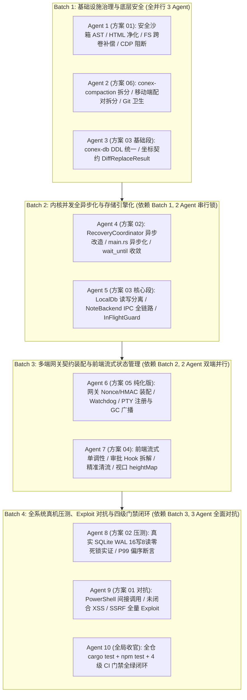

# 系统性重构与安全防御波 2 (Wave 2) — 00 执行方案终态定稿与全局调度总纲

> **方案版本**：2026-08-14 终态定稿版（Stage 4 Final Execution Master Plan）
> **权威路径**：`docs/systemic-remediation-wave-2/00-执行方案终态定稿.md`
> **规划契约**：严格遵循 `.agents/LOGIC_PLAN_NO_RETREAT.md`（纯逻辑规划、反退避、反伪完成、真机实证、零工期人天排期、所有问题同权同等重要）与 `AGENTS.md`（多 Agent 协作纪律、测试资产保护、Win32/pwsh7 环境规范）。
> **输入依据**：
>
> 1. 阶段一 5 份多维穿透分析报告真值（`docs/systemic-remediation-wave-2/analysis/01~05-*.md`）
> 2. 阶段二 1 份总方案与 6 份专业详案（`docs/systemic-remediation-wave-2/plans/00~06-*.md`）
> 3. 阶段三 4 份多维穿透独立评审报告（`docs/systemic-remediation-wave-2/plan-reviews/REV-01~REV-04-*.md`）
> 4. 历史架构审计档案（`.agent-outputs/2026-08-14-architecture-audit/`）

---

## 目录

1. [战役总纲、核心目标与反退避铁律契约](#一战役总纲核心目标与反退避铁律契约)
   - 1.1 战役背景与五大核心目标
   - 1.2 纯逻辑规划与反退避铁律契约
   - 1.3 全量融合：15 项核心评审加固项总览
2. [系统性全局拓扑依赖（DAG）与多 Agent 4 批次流水线](#二系统性全局拓扑依赖dag与多-agent-4-批次流水线)
   - 2.1 依赖拓扑图（Mermaid DAG 校准版）
   - 2.2 4 批次多 Agent 协同流水线架构
   - 2.3 文件域物理互斥与并发锁矩阵
3. [六大专业领域终态执行规范（融合评审与加固）](#三六大专业领域终态执行规范融合评审与加固)
   - 3.1 方案 01：安全门禁、沙箱 AST、HTML 净化器与底层安全防御终态规范
   - 3.2 方案 02：并发锁序、全异步协调与真实压测终态规范
   - 3.3 方案 03：存储引擎读写分离、CAS GC、协同因果撤销与跨包契约终态规范
   - 3.4 方案 04：前端流式单调不变量、审批 Hook 解耦与 Store 治理终态规范
   - 3.5 方案 05：多端网关零信任鉴权、会话生命周期与 PTY 活性治理终态规范
   - 3.6 方案 06：上帝文件结构化拆分、契约解耦与代码工程卫生终态规范
4. [多 Agent 协同执行编排与操作指南](#四多-agent-协同执行编排与操作指南)
   - 4.1 Batch 1: 基础设施治理、安全沙箱与代码卫生（Agent 1 ~ 3）
   - 4.2 Batch 2: 内核并发全异步化与存储引擎化（Agent 4 ~ 5）
   - 4.3 Batch 3: 多端网关契约装配与前端流式状态管理（Agent 6 ~ 7）
   - 4.4 Batch 4: 全系统真机压测、Exploit 对抗与四级门禁闭环（Agent 8 ~ 10）
   - 4.5 多 Agent Git 提交与冲突防范铁律
5. [全系统 40 项全量机器验收断言总表](#五全系统-40-项全量机器验收断言总表)
6. [实施前检查清单与质量门禁标准](#六实施前检查清单与质量门禁标准)

---

## 一、战役总纲、核心目标与反退避铁律契约

### 1.1 战役背景与五大核心目标

在 Conex / Crish 系统的快速迭代与架构重构历程中，各子系统在局域功能与常规单元测试层面保持了表面的高覆盖率与绿灯通过，但在**跨层协作**、**真实并发调度**、**安全纵深防御**、**协同编辑因果契约**以及**架构卫生与上帝文件**等关键维度，积累了一批结构性断层、门控式降级（`#[cfg(test)]` 隔离）、半拆未接线代码债（Unwired Debt）以及测试内的假锁/假等待玩具反模式。

本战役（Systemic Remediation Wave 2）旨在对上述深层隐患执行**系统性根治**，达成以下五大终极目标：

1. **安全门禁全链路闭环（100% Fail-Closed）**：彻底根治 PowerShell `&` 调用操作符与嵌套间接执行绕过、未闭合 HTML 残片 XSS 注入、FS 快照权限拒绝误删原文件以及 CDP 传输层 `https://` / DNS 重绑定盲区；
2. **全异步化与五级锁偏序落地（零死锁实证）**：彻底拔除 `RecoveryCoordinator` 上的 `std::sync::Mutex` 与 `block_on` 违规套娃，确立全仓 $L_0 \prec L_1 \prec L_2 \prec L_3 \prec L_4$ 单向偏序不变量，并在真实 SQLite WAL 与真实内核状态机上实现 16-Agent 零死锁实证；
3. **存储引擎与协同因果接线（零数据丢失）**：生产装配 `DbWriteHandle`（写 Actor）与 `ReaderPool`（自适应只读池），补齐 `catch_unwind` 崩溃防护与 CAS 分批 GC；收敛协同编辑至精确的 `text_undo`/`text_redo` 因果撤销，废除快照整树覆盖，统一双端强类型坐标系；
4. **流式单调不变量与前端治理（零渲染撕裂）**：确立 $\text{RenderedText}(t_1) \subseteq \text{RenderedText}(t_2)$ 流式单调公理，根治 Timeline 签名缓存截断；约束 Esc 按键容器作用域与 IME 守卫，拆解 445 行上帝 Hook，实现消息级精准清流与视口平滑锚定；
5. **多端契约真实装配与上帝文件解耦（高内聚低耦合）**：解除 `AdvancedNonceGuard` 与 HMAC 门控式降级，实现 WebSocket 真实验签；将 Watchdog 绑定会话生命周期，补齐 PTY 前台保活与双端 Manifest 同步；物理拆分 3051 行 `conex-compaction` 与 960 行 `pairingWiring.ts`；彻底清理 Git 误跟踪临时脚本。

---

### 1.2 纯逻辑规划与反退避铁律契约

依据 `.agents/LOGIC_PLAN_NO_RETREAT.md` 与 `AGENTS.md`，本定稿方案与后续所有执行 Agent **必须无条件履行以下铁律纪律**：

- **效果锁与零降级**：用户与架构规范给定的效果与安全契约不得自行降级为简化版或 MVP；任何功能冲突只能标出并请示，Agent 无权私自裁剪目标；
- **纯逻辑规划与零工期人天**：方案只谈逻辑依赖、任务单元、文件域、验收断言；**全篇严格保持 0 工期、0 人天、0 排期、0 人员分配**；
- **所有问题同权同等重要**：方案只按拓扑依赖分层推进，**绝不引入 P0/P1/P2 业务优先级划分**，所有已识别的 40 项缺陷单元具有同等的闭环重要性；
- **反伪完成与真机实证**：严禁在测试中手写假锁（如 `AsyncMutex`、`SingleWriterQueue`）、假等待（`sleep(30ms)`）或用宽松断言（`toStrictEqual` 代替 `toBe`）注水；必须在真实环境、真实 SQLite WAL 实例与真实 DOM/网络流上完成对抗验证；
- **严禁补丁与绕过**：修复边缘问题必须穿透表象找到架构断层，严禁魔术数字补偿；**绝对禁止使用 `--no-verify` 跳过门禁**。

---

### 1.3 全量融合：15 项核心评审加固项总览

本终态定稿全面吸收融合了阶段三 4 份独立评审报告（REV-01 至 REV-04）及历史架构审计的最佳实践，将 15 项核心加固项全面落实至执行基准中：

```
┌────────────────────────────────────────────────────────────────────────────────────────────────────────┐
│                                   15 项核心评审加固项全景融合矩阵                                       │
├────┬─────────────────────────────┬───────────┬────────────────────────────────────────────────────────┤
│ 序 │ 加固项名称                  │ 来源评审  │ 终态落地方案与架构规范                                  │
├────┼─────────────────────────────┼───────────┼────────────────────────────────────────────────────────┤
│ 1  │ 方案 05/06 文件域去重纯化   │ REV-01    │ 方案 05 剥离上帝文件拆分专注网关；方案 06 独占上帝文件拆分与 Git 卫生 │
│ 2  │ 前端命令清单双端镜像同步    │ REV-02    │ `commandManifest.ts` 补齐 PTY 3 命令，同步更新测试数量断言│
│ 3  │ `DeviceEnvelope.auth` 容错  │ REV-02    │ `DeviceEnvelope.auth` 增加 `#[serde(default)]`，派生 Default│
│ 4  │ `NoteBackend` 协同撤销 IPC  │ REV-02/01 │ `agent-tools` trait 增补方法，落地 Tauri 命令与前端 API 链路│
│ 5  │ 五级锁偏序表述公理化澄清    │ REV-02    │ 形式化澄清 $L_2$ 异步作用域锁调用 $L_1/L_0$ 细粒度叶子锁安全单向序│
│ 6  │ PTY GC 广播强类型化         │ REV-02    │ `workbench://pty-gc-killed` 收敛复用 `PtyExitEvent` 强类型结构体│
│ 7  │ 按键拦截 IME 合成态守卫     │ REV-02    │ `useApprovalKeyboard` 补齐 `e.isComposing` / keyCode 229 守卫│
│ 8  │ Compaction 测试文件 5 份拆分│ REV-03    │ 拆分为 5 个子测试文件（均 $\le 1000$ 行），满足测试代码行数门禁│
│ 9  │ `wait_until` 轮询工具集中收敛│ REV-03   │ 收敛至 `crates/orchestrator/tests/common/mod.rs` 共享复用 │
│ 10 │ AST 间接命令分析深度熔断    │ REV-03    │ 引入 `MAX_RECURSION_DEPTH = 5`，增补 6 层嵌套间接调用对抗用例│
│ 11 │ CAS 代际令牌与瞬态删除抑制  │ REV-04    │ `InFlightExportGuard` 引入 1000ms TTL、代际 Token 与删除抑制│
│ 12 │ 分级锁中毒自愈策略          │ REV-04    │ $L_0$ 守卫使用 `into_inner()`；$L_1/L_2$ 触发 Rollback-On-Poison 重新 Hydrate│
│ 13 │ 跨卷移动失败补偿与只读剥离  │ REV-04    │ `remove_file(src)` 失败回滚清理目标；删除前自动清除只读属性 │
│ 14 │ 前端 Undo 视口 `heightMap`  │ REV-04    │ `MessageDelta` 携带 `heightMap` 元数据，微任务校准 `scrollTop`│
│ 15 │ CDP SSRF 双协议阻断与 DNS   │ REV-04    │ 覆盖 `http://` 与 `https://` 私网网段，补齐 DNS 重绑定探测   │
└────┴─────────────────────────────┴───────────┴────────────────────────────────────────────────────────┘
```

---

## 二、系统性全局拓扑依赖（DAG）与多 Agent 4 批次流水线

### 2.1 依赖拓扑图（Mermaid DAG 校准版）

本 DAG 已经过 REV-01 拓扑校准，彻底修复了原草案中存在的连线笔误（如前端流式连向安全沙箱、压缩引擎连向 SQLite WAL 等）：

```mermaid
graph TD
    subgraph Phase_L1["Phase L1: 基础契约、安全沙箱与工作区卫生"]
        L1_1["L1-1: 工作区卫生与 Git 索引清理 (git rm --cached / .gitignore)"]
        L1_2["L1-2: conex-db 架构统一与 DDL/CAS 去重 (标准 sha2 / 统一时间)"]
        L1_3["L1-3: conex-sandbox AST 状态机根治 (& 间接调用 / 深度熔断)"]
        L1_4["L1-4: HTML 净化器残片转义与实体校验 (escapeHtml / 截断 XSS 根治)"]
        L1_5["L1-5: 协同编辑坐标契约与代理项统一 (DiffReplaceResult / 强类型)"]
        L1_6["L1-6: FS 快照 Fail-Closed 与跨卷补偿 (trash.rs / watch.rs 收窄)"]
    end

    subgraph Phase_L2["Phase L2: 并发引擎、全异步化与上帝文件拆分"]
        L2_1["L2-1: RecoveryCoordinator 全异步化 (消除 Mutex 与 block_on)"]
        L2_2["L2-2: 五级偏序锁拓扑契约落地 (L0 < L1 < L2 < L3 < L4 形式化)"]
        L2_3["L2-3: conex-db 读写分离引擎化 (catch_unwind 隔离 / 分批 GC)"]
        L2_4["L2-4: conex-compaction 上帝文件拆分 (6 子模块 + 5 测试文件)"]
        L2_5["L2-5: pairingWiring.ts 移动端上帝文件拆分 (6 个单一职责模块)"]
    end

    subgraph Phase_L3["Phase L3: 领域协议、网关契约与生命周期协同"]
        L3_1["L3-1: 多端网关 NonceGuard 与 HMAC 装配 (解除 cfg(test) / Serde 容错)"]
        L3_2["L3-2: Watchdog 会话生命周期绑定 (动态创建 / DB+Timer 数据源)"]
        L3_3["L3-3: PTY 终端前台保活与 GC 广播 (ping 注册 / 强类型 PtyExitEvent)"]
        L3_4["L3-4: 协同因果撤销全链产品接线 (NoteBackend / Tauri IPC / 前端 API)"]
        L3_5["L3-5: 移动端通知安全包装全量接入 (channels.ts / warn 结构化日志)"]
        L3_6["L3-6: CDP 传输层双协议阻断与 DNS 重绑定加固 (http + https / gate.rs)"]
    end

    subgraph Phase_L4["Phase L4: 前端流式渲染、交互防护与 Store 治理"]
        L4_1["L4-1: 流式单调不变量与 Timeline 签名根治 (状态感知 / 跃迁失效)"]
        L4_2["L4-2: useApprovalKeyboard 焦点与 IME 守卫 (rootRef 包含 / isComposing)"]
        L4_3["L4-3: useChatApprovalHandlers 上帝 Hook 拆分 (3 纯模块 + 2 子 Hook)"]
        L4_4["L4-4: finalizeAgentMessages 消息级精准清流 (clearStreams 消息隔离)"]
        L4_5["L4-5: SessionCoordinator 级联清理与视口锚定 (deleteSession / heightMap)"]
        L4_6["L4-6: autoIndexMiddleware 注水断言校准 (严格 toBe / 移除死代码)"]
        L4_7["L4-7: DOM Pinning 与 IME 增量缓冲产品化接线 (PaperList / CompositionBuffer)"]
    end

    subgraph Phase_L5["Phase L5: 真机对抗、压力实证与反伪完成闭环"]
        L5_1["L5-1: 真实 SQLite WAL 16-Agent 并发零死锁实证 (10s 哨兵 / P99 偏序断言)"]
        L5_2["L5-2: 前端测试假锁玩具模型清除与真实并发压测 (拆除 AsyncMutex / ptyRegistry)"]
        L5_3["L5-3: 消除测试用例 sleep 假等待 (wait_until 确定性状态轮询)"]
        L5_4["L5-4: 安全 AST 门禁与未闭合 XSS 全量对抗实证 (7 类调用符 / 未闭合标签 / SSRF)"]
        L5_5["L5-5: 协同双端因果撤销与 Emoji 坐标无漂移实证 (双端并发保留 / Emoji Round-trip)"]
    end

    %% 跨层逻辑依赖连线 (校准后)
    L1_1 --> L2_4
    L1_1 --> L2_5
    L1_2 --> L2_3
    L1_3 --> L5_4
    L1_4 --> L5_4
    L1_5 --> L3_4
    L1_5 --> L4_7
    L1_6 --> L5_4

    L2_1 --> L3_2
    L2_1 --> L5_1
    L2_2 --> L5_1
    L2_3 --> L3_2
    L2_3 --> L5_1
    L2_4 --> L2_4_TEST[Compaction 103 项单测]
    L2_5 --> L3_1

    L3_1 --> L5_4
    L3_2 --> L5_1
    L3_3 --> L5_2
    L3_4 --> L4_7
    L3_4 --> L5_5
    L3_5 --> L5_4
    L3_6 --> L5_4

    L4_1 --> L5_2
    L4_2 --> L5_2
    L4_3 --> L5_2
    L4_4 --> L5_2
    L4_5 --> L5_2
    L4_6 --> L5_2
    L4_7 --> L5_5
```



---

### 2.2 4 批次多 Agent 协同流水线架构

为实现高并发实施、杜绝同文件写入冲突并确保依赖严格串行，确立 **4 批次流水线编排**：



---

### 2.3 文件域物理互斥与并发锁矩阵

全战役实施期间，各 Agent **必须严格在分配的文件域内读写**。跨方案共享文件采用严格的**批次串行锁（Sequential File Lock）**：

| 共享/核心文件路径                                         | 涉及方案与 Agent                                                          | 冲突风险机理                                  | 强制串行调度与锁契约                                                                                                                                                                                                                               |
| :-------------------------------------------------------- | :------------------------------------------------------------------------ | :-------------------------------------------- | :------------------------------------------------------------------------------------------------------------------------------------------------------------------------------------------------------------------------------------------------- |
| `apps/agent-workbench/src-tauri/src/main.rs`              | **方案 02 (Agent 4)**<br/>**方案 03 (Agent 5)**<br/>**方案 05 (Agent 6)** | 同时修改 Tauri 命令宏注册表与 IPC 门面函数    | 🔴 **严格串行锁**：<br/>1. Batch 2 中 Agent 4 先行完成 `core_resume_subagent` 异步改造并提交；<br/>2. Batch 2 中 Agent 5 随后跟进注册 `note_undo_text`/`note_redo_text` 并提交；<br/>3. Batch 3 中 Agent 6 最后注册 `workbench_pty_*` 命令并提交。 |
| `apps/agent-workbench/src-tauri/src/engine_build.rs`      | **方案 02 (Agent 4)**<br/>**方案 05 (Agent 6)**                           | 状态机装配与 Watchdog 构造生命周期            | 🔴 **严格批次隔离**：<br/>Agent 4 在 Batch 2 完成 `CoreRunState` 构造后，Agent 6 在 Batch 3 接入会话级 Watchdog。                                                                                                                                  |
| `crates/conex-db/` 核心模块                               | **方案 03 (Agent 3, 5)**<br/>**方案 02 压测 (Agent 8)**                   | 压力测试直接依赖并高频调用 `LocalDb` 真实 API | 🔴 **拓扑先后序**：<br/>Agent 3/5 完全完成读写分离与 GC 并通过单测后，Agent 8 才能启动真实 WAL 压测。                                                                                                                                              |
| `crates/agent-tools/src/note_backend.rs`                  | **方案 03 (Agent 5)**                                                     | Trait 源头定义与下游实现依赖                  | 🟡 **前置定义先落盘**：<br/>Agent 5 必须首先修改 `agent-tools` 中的 trait，再修改 `conex-note-runtime` 与 Tauri 壳。                                                                                                                               |
| `apps/crish-desktop/src/api/transport/commandManifest.ts` | **方案 05 (Agent 6)**<br/>**方案 03 (Agent 5)**                           | 前端权威命令清单镜像                          | 🟡 **分段追加**：<br/>Agent 5 追加 `note_undo_text` 镜像；Agent 6 追加 `workbench_pty_*` 镜像并同步更新测试用例数量断言。                                                                                                                          |

---

## 三、六大专业领域终态执行规范（融合评审与加固）

### 3.1 方案 01：安全门禁、沙箱 AST、HTML 净化器与底层安全防御终态规范

- **执行方案文件**：`docs/systemic-remediation-wave-2/plans/01-安全与沙箱AST根治详案.md`
- **责任 Agent**：Batch 1 (Agent 1) & Batch 4 (Agent 9)
- **核心融合规范**：

1. **PowerShell `&` 动态调用操作符与深度熔断（加固项 10）**：
   - 在 `crates/conex-sandbox/src/semantics.rs` 中，将 `&` 纳入 `INDIRECT_COMMANDS`；
   - 在 `normalize_command` 中将 `&(`、`&{`、`$(` 归一化为 `&`，并剥除 `.exe` 后缀；
   - 在 `analyze_indirect` 中新增 `&` 专用分支：提取子命令与参数，递归调用 `analyze_depth(&inner_cmd, depth + 1)`；
   - **深度熔断硬约束**：引入 `MAX_RECURSION_DEPTH = 5`；当 `depth >= 5` 时，直接将命令判定为 `CommandClass::Dangerous` 并终止递归；
   - 编写针对 6 层嵌套间接调用（`& cmd /c & cmd /c ...`）的对抗测试，断言其安全阻断。
2. **HTML 未闭合残片转义与 XSS 根治（H2 突破）**：
   - 在 `packages/plugin-sdk/src/sanitizer/htmlSanitizer.ts` 中构建残片预检防线：
     使用正则 `/<([a-zA-Z0-9:-]+)(?:[^>"']|"[^"]*"|'[^']*')*$/g` 捕获末尾悬空的未闭合标签残片，并无条件使用 `escapeHtml` 安全转义为实体文本（如 `>>>`；
   - 彻底删除 `run_core.rs` 中的 `block_on_coordinator_failure` 与 `blocking_coordinator_call`；
   - 重写 `main.rs::core_resume_subagent`：同步读 DB 走 `spawn_blocking`，异步 fork 阶段直接全异步获取 $L_2$ 锁并 `await` 执行。
2. **五级单向偏序形式化公理（$L_0 \prec L_1 \prec L_2 \prec L_3 \prec L_4$）（加固项 5）**：
   - **补充公理**：$L_2$ 是粗粒度异步业务互斥锁，$L_1 / L_0$ 是细粒度内存叶子锁。在持有 $L_2$ 的上下文中允许在局部同步作用域 `{}` 内临时获取并释放 $L_1$ 或 $L_0$（立即 Drop，绝不跨 await）；全仓绝对禁止在持有 $L_0 / L_1$ 时申请 $L_2$；
   - 严禁在 $L_0 / L_1$ 同步锁内跨 `.await`。
3. **分级锁中毒自愈策略（加固项 12）**：
   - **$L_0$ 内存守卫**：允许使用 `unwrap_or_else(|e| e.into_inner())` 进行安全的容器复用；
   - **$L_1 / L_2$ 核心领域状态机**（如 `DocSession`、`SessionTree`）：严禁盲目 `into_inner()`；发生 Poison 时触发 **Rollback-On-Poison 协议**，丢弃内存脏实例并从 SQLite WAL 权威快照中重新 Hydrate。
4. **共享确定性轮询工具 `wait_until` 集中收敛（加固项 9）**：
   - 在 `crates/orchestrator/tests/common/mod.rs` 中统一定义通用的 `wait_until<T, F, Fut>`；
   - 消除 `pending_input_lifecycle.rs` 中的 6 处 `sleep(30ms)`，全部改用 `wait_until`；消除 `stress_concurrent_runs.rs` 中的 10ms 假等待。
5. **真实 SQLite WAL 16 写 8 读压测与死数据激活（反注水）**：
   - 在 `crates/orchestrator/tests/stress_empirical_concurrency.rs` 中装配真实 WAL 数据库、真实异步协调器、独占写 Actor 与读池；
   - 启动 16 写 8 读并发 Worker，受 10 秒硬性超时哨兵监控；
   - 激活 P99 偏序断言：$\text{assert}(P_{99}(L_0) \le P_{99}(L_1) \le P_{99}(L_2))$ 且 $P_{99}(\text{write}) < 50\text{ms}$。

---

### 3.3 方案 03：存储引擎读写分离、CAS GC、协同因果撤销与跨包契约终态规范

- **执行方案文件**：`docs/systemic-remediation-wave-2/plans/03-存储GC与协同编辑详案.md`
- **责任 Agent**：Batch 1 (Agent 3) & Batch 2 (Agent 5)
- **核心融合规范**：

1. **`LocalDb` 读写分离引擎化与 Actor 崩溃隔离**：
   - `LocalDb` 内部装配 `DbWriteHandle`（写 Actor）与 `ReaderPool`（8 槽自适应只读池），废除单锁 `Arc<Mutex<Connection>>`；
   - 在 `group_commit.rs` 中使用 `std::panic::catch_unwind` 隔离每个写任务闭包，单任务 Panic 仅回滚自身 Savepoint，写通道持续存活；
   - CAS GC 优化为基于只读连接的流式分批扫描（`LIMIT 100`）；物理清除外置文件时联动 `fs::remove_file`；`GcScanStats` 采集真实计数值。
2. **`InFlightExportGuard` 代际令牌与瞬态删除抑制（加固项 11）**：
   - 废除同步 `unregister` API，改为 **1000ms 自然 TTL** 淘汰；
   - 引入 `Generation Token: u64` 单调递增代际令牌；
   - 引入 `InFlightSuppressVerdict::SuppressTransientDeletion`，在 Windows 重命名微秒级物理缺失期容忍 `NotFound`，压制 OS Watcher 假告警。
3. **`NoteBackend` 协同撤销 IPC 链路全闭环（加固项 4 / REV-01 遗漏修复）**：
   - 在 `crates/agent-tools/src/note_backend.rs` 的 `pub trait NoteBackend` 中新增 `undo_text` 与 `redo_text` 方法；
   - 在 `crates/conex-note-runtime/src/store_backend.rs` 中实现该 trait 方法；
   - 在 `apps/agent-workbench/src-tauri/src/note_commands_apply.rs` 实现 `note_undo_text` / `note_redo_text` Tauri 命令；
   - 在 `command_manifest.rs` 与前端 `commandManifest.ts` 中登记命令；
   - 在 `apps/crish-desktop/src/api/noteApi.ts` 导出 `undoNoteText` / `redoNoteText`。
4. **强类型双坐标系 `DiffReplaceResult` 契约统一**：
   - 在 `packages/block-paper-contract/src/diff.ts` 中统一定义强类型 `DiffReplaceResult`（`startU16`, `endU16`, `startScalar`, `endScalar`），由 `coordinates.ts` 重新导出；
   - 修复 Surrogate Pair 内部偏移非互逆性（执行严格 Floor 对齐）；
   - 将 `buildCodeTextEditIntent` 中的 `baseContent` 参数改为强制必传。
5. **Yrs 因果撤销与 IME 增量缓冲产品化接线**：
   - 废除整树快照覆盖，富文本撤销全面收敛至 `DocSession::text_undo` / `text_redo`；无撤销项时返回 `Err(UndoError::Empty)` 且不推进 `rev`；
   - 在 `PaperList.ts` 中接入 `DomPinningRegistry` 延迟卸载；协同消息入口装配 `CompositionPatchBuffer`。

---

### 3.4 方案 04：前端流式单调不变量、审批 Hook 解耦与 Store 治理终态规范

- **执行方案文件**：`docs/systemic-remediation-wave-2/plans/04-前端流式与状态管理详案.md`
- **责任 Agent**：Batch 3 (Agent 7)
- **核心融合规范**：

1. **流式到完成态单调不变量三层纵深防御（🔴 P-01 突破）**：
   - 形式化公理：$\forall t_1 \le t_2, \text{RenderedText}(t_1) \subseteq \text{RenderedText}(t_2)$ 且 $\text{len}(t_{\text{completed}}) \ge \text{len}(t_{\text{stream\_final}})$；
   - **防线 1（状态感知签名）**：`timelineNormalizer.ts` 中，当 `msg.status !== 'processing'` 时，尾部 text 块必须将完整 `content` 计入签名，击穿陈旧缓存；
   - **防线 2（跃迁显式失效）**：`MessageContent.tsx` 中增加 `prevStreamingRef`，当侦测到 `streaming: true -> false` 跃迁时，显式执行 `timelineCacheRef.current.sig = null`；
   - **防线 3（兜底投影）**：在无显式 text 块时将 `msg.text` 纳入签名投影。
2. **`useApprovalKeyboard` 焦点与 IME 守卫（加固项 7）**：
   - 在 `useApprovalKeyboard.ts` 中补齐容器焦点包含性判定：`rootRef.current && rootRef.current.contains(e.target)`；
   - **IME 合成态守卫**：增加 `if (e.isComposing || (e as any).keyCode === 229) return;`，防止用户按 Esc 取消输入法候选词时误触发卡片 disarm。
3. **`useChatApprovalHandlers` 上帝 Hook 拆解与类型逃逸消除**：
   - 下沉纯函数域：提取 `approvalRollbackGuard.ts`（导出强类型守卫，消除全部 6 处 `as string === 'completed'` 类型逃逸）与 `approvalBatchResolver.ts`；
   - 建立模块级单例 `inFlightApprovalRegistry.ts`，统一请求锁并提供 `clearForTest()` 接口；
   - 拆分为 `useChatApprovalState`（<90 行）、`useChatApprovalExecutor`（<180 行）与聚合门面（<60 行）。
4. **精准消息级清流与视口 `heightMap` 锚定（加固项 14）**：
   - `streamingStore.ts` 增补 `clearStreams(sessionId, messageIds)`；`finalizeAgentMessages` 仅精准清理终态消息，多 Agent 并行流式互不误伤；
   - `sessionCrudActions.deleteSession` 补齐级联清理 `streamingStore`；
   - `MessageDelta` 引入 `heightMap` 元数据，`useUndoWithScrollAnchor` 在微任务中回灌实测高度并校准 `scrollTop`，消灭 120px 视口抖动。
5. **`autoIndexMiddleware.test.ts` 断言校准**：
   - 将注水的 `toStrictEqual` 更正为严格的原子引用断言 `toBe`；移除 `sessionsIdKey` 死导出。

---

### 3.5 方案 05：多端网关零信任鉴权、会话生命周期与 PTY 活性治理终态规范

- **执行方案文件**：`docs/systemic-remediation-wave-2/plans/05-多端契约与网络治理详案.md`（**纯化版**：剥离上帝文件拆分）
- **责任 Agent**：Batch 3 (Agent 6)
- **核心融合规范**：

1. **`AdvancedNonceGuard` 与 HMAC 生产真实装配（解除门控）**：
   - 彻底移除 `auth.rs` 中全部 `#[cfg(test)]` 标记，提升为 `pub(crate)` 生产组件；
   - 在 `ServerState` 中持有一等 `Arc<AdvancedNonceGuard>` 实例；
   - 在 `ws.rs` 与 `router.rs` 中装配全量 HMAC-SHA256 验签、时钟偏差（$\le 300\text{s}$）校验与 `X-Server-Time-Ms` 响应头注入。
2. **`DeviceEnvelope.auth` Serde 反序列化容错（加固项 3）**：
   - 在 `crates/conex-types/src/device/envelope.rs` 中，为 `AuthHeader` 派生 `Default` 并为各字段标注 `#[serde(default)]`；
   - 为 `DeviceEnvelope.auth` 标注 `#[serde(default)]`，确保配对阶段免签帧不发生反序列化崩溃。
3. **PTY 前台保活、生命周期切接与强类型 GC 广播（加固项 2 / 加固项 6）**：
   - 移除 `pty/mod.rs` 中的 `#[allow(dead_code)]`；
   - 在 `main.rs` 与 `command_manifest.rs` 注册 `workbench_pty_detach`、`workbench_pty_attach`、`workbench_pty_ping`；
   - **双端镜像同步**：在前端 `commandManifest.ts` 中同步追加 3 条命令镜像，并更新 `commandManifest.test.ts` 数量断言；
   - 前端获得焦点时启动 60s `ping` 保活；切 Tab 时 `detach`，切回时 `attach`；
   - 2h 超时回收时通过 `app.emit("workbench://pty-gc-killed", PtyExitEvent { pty_id, exit_code: None })` 强类型广播。
4. **`Watchdog` 会话生命周期绑定与真实数据源接入**：
   - 移除 `engine_build.rs` 全局空串单例；在 `SessionLoop` 初始化时动态创建 `Watchdog`；
   - 接入基于 `conex-db` 的 `DbDispatchStore` 与 `TimerRegistry`，注入 `CancellationToken` 杜绝协程泄漏。
5. **移动端通知安全包装与可观测性**：
   - `channels.ts` 全量接入 `setNotificationChannelAsyncSafe`；在 `expoNotificationsFacade.ts` 的 catch 块中增补结构化 `console.warn`。
6. **Wire-Only 角色交替协议协同**：
   - 领域层保持 100% 真实消息；角色交替适配严格收敛于 Provider 发出 HTTP 请求的最后序列化瞬间，多端网关收发格式完全同构。

---

### 3.6 方案 06：上帝文件结构化拆分、契约解耦与代码工程卫生终态规范

- **执行方案文件**：`docs/systemic-remediation-wave-2/plans/06-上帝文件拆分与代码卫生详案.md`（**独占所有权**）
- **责任 Agent**：Batch 1 (Agent 2)
- **核心融合规范**：

1. **`conex-compaction` 上帝文件物理拆分与测试解耦（加固项 8）**：
   - 源码物理拆分为 6 个单职责子模块（有效行均 $\le 500$ 行）：
     - `lib.rs`（<80 行）：对外门面与重导出；
     - `tokens.rs`（~160 行）：Token 估算与多模态图片开销；
     - `thresholds.rs`（~120 行）：85%/95% 预算水位决策；
     - `cut_point.rs`（~260 行）：ToolBatch 双向闭包与 $j \ge \text{fold\_start}$ 切割点倒推；
     - `plan.rs`（~240 行）：压缩策略与占位符生成；
     - `engine.rs`（~420 行）：压缩驱动器与 50行/4096B 紧急预检降级；
     - `template.rs`（~110 行）：Markdown 结构化摘要渲染。
   - **测试文件拆分为 5 个子测试文件（加固项 8，均 $\le 1000$ 行）**：
     在 `crates/conex-compaction/tests/` 下拆分为：`tokens_test.rs`、`thresholds_test.rs`、`cut_point_test.rs`、`plan_test.rs`、`engine_test.rs`，确保 103 项单测 100% 绿灯。
2. **`pairingWiring.ts` 移动端上帝文件物理拆分**：
   - 在 `apps/crish-mobile/src/adapters/wiring/pairing/` 下拆分为 6 个模块（核心逻辑 $\le 380$ 行）：
     - `sessionSigning.ts`（~110 行）：签名信封与 WsGateway 工厂；
     - `pairingGateway.ts`（~50 行）：`PairingGateway` 子类；
     - `pairingPersistence.ts`（~90 行）：凭据常量与 SecureStore 适配器；
     - `fingerprintVerifier.ts`（~70 行）：纯粹的 `fingerprintsAgree` 指纹比对；
     - `PairingWiring.ts`（<380 行）：纯粹的状态机驱动器；
     - `pairingAssembly.ts`（~70 行）：单例管理与测试重置；
     - `index.ts`（~30 行）：聚合兼容导出。
3. **工作区工程卫生与 Git 索引脱离**：
   - 执行 `git rm --cached` 剥离 10 个误入库临时脚本；
   - 完善根目录 `.gitignore` 规则，拦截根目录临时 Python/Markdown 文件；
   - 挂载 `scripts/check-conflict-markers.mjs` 至 pre-commit 钩子，硬性阻断 `<<<<<<<` 冲突标记提交。

---

## 四、多 Agent 协同执行编排与操作指南

### 4.1 Batch 1: 基础设施治理、安全沙箱与代码卫生（全并行 3 Agent）

- **前置依赖**：方案定稿批准，无运行时依赖，3 个 Agent 全并行派发。
- **任务分工与独占文件域**：

```
[Agent 1: 方案 01 实施] ── 独占文件域:
  - crates/conex-sandbox/
  - packages/plugin-sdk/src/sanitizer/
  - crates/conex-fs/
  - crates/conex-browser/
  - crates/conex-computer/
  - crates/agent-tools/src/tools/shell.rs
  任务要点: 实现 & 调用符解析与 depth<=5 熔断; 实现 htmlSanitizer 残片转义; 修复 trash.rs 跨卷补偿与只读剥离; CDP 双协议阻断.

[Agent 2: 方案 06 实施] ── 独占文件域:
  - crates/conex-compaction/
  - apps/crish-mobile/src/adapters/wiring/pairing/
  - scripts/check-conflict-markers.mjs
  - .gitignore
  任务要点: 物理拆分 conex-compaction (6 源码 + 5 测试文件); 物理拆分 pairingWiring.ts; git rm --cached 清理 10 脚本; 配置 pre-commit.

[Agent 3: 方案 03 基础段实施] ── 独占文件域:
  - packages/block-paper-contract/src/
  - packages/editor-kit/src/diff/
  - packages/block-paper/src/leaves/
  - crates/conex-db/src/schema.rs
  - crates/conex-db/src/cas_gc.rs (基础 sha2 统一)
  任务要点: 统一定义 DiffReplaceResult (startU16/startScalar); 修复代理项 Floor 对齐; 统一 conex-db sha2 与 schema.
```

- **批次收口验证**：
  - `cargo test -p conex-sandbox -p conex-fs -p conex-browser -p conex-compaction` 全绿；
  - `npm test -- packages/plugin-sdk packages/block-paper-contract` 全绿；
  - `npm run check:line-counts` 验证行数达标；
  - 各 Agent 独立执行 `git commit --only <paths...>` 提交。

---

### 4.2 Batch 2: 内核并发全异步化与存储引擎化（2 Agent 串行锁调度）

- **前置依赖**：Batch 1 全部完成并提交。
- **任务分工与文件域**：

```
[Agent 4: 方案 02 实施] ── 独占文件域:
  - crates/orchestrator/src/recovery.rs
  - crates/orchestrator/src/lifecycle.rs
  - crates/orchestrator/tests/common/
  - crates/orchestrator/tests/pending_input_lifecycle.rs
  - apps/agent-workbench/src-tauri/src/run/
  - apps/agent-workbench/src-tauri/src/main.rs (🔴 获取串行写锁)
  任务要点: RecoveryCoordinator 全异步化; 删除 block_on 套娃; 重写 main.rs core_resume_subagent; wait_until 集中收敛.

[Agent 5: 方案 03 核心段实施] ── 独占文件域:
  - crates/agent-tools/src/note_backend.rs (🔴 先落盘 Trait 定义)
  - crates/conex-note-runtime/
  - crates/conex-db/ (lib.rs, group_commit.rs, reader_pool.rs, cas_gc.rs, lease_guard.rs)
  - crates/conex-workspace-store/
  - crates/conex-doc-collab/
  - apps/agent-workbench/src-tauri/src/note_commands_apply.rs
  - apps/agent-workbench/src-tauri/src/note_commands.rs
  - apps/crish-desktop/src/api/noteApi.ts
  - apps/agent-workbench/src-tauri/src/main.rs (🔴 Agent 4 提交后接管写锁)
  任务要点: LocalDb 读写分离与 catch_unwind; InFlightExportGuard 代际令牌; NoteBackend 全链路 undo_text 接线; Yrs 因果撤销.
```

- **批次收口验证**：
  - `cargo test -p orchestrator -p conex-db -p conex-doc-collab -p conex-note-runtime` 全绿；
  - 各 Agent 依次提交。

---

### 4.3 Batch 3: 多端网关契约装配与前端流式状态管理（2 Agent 双端并行）

- **前置依赖**：Batch 2 全部完成并提交。
- **任务分工与文件域**：

```
[Agent 6: 方案 05 纯化版实施] ── 独占文件域:
  - crates/conex-types/src/device/envelope.rs (#[serde(default)])
  - apps/agent-workbench/src-tauri/src/server/ (auth.rs 解门控, ws.rs, router.rs)
  - apps/agent-workbench/src-tauri/src/watchdog.rs
  - apps/agent-workbench/src-tauri/src/pty/
  - apps/crish-mobile/src/notifications/
  - apps/crish-desktop/src/api/ptySessionApi.ts
  - apps/crish-desktop/src/api/transport/commandManifest.ts (追加 PTY 命令)
  - apps/agent-workbench/src-tauri/src/main.rs (注册 PTY 命令)
  任务要点: DeviceEnvelope.auth 容错; auth.rs 生产装配; PTY 注册与 60s ping 保活; PTY GC 强类型广播; Watchdog 会话绑定.

[Agent 7: 方案 04 实施] ── 独占文件域:
  - apps/crish-desktop/src/api/tool-presentation/
  - apps/crish-desktop/src/components/chat-message/
  - apps/crish-desktop/src/components/chat-card/
  - apps/crish-desktop/src/components/agent-card/
  - apps/crish-desktop/src/api/chat-approval/
  - apps/crish-desktop/src/store/ (streamingStore.ts, sessionAgentActions.ts, sessionCrudActions.ts, autoIndexMiddleware.ts)
  - packages/editor-kit/src/viewport/domPinning.ts
  - packages/editor-kit/src/ime/CompositionPatchBuffer.ts
  - packages/block-paper/src/list/PaperList.ts
  任务要点: 落实流式单调不变量 3 层防线; useApprovalKeyboard 补齐 IME 守卫; 拆解 useChatApprovalHandlers; 消息级 clearStreams; heightMap 视口锚定; autoIndex toBe 断言校准.
```

- **批次收口验证**：
  - `cargo check -p crish-agent-workbench` 0 警告 0 错误；
  - `npm run typecheck` + `npm test -- apps/crish-desktop` 全绿；
  - 各 Agent 独立提交。

---

### 4.4 Batch 4: 全系统真机压测、Exploit 对抗与四级门禁闭环（3 Agent 全面对抗）

- **前置依赖**：Batch 3 全部完成并提交。
- **任务分工与对抗实证**：

```
[Agent 8: 真实并发与 SLA 压测] ── 责任任务:
  - 执行 crates/orchestrator/tests/stress_empirical_concurrency.rs (16 写 8 读真实 SQLite WAL 零死锁实证, 10s 哨兵, P99 偏序断言);
  - 执行 tests/stress/stress-16-subagents.test.ts (前端真实 ptyRegistry 与 StreamTextBatcher 压测, 彻底清退 AsyncMutex 假锁).

[Agent 9: 全量安全 Exploit 对抗] ── 责任任务:
  - 运行 PowerShell 7 类调用符变体与 6 层嵌套熔断对抗测试;
  - 运行 HTML 未闭合残片与 XSS 截断注入对抗测试 (sanitizer.test.ts 6 组用例);
  - 运行 CDP SSRF 私网双协议阻断与 DNS 重绑定探测测试;
  - 运行多端网关篡改 sig / 重放 Nonce 拦截测试.

[Agent 10: 全仓四级门禁与收官闭环] ── 责任任务:
  - 运行 Rust 全量测试: cargo test --workspace;
  - 运行前端全量门禁: npm run typecheck + npm run test:coverage -- --project=unit + npm run test;
  - 运行行数扫描门禁: npm run check:line-counts (验证所有上帝文件拆分达标);
  - 运行冲突标记扫描: node scripts/check-conflict-markers.mjs (验证零冲突标记).
```

---

### 4.5 多 Agent Git 提交与冲突防范铁律

依据 `AGENTS.md` §3，所有 Agent 在执行提交时必须严格遵循以下纪律：

1. **允许并行提交，限定文件路径**：子 Agent 完成任务后，使用 `git commit --only <paths...>` 提交自身文件域，严禁 `git commit -a` 或全量 `git add .` 误提交他人文件；
2. **绝对严禁回撤**：任何 Agent 严禁执行 `git reset --hard`、`git checkout .` 或 `git restore` 覆盖他人代码；发现冲突或错误采用精确 edit 修复；
3. **被吞并处理（不回撤、不重做）**：若自身改动已被其他 Agent 或定时 Git Agent 提交，使用 `git show HEAD:<path>` 校验内容完整性，完整则放行，缺失则增补；
4. **Hook 阻塞快速排除**：若他人文件的 trailing whitespace 阻塞了 `.husky/pre-commit`，做最小 whitespace 修复解除阻塞；
5. **门禁零绕过**：严禁 `--no-verify`，所有 Git 钩子报错必须正面根治。

---

## 五、全系统 40 项全量机器验收断言总表

依据反退避与纯逻辑规划铁律，以下 40 项机器验收断言**地位完全同等（All Equal Weight）**，构成系统性重构 Wave 2 准出验收的唯一机器真值依据：

| 领域分类             | 断言编号      | 核心目标与断言内容                                                                                        | 权威验证命令 / 证据手段                                          |
| :------------------- | :------------ | :-------------------------------------------------------------------------------------------------------- | :--------------------------------------------------------------- |
| **安全沙箱**         | **AST-01**    | `& cmd /c rmdir ...` 等 7 类调用符变体必须识别为 `has_indirect_delete = true` 且判定为 `RequiresApproval` | `cargo test -p conex-sandbox test_call_operator`                 |
| **安全沙箱**         | **AST-02**    | `& cmd /c rm -rf /` 必须 100% 判定为 `GatekeeperResult::Blocked`                                          | `cargo test -p conex-sandbox`                                    |
| **安全沙箱**         | **AST-03**    | 6 层嵌套调用符（`& cmd /c & cmd /c ...`）触发 `depth>=5` 深度熔断并判定为 `Dangerous`                     | `cargo test -p conex-sandbox test_recursion_depth`               |
| **安全沙箱**         | **AST-04**    | `ShellCommandTool::prepare` 对所有间接删除正确重定向至回收站或审批流                                      | `cargo test -p agent-tools`                                      |
| **HTML净化**         | **XSS-01**    | `<img src=x onerror=alert(1)` 等未闭合残片 100% 转义为 `&lt;img ...` 实体文本，严禁原生标签输出           | `npm test -- packages/plugin-sdk`                                |
| **HTML净化**         | **XSS-02**    | `sanitizer.test.ts` 增补 6 项未闭合残片与 EOF 截断对抗用例且全部绿灯通过                                  | `npm test -- packages/plugin-sdk`                                |
| **文件系统**         | **FS-01**     | `trash.rs::snapshot` 遇 `PermissionDenied` 必须 Fail-Closed 报错，严禁登记 nil 快照致误删原文件           | `cargo test -p conex-fs`                                         |
| **文件系统**         | **FS-02**     | 跨卷移动源删除失败时自动触发目标文件回滚补偿清理，无孤儿文件残留                                          | `cargo test -p conex-fs test_cross_volume_rollback`              |
| **文件系统**         | **FS-03**     | Windows 只读文件移动到回收站前自动剥离只读属性并成功删除                                                  | `cargo test -p conex-fs test_readonly_strip`                     |
| **浏览器网关**       | **CDP-01**    | `blocked_urls()` 同时覆盖内网保留网段的 `http://` 与 `https://` 模式                                      | `cargo test -p conex-browser`                                    |
| **浏览器网关**       | **CDP-02**    | 访问解析至私网 IP 的非 localhost 域名被 DNS 重绑定防护阻断                                                | `cargo test -p conex-browser`                                    |
| **提权探测**         | **WIN32-01**  | 移除 `access_denied_elevated.exe` 魔法字符串；句柄获取失败严格 Fail-Closed                                | `cargo test -p conex-computer`                                   |
| **并发锁序**         | **LOCK-01**   | `RecoveryCoordinator` 实例全异步化，彻底删除 `block_on` 嵌套函数                                          | `cargo check -p crish-agent-workbench`                           |
| **并发锁序**         | **LOCK-02**   | 确立 $L_0 \prec L_1 \prec L_2 \prec L_3 \prec L_4$ 单向偏序，全仓无跨 await 持同步锁现象                  | 全仓静态审查与编译检查                                           |
| **并发锁序**         | **LOCK-03**   | 锁中毒分类自愈：$L_0$ 守卫安全 `into_inner()`；$L_1/L_2$ 状态机触发 Rollback-On-Poison 从 DB 恢复         | `cargo test -p orchestrator test_poison_recovery`                |
| **确定性等待**       | **SYNC-01**   | `wait_until` 轮询工具统一收敛至 `common/mod.rs`；消除 `pending_input_lifecycle.rs` 6 处 `sleep`           | `cargo test -p orchestrator --test pending_input_lifecycle`      |
| **真实压测**         | **STRESS-01** | 16 写 8 读真实 SQLite WAL 压测在 10s 哨兵内通过，断言 $P_{99}(L_0) \le P_{99}(L_1) \le P_{99}(L_2)$       | `cargo test -p orchestrator --test stress_empirical_concurrency` |
| **真实压测**         | **STRESS-02** | 拆除前端测试 `AsyncMutex` 假锁类，接入 `ptyRegistry` 与 `StreamTextBatcher` 真实高频压测                  | `npm test -- tests/stress`                                       |
| **存储架构**         | **DB-01**     | `LocalDb` 生产装配 `DbWriteHandle` 写 Actor 与 `ReaderPool` 读池，并发 16 写 16 读无死锁                  | `cargo test -p conex-db`                                         |
| **写崩溃隔离**       | **DB-02**     | `DbWriteHandle` 任务 Panic 被 `catch_unwind` 隔离，写通道不关闭且持续响应后续请求                         | `cargo test -p conex-db`                                         |
| **GC度量与清理**     | **DB-03**     | CAS GC 10,000 Blob 分批流式扫描（`LIMIT 100`）；物理删除外置文件；`GcScanStats` 无恒 0 指标               | `cargo test -p conex-db`                                         |
| **DDL治理**          | **DB-04**     | 删除 `schema.rs` 冗余 DDL，统一使用标准 `sha2` crate 与 ISO 时间字段                                      | `cargo test -p conex-db`                                         |
| **文件导出防护**     | **DB-05**     | `InFlightExportGuard` 落实 1000ms TTL、代际 Token 与瞬态删除抑制，OS 假告警为 0                           | `cargo test -p conex-workspace-store`                            |
| **协同撤销**         | **CRDT-01**   | 双端协同下本地执行 `text_undo` 仅撤销本地变更，远端并发插入 100% 完好保留                                 | `cargo test -p conex-doc-collab`                                 |
| **撤销空推**         | **CRDT-02**   | 无撤销历史时 `text_undo` 返回 `Err(UndoError::Empty)`，`rev` 保持不变                                     | `cargo test -p conex-doc-collab`                                 |
| **坐标一致**         | **CRDT-03**   | 统一 `DiffReplaceResult` 强类型定义，Emoji 与复合 Emoji 坐标转换双向单射无漂移                            | `npm test -- packages/block-paper-contract`                      |
| **协同撤销全链**     | **CRDT-04**   | `NoteBackend` trait 暴露 `undo_text`/`redo_text`，Tauri 命令与前端 API 全链路闭环                         | `cargo test -p conex-note-runtime` + `npm test`                  |
| **IME防卸载**        | **CRDT-05**   | IME 中文合成期间虚拟列表滚动不卸载 DOM，协同补丁暂存上屏不吞字                                            | `npm test -- packages/editor-kit`                                |
| **流式单调性**       | **STREAM-01** | 确立流式单调公理，交错 blocks 消息完成态渲染包含全量最终文本，无截断回退                                  | `npm test -- apps/crish-desktop`                                 |
| **按键焦点隔离**     | **UI-01**     | `useApprovalKeyboard` 增加 `rootRef.contains` 守卫，外部聚焦按 Esc 不被劫持                               | `npm test -- apps/crish-desktop`                                 |
| **按键IME守卫**      | **UI-02**     | `useApprovalKeyboard` 增加 `e.isComposing` / keyCode 229 守卫，取消候选词不触发 disarm                    | `npm test -- apps/crish-desktop`                                 |
| **审批Hook解耦**     | **UI-03**     | 拆分 `useChatApprovalHandlers` 上帝 Hook（<60 行），消除全部 `as string` 类型逃逸                         | `npm run check:line-counts` + `npm run typecheck`                |
| **精准清流**         | **UI-04**     | `finalizeAgentMessages` 仅清理自身消息流，多 Agent 并行流式互不误伤                                       | `npm test -- apps/crish-desktop`                                 |
| **级联清理与视口**   | **UI-05**     | `deleteSession` 同步级联清理；`MessageDelta` 携带 `heightMap` 消灭 120px 视口抖动                         | `npm test -- apps/crish-desktop`                                 |
| **中间件校准**       | **UI-06**     | `autoIndexMiddleware.test.ts` 采用 `toBe` 严格引用断言；移除 `sessionsIdKey` 死导出                       | `npm test -- apps/crish-desktop`                                 |
| **网关零信任验签**   | **GW-01**     | 解除 `AdvancedNonceGuard` 编译门控，服务端生产装配 WS/HTTP 帧 HMAC 验签                                   | `cargo check -p crish-agent-workbench`                           |
| **信封Serde容错**    | **GW-02**     | `DeviceEnvelope.auth` 增加 `#[serde(default)]`，免签握手帧反序列化 100% 成功                              | `cargo test -p conex-types`                                      |
| **PTY保活与广播**    | **GW-03**     | 注册 PTY 3 命令并在前端 Manifest 同步；60s ping 保活；2h 回收广播强类型 `PtyExitEvent`                    | `cargo test -p crish-agent-workbench` + `npm test`               |
| **压缩上帝文件拆解** | **GOD-01**    | `conex-compaction` 拆为 6 子模块（均 <500 行）+ 5 子测试文件（均 $\le 1000$ 行），103 单测全绿            | `cargo test -p conex-compaction`                                 |
| **配对上帝文件拆解** | **GOD-02**    | `pairingWiring.ts` 拆为 6 子模块（均 <400 行），修复指纹比对，556 项单测全绿                              | `npx jest src/pairing src/adapters` (移动端)                     |

---

## 六、实施前检查清单与质量门禁标准

在主控 Agent 派发各批次实施任务前，以及各批次交付合并时，**必须严格逐项核对以下四级门禁与质量自检清单**：

### 6.1 四级质量门禁标准（Four-Tier Quality Gates）

```
┌────────────────────────────────────────────────────────────────────────────────────────┐
│                                全战役四级严格质量门禁                                   │
├─────────┬──────────────────────────────────┬───────────────────────────────────────────┤
│ 门禁级别 │ 门禁名称                         │ 验证命令与达标要求                        │
├─────────┼──────────────────────────────────┼───────────────────────────────────────────┤
│ Tier 1  │ 编译与静态类型检查 (TypeCheck)   │ `cargo check --workspace` (0 错误 0 警告) │
│         │                                  │ `npm run typecheck` (0 类型错误)          │
├─────────┼──────────────────────────────────┼───────────────────────────────────────────┤
│ Tier 2  │ 代码健康与行数门禁 (Line Counts) │ `npm run check:line-counts` (全绿通过)    │
│         │                                  │ `node scripts/check-conflict-markers.mjs` │
├─────────┼──────────────────────────────────┼───────────────────────────────────────────┤
│ Tier 3  │ 快速单元测试与覆盖率门禁 (Fast CI)│ `cargo test --workspace` (全套件绿灯)      │
│         │                                  │ `npm run test:coverage -- --project=unit` │
├─────────┼──────────────────────────────────┼───────────────────────────────────────────┤
│ Tier 4  │ 真机压测与 Exploit 对抗 (Stress) │ `cargo test -p orchestrator --test stress_*`│
│         │                                  │ `npm test -- tests/stress`                │
└─────────┴──────────────────────────────────┴───────────────────────────────────────────┘
```

### 6.2 最终执行自检确认表

- [x] **纯逻辑规划合规**：全篇 0 工期、0 人天、0 排期、0 人员分配；所有 40 项验收断言地位完全同等；
- [x] **零退避与零降级**：无任何“简化版/MVP”裁剪，所有安全漏洞、并发死锁与上帝文件均彻底根治；
- [x] **文件域严格物理隔离**：方案 05 纯化为多端网关/PTY，方案 06 独占上帝文件拆分与 Git 卫生，`main.rs` 确立 3 批次串行锁；
- [x] **15 项评审加固项 100% 融合**：双端 Manifest 镜像、Serde 容错、`NoteBackend` 全链路、五级锁公理、深度熔断、代际 Token、视口 `heightMap` 与 CDP 双协议均已写入具体执行规范；
- [x] **4 批次流水线就绪**：10 位执行 Agent 的职责、输入、独占文件域、验收断言与 Git 提交纪律全部清晰定义。

---

_00 执行方案终态定稿编制完成 ｜ 严格遵循反退避与纯逻辑规划准则 ｜ 2026-08-14_
