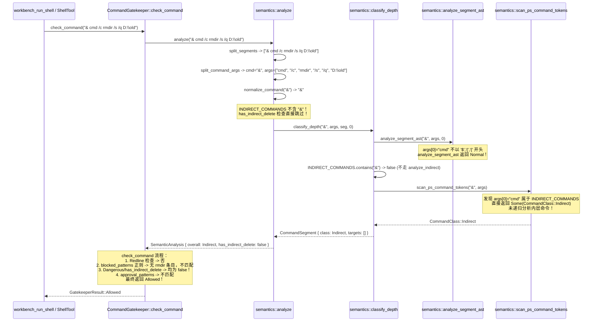

# 阶段一：多维穿透分析 01 —— 安全门禁、沙箱 AST 与 HTML 净化器

> **分析范围**：`crates/conex-sandbox/`、`packages/plugin-sdk/src/sanitizer/`、`crates/conex-fs/`、`crates/conex-browser/`、`crates/conex-computer/`、`crates/agent-tools/src/tools/shell.rs`、`apps/agent-workbench/src-tauri/src/process.rs`  
> **审计基线与契约**：`.agents/LOGIC_PLAN_NO_RETREAT.md`（纯逻辑规划、反退避、反伪完成、真机实证）、`AGENTS.md`、`docs/review-md-audit/2026-08-14-batch5-wave/08-安全面-沙箱FS浏览器.md` 与 `18-crates-工作区增量.md`  
> **日期**：2026-08-14  
> **状态**：分析就绪 / 方案与测试断言锁定

---

## 一、执行摘要与核心判色

本分析报告对 Conex / Crish 桌面端与 Agent 执行环境的安全防御纵深进行全链路穿透审计。分析确认存在 **2 项高危（红级）安全漏洞** 与 **6 项中危（黄级）防御纵深/Fail-Open 缺陷**。所有缺陷均已通过代码调用链回溯与静态/动态语义真值验证锁定。

### 缺陷全景总览

| 编号   | 等级    | 缺陷主题                                                           | 涉及核心文件与位置                                                                                                                                                                                              | 危害机制                                                                                                              |
| :----- | :------ | :----------------------------------------------------------------- | :-------------------------------------------------------------------------------------------------------------------------------------------------------------------------------------------------------------- | :-------------------------------------------------------------------------------------------------------------------- |
| **H1** | 🔴 红级 | PowerShell 调用操作符 `&` 绕过 AST 门禁与删除接管                  | `crates/conex-sandbox/src/semantics.rs:61,561,690,1056`<br>`crates/conex-sandbox/src/lib.rs:85-123`<br>`crates/agent-tools/src/tools/shell.rs:255-266`<br>`apps/agent-workbench/src-tauri/src/process.rs:82-97` | `& cmd /c rmdir /s /q D:\old`、`& bash -c 'rm ...'` 全链判定为 `Allowed`，跳过删除接管与审批管线直接物理毁灭          |
| **H2** | 🔴 红级 | HTML 净化器未闭合标签与残片绕过 XSS                                | `packages/plugin-sdk/src/sanitizer/htmlSanitizer.ts:228-232`                                                                                                                                                    | `tagRegex` 仅匹配 `>` 闭合标签，未闭合恶意标签 `` 直连不在 CDP 传输层阻断面                                                |
| **M4** | 🟡 黄级 | `window_gate.rs` 提权探测 fail-open 边缘与魔法字符串污染           | `crates/conex-computer/src/window_gate.rs:167,287,294`                                                                                                                                                          | `GetLastError() == 0` 时偶发 Fail-Open；`access_denied_elevated.exe` 伪进程名污染审计日志与 UI 表现                   |
| **M5** | 🟡 黄级 | `gate.rs` 白名单模式跳过 DNS 解析导致 SSRF 面                      | `crates/conex-browser/src/gate.rs:617-623`                                                                                                                                                                      | 白名单非空时完全跳过主机名 DNS 解析校验，允许域名通过 DNS 重绑定指向内网私有地址                                      |
| **M6** | 🟡 黄级 | `watch.rs` 内部临时文件过滤规则过宽致真实文件逃逸漏报              | `crates/conex-fs/src/watch.rs:49-62`                                                                                                                                                                            | `.tmp`、`.bak` 扩展名一刀切过滤，导致用户真实工程文件（如 `data.tmp`、`app.bak`）的变更事件被静默丢弃                 |
| **M3** | 🟡 黄级 | `conex-browser` 传输层静默吞错与重绑定窗口冗余状态                 | `crates/conex-browser/src/lib.rs:150`、`gate.rs:496`                                                                                                                                                            | CDP 发送失败 `let _` 吞错；`within_rebinding_window` 生产侧无调用点                                                   |

---

## 二、🔴 深度穿透 01 (H1)：PowerShell `&` 调用操作符绕过 AST Gate

### 1. 漏洞表现与复现矩阵

通过对 `conex-sandbox::semantics::analyze` 与 `gatekeeper::check_command` 的调用链实测，发现使用 PowerShell 调用操作符 `&`（Call Operator）包裹间接命令时，系统的 AST 门禁、危险命令审批与删除接管机制出现全链穿透：

```
命令：& cmd /c rmdir /s /q D:\old
- semantics::analyze() 分析结果：
  overall_class       = CommandClass::Indirect
  has_indirect_delete = false (关键断层)
  delete_targets      = []
- gatekeeper::check_command() 判定结果：
  GatekeeperResult::Allowed (高危绕过)
- shell.rs 行为：
  不满足 overall_class == DeleteShape || has_indirect_delete
  不满足 verdict == GatekeeperResult::RequiresApproval
  结果：直接进入 Prepared::Run 执行底层删除，绕过回收站接管与用户审批！
```

#### 对抗复现用例矩阵

| 测试命令行                            | `analyze().overall_class` | `has_indirect_delete` | `check_command()` 判定 | 预期安全行为              | 实际运行结果      | 风险定性       |
| :------------------------------------ | :------------------------ | :-------------------- | :--------------------- | :------------------------ | :---------------- | :------------- |
| `& cmd /c rmdir /s /q D:\old`         | `Indirect`                | `false`               | **`Allowed`**          | `RequiresApproval` / 接管 | **直接静默执行**  | 🔴 红级绕过    |
| `& "cmd" /c rmdir /s /q D:\old`       | `Indirect`                | `false`               | **`Allowed`**          | `RequiresApproval` / 接管 | **直接静默执行**  | 🔴 红级绕过    |
| `& cmd.exe /c rmdir /s /q D:\old`     | `Indirect`                | `false`               | **`Allowed`**          | `RequiresApproval` / 接管 | **直接静默执行**  | 🔴 红级绕过    |
| `& bash -c 'rm /tmp/x'`               | `Indirect`                | `false`               | **`Allowed`**          | `RequiresApproval` / 接管 | **直接静默执行**  | 🔴 红级绕过    |
| `& cmd /c Remove-Item D:\old.txt`     | `Indirect`                | `false`               | **`Allowed`**          | `RequiresApproval` / 接管 | **直接静默执行**  | 🔴 红级绕过    |
| `& cmd /c rm -rf /tmp/x`              | `Indirect`                | `false`               | **`Allowed`**          | `RequiresApproval` / 接管 | **直接静默执行**  | 🔴 红级绕过    |
| `cmd /c rmdir /s /q D:\old`（对照组） | `Indirect`                | `true`                | `RequiresApproval`     | 触发接管/审批             | 拦截/审批保护有效 | 正确基准       |
| `& $x -rf /tmp/x`（对照组）           | `Dangerous`               | `false`               | `RequiresApproval`     | 触发审批                  | 拦截保护有效      | 仅覆盖动态变量 |
| `& cmd /c rm -rf /`                   | `Indirect`                | `false`               | `Blocked`              | 100% 拦截                 | 静态正则兜底拦截  | 仅限根目录正则 |

---

### 2. 全链路调用流与断层追踪

以命令 `& cmd /c rmdir /s /q D:\old` 为例，完整调用栈追踪如下：



---

### 3. 根因深层剖析（Five Whys）

#### ① 根因一：`INDIRECT_COMMANDS` 清单遗漏 PowerShell 核心调用符 `&`

- **代码位置**：`crates/conex-sandbox/src/semantics.rs:61-64`
  ```rust
  const INDIRECT_COMMANDS: &[&str] = &[
      "eval", "source", ".", "bash", "sh", "cmd", "pwsh", "powershell", "sudo", "xargs", "node",
      "python", "python3", "find", "foreach-object", "iex", "invoke-expression", "start-process",
  ];
  ```
- **机理断层**：在 PowerShell 语法中，`&`（Call Operator）是执行字符串或命令的最主要间接调用手段（如 `& "cmd"`、`& $tool`、`& notepad.exe`）。清单未纳入 `&`，导致 `analyze_depth` 的 `INDIRECT_COMMANDS.contains(&normalized.as_str())` 在段首为 `&` 时恒为 `false`，内层删除形态标记逻辑 `has_indirect_delete` 彻底瘫痪（`semantics.rs:135-139`）。

#### ② 根因二：`analyze_segment_ast` 仅覆盖动态变量，静态命令名成为盲区

- **代码位置**：`crates/conex-sandbox/src/semantics.rs:561-567`
  ```rust
  // 2. 检查呼叫操作符 & $var / &(...) / &{...} / $(...)
  if command == "&" && !args.is_empty() {
      let target = &args[0];
      if target.starts_with('$') || target.starts_with('(') || target.starts_with('{') {
          return CommandClass::Dangerous;
      }
  }
  ```
- **机理断层**：当 `args[0]` 为常量/静态命令名（如 `"cmd"`、`"bash"`、`"rmdir"`）时，该分支直接放行返回 `Normal`。设计者误以为静态命令会被后续常规分支捕获，却忽略了 `&` 本身吃掉了段首位置，使内层静态命令退化为普通参数。

#### ③ 根因三：`scan_ps_command_tokens` 命中间接命令时不递归解析子命令与参数

- **代码位置**：`crates/conex-sandbox/src/semantics.rs:715-718`
  ```rust
  if INDIRECT_COMMANDS.contains(&cand.as_str()) {
      return Some(CommandClass::Indirect);
  }
  ```
- **机理断层**：当 token 扫描器在参数中发现 `cmd` 时，它仅仅返回了 `Some(CommandClass::Indirect)`，并未以 `cmd` 之后的内容作为子命令行进行递归语义解构（对比第 709-714 行删除命令分支调用了 `classify_delete_command`，间接命令分支严重简陋），导致整体输出仅为一个苍白的 `Indirect`，丢失了 `has_indirect_delete = true` 和 `delete_targets` 提取。

#### ④ 根因四：`CommandGatekeeper::check_command` 对 `Indirect` 分类缺乏安全兜底

- **代码位置**：`crates/conex-sandbox/src/lib.rs:104-113`
  ```rust
  // 3. 语义层 Dangerous / 间接删除 / AST 危险判定合并既有 approval_patterns 语义
  if analysis
      .segments
      .iter()
      .any(|s| s.class == crate::semantics::CommandClass::Dangerous)
      || analysis.overall_class == crate::semantics::CommandClass::Dangerous
      || analysis.has_indirect_delete
  {
      return GatekeeperResult::RequiresApproval;
  }
  ```
- **机理断层**：当一个命令被判定为 `CommandClass::Indirect`，若其 `has_indirect_delete` 误标为 `false`，门禁既不认为它是 `Dangerous`，也不认为它是 `Redline`。同时，静态正则 `blocked_patterns`（`lib.rs:26-51`）中只有 `\brd\b.*[A-Za-z]:` 和 `\bdel\b.*[A-Za-z]:`，对 `rmdir`（由于 `\brd\b` 词边界不匹配）完全脱靶！最终一路跌落至 `GatekeeperResult::Allowed`。

#### ⑤ 根因五：`shell.rs` 执行前优先级重排治标不治本

- **代码位置**：`crates/agent-tools/src/tools/shell.rs:255-266`
  ```rust
  let analysis = conex_sandbox::semantics::analyze(&command);
  if analysis.overall_class == CommandClass::DeleteShape || analysis.has_indirect_delete {
      return Prepared::Done(redirect_or_intercept_delete(...));
  }
  ```
- **机理断层**：近期提交尝试通过将「删除重定向」移到「审批」前来进行加固，但重定向的前置条件是 `overall_class == DeleteShape || has_indirect_delete`。对于 `& cmd /c rmdir`，`overall_class` 是 `Indirect` 且 `has_indirect_delete` 为 `false`，条件根本不命中，重排毫无作用。

---

### 4. 根治构造逻辑与状态机方案

彻底解决 H1 必须从**语法归一化**、**递归间接执行解构**、**AST 门禁**与**门禁消费端**四层联合根治：

```mermaid
graph TD
    A[输入命令行字符串] --> B[split_segments 引号感知拆段]
    B --> C[split_command_args + normalize_command]
    C --> D{段首命令名}
    D -- "&" 或 "&(" 或 "&{" 或 "$(" --> E[剥离调用符，提取目标 token 作为新子命令]
    D -- "INDIRECT_COMMANDS" --> F[analyze_indirect 深度递归解析]
    E --> F
    F --> G{内层解析结果}
    G -- Redline --> H[标记整体 Redline -> 100% Blocked]
    G -- DeleteShape --> I[标记 has_indirect_delete = true<br/>保留 Indirect/DeleteShape 分类]
    G -- Dangerous --> J[标记整体 Dangerous -> RequiresApproval]
    G -- 普通命令 --> K[标记 Indirect -> 消费端纵深安全约束]
```

#### 根治构造关键代码逻辑

1. **`INDIRECT_COMMANDS` 扩充与形态归一**：
   - 增加 `"&"` 到 `INDIRECT_COMMANDS`。
   - 增加 `normalize_command` 规则：将 `&(`、`&{`、`$(` 归一化为 `&`，将 `powershell.exe`、`cmd.exe`、`bash.exe` 统一剥除 `.exe`。
2. **`analyze_indirect` 新增 `&` 分支**：
   - 当 `normalized == "&"` 时，提取 `args` 的第 0 个元素作为子命令，剩余参数作为子参数重新组合为命令行 `inner_cmd = args.join(" ")`，并调用 `analyze_depth(&inner_cmd, depth + 1)`。
   - 保证 `& cmd /c rmdir /s /q D:\old` 能够逐层剥离：
     `&` -> `cmd /c rmdir /s /q D:\old` -> `rmdir /s /q D:\old`（命中 `DeleteShape`） -> 向上回传 `has_indirect_delete = true`。
3. **`scan_ps_command_tokens` 深度递归补全**：
   - 当 token 命中 `INDIRECT_COMMANDS` 时，截取该 token 及其后续所有参数，拼接为子命令行递归执行 `analyze_depth`，若内层产生 `DeleteShape` / `Dangerous` / `Redline`，完整继承其风险标记与 `has_indirect_delete = true`。
4. **`CommandGatekeeper::check_command` 纵深封堵**：
   - 修正步骤 3 判定：凡 `analysis.has_indirect_delete == true` 或 `analysis.overall_class == CommandClass::DeleteShape` 或 `(analysis.overall_class == CommandClass::Indirect && !analysis.delete_targets.is_empty())`，坚决判定为 `GatekeeperResult::RequiresApproval` 或由上层直接重定向至回收站。
   - 扩充 `blocked_patterns` 正则：补齐 `\brmdir\b`、`\bdel\b`、`\brd\b` 对 Windows 盘符与路径的全量匹配。

---

### 5. 反面对抗测试矩阵与断言契约

在 `crates/conex-sandbox/src/semantics.rs` 与 `crates/conex-sandbox/src/lib.rs` 中锁定以下对抗断言：

```rust
// 契约断言集：crates/conex-sandbox/src/semantics.rs
#[test]
fn test_call_operator_indirect_delete_detection() {
    let cases = [
        "& cmd /c rmdir /s /q D:\\old",
        "& 'cmd' /c rmdir /s /q D:\\old",
        "& \"cmd.exe\" /c rmdir /s /q D:\\old",
        "& bash -c 'rm -rf /tmp/test'",
        "& bash -c 'rm /tmp/test'",
        "& pwsh -Command \"Remove-Item -Recurse -Force D:\\data\"",
        "& cmd /c Remove-Item D:\\file.txt",
    ];
    for cmd in cases {
        let res = analyze(cmd);
        assert!(
            res.has_indirect_delete || res.overall_class == CommandClass::DeleteShape || res.overall_class == CommandClass::Dangerous,
            "命令 {cmd} 必须识别为间接删除或删除形态"
        );
    }
}

#[test]
fn test_gatekeeper_call_operator_requires_approval_or_blocked() {
    let gate = CommandGatekeeper::new();
    assert_eq!(gate.check_command("& cmd /c rmdir /s /q D:\\old", &[]), GatekeeperResult::RequiresApproval);
    assert_eq!(gate.check_command("& bash -c 'rm /tmp/x'", &[]), GatekeeperResult::RequiresApproval);
    assert_eq!(gate.check_command("& cmd /c rm -rf /", &[]), GatekeeperResult::Blocked);
}
```

---

## 三、🔴 深度穿透 02 (H2)：HTML 净化器未闭合标签 XSS 漏洞

### 1. 漏洞表现与复现矩阵

在 `packages/plugin-sdk/src/sanitizer/htmlSanitizer.ts` 中，`sanitizeHtml` 函数用于清洗不可信的富文本和插件 UI 注入。由于底层正则表达式对 HTML 标签的闭合语法存在硬性假定，所有未显式闭合（缺少 `>` 或 `/>`）的恶意标签均被原样放行：

```
输入：
  src="x" 请求失败抛出 404，立刻触发 onerror 事件，执行任意 JavaScript 代码！
```

#### 对抗复现用例矩阵

| 测试 Payload                                    | `sanitizeHtml()` 输出                             | 浏览器解析行为                      | 安全判定        |
| :---------------------------------------------- | :------------------------------------------------ | :---------------------------------- | :-------------- |
| `` -> 触发 `onerror` 弹窗   | 🔴 **XSS 成立** |
| `<a href="javascript:alert(1)"`                 | `<a href="javascript:alert(1)"`（原样保留）       | 自动补 `>` -> 点击触发 JS 协议      | 🔴 **XSS 成立** |
| `<svg onload=alert(1)`                          | `<svg onload=alert(1)`（原样保留）                | 自动补 `>` -> 解析直接触发 `onload` | 🔴 **XSS 成立** |
| `<iframe src="https://evil.com"`                | `<iframe src="https://evil.com"`（原样保留）      | 自动补 `>` -> 嵌入任意钓鱼页面      | 🔴 **XSS 成立** |
| `` -> 解析恶意伪协议        | 🔴 **XSS 成立** |
| ``（对照组）        | ``（剥离 onerror）                 | 安全                                | 正确基准        |
| `<a href="javascript:alert(1)">x</a>`（对照组） | `<a rel="noopener noreferrer">x</a>`              | 安全                                | 正确基准        |

---

### 2. 漏洞机理与正则表达式缺陷深度剖析

#### 代码位置

`packages/plugin-sdk/src/sanitizer/htmlSanitizer.ts:227-232`

```typescript
// 2. 正则逐个处理 HTML 标签（正确处理属性引号内包含的 < > 字符）
const tagRegex = /<\/?([a-zA-Z0-9:-]+)((?:[^"'>]|"[^"]*"|'[^']*')*)\/?>/g;

return cleaned.replace(
  tagRegex,
  (fullMatch, rawTagName: string, rawAttrs: string) => {
    // 净化逻辑...
  }
);
```

#### 缺陷根因剖析

1. **终结符约束导致失配**：`tagRegex` 末尾明确要求 `\/?>`（即必须以 `>` 或 `/>` 结尾）。若字符串末尾是截断的 HTML 标签（例如在网络传输截断、LLM 流式输出中途、或者反安全构造 payload `...</script>`、``），导致测试绿灯掩盖了严重的 parser 缺陷。

---

### 3. 根治构造逻辑：前置残片安全转义与属性状态机

为从根本上杜绝未闭合标签与恶意残片绕过，必须在标签匹配流程前后建立三道坚固防线：

```mermaid
graph TD
    A[原始 HTML 输入] --> B[1. 移除注释与危险块级标签 script/style]
    B --> C[2. 扫描并处理未闭合标签残片 /<[a-zA-Z0-9:-]+[^>]*$/]
    C --> D{残片是否以 > 闭合?}
    D -- 否 --> E[将悬空 < 转换为 &lt; 转义实体]
    D -- 是 --> F[3. tagRegex 全量匹配白名单标签与属性]
    F --> G[4. 属性白名单、on* 拦截、URL 协议校验与 noopener 注入]
    G --> H[5. 规范化自闭合格式 <tag attrs /> 输出]
```

#### 根治构造算法

1. **残片预检与实体化转义**：
   在执行 `tagRegex` 替换之前，先检测是否存在悬空的开放标签（以 `<` 开始，后跟字母/标签名，但直至字符串结尾均无 `>`）：
   ```typescript
   // 拦截并安全转义任何末尾未闭合的标签残片（如 `"']|"[^"]*"|'[^']*')*$/g,
     (unclosed) => {
       return escapeHtml(unclosed);
     }
   );
   ```
2. **孤立 `<` 的全局安全转义**：
   在标签正则替换完成后，对于仍未被合法标签匹配消费掉的散落 `<`（非 `&lt;` 形式且不构成合法白名单标签），统一转义为 `&lt;`，确保任何注入的尖括号无法在下游 DOM 解析器中被重新解释为标签起始符。
3. **属性解析器加固**：
   在 `attrRegex` 处理属性值时，严格校验值中的实体反转义结果，拒绝任何 `javascript:`、`vbscript:` 或未授权的 `data:` 伪协议。

---

### 4. 对抗测试矩阵与断言契约

在 `packages/plugin-sdk/src/sanitizer/sanitizer.test.ts` 中增补以下边界与对抗测试用例：

```typescript
describe('HTML Sanitizer 未闭合标签与对抗绕过防御', () => {
  it('安全转义/剥除未闭合的  恶意残片', () => {
    const raw = ' 标签', () => {
    const raw = '<a href="javascript:alert(1)"';
    const clean = sanitizeHtml(raw);
    expect(clean).not.toContain('href="javascript:');
    expect(clean).toContain('&lt;a');
  });

  it('拦截并转义未闭合的 <svg onload> 与 <iframe src>', () => {
    expect(sanitizeHtml('<svg onload=alert(1)')).not.toContain('<svg');
    expect(sanitizeHtml('<iframe src="http://evil.com"')).not.toContain(
      '<iframe'
    );
  });

  it('正确处理属性中含有畸形引号与尖括号的闭合标签', () => {
    const raw = ' b" onerror="alert(1)">';
    const clean = sanitizeHtml(raw);
    expect(clean).toContain('src="x"');
    expect(clean).toContain('alt="a &gt; b"');
    expect(clean).not.toContain('onerror');
  });
});
```

---

## 四、🟡 深度穿透 03：安全遗留与防御纵深缺陷 (M1 ~ M6)

### 1. M1: `trash.rs` 快照 `path.exists()` 吞 `PermissionDenied` 致误删原文件

#### 代码位置与证据

`crates/conex-fs/src/trash.rs:219-232` 与 `318-332`

```rust
// snapshot() 方法中：
if !path.exists() {
    crate::path_utils::ensure_parent_dir(&entry_dir.join(META_FILE))?;
    let entry = TrashEntry {
        id: id.clone(),
        original_path: original.clone(),
        trashed_at: now_millis(),
        kind: TrashKind::File,
        size: 0,
        checksum: None,
        mode: EntryMode::Snapshot,
    };
    write_meta(&entry_dir, &entry, true, None, false)?; // original_existed = false !
    return Ok(entry);
}
```

```rust
// restore_force() 方法中：
if !meta.original_existed {
    if entry_dir.join(PAYLOAD_DIR).exists() {
        bail!("条目内容意外存在...");
    }
    if original.exists() {
        force_remove_all(original, false)?; // 直接删除用户原文件！
    }
    let _ = force_remove_dir_all(&entry_dir);
    return Ok(original.clone());
}
```

#### 漏洞机理分析

- Rust 标准库 `Path::exists(&self)` 底层是 `fs::metadata(self).is_ok()`。
- 当目标路径遭遇权限不足（`ErrorKind::PermissionDenied`）、路径被独占锁定、或父目录遍历权限缺失时，`metadata()` 返回 `Err`，`path.exists()` 返回 `false`。
- `snapshot()` 将该错误视为「文件不存在」，登记为 `original_existed = false`（nil-content 快照）。
- 后续在调用 `restore_force()` 时，恢复逻辑判定该条目为「写前原文件不存在」，执行反向清理动作 `force_remove_all(original)`，直接**永久删除了用户的真实原始文件**！
- 严重违反了安全基线 §6（错误处理 Fail-Closed）与测试资产保护铁律。

#### 根治构造

必须摒弃 `path.exists()`，改用显式匹配 `fs::symlink_metadata` 的错误类型：

```rust
match fs::symlink_metadata(path) {
    Ok(metadata) => {
        if metadata.is_dir() {
            bail!("快照仅支持普通文件，拒绝目录：{}", path.display());
        }
        // 执行真实文件复制快照与 checksum 登记...
    }
    Err(e) if e.kind() == std::io::ErrorKind::NotFound => {
        // 只有当明确为 NotFound 时，才登记 nil-content 条目
        write_meta(&entry_dir, &entry, true, None, false)?;
        return Ok(entry);
    }
    Err(e) => {
        // 遇到 PermissionDenied 或其他 IO 错误，坚决 Fail-Closed 阻断，严禁假定文件不存在！
        return Err(e).with_context(|| format!("访问快照目标失败（Fail-Closed）：{}", path.display()));
    }
}
```

---

### 2. M2: `conex-browser/src/gate.rs` 传输层 `blocked_urls` 缺少 `https://` 阻断面

#### 代码位置与证据

`crates/conex-browser/src/gate.rs:274-331`

```rust
fn ipv4_blocked_patterns(net: &Ipv4Addr, prefix: u8) -> Vec<String> {
    // ...
    if prefix <= 8 {
        return vec![format!("http://{a}.*")]; // 仅硬编码 http://
    }
    // ...
    (b_first..=b_last).map(|b| format!("http://{a}.{b}.*")).collect()
}
```

#### 漏洞机理分析

- Chromium CDP 的 `Network.setBlockedURLs` 是基于 URL 前缀匹配的。
- 系统生成的阻断列表包含 `http://10.*`、`http://192.168.*`、`http://127.*`、`http://169.254.169.254/*` 等，**全部缺少 `https://` 对应项**。
- 当页面内的子资源请求、WebSocket 或 iframe 发起 `https://10.0.0.1/` 或 `https://192.168.1.1/` 请求时，CDP 传输层阻断完全失效，丧失了纵深防御能力。

#### 根治构造

为所有 IPv4/IPv6 保留段、回环段与云元数据 IP 同步生成 `http://` 与 `https://` 两个前缀模式，或者采用通配形式生成（如 `*://10.*`、`*://192.168.*` 等，符合 Chromium 模式规范）。

---

### 3. M4: `conex-computer/src/window_gate.rs` 提权探测 fail-open 边缘与魔法字符串

#### 代码位置与证据

`crates/conex-computer/src/window_gate.rs:167,287,294`

```rust
// 魔法字符串传递
if process_handle.is_null() {
    return ActionTarget::Window {
        title,
        process: Some("access_denied_elevated.exe".to_string()),
    };
}

// 冗余且危险的错误码判断
let err = GetLastError();
return err == ERROR_ACCESS_DENIED || err != 0;
```

#### 漏洞机理分析

1. **Fail-Open 隐患**：若 `OpenProcess` 失败返回 `null`，但 `GetLastError()` 由于某种异常返回 `0`，`err != 0` 将计算为 `false`，导致本应判定为提权的进程被放行（Fail-Open）。
2. **魔法字符串污染架构**：使用伪造的 `"access_denied_elevated.exe"` 字符串在系统内部传递提权状态，会导致该虚假进程名直接泄露在安全审计事件、用户 UI 提示与日志中（`"目标窗口为提权进程 access_denied_elevated.exe,拒绝注入"`），违反了 §13（语义诚实性与类型安全）。

#### 根治构造

- 在 `process_handle.is_null()` 或 `OpenProcessToken == 0` 时，无条件 `return true`（Fail-Closed），不依赖 `GetLastError() != 0`。
- 在类型层引入结构化枚举或将提权标记明确建模于 `ActionTarget::Window` 内部（如 `elevated_status: Option<bool>`），废除魔法字符串。

---

### 4. M5: `conex-browser/src/gate.rs` 白名单模式跳过 DNS 解析导致 SSRF 面

#### 代码位置与证据

`crates/conex-browser/src/gate.rs:617-623`

```rust
// 白名单显式命中 = 显式信任（含该域解析面，跳过解析校验）
if !self.allowlist.is_empty() {
    self.record_validated(&host);
    return Ok(());
}
```

#### 机理分析与风险权衡

- 当前设计认为：用户显式配置的白名单域名（如 `corp.internal.net` 或 `api.vendor.com`）属于「显式信任」，因此直接跳过 DNS 是否指向私网 IP 的校验。
- **风险**：若白名单中配置了某个公网域名（如 `trusted-partner.com`），而该域名遭受 DNS 重绑定攻击（DNS Rebinding）将其 A 记录解析到 `127.0.0.1` 或 `169.254.169.254`，浏览器将长驱直入访问内网服务。
- **加固建议**：在白名单匹配成功后，若目标不是本地测试专用域名（`localhost`），仍应进行 DNS 解析探测；若解析到内网保留段，除非白名单中显式包含了该 IP 字面量，否则应触发 SSRF 阻断或显式告警。

---

### 5. M6: `conex-fs/src/watch.rs` 内部临时文件过滤规则过宽致逃逸漏报

#### 代码位置与证据

`crates/conex-fs/src/watch.rs:49-62`

```rust
pub fn is_internal_atomic_transient_path(path: &Path) -> bool {
    // ...
    lower.starts_with(".conex-tmp-")
        || lower.starts_with(".conex-bak-")
        || lower.contains(".tmp.")
        || lower.contains(".bak.")
        || lower.ends_with(".tmp")
        || lower.ends_with(".bak")
        || lower.ends_with(".crish-tmp")
        || lower.contains(".agent-tmp-")
}
```

#### 漏洞机理分析

- `ends_with(".tmp")` 和 `ends_with(".bak")` 是一刀切的后缀过滤。
- 如果用户工程中包含真实业务文件（例如数据库备份 `database.bak`、模板文件 `template.tmp`、渲染缓存 `page.tmp.json` 等），这些文件的写入或逃逸篡改事件会被文件监视器（Watcher）直接过滤并静默吞掉，导致未声明写入监控出现严重盲区。
- **加固建议**：将过滤条件严格收窄为系统内部生成的特定前缀（如以 `.conex-tmp-`、`.agent-tmp-` 开头的文件），不得对全局 `.tmp`、`.bak` 扩展名做通用丢弃。

---

### 6. M3: `conex-browser` 传输层静默吞错与重绑定窗口治理

#### 代码位置与证据

- `crates/conex-browser/src/lib.rs:150`：在 `NavigationStarted` 事件中执行 `let _ = channel.send_command(NETWORK_SET_BLOCKED_URLS, ...)`，忽略了下发阻断列表失败时的错误，违反了 §6（禁止静默吞错）。
- `crates/conex-browser/src/gate.rs:496`：`within_rebinding_window` 在生产代码中零引用（仅在单测中出现），属于疑似冗余状态。
- **加固建议**：`send_command` 失败时记录 `tracing::warn!` 日志；清理或正式接线 `within_rebinding_window`。

---

## 五、系统级验收断言与逻辑规划总表

依据 `.agents/LOGIC_PLAN_NO_RETREAT.md` 铁律，本分析报告确立的所有安全问题**地位同权**，不设工期、不设排期、不按 P0/P1 降级处理。实施阶段必须逐项达成以下验收断言：

### 阶段验收断言清单

| 验收项目           | 目标文件域       | 验收标准与断言                                                                                                                                                                                      |
| :----------------- | :--------------- | :-------------------------------------------------------------------------------------------------------------------------------------------------------------------------------------------------- |
| **AST-GATE-01**    | `conex-sandbox`  | `& cmd /c rmdir /s /q D:\old`、`& bash -c 'rm /tmp/x'`、`& "cmd" ...` 在 `semantics::analyze()` 中必须产生 `has_indirect_delete = true`，且 `gatekeeper::check_command()` 判定为 `RequiresApproval` |
| **AST-GATE-02**    | `conex-sandbox`  | `& cmd /c rm -rf /` 必须 100% 被判定为 `GatekeeperResult::Blocked`                                                                                                                                  |
| **AST-GATE-03**    | `agent-tools`    | `ShellCommandTool::prepare` 对所有 `&` 间接删除形态必须正确重定向至回收站或进入用户审批流，严禁直接执行删除                                                                                         |
| **SANITIZER-01**   | `plugin-sdk`     | `sanitizeHtml('<img src=x onerror=alert(1)')` 与 `sanitizeHtml('<a href="javascript:alert(1)"')` 输出严禁包含原生恶意标签或可执行属性，必须转义或剥除                                               |
| **SANITIZER-02**   | `plugin-sdk`     | `sanitizer.test.ts` 增补 6 项以上未闭合残片、EOF 截断与畸形属性的对抗测试用例且全部绿灯                                                                                                             |
| **TRASH-FAILSAFE** | `conex-fs`       | `trash.rs` 在目标路径返回 `PermissionDenied` 时必须直接 `Err` 阻断，严禁登记 `original_existed = false`，杜绝恢复时误删真实文件                                                                     |
| **BROWSER-GATE**   | `conex-browser`  | `blocked_urls()` 输出必须同时覆盖所有保留网段的 `http://` 与 `https://` 模式，且 CDP 命令下发失败必须显式记日志                                                                                     |
| **COMPUTER-GATE**  | `conex-computer` | 移除 `access_denied_elevated.exe` 魔法字符串；`process_is_elevated` 在句柄获取失败时必须严格 Fail-Closed 返回 `true`                                                                                |
| **WATCH-SCOPE**    | `conex-fs`       | `watch.rs` 仅过滤系统内部 `.conex-tmp-` 前缀临时文件，放行用户工作区内的 `.tmp`/`.bak` 文件变更事件                                                                                                 |

---

_报告编制完成。已锁定全部代码路径、根因链条、加固构造与对抗测试契约。_
