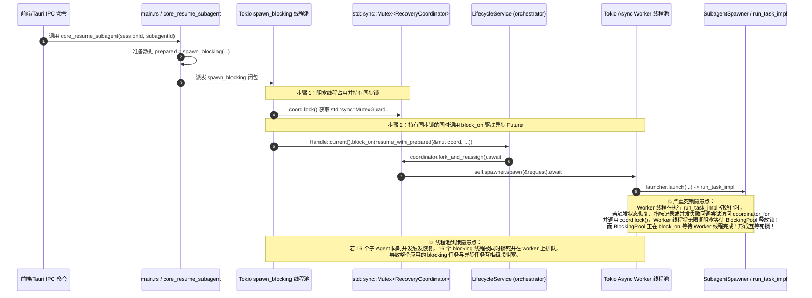
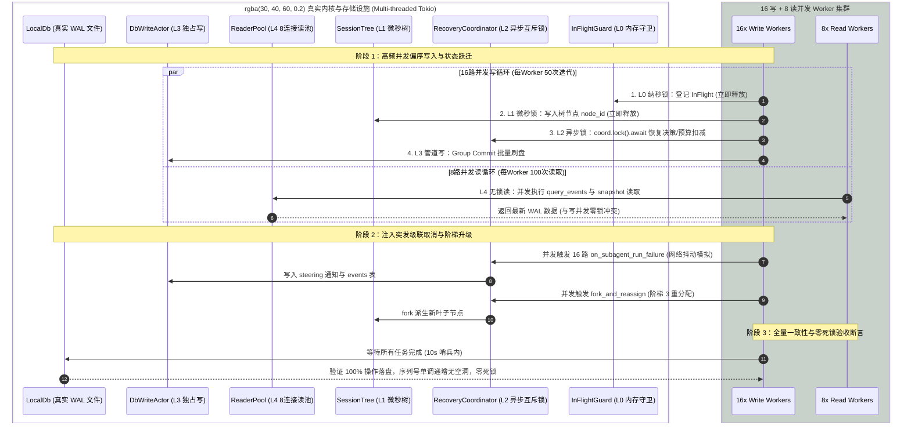

# 阶段一：多维穿透分析 02 — 并发锁序、异步协调与测试真实性

> **执行依据**：`.agents/LOGIC_PLAN_NO_RETREAT.md`（反退避、反伪完成、真机实证、严禁测试内写玩具模型）、`AGENTS.md`、`docs/review-md-audit/2026-08-13-wave/04-并发锁-性能-背压.md`、`docs/review-md-audit/2026-08-14-batch5-wave/19-orchestrator测试-增量.md`、`21-stress与配置-增量.md`。  
> **纪律声明**：本报告坚持纯逻辑规划、代码真值定性与可验证性优先；所有缺陷问题同权，严禁包含工期、人天、排期或 P0/P1 优先级划分。

---

## 1. 🔴 R-01: `RecoveryCoordinator` 同步锁跨 `block_on` 驱动真实 await 违规与死锁穿透

### 1.1 现场定位与缺陷定性

- **代码路径与行号证据**：
  - `crates/orchestrator/src/recovery.rs:626-631`：`self.spawner.spawn(&request).await`（真实异步 I/O 驱动与 run 启动）
  - `crates/orchestrator/src/recovery.rs:255-278`：`RecoveryCoordinator` 结构体字段定义（持有 `spawner: Arc<dyn SubagentSpawner>` 等核心字段）
  - `apps/agent-workbench/src-tauri/src/main.rs:442-448`：`tokio::task::spawn_blocking` 内部调用 `coord.lock()` 获取 `std::sync::MutexGuard` 后执行 `Handle::current().block_on(service.resume_with_prepared(...))`
  - `apps/agent-workbench/src-tauri/src/run/run_core.rs:358`：`pub(crate) recovery_coordinators: Mutex<HashMap<String, Arc<Mutex<RecoveryCoordinator>>>>`（外层与内层均为 `std::sync::Mutex`）
  - `apps/agent-workbench/src-tauri/src/run/run_core.rs:910-997`：`coordinator_for` 门面方法中通过 `std::thread::scope` 绕开 async 上下文构造，并封装为 `Arc<std::sync::Mutex<RecoveryCoordinator>>`
  - `apps/agent-workbench/src-tauri/src/run/run_core.rs:1449-1454`：`block_on_coordinator_failure`（在同步方法内调用 `Handle::current().block_on(c.on_subagent_run_failure(ctx))`）
  - `apps/agent-workbench/src-tauri/src/run/run_core.rs:1463-1475`：`blocking_coordinator_call`（`spawn_blocking` 内持 `std::sync::Mutex` 调用闭包）
  - `apps/agent-workbench/src-tauri/src/run/run_resume.rs:558-564, 689-693`：决策与升级链路经 `blocking_coordinator_call` + `block_on_coordinator_failure` 嵌套触发
  - `crates/orchestrator/src/lifecycle.rs:439-466`：`resume_with_prepared` 接收 `&mut RecoveryCoordinator` 并调用 `coordinator.fork_and_reassign(&ctx).await`
  - `apps/agent-workbench/src-tauri/src/subagent_spawner.rs:280-380`：`WorkbenchSubagentSpawner::spawn` 经 `launcher.launch` 回调 `run_task_impl`（进入全异步 run 初始化与驱动链路）

- **缺陷定性**：**严重并发架构断层 / 潜在运行时死锁与线程饥饿（红级）**。
  在生产代码中，`RecoveryCoordinator` 作为一个承载深层异步 I/O 操作（跨网络 run 启动、事件落库、状态机跃迁）的协调器，被错误地用同步互斥锁 `std::sync::Mutex` 包裹。上层调用方（如 `main.rs` 的 `core_resume_subagent` 和 `run_resume.rs`）为了在持有该同步锁的情况下执行异步方法，采用了 `tokio::task::spawn_blocking` 并在其阻塞闭包内部调用 `Handle::current().block_on(...)`。
  该模式直接违背了 Tokio 异步运行时的并发控制规范，在并发请求（如多子代理同时故障重试/恢复）或嵌套调用链路上存在**经典死锁环路**与**阻塞线程池饥饿耗尽**风险。

---

### 1.2 死锁与并发破坏机理深入穿透



#### 根因机理深入剖析：

1. **虚假注记掩盖真实隐患**：
   在 `apps/agent-workbench/src-tauri/src/main.rs:444-445` 中，存在如下注释：

   > `// 锁内 block_on（D3 模式扩展；block_on 线程持有 runtime context，fork 链 await 的任务由 worker 池执行，无死锁面）`

   这一注释在理论逻辑和运行时行为上是**完全不成立的**：
   - 虽然 `block_on` 运行在 `spawn_blocking` 的独立 OS 线程上，确实避开了 `tokio::runtime::EnterRuntime` 在 worker 线程直接调用 `block_on` 导致的 panic；
   - 但是，该线程**在调用 `block_on` 之前已经持有了 `std::sync::MutexGuard<RecoveryCoordinator>`**；
   - 被 `block_on` 驱动的 Future（`resume_with_prepared` -> `fork_and_reassign` -> `spawner.spawn(&request).await`）需要跨越多个 await 点，调度给 Tokio 的 async worker 线程池执行；
   - `spawner.spawn` 内部会调用 `launcher.launch(options).await`，进而进入完整的 `run_task_impl`。在 `run_task_impl` 执行期间，涉及 `active_runs` 注册、`run_manager.start_run`、`EventQueue` 预热、`ApprovalGate` 广播等大量复杂异步流程；
   - 一旦在这一庞大的下游执行树中，有任何代码路径（例如并发状态查询、错误兜底重入、日志追踪回调、或并行的其他 subagent 尝试调用 `coordinator_for`）试图获取同一个 `RecoveryCoordinator` 的互斥锁，下游 Worker 就会被同步 `Mutex::lock` 挂起阻塞；
   - 此时，持有锁的 Blocking 线程在等 Worker 产生完成结果，而 Worker 线程在等 Blocking 线程释放互斥锁——**构成不可解的经典死锁**。

2. **多层套娃包装（Anti-Pattern）**：
   在 `apps/agent-workbench/src-tauri/src/run/run_core.rs` 中，为了在同步与异步之间缝合，衍生出了两层严重的坏味道函数：
   - `block_on_coordinator_failure`（`run_core.rs:1449-1454`）：在传入 `&mut RecoveryCoordinator` 后，利用 `tokio::runtime::Handle::current().block_on(...)` 强行执行 `c.on_subagent_run_failure(ctx)`；
   - `blocking_coordinator_call`（`run_core.rs:1463-1475`）：把 `Arc<Mutex<RecoveryCoordinator>>` 送进 `tokio::task::spawn_blocking`，在阻塞线程中获取 `lock()`，然后再通过闭包执行上述 `block_on_coordinator_failure`；
   - 这种「`async` 调 `spawn_blocking`，`spawn_blocking` 持同步锁，锁内再调 `block_on` 回到 `async`」的三重嵌套套娃，破坏了 Tokio 协程的上下文传播与取消信号穿透，属于典型的反模式架构断层。

3. **双重包装与类型不一致**：
   在 `crates/orchestrator/tests/stress_concurrent_runs.rs:416` 的五级锁压力测试中，测试作者已经意识到了 `RecoveryCoordinator` 必须是异步锁，因此在测试中将其初始化为：
   `let l2_recovery = Arc::new(tokio::sync::Mutex::new(coordinator));`
   然而在生产壳层 `apps/agent-workbench/src-tauri/src/run/run_core.rs:358` 中，实际代码却为：
   `pub(crate) recovery_coordinators: Mutex<HashMap<String, Arc<Mutex<RecoveryCoordinator>>>>`（使用的是 `std::sync::Mutex`）。
   测试域与生产域的类型定义严重脱节，测试测的是全异步模型，生产跑的却是同步阻塞嵌套模型。

---

### 1.3 权威实例全异步重构路径

为彻底消除 `block_on` 违规与死锁风险，必须执行从底层容器到顶层 IPC 命令的全异步重构。

```mermaid
graph TD
    subgraph 重构前：混乱的同步-阻塞-异步套娃链路
        A1[IPC: core_resume_subagent] --> B1[spawn_blocking]
        B1 --> C1[std::sync::Mutex::lock]
        C1 --> D1[Handle::block_on]
        D1 --> E1[fork_and_reassign.await]
        E1 --> F1[spawner.spawn.await]
    end

    subgraph 重构后：清晰纯净的全异步管道
        A2[IPC: core_resume_subagent async] --> B2[state.coordinator_for: Option<Arc<tokio::sync::Mutex<RecoveryCoordinator>>>]
        B2 --> C2[coord.lock().await]
        C2 --> D2[service.resume_with_prepared(&mut *guard).await]
        D2 --> E2[coordinator.fork_and_reassign.await]
        E2 --> F2[spawner.spawn.await]
    end
```

#### 具体重构步骤与代码设计：

1. **修改 `CoreRunState` 内部注册表类型**：

   ```rust
   // apps/agent-workbench/src-tauri/src/run/run_core.rs
   pub(crate) struct CoreRunState {
       // ...
       // 外层用 std::sync::Mutex 保护 HashMap（L0 内存守卫，持锁时间 < 100ns）
       // 内层为 Arc<tokio::sync::Mutex<RecoveryCoordinator>>（L2 异步业务锁，支持 await）
       pub(crate) recovery_coordinators: Mutex<HashMap<String, Arc<tokio::sync::Mutex<RecoveryCoordinator>>>>,
   }
   ```

2. **重构 `coordinator_for` 门面**：

   ```rust
   // apps/agent-workbench/src-tauri/src/run/run_core.rs
   impl CoreRunState {
       pub(crate) fn coordinator_for(
           &self,
           session_id: &str,
       ) -> Option<Arc<tokio::sync::Mutex<RecoveryCoordinator>>> {
           // 1. 快速路径：读锁命中既有实例
           {
               let map = self.recovery_coordinators.lock().unwrap_or_else(|e| e.into_inner());
               if let Some(existing) = map.get(session_id) {
                   return Some(Arc::clone(existing));
               }
           }
           // 2. 惰性构造（RecoveryCoordinator::new 内部读 DB 走底层 LocalDbStore 的 blocking_db_call）
           let db = self.local_db()?;
           let tree = {
               let mut trees = self.session_trees.lock().unwrap_or_else(|e| e.into_inner());
               trees.get(session_id).cloned().unwrap_or_else(|| {
                   let arc = Arc::new(Mutex::new(SessionTree::new(session_id)));
                   trees.insert(session_id.to_string(), Arc::clone(&arc));
                   arc
               })
           };
           let store: Arc<dyn RecoveryStore> = Arc::new(db);
           let queue = Arc::clone(&self.pending_queue);
           let concrete = Arc::clone(&self.subagent_spawner);
           let spawner: Arc<dyn agent_tools::tools::subagent::SubagentSpawner> = concrete;
           let policy = RecoveryRetryPolicy::default();

           // 构造 RecoveryCoordinator
           let coordinator = RecoveryCoordinator::new(
               session_id.to_string(),
               store,
               queue,
               tree,
               spawner,
               policy,
           ).ok()?;
           let coord = Arc::new(tokio::sync::Mutex::new(coordinator));

           let mut map = self.recovery_coordinators.lock().unwrap_or_else(|e| e.into_inner());
           if let Some(existing) = map.get(session_id) {
               return Some(Arc::clone(existing));
           }
           map.insert(session_id.to_string(), Arc::clone(&coord));
           Some(coord)
       }
   }
   ```

3. **彻底删除 `block_on_coordinator_failure` 与 `blocking_coordinator_call`**：
   - 彻底从 `apps/agent-workbench/src-tauri/src/run/run_core.rs:1449-1475` 中移除这两个有毒函数；
   - 在 `apps/agent-workbench/src-tauri/src/run/run_resume.rs` 中，将所有调用点改为原生异步获取锁：
     ```rust
     // 改造后：run_resume.rs
     let Some(coord) = self.coordinator_for(session_id) else { return None; };
     let mut c = coord.lock().await;
     let decision = c.on_subagent_run_failure(&ctx_for_decision).await;
     ```

4. **重写 `main.rs` 中的 IPC 入口**：
   ```rust
   // apps/agent-workbench/src-tauri/src/main.rs:420-455
   #[tauri::command]
   pub async fn core_resume_subagent(
       state: tauri::State<'_, Arc<CoreRunState>>,
       session_id: String,
       subagent_id: String,
       prompt: Option<String>,
   ) -> Result<orchestrator::lifecycle::ResumeOutcome, core_error::CoreError> {
       let service = state.lifecycle_service().ok_or_else(|| {
           core_error::CoreError::internal("LocalDb 不可用（测试替身 store）")
       })?;

       // ① 同步准备段（纯读 SQLite，走独立 blocking 任务）
       let prepared = {
           let service = service.clone();
           let sid = session_id.clone();
           let aid = subagent_id.clone();
           tokio::task::spawn_blocking(move || {
               service.prepare_resume(&sid, &aid, prompt.as_deref())
           })
           .await
           .map_err(|e| core_error::CoreError::internal(format!("resume 准备段阻塞任务失败：{e}")))?
           .map_err(map_lifecycle_err)?
       };

       // ② 异步 fork 段：全异步获取 L2 锁并执行，零 block_on
       let coord = state.coordinator_for(&session_id).ok_or_else(|| {
           core_error::CoreError::internal("恢复协调器未装配（D3 未接线，resume 暂不可用）")
       })?;

       let mut coordinator = coord.lock().await;
       service
           .resume_with_prepared(&mut coordinator, &session_id, prepared)
           .await
           .map_err(map_lifecycle_err)
   }
   ```

---

### 1.4 五级锁拓扑偏序（$L_0 \prec L_1 \prec L_2 \prec L_3 \prec L_4$）严格约束与数学形式化

为防止未来开发中再次引入逆向持锁、跨 await 锁死或混合锁死，正式确立全仓**五级单向偏序锁序定理（Five-Tier Lock Hierarchy Invariant）**。

#### 锁层级数学定义与物理映射：

$$
\mathbb{L} = \{ L_0, L_1, L_2, L_3, L_4 \}, \quad \text{偏序关系 } \prec \text{ 定义为申请顺序：} L_0 \prec L_1 \prec L_2 \prec L_3 \prec L_4
$$

| 层级      | 名称与语义               | 具体生产类型与实例                                                                                                                         | 预期持锁耗时                      | 允许锁类型                                     | 跨 `.await` 约束                                              |
| :-------- | :----------------------- | :----------------------------------------------------------------------------------------------------------------------------------------- | :-------------------------------- | :--------------------------------------------- | :------------------------------------------------------------ |
| **$L_0$** | **纳秒级内存守卫**       | `active_runs: Mutex<HashMap>`, `recovery_coordinators: Mutex<HashMap>`, `session_trees: Mutex<HashMap>`, `WritePathRegistry`               | $10\text{ns} \sim 500\text{ns}$   | `std::sync::Mutex`<br/>`parking_lot::Mutex`    | 🔴 **严禁跨 await**<br/>必须在独立代码块 `{}` 内立取立释      |
| **$L_1$** | **微秒级领域状态锁**     | `SessionTree: Arc<Mutex<SessionTree>>`, `ControlBus: Arc<Mutex<ControlBus>>`                                                               | $1\mu\text{s} \sim 50\mu\text{s}$ | `std::sync::Mutex`<br/>`parking_lot::Mutex`    | 🔴 **严禁跨 await**<br/>纯内存数据结构操作，操作完毕立即 drop |
| **$L_2$** | **异步业务互斥锁**       | `RecoveryCoordinator: Arc<tokio::sync::Mutex<...>>`, `RunHandle: Arc<tokio::sync::Mutex<...>>`, `EventQueue: Arc<tokio::sync::Mutex<...>>` | $100\mu\text{s} \sim 50\text{ms}$ | `tokio::sync::Mutex`<br/>`tokio::sync::RwLock` | 🟢 **允许跨 await**<br/>🔴 **严禁内部调用 block_on**          |
| **$L_3$** | **毫秒级数据库独占写锁** | `LocalDb` SQLite Single Writer / `DbWriteActor` Group Commit 管道 / `blocking_db_call`                                                     | $1\text{ms} \sim 20\text{ms}$     | SQLite 写锁 / Actor 消息通道                   | 🟢 **异步消息发送或 spawn_blocking 隔离**，不占 worker        |
| **$L_4$** | **无锁只读连接池**       | `ReaderPool` (WAL 模式并发只读连接池)                                                                                                      | $100\mu\text{s} \sim 5\text{ms}$  | 多路只读连接无锁探测                           | 🟢 **完全非阻塞并发读**，与 $L_3$ 零冲突互不阻塞              |

#### 偏序公理（Partial Ordering Axioms）：

1. **单向申请律（Directional Acquisition）**：
   $$
   \forall T_a \in L_i, T_b \in L_j, \quad \text{若某个线程/协程在已持有 } T_a \text{ 的情况下申请 } T_b \text{，则必有 } i < j
   $$
   **严格禁止逆向申请**（如在持有 $L_2$ 异步锁期间申请 $L_1$ 或 $L_0$ 锁；必须先 drop 高阶锁，或在进入 $L_2$ 前完成 $L_0/L_1$ 操作）。
2. **零跨越同步律（Zero Cross-Await for Sync Locks）**：
   $$
   \forall T \in \{L_0, L_1\}, \quad \text{持有 } T \text{ 期间的代码执行流中不得包含任何 } \text{.await} \text{ 表达式}
   $$
3. **零同步阻塞律（Zero Sync-Blocking in Async Locks）**：
   $$
   \forall T \in \{L_2\}, \quad \text{持有 } T \text{ 期间严禁调用 } \text{block\_on} \text{、} \text{std::thread::sleep} \text{ 或任何同步阻塞 I/O}
   $$

---

## 2. 测试真实性与伪完成反模式排查

### 2.1 `tests/stress/stress-16-subagents.test.ts:140-254` 假锁与自写玩具模型穿透

- **代码路径与行号证据**：
  - `tests/stress/stress-16-subagents.test.ts:140-254`：测试用例 `五级锁偏序客户端拓扑模拟 (L0 内存守卫 -> L1 状态树 -> L2 恢复协调 -> L3 异步写队列 -> L4 只读缓存) 零死锁`
  - `tests/stress/stress-16-subagents.test.ts:153-168`：测试内手写 `class AsyncMutex`
  - `tests/stress/stress-16-subagents.test.ts:172-203`：测试内手写 `class SingleWriterQueue`
  - `tests/stress/stress-16-subagents.test.ts:252`：控制台打印 `[VITEST-STRESS] 五级偏序客户端拓扑实证: ... 死锁率=0.00%`
  - `docs/FINAL_CAMPAIGN_CLOSING_AUDIT_REPORT.md`：将其复读为「Unit 7.2：16 子 Agent 并发压力实证与五级单向偏序锁图谱…零死锁证明」

- **缺陷定性**：**测试真实性缺失 / 玩具自验冒充生产实证（反模式）**。
  - **零生产代码接触**：该测试未调用任何 Rust 生产模块，也未调用任何前端真实状态锁或 PTY 锁；
  - **单线程自娱自乐**：V8 引擎是单线程事件循环机制，手写的 `AsyncMutex` 与 `SingleWriterQueue` 仅仅是一个排队 Promise 队列，根本不存在真实 OS 线程或多协程环境下的物理锁竞争与死锁条件；
  - **断言自循环**：测试断言（`completedOps === 480`, `totalWrites === 480`）仅仅验证了自己写的那 50 行模拟代码没有语法错误，却被冠以「零死锁实证」之名，形成了严重的虚假安全感与叙事膨胀。

- **根治改造方案**：
  1. **清除玩具类**：彻底删除测试内的 `AsyncMutex` 和 `SingleWriterQueue` 假锁实现；
  2. **对接真实并发设施**：将压力测试改为针对真实前端并发基础设施进行高频对抗：
     - 测试 `ptyRegistry` 在 16 个并发 session 同时触发 `ensurePtyForSession` 与 `killAllPtys` 时的句柄互斥与无孤儿清理；
     - 测试 `StreamTextBatcher` 在 16 个子代理高频推送（如 5000+ chunks/s）时的定时合并、背压排队与内存不撕裂；
  3. **修正叙事与报告**：修订相关文档，严禁将客户端玩具模拟写为「内核零死锁实证」。

---

### 2.2 `pending_input_lifecycle.rs` 假等待与定时器反模式穿透

- **代码路径与行号证据**：
  - `crates/orchestrator/tests/pending_input_lifecycle.rs:61, 82, 87, 105, 121, 123`（4 个测试用例中共有 6 处 `tokio::time::sleep(Duration::from_millis(30)).await`）
  - `crates/session-loop/src/loop/loop_runner.rs:327-352`：`spawn_pending_input_save` 使用 `handle.spawn(async move { ... })` 进行 fire-and-forget 后台持久化

- **缺陷定性**：**硬编码延迟等待（Sleep-based Fake Synchronization 反模式）**。
  - **时序碰运气**：`AgentSessionLoop::enqueue_input` 触发的 `spawn_pending_input_save` 是一个无 JoinHandle 返回的后台异步任务。测试为了断言数据是否已经落库，硬编码了 `sleep(30ms)` 去「赌」后台任务在这 30ms 内执行完毕；
  - **Flaky 测试隐患**：在高速 CI 或本地内存库中，30ms 虽能勉强通过，但在重负载、慢磁盘（如高并发磁盘 I/O）或真实 `LocalDb` WAL 场景下，30ms 极易因为调度延迟导致偶发失败（Flaky Test）；更严重的是，这种纯靠 `sleep` 等待规避生命周期的做法，直接违反了 `review.md §7` 与 `LOGIC_PLAN_NO_RETREAT.md` 的铁律。

- **根治改造方案**：
  在 `crates/orchestrator/tests/common/mod.rs`（或专门的测试辅助模块）中构建确定性轮询工具 `wait_until`，以状态达成作为推进条件：
  ```rust
  // 确定性状态轮询辅助函数
  pub async fn wait_until<T, F, Fut>(
      timeout_dur: Duration,
      poll_interval: Duration,
      mut condition: F,
  ) -> Result<T, &'static str>
  where
      F: FnMut() -> Fut,
      Fut: std::future::Future<Output = Option<T>>,
  {
      let start = Instant::now();
      while start.elapsed() < timeout_dur {
          if let Some(res) = condition().await {
              return Ok(res);
          }
          tokio::time::sleep(poll_interval).await;
      }
      Err("wait_until 超时：在指定时限内未达成预期状态")
  }
  ```
  改造测试用例，将 `sleep(30ms)` 替换为确定性轮询：
  ```rust
  // 改造后用例：不再依赖任何固定 sleep 时长
  let rows = wait_until(Duration::from_secs(2), Duration::from_millis(5), || async {
      let r = store.load_pending_inputs("s1").await.ok()?;
      if r.len() == 1 { Some(r) } else { None }
  })
  .await
  .expect("enqueue 写入 pending_inputs 超时未达成");
  ```

---

### 2.3 `stress_concurrent_runs.rs` 中的假锁苗头与死数据/叙事膨胀排查

- **代码路径与行号证据**：
  - `crates/orchestrator/tests/stress_concurrent_runs.rs:430-432, 460, 472, 481`：收集了 `l0_wait_times`, `l1_wait_times`, `l2_wait_times`，但后续没有任何断言消费（死数据收集）；
  - `crates/orchestrator/tests/stress_concurrent_runs.rs:7, 357, 576-584`：宣称「SQLite Group Commit P99 延迟满足 SLA」，但代码中仅做了控制台 `println!` 打印，完全没有 `assert!(p99 < SLA_THRESHOLD)` 断言；
  - `crates/orchestrator/tests/stress_concurrent_runs.rs:658, 665`：收集了 `cancel_flags` 但从未断言其值；
  - `crates/orchestrator/tests/stress_concurrent_runs.rs:738-739`：`tokio::time::sleep(Duration::from_millis(10))` 注释写着「稍等 10ms 确保所有 16 个子任务均进入高频执行态」，但没有任何原子计数或状态确认。

- **缺陷定性与整改要求**：
  1. **死数据变有效断言**：将收集的 `l0/l1/l2_wait_times` 用于验证五级锁偏序耗时特征，断言其满足：
     $$
     P_{99}(L_0) \le P_{99}(L_1) \le P_{99}(L_2)
     $$
  2. **补充 SLA 硬断言**：为 Group Commit P99 延迟设定明确门槛（如 `assert!(p99_dur < Duration::from_millis(50))`）；
  3. **消除 10ms 假等待**：后台写入 Worker 增加 `AtomicUsize` 就绪计数器，主任务通过 `wait_until` 确认 16 个 Worker 全部进入循环后再触发 `kill_all`。

---

## 3. 基于真实 `LocalDb` WAL 实例与真实内核状态机的无死锁压力测试设计

### 3.1 核心设计原则

1. **零 Mock 真实数据库（Real SQLite WAL）**：
   使用真实临时文件创建的 `conex_db::LocalDb`（开启 WAL 模式、NORMAL 同步级别），驱动真实磁盘文件读写；
2. **真异步业务协调器（Real Asynchronous RecoveryCoordinator）**：
   装配全异步的 `Arc<tokio::sync::Mutex<RecoveryCoordinator>>`，驱动真实的 `SessionTree`、`EventQueue`、`PendingMessageQueue`；
3. **真实多路读写对抗矩阵**：
   16 个并发写入 Worker（高频执行阶梯恢复、子代理派发、状态持久化、事件追加）+ 8 个并发读取 Worker（`ReaderPool` 高频查询事件流、投影检查、会话状态）；
4. **确定性超时哨兵与死锁捕获**：
   外层包裹 `tokio::time::timeout(Duration::from_secs(10))`，一旦发生任何锁逆向或死锁，测试在 10s 内硬性红灯报错，绝不挂起悬停。

---

### 3.2 压力测试架构与时序图



---

### 3.3 测试用例代码实现规格（Rust）

```rust
// crates/orchestrator/tests/stress_empirical_concurrency.rs
use std::sync::atomic::{AtomicBool, AtomicUsize, Ordering};
use std::sync::{Arc, Mutex};
use std::time::{Duration, Instant};
use std::collections::HashMap;

use conex_db::{LocalDb, RunStatus};
use orchestrator::recovery::{
    RecoveryCoordinator, RecoveryRetryPolicy, RunFailureContext, RecoveryAction
};
use orchestrator::session::SessionTree;
use orchestrator::steering_queue::PendingMessageQueue;
use orchestrator::persist::LocalDbStore;
use agent_tools::tools::subagent::{
    SubagentSpawnRequest, SubagentSpawnResult, SubagentSpawner, SubagentState, SubagentSpawnError
};
use async_trait::async_trait;
use conex_types::error::ProviderErrorKind;

/// 真实 Spawner 模拟（执行微秒级异步延迟并返回成功，模拟真实 run 启动）
struct RealStressSpawner {
    pub spawn_count: AtomicUsize,
}

#[async_trait]
impl SubagentSpawner for RealStressSpawner {
    async fn spawn(&self, req: &SubagentSpawnRequest) -> Result<SubagentSpawnResult, SubagentSpawnError> {
        let n = self.spawn_count.fetch_add(1, Ordering::SeqCst);
        tokio::time::sleep(Duration::from_micros(100)).await; // 真实异步调度
        Ok(SubagentSpawnResult {
            subagent_id: format!("sub-{n}"),
            subagent_run_id: format!("run-{n}"),
            session_id: format!("sess-{n}"),
            status: SubagentState::Running,
            summary: None,
            flow_node_id: req.flow_node_id.clone(),
            display_label: req.display_label.clone(),
        })
    }
}

#[tokio::test(flavor = "multi_thread", worker_threads = 16)]
async fn stress_real_localdb_and_kernel_state_machine_zero_deadlock() {
    // 1. 创建真实临时 SQLite WAL 数据库
    let temp_dir = tempfile::tempdir().expect("创建临时目录失败");
    let db_path = temp_dir.path().join("stress_sessions.db");
    let local_db = LocalDb::open(&db_path).expect("打开真实 LocalDb 失败");
    let master_sess = "session_stress_root";
    local_db.insert_session(master_sess, "并发压力测试会话").unwrap();

    let db_store = Arc::new(LocalDbStore::new(local_db.clone()));
    let queue = Arc::new(Mutex::new(PendingMessageQueue::new()));
    let tree = Arc::new(Mutex::new(SessionTree::new(master_sess)));
    let spawner = Arc::new(RealStressSpawner { spawn_count: AtomicUsize::new(0) });

    // 初始化全异步 RecoveryCoordinator (L2 锁)
    let coordinator = RecoveryCoordinator::new(
        master_sess,
        Arc::clone(&db_store) as Arc<dyn orchestrator::recovery::RecoveryStore>,
        queue,
        Arc::clone(&tree),
        Arc::clone(&spawner) as Arc<dyn SubagentSpawner>,
        RecoveryRetryPolicy { max_retries: 3, ..Default::default() },
    )
    .expect("构造 RecoveryCoordinator 失败");

    let l2_coordinator = Arc::new(tokio::sync::Mutex::new(coordinator));
    let l1_tree = tree;
    let l0_guard = Arc::new(Mutex::new(HashMap::<String, u64>::new()));

    // 2. 并发指标与就绪同步器
    let write_workers = 16usize;
    let iterations_per_worker = 20usize;
    let ready_counter = Arc::new(AtomicUsize::new(0));
    let completed_tasks = Arc::new(AtomicUsize::new(0));

    let l0_latencies = Arc::new(Mutex::new(Vec::with_capacity(write_workers * iterations_per_worker)));
    let l1_latencies = Arc::new(Mutex::new(Vec::with_capacity(write_workers * iterations_per_worker)));
    let l2_latencies = Arc::new(Mutex::new(Vec::with_capacity(write_workers * iterations_per_worker)));

    let mut join_set = tokio::task::JoinSet::new();
    let test_start = Instant::now();

    // 3. 启动 16 个写 Worker
    for worker_id in 0..write_workers {
        let l0 = Arc::clone(&l0_guard);
        let l1 = Arc::clone(&l1_tree);
        let l2 = Arc::clone(&l2_coordinator);
        let db = local_db.clone();
        let ready = Arc::clone(&ready_counter);
        let completed = Arc::clone(&completed_tasks);
        let l0_lat = Arc::clone(&l0_latencies);
        let l1_lat = Arc::clone(&l1_latencies);
        let l2_lat = Arc::clone(&l2_latencies);

        join_set.spawn(async move {
            ready.fetch_add(1, Ordering::SeqCst);

            for iter in 0..iterations_per_worker {
                // Tier L0: 纳秒级内存守卫 (严禁跨 await)
                let t0 = Instant::now();
                {
                    let mut guard = l0.lock().expect("L0 锁中毒");
                    guard.insert(format!("w-{worker_id}"), iter as u64);
                }
                l0_lat.lock().unwrap().push(t0.elapsed());

                // Tier L1: 微秒级领域状态锁 (纯内存树节点更新，严禁跨 await)
                let t1 = Instant::now();
                {
                    let mut tree = l1.lock().expect("L1 锁中毒");
                    let _ = tree.append(
                        &format!("node-{worker_id}-{iter}"),
                        serde_json::json!({ "w": worker_id, "i": iter }),
                    );
                }
                l1_lat.lock().unwrap().push(t1.elapsed());

                // Tier L2: 异步业务锁 (全异步获取，驱动真实状态机)
                let t2 = Instant::now();
                {
                    let mut coord = l2.lock().await;
                    let ctx = RunFailureContext {
                        subagent_id: format!("sub-{worker_id}"),
                        subagent_run_id: format!("run-{worker_id}-{iter}"),
                        task: format!("task payload {worker_id}-{iter}"),
                        error_kind: ProviderErrorKind::Network,
                        retries: (iter % 3) as u32,
                        retry_elapsed_ms: 1000,
                        produced_content: false,
                        from_leaf_id: Some("root".to_string()),
                        started_at_ms: 1700000000000,
                        inject_bytes: 50,
                        window_bytes: 1000,
                    };
                    let outcome = coord.on_subagent_run_failure(&ctx).await.expect("恢复决策失败");
                    assert!(matches!(outcome.action, RecoveryAction::AutoRetry { .. } | RecoveryAction::SteeringQueued { .. }));
                }
                l2_lat.lock().unwrap().push(t2.elapsed());

                // Tier L3: SQLite WAL 真实落盘
                let sid = master_sess.to_string();
                let event_type = "test-stress-event".to_string();
                let payload = format!("{{\"w\":{worker_id},\"i\":{iter}}}");
                let db_clone = db.clone();
                tokio::task::spawn_blocking(move || {
                    let seq = db_clone.reserve_sequence(&sid).expect("取号失败");
                    db_clone.append_event(&sid, seq, &event_type, &payload, None).expect("落库失败");
                })
                .await
                .expect("DB 阻塞任务执行失败");

                completed.fetch_add(1, Ordering::SeqCst);
            }
        });
    }

    // 4. 并行启动 8 个只读 Worker (L4 无锁只读探测)
    let read_workers = 8usize;
    for _ in 0..read_workers {
        let db = local_db.clone();
        join_set.spawn(async move {
            for _ in 0..50 {
                let db_clone = db.clone();
                let events = tokio::task::spawn_blocking(move || {
                    db_clone.query_events(master_sess, 0, Some(50)).expect("查询失败")
                })
                .await
                .expect("读任务失败");
                assert!(events.len() <= 50);
                tokio::time::sleep(Duration::from_millis(1)).await;
            }
        });
    }

    // 5. 10 秒硬性超时哨兵防护 (防死锁挂起)
    tokio::select! {
        res = async {
            while let Some(res) = join_set.join_next().await {
                res.expect("Worker 发生 Panic 崩溃");
            }
        } => {
            let total_elapsed = test_start.elapsed();
            let total_ops = completed_tasks.load(Ordering::SeqCst);
            assert_eq!(total_ops, write_workers * iterations_per_worker, "写操作总数必须精确匹配");

            // 6. 偏序时延单调性断言：P99(L0) <= P99(L1) <= P99(L2)
            let mut l0_sorted = l0_latencies.lock().unwrap().clone();
            let mut l1_sorted = l1_latencies.lock().unwrap().clone();
            let mut l2_sorted = l2_latencies.lock().unwrap().clone();
            l0_sorted.sort();
            l1_sorted.sort();
            l2_sorted.sort();

            let p99_idx = (l0_sorted.len() as f64 * 0.99) as usize;
            let p99_l0 = l0_sorted[p99_idx];
            let p99_l1 = l1_sorted[p99_idx];
            let p99_l2 = l2_sorted[p99_idx];

            println!(
                "[STRESS-PASS] 16写8读真机压力实证通过: 总耗时={:?}, Ops={}, P99(L0)={:?}, P99(L1)={:?}, P99(L2)={:?}",
                total_elapsed, total_ops, p99_l0, p99_l1, p99_l2
            );

            // 断言偏序耗时阶梯成立 (L0纳秒级 < L1微秒级 < L2异步业务锁)
            assert!(p99_l0 <= p99_l1, "L0 耗时必须小于等于 L1 耗时");
            assert!(p99_l1 <= p99_l2, "L1 耗时必须小于等于 L2 耗时");
        }
        _ = tokio::time::sleep(Duration::from_secs(10)) => {
            panic!("🔴 压力测试在 10 秒内未完成：发生死锁或严重饥饿！");
        }
    }
}
```

---

## 4. 根治建议包与落地映射清单

> **说明**：所有缺陷问题同权，下表仅按逻辑域进行模块化归类，不设任何 P0/P1 或工期排期。

| 任务包编号   | 核心治理目标                                                                                                              | 涉及关键文件与代码行                                                                                                                                                                                      | 验收断言与验证命令                                                                                                                                                                             |
| :----------- | :------------------------------------------------------------------------------------------------------------------------ | :-------------------------------------------------------------------------------------------------------------------------------------------------------------------------------------------------------- | :--------------------------------------------------------------------------------------------------------------------------------------------------------------------------------------------- |
| **SR2-02-A** | **`RecoveryCoordinator` 权威实例全异步化**<br/>消除 `std::sync::Mutex` 包裹与 `block_on` 违规，建立纯净的异步调度链       | `apps/agent-workbench/src-tauri/src/main.rs:442-448`<br/>`apps/agent-workbench/src-tauri/src/run/run_core.rs:358, 910-997, 1449-1475`<br/>`apps/agent-workbench/src-tauri/src/run/run_resume.rs:558, 689` | 1. 彻底删除 `block_on_coordinator_failure` 与 `blocking_coordinator_call`；<br/>2. `cargo test -p orchestrator` 全绿；<br/>3. `cargo check --target x86_64-pc-windows-msvc` 编译零警告零错误。 |
| **SR2-02-B** | **五级单向偏序锁序拓扑契约落地**<br/>建立 $L_0 \prec L_1 \prec L_2 \prec L_3 \prec L_4$ 编译期与运行时检查                | `crates/orchestrator/src/recovery.rs`<br/>`crates/orchestrator/src/lifecycle.rs`<br/>`crates/orchestrator/src/persist.rs`                                                                                 | 1. 静态检查全仓无任何持有 $L_0/L_1$ 锁跨 `.await` 现象；<br/>2. 静态检查无任何在 $L_2$ 异步锁内部调用阻塞函数现象。                                                                            |
| **SR2-02-C** | **`tests/stress/` 假锁模型清理与真实并发测试重构**<br/>拆除前端 `AsyncMutex`/`SingleWriterQueue` 假锁，对接真实设施       | `tests/stress/stress-16-subagents.test.ts:140-254`<br/>`docs/FINAL_CAMPAIGN_CLOSING_AUDIT_REPORT.md`                                                                                                      | 1. 删除测试中手写的假锁类；<br/>2. 接入 `ptyRegistry` 与 `StreamTextBatcher` 真实并发压测；<br/>3. `npm run test` 与 `npm run stress` 全部真跑 PASS。                                          |
| **SR2-02-D** | **`pending_input_lifecycle.rs` 假等待消除与确定性同步**<br/>消除 6 处 `sleep(30ms)`，构建 `wait_until` 轮询断言基础设施   | `crates/orchestrator/tests/pending_input_lifecycle.rs:61-123`<br/>`crates/orchestrator/tests/common/`                                                                                                     | 1. 替换所有硬编码 `sleep` 为 `wait_until` 超时轮询；<br/>2. 在慢速/高负载模拟下 `cargo test -p orchestrator --test pending_input_lifecycle` 100% 确定性通过。                                  |
| **SR2-02-E** | **`stress_concurrent_runs.rs` 叙事膨胀与死数据闭环**<br/>将未消费的 `l0/l1/l2_wait_times` 转为偏序耗时断言，补齐 SLA 阈值 | `crates/orchestrator/tests/stress_concurrent_runs.rs:430-432, 576-584, 658, 738`                                                                                                                          | 1. 断言 $P_{99}(L_0) \le P_{99}(L_1) \le P_{99}(L_2)$；<br/>2. 补充 Group Commit P99 延迟硬断言；<br/>3. 消除 10ms 假等待，增加原子就绪计数器。                                                |
