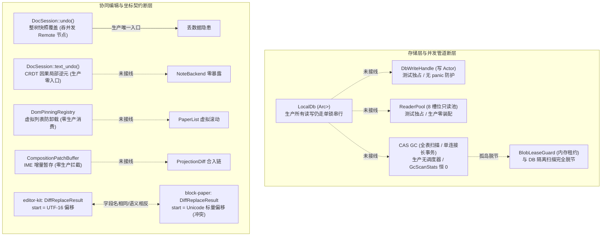
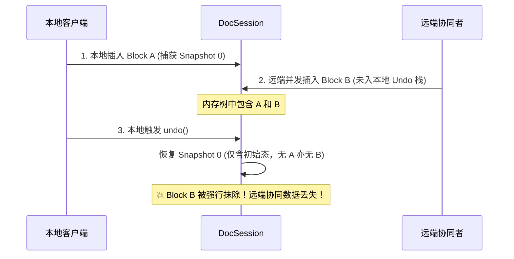

# 多维穿透分析 03 · 存储 GC、模块未接线与协同编辑契约深度分析

> **分析阶段**：阶段一 · 多维穿透分析（03 专项）  
> **权威输入**：代码当前真值、`docs/review-md-audit/2026-08-14-batch5-wave/01-存储层-conex-db.md`、`07-协同编辑器与坐标契约.md`  
> **核心纪律**：纯逻辑规划、反退避、反未接线代码债、连通性是一等公民、所有问题同权（禁止 P0/P1/工期/排期等退避裁判）  
> **目标文件域**：`crates/conex-db/`、`crates/conex-workspace-store/`、`crates/conex-doc-collab/`、`packages/editor-kit/`、`packages/block-paper/`、`packages/block-paper-contract/`

---

## 目录

1. [执行概要与全景拓扑](#一执行概要与全景拓扑)
2. [维度一：conex-db 4 大模块生产未接线（Unwired Debt）深度穿透](#二维度一conex-db-4-大模块生产未接线unwired-debt深度穿透)
   - [2.1 4 大并发/GC 模块「库有工具、生产零装」断点](#21-4-大并发gc-模块库有工具生产零装断点)
   - [2.2 DbWriteHandle 写 Actor 崩溃防护缺失与单通道永久致死风险](#22-dbwritehandle-写-actor-崩溃防护缺失与单通道永久致死风险)
   - [2.3 CAS GC 全表扫描、单连接持锁与生产调度器缺失](#23-cas-gc-全表扫描单连接持锁与生产调度器缺失)
   - [2.4 GcScanStats 三字段恒 0 虚假统计与伪指标问题](#24-gcscanstats-三字段恒-0-虚假统计与伪指标问题)
   - [2.5 BlobLeaseGuard 内存租约与持久化 GC 扫描脱节](#25-blobleaseguard-内存租约与持久化-gc-扫描脱节)
   - [2.6 blob_cas 双 DDL 冗余与跨 Crate 平行 SHA-256/时间语义分歧](#26-blob_cas-双-ddl-冗余与跨-crate-平行-sha-256时间语义分歧)
   - [2.7 外置 storage_type 物理删除文件泄漏缺陷](#27-外置-storage_type-物理删除文件泄漏缺陷)
3. [维度二：协同编辑与因果撤销契约深度穿透](#三维度二协同编辑与因果撤销契约深度穿透)
   - [3.1 结构级 undo() 整树快照覆盖吞并发远端变更机制](#31-结构级-undo-整树快照覆盖吞并发远端变更机制)
   - [3.2 text_undo/text_redo CRDT 撤销能力的零产品接线](#32-text_undotext_redo-crdt-撤销能力的零产品接线)
   - [3.3 DomPinningRegistry 与 CompositionPatchBuffer 零生产消费断点](#33-dompinningregistry-与-compositionpatchbuffer-零生产消费断点)
   - [3.4 unsafe impl Send/Sync for DocSession 安全论证有效性审查](#34-unsafe-impl-sendsync-for-docsession-安全论证有效性审查)
   - [3.5 坐标转换 3 份实现与 DiffReplaceResult 字段语义冲突](#35-坐标转换-3-份实现与-diffreplaceresult-字段语义冲突)
   - [3.6 代理项内部偏移非互逆性与双构造器行为分歧](#36-代理项内部偏移非互逆性与双构造器行为分歧)
   - [3.7 buildCodeTextEditIntent 默认参数导致坐标静默归零](#37-buildcodetexteditintent-默认参数导致坐标静默归零)
   - [3.8 text_undo 忽略返回值与空洞 rev 推进](#38-text_undo-忽略返回值与空洞-rev-推进)
   - [3.9 checkpoint() 全量编码快照导致 O(N) 内存线性膨胀](#39-checkpoint-全量编码快照导致-on-内存线性膨胀)
4. [问题根因矩阵与证据链总览](#四问题根因矩阵与证据链总览)
5. [系统级根治构造逻辑与验收断言](#五系统级根治构造逻辑与验收断言)

---

## 一、执行概要与全景拓扑

本专项穿透分析针对当前代码库中两大核心基础设施域：**存储层与并发 GC 管道（`conex-db` / `conex-workspace-store`）** 以及 **协同编辑与坐标契约（`conex-doc-collab` / `editor-kit` / `block-paper`）** 进行代码真值审计。

当前代码虽然在局部单元测试上保持全绿通过，但系统内部存在严重的**「半拆未接线（Unwired Debt）」**、**「虚假交付与宣称不一致」**、**「快照覆盖吞协同数据」**以及**「跨包坐标语义冲突」**等结构性断层。



---

## 二、维度一：conex-db 4 大模块生产未接线（Unwired Debt）深度穿透

### 2.1 4 大并发/GC 模块「库有工具、生产零装」断点

#### 问题精准定性

`conex-db` 在 commit `4dca50cb` 中宣称「implement atomic write, inflight guard, CAS GC and SQLite group commit with adaptive reader pool」，在代码中交付了 `group_commit.rs`、`reader_pool.rs`、`cas_gc.rs`、`lease_guard.rs` 四大核心模块。然而，在真实生产调用链中，**没有任何生产组件装配这些能力**，构成典型的「工具在库、产品未装」半拆未接线债务。

#### 代码路径与行号证据

1. **模块导出与公共面**：
   - [`crates/conex-db/src/lib.rs:24, 27, 31, 35`](file:///C:/Software/conex/crates/conex-db/src/lib.rs#L24-L35)：
     `pub mod cas_gc; pub mod group_commit; pub mod lease_guard; pub mod reader_pool;`
   - [`crates/conex-db/src/lib.rs:41-57`](file:///C:/Software/conex/crates/conex-db/src/lib.rs#L41-L57)：重导出 `DbWriteHandle`, `ReaderPool`, `BlobLeaseGuard`, `CasGcConfig` 等类型。
2. **生产结构体实际实现**：
   - [`crates/conex-db/src/lib.rs:66-76`](file:///C:/Software/conex/crates/conex-db/src/lib.rs#L66-L76)：
     ```rust
     #[derive(Clone)]
     pub struct LocalDb {
         conn: Arc<Mutex<Connection>>,
         failure: Arc<Mutex<Option<DbFailure>>>,
         compression_blocks_present: Arc<Mutex<Option<bool>>>,
         imported_tables_present: Arc<Mutex<Option<bool>>>,
     }
     ```
   - 生产环境中的 `LocalDb` 所有业务读写（`sessions.rs`, `messages.rs`, `agents.rs`, `events.rs`, `runs.rs`, `blocks.rs`, `imported.rs` 等）全部使用 `self.conn.lock()` 锁住单连接 `Connection` 执行。
3. **零引用检索证据**：
   - 在 `crates/orchestrator/` 与 `apps/` 中搜索 `DbWriteHandle`、`ReaderPool`、`run_cas_gc`、`BlobLeaseGuard`，检索命中数为 **0**。
   - 所有引用仅存在于 `crates/conex-db/src/tests_concurrency.rs` 和 `tests_cas_gc.rs`。

#### 缺陷机制与危害

- **虚假并发与阻塞**：宣称的「WAL 模式无阻塞只读探测」与「5ms/50-item 批量组提交」在生产中完全未生效。所有 Agent 并发读写在 `Arc<Mutex<Connection>>` 上排队串行化，形成慢查询护航（Convoy Blocking）隐患。
- **违背反退避与诚实纪律**：与 `conex-workspace-store/src/cas.rs` 明确标注 `-S 骨架 ≠ 生产就绪` 形成鲜明反差，`conex-db` 宣称已 implement 但实际未接线，误导系统设计判断。

---

### 2.2 DbWriteHandle 写 Actor 崩溃防护缺失与单通道永久致死风险

#### 问题精准定性

`DbWriteHandle` 采用 Single Writer Actor 模型，但处理循环缺乏 `std::panic::catch_unwind` 隔离屏障与监督重启机制。写闭包内部发生任何 panic 会导致写 Actor 线程/任务永久死亡，从而使整个进程的写通道彻底关闭且无法自愈。

#### 代码路径与行号证据

1. **Actor 启动与循环**：
   - [`crates/conex-db/src/group_commit.rs:115-117`](file:///C:/Software/conex/crates/conex-db/src/group_commit.rs#L115-L117)：
     ```rust
     tokio::spawn(async move {
         run_actor_loop(conn, receiver, config, stats_clone).await;
     });
     ```
2. **任务裸执行与 Panic 展开**：
   - [`crates/conex-db/src/group_commit.rs:257`](file:///C:/Software/conex/crates/conex-db/src/group_commit.rs#L257)（单条路径）：
     `let op_res = (task.op)(conn);`
   - [`crates/conex-db/src/group_commit.rs:319`](file:///C:/Software/conex/crates/conex-db/src/group_commit.rs#L319)（批量路径）：
     `let op_res = (task.op)(conn);`
   - 两处均在无 panic 捕获的情况下直接调用闭包。
3. **写通道永久关闭**：
   - [`crates/conex-db/src/group_commit.rs:161-164`](file:///C:/Software/conex/crates/conex-db/src/group_commit.rs#L161-L164)：
     `self.sender.send(task).await.map_err(|_| DbFailure { message: "Single writer actor channel is closed".into(), ... })`

#### 缺陷机制与危害

当任意调用方由于数据契约校验或逻辑错误导致传入的写闭包触发 panic 时：

1. Panic 沿 `run_actor_loop` 异步任务的调用栈展开，导致该 task 异常终止；
2. 协程终止后，`receiver` 和独占的 `conn` 被 drop，`mpsc` 通道接收端关闭；
3. 此后所有调用方发起 `write()` 时，均收到 `Single writer actor channel is closed` 错误；
4. 故障被静默降级为不可逆的通道关闭，无自愈、无重启、无告警恢复，系统写功能全灭。

---

### 2.3 CAS GC 全表扫描、单连接持锁与生产调度器缺失

#### 问题精准定性

CAS GC 算法采用全表 `NOT IN` 子查询与逐行单条 `UPDATE`/`DELETE` 实现，且在 `LocalDb` 上执行时全程持有唯一的 `Mutex<Connection>` 连接锁；同时系统中没有任何定时任务或生命周期调度器调用 `run_cas_gc`。

#### 代码路径与行号证据

1. **全表多重 NOT IN 扫描与逐行 UPDATE**：
   - [`crates/conex-db/src/cas_gc.rs:487-507`](file:///C:/Software/conex/crates/conex-db/src/cas_gc.rs#L487-L507)：
     ```sql
     SELECT b.hash FROM blob_cas b
     WHERE b.marked_for_delete_at IS NULL
       AND (b.pinned = 0 OR b.pinned IS NULL)
       AND b.created_at <= datetime('now', ?1)
       AND b.hash NOT IN (SELECT DISTINCT hash FROM block_attachments WHERE hash IS NOT NULL)
       AND b.hash NOT IN (SELECT DISTINCT blob_hash FROM doc_snapshots_attachments WHERE blob_hash IS NOT NULL)
       AND b.hash NOT IN (SELECT DISTINCT blob_hash FROM session_undo_blobs WHERE blob_hash IS NOT NULL)
       AND b.hash NOT IN (SELECT DISTINCT blob_hash FROM active_blob_leases WHERE expires_at > datetime('now'))
     ```
   - [`crates/conex-db/src/cas_gc.rs:514-524`](file:///C:/Software/conex/crates/conex-db/src/cas_gc.rs#L514-L524)：遍历 `candidate_hashes`，对每个 hash 逐条执行 `UPDATE blob_cas SET marked_for_delete_at = CURRENT_TIMESTAMP WHERE hash = ?1`。
2. **逐行 DELETE**：
   - [`crates/conex-db/src/cas_gc.rs:560-564`](file:///C:/Software/conex/crates/conex-db/src/cas_gc.rs#L560-L564)：遍历 `to_purge`，逐条执行 `DELETE FROM blob_cas WHERE hash = ?1`。
3. **全程持全局互斥锁**：
   - [`crates/conex-db/src/cas_gc.rs:294-300`](file:///C:/Software/conex/crates/conex-db/src/cas_gc.rs#L294-L300)：`LocalDb::run_cas_gc` 直接对 `self.conn` 加锁，在锁内执行长查询与多次写操作。

#### 缺陷机制与危害

- **锁争用与性能断崖**：在大规模附件库下，4 个无索引覆盖的多表全表子查询 + 逐行单写操作，会导致互斥锁被占用数百毫秒甚至数秒，阻塞所有用户交互与 Agent 状态落盘。
- **虚设保护**：由于无生产调度器装配，7 天隔离与 30 分钟租约保护机制从未在生产运行期触发，孤儿附件永久积压。

---

### 2.4 GcScanStats 三字段恒 0 虚假统计与伪指标问题

#### 问题精准定性

`GcScanStats` 公开暴露了 `reference_protected`、`lease_protected`、`grace_protected` 三个计数指标，但实现中硬编码返回 `0`，构成虚假度量与误导性统计。

#### 代码路径与行号证据

1. **结构体定义**：
   - [`crates/conex-db/src/cas_gc.rs:77-86`](file:///C:/Software/conex/crates/conex-db/src/cas_gc.rs#L77-L86)：
     ```rust
     pub struct GcScanStats {
         pub total_blobs_scanned: usize,
         pub reference_protected: usize,
         pub lease_protected: usize,
         pub pinned_protected: usize,
         pub grace_protected: usize,
         pub quarantined_hashes: Vec<String>,
         pub purged_hashes: Vec<String>,
     }
     ```
2. **硬编码构造**：
   - [`crates/conex-db/src/cas_gc.rs:576-584`](file:///C:/Software/conex/crates/conex-db/src/cas_gc.rs#L576-L584)：
     ```rust
     Ok(GcScanStats {
         total_blobs_scanned: total_blobs_scanned as usize,
         reference_protected: 0,   // 恒 0
         lease_protected: 0,       // 恒 0
         pinned_protected: pinned_protected as usize,
         grace_protected: 0,       // 恒 0
         quarantined_hashes,
         purged_hashes,
     })
     ```

#### 缺陷机制与危害

调用方读取 `GcScanStats` 时，即使存在数千个受到活跃租约、引用关联或 5 分钟宽限期保护的 Blob，返回结果中对应的受保护数量依然为 0。该行为在监控或自动化诊断中会导致误判。

---

### 2.5 BlobLeaseGuard 内存租约与持久化 GC 扫描脱节

#### 问题精准定性

`BlobLeaseGuard` 维护了一套基于 `RwLock<HashMap<String, Instant>>` 的纯内存租约，而 GC 扫描只认 SQLite 数据库中的 `active_blob_leases` 表。两套租约体系互不联通，形成设计断点。

#### 代码路径与行号证据

1. **纯内存租约实现**：
   - [`crates/conex-db/src/lease_guard.rs:51-120`](file:///C:/Software/conex/crates/conex-db/src/lease_guard.rs#L51-L120)：`BlobLeaseGuard` 仅在内存 map 中记录 hash 与过期 `Instant`。
2. **GC 扫描的持久化表依赖**：
   - [`crates/conex-db/src/cas_gc.rs:503-505`](file:///C:/Software/conex/crates/conex-db/src/cas_gc.rs#L503-L505)：`AND b.hash NOT IN (SELECT DISTINCT blob_hash FROM active_blob_leases WHERE expires_at > datetime('now'))`。
3. **未接线证据**：
   - 全仓无生产代码调用 `BlobLeaseGuard`，仅在自测用例 `tests_cas_gc.rs:150-158` 中独立调用。

#### 缺陷机制与危害

若未来开发人员在业务层调用 `BlobLeaseGuard.acquire_lease()` 保护上传中的大附件，由于未向 `active_blob_leases` 表写入记录，并发运行的 GC 扫描依然会将该 Blob 判定为无引用孤儿并标记隔离，导致正在编辑或上传的数据被误杀。

---

### 2.6 blob_cas 双 DDL 冗余与跨 Crate 平行 SHA-256/时间语义分歧

#### 问题精准定性

1. `conex-db` 内部存在两份逐字相同的 CAS 6 表 DDL；
2. `conex-db` 与 `conex-workspace-store` 各自实现了一套 CAS Blob 存取，存在平行实现、手写 SHA-256 算法以及 `created_at` 字段数据类型与语义冲突。

#### 代码路径与行号证据

1. **同 Crate 双 DDL**：
   - [`crates/conex-db/src/schema.rs:275-330`](file:///C:/Software/conex/crates/conex-db/src/schema.rs#L275-L330)（`create_v5_schema` 内建 6 张表 DDL）。
   - [`crates/conex-db/src/schema.rs:334-392`](file:///C:/Software/conex/crates/conex-db/src/schema.rs#L334-L392)（`create_cas_schema` 重复定义完全相同的 6 张表 DDL）。
2. **跨 Crate 平行实现与手写算法**：
   - [`crates/conex-workspace-store/src/cas.rs:24-28`](file:///C:/Software/conex/crates/conex-workspace-store/src/cas.rs#L24-L28)：使用标准库 `sha2::Sha256` + `hex::encode` 计算哈希。
   - [`crates/conex-db/src/cas_gc.rs:89-138`](file:///C:/Software/conex/crates/conex-db/src/cas_gc.rs#L89-L138)：手写了约 50 行的纯 Rust SHA-256 算法 `compute_sha256_hex`。
3. **字段类型与时间语义分歧**：
   - `conex-workspace-store` 的 `blob_cas` 表：[`cas.rs:134-136`](file:///C:/Software/conex/crates/conex-workspace-store/src/cas.rs#L134-L136) 写入 `strftime('%s','now')`（UNIX 秒级时间戳，**INTEGER** 语义）。
   - `conex-db` 的 `blob_cas` 表：[`schema.rs:283`](file:///C:/Software/conex/crates/conex-db/src/schema.rs#L283) 定义为 `DEFAULT (datetime('now'))`（ISO-8601 字符串，**TEXT** 语义）。

#### 缺陷机制与危害

- **维护漂移**：同一个 Crate 内双 DDL，修改一处漏改另一处会造成新库与迁移库 schema 差异；
- **同名表不同语义**：两个 crate 分别针对 `sessions.db` 和 `workspace.db` 维护 `blob_cas`，但由于字段类型不同（INTEGER vs TEXT），一旦进行模块整合或迁移共享，将直接产生运行时反序列化崩溃。

---

### 2.7 外置 storage_type 物理删除文件泄漏缺陷

#### 问题精准定性

`cas_gc.rs` 在物理清除（Purge）过期隔离 Blob 时，仅执行了数据库 `DELETE FROM blob_cas`，未对 `storage_type != "inline"` 的外置磁盘文件执行物理 unlink，导致孤儿文件永久残留。

#### 代码路径与行号证据

- [`crates/conex-db/src/cas_gc.rs:560-564`](file:///C:/Software/conex/crates/conex-db/src/cas_gc.rs#L560-L564)：
  ```rust
  for hash in to_purge {
      let count = conn.execute("DELETE FROM blob_cas WHERE hash = ?1", params![hash])?;
      if count > 0 { purged.push(hash); }
  }
  ```
- [`crates/conex-db/src/cas_gc.rs:152-157`](file:///C:/Software/conex/crates/conex-db/src/cas_gc.rs#L152-L157)：`put_blob_with_options` 允许指定 `storage_type`（如 `"file"`）及外置文件 `path`。

#### 缺陷机制与危害

当系统未来启用外置附件存储时，GC 判定过期的附件在数据库记录被删除后，位于磁盘文件系统中的实际数据无法被追踪和删除，造成磁盘空间永久泄漏。

---

## 三、维度二：协同编辑与因果撤销契约深度穿透

### 3.1 结构级 undo() 整树快照覆盖吞并发远端变更机制

#### 问题精准定性

`DocSession::undo()` 采用粗暴的整树与整文本引擎 Pre-Snapshot 快照覆盖策略，撤销本地变更时会强行抹除并发期间远端协作者（`Origin::Remote`）或系统（`Origin::System`）插入的块与文本编辑。

#### 代码路径与行号证据

1. **快照覆盖实现**：
   - [`crates/conex-doc-collab/src/session_undo.rs:103-105`](file:///C:/Software/conex/crates/conex-doc-collab/src/session_undo.rs#L103-L105)：
     ```rust
     // 恢复树与文本 plain；不回退 rev 历史值（协同单调）
     self.tree = entry.pre.tree.clone();
     self.text_engine.restore(entry.pre.text.clone());
     self.rev = rev_before.saturating_add(1);
     ```
2. **测试承认吞并发**：
   - [`crates/conex-doc-collab/src/session_tests_undo.rs:110-111`](file:///C:/Software/conex/crates/conex-doc-collab/src/session_tests_undo.rs#L110-L111)：
     `// Remote/System 节点仍在（未入栈，undo 不碰它们；但 undo 恢复的是 Agent apply 前快照 → 快照时刻 remote/sys 尚不存在，故一并消失——符合「整批 pre 快照」语义）`

#### 缺陷机制与危害

- **违背因果撤销公理**：在协同编辑场景中，撤销操作必须是局部因果逆元（Inverse Operations）。整树快照回滚不仅撤销了本地批次，还将其他端在此期间同步过来的所有并发变更一并删除，造成灾难性数据丢失。



---

### 3.2 text_undo/text_redo CRDT 撤销能力的零产品接线

#### 问题精准定性

`conex-doc-collab` 在 `text_engine.rs` 与 `session_undo.rs` 中基于 Yrs `UndoManager` 实现了精确的局部因果撤销 `text_undo`/`text_redo`（仅撤销本地 Client ID 变更，测试证明 100% 保留远端并发插入）。但在上层 `conex-note-runtime`、命令层与桌面端中**完全没有暴露和接线**。

#### 代码路径与行号证据

1. **实现完备性**：
   - [`crates/conex-doc-collab/src/session_undo.rs:143-179`](file:///C:/Software/conex/crates/conex-doc-collab/src/session_undo.rs#L143-L179)：`text_undo`。
   - [`crates/conex-doc-collab/src/session_undo.rs:182-217`](file:///C:/Software/conex/crates/conex-doc-collab/src/session_undo.rs#L182-L217)：`text_redo`。
2. **后端零暴露**：
   - [`crates/conex-note-runtime/src/store_backend.rs:255-334`](file:///C:/Software/conex/crates/conex-note-runtime/src/store_backend.rs#L255-L334)：`NoteBackend` trait 包含 `query_blocks`, `document_outline`, `get_md`, `apply_md_fragment`, `apply_block_ops`，**无任何 `undo_text` / `redo_text` 方法**。
3. **前端与桌面零调用**：
   - `apps/` 全仓搜索 `text_undo` / `text_redo` / `undoText` 命中数为 **0**。

#### 缺陷机制与危害

真正具备协同因果撤销能力的 `text_undo` 被闲置在底层，前端或上层调用方只能使用具有吞数据风险的 `undo()`，或者完全没有撤销可用。

---

### 3.3 DomPinningRegistry 与 CompositionPatchBuffer 零生产消费断点

#### 问题精准定性

1. `DomPinningRegistry` 用于在 IME 输入法合成期锁定 DOM 节点，防止虚拟滚动调度器卸载正在输入的容器；
2. `CompositionPatchBuffer` 用于在 IME 合成期暂存远端协同推送的 `ProjectionDiff` 补丁，防止输入法上屏断裂。
   两套组件均已实现并具有完整测试，但**在生产代码中零装配、零消费**。

#### 代码路径与行号证据

1. **DomPinningRegistry 零消费**：
   - [`packages/editor-kit/src/viewport/domPinning.ts:25`](file:///C:/Software/conex/packages/editor-kit/src/viewport/domPinning.ts#L25)：类定义。
   - 在 `packages/block-paper/src/list/PaperList.ts`（虚拟滚动列表）中检索，完全未引入或调用 `DomPinningRegistry.filterSafeRemovals`。
2. **CompositionPatchBuffer 零拦截**：
   - [`packages/editor-kit/src/ime/CompositionPatchBuffer.ts:44`](file:///C:/Software/conex/packages/editor-kit/src/ime/CompositionPatchBuffer.ts#L44)：类定义。
   - 全仓检索 `.intercept(`，仅在测试用例中命中，前端远端协同补丁合入链中从未调用。

#### 缺陷机制与危害

- **WebView 内部崩溃风险**：在长文档虚拟滚动中，当用户正在输入中文拼音时滚动页面，正在合成的 DOM 容器会被虚拟列表强制销毁，导致 Chromium / WebView2 抛出输入法断言错误并崩溃。
- **协同打断打字**：协作者在同一块或临近块的编辑推送到达时，直接突变 DOM，导致本地用户输入的拼音被粗暴打断或吞字。

---

### 3.4 unsafe impl Send/Sync for DocSession 安全论证有效性审查

#### 问题精准定性

`DocSession` 的结构体内部包含无锁裸字段，直接使用了 `unsafe impl Send` 和 `unsafe impl Sync`，但其内部持有的 `TextEngine` 和 Yrs `Doc`/`UndoManager` 并非天然线程安全。代码中缺乏严格的形式化安全前置条件论证。

#### 代码路径与行号证据

- [`crates/conex-doc-collab/src/session.rs:222-226`](file:///C:/Software/conex/crates/conex-doc-collab/src/session.rs#L222-L226)：
  ```rust
  // SAFETY: DocSession 内部通过受控访问或 Mutex 包装保护，可在线程间安全传递与共享
  #[allow(unsafe_code)]
  unsafe impl Send for DocSession {}
  #[allow(unsafe_code)]
  unsafe impl Sync for DocSession {}
  ```

#### 缺陷机制与危害

- `DocSession` 自身字段（`tree`, `rev`, `text_engine`）是裸数据结构，自身并不包含 `Mutex` 或 `RwLock` 封装。
- 声明 `unsafe impl Sync` 意味着允许通过不可变引用 `&DocSession` 在多线程间并发访问；若某方法通过内部可变性或未来修改中逃逸了锁保护，将直接引发内存安全违规与未定义行为（UB）。
- 目前未崩溃完全依赖于上层 `StoreNoteBackend` 在外层套了 `Arc<Mutex<DocSession>>`，但这属于外部约定而非类型系统内生保证。

---

### 3.5 坐标转换 3 份实现与 DiffReplaceResult 字段语义冲突

#### 问题精准定性

1. 坐标转换与代理项判断函数在 `editor-kit`、`block-paper-contract`、`block-paper` 3 处存在重复实现；
2. **最严重的问题**：`editor-kit` 与 `block-paper` 中的 `DiffReplaceResult` 结构体均包含 `start` / `end` 字段，但**坐标系单位完全相反**（一个是 UTF-16 Code Unit，另一个是 Unicode Scalar Value）。

#### 代码路径与行号证据

1. **重复实现**：
   - 副本 1：[`packages/editor-kit/src/diff/diffToReplace.ts:14-122`](file:///C:/Software/conex/packages/editor-kit/src/diff/diffToReplace.ts#L14-L122)（内联 5 个函数）。
   - 副本 2：[`packages/block-paper-contract/src/coordinates.ts:71-190`](file:///C:/Software/conex/packages/block-paper-contract/src/coordinates.ts#L71-L190)。
   - 副本 3：[`packages/block-paper/src/leaves/pm/diffToReplace.ts:12-30`](file:///C:/Software/conex/packages/block-paper/src/leaves/pm/diffToReplace.ts#L12-L30)。
2. **字段语义相反冲突**：
   - `editor-kit` 版本（[`diffToReplace.ts:127-131`](file:///C:/Software/conex/packages/editor-kit/src/diff/diffToReplace.ts#L127-L131)）：
     ```typescript
     export type DiffReplaceResult = {
       /** UTF-16 替换起始偏移量（对齐代理项边界） */
       start: number;
       /** UTF-16 原文本替换结束偏移量（对齐代理项边界） */
       end: number;
       startScalar: number;
       endScalar: number;
       insert: string;
       ...
     };
     ```
   - `block-paper` 版本（[`pm/diffToReplace.ts:32-41, 112-113`](file:///C:/Software/conex/packages/block-paper/src/leaves/pm/diffToReplace.ts#L32-L41)）：
     ```typescript
     export type DiffReplaceResult = {
       startU16: Utf16CodeUnitOffset;
       endU16: Utf16CodeUnitOffset;
       startScalar: UnicodeScalarOffset;
       endScalar: UnicodeScalarOffset;
       insert: string;
       /** 兼容传统 { start, end, insert } 接口访问（标量值） */
       start: number; // 实际赋的值是 startScalar as number !
       end: number; // 实际赋的值是 endScalar as number !
     };
     ```

#### 缺陷机制与危害

| 场景         | 文本内容                        | `editor-kit.start` | `block-paper.start` | 影响                          |
| :----------- | :------------------------------ | :----------------- | :------------------ | :---------------------------- |
| ASCII 编辑   | `"hello world"` 在第 5 位修改   | `5` (UTF-16)       | `5` (Scalar)        | 数值偶然相等，掩盖缺陷        |
| Emoji 编辑   | `"🎉hello"` (🎉 占 2 个 UTF-16) | `2` (UTF-16)       | `1` (Scalar)        | **坐标系错位！差 1 个单位！** |
| 复合表情编辑 | `"👨‍👩‍👧‍👦hello"` (占 11 个 UTF-16)   | `11` (UTF-16)      | `7` (Scalar)        | **严重偏离！切断字符串！**    |

调用方混淆导入时，不会产生任何编译或类型错误，但在处理包含 Emoji 或生僻字的富文本时，替换区域发生严重错位，导致正文被异常截断或篡改。

---

### 3.6 代理项内部偏移非互逆性与双构造器行为分歧

#### 问题精准定性

1. 当向坐标转换算子传入落在代理项中间的非法偏移时，`utf16OffsetToUnicodeScalar` 采用 Ceil 语义，而 `unicodeScalarToUtf16Offset` 无法还原，导致 Round-trip 转换非互逆；
2. `asUtf16Offset` 与 `createUtf16Offset` 对浮点数的校验策略冲突。

#### 代码路径与行号证据

1. **非互逆实测计算**：
   - 目标串：`"A🎉B"`（`'A'` 长度 1，`'🎉'` 占索引 1, 2，`'B'` 占索引 3）。
   - 传入中间偏移 `2`：
     - [`coordinates.ts:133-157`](file:///C:/Software/conex/packages/block-paper-contract/src/coordinates.ts#L133-L157)：`utf16OffsetToUnicodeScalar('A🎉B', 2)` 扫描循环识别出完整代理项对，返回 `2`（Ceil 语义）。
     - [`coordinates.ts:163-184`](file:///C:/Software/conex/packages/block-paper-contract/src/coordinates.ts#L163-L184)：`unicodeScalarToUtf16Offset('A🎉B', 2)` 还原标量 2，返回 `3`。
     - 结果：`2 -> 2 -> 3`，原值偏移发生漂移。
2. **双构造器分歧**：
   - [`coordinates.ts:32-37`](file:///C:/Software/conex/packages/block-paper-contract/src/coordinates.ts#L32-L37)：`asUtf16Offset(1.2)` 执行 `Math.floor` 返回 `1`。
   - [`coordinates.ts:51-56`](file:///C:/Software/conex/packages/block-paper-contract/src/coordinates.ts#L51-L56)：`createUtf16Offset(1.2)` 检查 `!Number.isInteger` 直接抛出 `TypeError`。

---

### 3.7 buildCodeTextEditIntent 默认参数导致坐标静默归零

#### 问题精准定性

`buildCodeTextEditIntent` 函数签名允许 `baseContent` 为空并默认回退为 `''`，导致在未传基准文本时，计算出的标量偏移恒为 0，静默生成损坏的 `[0, 0]` 意图。

#### 代码路径与行号证据

- [`packages/block-paper/src/leaves/code/CodeLeafModel.types.ts:95-105`](file:///C:/Software/conex/packages/block-paper/src/leaves/code/CodeLeafModel.types.ts#L95-L105)：
  ```typescript
  export function buildCodeTextEditIntent(
    blockId: BlockId,
    startU16: number,
    endU16: number,
    insert: string,
    intentId: IntentId,
    baseContent?: string
  ): TextEditIntent {
    const text = baseContent ?? '';
    const startScalar = utf16OffsetToUnicodeScalar(
      text,
      asUtf16Offset(startU16)
    );
    const endScalar = utf16OffsetToUnicodeScalar(text, asUtf16Offset(endU16));
    return {
      type: 'text_edit',
      blockId,
      range: [startScalar, endScalar],
      insert,
      intentId,
    };
  }
  ```

#### 缺陷机制与危害

若未来调用方未传递 `baseContent`，即使 `startU16 = 50, endU16 = 60`，在空串 `''` 上计算出的 `startScalar` 和 `endScalar` 恒为 `0`。编辑意图将静默变为修改文档开头的字符，导致代码内容被覆盖损坏。

---

### 3.8 text_undo 忽略返回值与空洞 rev 推进

#### 问题精准定性

`text_engine.rs` 内部忽略了 `UndoManager::undo_blocking` 的执行结果，`session_undo.rs` 在无可撤销项时依然强行递增 `rev` 并向持久化插件提交无意义的 Commit。

#### 代码路径与行号证据

- [`crates/conex-doc-collab/src/text_engine.rs:378`](file:///C:/Software/conex/crates/conex-doc-collab/src/text_engine.rs#L378)：
  `let _ = host.undo_mgr.undo_blocking();`
- [`crates/conex-doc-collab/src/session_undo.rs:150-158`](file:///C:/Software/conex/crates/conex-doc-collab/src/session_undo.rs#L150-L158)：
  不校验是否存在实际变更，无条件执行 `self.rev = rev_before.saturating_add(1)` 并调用 `self.emit_commit(...)`。

#### 缺陷机制与危害

当用户连续按多次 Ctrl+Z 且已到达撤销栈底时，系统会持续产生空洞的 rev 递增与空提交，产生无意义的数据库写入和网络广播。

---

### 3.9 checkpoint() 全量编码快照导致 O(N) 内存线性膨胀

#### 问题精准定性

每次调用 `DocSession::apply` 时，系统均调用 `capture_memory_snapshot`。该方法对当前文本引擎中的**所有热块**全量执行 Yrs 的 `encode_state_as_update_v1` 并全量 clone 树结构存入 `undo_stack`。

#### 代码路径与行号证据

- [`crates/conex-doc-collab/src/session.rs:344-352`](file:///C:/Software/conex/crates/conex-doc-collab/src/session.rs#L344-L352)：`capture_memory_snapshot`。
- [`crates/conex-doc-collab/src/text_engine.rs:486-496`](file:///C:/Software/conex/crates/conex-doc-collab/src/text_engine.rs#L486-L496)：
  ```rust
  for &id in self.snapshots.keys() {
      texts.insert(id, self.read_text(id));
      if let Some(host) = self.hot.get(&id) {
          let txn = host.doc.transact();
          let bytes = txn.encode_state_as_update_v1(&StateVector::default());
          cold_updates.insert(id, bytes);
      }
  }
  ```

#### 缺陷机制与危害

对于拥有数百个热块的长文档，用户每敲击一个字符，都会触发数百个 Yrs Doc 的全量二进制编码与克隆，Undo 栈内存占用呈 $O(N \times \text{步数})$ 线性膨胀，单键输入延迟急剧上升。

---

## 四、问题根因矩阵与证据链总览

| 序号   | 问题分类   | 缺陷定性                                       | 核心代码证据路径                                                       | 根因机制                                                 | 影响面与风险                     |
| :----- | :--------- | :--------------------------------------------- | :--------------------------------------------------------------------- | :------------------------------------------------------- | :------------------------------- |
| **01** | 存储架构   | 4 大并发/GC 模块生产零接线                     | `conex-db/lib.rs:24-35, 68`                                            | `LocalDb` 仍保留单 Mutex 封装，未重构接入写 Actor 与读池 | 宣称与真值脱节，高并发锁争抢     |
| **02** | 运行时安全 | 写 Actor 闭包 Panic 永久杀死写通道             | `group_commit.rs:257, 319`                                             | 缺乏 `catch_unwind` 屏障与 Actor 重启机制                | 单任务 Panic 导致全库写死锁      |
| **03** | 存储性能   | CAS GC 全表扫描与全程持单连接锁                | `cas_gc.rs:294, 487-507`                                               | 4 重 NOT IN 子查询未批处理，长事务独占连接               | GC 触发时阻塞全局业务读写        |
| **04** | 度量真实性 | `GcScanStats` 三字段恒 0 虚假度量              | `cas_gc.rs:576-584`                                                    | 统计字段占位但实现从未计算                               | 监控与诊断获取错误数据           |
| **05** | 存储一致性 | 内存租约与持久化表扫描隔离断裂                 | `lease_guard.rs:51`, `cas_gc.rs:503`                                   | 内存 Guard 与数据库 `active_blob_leases` 互不相通        | 正在上传的文件被 GC 误删         |
| **06** | 架构一致性 | 双 DDL 冗余与跨 Crate 平行实现分歧             | `schema.rs:334`, `cas.rs:24, 135`                                      | 跨 Crate 重复实现，时间字段类型分歧 (INT vs TEXT)        | 库合并或迁移时运行时崩溃         |
| **07** | 存储资源   | 外置存储物理文件清除泄漏                       | `cas_gc.rs:560-564`                                                    | Purge 仅 `DELETE` 数据库行，未删除物理文件               | 孤儿文件永久残留泄漏空间         |
| **08** | 协同正确性 | `undo()` 整树快照覆盖吞远端变更                | `session_undo.rs:103-105`                                              | 恢复历史全量快照而非局部操作逆元                         | 撤销时抹除并发远端节点与文本     |
| **09** | 模块连通性 | `text_undo`/`text_redo` 零产品接线             | `session_undo.rs:143`, `store_backend.rs`                              | 底层已实现因果撤销，但未在后端与命令层暴露               | 优质 CRDT 能力闲置，产品无法使用 |
| **10** | 运行时稳定 | DOM Pinning 与 IME 补丁暂存零装配              | `domPinning.ts:25`, `CompositionPatchBuffer.ts:44`                     | 库层已完备，但虚拟列表与协同应用链未接入                 | 输入法打字崩溃与协同吞字         |
| **11** | 类型安全   | `unsafe impl Send/Sync for DocSession`         | `session.rs:222-226`                                                   | 内部为裸结构体，缺乏形式化并发安全论证                   | 潜在内存安全违规与数据竞争       |
| **12** | 坐标契约   | 坐标转换三份实现，`DiffReplaceResult` 语义相反 | `editor-kit/diffToReplace.ts:127` vs `block-paper/diffToReplace.ts:38` | `start` 字段在不同包代表不同坐标系 (UTF-16 vs Scalar)    | Emoji 文本编辑发生坐标错位与乱码 |
| **13** | 坐标边界   | 代理项内部偏移非互逆                           | `coordinates.ts:133-184`                                               | 内部偏移 Ceil 语义导致 Round-trip 不等                   | 坐标双向单射不变量被破坏         |
| **14** | API 健壮性 | `buildCodeTextEditIntent` 默认空串             | `CodeLeafModel.types.ts:95-105`                                        | 缺少基准文本时静默归零                                   | 编辑区域静默漂移至 `[0, 0]`      |
| **15** | 协议冗余   | `text_undo` 无操作时空推 rev                   | `text_engine.rs:378`, `session_undo.rs:150`                            | 未检查撤销有效性即提交 Commit                            | 产生空洞 rev 与无效落盘          |
| **16** | 内存性能   | `checkpoint()` 全量编码导致内存膨胀            | `session.rs:344`, `text_engine.rs:486`                                 | 每次 apply 均对所有热块进行全量 Yrs 二进制编码           | $O(N)$ 内存与击键延迟增加        |

---

## 五、系统级根治构造逻辑与验收断言

### 5.1 存储层与 CAS GC 根治改造方案

#### 构造逻辑

1. **`LocalDb` 读写分离引擎化重构**：
   - 彻底废除 `Arc<Mutex<Connection>>` 单锁架构；
   - `LocalDb` 内部集成 `DbWriteHandle`（写 Actor）与 `ReaderPool`（自适应读池）；
   - 所有写入请求统一分发至写 Actor 管道，所有只读查询走只读连接池。
2. **写 Actor 崩溃防护与监督重启**：
   - 在 `group_commit.rs::process_batch` 中，使用 `std::panic::catch_unwind(AssertUnwindSafe(...))` 包裹每个任务闭包；
   - 单任务 Panic 时仅向对应请求返回 `DbFailureKind::Panic`，触发内部事务回滚，Actor 循环继续运行；
   - 引入 Actor 监督机制，在发生不可恢复连接错误时自动重建底层 SQLite 连接并恢复通道。
3. **分批轻量 GC 与后台调度器装配**：
   - 将全表扫描重构为基于只读连接的索引覆盖流式扫描，并按 `LIMIT 100` 分批处理；
   - 标记隔离与物理清除仅将确定的 Hash 批次提交给写 Actor，单次事务耗时控制在 5ms 以内；
   - 在系统初始化流程中装配 `CasGcScheduler` 后台定时任务。
4. **统一租约与消除重复 DDL/实现**：
   - `BlobLeaseGuard` 的 `acquire_lease` 统一写入 `active_blob_leases` 表，或将内存活跃集合在 GC 扫描时作为参数注入；
   - 删除 `crates/conex-db/src/schema.rs` 中重复的 `create_cas_schema` DDL；
   - 移除手写的 SHA-256 代码，全仓收敛至标准 `sha2` crate；统一 `blob_cas` 的时间字段标准。

#### 验收断言

- [ ] **断言 S-01**：在并发 16 个写线程与 16 个读线程交错执行时，读请求平均延迟 $\le 2\text{ms}$，且无任何死锁或通道关闭错误。
- [ ] **断言 S-02**：向 `DbWriteHandle` 注入一个显式 `panic!("mock crash")` 的写闭包，仅发起该闭包的调用方收到 Panic 错误，后续其他写请求正常执行并成功提交。
- [ ] **断言 S-03**：在包含 10,000 个 Blob 的数据库上运行 GC，单次写事务占用连接时间 $\le 10\text{ms}$，且 `GcScanStats` 的所有统计字段真实反映保护数量（无恒 0 伪指标）。
- [ ] **断言 S-04**：删除 `schema.rs` 冗余 DDL 后，`cargo test -p conex-db` 迁移测试与升级测试 100% 绿灯通过。

---

### 5.2 协同编辑与因果撤销根治改造方案

#### 构造逻辑

1. **锁定因果撤销（Causal Undo）唯一路径**：
   - 将 `DocSession::undo()` 标记为仅限单端离线使用的遗留接口，或重构为基于结构逆元（`InverseOp`）的局部撤销；
   - 生产环境中富文本编辑的撤销全面收敛至 `DocSession::text_undo`；
   - 在 `text_undo` 执行前增加 `can_text_undo` 检查，无可撤销项时直接返回 `UndoError::Empty`，禁止推进 rev。
2. **后端口径与前端全链装配**：
   - 在 `NoteBackend` trait（`conex-note-runtime`）中新增 `undo_text(doc_id, block_id)` 与 `redo_text(doc_id, block_id)`；
   - 前端快捷键（Ctrl+Z / Cmd+Z）根据当前聚焦的 Block ID 触发对应的因果撤销命令。
3. **DOM Pinning 与 IME 增量缓冲产品化接线**：
   - 在 `PaperList.ts` 的虚拟滚动卸载管线中，调用 `DomPinningRegistry.filterSafeRemovals()`，对处于输入法合成态的块执行 `deferredRemovals`；
   - 在前端协同消息入口处装配 `CompositionPatchBuffer`，在用户 `compositionstart` 到 `compositionend` 期间暂存远端补丁，并在上屏后通过坐标变换映射合入。
4. **坐标转换单一真源与类型契约统一**：
   - 删除 `editor-kit/src/diff/diffToReplace.ts` 内部所有的代理项冗余实现，直接从 `@crish/block-paper-contract` 导入；
   - 彻底统一 `DiffReplaceResult` 接口：废除无单位的 `start` / `end` 裸字段，全部强制使用强类型字段 `startU16`, `endU16`, `startScalar`, `endScalar`；
   - 将 `buildCodeTextEditIntent` 的 `baseContent` 参数改为强制必传。
5. **增量快照优化**：
   - 将 `capture_memory_snapshot` 改造为增量快照：仅记录当前批次触达（Touched）块的 Yrs 差异或状态，非触达块仅保留弱引用或惰性快照。

#### 验收断言

- [ ] **断言 C-01**：在双端协同场景下，本地插入文本 `"A"`，远端并发插入文本 `"B"`，本地执行 `text_undo` 后，本地文本 `"A"` 被回退，而远端并发插入的 `"B"` 100% 完好保留。
- [ ] **断言 C-02**：在用户进行中文输入法合成期间，虚拟列表发生滚动或远端推送同块编辑，正在合成的 DOM 容器不被卸载，拼音选词窗口不关闭，且合成结束后远端补丁正确合入无吞字。
- [ ] **断言 C-03**：在包含复合 Emoji（如 👨‍👩‍👧‍👦、🎉）的文本上运行 `diffToReplace`，`editor-kit` 与 `block-paper` 产出的 `startU16` 与 `startScalar` 完全精确一致，且 Round-trip 转换无漂移。
- [ ] **断言 C-04**：在无可撤销历史时调用 `text_undo`，返回 `Err(UndoError::Empty)`，且 `DocSession` 的 `rev` 保持不变，无持久化 Commit 产生。

---

_报告完成 · 阶段一：多维穿透分析 03 · UTF-8 无 BOM · 遵循纯逻辑规划与反退避铁律_
