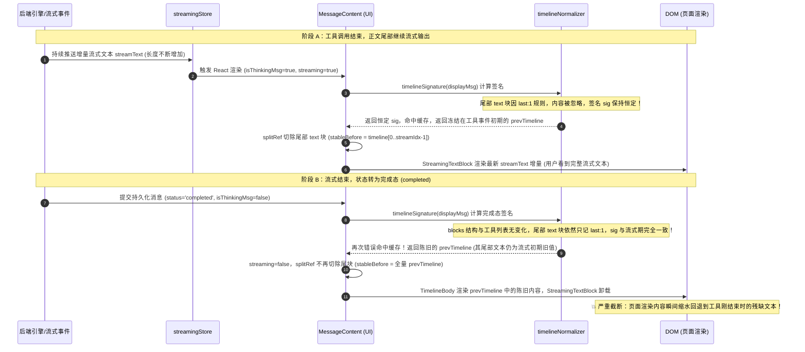
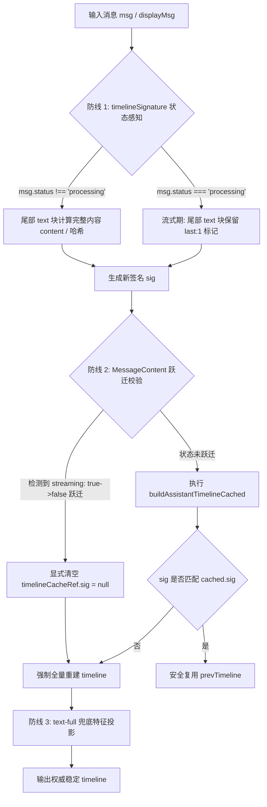
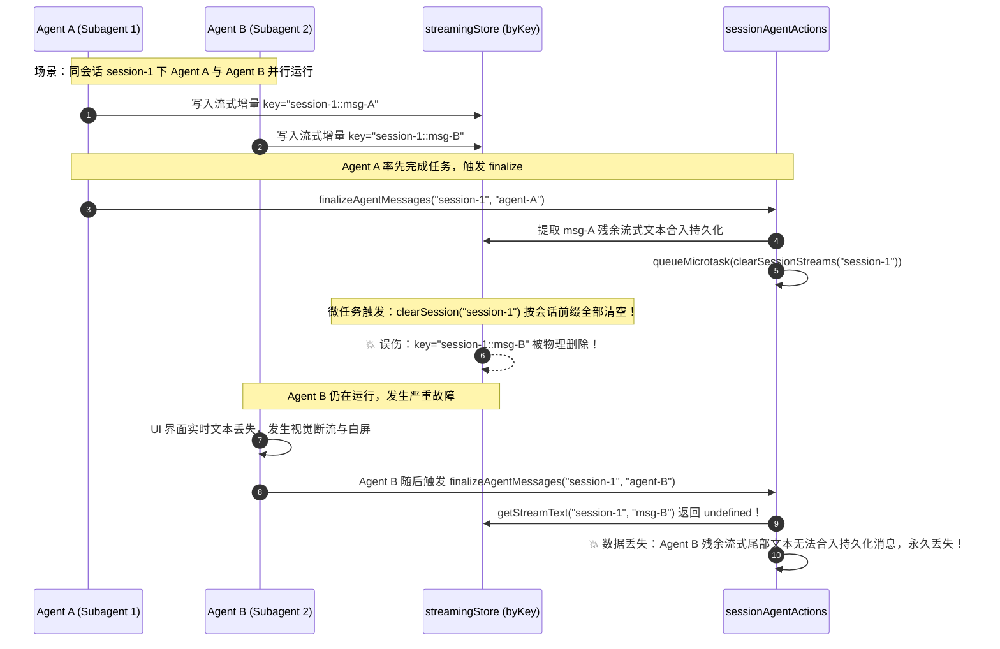

# 阶段一：多维穿透分析 04 — 前端流式渲染、Timeline签名与状态管理

> **执行依据**：`.agents/LOGIC_PLAN_NO_RETREAT.md`（反退避与单调不变量）、`AGENTS.md`、`docs/review-md-audit/2026-08-14-batch5-wave/`（09、13、14、15 审计输入）。  
> **纪律声明**：本报告坚持纯逻辑规划、代码真值定性与可验证性优先；所有缺陷问题同权，严禁包含工期、人天、排期或 P0/P1 优先级划分。

---

## 1. 🔴 红-01: `timelineSignature` 缓存导致完成态消息文本截断深度根因与单调不变量

### 1.1 现场定位与缺陷定性

- **代码路径与行号证据**：
  - `apps/crish-desktop/src/api/tool-presentation/timelineNormalizer.ts:286-323`（`timelineSignature` 签名生成算法）
  - `apps/crish-desktop/src/api/tool-presentation/timelineNormalizer.ts:330-340`（`buildAssistantTimelineCached` 缓存比对与命中复用）
  - `apps/crish-desktop/src/components/chat-message/MessageContent.tsx:148-158`（`timelineCacheRef` 缓存容器）、`:190-207`（构建与缓存更新）、`:217-222`（`streaming` 状态判定）、`:269-284`（`splitRef` 主体拆分逻辑）、`:333-368`（分段渲染装配）
  - `apps/crish-desktop/src/components/chat-message/streamMessageViewModel.ts:21-59`（`applyStreamTextToMessage` 文本合入逻辑）
- **缺陷定性**：**功能回归 / 数据展示严重倒退（红级）**。当助手消息包含交错块（即 `msg.blocks` 已含有 `[{type: 'text'}, {type: 'tool_call'}, {type: 'text'}]`），在最后一次工具事件结束后正文继续流式增长时，完成态（`msg.status === 'completed'` 或 `streaming === false`）渲染的最终正文被截断为最后一次工具事件发生时的陈旧快照，出现「流式期间全文完整，流式结束后文本缩水丢失」的严重视觉撕裂。

---

### 1.2 阶段时序与截断机理深入穿透



#### 根因机理详细剖析：

1. **流式期签名冻结**：
   在 `timelineNormalizer.ts:295-304` 中，对消息 `blocks` 中的最后一个 `text` 块进行了如下投影：
   ```typescript
   return i === lastTextIdx
     ? { t: 'text', last: 1, e: (b.content || '') === '' ? 1 : 0 }
     : { t: 'text', c: b.content };
   ```
   **设计初衷**：纯文本流式期间尾部文本每帧增长，若将 `content` 纳入签名会导致每帧签名失效重建，破坏 `TimelineBody` 的 memo 缓存。因此设计者刻意将尾部 text 的内容屏蔽，只记录 `last: 1` 和空标志 `e`。  
   **实际后果**：在交错块场景（包含工具调用与尾部文本）中，当最后一个工具调用结束后，`toolCalls` 数组稳定，非尾部 blocks 稳定，尾部 text 的 `e` 保持为 0。此后无论尾部文本流式追加多少字符，`timelineSignature(displayMsg)` 返回的 JSON 字符串**完全不变**。
2. **流式期视觉遮掩（False Positive）**：
   在流式期间（`streaming === true`），`MessageContent.tsx:277-280` 通过 `splitRef` 将 `lastTextKey` 对应的尾部 text 块从 timeline 中剥离（`stableBefore = timeline.slice(0, streamIdx)`），而尾部增长内容由 `<StreamingTextBlock>` 实时渲染。因此在流式期间，用户能看到完整的流式输出，掩盖了 `timelineCacheRef.current.timeline` 内部尾部 text 块早已被冻结在陈旧值的事实。
3. **完成态缓存击穿与陈旧值覆写**：
   当消息生成完毕进入完成态（`msg.status === 'completed'`，`isThinkingMsg = false`）：
   - `sessionStore` 提交了包含最终全量文本的 `msg.blocks`；
   - `MessageContent.tsx` 重新计算 `timelineSignature(displayMsg)`。由于算法依然只为尾部 text 块生成 `{ t: 'text', last: 1, e: 0 }`，签名字符串与流式期完全一致；
   - `buildAssistantTimelineCached` 判定 `sig === prevSig` 成立，直接返回了 `cached.timeline`（即流式初期冻结的旧 timeline）；
   - 此时 `streaming` 变为 `false`，`streamIdx` 为 `-1`，`stableBefore` 取全量 `timeline`；
   - `<StreamingTextBlock>` 卸载，`TimelineBody` 渲染 `cached.timeline` 中的尾部 `item.content`（陈旧截断文本）；
   - 最终导致完成态正文严重截断。
4. **为什么纯文本消息（无 blocks）未暴露此问题？**
   对于纯文本消息，在流式期间 `msg.blocks` 为空（`blocks.length === 0`），触发 `timelineSignature` 的 `blocks.length === 0` 特殊分支返回 `{ b: [], t: [], hasText: true }`。当完成态持久化提交时，`updateMessageText` 写入了 `msg.blocks = [{ type: 'text', content: '...' }]`，使 `blocks.length` 从 0 变为 1，签名结构发生翻转强制打破了缓存。然而对于交错消息，`blocks.length > 0` 贯穿始终，签名结构在完成态前后毫无变化，落入签名死盲区。
5. **轻级留洞（A-06）次生隐患**：
   `timelineNormalizer.ts:248-250` 的 `text-full` 兜底分支在 `blocks.length > 0` 但无 text 块时消费 `msg.text`，但 `timelineSignature` 在 `blocks.length > 0` 时完全不感知 `msg.text`。当 `msg.text` 发生变化时签名同样不会失效，导致该路径同样返回缺正文的陈旧 timeline。

---

### 1.3 前端流式到完成态单调不变量（Monotonic Invariant）公理化确立

为彻底杜绝各类流式到完成态的状态倒退、视觉撕裂与内容截断，确立以下公理化单调不变量：

$$
\forall t_1, t_2 \text{ with } t_{\text{start}} \le t_1 \le t_2 \le t_{\text{completed}},\quad
\text{RenderedText}(t_1) \subseteq_{\text{prefix}} \text{RenderedText}(t_2)
$$

特别是在终态转换点：

$$
\text{len}(\text{RenderedText}(t_{\text{completed}})) \ge \text{len}(\text{RenderedText}(t_{\text{streaming\_final}}))
$$

#### 核心推论与约束契约：

1. **内容单调不减律**：任意时刻渲染给用户的文本集合必须是前一时刻文本的前缀超集，严禁出现由于缓存复用、Store 覆盖或竞态导致的文本长度收缩或内容倒退；
2. **终态必定全量律**：完成态（`completed` / `stopped` / `error`）渲染的 DOM 文本必须严格等价于持久化 Store 中的全量最终文本，严禁复用流式期任何不完整的中间状态快照；
3. **状态跃迁失效律**：从流式态向完成态跃迁（`streaming: true -> false` 或 `msg.status: 'processing' -> 'completed'`）为不可逆的终态事件，该跃迁必须强制使所有基于流式期优化的中间视图缓存（包含 `timelineCacheRef`、增量剥离器状态等）彻底失效重建。

---

### 1.4 根治构造逻辑与多层防线设计

采用三层纵深防御体系彻底根除红-01 缺陷：



#### 具体实现规范：

1. **防线 1：`timelineSignature` 引入状态感知与尾文本差分感知**
   - 在 `timelineNormalizer.ts:286-323` 中，将消息状态纳入签名计算。
   - 当 `msg.status !== 'processing'`（即非流式完成态）时，最后一个 text 块**必须将其完整内容（或内容长度+内容哈希）计入签名**：
     ```typescript
     const isLiveProcessing = msg.status === 'processing';
     const blocksProj = blocks.map((b, i) => {
       if (b.type === 'text') {
         if (i === lastTextIdx) {
           return isLiveProcessing
             ? { t: 'text', last: 1, e: (b.content || '') === '' ? 1 : 0 }
             : { t: 'text', last: 1, c: b.content || '' };
         }
         return { t: 'text', c: b.content };
       }
       return { t: b.type, id: b.id };
     });
     ```
   - 保证完成态持久化提交时，签名必然发生结构性改变，从根本上打破缓存。
2. **防线 2：`MessageContent.tsx` 状态跃迁显式失效机制**
   - 在 `MessageContent.tsx` 中增加对 `streaming` 状态变化的跟踪 ref：
     ```typescript
     const prevStreamingRef = useRef(streaming);
     if (prevStreamingRef.current && !streaming) {
       // 流式态 -> 完成态跃迁：显式失效 timeline 缓存与拆分缓存
       timelineCacheRef.current.sig = null;
       timelineCacheRef.current.timeline = null;
       splitRef.current.timeline = EMPTY_TIMELINE;
     }
     prevStreamingRef.current = streaming;
     ```
   - 彻底阻断组件复用流式期陈旧 `timelineCacheRef` 的可能。
3. **防线 3：修复 A-06 签名轻级留洞**
   - 修正 `timelineNormalizer.ts:315-323`，即使 `blocks.length > 0`，若无有效 text 块（`!blocks.some(b => b.type === 'text' && (b.content || '').trim())`），同样将 `msg.text` 纳入签名投影，消除 `text-full` 兜底路径的签名盲区。

---

### 1.5 验收断言与魔鬼测试设计

1. **单元断言（`timelineNormalizer.test.ts` 新增）**：
   - 断言：针对同一交错 blocks 消息，`status: 'processing'` 与 `status: 'completed'` 生成的 `timelineSignature` **必须不相等**（`expect(sigProcessing).not.toBe(sigCompleted)`）；
   - 断言：在 `status: 'completed'` 下修改尾部 text 块内容，`timelineSignature` **必须改变**；
   - 断言：`buildAssistantTimelineCached` 在 `status` 翻转后必须返回新引用且内容包含最终文本。
2. **组件集成断言（`MessageContent.test.tsx` 新增）**：
   - 模拟交错消息从流式生成到完成提交的全周期：
     - Frame 1（流式）：`tool_call` 执行中；
     - Frame 2（流式）：`tool_call` 完成，尾部 text 开始输出 "初步结果："；
     - Frame 3（流式）：尾部 text 增长至 "初步结果：已成功扫描 100 个文件，执行完毕。"；
     - Frame 4（完成态）：`msg.status = 'completed'`，`msg.blocks[2].content = '初步结果：已成功扫描 100 个文件，执行完毕。'`；
   - 断言：Frame 4 渲染结果中必须包含完整的 "已成功扫描 100 个文件，执行完毕。"，不得退回 "初步结果："。
3. **单调性模糊测试（Property-based Test）**：
   - 随机生成 50 组交错 blocks，在任意增量序列与完成态之间断言：
     `expect(finalRenderedText.length).toBeGreaterThanOrEqual(streamingRenderedText.length)`。

---

## 2. 全局按键与 Hook 复杂度分析

### 2.1 `useApprovalKeyboard.ts` Esc 键全局捕获无容器焦点校验漏洞

#### 现场定位与缺陷机理：

- **代码证据**：`apps/crish-desktop/src/components/agent-card/useApprovalKeyboard.ts:47-58`
  ```typescript
  // 2. Esc：取消「再次确认」武装，不提交拒绝
  useEffect(() => {
    if (!confirmArmed) return;
    const onKey = (e: KeyboardEvent) => {
      if (e.key === 'Escape') {
        e.preventDefault();
        e.stopPropagation();
        onDisarmRef.current();
      }
    };
    window.addEventListener('keydown', onKey, true);
    return () => window.removeEventListener('keydown', onKey, true);
  }, [confirmArmed]);
  ```
- **缺陷剖析**：
  1. **全局捕获劫持**：监听器挂载在 `window` 上，且使用了事件捕获阶段（`true`）。在 `confirmArmed === true` 期间，页面上发生的**所有 Escape 按键事件**均会在根节点捕获阶段被无条件拦截；
  2. **缺失作用域约束**：代码未对 `e.target` 进行任何校验（无 `rootRef.current?.contains(target)`）。当用户在全局弹窗（Modal）、设置抽屉、代码编辑器（Monaco Editor）、检索输入框等外部组件中按下 Escape 时，预期操作被直接掐死（`preventDefault` + `stopPropagation`），且卡片武装被意外解除；
  3. **架构自相矛盾**：同一文件内的 `Enter` 快捷键处理（:92-115）严谨包含了 `rootRef.current.contains(target)` 与 `textarea/contentEditable` 豁免，Focus Trap（:61-87）仅在 `root` 节点内监听，唯独 `Esc` 破坏了焦点隔离铁律。

#### 根治构造逻辑：

- 在 `Esc` 处理函数中补齐容器焦点包含性判定与外部豁免：
  ```typescript
  const onKey = (e: KeyboardEvent) => {
    if (e.key !== 'Escape') return;
    const target = e.target as HTMLElement | null;
    if (!rootRef.current || !rootRef.current.contains(target)) {
      return; // 焦点在卡片容器外部，严禁拦截全局按键
    }
    e.preventDefault();
    e.stopPropagation();
    onDisarmRef.current();
  };
  ```
- 或者将 `Esc` 监听从 `window` 捕获阶段移至 `rootRef.current` 容器冒泡阶段，配合容器失焦自动 disarm 机制。

#### 验收断言：

- **用例 1**：在外部输入框获取焦点时触发 `Escape`，断言 `e.defaultPrevented === false`，`onDisarm` 未被调用；
- **用例 2**：在卡片内部按钮获取焦点时触发 `Escape`，断言 `e.defaultPrevented === true`，`onDisarm` 成功被调用。

---

### 2.2 `useChatApprovalHandlers.ts` 上帝 Hook 与有效行数触顶治理

#### 现场定位与坏味道度量：

- **代码证据**：`apps/crish-desktop/src/components/chat-card/useChatApprovalHandlers.ts`（总行数 445 行，有效代码行触顶 400 行业务上限，返回 13 个属性/回调）
- **职责混合分析**：
  1. **待审批状态扫描与 UI 决策**（投影职责）：`pendingApprovalScan`、`approvalUiPlan`、`pendingApprovalSummary`、`pendingApprovalDockLabel`、`approvalDockVisible`；
  2. **请求级锁与防重入状态**（状态管理职责）：`inFlightToolIdsRef`、`inFlightCount`、`isToolBusy`；
  3. **单条审批/拒绝执行器**（操作执行职责）：`handleApprovalAllow`、`handleApprovalDeny`；
  4. **批量审批/拒绝执行器**（批量配对与执行职责）：`resolveBatchPairs`、`handleBatchApprove`、`handleBatchDeny`；
  5. **错误回滚与防倒退守卫**（防御性逻辑）：重复硬编码 6 处带有类型逃逸（`as string === 'completed'`）的 catch 回滚判定。

```mermaid
graph TD
    subgraph 现有架构: useChatApprovalHandlers (445行上帝Hook / 13返回值)
        A[状态扫描与Dock计算]
        B[inFlight 请求锁]
        C[单条 Approve/Deny]
        D[批量 Approve/Deny]
        E[防倒退守卫 / 类型逃逸]
    end

    subgraph 重构解耦架构 (清晰分层)
        P1[api/chat-approval/approvalRollbackGuard.ts<br>纯函数: 类型安全防倒退守卫]
        P2[api/chat-approval/approvalBatchResolver.ts<br>纯函数: 批量工具配对计算]
        P3[api/chat-approval/inFlightApprovalRegistry.ts<br>跨实例共享请求锁管理器]
        H1[useChatApprovalState<br>只读UI投影Hook: 6返回值]
        H2[useChatApprovalExecutor<br>操作执行Hook: 4回调+busy]
        F[useChatApprovalHandlers<br>极薄聚合门面: 小于80行]
    end

    A --> H1
    B --> P3
    C --> H2
    D --> H2
    E --> P1
    P2 --> H2
    H1 --> F
    H2 --> F
```

#### 坏味道深入穿透：

1. **类型逃逸与死分支**（`useChatApprovalHandlers.ts:147, 198, 294, 383` 与 `useAgentToolApproval.ts:114, 171`）：
   代码中大量出现 `(currentTc?.status as string) === 'completed'`。在类型定义 `store/types.ts` 中，`MessageToolCallStatus` 仅包含 `'running' | 'success' | 'error' | 'pending_approval'`，`'completed'` 属于类型系统和后端事件均不可能产生的幻影值。该用法违反了禁止 `as string` 类型逃逸的铁律，属于无效死分支；
2. **实例级锁导致并发穿透**：
   `inFlightToolIdsRef` 属于各 Hook 实例私有。当同一 `toolId` 在侧边栏 `AgentCard` 与主时间线 `InlineAgentPanel` 中同时挂载时，两个 Hook 实例互不感知对方的锁状态，用户在不同面板点击会导致同工具并发重复执行；
3. **真实错误信息被覆写吞噬**：
   在 `handleApprovalAllow` 与 `handleApprovalDeny` 的 catch 块中，若引擎在网络超时前已将状态置为 `status: 'error'` 并携带真实错误信息，前端 catch 依然盲目执行 `output: '批准失败'` / `'已拒绝'`，导致真实的后端诊断日志被静态文案覆盖。

#### 根治拆分方案：

1. **下沉纯函数域（`api/chat-approval/`）**：
   - 提取 `approvalRollbackGuard.ts`：导出强类型的 `shouldSkipApprovalRollback(tc: MessageToolCall): boolean` 和 `shouldSkipDenyRollback(tc: MessageToolCall): boolean`，彻底消除 `as string` 强转；
   - 提取 `approvalBatchResolver.ts`：承载 `resolveBatchPairs` 纯逻辑；
2. **跨实例共享锁注册表（`inFlightApprovalRegistry.ts`）**：
   - 建立模块级单例 `inFlightApprovalRegistry`（维护全局 `Set<string>` + 订阅发布），跨 `ChatCard`、`AgentCard`、`InlineAgentPanel` 统一防重入；
3. **拆分 Hook 职责**：
   - `useChatApprovalState`（UI 状态投影）：仅接收 `messages` 与 `agents`，返回 6 个只读 UI 状态（行数 < 90 行）；
   - `useChatApprovalExecutor`（业务操作）：接收 `activeSessionId` 与 `onShowToast`，调用共享锁与 API（行数 < 180 行）；
   - `useChatApprovalHandlers` 保留为向下兼容的聚合门面，行数由 445 行缩减至 60 行以内。

---

## 3. Store 级联与并发清流误伤分析

### 3.1 `finalizeAgentMessages` 按会话清流并发误伤机理

#### 现场定位与缺陷时序：

- **代码证据**：
  - `apps/crish-desktop/src/store/sessionAgentActions.ts:168-204`（`finalizeAgentMessages`）
  - `apps/crish-desktop/src/store/streamingStore.ts:269-283`（`clearSession`）、`:345-347`（`clearSessionStreams`）



#### 根因分析：

`sessionAgentActions.ts:180-188` 在本轮虽补齐了「从 streamingStore 提取残余流式正文并合入持久化消息」的保护逻辑，但其提取范围**仅限于当前正在 finalize 的 `agentId` 的消息**。紧随其后的 `:201-203` 却调用了全局整会话清流函数 `clearSessionStreams(sessionId)`。`clearSessionStreams` 会遍历 `streamingStore.byKey`，将所有以 `${sessionId}::` 开头的条目清空。因此，当同会话存在多个并发 Agent 时，先结束的 Agent 会直接掐死后结束 Agent 的流式通道。

#### 根治构造方案：

1. **精确化清流粒度**：
   - 废除在 Agent finalize 路径中使用会话级清流的危险做法；
   - 在 `streamingStore.ts` 中新增精确消息清流接口：
     ```typescript
     clearStreams: (sessionId: string, messageIds: string[]) => void
     ```
   - 在 `finalizeAgentMessages` 中，收集当前 `agentId` 下所有已转为终态的 `m.id` 列表，在微任务中仅对这批 `messageIds` 进行精确清理：
     ```typescript
     const finalizedMsgIds = ag.messages
       .filter((m) => m.sender === 'assistant')
       .map((m) => m.id);
     queueMicrotask(() => {
       useStreamingStore.getState().clearStreams(sessionId, finalizedMsgIds);
     });
     ```
2. **验收断言（并发隔离测试）**：
   - 测试用例：在同会话 `sess-1` 下同时向 `streamingStore` 写入 `msg-1`（Agent A）与 `msg-2`（Agent B）的流式数据；
   - 调用 `finalizeAgentMessages('sess-1', 'agent-A')`；
   - 执行微任务等待后，断言 `getStreamText('sess-1', 'msg-1')` 为 `undefined`（已清理），而 `getStreamText('sess-1', 'msg-2')` **必须依然完整存在**。

---

### 3.2 `SessionCoordinator` 真实接线与幽灵流清理闭环

#### 现场定位与架构脱节现状：

- **代码证据**：
  - `apps/crish-desktop/src/store/SessionCoordinator.ts:1-49`（定义了跨 4 个 Store 的级联删除器 `deleteSessionCascade`）
  - `apps/crish-desktop/src/store/sessionCrudActions.ts:409-445`（`deleteSession` 实现）
  - `apps/crish-desktop/src/components/sidebar/useSidebarContextMenu.ts:233-234`（侧边栏真实删除调用点）

#### 缺陷剖析：

1. **伪闭环与半拆未接线**：
   `SessionCoordinator.ts` 虽然实现了原子级联清理逻辑并具备单元测试，但**全仓生产代码零调用**，仅在 `sessionStore.ts` 与 `storeAccess.ts` 中作为死导出存在；
2. **生产删除路径遗漏 streamingStore**：
   侧边栏右键菜单真实走的是 `sessionCrudActions.ts:409` 的 `deleteSession`。该函数在删除会话时执行了：
   - `dropTerminalForSession(state, id)`
   - `sessionRuntimeRegistry.remove(id)`
   - `clearMessageSnapshots(id)`  
     **完全遗漏了 `clearSessionStreams(id)`**！
3. **幽灵流与内存泄漏**：
   当用户在侧边栏删除一个正在流式传输或包含未清理流式条目的会话时，`streamingStore.byKey` 中对应会话的条目将永久驻留内存，成为无主「幽灵流」。若后续新建了同名会话或组件错误订阅，将读出历史脏数据。

#### 根治构造方案：

- **底层兜底接线**：
  在 `sessionCrudActions.ts:440-444` 的 `deleteSession` 成功分支中，显式补齐 `streamingStore` 清理：
  ```typescript
  if (removed) {
    sessionRuntimeRegistry.remove(id);
    clearMessageSnapshots(id);
    useStreamingStore.getState().clearSession(id);
  }
  ```
- **高层收敛**：
  将 UI 层所有会话销毁操作收敛至统一生命周期协调器，消除「部分清理」的架构隐患。

---

### 3.3 `autoIndexMiddleware.ts` 语义断言注水与死导出治理

#### 现场定位与问题定性：

- **代码证据**：
  - `apps/crish-desktop/src/store/autoIndexMiddleware.ts:8, 80-88, 152`
  - `apps/crish-desktop/src/store/autoIndexMiddleware.test.ts:103-110`
- **问题定性**：
  1. **测试名称与实现行为自相矛盾（注水断言）**：
     `autoIndexMiddleware.ts:8` 头注释明确写道：「只要 sessions 数组引用发生变化，就重建 map」；实现代码 `:98/:117` 在 `partial.sessions !== prevSessions` 时也确实无条件重建了 `sessionsById`。  
     然而测试用例 `:103` 命名为 `"does not rebuild when sessions array ref changes but id set is unchanged"`，断言却使用 `expect(store.getState().sessionsById).toStrictEqual(mapBefore)`。`toStrictEqual` 仅比对对象内容结构，即使引用被重建也恒定返回 true。若改为严格引用比对 `toBe`，测试立即报红。这是典型的「用宽松断言伪造行为成立」的注水测试。
  2. **死代码导出**：
     `sessionsIdKey` 在 `autoIndexMiddleware.ts:152` 中被 `export`，但在整个生产代码中**零引用**，仅在自身单元测试中被调用。

#### 根治方案：

1. **校准测试语义与真实行为**：
   更正用例名称为 `"rebuilds map instance atomically on sessions array reference change with identical content"`，断言明确验证单次派发与原子更新；
2. **清理死导出**：
   移除 `export { sessionsIdKey }`，将其降为模块内部辅助函数或直接移除。

---

### 3.4 上帝 Store（`layoutStore` 与 `sessionStore` 混生）架构演进路径

#### 现状分析：

`sessionStore.ts:27` 存在 `export const useSessionStore = useLayoutStore;`。单一 Store 内同时容纳了布局 Chrome（workspaces, uiSize, tabMode）、会话核心域（sessions, sessionsById, agents）、拖拽瞬态（draggedTab, dropPreview）、Composer 草稿与设置弹层。导致 `withAutoIndex` 中间件不得不包裹整个 Layout Store，使高频的布局交互与会话索引计算发生不必要的耦合。

#### 解耦演进路径（纯逻辑依赖）：

1. **阶段 1：边界收敛与接口门面隔离**：所有上层业务组件禁止直接 import `useLayoutStore` 访问 session 域，必须通过 `useSessionStore` / `storeAccess.ts` 门面；
2. **阶段 2：状态物理切分**：将 `sessions`、`sessionsById`、`agents` 迁移至独立的 `createSessionStore` 实例；
3. **阶段 3：中间件作用域收窄**：`withAutoIndex` 仅包裹独立的 `sessionStore`，解除对全局布局更新的穿透监听。

---

## 4. 穿透分析与整改闭环矩阵

下表总结本次多维穿透分析确立的问题定性、代码证据、不变量契约与验收闭环条件（**所有问题同权**）：

| 编号     | 问题定性与表现                             | 代码现场（路径:行号）                                                        | 核心机制缺陷                                                                                                         | 单调不变量 / 架构契约                                                                              | 验收断言与闭环标准                                                              |
| :------- | :----------------------------------------- | :--------------------------------------------------------------------------- | :------------------------------------------------------------------------------------------------------------------- | :------------------------------------------------------------------------------------------------- | :------------------------------------------------------------------------------ |
| **P-01** | 🔴 **红-01: 完成态正文文本截断**           | `timelineNormalizer.ts:286-323`<br>`MessageContent.tsx:148-160`              | `timelineSignature` 对尾部 text 块忽略内容，且在完成态前后签名不变，导致 `MessageContent` 命中陈旧缓存并覆写截断内容 | $\text{Text}(t_{\text{completed}}) \ge \text{Text}(t_{\text{stream}})$<br>流式到完成态严格单调不减 | 交错 blocks 消息完成态渲染包含全量最终文本；`timelineSignature` 区分流式/完成态 |
| **P-02** | **Esc 全局按键劫持漏洞**                   | `useApprovalKeyboard.ts:47-58`                                               | `window` 捕获阶段监听 Esc 且无 `rootRef.contains(target)` 校验，劫持外部弹窗与编辑器 Esc                             | 全局按键必须做容器焦点作用域约束                                                                   | 外部元素聚焦按 Esc 不拦截默认行为，卡片内聚焦按 Esc 安全 disarm                 |
| **P-03** | **useChatApprovalHandlers 上帝 Hook 触顶** | `useChatApprovalHandlers.ts:1-445`<br>`useAgentToolApproval.ts:1-180`        | 445 行 / 13 返回值，揉杂扫描、UI决策、请求锁、执行与回滚；含 6 处 `as string === 'completed'` 类型逃逸死分支         | 单一职责与类型安全（业务 Hook $\le 400$ 行）                                                       | 拆分纯函数守卫、共享锁注册表与 UI/执行子 Hook；消除全部类型逃逸                 |
| **P-04** | **finalizeAgentMessages 并发清流误伤**     | `sessionAgentActions.ts:200-203`<br>`streamingStore.ts:345-347`              | 多 Agent 并发流式时，先完成的 Agent 异步调用 `clearSessionStreams` 按会话清空全部流，抹除并行 Agent 正在流式的数据   | 并发数据流生命周期精确隔离                                                                         | 多 Agent 并行流式测试中，先 finalize 的 Agent 不影响其他 Agent 的流式读取       |
| **P-05** | **SessionCoordinator 半拆未接线**          | `SessionCoordinator.ts:23-40`<br>`sessionCrudActions.ts:409-445`             | `SessionCoordinator` 生产零调用；`deleteSession` 删除会话未清理 `streamingStore`，产生内存泄漏与幽灵流               | 跨 Store 实体销毁必须原子级联闭环                                                                  | 删除会话后断言 `streamingStore.byKey` 无对应会话残留；接通生产删除路径          |
| **P-06** | **autoIndex 测试与实现矛盾及死导出**       | `autoIndexMiddleware.ts:80-88, 152`<br>`autoIndexMiddleware.test.ts:103-110` | 测试用例声称不重建却用 `toStrictEqual` 注水断言；`sessionsIdKey` 生产零引用死导出                                    | 测试断言必须真实锁定引用与原子语义                                                                 | 校准测试名称与断言；移除 `sessionsIdKey` 死导出                                 |

---

## 5. 结论与后续行动

本报告完成了对前端流式渲染、Timeline 签名缓存、全局按键作用域、审批 Hook 架构及跨 Store 级联协调的全面穿透分析。确立了「前端流式到完成态单调不变量」等核心公理契约，并给出了精准到行号的根治构造逻辑与验收断言，为阶段二的系统性修复提供了坚实完备的逻辑基石。
