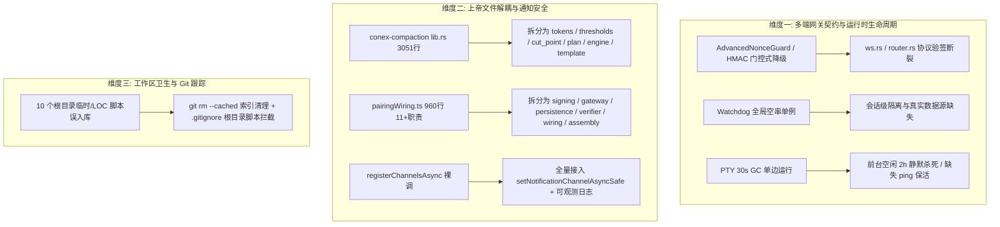

# 阶段一：多维穿透分析 05 — 多端网关契约、上帝文件重构与工作区卫生

> **报告版本**：2026-08-14 权威分析稿
> **报告路径**：`docs/systemic-remediation-wave-2/analysis/05-多端契约上帝文件与卫生分析.md`
> **分析基准**：严格遵循 `.agents/LOGIC_PLAN_NO_RETREAT.md`（纯逻辑规划、反退避、反门控降级、Rust/TS 双端防上帝文件、工作区卫生）与 `AGENTS.md`；只针对内部源码真值与审计事实（`06-推送链路.md`、`10-桌面工作区未提交.md`、`11-移动端与协议与压缩.md`、`16-壳层服务端-工作区增量.md`、`17-壳层运行-工作区增量.md`）。
> **核心原则**：所有问题同权，严禁包含工期、人天、排期或 P0/P1 优先级。

---

## 1. 架构总览与分析范围

本分析针对 Conex / Crish 桌面壳层服务端、移动端配对与通知、核心压缩引擎以及仓库根目录工作区卫生展开深度穿透，重点覆盖以下三大核心领域：



---

## 2. 维度一：多端网关契约与门控式降级深度穿透分析

### 2.1 `AdvancedNonceGuard` 与 HMAC 门控降级深度根因与修复

#### 2.1.1 问题精准定性

在 `BATCH-07`（提交 `66af5b32`）的零警告治理中，为了消除未接线代码的编译器警告，将核心安全原语（`AdvancedNonceGuard`、HMAC 签名与校验、规范化签名载荷生成器）整体打上 `#[cfg(test)]` 编译门控。导致生产环境中：

1. 服务端对 WebSocket 入站帧（`ws.rs`）及 HTTP 敏感接口（`router.rs`）完全不校验 `auth.sig` 与 `auth.nonce`；
2. 移动端构建的签名帧（`pairingWiring.ts:217-250`）在服务端直接穿透，未生效任何防重放与防篡改防护；
3. 服务端在 `router.rs:185-194` 仍在响应中注入 `X-Server-Time-Ms` 头部，声称“供客户端自愈时钟偏差”，但服务端根本无运行中的时钟与 Nonce 校验器，形成虚假的单向半连通。

#### 2.1.2 代码路径与行号证据

- `apps/agent-workbench/src-tauri/src/server/auth.rs:42-140`：
  `DEFAULT_NONCE_CAPACITY`、`DEFAULT_CLOCK_SKEW_MS`、`NonceEntry`、`NonceCheckResult`、`NonceStoreInner`、`AdvancedNonceGuard` 全部被 `#[cfg(test)]` 隔离。
- `apps/agent-workbench/src-tauri/src/server/auth.rs:231-284`：
  `hmac_sha256`、`hmac_sha256_hex`、`verify_hmac_sha256`、`canonical_http_signing_payload`、`canonical_ws_signing_payload` 全部被 `#[cfg(test)]` 隔离。
- `apps/agent-workbench/src-tauri/src/server/ws.rs:996-1017`：
  `pair.verify` 密钥交换被跳过，注释承认：“简化链不实现，hello 已直接完成配对；challenge/verify 密钥链在无 X25519/HMAC 实现下为占位，mock 亦不验签”。
- `apps/agent-workbench/src-tauri/src/server/router.rs:185-194`：
  中间件无条件向响应写入 `SERVER_TIME_HEADER`（`X-Server-Time-Ms`），但下游消费断链。
- `apps/crish-mobile/src/adapters/wiring/pairingWiring.ts:217-250`：
  移动端实现了 `buildSignedRequest`，生成 `env.auth = { deviceId, ts, nonce, sig }`，但在简化链中 `tokenKey = token`（明文 fallback），且服务端完全不解析。

#### 2.1.3 根因机制分析

- **门控式降级掩盖真实交付缺口**：违反了 `.agents/LOGIC_PLAN_NO_RETREAT.md` 中“严禁使用 `#[cfg(test)]` 门控把未接线的生产死代码伪装为测试原语”的铁律。通过编译门控消除警告，使得 CI 绿灯与真实产品安全能力脱节。
- **协议契约单边虚构**：移动端保持了完整的帧签名构造逻辑，但服务端由于未装配 Nonce 守卫与 HMAC 校验器，导致网络协议上行链路处于完全无签名的明文 Bearer 状态。

#### 2.1.4 根治构造逻辑与落地方案

按反退避原则，必须推进**真实生产装配**：

1. **移除编译门控**：解除 `auth.rs` 中 `AdvancedNonceGuard`、`NonceEntry`、`NonceCheckResult`、`hmac_sha256*`、`verify_hmac_sha256`、`canonical_*` 的 `#[cfg(test)]` 标记，使其成为生产 `pub(crate)` 原语。
2. **状态装配**：在 `ServerState`（`apps/agent-workbench/src-tauri/src/server/mod.rs`）中持有一等 `Arc<AdvancedNonceGuard>` 实例（容量 10,000，容忍时钟偏差 300,000ms）。
3. **WebSocket 帧签名校验接线**：
   在 `ws.rs` 的 `handle_incoming_text` 解析出 `DeviceEnvelope` 后，提取 `envelope.auth`：
   - 校验 `ts` 与本地时间偏差（超过 5 分钟返回 `DeviceErrorCode::AuthExpired`）；
   - 调用 `AdvancedNonceGuard.check_and_record((deviceId, nonce), payload_hash, now_ms)`，拦截重放与篡改；
   - 根据连接已认证的 `tokenKey`，计算 `canonical_ws_signing_payload` 并调用 `verify_hmac_sha256` 进行常量时间验签；验签失败立即下发 `error` 帧并切断连接。
4. **HTTP 中间件校验接线**：
   在 `router.rs` 中针对敏感控制路由（如 `/v1/runs/*`）增加签名校验中间件，消费 `X-Signature`、`X-Nonce`、`X-Timestamp` 头部。

#### 2.1.5 验收断言清单

- [ ] `cargo check -p crish-agent-workbench` 生产构建无任何未使用警告且包含 `AdvancedNonceGuard`。
- [ ] 构造篡改 `sig` 或超时 `ts` 的 WS 入站帧，断言服务端返回 `AuthFailed` / `AuthExpired` 并拒绝执行。
- [ ] 构造相同 `(deviceId, nonce)` 但修改 payload 的二次请求，断言触发 `ReplayDetected` 拒绝。
- [ ] 正常移动端通过 `buildSignedRequest` 发送的合法帧通过验签并正常流转。

---

### 2.2 `Watchdog` 全局单例与未按会话实例化深度根因

#### 2.2.1 问题精准定性

`Watchdog` 设计初衷为“每会话一个周期任务，针对等待中的子代理任务在超时失联时向会话的 `PendingMessageQueue` 注入 steering 提示条目”。然而在生产装配中：

1. `Watchdog::new` 在 `engine_build.rs:283` 被硬编码为全局单例，传入空字符串 `session_id: String::new()`；
2. 内部使用的 `store` 为孤立的内存实现 `MemoryDispatchStore`，未连接真实 `session_meta` 中的 `dispatch_*` 声明；
3. `active_timer_probe` 被硬编码为恒 0 闭包 `Arc::new(|| 0)`，无法感知 AI 是否已主动设置定时器；
4. `agents_source` 未注入，导致已完成的子代理无法被核销，存在误报风暴隐患。

#### 2.2.2 代码路径与行号证据

- `apps/agent-workbench/src-tauri/src/watchdog.rs:4-16`：
  模块注释明确规定：“`[Watchdog]`：每会话一个 tokio 周期任务（周期 60s，可配），扫描会话 `dispatch_*` 声明……group_id = `watchdog-<session>`……”。
- `apps/agent-workbench/src-tauri/src/watchdog.rs:353-355`：
  `SteeringInputEntry` 的 id 构造为 `format!("watchdog-{}-{now_ms}", self.session_id)`。
- `apps/agent-workbench/src-tauri/src/engine_build.rs:283-290`：
  ```rust
  let watchdog = Arc::new(Watchdog::new(
      String::new(), // 空串占位！
      Arc::clone(&timer_steering_queue),
      Arc::clone(&dispatch_store) as Arc<dyn crate::watchdog::DispatchStore>,
      Arc::clone(&last_wakeup),
      Arc::new(|| 0), // 恒 0 探测！
      WatchdogOptions::default(),
  ));
  ```

#### 2.2.3 根因机制分析

- **生命周期宿主错位**：Watchdog 属于会话级（Session-scoped）活性监控组件，但被错误地在引擎级（Engine-scoped）装配流中静态构建一次。由于引擎启动时没有会话上下文，导致 `session_id` 只能填充空串。
- **数据源隔离悬空**：会话的真实子代理分发声明写入了会话元数据（`conex-db` 的 `session_meta` 表），而引擎构建时传入的 `MemoryDispatchStore` 只是一个空容器，两者数据通路不通。

#### 2.2.4 根治构造逻辑与真实装配方案

1. **移除引擎级全局伪实例**：清理 `engine_build.rs:283-298` 中的静态全局 `Watchdog::new` 与无意义的全局 spawn。
2. **绑定会话生命周期**：
   在 `SessionLoop` 或 `ActiveSession` 初始化（会话激活/创建）时动态创建 `Watchdog`：
   - 传入真实 `session_id`；
   - 注入基于 `conex-db` 的 `DbDispatchStore`（根据 `session_id` 读取 `dispatch_*` 键）；
   - 注入真实的 `TimerRegistry` 计数探测 `Arc::new(move || timer_registry.active_count_for_session(&session_id))`；
   - 注入壳层的 `SubagentStatusSource`（用于核销已完成的子代理声明）。
3. **协同销毁**：在会话退出、销毁或进入关闭状态时，通过 `tokio_util::sync::CancellationToken` 安全终止对应的 Watchdog 扫描循环。

#### 2.2.5 验收断言清单

- [ ] 引擎启动时不启动无会话归属的全局 Watchdog 协程。
- [ ] 创建会话 A 与 B，分别派发子代理任务并使其超时，断言会话 A 收到 `watchdog-session_A-*` 的 steering 条目，会话 B 收到 `watchdog-session_B-*`，互不干扰且 group_id 正确。
- [ ] 当 AI 会话设置了有效定时器时，`active_timer_probe` 返回 >0，Watchdog 抑制兜底提醒。
- [ ] 会话关闭后，对应的 Watchdog 后台任务立即停止，无协程泄漏。

---

### 2.3 PTY 前台 2 小时空闲静默杀死与保活缺失根因

#### 2.3.1 问题精准定性

在 `BATCH-07` 中接通了后台 30s 周期 PTY 垃圾回收循环（`spawn_pty_gc_loop`），但由于前端与后端的生命周期协同契约仅完成了 1/3，导致严重的产品交互缺陷：

1. **未注册保活与切接命令**：`workbench_pty_detach`、`workbench_pty_attach`、`workbench_pty_ping` 在后端虽然已实现，但仍保留 `#[allow(dead_code)]`，且未在 Tauri `command_registry!` 中注册；
2. **前台空闲误杀**：前台打开的 PTY 终端在无用户输入且无后台输出超过 2 分钟时，GC 判定其超时并自动转为 `Detached` 态；在继续无输出维持 2 小时（`DETACHED_GC_GRACE_MS = 7,200,000ms`）后，GC 将其判定为可回收并**物理杀死子进程**；
3. **幽灵 UI**：`spawn_pty_gc_loop` 杀死会话时未消费 `_app` 发送任何事件，前端 UI 仍然保持终端 Tab 开启状态，用户切回终端输入时必然失败。

#### 2.3.2 代码路径与行号证据

- `apps/agent-workbench/src-tauri/src/pty/mod.rs:91-110`：
  `workbench_pty_detach`、`workbench_pty_attach`、`workbench_pty_ping` 均带有 `#[allow(dead_code)]`，未被调用。
- `apps/agent-workbench/src-tauri/src/pty/mod.rs:127-144`：
  `spawn_pty_gc_loop` 接受 `_app: AppHandle`（闲置未用），调用 `session::run_gc_sweep(now)` 杀死会话后仅打日志，未发出广播。
- `apps/agent-workbench/src-tauri/src/pty/session.rs:35, 38, 145-162`：
  - `ACTIVE_IDLE_TIMEOUT_MS = 120_000`（2分钟）；
  - `DETACHED_GC_GRACE_MS = 7_200_000`（2小时）；
  - `is_gc_eligible` 逻辑：`Active` 态在 >120s 无活动自动置为 `Detached`；`Detached` 态在 `now_ms - last_act > 7200000` 且 `now_ms - detached_at > 7200000` 时返回 `true`，触发 `kill`。
- `apps/crish-desktop/src/api/ptySessionApi.ts` 与 `apps/agent-workbench/src-tauri/src/main.rs:159-162`：
  `command_registry!` 仅注册了 `workbench_pty_create`、`workbench_pty_write`、`workbench_pty_resize`、`workbench_pty_kill` 4 个命令。

#### 2.3.3 根因机制分析

- **半套契约单独上线的行为失真**：完整的 PTY 三态设计要求“前端 Tab 聚焦发 ping 保活 / Tab 切换发 detach / Tab 切回发 attach / 真正无前端托管的游离会话在 2h 后回收”。只上线了 GC 清理端，却没有上线前端保活端，破坏了生命周期闭环。

#### 2.3.4 根治构造逻辑与完整闭环方案

1. **完整命令注册**：
   - 移除 `pty/mod.rs:91-110` 中的 `#[allow(dead_code)]`；
   - 在 `main.rs` 的 `command_registry!`、`command_manifest.rs` 中注册 `workbench_pty_detach`、`workbench_pty_attach`、`workbench_pty_ping`；
   - 在前端 `ptySessionApi.ts` 中导出对应的调用接口。
2. **前端焦点保活与 Tab 切接**：
   - 前端 PTY 终端组件挂载且获得焦点时，启动 60s 周期定时器调用 `workbench_pty_ping(pty_id)`，刷新 `last_activity_at_ms`；
   - 用户切换 Tab 离开终端时，调用 `workbench_pty_detach(pty_id)`；切回终端 Tab 时，调用 `workbench_pty_attach(pty_id)`。
3. **GC 回收事件通知**：
   - 在 `spawn_pty_gc_loop` 中，当 `killed` 列表非空时，遍历被回收的 `pty_id`，调用 `app.emit("workbench://pty-gc-killed", PtyExitEvent { pty_id, exit_code: None })`；
   - 前端监听该事件，在终端被后台回收时自动关闭对应 Tab 或显示“会话已因长时间空闲回收，点击重新连接”的优雅占位。

#### 2.3.5 验收断言清单

- [ ] 前端 PTY 处于前台聚焦状态超过 2 小时，断言持续发送 ping，PTY 会话始终保持存活不被 GC 回收。
- [ ] 前端关闭/切走 Tab 超过 2 小时且无后台输出，断言 GC 扫描回收该进程，并发出 `workbench://pty-gc-killed` 广播。
- [ ] 前端收到 `workbench://pty-gc-killed` 事件后，Tab 状态正确响应，无僵尸连接与报错。

---

## 3. 维度二：双端上帝文件与架构解耦分析

### 3.1 `crates/conex-compaction/src/lib.rs` (3,051 行) 职责缠结与子模块拆分方案

#### 3.1.1 问题精准定性

`crates/conex-compaction/src/lib.rs` 总行数高达 3,051 行（包含约 1,485 行核心业务代码与 1,566 行单元测试）。该文件违背了架构分层与行数门禁标准（>900 行必进 SD 结构债包），将 7 种不同维度的职责内联在一个单一模块中。

#### 3.1.2 职责缠结分析与代码证据

| 职责维度                   | 核心符号 / 函数 / 结构体                                                                             | 代码行位置                   | 耦合与坏味道                                                                 |
| :------------------------- | :--------------------------------------------------------------------------------------------------- | :--------------------------- | :--------------------------------------------------------------------------- |
| **Token 计算与启发式估算** | `count_tokens`, `count_agent_message_tokens`, `count_tool_output_tokens`, `IMAGE_TOKEN_COST`         | `1330-1449`                  | 包含字符遍历、CJK 判断、多模态图片成本估算，与上层策略无强耦合但内联在根文件 |
| **水位阈值与决策模型**     | `CompactionThresholds`, `ThresholdDecision`, `EstimateSource`, `EstimateContext`, `classify`         | `80-167`                     | 包含 85%/95% 双阈值判定及 E2 裁决逻辑                                        |
| **上下文切割点与批次闭合** | `find_cut_point`, `enforce_tool_batch_closure`, `fold_start_of`                                      | `266-405, 593-633`           | 负责 tool-call / tool-result 配对防护与回合边界推导，算法复杂度高            |
| **策略与计划数据结构**     | `CompactionPolicy`, `CompactionPlan`, `StubPolicy`, `Summarizer`, `noop_plan`, `summary_placeholder` | `48-79, 168-236, 1035-1329`  | 包含占位符生成、Markdown 截断与 fallback 计划生成                            |
| **压缩引擎与编排流**       | `CompactionEngine`, `compact`, `compact_agent_messages`, `emergency_preflight`                       | `237-265, 406-592, 634-1034` | 压缩主驱动器、紧急预检（50行/4096B限制）与双面模型转换                       |
| **结构化摘要模板**         | `structured_summary_template`, `days_from_civil`                                                     | `1450-1476`                  | Markdown 结构模板与时间辅助工具                                              |
| **庞大测试套件**           | `mod tests`                                                                                          | `1485-3051`                  | 1,566 行测试代码，混杂所有子功能的用例                                       |

#### 3.1.3 子模块解耦架构设计

将 `crates/conex-compaction/src/` 拆分为以下模块结构：

```
crates/conex-compaction/src/
├── lib.rs                 # 模块入口、常量定义与公开 API re-export (<100 行)
├── tokens.rs              # Token 计算、多模态估算与字符启发式 (~160 行)
├── thresholds.rs          # 预算水位模型与双阈值判定 (~120 行)
├── cut_point.rs           # 切割点倒推与 tool use/result 配对保护 (~260 行)
├── plan.rs                # 压缩计划、策略与占位符生成 (~240 行)
├── engine.rs              # 核心压缩编排引擎与紧急预检降级 (~420 行)
├── template.rs            # 结构化摘要 Markdown 模板渲染 (~110 行)
└── tests/                 # 模块化测试目录 (对齐拆分 1566 行测试)
    ├── tokens_test.rs
    ├── thresholds_test.rs
    ├── cut_point_test.rs
    ├── plan_test.rs
    └── engine_test.rs
```

#### 3.1.4 验收断言清单

- [ ] `crates/conex-compaction/src/lib.rs` 缩减至 100 行以内，每个独立子模块源码均严格控制在 500 行以内。
- [ ] `cargo test -p conex-compaction` 103 项测试全部保持绿灯通过。
- [ ] 模块间依赖保持单向无环，`lib.rs` 导出的 API 签名保持 100% 向后兼容。

---

### 3.2 `apps/crish-mobile/src/adapters/wiring/pairingWiring.ts` (960 行) 10+ 职责缠结与拆分方案

#### 3.2.1 问题精准定性

`pairingWiring.ts` 文件共 960 行，承担了移动端配对握手、密钥派生、签名构建、指纹比对、WebSocket 会话管理、安全存储桥接、Store 同步及单例装配等 11 项以上异构职责，属于典型的前端“上帝文件”。

#### 3.2.2 11 类职责拆解矩阵

| 编号 | 职责类型                  | 涉及函数 / 类 / 变量                                            | 代码行位置 | 拆分目标模块                     |
| :--- | :------------------------ | :-------------------------------------------------------------- | :--------- | :------------------------------- |
| 1    | 随机 Nonce 与签名信封构建 | `randomNonce`, `buildSignedRequest`                             | `200-250`  | `pairing/sessionSigning.ts`      |
| 2    | 会话网关与连接器工厂      | `buildSessionGateway`, `defaultConnectSession`                  | `252-283`  | `pairing/sessionSigning.ts`      |
| 3    | 安全存储持久化适配器      | `buildAuthPersist`                                              | `284-297`  | `pairing/pairingPersistence.ts`  |
| 4    | 发送就绪信号网关          | `PairingGateway` 类                                             | `299-324`  | `pairing/pairingGateway.ts`      |
| 5    | 证书指纹一致性验证        | `checkHostFingerprint` 逻辑、`pendingHostFingerprint`           | `720-745`  | `pairing/fingerprintVerifier.ts` |
| 6    | 凭据与元数据读写常量      | `PAIRING_META_*`, `loadPairingCredential`                       | `94-199`   | `pairing/pairingPersistence.ts`  |
| 7    | 配对状态机核心驱动        | `PairingWiring` 类状态轮转、`submitCode`, `onPairOk`            | `327-720`  | `pairing/PairingWiring.ts`       |
| 8    | 配对期 WebSocket 网络协调 | `ReconnectingWsClient` 创建/关闭/重置                           | `450-580`  | `pairing/PairingWiring.ts`       |
| 9    | 领域层 Store 状态同步     | `authStore`, `connectionStore` 反向绑定                         | `780-880`  | `pairing/PairingWiring.ts`       |
| 10   | 令牌撤销事件监听与解绑    | `revokedHandler`, `detachRevokedHandler`, `unpair`              | `890-912`  | `pairing/PairingWiring.ts`       |
| 11   | 单例管理与测试隔离重置    | `singleton`, `ensurePairingWiring`, `resetPairingWiringForTest` | `927-960`  | `pairing/pairingAssembly.ts`     |

此外，在 `724-738` 行存在 `checkHostFingerprint` 参数语义误用（将 `pair.challenge` 下发值作为 `stored` 传入，使得防御标签失真），需在拆分时提炼出纯粹的双端指纹一致性判断函数 `fingerprintsAgree(a, b)`。

#### 3.2.3 目标拆分架构

在 `apps/crish-mobile/src/adapters/wiring/pairing/` 下建立清晰子模块：

- `sessionSigning.ts` (~110 行)：纯函数集合，负责 Nonce、HMAC 签名信封构建与 `WsGateway` 工厂；
- `pairingGateway.ts` (~50 行)：`PairingGateway` 子类，负责就绪钩子 `onSendReady`；
- `pairingPersistence.ts` (~90 行)：凭据元数据键、`buildAuthPersist` 及 SecureStore 交互；
- `fingerprintVerifier.ts` (~70 行)：`fingerprintsAgree` 与证书指纹双信道校验逻辑；
- `PairingWiring.ts` (~360 行)：纯粹的配对业务逻辑驱动器（行数降至 400 行以下）；
- `pairingAssembly.ts` (~70 行)：单例管理、初始化配置与测试隔离；
- `index.ts` (~30 行)：聚合导出，对外保持原 `pairingWiring.ts` 的导入路径不变。

#### 3.2.4 验收断言清单

- [ ] `apps/crish-mobile/src/adapters/wiring/pairing/` 各文件均符合行数门禁（<400 行）。
- [ ] 移动端测试 `npx jest src/pairing src/adapters` 556 项测试全绿通过。
- [ ] 消除 `checkHostFingerprint` 语义误用，双信道指纹比对逻辑清晰且测试覆盖。

---

### 3.3 移动端 `registerChannelsAsync` 裸调与启动崩溃漏洞穿透

#### 3.3.1 问题精准定性

在 `apps/crish-mobile/src/notifications/channels.ts` 中，`registerChannelsAsync` 绕过了专门构建的 `setNotificationChannelAsyncSafe` 安全包装，直接在 `Promise.all` 中裸调底层 `api.setNotificationChannelAsync`。当在真机或部分 OEM Android 设备上渠道注册抛出原生异常时，`Promise.all` 会直接 Reject，导致应用在启动加载阶段触发 Unhandled Promise Rejection 而崩溃，破坏了 P0-1 阶段“系统通知不可用或失败时绝不阻塞启动”的核心契约。

#### 3.3.2 代码路径与行号证据

- `apps/crish-mobile/src/notifications/channels.ts:111-126`：
  ```typescript
  export async function registerChannelsAsync(): Promise<number> {
    const api = await loadNotificationsApi();
    if (!api) return 0;
    await Promise.all(
      NOTIFICATION_CHANNELS.map((def) =>
        api.setNotificationChannelAsync(
          // 裸调用！无 try/catch
          def.id,
          channelInputOf(
            def,
            api.AndroidImportance[IMPORTANCE_VALUE_KEY[def.importance]]
          )
        )
      )
    );
    return NOTIFICATION_CHANNELS.length;
  }
  ```
- `apps/crish-mobile/src/notifications/expoNotificationsFacade.ts:159-171`：
  `setNotificationChannelAsyncSafe` 已实现完整的错误捕获与降级，但未被 `channels.ts` 使用。
- `apps/crish-mobile/src/notifications/index.ts:64` 与 `permissions.ts:85`：
  在启动入口与权限请求路径直接 `await registerChannelsAsync()`，没有任何外部 catch 保护。
- `apps/crish-mobile/src/notifications/expoNotificationsFacade.ts:137-239`（Y1 发现项）：
  8 个安全包装函数的 `catch { return null; }` 完全静默，抹除了运行期可观测性。

#### 3.3.3 根治构造逻辑与落地方案

1. **全量接入安全包装**：
   重构 `channels.ts` 的 `registerChannelsAsync`：
   ```typescript
   export async function registerChannelsAsync(): Promise<number> {
     let successCount = 0;
     for (const def of NOTIFICATION_CHANNELS) {
       const channelInput = channelInputOf(def, ...);
       const ok = await setNotificationChannelAsyncSafe(def.id, channelInput);
       if (ok) {
         successCount += 1;
       }
     }
     return successCount;
   }
   ```
2. **增强运行期可观测性**：
   在 `expoNotificationsFacade.ts` 的 8 个安全包装函数（`getPermissionsAsyncSafe`, `requestPermissionsAsyncSafe`, `setNotificationChannelAsyncSafe`, `presentNotificationAsyncSafe` 等）的 catch 块中，统一增加 `console.warn(`[NotificationsFacade] ${wrapperName} failed:`, err)`，确保平台能力缺失（返回 null/false）与运行期异常具备可区分的日志诊断痕迹。

#### 3.3.4 验收断言清单

- [ ] 在 Mock `setNotificationChannelAsync` 抛出原生异常的测试用例中，`registerChannelsAsync()` 返回成功数 0，不抛出任何异常，应用启动流程正常完成。
- [ ] 8 个安全包装在捕获到调用异常时，均输出结构化 warn 日志，无静默吞错。

---

## 4. 维度三：工作区卫生与 Git 跟踪清理

### 4.1 10 个误跟踪根目录临时/LOC 脚本清单与定性

#### 4.1.1 误跟踪文件清单

在提交 `66af5b32` 中，以下 10 个临时、统计及分析脚本被 `git add` 误包含并推入 Git 跟踪索引：

| 序号 | 文件路径                         | 文件大小 | 类型定性            | 产生根因                                      |
| :--- | :------------------------------- | :------- | :------------------ | :-------------------------------------------- |
| 1    | `.agent-tmp-agents-dot-head.md`  | 13,024 B | 运行期临时快照      | Agent 抓取 `.agents/AGENTS.md` 产生的过程文件 |
| 2    | `.agent-tmp-agents-root-head.md` | 18,499 B | 运行期临时快照      | Agent 抓取根 `AGENTS.md` 产生的过程文件       |
| 3    | `.agent-tmp-report.py`           | 15,979 B | 运行期临时分析脚本  | 自动化审计过程生成的临时分析脚本              |
| 4    | `.agent-tmp-scan.py`             | 1,834 B  | 运行期临时扫描脚本  | 临时扫描脚本                                  |
| 5    | `count_lines.py`                 | 4,036 B  | 一次性行数统计脚本  | 本地临时统计脚本，非仓库正式门禁资产          |
| 6    | `daily_loc.py`                   | 2,975 B  | 一次性 LOC 统计脚本 | 本地临时统计脚本                              |
| 7    | `generate_report.py`             | 22,827 B | 临时报告生成工具    | 本地临时生成脚本                              |
| 8    | `generate_summary.py`            | 1,349 B  | 临时摘要生成工具    | 本地临时生成脚本                              |
| 9    | `hourly_loc.py`                  | 2,576 B  | 一次性 LOC 统计脚本 | 本地临时统计脚本                              |
| 10   | `recent_loc.py`                  | 2,130 B  | 一次性 LOC 统计脚本 | 本地临时统计脚本                              |

#### 4.1.2 危害性分析

- **污染版本历史与代码基线**：临时脚本混入根目录，破坏了工程目录结构的规范性与纯净度；
- **干扰自动化门禁与行数扫描**：部分代码扫描工具若未过滤根目录 Python 脚本，会把临时脚本的行数与语法误计入项目资产。

---

### 4.2 Git 跟踪清理与 `.gitignore` 规则收口方案

#### 4.2.1 Git 索引清理操作（规划）

执行以下精确索引移除命令（保留本地开发文件，仅移除 Git 跟踪）：

```bash
git rm --cached .agent-tmp-agents-dot-head.md
git rm --cached .agent-tmp-agents-root-head.md
git rm --cached .agent-tmp-report.py
git rm --cached .agent-tmp-scan.py
git rm --cached count_lines.py
git rm --cached daily_loc.py
git rm --cached generate_report.py
git rm --cached generate_summary.py
git rm --cached hourly_loc.py
git rm --cached recent_loc.py
```

#### 4.2.2 `.gitignore` 规则精确增补

在仓库根目录 `.gitignore` 的 `# Temporary files` 及 `# One-off agent/codegen scratch scripts` 区域增补以下规则，杜绝未来类似脚本被再次误提交：

```gitignore
# ── Agent 临时快照与运行期过程文件 ───────────────────────────
.agent-tmp-*

# ── 根目录临时/统计/报告 Python 脚本（非正式资产）─────────────
/*_loc.py
/count_lines.py
/generate_report.py
/generate_summary.py
/*.py
!scripts/**/*.py
```

#### 4.2.3 验证与防护断言

- [ ] 执行 `git check-ignore -v .agent-tmp-report.py count_lines.py daily_loc.py`，断言全部命中新增规则。
- [ ] 验证 `scripts/` 下的正式门禁脚本（如 `scripts/check-line-counts.mjs`）未被误伤，仍处于受控跟踪状态。
- [ ] 执行 `git status`，确认根目录下不再有未忽略的临时 Python / Markdown 脏文件。

---

## 5. 综合断言与全量验收标准

为确保本阶段穿透分析所识别的所有问题在后续实施轮次中彻底闭环，制定以下全量验收断言：

| 领域           | 核心检查项                    | 验收断言命令 / 验证方式                        | 预期结果                                                      |
| :------------- | :---------------------------- | :--------------------------------------------- | :------------------------------------------------------------ |
| **网关与安全** | `AdvancedNonceGuard` 生产装配 | `cargo check -p crish-agent-workbench`         | 0 警告，生产代码真实编译包含 NonceGuard 与 HMAC 验签          |
| **网关与安全** | WebSocket 帧签名校验          | 自动化测试注入篡改签名帧                       | 服务端立即拦截并返回 `AuthFailed`                             |
| **生命周期**   | Watchdog 会话级实例化         | 创建多会话并发测试                             | 每个会话独立持有 Watchdog 且 group_id 带会话前缀              |
| **生命周期**   | PTY 前台保活与 GC 通知        | 前台终端挂起 >2h 测试                          | 保持 ping 保活不被杀死；若游离回收则发出 `pty-gc-killed` 广播 |
| **上帝文件**   | `conex-compaction` 解耦       | `cargo test -p conex-compaction`               | 103 项测试全绿，所有拆分子模块代码行数 <500 行                |
| **上帝文件**   | `pairingWiring.ts` 解耦       | `npx jest src/pairing src/adapters` (移动端)   | 556 项测试全绿，`PairingWiring.ts` 源码 <400 行               |
| **通知安全**   | 渠道注册安全包装              | 移动端异常注入测试（Native reject）            | `registerChannelsAsync` 捕获异常返回 0，启动不崩溃            |
| **工作区卫生** | 临时脚本清理                  | `git ls-files count_lines.py *.py .agent-tmp*` | 输出为空，10 个临时脚本完全脱离 Git 跟踪                      |

---

_分析完成报告人：阶段一多维穿透分析 05 专项 Agent ｜ 遵循反退避纯逻辑规划准则 ｜ 2026-08-14_
