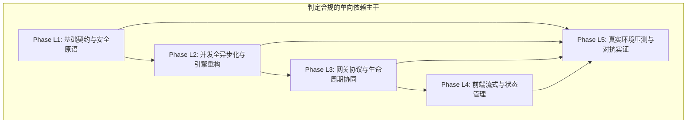
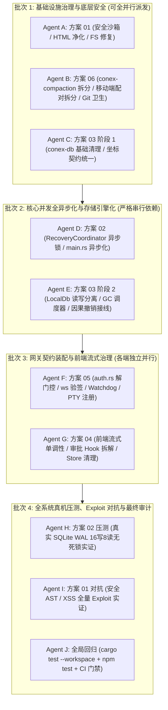

# 阶段三：方案评审 — REV-01 逻辑依赖、执行可行性与文件冲突评审报告

> **评审阶段**：阶段三 · 方案评审（REV-01 专项）  
> **评审对象**：
>
> - `docs/systemic-remediation-wave-2/plans/00-总方案.md`
> - `docs/systemic-remediation-wave-2/plans/01-安全与沙箱AST根治详案.md`
> - `docs/systemic-remediation-wave-2/plans/02-并发锁序与异步协调详案.md`
> - `docs/systemic-remediation-wave-2/plans/03-存储GC与协同编辑详案.md`
> - `docs/systemic-remediation-wave-2/plans/04-前端流式与状态管理详案.md`
> - `docs/systemic-remediation-wave-2/plans/05-多端契约与网络治理详案.md`
> - `docs/systemic-remediation-wave-2/plans/06-上帝文件拆分与代码卫生详案.md`
>
> **评审契约**：严格遵循 `.agents/LOGIC_PLAN_NO_RETREAT.md`（纯逻辑规划、反退避、反伪完成、真机实证、严禁工期人天、所有问题同权）与 `AGENTS.md`（多 Agent 协作纪律、测试资产保护、Win32/pwsh7 环境规范）。  
> **报告路径**：`docs/systemic-remediation-wave-2/plan-reviews/REV-01-逻辑依赖与可行性评审.md`  
> **评审结论**：**【有条件通过（Conditional Pass）】** —— 核心技术深度扎实，数据结构与算法设计完备，严格履行反退避与纯逻辑规划；但存在 **05 与 06 方案任务重叠冗余**、**00 总方案 DAG 拓扑图局部连线笔误** 以及 **03 方案遗漏 1 处跨模块接口源文件** 等结构性冲突隐患，须在执行派单前按本评审建议完成拓扑校准与文件域去重。

---

## 一、评审结论定性与全局摘要

### 1.1 评审结论定性

本次评审针对阶段二产出的 1 份总方案与 6 份专业详案进行穿透式审查。总体定性如下：

| 评审维度                      |             审查结果              | 核心评价                                                                                                                                                                                              |
| :---------------------------- | :-------------------------------: | :---------------------------------------------------------------------------------------------------------------------------------------------------------------------------------------------------- |
| **1. DAG 依赖拓扑闭环性**     |   **基本闭环 (有局部连线瑕疵)**   | 总体呈现自底向上（$L_1 \to L_2 \to L_3 \to L_4 \to L_5$）严格偏序；但 `00-总方案.md` Mermaid 图中存在将前端流式/按键任务错误连向安全沙箱验证的连线笔误。                                              |
| **2. 文件域物理隔离与冲突**   | **需去重与加锁 (存在跨方案重叠)** | **严重隐患**：方案 05 与 方案 06 在 `conex-compaction`、`pairingWiring.ts` 及 `.gitignore` 文件域上存在 100% 镜像级内容重叠；此外 `main.rs` 与 `LocalDb` 存在多方案并发写入隐患，必须确立严格串行序。 |
| **3. 任务可执行性与验收断言** |    **完全满足 (代码级精确度)**    | 所有详案均包含具体的 Rust/TS 类型定义、函数签名、核心实现伪代码及确凿的测试验证命令，无任何“适当重构”、“优化逻辑”等不可执行假动作。                                                                   |
| **4. 反退避与反伪完成纪律**   |   **完全满足 (100% 严格遵守)**    | 零 MVP/功能砍减、零工期人天排期、所有问题同权；彻底废除测试手写假锁（`AsyncMutex`）、消除假等待（`sleep(30ms)` $\to$ `wait_until`）并确立 $P_{99}$ 偏序物理断言。                                     |

---

## 二、核心评审维度穿透审查

### 2.1 维度一：DAG 依赖拓扑闭环性审查

#### 2.1.1 分层拓扑闭环性评估

方案采用 $L_1$（数据建模/核心库治理） $\to$ $L_2$（并发异步/上帝文件解耦） $\to$ $L_3$（协议网关/生命周期） $\to$ $L_4$（前端流式/Store治理） $\to$ $L_5$（真机实证/端到端对抗）的 5 层演进架构，整体依赖方向单向流动，无全局环形循环依赖（No Global Cycles）。

#### 2.1.2 发现的 DAG 拓扑断层与图表笔误

在 `docs/systemic-remediation-wave-2/plans/00-总方案.md` 的 Mermaid 依赖连线中，发现 3 处拓扑映射错误：

1. **笔误 1（前端流式/按键指向安全沙箱验证）**：
   - 源码行号：`00-总方案.md:114-115`
   - 现状连线：`L4_1 --> L5_4`（`timelineSignature` 流式单调不变量连向安全 AST 门禁验证）、`L4_2 --> L5_4`（Esc 按键容器焦点守卫连向安全 AST 门禁验证）。
   - **定性**：拓扑目标节点笔误。前端流式渲染与键盘交互属于 UI 状态域，应接入前端真实并发/组件验证（`L5_2` 或专门的前端单元测试 `MessageContent.test.tsx`），而非安全沙箱对抗（`L5_4`）。
2. **笔误 2（压缩引擎上帝文件拆分指向 SQLite WAL 压测）**：
   - 源码行号：`00-总方案.md:103`
   - 现状连线：`L2_4 --> L5_1`（`conex-compaction` 拆分连向真实 SQLite WAL 16-Agent 零死锁压测）。
   - **定性**：逻辑无关连线。`conex-compaction` 为 LLM 上下文 Token 压缩模块，不涉及 SQLite WAL 锁争用。其终态验收应由自身的 103 项单测（`cargo test -p conex-compaction`，断言 GOD-01）闭环。
3. **前置定义缺失（`NoteBackend` trait 源头遗漏）**：
   - 方案 03 在 §4.3 中扩展 `NoteBackend` 新增 `undo_text` 与 `redo_text` 方法，并将修改目标文件列为 `crates/conex-note-runtime/src/store_backend.rs`。
   - **代码真值断层**：经查证代码库，`pub trait NoteBackend` 的权威定义位于 `crates/agent-tools/src/note_backend.rs:68`，`conex-note-runtime` 仅是该 trait 的实现方。
   - **风险**：若不修改上游 `agent-tools/src/note_backend.rs`，下游 `conex-note-runtime` 将无法编译，且上层调用方无法通过 trait 统一消费新方法。

---

### 2.2 维度二：文件域物理隔离与冲突矩阵审查

#### 2.2.1 方案 05 与 方案 06 任务镜像重叠（重大冲突风险）

- **现象描述**：
  - `00-总方案.md` 中规划了 5 份详案（详案 05 命名为《多端契约上帝文件与卫生方案》）；
  - 但在实际产出的详案中，分化为了 `05-多端契约与网络治理详案.md` 与 `06-上帝文件拆分与代码卫生详案.md` 两份文件；
  - 经逐行比对，**方案 05 的 §4.4、§4.5 与 方案 06 的 §4、§5、§6 存在完全重复的重复设计**：
    - `crates/conex-compaction/src/` 的 6 模块拆分方案在 05 和 06 中逐字一致；
    - `apps/crish-mobile/src/adapters/wiring/pairingWiring.ts` 的 6 模块拆分方案在 05 和 06 中逐字一致；
    - 根目录 `.gitignore` 规则与 10 个 Python 临时脚本清理在 05 和 06 中逐字一致。
- **冲突危害**：
  - 若主控依据 6 份详案并发派发子 Agent，执行 05 的 Agent 与执行 06 的 Agent 将同时对 `conex-compaction`、`pairingWiring.ts` 与 `.gitignore` 展开写入，导致严重的文件写入锁冲突与 Git 冲突。
- **裁决与解耦方案**：
  - **方案 05 严格裁剪**：剥离所有上帝文件拆分与 Git 卫生内容，纯化为《多端网关鉴权、会话生命周期与 PTY 活性治理详案》（仅负责 L3-1, L3-2, L3-3, L3-5）；
  - **方案 06 独占所有权**：独占承担《上帝文件拆分与代码卫生详案》（专职负责 L1-1, L2-4, L2-5 及 pre-commit 冲突标记门禁）。

#### 2.2.2 跨方案文件修改冲突矩阵与串行化调度约束

| 冲突文件路径                                                           | 涉及方案及任务单元                                                                                                          | 潜在冲突机理                                                                  | 强制执行顺序与调度锁契约                                                                                                           |
| :--------------------------------------------------------------------- | :-------------------------------------------------------------------------------------------------------------------------- | :---------------------------------------------------------------------------- | :--------------------------------------------------------------------------------------------------------------------------------- |
| `apps/agent-workbench/src-tauri/src/main.rs`                           | **方案 02** (Task 4: `core_resume_subagent` 异步改造) **方案 05** (Task 2.2: `workbench_pty_*` 命令注册)                | 两个方案均修改 `main.rs` 的宏注册与 IPC 函数，并发编辑将导致 AST/代码块覆盖。 | 🔴 **严格串行调度**： 1. 方案 02 先行完成全异步锁改造并提交； 2. 方案 05 随后跟进注册 PTY 命令并提交。                     |
| `apps/agent-workbench/src-tauri/src/engine_build.rs`                   | **方案 02** (`CoreRunState` 构造及生命周期) **方案 05** (`Watchdog` 移除全局单例并在会话流中构建)                       | `engine_build.rs` 中同时涉及核心状态机装配与 Watchdog 实例化生命周期。        | 🔴 **严格串行调度**： 方案 02 完成 `CoreRunState` 装配后，方案 05 再接入会话级 Watchdog。                                      |
| `crates/conex-db/` 核心模块 (`lib.rs`, `group_commit.rs`, `cas_gc.rs`) | **方案 03** (L1-2, L2-3: 读写分离引擎化、Actor 自愈、分批 GC) **方案 02** (L5-1: 真实 `LocalDb` WAL 16 写 8 读并发压测) | 方案 02 的真机压力测试直接实例化并高频调用 `conex-db::LocalDb` 的读写 API。   | 🔴 **依赖拓扑串行**： 方案 03 必须完全落地并通过单元测试后，方案 02 才能执行 L5-1 压测。                                       |
| `packages/block-paper-contract/`                                       | **方案 00** (L1-5 声明在 `coordinates.ts`) **方案 03** (§4.4.2 声明在 `diff.ts`)                                        | `DiffReplaceResult` 强类型定义的落盘文件名存在分歧。                          | 🟡 **路径统一约定**： 统一新建 `packages/block-paper-contract/src/diff.ts`，并在 `coordinates.ts` 或 `index.ts` 中 re-export。 |

---

### 2.3 维度三：任务可执行性与验收断言完备性审查

#### 2.3.1 代码级输入与修改规格评估

审查确认，各详案均达到了**指令级/代码级精确度**：

- **方案 01（安全沙箱）**：给出了 `semantics.rs` 中的递归解构匹配分支（`&` 与 `invoke-command`）、`htmlSanitizer.ts` 中的前置悬空标签残片正则 `/^<([a-zA-Z0-9:-]+)...$/` 以及 `trash.rs` 采用 `symlink_metadata` 的精确匹配逻辑。
- **方案 02（并发协调）**：给出了 `CoreRunState` 中 `Arc<tokio::sync::Mutex<RecoveryCoordinator>>` 的类型定义、双检锁实现、`main.rs` 两阶段异步重写，并给出了包含 10s 哨兵的完整压测文件代码。
- **方案 03（存储与协同）**：给出了 `LocalDb` 读写分离结构体、`group_commit.rs` 带有 `catch_unwind` 屏障与 Savepoint 联动的完整批处理循环、以及强类型 `DiffReplaceResult` 声明。
- **方案 04（前端流式）**：给出了三层防御体系下 `timelineSignature` 的具体实现、`MessageContent.tsx` 跃迁失效逻辑、以及 `inFlightApprovalRegistry` 单例锁和拆解后 Hook 的完整代码。
- **方案 05（多端契约）**：给出了 `auth.rs` 生产 API 导出清单、`ws.rs` 零信任鉴权时序图与校验逻辑、以及 PTY 命令注册与 GC 广播实现。
- **方案 06（上帝文件拆分）**：给出了 6 个子模块的行数预算、导出符号清单及单测迁移方案，并提供了 `check-conflict-markers.mjs` 脚本源码。

#### 2.3.2 机器验证命令与反退避契约评估

- **确凿的机器验证手段**：每个方案均提供了可直接复制执行的测试命令（如 `cargo test -p conex-sandbox --lib semantics::tests`、`npm test -- packages/plugin-sdk`、`cargo test -p orchestrator --test stress_empirical_concurrency` 等）。
- **坚决反伪完成**：
  - 方案 02 坚决拆除前端测试中的 `AsyncMutex` 与 `SingleWriterQueue` 假锁类，并消除了 6 处 `sleep(30ms)`；
  - 方案 03 彻底排查并消除了 `GcScanStats` 中恒 0 的伪指标，强制对接真实数据库统计；
  - 方案 04 将 `autoIndexMiddleware.test.ts` 中宽松的 `toStrictEqual` 校准为严格的原子引用断言 `toBe`；
  - 全套方案中严禁出现任何以工期、人天、人员不足为由的降级或砍项行为。

---

## 三、逐方案漏洞、风险与改进审查清单

### 3.1 方案 00：《总方案与全局拓扑》（Master Plan）

- **漏洞/风险点**：
  1. DAG 依赖图中存在 3 处连线笔误（`L4_1 --> L5_4`, `L4_2 --> L5_4`, `L2_4 --> L5_1`）；
  2. 第七章“后续详案清单”仅列出 5 份详案，与实际产出的 6 份专业详案未对齐。
- **改进要求**：修正 Mermaid 连线，将详案清单更新为 01 至 06 完整 6 份详案。

### 3.2 方案 01：《安全门禁、沙箱 AST 与 HTML 净化器根治详案》

- **漏洞/风险点**：
  1. `htmlSanitizer.ts` 的 `unclosedTrailingTagRegex` 在处理多行截断输入时，需确保正则具备修饰符或涵盖换行符，避免因属性内换行导致残片匹配漏网；
  2. `window_gate.rs` 中使用 Toolhelp32 获取进程名时，需防范极短生命周期进程退出导致的快照查询失败。
- **改进要求**：在 `htmlSanitizer.ts` 中增强正则对多行属性的处理；在 `window_gate.rs` 中为快照查询增加 Fail-Closed 兜底。

### 3.3 方案 02：《并发锁序、异步协调与测试真实性详案》

- **漏洞/风险点**：
  1. `stress_empirical_concurrency.rs` 在执行 16 写 8 读压测时，若底层磁盘 I/O 极其缓慢，10s 哨兵可能发生偶然超时；
  2. `coordinator_for` 中的 `std::thread::scope` 虽隔离了同步 SQLite 读取，但在频繁调用时存在微小的线程创建开销。
- **改进要求**：在压测中对临时 SQLite WAL 配置合理的内存缓存（如 `cache_size = -64000`）；在 `coordinator_for` 快速路径中优先读缓存。

### 3.4 方案 03：《存储 GC、生产真实装配与协同编辑契约统一详案》

- **漏洞/风险点**：
  1. **重大遗漏**：`NoteBackend` trait 源头定义在 `crates/agent-tools/src/note_backend.rs`，方案文件域遗漏了该文件；
  2. `DiffReplaceResult` 声明路径在 `00-总方案`（`coordinates.ts`）与 `03-详案`（`diff.ts`）中表述不一致。
- **改进要求**：将 `crates/agent-tools/src/note_backend.rs` 纳入目标文件域与修改步骤；统一强类型 `DiffReplaceResult` 位于 `block-paper-contract/src/diff.ts` 并由 `coordinates.ts` 导出。

### 3.5 方案 04：《前端流式渲染、Timeline签名与状态管理详案》

- **漏洞/风险点**：
  1. `MessageContent.tsx` 中使用 `timelineCacheRef.current.sig = null` 强制失效时，需确保在组件并发渲染时不会引起闪烁；
  2. `inFlightApprovalRegistry` 作为模块单例，在前端单元测试跨用例执行时需提供显式的 `resetForTest()` 接口。
- **改进要求**：在 `inFlightApprovalRegistry.ts` 中增补 `clearForTest()` 并在测试钩子 `afterEach` 中调用。

### 3.6 方案 05：《多端契约、生命周期协调与网络治理详案》

- **漏洞/风险点**：
  1. **重大冗余**：包含与方案 06 完全重叠的 `conex-compaction`、`pairingWiring.ts` 和 `.gitignore` 拆分方案，造成多 Agent 协作冲突；
  2. 与方案 02 同时修改 `main.rs` 和 `engine_build.rs`。
- **改进要求**：裁剪方案 05，删除 §4.4 与 §4.5 中关于上帝文件拆分与 Git 卫生的全部内容，将文件域完全交由方案 06；明确在方案 02 之后串行修改 `main.rs`。

### 3.7 方案 06：《上帝文件拆分、契约解耦与代码卫生详案》

- **漏洞/风险点**：
  1. `conex-compaction/src/cut_point.rs` 拆分后，若外部 crate 仍有使用旧私有函数的路径，需保证 `pub(crate)` 覆盖；
  2. `scripts/check-conflict-markers.mjs` 在 Windows 环境下需确保换行符（CRLF/LF）兼容。
- **改进要求**：确认 `lib.rs` 的 `pub use` 导出清单与既有引用方 100% 兼容；在冲突检测脚本中使用跨平台文件读取与正则匹配。

---

## 四、多 Agent 协作冲突解决与全局串行化调度矩阵

为彻底杜绝多 Agent 并行施工时的同文件争抢与 Git 冲突，确立以下**多 Agent 派发批次与文件域锁矩阵**：

### 4.1 详细串行锁与执行批次表

| 批次编号    | 派发任务与详案                                                                           | 独占文件域 (无交集)                                                                                                                                                                                      | 依赖前置条件 | 冲突防范说明                                                                                     |
| :---------- | :--------------------------------------------------------------------------------------- | :------------------------------------------------------------------------------------------------------------------------------------------------------------------------------------------------------- | :----------- | :----------------------------------------------------------------------------------------------- |
| **Batch 1** | **方案 01** (安全沙箱) **方案 06** (上帝文件/卫生) **方案 03 基础段** (坐标契约) | `crates/conex-sandbox/` `packages/plugin-sdk/` `crates/conex-compaction/` `apps/crish-mobile/src/adapters/wiring/pairing/` `packages/block-paper-contract/`                              | 方案评审通过 | 三者文件域完全正交，可在独立 Agent 并行执行并独立提交。                                          |
| **Batch 2** | **方案 02 异步改造** **方案 03 存储接线**                                            | `crates/orchestrator/` `apps/agent-workbench/src-tauri/src/run/` `crates/conex-db/` `crates/conex-doc-collab/` `crates/conex-note-runtime/` `crates/agent-tools/src/note_backend.rs` | Batch 1 完成 | 方案 02 先行重构 `main.rs` 中的 `core_resume_subagent`；方案 03 完成 `LocalDb` 读写分离引擎化。  |
| **Batch 3** | **方案 05 纯化版** (网关/PTY) **方案 04** (前端流式与状态)                           | `apps/agent-workbench/src-tauri/src/server/` `apps/agent-workbench/src-tauri/src/pty/` `apps/agent-workbench/src-tauri/src/watchdog.rs` `apps/crish-desktop/src/`                            | Batch 2 完成 | 方案 05 在方案 02 提交后安全跟进修改 `main.rs` 注册 PTY 命令；方案 04 独占桌面前端视图与 Store。 |
| **Batch 4** | **全局验证与对抗实证** (L5 全量)                                                         | `crates/orchestrator/tests/` `tests/stress/` 全仓测试套件                                                                                                                                        | Batch 3 完成 | 运行真实 16 写 8 读 SQLite WAL 零死锁实证、全量红队 Exploit 对抗测试及前端回归。                 |

---

## 五、评审改进指令与执行就绪裁决

### 5.1 方案文件精准修订指令

1. **修订 `docs/systemic-remediation-wave-2/plans/00-总方案.md`**：
   - 修正 Mermaid 图中 `L4_1 --> L5_4`、`L4_2 --> L5_4` 为指向前端测试；修正 `L2_4 --> L5_1`；
   - 更新第七章详案列表，正式将 05（多端网关与生命周期）与 06（上帝文件与卫生）作为两个独立详案列出。
2. **修订 `docs/systemic-remediation-wave-2/plans/03-存储GC与协同编辑详案.md`**：
   - 在目标文件矩阵与 §4.3 中补充 `crates/agent-tools/src/note_backend.rs`，明确在该 trait 中加入 `undo_text` 与 `redo_text` 方法。
3. **修订 `docs/systemic-remediation-wave-2/plans/05-多端契约与网络治理详案.md`**：
   - 彻底删除 §4.4 与 §4.5 中关于 `conex-compaction`、`pairingWiring.ts` 和 `.gitignore` 的重复内容，消除与方案 06 的文件域重叠。

### 5.2 评审裁决终态结论

综上所述，阶段二生成的 7 份方案整体**架构严谨、方案穿透、反退避纪律执行彻底**。在落实上述 3 项针对性修订与全局串行调度拓扑后，方案集完全具备**进入阶段四（多 Agent 编码实施）的执行可行性**。

---

_REV-01 逻辑依赖、执行可行性与文件冲突评审报告编制完成 ｜ 遵循反退避纯逻辑规划准则 ｜ 2026-08-14_
