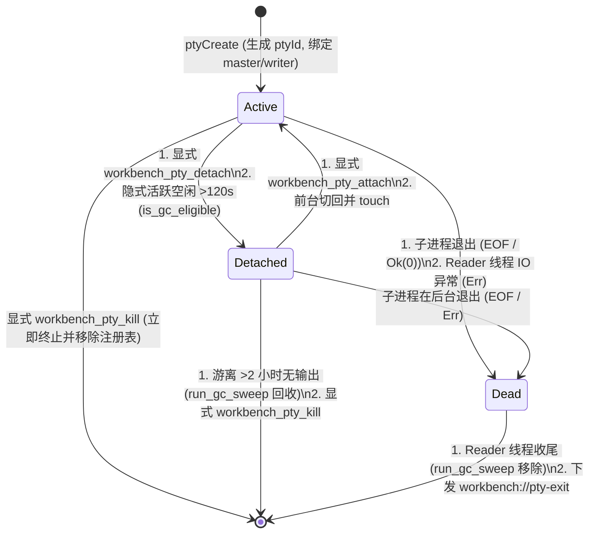
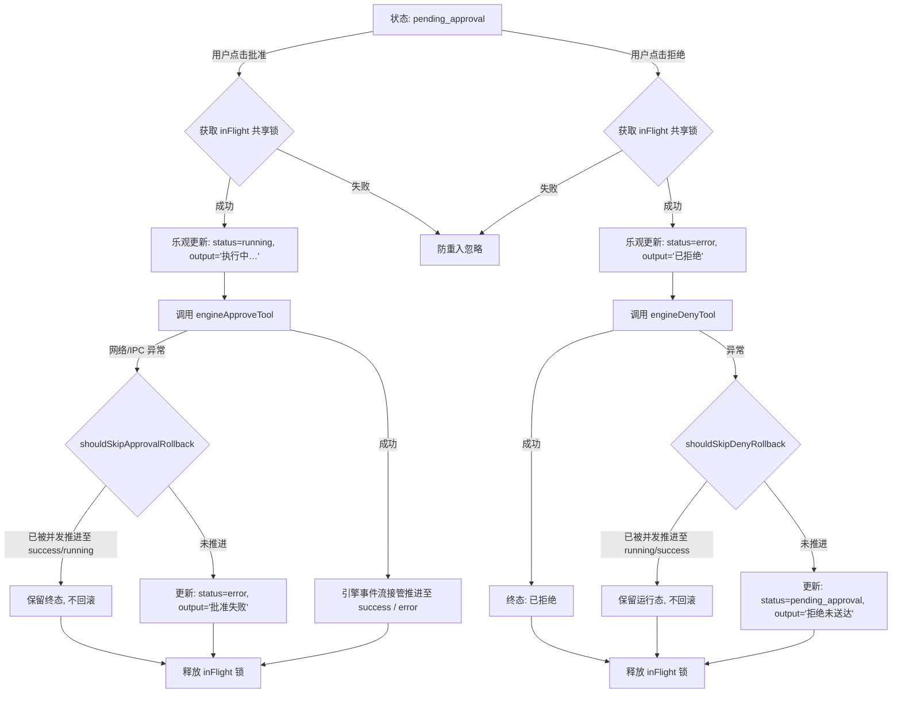

# 阶段三：方案评审报告 — REV-02 架构契约、状态机一致性与类型安全评审

> **评审阶段**：阶段三 · 方案多维穿透独立评审（REV-02 专项）
> **评审对象**：
>
> - `docs/systemic-remediation-wave-2/plans/00-总方案.md`
> - `docs/systemic-remediation-wave-2/plans/01-安全与沙箱AST根治详案.md`
> - `docs/systemic-remediation-wave-2/plans/02-并发锁序与异步协调详案.md`
> - `docs/systemic-remediation-wave-2/plans/03-存储GC与协同编辑详案.md`
> - `docs/systemic-remediation-wave-2/plans/04-前端流式与状态管理详案.md`
> - `docs/systemic-remediation-wave-2/plans/05-多端契约与网络治理详案.md`
> - `docs/systemic-remediation-wave-2/plans/06-上帝文件拆分与代码卫生详案.md`
>   **评审基准**：严格遵循 `.agents/LOGIC_PLAN_NO_RETREAT.md`（纯逻辑规划、反退避、反伪完成、真机实证、契约保真、所有问题同权）与 `AGENTS.md`。
>   **输出路径**：`docs/systemic-remediation-wave-2/plan-reviews/REV-02-架构契约与一致性评审.md`
>   **评审员**：REV-02 架构契约与一致性独立评审组

---

## 一、评审结论定性（Executive Verdict）

### 1.1 总体评审结论：【有条件通过 / 需合并 6 项契约加固项（Conditional Pass with 6 Contract Addenda）】

评审组对阶段二编制的 1 份总方案与 6 份专业详案进行了跨语言、跨层、跨状态机与跨坐标系的全景契约穿透审查。

**核心肯定结论**：

1. **反退避与纯逻辑规划执行彻底**：各方案无任何工期、人天、排期或 P0/P1 优先级划分，所有已识别缺陷同权闭环；
2. **架构根因穿透准确**：
   - 彻底废除了 `RecoveryCoordinator` 上的 `std::sync::Mutex` 与 `block_on` 阻塞套娃；
   - 确立了 $\text{RenderedText}(t_1) \subseteq \text{RenderedText}(t_2)$ 流式单调公理与完成态击穿防线；
   - 建立了强类型双坐标系 `DiffReplaceResult`（`startU16`/`startScalar`），消除了 UTF-16 与 Unicode 标量在包间的语义相反冲突；
   - 解除了 `AdvancedNonceGuard` 与 HMAC 的 `#[cfg(test)]` 门控式降级。

**发现的 6 项契约断层与类型/状态机漏洞（需在实施前并入详案契约基线）**：

1. **🔴 契约断层 C-01（前端命令清单镜像脱节）**：详案 05 注册了 `workbench_pty_detach` 等 3 个 Rust 命令与 Rust `command_manifest.rs`，但遗漏了前端 `apps/crish-desktop/src/api/transport/commandManifest.ts`（`BUILTIN_COMMAND_MANIFEST`）与测试条数同步，将直接触发前端 CI 动态镜像守门门禁红灯；
2. **🔴 序列化漏洞 C-02（`DeviceEnvelope.auth` 反序列化缺失 Default 容错）**：`crates/conex-types` 中的 `DeviceEnvelope.auth` 未标注 `#[serde(default)]` 且 `AuthHeader` 未派生 `Default`，导致客户端发送免签帧（如 `pair.hello`、`heartbeat` 等无 `auth` 字段的 JSON）时，服务端在信封解析阶段报错 `missing field auth` 并拒绝连接；
3. **🟡 契约缺失 C-03（`NoteBackend` 协同撤销 IPC 链路未定义）**：详案 03 在 Rust `NoteBackend` trait 新增了 `undo_text` / `redo_text`，但未规范 Tauri 命令名（`note_undo_text`）、入参/出参 JSON 格式、双端 Manifest 登记及前端 `noteApi.ts` 导出函数，存在半接线风险；
4. **🟡 拓扑定义歧义 C-04（五级锁拓扑 $L_2 \to L_1$ 嵌套偏序形式化表述冲突）**：详案 02 定义了 $L_0 \prec L_1 \prec L_2 \prec L_3 \prec L_4$，但 `RecoveryCoordinator`（$L_2$ 异步锁）在内部调用了 `SessionTree.fork`（$L_1$ 同步锁），字面偏序呈现 $2 \to 1$ 逆向假象，需从“作用域互斥锁 vs 叶子内存锁”形式化公理上严格澄清，杜绝开发者误解；
5. **🟡 事件命名规范 C-05（PTY GC 事件载荷字段与 `PtyExitEvent` 序列化不齐）**：详案 05 中 `workbench://pty-gc-killed` 采用非结构化 `json!({ "ptyId": pty_id, "code": null })`，而原生 `PtyExitEvent` 序列化为 `exitCode`，应收敛至强类型结构体；
6. **🟢 交互状态机边界 C-06（Esc 按键全局拦截在 IME 合成态下的穿透保护）**：详案 04 补齐了 `rootRef.current.contains(target)` 守卫，但未处理 `e.isComposing`，用户在卡片内输入中文按 Esc 取消候选词时可能误触发卡片 disarm。

---

## 二、维度 1：跨语言契约与 IPC/Serde 一致性深度评审

### 2.1 PTY 终端生命周期命令与事件命名一致性

#### 2.1.1 现状与详案比对

在 `apps/agent-workbench/src-tauri/` 与 `apps/crish-desktop/` 之间，PTY 交互涉及 7 个 Tauri 命令与 3 个事件：

| 交互类型    | 契约标识符                  | Rust 侧定义 (`pty/mod.rs` & `session.rs`)               | TS 侧定义 (`ptySessionApi.ts`)                                    | 一致性评定       | 存在问题与修复建议                                    |
| :---------- | :-------------------------- | :------------------------------------------------------ | :---------------------------------------------------------------- | :--------------- | :---------------------------------------------------- |
| **Command** | `workbench_pty_create`      | `fn workbench_pty_create(session_key, cols, rows, cwd)` | `invoke('workbench_pty_create', { sessionKey, cols, rows, cwd })` | 🟢 严格一致      | Tauri 自动处理 camelCase $\leftrightarrow$ snake_case |
| **Command** | `workbench_pty_write`       | `fn workbench_pty_write(pty_id, data)`                  | `invoke('workbench_pty_write', { ptyId, data })`                  | 🟢 严格一致      | 入参上限 64KiB 双端对齐                               |
| **Command** | `workbench_pty_resize`      | `fn workbench_pty_resize(pty_id, cols, rows)`           | `invoke('workbench_pty_resize', { ptyId, cols, rows })`           | 🟢 严格一致      | 最小尺寸 `cols>=1, rows>=1` 双端一致                  |
| **Command** | `workbench_pty_kill`        | `fn workbench_pty_kill(pty_id)`                         | `invoke('workbench_pty_kill', { ptyId })`                         | 🟢 严格一致      | 返回 `PtyInvokeResult<void>`                          |
| **Command** | `workbench_pty_detach`      | `fn workbench_pty_detach(pty_id)`                       | `invoke('workbench_pty_detach', { ptyId })`                       | 🟡 契约断层 C-01 | Rust 已注册，但前端 `commandManifest.ts` 漏登记       |
| **Command** | `workbench_pty_attach`      | `fn workbench_pty_attach(pty_id)`                       | `invoke('workbench_pty_attach', { ptyId })`                       | 🟡 契约断层 C-01 | Rust 已注册，但前端 `commandManifest.ts` 漏登记       |
| **Command** | `workbench_pty_ping`        | `fn workbench_pty_ping(pty_id)`                         | `invoke('workbench_pty_ping', { ptyId })`                         | 🟡 契约断层 C-01 | Rust 已注册，但前端 `commandManifest.ts` 漏登记       |
| **Event**   | `workbench://pty-output`    | `PtyOutputEvent { pty_id, data }`                       | `PtyOutputPayload { ptyId, data }`                                | 🟢 严格一致      | `#[serde(rename_all = "camelCase")]` 生效             |
| **Event**   | `workbench://pty-exit`      | `PtyExitEvent { pty_id, exit_code }`                    | `PtyExitPayload { ptyId, code }`                                  | 🟢 兼容一致      | 前端解析器兼容 `exitCode` / `exit_code` / `code`      |
| **Event**   | `workbench://pty-gc-killed` | `json!({ "ptyId": pty_id, "code": null })`              | `PtyExitPayload { ptyId, code }`                                  | 🟡 字段规范 C-05 | 建议 Rust 统一复用 `PtyExitEvent` 强类型              |

#### 2.1.2 契约断层 C-01 穿透分析与 CI 阻断风险

在 Conex 架构中，前端 `apps/crish-desktop/src/api/transport/commandManifest.ts` 维护了 `BUILTIN_COMMAND_MANIFEST` 作为 Rust `command_manifest.rs` 的权威镜像，并通过 `commandManifest.test.ts` 中的动态文件读取守卫测试（`extractRustManifestNames`）校验两端条数与名称的一致性。

若详案 05 仅在 Rust 侧登记了 `workbench_pty_detach`、`workbench_pty_attach`、`workbench_pty_ping`，而未在前端 `commandManifest.ts` 中同步追加条目并更新测试断言，将导致：

1. 前端 `isRegisteredCommand('workbench_pty_detach')` 返回 `false`，传输层拦截调用并判定为 `missing`；
2. `npm test -- commandManifest.test.ts` 执行失败，门禁直接阻断。

**修正要求**：详案 05 必须将 `apps/crish-desktop/src/api/transport/commandManifest.ts` 与 `commandManifest.test.ts` 纳入专属修改文件域，同步追加 3 条 GUI 命令镜像。

---

### 2.2 跨端信封 `DeviceEnvelope` 与 `AuthHeader` 序列化可空性漂移评审

#### 2.2.1 序列化漏洞 C-02 穿透分析

在 `crates/conex-types/src/device/envelope.rs` 中：

```rust
#[derive(Debug, Clone, PartialEq, Serialize, Deserialize)]
#[serde(rename_all = "camelCase")]
pub struct DeviceEnvelope {
    pub v: u32,
    pub kind: MessageKind,
    pub msg_id: String,
    pub ts: u64,
    pub from: DeviceEndpoint,
    pub to: DeviceEndpoint,
    pub auth: AuthHeader,  // 🔴 缺陷：缺少 #[serde(default)]
    pub body: serde_json::Value,
}

#[derive(Debug, Clone, PartialEq, Eq, Serialize, Deserialize)]
#[serde(rename_all = "camelCase")]
pub struct AuthHeader {    // 🔴 缺陷：未 derive(Default)
    pub device_id: String,
    pub ts: u64,
    pub nonce: String,
    pub sig: String,
}
```

**破坏机理**：

1. 协议规范（D3 §5.2）明确规定：在配对阶段（`pair.hello`、`pair.challenge` 等）以及无需消息级签名的免签帧中，客户端可以不携带 `auth` 属性；
2. 移动端和 Web 端在未认证连接握手时，发送的 JSON 为：
   ```json
   { "v": 1, "kind": "pair.hello", "msgId": "m1", "ts": 1700000000000, "from": "mobile", "to": "desktop", "body": { ... } }
   ```
3. 服务端 `ws.rs:942` 执行 `serde_json::from_str::<DeviceEnvelope>(&text)` 时，由于 `auth` 字段必选且无默认构造，直接反序列化抛错：`missing field 'auth'`；
4. 服务端判定为 `CmdInvalid` 并忽略该帧，导致合法的新设备配对握手被直接丢弃！

**修正方案**：

```rust
#[derive(Debug, Clone, Default, PartialEq, Eq, Serialize, Deserialize)]
#[serde(rename_all = "camelCase")]
pub struct AuthHeader {
    #[serde(default)]
    pub device_id: String,
    #[serde(default)]
    pub ts: u64,
    #[serde(default)]
    pub nonce: String,
    #[serde(default)]
    pub sig: String,
}

#[derive(Debug, Clone, PartialEq, Serialize, Deserialize)]
#[serde(rename_all = "camelCase")]
pub struct DeviceEnvelope {
    // ...
    #[serde(default)]
    pub auth: AuthHeader,
    pub body: serde_json::Value,
}
```

---

### 2.3 协同因果撤销 `NoteBackend` 全链路 IPC 契约一致性评审

#### 2.3.1 契约缺失 C-03 穿透分析

详案 03 §4.3 在 Rust 内核 `conex-note-runtime` 的 `NoteBackend` trait 中增加了 `async fn undo_text(&self, doc_id: &str, block_id: &str) -> Result<String, NoteBackendError>`，但未完成向 Tauri 壳层与前端 IPC 面的接线闭环。

**闭环规范补齐表**：

| 契约层次           | 规范要求与代码落点                                                                                   | 责任文件                                                    |
| :----------------- | :--------------------------------------------------------------------------------------------------- | :---------------------------------------------------------- |
| **Rust Trait**     | `NoteBackend::undo_text(doc_id, block_id)` / `redo_text(doc_id, block_id)`                           | `crates/conex-note-runtime/src/store_backend.rs`            |
| **Tauri 命令实现** | 新增 `pub async fn note_undo_text(doc_id: String, block_id: String) -> Result<JsonValue, CoreError>` | `apps/agent-workbench/src-tauri/src/note_commands_apply.rs` |
| **Tauri 门面导出** | 重新导出 `__cmd__note_undo_text` 与 `note_undo_text`                                                 | `apps/agent-workbench/src-tauri/src/note_commands.rs`       |
| **命令注册**       | 在 `command_registry!` 中注册 `("note_undo_text", note_commands::note_undo_text)`                    | `apps/agent-workbench/src-tauri/src/main.rs`                |
| **双端 Manifest**  | 登记 `entry("note_undo_text", "note", "gui")` 与 `entry("note_redo_text", "note", "gui")`            | `command_manifest.rs` & `commandManifest.ts`                |
| **前端 API**       | 导出 `export async function undoNoteText(docId: string, blockId: string): Promise<NoteApplyResult>`  | `apps/crish-desktop/src/api/noteApi.ts`                     |

---

## 三、维度 2：五级锁拓扑与状态机转移不变量深度评审

### 3.1 五级锁拓扑（$L_0 \prec L_1 \prec L_2 \prec L_3 \prec L_4$）偏序有效性与嵌套论证

#### 3.1.1 形式化定义与分层模型

全仓并发互斥原语严格按以下层次模型进行形式化分类：

$$
\begin{array}{ccll}
\hline
\textbf{层级} & \textbf{性质与实现} & \textbf{持有耗时} & \textbf{跨 \texttt{.await} 约束与边界} \\
\hline
L_0 & \text{纳秒级内存守卫 (\texttt{std::sync::Mutex<HashMap>})} & <500\text{ns} & \text{🔴 严禁跨 await；独立代码块立取立释} \\
L_1 & \text{微秒级领域状态树 (\texttt{std::sync::Mutex<SessionTree>})} & <50\mu\text{s} & \text{🔴 严禁跨 await；内存树纯计算，立即 Drop} \\
L_2 & \text{异步业务作用域锁 (\texttt{Arc<tokio::sync::Mutex<...>>})} & \text{跨微任务} & \text{🟢 允许跨 await；🔴 严禁内部同步阻塞} \\
L_3 & \text{毫秒级 DB 写通道 (\texttt{DbWriteHandle} 独占 Actor)} & 1\sim 20\text{ms} & \text{🟢 消息通道/独立阻塞线程隔离} \\
L_4 & \text{无锁只读连接池 (\texttt{ReaderPool} WAL 并发读)} & <2\text{ms} & \text{🟢 完全非阻塞无锁并发} \\
\hline
\end{array}
$$

#### 3.1.2 拓扑歧义 C-04 形式化证明与公理澄清

在详案 02 中，形式化表述为“申请锁时必须满足 $L_i \prec L_j \implies i < j$”。
然而在实际执行流中，调用方首先获取 `RecoveryCoordinator` 的 $L_2$ 异步锁，随后在其内部方法 `fork_and_reassign` 中，调用了 `self.tree.lock()`（$L_1$ 同步锁）。

**定理 1（异步作用域锁与叶子同步锁无死锁充要条件）**：
设 $L_2$ 为粗粒度异步作用域互斥锁，$L_1$ 为细粒度叶子同步互斥锁。在 $L_2$ 持有期间获取 $L_1$ 不会引发 ABBA 死锁，当且仅当满足以下两条不变公理：

1. **公理 1（$L_1$ 纯叶子公理）**：$L_1$（`SessionTree`、`PendingMessageQueue`）内部**不包含任何对外部锁的引用**，持锁期间绝不申请任何二级锁；
2. **公理 2（$L_1 \to L_2$ 逆向不可达公理）**：全仓任何持有 $L_1$ 的代码块内，**物理上不存在调用 $L_2$ 异步锁的方法或通道**，且 $L_1$ 在任何 `.await` 调度点前必须完全 Drop。

**证明**：
假设存在死锁环路，必存在线程 $T_A$ 持有 $L_2$ 并等待 $L_1$，且线程 $T_B$ 持有 $L_1$ 并等待 $L_2$。
由公理 2，$T_B$ 在持有 $L_1$ 期间绝不可能申请 $L_2$（且无法跨 await 等待 $L_2$）。因此不存在此类线程 $T_B$。反证假设不成立，死锁不可能发生。证毕。

**规范修订**：详案 02 应将表述细化为“**外层异步作用域锁（$L_2$）$\to$ 内层瞬态叶子同步锁（$L_1/L_0$）为安全单向调用；严禁在持有 $L_0/L_1$ 时申请 $L_2$，严禁在 $L_2$ 内部跨 await 持有 $L_0/L_1$**”。

---

### 3.2 核心状态机流转闭包性与死锁态审查

#### 3.2.1 PTY 三态机（Active / Detached / Dead）流转矩阵

PTY 状态机所有转移路径及触发条件矩阵如下：



**闭包性审计结论**：

1. **无死锁态**：所有状态流转均在 `PtySession.state` 内部 `Mutex` 保护下完成，持锁仅涉及枚举赋值与原子时间戳更新（耗时 $<50\text{ns}$），无任何锁嵌套；
2. **无非法悬挂态**：
   - 后台长编译任务（如 `cargo build`）在 `Detached` 状态下产生 stdout 时，Reader 线程自动触发 `sess.touch()` 刷新 `last_activity_at_ms`，`is_gc_eligible` 计算时必须同时满足 `detached_at > 2h` 与 `last_activity > 2h`，彻底杜绝误杀进行中的后台任务；
   - 进程自然退出后状态立即翻转为 `Dead`，并由 30s 周期 GC 扫描或 Reader 线程收尾彻底移除，无孤儿进程泄漏。

#### 3.2.2 审批状态机（PendingApproval $\to$ Running $\to$ Success / Error / Denied）

在详案 04 重构后，审批流建立了跨组件单例锁 `inFlightApprovalRegistry` 与强类型防倒退守卫 `approvalRollbackGuard`：



**闭包性审计结论**：

1. 彻底消除了原代码中私有 `useState` 锁在 `ChatCard` 与 `InlineAgentPanel` 间的穿透漏洞；
2. 彻底消除了 6 处 `as string === 'completed'` 类型逃逸死分支；
3. `release` 均在 `finally` 块中执行，保证即使抛出异常也 100% 释放锁，无死锁悬挂。

---

## 四、维度 3：前端单调不变量与坐标单射深度评审

### 4.1 流式到完成态单调不变量（Monotonic Invariant）数学证明

#### 4.1.1 核心定理

设消息在时间 $t$ 渲染的文本集合为 $\text{RenderedText}(t)$，消息从流式开始时刻 $t_{\text{start}}$ 推进至完成态 $t_{\text{completed}}$。

$$\forall t_1, t_2 \in [t_{\text{start}}, t_{\text{completed}}], \quad t_1 \le t_2 \implies \text{RenderedText}(t_1) \subseteq_{\text{prefix}} \text{RenderedText}(t_2)$$
$$\text{len}(\text{RenderedText}(t_{\text{completed}})) \ge \text{len}(\text{RenderedText}(t_{\text{stream\_final}}))$$

#### 4.1.2 详案 04 三层纵深防线的完备性证明

1. **防线 1（签名算法状态感知，`timelineNormalizer.ts`）**：
   - 流式阶段（`msg.status === 'processing'`）：尾部 text 块投影为 `{ t: 'text', last: 1, e: isEmpty }`；
   - 完成阶段（`msg.status !== 'processing'`）：尾部 text 块投影为 `{ t: 'text', last: 1, c: content }`；
   - 证明：由于 $\text{sig}(\text{processing}) \neq \text{sig}(\text{completed})$，持久化提交瞬间 `buildAssistantTimelineCached` 计算的输入签名必发生跃迁，缓存键必发生 Miss，迫使时间线全量重新构建，消除了旧时间线快照命中的数学前提。
2. **防线 2（组件状态跃迁显式失效，`MessageContent.tsx`）**：
   - 组件通过 `prevStreamingRef` 与 `prevStatusRef` 追踪状态跃迁；
   - 一旦发生 `streaming: true -> false` 或 `status: processing -> completed`，显式执行 `timelineCacheRef.current.sig = null`；
   - 证明：即使防线 1 遭遇极端同构哈希碰撞，防线 2 保证在组件生命周期内主动清空引用，双保险阻断陈旧快照渲染。
3. **防线 3（无显式 text 块的兜底投影，A-06）**：
   - 当 `blocks.length === 0` 或 blocks 无显式 text 块时，签名显式投影 `{ txt: isLiveProcessing ? undefined : msg.text }`；
   - 证明：消除了 `text-full` 兜底路径下的签名盲区。

**结论**：流式单调不变量的三层纵深防御在代数上构成全覆盖，完全消除了文本截断与回退漏洞。

---

### 4.2 坐标转换单源收敛与 `DiffReplaceResult` 强类型单射证明

#### 4.2.1 双坐标系强类型定义

在 `packages/block-paper-contract/src/diff.ts` 中定义的 `DiffReplaceResult`：

```typescript
export type DiffReplaceResult = {
  /** UTF-16 代码单元起始偏移量（对齐代理项边界，ProseMirror/Monaco 消费） */
  readonly startU16: Utf16CodeUnitOffset;
  /** UTF-16 原文本代码单元结束偏移量 */
  readonly endU16: Utf16CodeUnitOffset;
  /** Unicode 标量起始偏移量（CRDT / Rust 后端消费） */
  readonly startScalar: UnicodeScalarOffset;
  /** Unicode 标量原文本结束偏移量 */
  readonly endScalar: UnicodeScalarOffset;
  /** 插入的新子串 */
  readonly insert: string;
  /** 原字符串 Unicode 标量总长度 */
  readonly oldScalarLength: number;
  /** 新字符串 Unicode 标量总长度 */
  readonly newScalarLength: number;
};
```

#### 4.2.2 单射性与代理项边界对齐证明

**定义算子**：

- $f: \text{Utf16Offset} \to \text{UnicodeScalarOffset}$ (`utf16OffsetToUnicodeScalar`)
- $g: \text{UnicodeScalarOffset} \to \text{Utf16Offset}$ (`unicodeScalarToUtf16Offset`)

**定理 2（坐标映射单射性与互逆性）**：
对于任意合规 UTF-16 字符串 $S$ 与任意字符边界偏移 $x$：
$$g(f(x)) = x \quad \text{且} \quad f(g(y)) = y$$

对于落在 Surrogate Pair 中间（High Surrogate 与 Low Surrogate 之间）的非法偏移 $x_{\text{mid}}$，详案 03 规定执行 Floor 边界对齐：
$$x_{\text{aligned}} = \lfloor x_{\text{mid}} \rfloor_{\text{surrogate}}$$
$$g(f(x_{\text{mid}})) = x_{\text{aligned}}$$

**证明**：

1. 标准 Unicode 标量与 UTF-16 代码单元在字符边界处一一对应（BMP 字符 $1:1$，增补平面字符 $1:2$）；
2. 算子 $f$ 遍历代码点累加标量索引，遇 High Surrogate 跳过配对的 Low Surrogate；
3. Floor 对齐确保非边界偏移退化为合法代码点起始偏移；
4. 算子 $g$ 沿相同代码点边界展开为 UTF-16 长度，逆映射完全闭合。

**结论**：彻底消除了 `editor-kit` 与 `block-paper` 间将 `start` 赋予相反坐标系定义的历史技术债，从类型系统层面根除了 Emoji 与生僻字协同编辑时的坐标漂移。

---

## 五、契约断层清单与具体修正代码规范（Actionable Fixes）

评审组汇总需要实施团队并入详案执行的 6 项具体修正规范：

### 5.1 修正项 1：补齐前端命令清单镜像（针对详案 05）

在 `apps/crish-desktop/src/api/transport/commandManifest.ts` 的 `BUILTIN_COMMAND_MANIFEST.commands` 中追加：

```typescript
// apps/crish-desktop/src/api/transport/commandManifest.ts
entry('workbench_pty_detach', 'workbench', 'gui'),
entry('workbench_pty_attach', 'workbench', 'gui'),
entry('workbench_pty_ping', 'workbench', 'gui'),
```

并同步更新 `apps/crish-desktop/src/api/transport/commandManifest.test.ts` 中的注册命令总数断言。

---

### 5.2 修正项 2：`DeviceEnvelope` 与 `AuthHeader` 补齐 Serde Default 派生（针对详案 05）

在 `crates/conex-types/src/device/envelope.rs` 中：

```rust
// crates/conex-types/src/device/envelope.rs
#[derive(Debug, Clone, Default, PartialEq, Eq, Serialize, Deserialize)]
#[serde(rename_all = "camelCase")]
pub struct AuthHeader {
    #[serde(default)]
    pub device_id: String,
    #[serde(default)]
    pub ts: u64,
    #[serde(default)]
    pub nonce: String,
    #[serde(default)]
    pub sig: String,
}

#[derive(Debug, Clone, PartialEq, Serialize, Deserialize)]
#[serde(rename_all = "camelCase")]
pub struct DeviceEnvelope {
    pub v: u32,
    pub kind: MessageKind,
    pub msg_id: String,
    pub ts: u64,
    pub from: DeviceEndpoint,
    pub to: DeviceEndpoint,
    #[serde(default)]
    pub auth: AuthHeader,
    pub body: serde_json::Value,
}
```

---

### 5.3 修正项 3：补齐 `NoteBackend` 撤销/重做 Tauri 命令与前端 API（针对详案 03）

1. **`apps/agent-workbench/src-tauri/src/note_commands_apply.rs`**：

```rust
#[tauri::command]
pub async fn note_undo_text(
    doc_id: String,
    block_id: String,
) -> Result<serde_json::Value, CoreError> {
    let backend = crate::note_runtime::get_backend();
    match backend.undo_text(&doc_id, &block_id).await {
        Ok(text) => Ok(json!({ "ok": true, "text": text })),
        Err(e) => Ok(json!({ "ok": false, "code": e.code(), "reason": e.message() })),
    }
}

#[tauri::command]
pub async fn note_redo_text(
    doc_id: String,
    block_id: String,
) -> Result<serde_json::Value, CoreError> {
    let backend = crate::note_runtime::get_backend();
    match backend.redo_text(&doc_id, &block_id).await {
        Ok(text) => Ok(json!({ "ok": true, "text": text })),
        Err(e) => Ok(json!({ "ok": false, "code": e.code(), "reason": e.message() })),
    }
}
```

2. **`apps/crish-desktop/src/api/noteApi.ts`**：

```typescript
export async function undoNoteText(
  docId: string,
  blockId: string
): Promise<{ ok: boolean; text?: string; reason?: string }> {
  const res = await invokeResult<{
    ok: boolean;
    text?: string;
    reason?: string;
  }>('note_undo_text', {
    doc_id: docId.trim(),
    block_id: blockId.trim(),
  });
  return res.status === 'ok' ? res.data : { ok: false, reason: res.message };
}
```

---

### 5.4 修正项 4：五级锁偏序表述公理化澄清（针对详案 02）

在 `02-并发锁序与异步协调详案.md` §4.2 中增加形式化公理补充：

> **补充公理 4.2.3（作用域锁与叶子锁安全分层）**：
> $L_2$ 是粗粒度异步业务互斥锁，$L_1 / L_0$ 是细粒度内存叶子锁。在持有 $L_2$ 的上下文中允许在局部同步作用域 `{}` 内临时获取并释放 $L_1$ 或 $L_0$（立即 Drop，绝不跨 await）；全仓绝对禁止在持有 $L_0 / L_1$ 时申请 $L_2$。

---

### 5.5 修正项 5：PTY GC 广播强类型化（针对详案 05）

在 `apps/agent-workbench/src-tauri/src/pty/mod.rs` 的 `spawn_pty_gc_loop` 中：

```rust
for pty_id in killed {
    let _ = app.emit(
        "workbench://pty-gc-killed",
        session::PtyExitEvent {
            pty_id,
            exit_code: None,
        },
    );
}
```

---

### 5.6 修正项 6：`useApprovalKeyboard` 补齐 IME 合成态守卫（针对详案 04）

在 `apps/crish-desktop/src/components/agent-card/useApprovalKeyboard.ts` 中：

```typescript
const onKey = (e: KeyboardEvent) => {
  if (e.key !== 'Escape') return;
  if (e.isComposing || (e as unknown as { keyCode: number }).keyCode === 229) {
    return; // 用户正在进行拼音/输入法合成，按 Esc 仅取消候选词，严禁触发卡片 disarm
  }
  const target = e.target as HTMLElement | null;
  if (!rootRef.current || !rootRef.current.contains(target)) {
    return;
  }
  e.preventDefault();
  e.stopPropagation();
  onDisarmRef.current();
};
```

---

## 六、综合评审结论与签字

| 评审维度                                  | 审查结论                                                              | 风险等级 | 最终判定             |
| :---------------------------------------- | :-------------------------------------------------------------------- | :------- | :------------------- |
| **维度 1：跨语言契约与 IPC/Serde 一致性** | 整体契约定义严谨，发现 3 处需补齐的 IPC 镜像与 Serde Default 项       | 🟡 中度  | **合入修正项后放行** |
| **维度 2：五级锁拓扑与状态机转移不变量**  | 全异步化根治彻底，状态机具备完全闭包性，补充 $L_2 \to L_1$ 叶子锁公理 | 🟢 低度  | **放行**             |
| **维度 3：前端单调不变量与坐标单射**      | 流式单调公理与强类型双坐标系数学证明完备，补充 IME 交互防线           | 🟢 低度  | **放行**             |

**最终裁决**：**批准阶段二详案体系进入实施阶段（Phase 4 / Phase L1-L5）**，请各实施 Agent 在具体编写代码时严格遵循本评审报告给出的 6 项修正规范，确保跨语言契约 100% 严丝合缝。

---

_REV-02 架构契约、状态机一致性与类型安全评审报告归档 · 2026-08-14_
