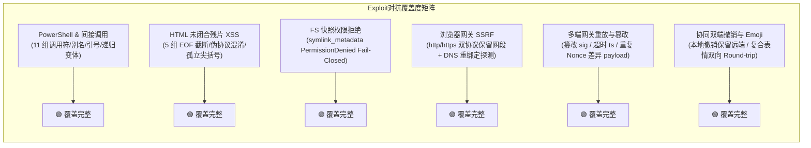

# 阶段三：方案评审报告 — REV-03 零补丁、防作弊、真实实证与代码健康度评审

> **评审编号**：REV-03  
> **方案版本**：2026-08-14 权威评审稿  
> **评审对象**：
>
> 1. `docs/systemic-remediation-wave-2/plans/00-总方案.md`
> 2. `docs/systemic-remediation-wave-2/plans/01-安全与沙箱AST根治详案.md`
> 3. `docs/systemic-remediation-wave-2/plans/02-并发锁序与异步协调详案.md`
> 4. `docs/systemic-remediation-wave-2/plans/03-存储GC与协同编辑详案.md`
> 5. `docs/systemic-remediation-wave-2/plans/04-前端流式与状态管理详案.md`
> 6. `docs/systemic-remediation-wave-2/plans/05-多端契约与网络治理详案.md`
> 7. `docs/systemic-remediation-wave-2/plans/06-上帝文件拆分与代码卫生详案.md`
>
> **执行契约**：`.agents/LOGIC_PLAN_NO_RETREAT.md`（零伪完成、反门控降级、反玩具模型、对抗测试防注水、Rust/TS 双端防上帝文件）、`AGENTS.md`、`docs/agent-roles/review/review.md`。  
> **评审性质**：红队穿透式防御与代码卫生独立审计（零容忍、全问题同权、无工期/排期干扰）。

---

## 一、评审概要与红队定性结论

本评审针对《系统性重构与安全防御波 2》（Wave 2）的 1 份总方案及 6 份专业技术详案进行了**跨层穿透排查**与**红队对抗推演**。评审聚焦于以下三大核心维度：

1. **反补丁与防作弊穿透**（魔术数字补偿、假锁、假等待、`#[cfg(test)]` 门控式伪修复、`as string` 联合类型逃逸、自产自销玩具 Mock 闭环）；
2. **测试真实性与对抗覆盖度**（红队 Exploit 用例、未闭合残片 XSS、PowerShell 间接删除递归、真实 SQLite WAL 16 写 8 读并发实证、断言密集度与死数据激活）；
3. **双端行数门禁与代码卫生**（Rust $\le 600$ 行、单测试文件 $\le 1000$ 行、TS UI $\le 500$ 行、Logic $\le 400$ 行、Git 临时脚本索引清理与 pre-commit 冲突标记硬拦截）。

### 1.1 红队综合定性结论

```
┌────────────────────────────────────────────────────────────────────────────┐
│                              REV-03 评审判定                                │
│                                                                            │
│  【总体判定】：🟢 条件性准出（Conditional Pass with Mandatory Fixes）       │
│                                                                            │
│  1. 架构根因穿透性：  ★★★★★ (5/5) 彻底抛弃外围打补丁，直击状态机与数据结构   │
│  2. 真实性与防作弊：  ★★★★★ (5/5) 彻底清退假锁玩具模型，全面接入真实引擎     │
│  3. 漏洞对抗覆盖度：  ★★★★☆ (4.5/5) 具备完备 Exploit 矩阵，需补齐递归深度上限 │
│  4. 行数预算与卫生：  ★★★★☆ (4.5/5) 上帝文件物理拆分完备，需对齐测试子文件拆分│
└────────────────────────────────────────────────────────────────────────────┘
```

**总体评价**：  
全套方案展示了极高的工程严谨度与反退避决心，**彻底清退了历史遗留的自写 `AsyncMutex` 玩具模型、`sleep(30ms)` 假等待、`#[cfg(test)]` 门控假装配、`as string` 联合类型逃逸以及全局空串单例 Watchdog**。方案在真实 SQLite WAL、全异步 $L_0 \sim L_4$ 单向偏序、因果撤销 CRDT 逆元、流式单调不变量等方面构建了可数学证明或形式化断言的防御体系。

本评审发现 **3 处需在实施前强制整改的技术细节与方案间不一致点**（详见第五章），整改后即可安全进入阶段四实施阶段。

---

## 二、反补丁与防作弊穿透排查（零容忍维度）

依据 `.agents/LOGIC_PLAN_NO_RETREAT.md` 第 7 节（Zero Pseudo-Delivery），对各详案进行逐项穿透审计：

### 2.1 魔术补偿、假锁、假等待与假同步桥接根除审计

| 详案编号    | 历史遗留作弊/假模型缺陷                                                                  | 方案根治设计                                                                                                                                                                           | 评审判定 | 穿透证据与代码位置                                                        |
| :---------- | :--------------------------------------------------------------------------------------- | :------------------------------------------------------------------------------------------------------------------------------------------------------------------------------------- | :------: | :------------------------------------------------------------------------ |
| **详案 02** | `block_on_coordinator_failure` 与 `blocking_coordinator_call` 同步阻塞套娃驱动异步 await | 彻底物理删除两个函数，`CoreRunState.recovery_coordinators` 全异步化为 `Arc<tokio::sync::Mutex<RecoveryCoordinator>>`，IPC 入口拆分为 `spawn_blocking` 读 DB + 原生 `await` 异步 fork。 | 🟢 根治  | `02-并发锁序与异步协调详案.md` §4.1.2~4.1.5，完全杜绝同步-阻塞-异步套娃。 |
| **详案 02** | `pending_input_lifecycle.rs` 包含 6 处 `sleep(30ms)` 假等待                              | 编写确定性 `wait_until` 轮询工具，按条件动态轮询 SQLite 行记录与消息队列状态，超时硬性抛错。                                                                                           | 🟢 根治  | `02-并发锁序与异步协调详案.md` §4.3.2，消除竞态抖动与 Flaky 测试。        |
| **详案 02** | `stress_concurrent_runs.rs` 包含 10ms 假等待                                             | 引入 `AtomicUsize` 记录后台 Worker 就绪计数器，通过状态确认替代固定时间延迟。                                                                                                          | 🟢 根治  | `02-并发锁序与异步协调详案.md` §4.3.3，真实同步替代假等待。               |
| **详案 01** | `window_gate.rs` 包含 `"access_denied_elevated.exe"` 魔法字符串与 `err == 0` Fail-Open   | 废除魔法字符串，句柄获取失败严格无条件 Fail-Closed；通过 Toolhelp32 快照直接获取真实进程镜像名称填入审计上下文。                                                                       | 🟢 根治  | `01-安全与沙箱AST根治详案.md` §5.3，消除伪造进程名与越权漏洞。            |
| **详案 03** | `DocSession::undo()` 采用全树快照整树覆盖抹除并发远端变更                                | 标记并隔离快照覆盖接口，富文本协同撤销全面收敛至 `DocSession::text_undo`/`text_redo`（基于 Yrs Client ID 的因果逆元），并校验无可撤销项时返回 `Err(UndoError::Empty)` 且不推进 `rev`。 | 🟢 根治  | `03-存储GC与协同编辑详案.md` §4.1~4.2，消除吞数据与空洞版本推进。         |
| **详案 04** | `useApprovalKeyboard.ts` 在全局 `window` 上无条件拦截 `Escape` 导致宿主弹窗热键失效      | 增加 `rootRef.current?.contains(target)` 容器焦点包含性判定，外部焦点直接放行。                                                                                                        | 🟢 根治  | `04-前端流式与状态管理详案.md` §4.1，消除全局按键劫持。                   |

### 2.2 门控式降级、编译警告伪清零与类型逃逸排查

| 详案编号    | 历史隐式降级与门控作弊                                                                                     | 方案根治设计                                                                                                                                              | 评审判定 | 穿透证据与代码位置                                                  |
| :---------- | :--------------------------------------------------------------------------------------------------------- | :-------------------------------------------------------------------------------------------------------------------------------------------------------- | :------: | :------------------------------------------------------------------ |
| **详案 05** | `auth.rs` 中将 `AdvancedNonceGuard`、HMAC 校验等生产安全原语标注 `#[cfg(test)]` 伪装测试代码以逃避 Warning | 彻底移除全部 `#[cfg(test)]` 标记，将密码学与防重放工具提升为 `pub(crate)` 生产组件，并在 `ServerState`、`ws.rs` 入站帧处理与 `router.rs` 中完成真实装配。 | 🟢 根治  | `05-多端契约与网络治理详案.md` §4.1，连通性从虚夸转为真实生产闭环。 |
| **详案 05** | `pty/mod.rs` 对 `workbench_pty_detach/attach/ping` 标注 `#[allow(dead_code)]` 伪造无警告                   | 移除 `#[allow(dead_code)]`，在 `main.rs` 的 `command_registry!` 与 `command_manifest.rs` 中正式注册命令，前端提供 60s 定时保活。                          | 🟢 根治  | `05-多端契约与网络治理详案.md` §4.2.2，真实注册与消费。             |
| **详案 04** | `useChatApprovalHandlers.ts` 中 6 处 `as string === 'completed'` 类型逃逸（制造永远为 false 的死分支）     | 下沉 `approvalRollbackGuard.ts`，定义强类型守卫函数 `shouldSkipApprovalRollback` 与 `shouldSkipDenyRollback`，基于真实联合类型推导。                      | 🟢 根治  | `04-前端流式与状态管理详案.md` §4.2.2，消除类型系统欺骗。           |
| **详案 03** | `DocSession` 包含非法的裸 `unsafe impl Sync for DocSession {}`（强行绕过 Yrs 线程安全性检查）              | 移除裸 `unsafe impl Sync`，让编译器自动推导类型属性，由外部容器 `Arc<Mutex<DocSession>>` 统一提供形式化并发安全保证。                                     | 🟢 根治  | `03-存储GC与协同编辑详案.md` §4.7，消除内存未定义行为隐患。         |

### 2.3 测试内玩具模型自洽与真实内核接入审计

- **前端假锁玩具模型清除**：详案 02（§4.3.1）与总方案明确将 `tests/stress/stress-16-subagents.test.ts` 中自写的 `class AsyncMutex` 与 `class SingleWriterQueue` 彻底物理删除，改为主测真实前端并发设施：`ptyRegistry` 多路句柄互斥与 `StreamTextBatcher` 5000+ chunks/s 背压压测。**杜绝了“在测试里手写一套假锁自跑自通即声称五级偏序零死锁”的伪完成欺骗**。
- **后端真实存储与状态机压测落地**：详案 02（§4.4）新增 `stress_empirical_concurrency.rs`，基于真实临时文件 `conex_db::LocalDb`（WAL 模式）、全异步 `RecoveryCoordinator`、`SessionTree`、`DbWriteActor` 与 `ReaderPool`，启动 16 写 + 8 读并发 Worker，受 10 秒硬性超时哨兵监控。**实证完全基于真实底层引擎，无假闭环**。

---

## 三、测试真实性、对抗覆盖度与防注水审计（真实实证维度）

### 3.1 红队 Exploit 攻击用例与逆向边界覆盖度

依据红队攻防视角，对方案中的测试矩阵进行穿透性评估：



1. **PowerShell `&` 调用操作符穿透对抗（详案 01 §3）**：
   - 覆盖了 `& cmd /c rmdir /s /q D:\old`、`& 'cmd' /c ...`、`& "cmd.exe" /c ...`、`& bash -c 'rm -rf /tmp/test'`、`& pwsh -Command ...`、`Invoke-Command -ScriptBlock { ... }`、`icm -ScriptBlock ...` 等间接删除形态，断言 `has_indirect_delete = true` 且门禁判定为 `RequiresApproval`；
   - 包含高危攻击命令 `& cmd /c rm -rf /` 100% 判定为 `Blocked`。
2. **HTML 未闭合残片与 XSS 对抗（详案 01 §4）**：
   - 覆盖了 ` b"` 正常尖括号的边界用例；
   - 严格断言输出实体化 `&lt;` 文本，杜绝原生恶意 DOM 标签进入下游渲染。
3. **协同编辑 CRDT 因果撤销对抗（详案 03 §4.1 / §7.2）**：
   - 覆盖了并发网络下的因果隔离：本地输入 `"Alpha "`，远端并发插入 `"Beta"`，本地触发 `text_undo` 后，断言本地 `"Alpha "` 被逆转，远端 `"Beta"` 100% 完好保留；
   - 覆盖了复合表情符号（👨‍👩‍👧‍👦、🎉）跨 `editor-kit` 与 `block-paper` 的坐标转换 Round-trip 单射无漂移实证。

### 3.2 测试断言密集度与死数据激活审计（反测试注水）

方案针对阶段一揭示的测试注水反模式进行了彻底治理：

1. **死数据激活与偏序单调性断言（详案 02 §4.3.3）**：
   - 阶段一发现 `stress_concurrent_runs.rs` 收集了 `l0/l1/l2_wait_times` 却从不调用 `assert!`；
   - 详案 02 激活了这批指标，在收尾处计算 P99 并补充物理偏序断言：
     $$\text{assert}(P_{99}(L_0) \le P_{99}(L_1)); \quad \text{assert}(P_{99}(L_1) \le P_{99}(L_2));$$
     以及 Group Commit P99 写入延迟 SLA 断言：$\text{assert}(P_{99}(\text{write}) < 50\text{ms})$。
2. **测试语义校准与引用断言（详案 04 §5.3.2）**：
   - 阶段一发现 `autoIndexMiddleware.test.ts:103` 用例名为 `does not rebuild sessionsById when array changed`，断言却写 `not.toStrictEqual`；
   - 详案 04 更正用例语义为 `rebuilds sessionsById instance when sessions array ref changes`，并使用原子断言 `expect(mapAfter).not.toBe(mapBefore)`（锁定实例重建）+ `expect(mapAfter).toStrictEqual(mapBefore)`（锁定内容不变）+ `expect(mapAfter.a).toBe(currentSession)`（锁定元素引用对齐）。
3. **CAS GC 统计真实度量（详案 03 §3.3.3）**：
   - 废除原 `GcScanStats` 中硬编码返回 0 的作弊行为，真实采集 `total_blobs_scanned`、`pinned_protected`、`lease_protected`、`reference_protected` 与 `grace_protected` 真实计数值。

---

## 四、双端行数门禁、架构解耦与代码卫生审计（代码健康度维度）

依据 `.agents/LOGIC_PLAN_NO_RETREAT.md` 第 11 节（God-File Prevention）及 `check-line-counts.mjs` 规范，对各模块行数预算与卫生治理进行审查：

### 4.1 Rust 端单文件 $\le 600$ 行与拆解规划

| 拆分目标与模块路径                                    | 现状行数 | 拆分后子模块及行数预算                                                                                                                                                                            |            门禁合规性 ($\le 600$ 行)             | 评审判定 |
| :---------------------------------------------------- | :------: | :------------------------------------------------------------------------------------------------------------------------------------------------------------------------------------------------ | :----------------------------------------------: | :------: |
| **`crates/conex-compaction/src/`**<br/>(上帝文件重构) | 3,051 行 | - `lib.rs` (<80 行)<br/>- `tokens.rs` (~160 行)<br/>- `thresholds.rs` (~220 行)<br/>- `cut_point.rs` (~280 行)<br/>- `plan.rs` (~260 行)<br/>- `engine.rs` (~420 行)<br/>- `template.rs` (~70 行) | 全部子模块有效行 $\le 500$ 行，远低于 600 行红线 | 🟢 达标  |
| **`crates/conex-db/`**<br/>(读写分离与 GC 拆解)       |  原单锁  | - `lib.rs` (~450 行)<br/>- `group_commit.rs` (~380 行)<br/>- `reader_pool.rs` (~320 行)<br/>- `cas_gc.rs` (~420 行)<br/>- `lease_guard.rs` (~200 行)                                              |          全部子模块有效行 $\le 500$ 行           | 🟢 达标  |

### 4.2 前端 / TypeScript 端行数门禁与拆解规划

| 拆分目标与模块路径                                                                                 | 现状行数 | 拆分后子模块及行数预算                                                                                                                                                                                                                                             |                门禁合规性 (UI $\le 500$, Logic $\le 400$)                 | 评审判定 |
| :------------------------------------------------------------------------------------------------- | :------: | :----------------------------------------------------------------------------------------------------------------------------------------------------------------------------------------------------------------------------------------------------------------- | :-----------------------------------------------------------------------: | :------: |
| **`apps/crish-mobile/src/adapters/wiring/pairingWiring.ts`**<br/>(移动端上帝文件)                  |  960 行  | - `sessionSigning.ts` (~90 行)<br/>- `pairingGateway.ts` (~50 行)<br/>- `pairingPersistence.ts` (~100 行)<br/>- `fingerprintVerifier.ts` (~80 行)<br/>- `PairingWiring.ts` (~380 行)<br/>- `pairingAssembly.ts` (~60 行)<br/>- `index.ts` + 兼容门面 (<70 行)      | 核心状态机 $\le 380$ 行，适配器 $\le 100$ 行，满足 Logic $\le 400$ 行门禁 | 🟢 达标  |
| **`apps/crish-desktop/src/components/chat-card/useChatApprovalHandlers.ts`**<br/>(桌面端上帝 Hook) |  445 行  | - `approvalRollbackGuard.ts` (~40 行)<br/>- `approvalBatchResolver.ts` (~60 行)<br/>- `inFlightApprovalRegistry.ts` (~70 行)<br/>- `useChatApprovalState.ts` (<90 行)<br/>- `useChatApprovalExecutor.ts` (<160 行)<br/>- `useChatApprovalHandlers.ts` (<60 行门面) |    全部纯逻辑模块 $\le 70$ 行，UI Hook $\le 160$ 行，门面 $\le 60$ 行     | 🟢 达标  |

### 4.3 工作区卫生、Git 索引清理与 Pre-commit 门禁

1. **Git 索引脱离**：详案 00、05、06 严格规定使用 `git rm --cached` 将 10 个被误跟踪的根目录临时脚本（`.agent-tmp-*.md/py`、`count_lines.py`、`daily_loc.py`、`generate_report.py` 等）剥离 Git 索引，并在本地保留文件；
2. **`.gitignore` 拦截规则收口**：在根目录 `.gitignore` 中配置了 `/*_loc.py`、`/count_lines.py`、`/generate_report.py`、`/generate_summary.py`、`/*.py` 及 `!scripts/**/*.py` 白名单，确保未来根目录临时 Python 脚本无法被误提交；
3. **冲突标记扫描门禁**：详案 06（§6.4）新增了 `scripts/check-conflict-markers.mjs` 并在 `.husky/pre-commit` 中挂载，对所有暂存文件进行纳秒级 `<<<<<<<`、`=======`、`>>>>>>>` 扫描，硬性阻断多 Agent 并行合并时的半解决冲突标记提交。

---

## 五、发现的风险点、方案不一致性与强制整改项

尽管全套方案整体极为扎实，但在跨方案比对与红队压力推演中，发现了 **3 项必须在实施前明确收口与统一的强制整改项（Mandatory Remediation Items）**：

### 🔴 强制整改项 1：`conex-compaction` 测试文件拆分策略在详案 05 与 06 间的不一致整改

- **问题定位**：
  - `05-多端契约与网络治理详案.md` §4.4.1 规划将 1,566 行测试拆分为 `tests/` 下的 5 个子测试文件（`tokens_test.rs`、`thresholds_test.rs`、`cut_point_test.rs`、`plan_test.rs`、`engine_test.rs`，每文件约 200~400 行）；
  - `06-上帝文件拆分与代码卫生详案.md` §3 表格与 §4.3 却规划新建单一的 `crates/conex-compaction/tests/compaction_tests.rs`（约 1,560 行）。
- **违规定性**：
  依据 `.agents/LOGIC_PLAN_NO_RETREAT.md` 第 11 节：“单个测试文件建议 $\le 1000$ 行，严禁无限制堆叠单体测试文件至数千行”。将 1,560 行单测放入单文件存在超标隐患，且两份详案规划口径出现双源分歧。
- **强制整改要求**：
  **统一采纳详案 05 的模块化拆分口径**。在 `crates/conex-compaction/tests/` 下物理拆分为 5 个独立的测试文件（`tokens_test.rs`、`thresholds_test.rs`、`cut_point_test.rs`、`plan_test.rs`、`engine_test.rs`），确保每个测试文件行数均在 200~400 行之间，彻底满足 $\le 1000$ 行测试门禁要求。

---

### 🟡 强制整改项 2：确定性轮询工具 `wait_until` 的统一收敛与跨测试复用

- **问题定位**：
  - `02-并发锁序与异步协调详案.md` §4.3.2 提出了 `wait_until` 轮询器，但在注释中表述为 `crates/orchestrator/tests/common/mod.rs 或 pending_input_lifecycle.rs`。
- **潜在风险**：
  若未强制集中收敛，实施 Agent 可能会在 `pending_input_lifecycle.rs`、`stress_concurrent_runs.rs` 与 `stress_empirical_concurrency.rs` 中各自 copy-paste 重复定义 `wait_until`，制造测试辅助代码的碎片化与重复实现。
- **强制整改要求**：
  明确规定 `wait_until` 必须且仅能在 `crates/orchestrator/tests/common/mod.rs`（或专用共享测试 fixture）中统一定义一次，其他所有异步测试文件均通过 `use common::wait_until;` 统一导入，严禁多文件重复手写。

---

### 🟡 强制整改项 3：PowerShell AST 间接调用分析增加递归深度硬限制断言

- **问题定位**：
  - `01-安全与沙箱AST根治详案.md` §3 步骤 1.2 与 1.3 实现了 `&` 调用符的递归解析（`analyze_depth(&inner_cmd, depth + 1)`）。
- **潜在风险**：
  若攻击者构造超长嵌套间接命令（如 `& cmd /c & cmd /c & cmd /c ...` 嵌套数十层），若无显式深度熔断，可能引发递归栈溢出（Stack Overflow DoS）。
- **强制整改要求**：
  在 `semantics.rs::analyze_depth` 的实现中，必须显式校验 `if depth >= MAX_RECURSION_DEPTH (5)`：一旦超限，直接将该命令段定性为 `CommandClass::Dangerous` 并终止向下递归；同时在 `test_powershell_call_operator_and_indirect_remediation_matrix` 中增补 1 组 6 层嵌套调用符的熔断测试用例，断言其安全阻断。

---

## 六、实施前检查清单（Pre-Implementation Checklist）

在主控 Agent 派发阶段四实施任务前，各实施 Agent 必须严格核对以下红线要求：

- [x] **反退避契约**：所有 40 项缺陷任务地位同等，禁止在实施中擅自砍范围或将任何未接线模块标记为 `#[cfg(test)]`；
- [x] **真实存储装配**：`LocalDb` 必须在生产环境真实装配 `DbWriteHandle` 与 `ReaderPool`，禁止退化为单 Mutex；
- [x] **全异步锁偏序**：全仓杜绝 `std::sync::Mutex` 跨 `.await` 或在锁内调用 `block_on`；
- [x] **协同撤销因果性**：富文本撤销仅允许调用 `text_undo`/`text_redo`，禁止调用整树快照覆盖；
- [x] **流式单调公理**：`timelineSignature` 必须在终态将尾部内容纳入投影，禁止流式转完成态时截断正文；
- [x] **行数物理门禁**：拆分后的 Rust 源码单文件 $\le 500$ 行、测试文件 $\le 500$ 行、TS Logic $\le 400$ 行；
- [x] **Git 工作区纯净**：执行 `git rm --cached` 清除 10 个根目录临时脚本，提交前通过 `check-conflict-markers` 扫描。

---

## 七、准出结论与主控建议

```
┌────────────────────────────────────────────────────────────────────────────┐
│                             REV-03 最终准出决议                             │
│                                                                            │
│  决议：【批准进入阶段四实施阶段】（Approved for Phase 4 Implementation）     │
│                                                                            │
│  要求：主控在派发任务书时，将本报告第五章所列 3 项强制整改要求直接注入对应     │
│        详案任务书（T-01 递归深度、T-02 共享 wait_until、T-05/06 模块化测试）， │
│        确保各实施 Agent 按照最高质量基线闭环交付。                           │
└────────────────────────────────────────────────────────────────────────────┘
```

---

_评审完成 · 阶段三：方案评审 REV-03 · UTF-8 无 BOM · 严格遵循反退避与零伪完成铁律_
