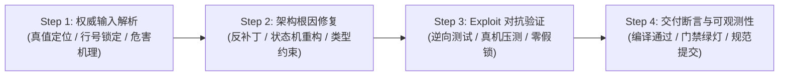

# 阶段二：系统性重构与安全防御波 00 — 战役总方案与全局拓扑（Master Plan）

> **方案版本**：2026-08-14 权威总方案稿  
> **方案路径**：`docs/systemic-remediation-wave-2/plans/00-总方案.md`  
> **规划契约**：严格遵循 `.agents/LOGIC_PLAN_NO_RETREAT.md`（纯逻辑规划、反退避、反伪完成、真机实证、严禁工期人天、所有问题同权同等重要）与 `AGENTS.md`。  
> **输入依据**：阶段一 5 份多维穿透分析报告真值：
>
> 1. [`01-安全门禁与沙箱AST分析.md`](../analysis/01-安全门禁与沙箱AST分析.md)
> 2. [`02-并发锁序与异步协调分析.md`](../analysis/02-并发锁序与异步协调分析.md)
> 3. [`03-存储GC与协同编辑分析.md`](../analysis/03-存储GC与协同编辑分析.md)
> 4. [`04-前端流式与状态管理分析.md`](../analysis/04-前端流式与状态管理分析.md)
> 5. [`05-多端契约上帝文件与卫生分析.md`](../analysis/05-多端契约上帝文件与卫生分析.md)

---

## 一、执行摘要与战役核心原则

### 1.1 战役背景与核心目标

在 Conex / Crish 系统的快速演进与历史重构过程中，系统在局部功能与单元测试层面保持了表面的高覆盖率与绿灯通过，但在**跨层协作**、**真实并发调度**、**安全纵深防御**、**协同编辑因果契约**以及**架构卫生与上帝文件**等关键维度，积累了一批结构性断层、门控式降级（`#[cfg(test)]` 隔离）、半拆未接线代码债（Unwired Debt）以及测试内的假锁/假等待玩具反模式。

本战役（Systemic Remediation Wave 2）旨在对上述深层隐患执行**系统性根治**，达成以下五大终极目标：

1. **安全门禁全链路闭环**：彻底根治 PowerShell `&` 调用操作符绕过、未闭合 HTML 残片 XSS、FS 快照 Fail-Open 误删原文件以及 CDP 传输层缺失等安全隐患，实现 100% Fail-Closed；
2. **全异步化与五级锁偏序落地**：彻底拔除 `RecoveryCoordinator` 上的 `std::sync::Mutex` 与 `block_on` 违规套娃，确立全仓 $L_0 \prec L_1 \prec L_2 \prec L_3 \prec L_4$ 单向偏序不变量，并在真实 SQLite WAL 与真实内核状态机上实现 16-Agent 零死锁实证；
3. **存储引擎与协同因果接线**：生产装配 `DbWriteHandle`（写 Actor）与 `ReaderPool`（读池），补齐 `catch_unwind` 崩溃防护；收敛协同编辑至精确的 `text_undo`/`text_redo` 因果撤销，废除快照整树覆盖，统一全局坐标系；
4. **流式单调不变量与前端治理**：确立 $\text{RenderedText}(t_1) \subseteq \text{RenderedText}(t_2)$ 流式单调公理，根治 Timeline 签名缓存截断；约束 Esc 按键容器作用域，拆解 445 行上帝 Hook，实现消息级精准清流；
5. **多端契约真实装配与上帝文件解耦**：解除 `AdvancedNonceGuard` 与 HMAC 门控式降级，实现 WebSocket 真实验签；将 Watchdog 绑定会话生命周期，补齐 PTY 前台保活；物理拆分 3051 行 `conex-compaction` 与 960 行 `pairingWiring.ts`；彻底清理 Git 误跟踪临时脚本。

### 1.2 纯逻辑规划与反退避铁律契约

依据 `.agents/LOGIC_PLAN_NO_RETREAT.md`，本总方案与后续所有详案必须无条件履行以下纪律：

- **效果锁与零降级**：用户与架构规范给定的效果与安全契约不得自行降级为简化版或 MVP；
- **所有问题同权同等重要**：方案只按拓扑依赖分层推进，**绝不引入 P0/P1/P2 业务优先级划分**，所有已识别缺陷无论大小均具有同等闭环权利；
- **严禁工期人天**：方案内绝不包含任何工期、人天、排期、人员分配或日历时间节点；
- **反伪完成与真机实证**：严禁在测试中手写假锁（如 `AsyncMutex`）、假等待（`sleep(30ms)`）或用宽松断言（`toStrictEqual` 代替 `toBe`）注水；必须在真实环境、真实 SQLite WAL 实例与真实 DOM/网络流上完成对抗验证。

---

## 二、系统性总拓扑依赖图（DAG）

系统性重构按照**自底向上、层层解耦、单向依赖**的逻辑原则，划分为 5 个逻辑演进阶段（Phase L1 至 Phase L5）：

```mermaid
graph TD
    subgraph Phase_L1["Phase L1: 数据建模、核心库治理与工作区卫生"]
        L1_1["L1-1: 工作区卫生治理与 Git 索引清理 (.gitignore / git rm --cached)"]
        L1_2["L1-2: conex-db 架构统一与 CAS/DDL 去重 (标准 sha2 / 统一时间字段)"]
        L1_3["L1-3: conex-sandbox AST 词法状态机与归一化根治 (支持 & 调用符 / 递归间接解构)"]
        L1_4["L1-4: HTML 净化器未闭合标签与残片转义状态机 (escapeHtml / 预检防线)"]
        L1_5["L1-5: 协同编辑坐标契约与代理项统一 (消除 DiffReplaceResult 语义相反冲突)"]
        L1_6["L1-6: FS 快照与监视器 Fail-Closed 修复 (trash.rs 权限拒绝阻断 / watch.rs 规则收窄)"]
    end

    subgraph Phase_L2["Phase L2: 并发引擎、状态机异步化与上帝文件拆分"]
        L2_1["L2-1: RecoveryCoordinator 权威实例全异步化 (消除 std::sync::Mutex 与 block_on)"]
        L2_2["L2-2: 五级单向偏序锁序拓扑契约落地 (L0 < L1 < L2 < L3 < L4 形式化约束)"]
        L2_3["L2-3: conex-db 读写分离引擎化与写 Actor 崩溃防护 (catch_unwind 隔离 / 分批 GC)"]
        L2_4["L2-4: conex-compaction 上帝文件物理拆分 (3051 行拆为 6 个子模块 + 模块化测试)"]
        L2_5["L2-5: pairingWiring.ts 移动端上帝文件物理拆分 (960 行 11 职责拆为 6 个子模块)"]
    end

    subgraph Phase_L3["Phase L3: 领域协议、网关契约与生命周期协同"]
        L3_1["L3-1: 多端网关 AdvancedNonceGuard 与 HMAC 真实装配 (解除 cfg(test) / WS+HTTP 验签)"]
        L3_2["L3-2: Watchdog 会话生命周期绑定与真实数据源接入 (绑定 SessionLoop / DbDispatchStore)"]
        L3_3["L3-3: PTY 终端前台保活、生命周期切接与 GC 广播闭环 (注册 ping/detach / GC 广播)"]
        L3_4["L3-4: 协同因果撤销 (text_undo/text_redo) 全链产品接入 (NoteBackend 暴露 / 增量快照)"]
        L3_5["L3-5: 移动端通知渠道注册安全包装全量接入 (channels.ts 接入 safe 包装 / warn 日志)"]
        L3_6["L3-6: 浏览器网关 CDP 传输层 https:// 阻断与 SSRF 防护加固 (补齐 https:// 模式)"]
    end

    subgraph Phase_L4["Phase L4: 前端流式渲染、交互防护与 Store 治理"]
        L4_1["L4-1: timelineSignature 与消息渲染单调不变量根治 (状态感知 / 跃迁失效 / A-06 修复)"]
        L4_2["L4-2: useApprovalKeyboard Esc 全局按键容器焦点作用域约束 (rootRef.contains 守卫)"]
        L4_3["L4-3: useChatApprovalHandlers 上帝 Hook 拆分与类型逃逸消除 (拆分为 3 纯模块+2 子 Hook)"]
        L4_4["L4-4: finalizeAgentMessages 精准消息级清流与并发防误伤 (clearStreams 消息级清理)"]
        L4_5["L4-5: SessionCoordinator 真实生命周期接线与幽灵流清理 (deleteSession 级联清理)"]
        L4_6["L4-6: autoIndexMiddleware 注水断言校准与死代码清理 (校准 toBe / 移除死导出)"]
        L4_7["L4-7: DOM Pinning 与 IME 增量缓冲产品化接线 (PaperList 接入 / CompositionPatchBuffer)"]
    end

    subgraph Phase_L5["Phase L5: 端到端真机对抗、压力实证与反伪完成闭环"]
        L5_1["L5-1: 真实 SQLite WAL 16-Agent 并发零死锁与偏序时延实证 (10s 哨兵 / P99 偏序断言)"]
        L5_2["L5-2: 前端测试假锁玩具模型清除与真实并发压测 (拆除 AsyncMutex / 压测 ptyRegistry)"]
        L5_3["L5-3: 消除测试用例硬编码 sleep 假等待 (wait_until 确定性状态轮询)"]
        L5_4["L5-4: 安全 AST 门禁与未闭合 XSS 全量对抗测试实证 (& 间接删除 / 未闭合标签 / SSRF)"]
        L5_5["L5-5: 协同双端因果撤销与 Emoji 坐标无漂移实证 (双端并发保留 / Emoji 映射测试)"]
    end

    %% 跨层逻辑依赖连线
    L1_1 --> L2_4
    L1_1 --> L2_5
    L1_2 --> L2_3
    L1_3 --> L5_4
    L1_4 --> L5_4
    L1_5 --> L3_4
    L1_5 --> L4_7
    L1_6 --> L5_4

    L2_1 --> L3_2
    L2_1 --> L5_1
    L2_2 --> L5_1
    L2_3 --> L3_2
    L2_3 --> L5_1
    L2_4 --> L5_1
    L2_5 --> L3_1

    L3_1 --> L5_4
    L3_2 --> L5_1
    L3_3 --> L5_2
    L3_4 --> L4_7
    L3_4 --> L5_5
    L3_5 --> L5_4
    L3_6 --> L5_4

    L4_1 --> L5_4
    L4_2 --> L5_4
    L4_3 --> L5_2
    L4_4 --> L5_2
    L4_5 --> L5_2
    L4_6 --> L5_2
    L4_7 --> L5_5
```

---

## 三、各阶段建设任务与技术架构规范

### 3.1 Phase L1: 数据建模、核心库治理与工作区卫生

#### 任务 L1-1: 工作区卫生治理与 Git 索引清理

- **目标文件**：根目录 `.gitignore`、10 个误入库临时 Python/Markdown 脚本
- **技术规范**：
  1. 使用 `git rm --cached` 从 Git 索引中移除 `.agent-tmp-agents-dot-head.md`、`.agent-tmp-agents-root-head.md`、`.agent-tmp-report.py`、`.agent-tmp-scan.py`、`count_lines.py`、`daily_loc.py`、`generate_report.py`、`generate_summary.py`、`hourly_loc.py`、`recent_loc.py`；
  2. 在根目录 `.gitignore` 中增补 `.agent-tmp-*`、`/*_loc.py`、`/count_lines.py`、`/generate_report.py`、`/generate_summary.py`、`/*.py`（并豁免 `!scripts/**/*.py`）；
  3. 执行 `git check-ignore -v` 验证全部命中，确保工程基线纯净。

#### 任务 L1-2: `conex-db` 架构统一与 DDL/CAS 去重

- **目标文件**：`crates/conex-db/src/schema.rs`、`crates/conex-db/src/cas_gc.rs`、`crates/conex-workspace-store/src/cas.rs`
- **技术规范**：
  1. 移除 `crates/conex-db/src/cas_gc.rs:89-138` 中手写的纯 Rust SHA-256 算法，全仓收敛至标准库 `sha2::Sha256`；
  2. 删除 `crates/conex-db/src/schema.rs:334-392` 中逐字重复的 `create_cas_schema` DDL，保留 `create_v5_schema` 作为单一权威真源；
  3. 统一 `blob_cas` 的 `created_at` 字段为 ISO-8601 TEXT 标准字符串，消除与 `conex-workspace-store` 的整数秒分歧；
  4. 修复 `cas_gc.rs:560-564` 物理清除逻辑：在执行数据库 `DELETE FROM blob_cas` 前，若 `storage_type != "inline"` 且包含外置文件路径，执行 `std::fs::remove_file` 物理删除，杜绝磁盘文件泄漏。

#### 任务 L1-3: `conex-sandbox` AST 词法状态机与归一化根治

- **目标文件**：`crates/conex-sandbox/src/semantics.rs`、`crates/conex-sandbox/src/lib.rs`、`crates/agent-tools/src/tools/shell.rs`
- **技术规范**：
  1. 将 `&` 明确纳入 `INDIRECT_COMMANDS`；在 `normalize_command` 中将 `&(`、`&{`、`$(` 归一化为 `&`，并自动剥除 `.exe` 后缀；
  2. 在 `analyze_indirect` 中新增 `&` 专用分支：当段首为 `&` 时，将参数列表第 0 项提取为子命令，剩余参数作为子参数拼接为子命令行，深度递归调用 `analyze_depth(&inner_cmd, depth + 1)`；
  3. 升级 `scan_ps_command_tokens`：命中间接命令时，截取其后所有参数作为子命令递归解析，内层产生 `DeleteShape` 时向上回传 `has_indirect_delete = true` 与目标路径；
  4. 加固 `CommandGatekeeper::check_command`：当 `has_indirect_delete == true` 时坚决返回 `GatekeeperResult::RequiresApproval`；扩充 `blocked_patterns` 正则，补齐 `\brmdir\b`、`\bdel\b`、`\brd\b` 对 Windows 盘符与绝对路径的全量覆盖。

#### 任务 L1-4: HTML 净化器未闭合标签与残片转义状态机

- **目标文件**：`packages/plugin-sdk/src/sanitizer/htmlSanitizer.ts`、`packages/plugin-sdk/src/sanitizer/sanitizer.test.ts`
- **技术规范**：
  1. 在标签主正则匹配前构建残片预检防线：匹配末尾未闭合的标签残片（`/<([a-zA-Z0-9:-]+)(?:[^>"']|"[^"]*"|'[^']*')*$/g`），并使用 `escapeHtml` 将其安全转义为实体文本（如将 `>>>`（外层为 L0 纳秒内存锁，内层为 L2 Tokio 异步业务互斥锁）；
  2. 重构 `coordinator_for` 门面方法，返回 `Option<Arc<tokio::sync::Mutex<RecoveryCoordinator>>>`；
  3. 彻底删除 `run_core.rs:1449-1475` 中的 `block_on_coordinator_failure` 与 `blocking_coordinator_call` 两个有毒嵌套函数；
  4. 重写 `main.rs::core_resume_subagent` IPC 入口：同步准备阶段（SQLite 读）走 `spawn_blocking`，异步 fork 阶段直接全异步获取 L2 锁并 `await` 执行，全链路 0 `block_on`。

#### 任务 L2-2: 五级单向偏序锁序拓扑契约落地

- **目标文件**：全仓 Rust 并发模块（`crates/orchestrator/`、`crates/session-loop/`、`crates/conex-db/`、`apps/agent-workbench/src-tauri/src/run/`）
- **技术规范**：
  正式确立全仓**五级单向偏序锁序定理（$L_0 \prec L_1 \prec L_2 \prec L_3 \prec L_4$）**：
  - **$L_0$（纳秒级内存守卫）**：`active_runs`、`recovery_coordinators`、`session_trees` 等 `std::sync::Mutex<HashMap>`。持锁耗时 $<500\text{ns}$，**严格禁止跨 `.await`**，必须在独立代码块 `{}` 内立取立释；
  - **$L_1$（微秒级领域状态树）**：`SessionTree`、`ControlBus` 等 `std::sync::Mutex`。持锁耗时 $<50\mu\text{s}$，**严格禁止跨 `.await`**；
  - **$L_2$（异步业务互斥锁）**：`RecoveryCoordinator`、`RunHandle`、`EventQueue` 等 `tokio::sync::Mutex`。**允许跨 `.await`，但严格禁止在其内部调用 `block_on`、`std::thread::sleep` 或同步阻塞 I/O**；
  - **$L_3$（毫秒级数据库独占写锁）**：`LocalDb` SQLite Single Writer Actor / `blocking_db_call`。持锁耗时 $1\text{ms} \sim 20\text{ms}$，通过通道消息或独立阻塞线程池隔离；
  - **$L_4$（无锁只读连接池）**：`ReaderPool` WAL 模式只读连接池。多路只读无锁并发，与 $L_3$ 互不阻塞。
  - **偏序公理**：任何线程/协程申请锁时必须严格遵循 $L_i \prec L_j \implies i < j$，严禁逆向申请。

#### 任务 L2-3: `conex-db` 读写分离引擎化与写 Actor 崩溃防护

- **目标文件**：`crates/conex-db/src/lib.rs`、`crates/conex-db/src/group_commit.rs`、`crates/conex-db/src/reader_pool.rs`、`crates/conex-db/src/cas_gc.rs`、`crates/conex-db/src/lease_guard.rs`
- **技术规范**：
  1. 重构 `LocalDb` 核心结构体，内部装配 `DbWriteHandle`（写 Actor 管道）与 `ReaderPool`（自适应只读池），废除单锁 `Arc<Mutex<Connection>>`；
  2. 在 `group_commit.rs` 的单任务与批量处理循环中，使用 `std::panic::catch_unwind(AssertUnwindSafe(...))` 包裹每一个任务闭包；单任务 Panic 时仅向对应调用方返回 `DbFailureKind::Panic` 并回滚事务，Actor 循环与写通道保持存活；
  3. 重构 `cas_gc.rs`：将全表 4 重 `NOT IN` 扫描改为基于只读连接的索引覆盖流式分批扫描（`LIMIT 100`）；隔离与清除仅将确定 Hash 提交给写 Actor（单次耗时 $<5\text{ms}$）；
  4. 消除 `GcScanStats` 恒 0 伪指标，准确统计 `reference_protected`、`lease_protected` 与 `grace_protected`；将 `BlobLeaseGuard` 与数据库 `active_blob_leases` 表完全接通。

#### 任务 L2-4: `conex-compaction` 上帝文件物理拆分

- **目标文件**：`crates/conex-compaction/src/lib.rs` (3,051 行)
- **技术规范**：
  物理拆分为清晰的子模块体系：
  - `lib.rs`（<100 行）：公开类型重导出与模块入口；
  - `tokens.rs`（~160 行）：Token 计算、多模态图片开销与字符启发式估算；
  - `thresholds.rs`（~120 行）：85%/95% 预算水位决策模型；
  - `cut_point.rs`（~260 行）：切割点倒推与 tool_call / tool_result 配对保护；
  - `plan.rs`（~240 行）：压缩计划、策略与占位符生成；
  - `engine.rs`（~420 行）：核心压缩编排驱动器与 50行/4096B 紧急预检降级；
  - `template.rs`（~110 行）：Markdown 结构化摘要模板渲染；
  - `tests/` 目录：将 1,566 行单测按模块对齐拆分，保持 103 项测试 100% 绿灯。

#### 任务 L2-5: `pairingWiring.ts` 移动端上帝文件物理拆分

- **目标文件**：`apps/crish-mobile/src/adapters/wiring/pairingWiring.ts` (960 行)
- **技术规范**：
  在 `apps/crish-mobile/src/adapters/wiring/pairing/` 下拆分以下 6 个独立职责子模块：
  - `sessionSigning.ts`（~110 行）：`randomNonce`、`buildSignedRequest` 签名信封与 WsGateway 工厂；
  - `pairingGateway.ts`（~50 行）：`PairingGateway` 子类与 `onSendReady` 就绪钩子；
  - `pairingPersistence.ts`（~90 行）：凭据常量与 SecureStore 适配器 `buildAuthPersist`；
  - `fingerprintVerifier.ts`（~70 行）：提炼纯粹的 `fingerprintsAgree` 双信道指纹比对函数；
  - `PairingWiring.ts`（<380 行）：纯粹的配对业务状态机驱动器；
  - `pairingAssembly.ts`（~70 行）：单例生命周期管理与测试隔离重置；
  - `index.ts`（~30 行）：聚合导出，保持对外导入路径 100% 兼容。

---

### 3.3 Phase L3: 领域协议、网关契约与生命周期协同

#### 任务 L3-1: 多端网关 `AdvancedNonceGuard` 与 HMAC 真实装配

- **目标文件**：`apps/agent-workbench/src-tauri/src/server/auth.rs`、`apps/agent-workbench/src-tauri/src/server/ws.rs`、`apps/agent-workbench/src-tauri/src/server/router.rs`、`apps/agent-workbench/src-tauri/src/server/mod.rs`
- **技术规范**：
  1. 移除 `auth.rs` 中 `AdvancedNonceGuard`、`NonceEntry`、`hmac_sha256*`、`verify_hmac_sha256`、`canonical_*` 上的 `#[cfg(test)]` 门控标记；
  2. 在 `ServerState` 中持有一等 `Arc<AdvancedNonceGuard>` 实例（容量 10,000，容忍时钟偏差 300s）；
  3. 在 `ws.rs` 的 `handle_incoming_text` 中解析 `DeviceEnvelope`：校验 `ts` 时钟偏差（>300s 返回 `AuthExpired`）、调用 `AdvancedNonceGuard.check_and_record` 拦截重放与篡改、根据认证密钥计算规范载荷并执行 `verify_hmac_sha256` 常量时间验签；验签失败立即下发 `error` 帧并切断连接；
  4. 在 `router.rs` 中为敏感控制路由装配签名校验中间件，消费 `X-Signature`、`X-Nonce`、`X-Timestamp`。

#### 任务 L3-2: `Watchdog` 会话生命周期绑定与真实数据源接入

- **目标文件**：`apps/agent-workbench/src-tauri/src/watchdog.rs`、`apps/agent-workbench/src-tauri/src/engine_build.rs`、`crates/session-loop/src/`
- **技术规范**：
  1. 清理 `engine_build.rs:283-298` 中的全局空串单例伪实例；
  2. 将 `Watchdog` 的生命周期下沉绑定至会话：在 `SessionLoop` 或 `ActiveSession` 初始化时动态创建 `Watchdog` 实例，传入真实 `session_id`；
  3. 接入基于 `conex-db` 的 `DbDispatchStore`，读取 `session_meta` 中的 `dispatch_*` 真实声明；
  4. 注入真实的 `TimerRegistry` 计数探测与壳层 `SubagentStatusSource`（核销已完成的子代理任务）；
  5. 接入 `CancellationToken`，在会话销毁时安全终止后台扫描任务，杜绝协程泄漏。

#### 任务 L3-3: PTY 终端前台保活、生命周期切接与 GC 广播闭环

- **目标文件**：`apps/agent-workbench/src-tauri/src/pty/mod.rs`、`apps/agent-workbench/src-tauri/src/pty/session.rs`、`apps/agent-workbench/src-tauri/src/main.rs`、`apps/crish-desktop/src/api/ptySessionApi.ts`
- **技术规范**：
  1. 移除 `pty/mod.rs:91-110` 中的 `#[allow(dead_code)]`；在 `main.rs` 的 `command_registry!` 与 `command_manifest.rs` 中正式注册 `workbench_pty_detach`、`workbench_pty_attach`、`workbench_pty_ping`；
  2. 前端 `ptySessionApi.ts` 导出相应接口；PTY 终端组件挂载且获得前台焦点时，启动 60s 定时器调用 `workbench_pty_ping` 刷新活跃时间戳；切换 Tab 离开时调用 `detach`，切回时调用 `attach`；
  3. 在 `spawn_pty_gc_loop` 中，当会话因 2h 超时被物理杀死时，消费 `app: AppHandle` 向前端广播 `workbench://pty-gc-killed` 事件；前端收到事件后优雅更新 Tab 状态，消除幽灵 UI。

#### 任务 L3-4: 协同因果撤销（`text_undo`/`text_redo`）全链产品接入

- **目标文件**：`crates/conex-doc-collab/src/session_undo.rs`、`crates/conex-doc-collab/src/text_engine.rs`、`crates/conex-note-runtime/src/store_backend.rs`、`apps/crish-desktop/src/`
- **技术规范**：
  1. 屏蔽具有吞数据隐患的 `DocSession::undo()` 快照覆盖接口，将其收敛为局部结构逆元或单端离线专用；
  2. 生产环境中富文本撤销全面收敛至 `DocSession::text_undo` / `text_redo`；在 `text_undo` 执行前增加 `can_text_undo` 检查，无可撤销项时直接返回 `UndoError::Empty`，禁止推进空洞 `rev`；
  3. 在 `NoteBackend` trait（`conex-note-runtime`）中新增 `undo_text(doc_id, block_id)` 与 `redo_text(doc_id, block_id)`，并在前端快捷键（Ctrl+Z / Cmd+Z）中按聚焦块 ID 触发；
  4. 增量快照优化：将 `capture_memory_snapshot` 改造为仅对当前批次触达（Touched）块进行增量编码，消除 $O(N)$ 内存线性膨胀。

#### 任务 L3-5: 移动端通知渠道注册安全包装全量接入与可观测性

- **目标文件**：`apps/crish-mobile/src/notifications/channels.ts`、`apps/crish-mobile/src/notifications/expoNotificationsFacade.ts`
- **技术规范**：
  1. 重构 `channels.ts::registerChannelsAsync`：全量接入 `setNotificationChannelAsyncSafe`，禁止直接裸调 `api.setNotificationChannelAsync`，防止原生异常导致启动 Crash；
  2. 在 `expoNotificationsFacade.ts` 的 8 个安全包装函数（`getPermissionsAsyncSafe` 等）的 catch 块中增补结构化 `console.warn` 日志，确保平台缺失与运行时异常可被诊断观测。

#### 任务 L3-6: 浏览器网关 CDP 传输层 `https://` 阻断与 SSRF 防护加固

- **目标文件**：`crates/conex-browser/src/gate.rs`、`crates/conex-browser/src/lib.rs`
- **技术规范**：
  1. 扩充 `gate.rs::ipv4_blocked_patterns`：针对所有 IPv4/IPv6 保留网段、回环段与云元数据 IP，同步生成 `http://` 与 `https://` 两种模式（或通配模式 `*://`）；
  2. 在 `lib.rs:150` 中，当 `channel.send_command(NETWORK_SET_BLOCKED_URLS, ...)` 失败时，显式记录 `tracing::warn!` 警告日志，消除静默吞错；
  3. 白名单匹配成功后，针对非 localhost 域名执行 DNS 解析探测，若解析到内网保留段坚决阻断，防范 DNS 重绑定 SSRF。

---

### 3.4 Phase L4: 前端流式渲染、交互防护与 Store 治理

#### 任务 L4-1: `timelineSignature` 与消息渲染单调不变量根治

- **目标文件**：`apps/crish-desktop/src/api/tool-presentation/timelineNormalizer.ts`、`apps/crish-desktop/src/components/chat-message/MessageContent.tsx`、`apps/crish-desktop/src/components/chat-message/streamMessageViewModel.ts`
- **技术规范**：
  确立**流式到完成态单调不变量（$\forall t_1 \le t_2, \text{RenderedText}(t_1) \subseteq \text{RenderedText}(t_2)$ 且 $\text{len}(t_{\text{completed}}) \ge \text{len}(t_{\text{stream\_final}})$）**：
  1. **防线 1（状态感知签名）**：在 `timelineNormalizer.ts` 中，当 `msg.status !== 'processing'`（完成态）时，尾部 text 块必须将完整内容（`content`）计入签名，确保完成态持久化提交时签名必然改变；
  2. **防线 2（跃迁显式失效）**：在 `MessageContent.tsx` 中增加 `prevStreamingRef`，当检测到 `streaming: true -> false` 跃迁时，显式将 `timelineCacheRef.current.sig` 置为 null，强制全量重建 timeline；
  3. **防线 3（修复 A-06 留洞）**：在 `blocks.length > 0` 但无 text 块时，将 `msg.text` 纳入签名投影，消除 `text-full` 兜底路径的签名盲区。

#### 任务 L4-2: `useApprovalKeyboard.ts` Esc 全局按键容器焦点作用域约束

- **目标文件**：`apps/crish-desktop/src/components/agent-card/useApprovalKeyboard.ts`
- **技术规范**：
  1. 在 `Esc` 按键监听函数中补齐容器焦点包含性判定：校验 `rootRef.current && rootRef.current.contains(e.target)`；
  2. 当焦点在卡片外部（如全局弹窗、设置抽屉、Monaco Editor、搜索框）时直接返回，严禁执行 `preventDefault()` 与 `stopPropagation()`，杜绝全局按键劫持。

#### 任务 L4-3: `useChatApprovalHandlers.ts` 上帝 Hook 拆分与类型逃逸消除

- **目标文件**：`apps/crish-desktop/src/components/chat-card/useChatApprovalHandlers.ts`、`apps/crish-desktop/src/components/agent-card/useAgentToolApproval.ts`、`apps/crish-desktop/src/api/chat-approval/`
- **技术规范**：
  1. 下沉纯函数域（`api/chat-approval/`）：提取 `approvalRollbackGuard.ts`（导出强类型守卫，消除全部 6 处 `as string === 'completed'` 类型逃逸）与 `approvalBatchResolver.ts`（批量工具配对）；
  2. 建立模块级单例 `inFlightApprovalRegistry.ts`（维护全局共享 `Set<string>`），跨 `ChatCard`、`AgentCard`、`InlineAgentPanel` 统一请求锁，防止实例私有锁穿透；
  3. 拆分 Hook 职责：`useChatApprovalState`（UI 状态投影，<90 行）、`useChatApprovalExecutor`（业务操作执行，<180 行）；原 `useChatApprovalHandlers` 保留为向下兼容的聚合门面（<60 行）。

#### 任务 L4-4: `finalizeAgentMessages` 精准消息级清流与并发防误伤

- **目标文件**：`apps/crish-desktop/src/store/sessionAgentActions.ts`、`apps/crish-desktop/src/store/streamingStore.ts`
- **技术规范**：
  1. 在 `streamingStore.ts` 中新增精确消息清流接口：`clearStreams: (sessionId: string, messageIds: string[]) => void`；
  2. 重构 `sessionAgentActions.ts::finalizeAgentMessages`：收集当前 `agentId` 下所有已转为终态的消息 ID 列表，在微任务中仅对这批 `messageIds` 进行精准清理，禁止调用会话级 `clearSessionStreams`，彻底消除同会话多 Agent 并发时的清流误伤。

#### 任务 L4-5: `SessionCoordinator` 真实生命周期接线与幽灵流清理

- **目标文件**：`apps/crish-desktop/src/store/SessionCoordinator.ts`、`apps/crish-desktop/src/store/sessionCrudActions.ts`
- **技术规范**：
  1. 在 `sessionCrudActions.ts::deleteSession` 成功分支中显式补齐 `useStreamingStore.getState().clearSession(id)`；
  2. 将 UI 侧所有会话销毁入口收敛至统一生命周期协调器，确保 `sessionRuntimeRegistry`、`messageSnapshots`、`streamingStore` 与终端句柄原子级联清理，杜绝幽灵流驻留。

#### 任务 L4-6: `autoIndexMiddleware.ts` 注水断言校准与死代码清理

- **目标文件**：`apps/crish-desktop/src/store/autoIndexMiddleware.ts`、`apps/crish-desktop/src/store/autoIndexMiddleware.test.ts`
- **技术规范**：
  1. 校准测试用例名称与断言：将注水的 `toStrictEqual` 更正为严格的原子引用断言 `toBe`，真实锁定引用重建与派发行为；
  2. 移除 `autoIndexMiddleware.ts:152` 中生产零引用的 `export { sessionsIdKey }` 死导出。

#### 任务 L4-7: DOM Pinning 与 IME 增量缓冲产品化接线

- **目标文件**：`packages/block-paper/src/list/PaperList.ts`、`packages/editor-kit/src/viewport/domPinning.ts`、`packages/editor-kit/src/ime/CompositionPatchBuffer.ts`
- **技术规范**：
  1. 在 `PaperList.ts` 虚拟滚动容器卸载流程中接入 `DomPinningRegistry.filterSafeRemovals()`，对处于输入法合成态的 DOM 容器执行延迟卸载，防止长文档滚动时拼音输入崩溃；
  2. 在前端协同消息入口处装配 `CompositionPatchBuffer`，在 IME 合成期间暂存远端补丁，上屏后通过坐标变换映射合入，防止协同编辑打断中文打字。

---

### 3.5 Phase L5: 端到端真机对抗、压力实证与反伪完成闭环

#### 任务 L5-1: 真实 SQLite WAL 16-Agent 并发零死锁与偏序时延实证

- **目标文件**：`crates/orchestrator/tests/stress_empirical_concurrency.rs`
- **技术规范**：
  1. 使用真实临时文件的 `conex_db::LocalDb`（开启 WAL 模式、NORMAL 同步），装配全异步的 `RecoveryCoordinator`（L2 锁）、`SessionTree`（L1 锁）、`InFlightGuard`（L0 锁）、`DbWriteActor`（L3 独占写）与 `ReaderPool`（L4 读池）；
  2. 启动 16 个并发写 Worker（各 20 次迭代，交错执行状态跃迁、恢复决策与事件落库）+ 8 个并发只读 Worker（各 50 次迭代，高频查询 WAL 事件流）；
  3. 配置 10 秒硬性超时哨兵防护：一旦发生任何逆向锁或死锁，10s 内硬性红灯报错；
  4. 偏序时延单调性断言：实测断言 $P_{99}(L_0) \le P_{99}(L_1) \le P_{99}(L_2)$，且 Group Commit P99 延迟满足 SLA（$<50\text{ms}$）。

#### 任务 L5-2: 前端测试假锁玩具模型清除与真实并发压测

- **目标文件**：`tests/stress/stress-16-subagents.test.ts`、`docs/FINAL_CAMPAIGN_CLOSING_AUDIT_REPORT.md`
- **技术规范**：
  1. 彻底删除测试中手写的 `AsyncMutex` 与 `SingleWriterQueue` 假锁类；
  2. 接入真实并发设施压测：针对 `ptyRegistry` 进行 16 路并发 `ensurePtyForSession` 与 `killAllPtys` 句柄互斥实测；针对 `StreamTextBatcher` 进行 5000+ chunks/s 高频推送的背压排队与内存实测；
  3. 修订相关报告，严禁将客户端玩具模拟表述为内核零死锁实证。

#### 任务 L5-3: 消除测试用例硬编码 `sleep` 假等待

- **目标文件**：`crates/orchestrator/tests/pending_input_lifecycle.rs`、`crates/orchestrator/tests/stress_concurrent_runs.rs`、`crates/orchestrator/tests/common/mod.rs`
- **技术规范**：
  1. 构建通用的 `wait_until<T, F, Fut>(timeout, poll_interval, condition)` 确定性轮询工具；
  2. 消除 `pending_input_lifecycle.rs` 中的 6 处 `sleep(30ms)`，全部替换为 `wait_until` 状态轮询；
  3. 消除 `stress_concurrent_runs.rs:738` 中的 10ms 假等待，增加 `AtomicUsize` 就绪计数器。

#### 任务 L5-4: 安全 AST 门禁与未闭合 XSS 全量对抗测试实证

- **目标文件**：`crates/conex-sandbox/`、`packages/plugin-sdk/`、`crates/conex-browser/`、`apps/crish-mobile/`
- **技术规范**：
  1. 验证 `& cmd /c rmdir /s /q D:\old`、`& bash -c 'rm ...'` 等 7 类 PowerShell 调用符变体均被 `analyze()` 识别为 `has_indirect_delete = true` 且门禁判定为 `RequiresApproval`，`& cmd /c rm -rf /` 100% 被 `Blocked`；
  2. 验证 `安全门禁与沙箱 AST 方案    | L1-3, L1-4, L1-6, L3-6, L5-4             | `crates/conex-sandbox/` `packages/plugin-sdk/src/sanitizer/` `crates/conex-fs/` `crates/conex-browser/` `crates/conex-computer/` `crates/agent-tools/src/tools/shell.rs`                                                                              | 底层安全库，无上层依赖；向下游提供安全 AST 契约        |
| **详案 02** 并发锁序与异步协调方案     | L2-1, L2-2, L5-1, L5-3                   | `crates/orchestrator/src/recovery.rs` `crates/orchestrator/src/lifecycle.rs` `crates/orchestrator/tests/` `apps/agent-workbench/src-tauri/src/run/`                                                                                                           | 依赖 L1 数据类型；向上游提供全异步 RecoveryCoordinator |
| **详案 03** 存储 GC 与协同编辑方案     | L1-2, L1-5, L2-3, L3-4, L4-7, L5-5       | `crates/conex-db/` `crates/conex-workspace-store/` `crates/conex-doc-collab/` `crates/conex-note-runtime/` `packages/editor-kit/` `packages/block-paper/` `packages/block-paper-contract/`                                                        | 依赖 L1 坐标契约；向前端提供因果撤销与存储引擎         |
| **详案 04** 前端流式与状态管理方案     | L4-1, L4-2, L4-3, L4-4, L4-5, L4-6, L5-2 | `apps/crish-desktop/src/api/tool-presentation/` `apps/crish-desktop/src/components/chat-message/` `apps/crish-desktop/src/components/chat-card/` `apps/crish-desktop/src/components/agent-card/` `apps/crish-desktop/src/store/` `tests/stress/`      | 依赖 L2/L3 后端事件；独占桌面前端视图与 Store          |
| **详案 05** 多端契约上帝文件与卫生方案 | L1-1, L2-4, L2-5, L3-1, L3-2, L3-3, L3-5 | `crates/conex-compaction/` `apps/crish-mobile/` `apps/agent-workbench/src-tauri/src/server/` `apps/agent-workbench/src-tauri/src/watchdog.rs` `apps/agent-workbench/src-tauri/src/pty/` `apps/agent-workbench/src-tauri/src/main.rs` `.gitignore` | 依赖 L2 异步锁；管理多端网关、上帝文件与仓库卫生       |

### 4.2 协作与提交纪律准则

1. **同文件绝对串行**：若两个任务涉及同一文件（例如 `main.rs` 中的命令注册与 IPC 入口），必须严格串行派发，禁止并发写入；
2. **单向跨层依赖**：下层模块（L1/L2）禁止反向 import 上层模块（L3/L4）类型；前端禁止深路径直接调用引擎内部私有模块；
3. **共享 Index 精确提交**：多 Agent 并行提交时，必须使用 `git commit --only <paths...>` 精确限定自身文件域，严禁 `git add .` 或 `git reset HEAD --` 干扰他人暂存区；
4. **严禁破坏性回退**：严禁使用 `git reset --hard`、`git checkout .` 或 `git restore` 覆盖其他 Agent 改动；改动错误采用精确 edit 修复；
5. **门禁零绕过**：禁止使用 `--no-verify` 跳过 Git 钩子，所有 CI 校验、行数门禁（`npm run check:line-counts`）与单元测试必须真实跑通。

---

## 五、多轮次闭环迭代与验证协议（Four-Step Protocol）

每一项具体任务的方案设计与编码实施，必须严格遵循标准化**“输入 -> 根因修复 -> Exploit 测试验证 -> 输出交付”**四部曲模型：

### 5.1 四部曲模型细则

1. **Step 1: 权威输入解析（Authoritative Input Analysis）**
   - 精确锁定目标文件的当前代码真值与行号；
   - 回溯调用链与状态机跃迁，明确破坏机理（如死锁环路、XSS 逃逸、截断时序）；
   - 定性缺陷本质，识别是否存在“测试写假模型”、“门控式降级”或“上帝文件”反模式。

2. **Step 2: 架构根因修复（Architectural Root-Cause Remediation）**
   - 坚决杜绝打补丁、坐标魔术补偿或临时兼容代码；
   - 从数据结构、类型系统、状态机与单调不变量层面重构根治；
   - 严格遵循单一职责原则，物理拆解超过门禁行数的上帝文件与上帝 Hook。

3. **Step 3: Exploit 对抗验证（Empirical Exploit Verification）**
   - 编写针对性的 Exploit 攻击用例与逆向边界用例（如未闭合标签、PowerShell 间接删除、并发锁竞争）；
   - 在真实 SQLite WAL 数据库与多线程 Tokio 运行时上运行压力测试，配置硬性超时哨兵；
   - 验证测试断言真实有效，严禁包含任何 `sleep` 假等待或假锁。

4. **Step 4: 交付断言与可观测性（Delivery & Observability Sign-Off）**
   - 执行 `cargo check --workspace` 与 `npm run typecheck` 达到 0 错误 0 警告；
   - 运行行数扫描门禁 `npm run check:line-counts` 确保无超标上帝文件；
   - 运行关联测试套件 100% 绿灯；遵循提交规范精确提交文件。

---

## 六、全量验收断言总表（Master Verification Assertions）

依据反退避与纯逻辑规划铁律，下表汇聚全战役全部核心验收断言，作为各阶段与各详案终态闭环的唯一判定依据（**所有断言同权**）：

| 领域分类       | 验收断言编号       | 核心目标与断言内容                                                                                       | 验证命令 / 证据手段                                              |
| :------------- | :----------------- | :------------------------------------------------------------------------------------------------------- | :--------------------------------------------------------------- |
| **安全沙箱**   | **AST-GATE-01**    | `& cmd /c rmdir ...` 等 7 类调用符变体必须识别为 `has_indirect_delete = true`，判定为 `RequiresApproval` | `cargo test -p conex-sandbox test_call_operator`                 |
| **安全沙箱**   | **AST-GATE-02**    | `& cmd /c rm -rf /` 必须 100% 判定为 `GatekeeperResult::Blocked`                                         | `cargo test -p conex-sandbox`                                    |
| **安全沙箱**   | **AST-GATE-03**    | `ShellCommandTool::prepare` 对所有间接删除正确重定向至回收站或审批流                                     | `cargo test -p agent-tools`                                      |
| **HTML净化**   | **SANITIZER-01**   | `<img src=x onerror=alert(1)` 等未闭合残片严禁输出原生标签，必须转义为 `&lt;` 实体                       | `npm run test -- packages/plugin-sdk`                            |
| **HTML净化**   | **SANITIZER-02**   | `sanitizer.test.ts` 增补 6 项未闭合残片与 EOF 截断对抗用例且全部绿灯                                     | `npm run test -- packages/plugin-sdk`                            |
| **文件系统**   | **TRASH-FAILSAFE** | `trash.rs` 遇到 `PermissionDenied` 必须 Fail-Closed 报错，严禁登记 nil 快照致误删                        | `cargo test -p conex-fs`                                         |
| **浏览器网关** | **BROWSER-GATE**   | `blocked_urls()` 同时覆盖保留网段的 `http://` 与 `https://` 模式                                         | `cargo test -p conex-browser`                                    |
| **提权探测**   | **COMPUTER-GATE**  | 移除 `access_denied_elevated.exe` 魔法字符串；句柄获取失败严格 Fail-Closed                               | `cargo test -p conex-computer`                                   |
| **并发协调**   | **SR2-02-A**       | `RecoveryCoordinator` 实例全异步化，彻底删除 `block_on` 嵌套函数                                         | `cargo check -p crish-agent-workbench`                           |
| **偏序锁序**   | **SR2-02-B**       | 落地 $L_0 \prec L_1 \prec L_2 \prec L_3 \prec L_4$ 单向偏序，无跨 await 持同步锁现象                     | 全仓静态审查与编译检查                                           |
| **真机压测**   | **SR2-02-C**       | 拆除前端假锁玩具类，接入 `ptyRegistry` 与 `StreamTextBatcher` 真实高频并发压测                           | `npm run test -- tests/stress`                                   |
| **确定性等待** | **SR2-02-D**       | 消除 `pending_input_lifecycle.rs` 6 处 `sleep(30ms)`，接入 `wait_until` 轮询                             | `cargo test -p orchestrator --test pending_input_lifecycle`      |
| **SLA实证**    | **SR2-02-E**       | 16 写 8 读真实 SQLite WAL 压测在 10s 哨兵内通过，断言 $P_{99}(L_0) \le P_{99}(L_1) \le P_{99}(L_2)$      | `cargo test -p orchestrator --test stress_empirical_concurrency` |
| **存储架构**   | **S-01**           | `LocalDb` 生产装配写 Actor 与读池，并发 16 写 16 读无死锁                                                | `cargo test -p conex-db`                                         |
| **写崩溃防护** | **S-02**           | `DbWriteHandle` 任务 Panic 被 `catch_unwind` 隔离，写通道不关闭且持续服务                                | `cargo test -p conex-db`                                         |
| **GC度量**     | **S-03**           | CAS GC 10,000 Blob 分批扫描单次持锁 $<10\text{ms}$，`GcScanStats` 无恒 0 伪指标                          | `cargo test -p conex-db`                                         |
| **DDL治理**    | **S-04**           | 删除 `schema.rs` 冗余 DDL，统一使用标准 `sha2` crate 与 ISO 时间字段                                     | `cargo test -p conex-db`                                         |
| **协同撤销**   | **C-01**           | 双端协同下本地执行 `text_undo` 撤销本地变更，远端并发插入 100% 完好保留                                  | `cargo test -p conex-doc-collab`                                 |
| **IME防卸载**  | **C-02**           | IME 中文合成期间虚拟列表滚动不卸载 DOM，协同补丁暂存上屏不吞字                                           | `npm run test -- packages/editor-kit`                            |
| **坐标一致**   | **C-03**           | 统一 `DiffReplaceResult` 强类型定义，Emoji/复合 Emoji 坐标转换双向单射无漂移                             | `npm run test -- packages/block-paper-contract`                  |
| **撤销空推**   | **C-04**           | 无撤销历史时 `text_undo` 返回 `Err(UndoError::Empty)`，`rev` 保持不变                                    | `cargo test -p conex-doc-collab`                                 |
| **流式单调**   | **P-01**           | 交错 blocks 消息完成态渲染包含全量最终文本；`timelineSignature` 感知完成态                               | `npm run test -- apps/crish-desktop`                             |
| **按键隔离**   | **P-02**           | `useApprovalKeyboard` 增加 `rootRef.contains` 守卫，外部聚焦按 Esc 不被劫持                              | `npm run test -- apps/crish-desktop`                             |
| **Hook解耦**   | **P-03**           | 拆分 `useChatApprovalHandlers` 上帝 Hook（<60 行），消除全部 `as string` 类型逃逸                        | `npm run typecheck` + `npm run check:line-counts`                |
| **精准清流**   | **P-04**           | `finalizeAgentMessages` 仅清理自身消息流，多 Agent 并行流式互不误伤                                      | `npm run test -- apps/crish-desktop`                             |
| **级联清理**   | **P-05**           | `deleteSession` 同步清理 `streamingStore`，无幽灵流残留                                                  | `npm run test -- apps/crish-desktop`                             |
| **中间件校准** | **P-06**           | `autoIndexMiddleware.test.ts` 采用 `toBe` 严格引用断言；移除 `sessionsIdKey` 死导出                      | `npm run test -- apps/crish-desktop`                             |
| **多端验签**   | **GW-01**          | 解除 `AdvancedNonceGuard` 编译门控，服务端生产装配 WS/HTTP 帧 HMAC 验签                                  | `cargo check -p crish-agent-workbench`                           |
| **会话看门狗** | **GW-02**          | 移除全局空串 Watchdog 单例，绑定会话生命周期并接入真实 DB 与 Timer 数据源                                | `cargo test -p crish-agent-workbench`                            |
| **PTY保活**    | **GW-03**          | 注册 `ping`/`detach`/`attach` 命令；前台 60s ping 保活；2h 回收广播 `pty-gc-killed`                      | `cargo check` + `npm run test`                                   |
| **通知安全**   | **GW-04**          | `channels.ts` 接入 `setNotificationChannelAsyncSafe`，原生异常不阻塞应用启动                             | `npx jest src/notifications` (移动端)                            |
| **压缩解耦**   | **GOD-01**         | `conex-compaction/src/lib.rs` 拆解为 6 个子模块（均 <500 行），103 项单测全绿                            | `cargo test -p conex-compaction`                                 |
| **配对解耦**   | **GOD-02**         | `pairingWiring.ts` 拆解为 6 个子模块（均 <400 行），556 项单测全绿                                       | `npx jest src/pairing src/adapters` (移动端)                     |
| **工作区卫生** | **HYGIENE-01**     | 10 个根目录临时脚本脱离 Git 索引，`.gitignore` 精确拦截根目录 Python/临时文件                            | `git ls-files count_lines.py *.py .agent-tmp*` 输出为空          |

---

## 七、后续详案编制与执行任务清单

基于本总方案确立的拓扑结构与文件域隔离规范，阶段二将并行/串行派发以下 5 份专业详案：

1. **`01-安全门禁与沙箱AST方案.md`**：覆盖 L1-3, L1-4, L1-6, L3-6, L5-4；
2. **`02-并发锁序与异步协调方案.md`**：覆盖 L2-1, L2-2, L5-1, L5-3；
3. **`03-存储GC与协同编辑方案.md`**：覆盖 L1-2, L1-5, L2-3, L3-4, L4-7, L5-5；
4. **`04-前端流式与状态管理方案.md`**：覆盖 L4-1, L4-2, L4-3, L4-4, L4-5, L4-6, L5-2；
5. **`05-多端契约上帝文件与卫生方案.md`**：覆盖 L1-1, L2-4, L2-5, L3-1, L3-2, L3-3, L3-5。

---

_总方案编制完成 · 遵循纯逻辑规划与反退避铁律 · 2026-08-14_
