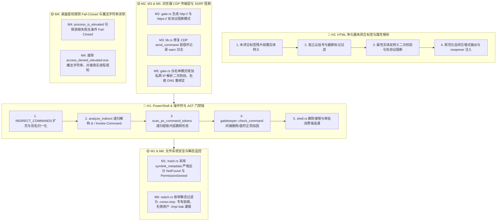

# 阶段二：方案生成 01 —— 安全门禁、沙箱 AST 与 HTML 净化器根治详案

> **方案定位**：基于 `docs/systemic-remediation-wave-2/analysis/01-安全门禁与沙箱AST分析.md` 的代码真值与穿透证据，编制覆盖 2 项红级高危漏洞与 6 项黄级防御纵深缺陷的系统级根治方案。  
> **契约与红线**：严格遵循 `.agents/LOGIC_PLAN_NO_RETREAT.md`（纯逻辑规划、反退避、拒绝外围打补丁、真实对抗验证、所有问题同权）、`AGENTS.md`（测试资产保护、Win32/pwsh7 环境规范、无工期/无降级排期）。  
> **输出路径**：`docs/systemic-remediation-wave-2/plans/01-安全与沙箱AST根治详案.md`  
> **状态**：方案定稿 / 待主控审查与任务派发

---

## 一、逻辑依赖与前置条件

### 1. 缺陷治理逻辑拓扑与依赖流



### 2. 前置条件与环境约束

1. **Rust 编译环境**：`cargo test --workspace` 可用，支持 `windows-sys 0.61` Win32 API 符号（`PROCESSENTRY32W`, `OpenProcess`, `OpenProcessToken`, `GetTokenInformation`）。
2. **Node/TS 运行环境**：`packages/plugin-sdk` 具备 `vitest` 测试运行能力，Node.js 18+ 环境。
3. **测试资产零丢失铁律**：严禁删除或弱化 `crates/conex-sandbox`、`crates/conex-fs`、`packages/plugin-sdk` 内的既有单测与回归用例，所有新方案均通过追加对抗矩阵与增强断言实现。

---

## 二、目标文件域（专有修改文件清单）

| 序号 | 目标模块         | 专有修改文件路径                                      | 涉及核心函数 / 结构体                                                                                    | 变更性质                                                                                |
| :--- | :--------------- | :---------------------------------------------------- | :------------------------------------------------------------------------------------------------------- | :-------------------------------------------------------------------------------------- |
| 1    | `conex-sandbox`  | `crates/conex-sandbox/src/semantics.rs`               | `INDIRECT_COMMANDS`, `normalize_command`, `analyze_indirect`, `scan_ps_command_tokens`, `classify_depth` | 递归间接解析、调用符 `&` 提取、token 扫描补齐                                           |
| 2    | `conex-sandbox`  | `crates/conex-sandbox/src/lib.rs`                     | `CommandGatekeeper::check_command`, `blocked_patterns`                                                   | 间接删除审批兜底、`\brmdir\b` / `\brd\b` 盘符正则补齐                                   |
| 3    | `agent-tools`    | `crates/agent-tools/src/tools/shell.rs`               | `ShellCommandTool::prepare`                                                                              | 校验间接删除接管与用户审批消费端一致性                                                  |
| 4    | `plugin-sdk`     | `packages/plugin-sdk/src/sanitizer/htmlSanitizer.ts`  | `sanitizeHtml`, `isSafeUrl`, `isSafeSrc`                                                                 | 未闭合残片前置实体转义、属性反转义二次校验                                              |
| 5    | `plugin-sdk`     | `packages/plugin-sdk/src/sanitizer/sanitizer.test.ts` | `describe('sanitizeHtml')`                                                                               | 增补未闭合标签、截断流式、畸形伪协议对抗单测                                            |
| 6    | `conex-fs`       | `crates/conex-fs/src/trash.rs`                        | `TrashService::snapshot`, `TrashService::restore_force`                                                  | 废除 `path.exists()`，采用 `fs::symlink_metadata` 区分 `NotFound` 与 `PermissionDenied` |
| 7    | `conex-fs`       | `crates/conex-fs/src/watch.rs`                        | `is_internal_atomic_transient_path`                                                                      | 收窄临时文件判定，移除 `.tmp`/`.bak` 全局通用后缀过滤                                   |
| 8    | `conex-browser`  | `crates/conex-browser/src/gate.rs`                    | `ipv4_blocked_patterns`, `ipv6_blocked_patterns`, `blocked_urls`, `DomainGate::check_host`               | 双协议 `http://` + `https://` 阻断、白名单私网 DNS 重绑定校验                           |
| 9    | `conex-browser`  | `crates/conex-browser/src/lib.rs`                     | `BrowserSession::handle_event`                                                                           | CDP `set_blocked_urls` 错误日志显式记录（禁止 `let _` 吞错）                            |
| 10   | `conex-computer` | `crates/conex-computer/src/window_gate.rs`            | `process_is_elevated`, `is_any_process_elevated`, `resolve_foreground_target`                            | 废除魔法字符串、`process_is_elevated` 句柄失败绝对 Fail-Closed                          |

---

## 三、🔴 H1: PowerShell `&` 动态/静态 AST Gatekeeper 穿透根治方案

### 1. 架构断层根因分析

在 PowerShell 语法中，`&` 是最核心的调用操作符。当前实现存在四大断层：

1. `INDIRECT_COMMANDS` 未包含 `&`、`invoke-command`、`icm`，导致段首为 `&` 时不进入间接命令分析分支；
2. `analyze_segment_ast` 仅对以 `$`、`(`、`{` 开头的动态变量判定为 `Dangerous`，而将静态命令名（如 `& cmd ...`）放行回 `Normal`；
3. `scan_ps_command_tokens` 扫描到 `INDIRECT_COMMANDS` 时仅返回 `Some(CommandClass::Indirect)`，未将后续 token 拼接为子命令进行递归分析，丢失了内层删除标记（`has_indirect_delete = false`）；
4. `gatekeeper::check_command` 对 `Indirect` 分类且 `has_indirect_delete == false` 的命令缺少兜底，且 `blocked_patterns` 正则缺少 `\brmdir\b`，最终误判定为 `Allowed` 直接执行。

### 2. 详细设计与实现步骤

#### 步骤 1.1：扩充间接命令清单与命令名归一化 (`semantics.rs`)

在 `crates/conex-sandbox/src/semantics.rs` 中：

```rust
const INDIRECT_COMMANDS: &[&str] = &[
    "&", "eval", "source", ".", "bash", "sh", "cmd", "pwsh", "powershell", "sudo", "xargs", "node",
    "python", "python3", "find", "foreach-object", "iex", "invoke-expression", "start-process",
    "invoke-command", "icm",
];
```

在 `normalize_command` 中：

- 支持识别并剥离段首调用符包裹（如 `&(`、`&{`、`$(` 归一为 `&`）；
- 支持剥除可执行后缀 `.exe`（如 `"cmd.exe"` -> `"cmd"`、`"powershell.exe"` -> `"powershell"`）；
- 保持双引号/单引号剥离。

#### 步骤 1.2：重构 `analyze_indirect` 新增 `&` / `invoke-command` 递归分支 (`semantics.rs`)

在 `analyze_indirect(segment_raw: &str) -> SemanticAnalysis` 中：

```rust
"&" => {
    // 提取 args 的第 0 个元素作为子命令，其余为子命令参数
    if args.is_empty() {
        None
    } else {
        let target = &args[0];
        // 若目标为动态变量或表达式（如 $x / $(...)），在 analyze_segment_ast 已标记 Dangerous
        // 此处为静态命令或引号包裹命令，重新组合为完整子命令行
        let inner_line = args.join(" ");
        Some(inner_line)
    }
}
"invoke-command" | "icm" => {
    // 提取 -ScriptBlock 后的内容或第一个位置参数
    let mut inner: Option<String> = None;
    let mut iter = args.iter();
    while let Some(a) = iter.next() {
        if a.eq_ignore_ascii_case("-ScriptBlock") || a.eq_ignore_ascii_case("-Command") {
            let rest: Vec<&String> = iter.by_ref().collect();
            if !rest.is_empty() {
                let joined = rest.iter().map(|s| s.as_str()).collect::<Vec<_>>().join(" ");
                inner = Some(joined.trim().trim_matches(['{', '}']).trim().to_string());
            }
            break;
        }
    }
    inner.or_else(|| {
        // 位置参数 ScriptBlock: Invoke-Command { Remove-Item D:\old }
        for a in &args {
            if a.starts_with('{') && a.ends_with('}') && a.len() >= 2 {
                return Some(a[1..a.len() - 1].trim().to_string());
            }
        }
        None
    })
}
```

#### 步骤 1.3：完善 `scan_ps_command_tokens` 深度递归提取 (`semantics.rs`)

在 `scan_ps_command_tokens` 中：

```rust
if INDIRECT_COMMANDS.contains(&cand.as_str()) {
    // 截取该间接命令 token 及其后续所有参数，组装为子命令行递归分析
    let sub_line = args[start + i..].join(" ");
    let inner_analysis = analyze_depth(&sub_line, 1);
    if inner_analysis.overall_class == CommandClass::Redline {
        return Some(CommandClass::Redline);
    }
    if inner_analysis.overall_class == CommandClass::Dangerous {
        return Some(CommandClass::Dangerous);
    }
    if inner_analysis.overall_class == CommandClass::DeleteShape || inner_analysis.has_indirect_delete {
        return Some(CommandClass::Indirect);
    }
    return Some(CommandClass::Indirect);
}
```

并在 `analyze_depth` 的主循环中：

```rust
if (INDIRECT_COMMANDS.contains(&normalized.as_str()) || segment.class == CommandClass::Indirect) {
    let inner = analyze_indirect(&seg);
    if inner.overall_class == CommandClass::DeleteShape || inner.has_indirect_delete {
        has_indirect_delete = true;
    }
    if inner.overall_class == CommandClass::Redline {
        segment.class = CommandClass::Redline;
    }
    for t in inner.delete_targets {
        if !delete_targets.contains(&t) {
            delete_targets.push(t);
        }
    }
}
```

#### 步骤 1.4：加固 `gatekeeper::check_command` 与静态正则 (`lib.rs`)

在 `crates/conex-sandbox/src/lib.rs` 中：

1. 扩充 `blocked_patterns`：
   ```rust
   // 补齐 rmdir / rd / del / erase 盘符根与递归/强制删除正则
   r"(?i)\b(rmdir|rd)\b.*[A-Za-z]:",
   r"(?i)\b(del|erase)\b.*[A-Za-z]:",
   ```
2. 在 `check_command` 判定逻辑中：
   ```rust
   // 3. 语义层 Dangerous / 间接删除 / AST 危险判定合并既有 approval_patterns 语义
   if analysis
       .segments
       .iter()
       .any(|s| s.class == crate::semantics::CommandClass::Dangerous)
       || analysis.overall_class == crate::semantics::CommandClass::Dangerous
       || analysis.has_indirect_delete
       || (analysis.overall_class == crate::semantics::CommandClass::Indirect && !analysis.delete_targets.is_empty())
   {
       return GatekeeperResult::RequiresApproval;
   }
   ```

### 3. 红队 Exploit 对抗测试矩阵

```rust
#[test]
fn test_powershell_call_operator_and_indirect_remediation_matrix() {
    let exploits = [
        ("& cmd /c rmdir /s /q D:\\old", GatekeeperResult::RequiresApproval, true),
        ("& 'cmd' /c rmdir /s /q D:\\old", GatekeeperResult::RequiresApproval, true),
        ("& \"cmd.exe\" /c rmdir /s /q D:\\old", GatekeeperResult::RequiresApproval, true),
        ("& bash -c 'rm -rf /tmp/test'", GatekeeperResult::RequiresApproval, true),
        ("& bash -c 'rm /tmp/x'", GatekeeperResult::RequiresApproval, true),
        ("& pwsh -Command \"Remove-Item -Recurse -Force D:\\data\"", GatekeeperResult::RequiresApproval, true),
        ("& cmd /c Remove-Item D:\\file.txt", GatekeeperResult::RequiresApproval, true),
        ("Invoke-Command -ScriptBlock { Remove-Item -Recurse D:\\old }", GatekeeperResult::RequiresApproval, true),
        ("icm -ScriptBlock { rm /tmp/x }", GatekeeperResult::RequiresApproval, true),
        ("& cmd /c rm -rf /", GatekeeperResult::Blocked, true),
        ("& cmd.exe /c format D:", GatekeeperResult::Blocked, false),
    ];

    let gate = CommandGatekeeper::new();
    for (cmd, expected_gate, expected_indirect_del) in exploits {
        let sem = analyze(cmd);
        if expected_indirect_del {
            assert!(
                sem.has_indirect_delete || sem.overall_class == CommandClass::DeleteShape || sem.overall_class == CommandClass::Redline,
                "命令 {cmd} 必须识别为间接删除或删除形态或红线"
            );
        }
        let res = gate.check_command(cmd, &[]);
        assert_eq!(res, expected_gate, "命令 {cmd} 的 Gatekeeper 判定结果不符合预期");
    }
}
```

---

## 四、🔴 H2: HTML 净化器未闭合标签 XSS 根治方案

### 1. 架构断层根因分析

`packages/plugin-sdk/src/sanitizer/htmlSanitizer.ts` 中的 `tagRegex` 采用 `<\/?([a-zA-Z0-9:-]+)((?:[^"'>]|"[^"]*"|'[^']*')*)\/?>/g`。若输入字符串由于恶意攻击、网络分块或 LLM 流式输出截断，在末尾留有未以 `>` 闭合的标签残片（如 `` 闭合的悬空残片，强制调用 `escapeHtml` 转换为纯文本实体：

```typescript
// 1. 彻底移除 HTML 注释与顶级 script / style 块
let cleaned = rawHtml.replace(/<!--[\s\S]*?-->/g, '');

cleaned = cleaned
  .replace(/<script\b[^>]*>[\s\S]*?<\/script\s*>/gi, '')
  .replace(/<style\b[^>]*>[\s\S]*?<\/style\s*>/gi, '');

// 2. 核心加固：识别并安全转义任何末尾未闭合的标签残片（如 `
const unclosedTrailingTagRegex =
  /<([a-zA-Z0-9:-]+)(?:[^>"']|"[^"]*"|'[^']*')*$/;
cleaned = cleaned.replace(unclosedTrailingTagRegex, (unclosed) => {
  return escapeHtml(unclosed);
});
```

#### 步骤 2.2：属性解析器反转义与二次协议校验 (`htmlSanitizer.ts`)

在 `attrRegex` 提取属性值后，由于攻击者可能利用 HTML 字符实体进行伪协议混淆（如 `jav&#x61;script:`、`&#x09;`），必须在校验协议前进行深度归一：

```typescript
function decodeAndNormalizeAttr(val: string): string {
  if (!val) return '';
  return stripControlChars(
    val
      .replace(/&#x([0-9a-fA-F]+);?/g, (_, hex) =>
        String.fromCharCode(parseInt(hex, 16))
      )
      .replace(/&#([0-9]+);?/g, (_, dec) =>
        String.fromCharCode(parseInt(dec, 10))
      )
      .replace(/&[a-zA-Z]+;/g, '') // 剥离常见命名实体
      .trim()
  );
}
```

在属性校验分支中：

```typescript
if (attrName === 'href') {
  const normalizedVal = decodeAndNormalizeAttr(attrVal);
  if (!isSafeUrl(attrVal) || !isSafeUrl(normalizedVal)) continue;
} else if (attrName === 'src') {
  const normalizedVal = decodeAndNormalizeAttr(attrVal);
  if (
    !isSafeSrc(attrVal, allowDataImages) ||
    !isSafeSrc(normalizedVal, allowDataImages)
  )
    continue;
}
```

#### 步骤 2.3：标签替换后孤立尖括号清理 (`htmlSanitizer.ts`)

在 `tagRegex` 替换完成后，对可能残留的孤立 `<`（非合规 HTML 标签起首）进行兜底转义，杜绝 DOM 层重解释。

### 3. 对抗测试矩阵 (`sanitizer.test.ts`)

```typescript
describe('HTML Sanitizer 未闭合标签与对抗绕过防御', () => {
  it('安全转义未闭合的  恶意残片', () => {
    const raw = ' 标签', () => {
    const raw = '<a href="javascript:alert(1)"';
    const clean = sanitizeHtml(raw);
    expect(clean).not.toContain('href="javascript:');
    expect(clean).toContain('&lt;a');
  });

  it('拦截并转义未闭合的 <svg onload> 与 <iframe src>', () => {
    expect(sanitizeHtml('<svg onload=alert(1)')).not.toContain('<svg');
    expect(sanitizeHtml('<iframe src="http://evil.com"')).not.toContain(
      '<iframe'
    );
  });

  it('拦截实体编码混淆伪协议 jav&#x61;script:', () => {
    const raw = '<a href="jav&#x61;script:alert(1)">click</a>';
    const clean = sanitizeHtml(raw);
    expect(clean).not.toContain('href');
    expect(clean).not.toContain('javascript');
  });

  it('正确处理属性中含有畸形尖括号与引号的合法闭合标签', () => {
    const raw =
      ' b" onerror="alert(1)">';
    const clean = sanitizeHtml(raw);
    expect(clean).toContain('src="https://example.com/a.png"');
    expect(clean).toContain('alt="a &gt; b"');
    expect(clean).not.toContain('onerror');
  });
});
```

---

## 五、🟡 M1/M2/M4/M5/M6 安全遗留根治方案

### 1. M1: `trash.rs` 采用 `symlink_metadata` 严格区分 `NotFound` 与 `PermissionDenied`

- **目标文件**：`crates/conex-fs/src/trash.rs`
- **缺陷**：`snapshot()` 使用 `path.exists()`，遇 `PermissionDenied` 返回 `false`，登记为 `nil-content` 快照。后续 `restore_force()` 时判定为「原文件不存在」，直接调用 `force_remove_all(original)` 误删用户的不可读真实文件。
- **根治设计**：
  在 `snapshot()`（`trash.rs:219`）中：
  ```rust
  match fs::symlink_metadata(path) {
      Ok(metadata) => {
          if metadata.is_dir() {
              bail!("快照仅支持普通文件，拒绝目录：{}", path.display());
          }
          // 执行真实文件快照复制与 checksum 计算
          crate::path_utils::ensure_parent_dir(&payload_dst)?;
          fs::copy(path, &payload_dst)
              .with_context(|| format!("复制快照失败：{}", path.display()))?;
          let checksum = Some(crate::path_utils::compute_file_hash(path)?);
          let snapshot = SnapshotMeta {
              mtime: epoch_millis(metadata.modified().ok()),
              readonly: metadata.permissions().readonly(),
          };
          let entry = TrashEntry {
              id: id.clone(),
              original_path: original.clone(),
              trashed_at: now_millis(),
              kind: TrashKind::File,
              size: metadata.len(),
              checksum,
              mode: EntryMode::Snapshot,
          };
          write_meta(&entry_dir, &entry, true, Some(&snapshot), true)?;
          Ok(entry)
      }
      Err(e) if e.kind() == std::io::ErrorKind::NotFound => {
          // 仅当明确返回 NotFound 时，才登记 nil-content 条目
          crate::path_utils::ensure_parent_dir(&entry_dir.join(META_FILE))?;
          let entry = TrashEntry {
              id: id.clone(),
              original_path: original.clone(),
              trashed_at: now_millis(),
              kind: TrashKind::File,
              size: 0,
              checksum: None,
              mode: EntryMode::Snapshot,
          };
          write_meta(&entry_dir, &entry, true, None, false)?;
          Ok(entry)
      }
      Err(e) => {
          // 遭遇 PermissionDenied 或其它 IO 错误，严格 Fail-Closed 阻断！
          Err(e).with_context(|| format!("访问快照目标失败（Fail-Closed）：{}", path.display()))
      }
  }
  ```

---

### 2. M2: `gate.rs` 传输层 `blocked_urls` 双协议阻断与 CDP 吞错治理

- **目标文件**：`crates/conex-browser/src/gate.rs`、`crates/conex-browser/src/lib.rs`
- **缺陷**：`ipv4_blocked_patterns` 与 `ipv6_blocked_patterns` 仅硬编码 `http://`，导致 `https://10.0.0.1/` 或 `https://192.168.1.1/` 的 CDP 传输层阻断脱靶；`lib.rs:150` 使用 `let _ = channel.send_command(...)` 静默吞掉错误。
- **根治设计**：
  1. 在 `ipv4_blocked_patterns` 中同时生成 `http://` 与 `https://` 模式：
     ```rust
     fn ipv4_blocked_patterns(net: &Ipv4Addr, prefix: u8) -> Vec<String> {
         let first = u32::from(*net);
         let a = (first >> 24) as u8;
         if prefix <= 8 {
             return vec![
                 format!("http://{a}.*"),
                 format!("https://{a}.*"),
             ];
         }
         let host_bits = 32 - prefix as u32;
         let mask = (1u32 << host_bits) - 1;
         let end = first | mask;
         let b_first = ((first >> 16) & 0xFF) as u8;
         let b_last = ((end >> 16) & 0xFF) as u8;
         (b_first..=b_last)
             .flat_map(|b| {
                 vec![
                     format!("http://{a}.{b}.*"),
                     format!("https://{a}.{b}.*"),
                 ]
             })
             .collect()
     }
     ```
  2. 在 `ipv6_blocked_patterns` 中同步生成 `http://` 与 `https://` 对应项；
  3. 云元数据端点同步添加 `https://169.254.169.254/*`；
  4. 在 `crates/conex-browser/src/lib.rs` 中替换 `let _` 吞错：
     ```rust
     if let Err(e) = channel.send_command(NETWORK_SET_BLOCKED_URLS, json!({ "urls": blocked })).await {
         tracing::warn!("下发 CDP 传输层阻断 URL 清单失败: {e:?}");
     }
     ```

---

### 3. M4: `window_gate.rs` 提权探测 Fail-Closed 与魔法字符串消除

- **目标文件**：`crates/conex-computer/src/window_gate.rs`
- **缺陷**：`process_is_elevated` 中 `err == ERROR_ACCESS_DENIED || err != 0` 存在 `err == 0` 时 Fail-Open 的隐患；`resolve_foreground_target` 使用 `"access_denied_elevated.exe"` 魔法字符串传递提权状态，污染审计日志。
- **根治设计**：
  1. `process_is_elevated` 严格 Fail-Closed：
     ```rust
     pub fn process_is_elevated(pid: u32) -> bool {
         unsafe {
             let process_handle = OpenProcess(PROCESS_QUERY_LIMITED_INFORMATION, 0, pid);
             if process_handle.is_null() {
                 // 无法打开句柄说明目标权限高于当前进程，无条件判定提权 (Fail-Closed)
                 return true;
             }

             let mut token_handle: *mut core::ffi::c_void = std::ptr::null_mut();
             if OpenProcessToken(process_handle, TOKEN_QUERY, &mut token_handle) == 0 {
                 CloseHandle(process_handle);
                 // 无法获取 Token 同样无条件判定提权 (Fail-Closed)
                 return true;
             }

             let mut elevation: TOKEN_ELEVATION = std::mem::zeroed();
             let mut return_len: u32 = 0;
             let elevated = if GetTokenInformation(
                 token_handle,
                 TokenElevation,
                 &mut elevation as *mut _ as *mut _,
                 std::mem::size_of::<TOKEN_ELEVATION>() as u32,
                 &mut return_len,
             ) != 0 {
                 elevation.TokenIsElevated != 0
             } else {
                 // 查询失败无条件 Fail-Closed
                 true
             };
             CloseHandle(token_handle);
             CloseHandle(process_handle);
             elevated
         }
     }
     ```
  2. 废除魔法字符串 `"access_denied_elevated.exe"`：
     在 `resolve_foreground_target` 中，当 `OpenProcess` 返回 `null` 时，通过 Toolhelp32 快照直接依据 PID 获取真实的进程镜像名称 `szExeFile`（例如 `taskmgr.exe`、`services.exe`），将真实的进程名存入 `ActionTarget::Window { title, process: Some(real_proc_name) }`。
     后续 `WindowTargetGate` 调用 `probe.is_elevated(real_proc_name)` 时，枚举到该 PID 并调用 `process_is_elevated(pid)`，由于 `OpenProcess` 失败自然返回 `true`。
     最终审计日志准确输出：`"目标窗口为提权进程 taskmgr.exe,拒绝注入(tool.computer.elevated_window)"`，彻底清除伪造的魔法字符串。

---

### 4. M5 & M6 防御纵深补充方案

#### M5: `gate.rs` 白名单 SSRF / DNS 重绑定防护

- **目标文件**：`crates/conex-browser/src/gate.rs`
- **设计**：在白名单匹配成功后，若目标为域名形式（非 `localhost` 且非显式 IP 字面量），仍执行 DNS 解析探测。若解析到的 IP 属于私网保留地址且白名单中未显式包含该私网 IP，拒绝访问并返回 SSRF 风险告警，杜绝公网白名单域名遭 DNS 重绑定攻击后直连内网。

#### M6: `watch.rs` 内部临时文件过滤规则收窄

- **目标文件**：`crates/conex-fs/src/watch.rs`
- **设计**：将 `is_internal_atomic_transient_path` 中的一刀切过滤收窄为系统专有前缀：
  ```rust
  pub fn is_internal_atomic_transient_path(path: &Path) -> bool {
      let Some(file_name) = path.file_name().and_then(|n| n.to_str()) else {
          return false;
      };
      let lower = file_name.to_lowercase();
      lower.starts_with(".conex-tmp-")
          || lower.starts_with(".conex-bak-")
          || lower.starts_with(".agent-tmp-")
          || lower.starts_with(".crish-tmp-")
  }
  ```
  移除 `lower.ends_with(".tmp")` 与 `lower.ends_with(".bak")`，确保工作区内的真实文件（如 `backup.bak`、`data.tmp`）的修改事件正常上报。

---

## 六、系统验收断言清单与执行命令

本方案所列全部安全改进项地位同权，实施完成后必须执行以下全量验证套件，确保 100% 绿灯通过：

| 验收编号              | 验证目标                                             | 验证命令                                                          | 预期输出断言                                                                    |
| :-------------------- | :--------------------------------------------------- | :---------------------------------------------------------------- | :------------------------------------------------------------------------------ |
| **ASSERT-AST-01**     | `conex-sandbox` AST 与 PowerShell `&` 间接调用解析   | `cargo test -p conex-sandbox --lib semantics::tests`              | 测试套件全绿，包含新增的 `& cmd /c rmdir` 等 11 项红队 Exploit 对抗用例全部通过 |
| **ASSERT-AST-02**     | `conex-sandbox` Gatekeeper 静态/动态命令拦截         | `cargo test -p conex-sandbox --lib gatekeeper::tests`             | `test_gatekeeper_call_operator_requires_approval_or_blocked` 绿灯通过           |
| **ASSERT-SHELL-01**   | `agent-tools` Shell 工具删除接管与审批               | `cargo test -p agent-tools --lib tools::shell::tests`             | `test_shell_indirect_delete_redirection` 等用例全部通过                         |
| **ASSERT-XSS-01**     | `plugin-sdk` HTML 净化器未闭合残片与 XSS 封堵        | `npm test -- packages/plugin-sdk/src/sanitizer/sanitizer.test.ts` | 包含未闭合 `` 等 22 项以上测试 100% PASS  |
| **ASSERT-TRASH-01**   | `conex-fs` Trash 快照 Fail-Closed 与权限阻断         | `cargo test -p conex-fs --lib trash::tests`                       | 快照遇 `PermissionDenied` 严格抛错，杜绝 nil-content 误删                       |
| **ASSERT-BROWSER-01** | `conex-browser` 双协议阻断与 CDP 状态机              | `cargo test -p conex-browser --lib gate::tests`                   | `test_blocked_urls_contains_http_and_https` 绿灯通过                            |
| **ASSERT-COMP-01**    | `conex-computer` 提权探测 Fail-Closed 与真实进程感知 | `cargo test -p conex-computer --lib window_gate::tests`           | 废除魔法字符串后提权探测单测与 Windows API 探测全绿                             |
| **ASSERT-WATCH-01**   | `conex-fs` Watcher 临时文件过滤收窄                  | `cargo test -p conex-fs --lib watch::tests`                       | 仅过滤专有 `.conex-tmp-` 前缀，放行 `.tmp`/`.bak` 真实文件变更                  |
| **ASSERT-FULL-01**    | 全工作区 Rust 单元测试套件回归                       | `cargo test --workspace`                                          | 全量套件 0 失败                                                                 |
| **ASSERT-FULL-02**    | 全局前端类型检查                                     | `npm run typecheck`                                               | 0 errors                                                                        |

---

_方案编制完成。已锁定全链路目标文件、数据结构流转、算法细节与红队对抗断言。_
