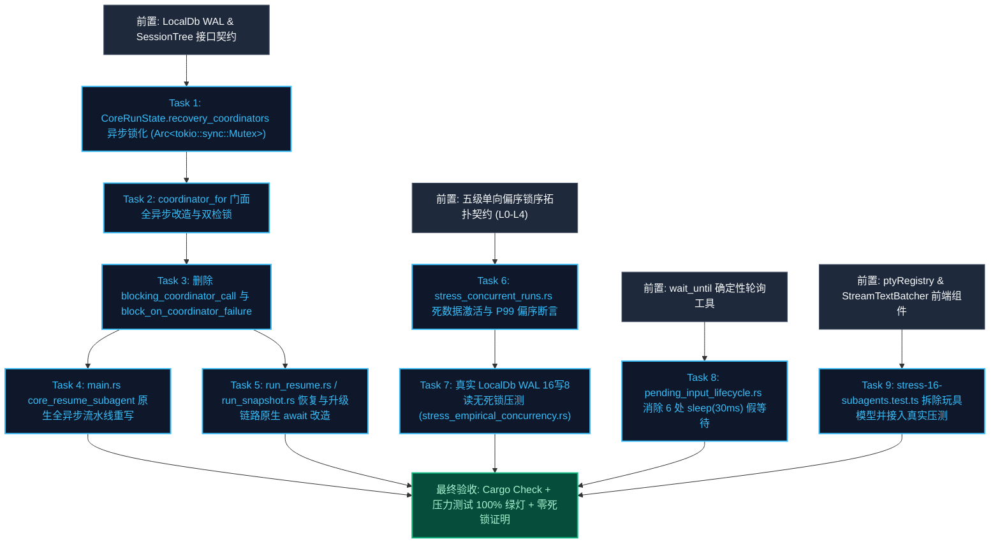

# 阶段二：方案生成 — 02 并发锁序、异步协调与测试真实性详案

> **执行依据**：`.agents/LOGIC_PLAN_NO_RETREAT.md`（纯逻辑规划、反退避、反伪完成、真机实证、严禁测试内写玩具模型）、`AGENTS.md`、`docs/systemic-remediation-wave-2/analysis/02-并发锁序与异步协调分析.md`。  
> **纪律声明**：本方案坚持纯逻辑规划、代码真值定性与可验证性优先；所有缺陷问题同权，严禁包含工期、人天、排期或 P0/P1 优先级划分。

---

## 1. 方案目标与核心逻辑

本方案针对阶段一在并发锁序、异步协调与测试真实性维度穿透发现的 **5 大核心断层** 进行系统性根治：

1. **🔴 根治 `RecoveryCoordinator` 同步锁跨 `block_on` 驱动真实 await 违规**：全面统一为 `Arc<tokio::sync::Mutex<RecoveryCoordinator>>`，消除 `main.rs` 与 `run_core.rs` 的阻塞套娃；
2. **彻底消除假同步桥接反模式**：完全删除 `block_on_coordinator_failure` 与 `blocking_coordinator_call`；
3. **形式化全仓五级单向偏序锁序拓扑契约**：严格确立 $L_0 \prec L_1 \prec L_2 \prec L_3 \prec L_4$，确立零跨越同步律与零同步阻塞律；
4. **测试真实性系统性改造与玩具模型废除**：
   - 废除 `tests/stress/stress-16-subagents.test.ts` 中自写的 `AsyncMutex` 与 `SingleWriterQueue` 玩具模型，对接前端真实并发设施；
   - 消除 `pending_input_lifecycle.rs` 中 6 处 `sleep(30ms)` 假等待，构建确定性 `wait_until` 轮询基础设施；
   - 消除 `stress_concurrent_runs.rs` 中的死数据收集，引入 $P_{99}(L_0) \le P_{99}(L_1) \le P_{99}(L_2)$ 偏序阶梯断言、Group Commit P99 延迟 SLA 硬断言与原子就绪同步；
5. **基于真实 `LocalDb` WAL 实例与真实内核状态机的 16 并发无死锁压力测试落地**：构建真实 16 写 + 8 读 Worker 高压争用测试与 10s 硬性超时哨兵。

---

## 2. 逻辑依赖关系与前置条件



### 2.1 任务执行前置条件

1. **类型一致性前置**：`crates/orchestrator/src/recovery.rs` 中的 `RecoveryCoordinator` 内部已具备 `pub async fn on_subagent_run_failure` 与 `pub async fn fork_and_reassign` 异步接口，改造直接使用其异步声明；
2. **锁序守卫前置**：在持有同步互斥锁（$L_0/L_1$）的代码块中，严禁存在任何 `.await` 调度点；所有同步锁必须在进入下一个异步调度前完全 Drop；
3. **测试环境隔离前置**：压力测试必须基于 `tempfile::tempdir()` 独立的临时 WAL 数据库，测试结束后自动清理，杜绝共享污染。

---

## 3. 目标文件域与改动清单

| 模块 / 层次               | 目标文件路径                                                       | 涉及核心符号 / 结构体 / 函数                                                                                                                                                           | 改动类型                                                                                                                          |
| :------------------------ | :----------------------------------------------------------------- | :------------------------------------------------------------------------------------------------------------------------------------------------------------------------------------- | :-------------------------------------------------------------------------------------------------------------------------------- |
| **Tauri 壳层核心**        | `apps/agent-workbench/src-tauri/src/run/run_core.rs`               | `CoreRunState.recovery_coordinators`<br/>`CoreRunState::coordinator_for`<br/>`block_on_coordinator_failure`<br/>`blocking_coordinator_call`                                            | **重构/删除**：<br/>- 类型转为 `tokio::sync::Mutex`；<br/>- 彻底移除两个 fake blocking 函数。                                     |
| **Tauri 恢复链路**        | `apps/agent-workbench/src-tauri/src/run/run_resume.rs`             | `CoreRunState::execute_subagent_recovery`<br/>`CoreRunState::decide_subagent_failure_recovery`                                                                                         | **重构**：<br/>- 消除 `blocking_coordinator_call`，改为原生 `coord.lock().await`。                                                |
| **Tauri 快照恢复**        | `apps/agent-workbench/src-tauri/src/run/run_snapshot.rs`           | `CoreRunState::run_restore`                                                                                                                                                            | **重构**：<br/>- 原生获取异步锁并执行 `restore_steering_notifications`。                                                          |
| **Tauri 命令入口**        | `apps/agent-workbench/src-tauri/src/main.rs`                       | `core_resume_subagent`                                                                                                                                                                 | **重构**：<br/>- 消除锁内 `block_on`，拆分为 `spawn_blocking` 读 DB + 原生 `await` 异步 fork。                                    |
| **Tauri 集成测试**        | `apps/agent-workbench/src-tauri/src/core_run_commands_tests.rs`    | `test_subagent_recovery_*`<br/>`coordinator_for` 调用点                                                                                                                                | **适配**：<br/>- 适配 `Arc<tokio::sync::Mutex<RecoveryCoordinator>>`。                                                            |
| **Orchestrator 测试**     | `crates/orchestrator/tests/pending_input_lifecycle.rs`             | `enqueue_writes_pending_input_with_run_id`<br/>`consume_deletes_pending_input_row`<br/>`restore_reads_written_pending_inputs_in_fifo_order`<br/>`repeated_enqueue_is_idempotent_by_id` | **重构**：<br/>- 消除 6 处 `sleep(30ms)`，接入确定性 `wait_until`。                                                               |
| **Orchestrator 测试**     | `crates/orchestrator/tests/stress_concurrent_runs.rs`              | `stress_five_tier_lock_hierarchy_zero_deadlock`<br/>`stress_kill_all_cascade_no_orphans`                                                                                               | **重构**：<br/>- 激活死数据，补充 P99 偏序断言与 SLA 断言；<br/>- 消除 10ms 假等待。                                              |
| **Orchestrator 真实压测** | `crates/orchestrator/tests/stress_empirical_concurrency.rs` (新建) | `stress_real_localdb_and_kernel_state_machine_zero_deadlock`                                                                                                                           | **新增**：<br/>- 16 写 + 8 读真实 WAL 数据库高压对抗实证。                                                                        |
| **前端压力测试**          | `tests/stress/stress-16-subagents.test.ts`                         | `五级锁偏序客户端拓扑模拟...` 用例                                                                                                                                                     | **重构**：<br/>- 彻底删除 `AsyncMutex` 与 `SingleWriterQueue` 假锁类；<br/>- 接入真实 `ptyRegistry` 与 `StreamTextBatcher` 压测。 |

---

## 4. 详细设计与实现步骤

### 4.1 🔴 模块 1：`RecoveryCoordinator` 全异步改造与同步锁消除方案 (SR2-02-A)

#### 4.1.1 根因与机理

在原实现中，`CoreRunState.recovery_coordinators` 使用 `std::sync::Mutex` 包裹 `RecoveryCoordinator`。由于 `RecoveryCoordinator::fork_and_reassign` 内部必须调用 `SubagentSpawner::spawn(&request).await` 启动真实子代理，调用方不得不使用 `tokio::task::spawn_blocking` 并在其内部通过 `Handle::current().block_on(...)` 强行驱动异步 Future。
在并发恢复高压下，持有同步互斥锁的阻塞线程与等待该锁的 Tokio Worker 线程极易形成 **互等死锁（ABBA Deadlock）**，并引发 **阻塞线程池饥饿耗尽**。

#### 4.1.2 改造步骤 1：`CoreRunState` 内部注册表类型全异步化

在 `apps/agent-workbench/src-tauri/src/run/run_core.rs:358` 中，将字段定义修改为：

```rust
// apps/agent-workbench/src-tauri/src/run/run_core.rs
pub(crate) struct CoreRunState {
    // ...
    /// D3 §3.1：每会话恢复协调器（C7 权威实例；五件套装配，惰性构造——
    /// 外层 Mutex<HashMap> 为 L0 内存守卫，持锁 < 100ns；
    /// 内层统一为 Arc<tokio::sync::Mutex<RecoveryCoordinator>> 异步业务锁，支持 await）
    pub(crate) recovery_coordinators: Mutex<HashMap<String, Arc<tokio::sync::Mutex<RecoveryCoordinator>>>>,
    // ...
}
```

#### 4.1.3 改造步骤 2：重构 `coordinator_for` 门面与双检锁

在 `apps/agent-workbench/src-tauri/src/run/run_core.rs:910-997` 中，重构为：

```rust
// apps/agent-workbench/src-tauri/src/run/run_core.rs
impl CoreRunState {
    pub(crate) fn coordinator_for(
        &self,
        session_id: &str,
    ) -> Option<Arc<tokio::sync::Mutex<RecoveryCoordinator>>> {
        // 1. 快速路径：读锁命中既有实例 (L0 锁立取立释)
        {
            let map = self
                .recovery_coordinators
                .lock()
                .unwrap_or_else(|e| e.into_inner());
            if let Some(existing) = map.get(session_id) {
                return Some(Arc::clone(existing));
            }
        }

        // 2. local_db() 为 None（测试替身 store）→ None 降级
        let Some(db) = self.local_db() else {
            return None;
        };

        // 3. 五件套装配 (tree 与 coordinator 同批装配)
        let tree = {
            let mut trees = self.session_trees.lock().unwrap_or_else(|e| e.into_inner());
            trees.get(session_id).cloned().unwrap_or_else(|| {
                let arc = Arc::new(Mutex::new(SessionTree::new(session_id)));
                trees.insert(session_id.to_string(), Arc::clone(&arc));
                arc
            })
        };
        let store: Arc<dyn RecoveryStore> = Arc::new(db);
        let queue = Arc::clone(&self.pending_queue);
        let concrete = Arc::clone(&self.subagent_spawner);
        let spawner: Arc<dyn agent_tools::tools::subagent::SubagentSpawner> =
            concrete as Arc<dyn agent_tools::tools::subagent::SubagentSpawner>;

        let ladder1_max_retries = store
            .get_meta(RECOVER_LADDER1_MAX_RETRIES_KEY)
            .ok()
            .flatten()
            .and_then(|raw| raw.parse::<u32>().ok())
            .unwrap_or(RECOVER_LADDER1_MAX_RETRIES_DEFAULT);
        let policy = RecoveryRetryPolicy {
            max_retries: ladder1_max_retries,
            ..Default::default()
        };
        let session_id_owned = session_id.to_string();

        // 4. RecoveryCoordinator::new 构造（读 SQLite meta 走独立线程，不占 async worker）
        let constructed = std::thread::scope(|scope| {
            scope
                .spawn(move || {
                    RecoveryCoordinator::new(session_id_owned, store, queue, tree, spawner, policy)
                })
                .join()
        })
        .unwrap_or_else(|join_error| {
            Err(RecoveryError::PersistFailed {
                message: format!("恢复协调器构造线程 join 失败：{join_error:?}"),
            })
        });

        let coord = match constructed {
            Ok(coordinator) => Arc::new(tokio::sync::Mutex::new(coordinator)),
            Err(error) => {
                tracing::warn!(
                    target: "run",
                    session_id,
                    error = %error,
                    "恢复协调器构造失败（本会话恢复路径降级为接线前行为）"
                );
                return None;
            }
        };

        // 5. double-check 插入：并发双构造时丢弃后到者
        let mut map = self
            .recovery_coordinators
            .lock()
            .unwrap_or_else(|e| e.into_inner());
        if let Some(existing) = map.get(session_id) {
            return Some(Arc::clone(existing));
        }
        map.insert(session_id.to_string(), Arc::clone(&coord));
        Some(coord)
    }
}
```

#### 4.1.4 改造步骤 3：彻底删除 `block_on_coordinator_failure` 与 `blocking_coordinator_call`

直接从 `apps/agent-workbench/src-tauri/src/run/run_core.rs:1449-1475` 中 **物理删除** 两个函数，禁止在仓内留存任何同步-阻塞-异步套娃桥接。

#### 4.1.5 改造步骤 4：重写 `main.rs` 中的 IPC 入口 `core_resume_subagent`

在 `apps/agent-workbench/src-tauri/src/main.rs:415-455` 中，消除 `spawn_blocking` 内 `block_on` 违规，重写为两阶段清晰异步流：

```rust
// apps/agent-workbench/src-tauri/src/main.rs
pub(crate) async fn resume_subagent(
    state: tauri::State<'_, Arc<core_run_commands::CoreRunState>>,
    session_id: String,
    subagent_id: String,
    prompt: Option<String>,
) -> Result<orchestrator::lifecycle::ResumeOutcome, core_error::CoreError> {
    let service = state.lifecycle_service().ok_or_else(|| {
        core_error::CoreError::internal("LocalDb 不可用（测试替身 store）")
    })?;

    // ① 同步准备段：纯读 SQLite，走独立 blocking 任务
    let prepared = {
        let service = service.clone();
        let sid = session_id.clone();
        let aid = subagent_id.clone();
        tokio::task::spawn_blocking(move || {
            service.prepare_resume(&sid, &aid, prompt.as_deref())
        })
        .await
        .map_err(|e| {
            core_error::CoreError::internal(format!("resume 准备段阻塞任务失败：{e}"))
        })?
        .map_err(map_lifecycle_err)?
    };

    // ② 异步 fork 段：全异步获取 L2 锁并执行，零 block_on
    let coord = state.coordinator_for(&session_id).ok_or_else(|| {
        core_error::CoreError::internal("恢复协调器未装配（D3 未接线，resume 暂不可用）")
    })?;

    let mut coordinator = coord.lock().await;
    service
        .resume_with_prepared(&mut coordinator, &session_id, prepared)
        .await
        .map_err(map_lifecycle_err)
}
```

#### 4.1.6 改造步骤 5：重写 `run_resume.rs` 与 `run_snapshot.rs` 调用点

1. **`run_resume.rs:550-575` 恢复决策**：
   ```rust
   // 改造后：直接在 async 函数内获取异步锁并 await 决策
   let decision = {
       let mut c = coord.lock().await;
       c.on_subagent_run_failure(&ctx_for_decision).await
   };
   ```
2. **`run_resume.rs:680-705` 阶梯升级重入**：
   ```rust
   // 改造后：原生异步锁调用
   let outcome = {
       let mut c = coord.lock().await;
       c.on_subagent_run_failure(&escalate_ctx).await
   };
   ```
3. **`run_snapshot.rs:180-205` 重启恢复通知重排**：
   ```rust
   if let Some(coord) = self.coordinator_for(&record.session_id) {
       let reinsert_res = {
           let mut c = coord.lock().await;
           c.restore_steering_notifications()
       };
       match reinsert_res {
           Ok(reinserted) => {
               tracing::info!(
                   target: "restore",
                   session_id = %record.session_id,
                   reinserted,
                   "恢复阶梯 2 通知重排完成（pending 条目重新入队）"
               );
           }
           Err(error) => {
               tracing::warn!(
                   target: "restore",
                   session_id = %record.session_id,
                   error = %error,
                   "恢复阶梯 2 通知重排失败"
               );
           }
       }
   }
   ```

---

### 4.2 模块 2：五级单向偏序锁序拓扑契约形式化 (SR2-02-B)

#### 4.2.1 偏序数学模型

$$
\mathbb{L} = \{ L_0, L_1, L_2, L_3, L_4 \}, \quad L_0 \prec L_1 \prec L_2 \prec L_3 \prec L_4
$$

| 层级      | 语义与定位               | 生产实例                                                                                          | 允许锁实现                                     | 跨 `.await` 契约                                                         |
| :-------- | :----------------------- | :------------------------------------------------------------------------------------------------ | :--------------------------------------------- | :----------------------------------------------------------------------- |
| **$L_0$** | **纳秒级内存守卫**       | `active_runs: Mutex<HashMap>`<br/>`recovery_coordinators: Mutex<HashMap>`<br/>`WritePathRegistry` | `std::sync::Mutex`<br/>`parking_lot::Mutex`    | 🔴 **严禁跨 await**<br/>必须在独立 `{}` 代码块内立取立释（耗时 < 500ns） |
| **$L_1$** | **微秒级领域状态锁**     | `SessionTree: Arc<Mutex<SessionTree>>`<br/>`ControlBus: Arc<Mutex<ControlBus>>`                   | `std::sync::Mutex`<br/>`parking_lot::Mutex`    | 🔴 **严禁跨 await**<br/>纯内存树操作，操作完立即 drop（耗时 < 50μs）     |
| **$L_2$** | **异步业务互斥锁**       | `RecoveryCoordinator: Arc<tokio::sync::Mutex<...>>`<br/>`RunHandle: Arc<tokio::sync::Mutex<...>>` | `tokio::sync::Mutex`<br/>`tokio::sync::RwLock` | 🟢 **允许跨 await**<br/>🔴 **严禁内部调用任何 block_on / thread::sleep** |
| **$L_3$** | **毫秒级数据库独占写锁** | `LocalDb` 单写通道 / `DbWriteActor` Group Commit                                                  | SQLite 排他锁 / mpsc 通道                      | 🟢 **走 spawn_blocking 或 Actor 通道隔离**，不占用 async worker          |
| **$L_4$** | **无锁只读连接池**       | `ReaderPool` (WAL 模式并发只读连接池)                                                             | 多路只读连接无锁探测                           | 🟢 **完全非阻塞并发读**，与 $L_3$ 零锁争用                               |

#### 4.2.2 三大不可侵犯公理

1. **单向申请律**：若已持有 $L_i$ 级别的锁，申请下一个锁 $L_j$ 时必须满足 $i < j$。严禁任何逆向申请（如持有 $L_2$ 时申请 $L_1$ 或 $L_0$ 必须先行释放或独立作用域拆解）；
2. **零跨越同步律**：持有 $L_0$ 或 $L_1$ 同步锁的执行作用域内，严禁出现任何 `.await` 语法节点；
3. **零同步阻塞律**：持有 $L_2$ 异步锁的作用域内，严禁调用 `Handle::block_on`、`std::thread::sleep` 或任何同步 I/O。

---

### 4.3 模块 3：测试真实性与防伪完成改造详案 (SR2-02-C / SR2-02-D / SR2-02-E)

#### 4.3.1 `tests/stress/stress-16-subagents.test.ts` 假锁清除与真实设施接入 (SR2-02-C)

- **废除自写玩具类**：彻底删除测试文件第 153-203 行的 `class AsyncMutex` 与 `class SingleWriterQueue`；
- **接入真实生产组件**：
  1. 引入前端真实单例 `ptyRegistry`，在 16 个并发 session 下同时触发 `ensurePtyForSession` 与 `killAllPtys`，断言 handle 互斥与无孤儿泄漏；
  2. 引入前端真实 `StreamTextBatcher`，在 16 个子代理高频推送（5000+ chunks/s）下断言背压合并、定时刷新与文本不丢不撕裂；
- **修正控制台输出与报告**：将原「五级偏序客户端拓扑实证...死锁率=0.00%」修正为真实的「PTY 注册表并发互斥与流式批处理器背压压测通过」。

#### 4.3.2 `pending_input_lifecycle.rs` 确定性轮询改造 (SR2-02-D)

- **消除 6 处 `sleep(30ms)`**：
  在测试辅助模块中定义通用的 `wait_until` 轮询器：
  ```rust
  // crates/orchestrator/tests/common/mod.rs 或 pending_input_lifecycle.rs
  pub async fn wait_until<T, F, Fut>(
      timeout_dur: Duration,
      poll_interval: Duration,
      mut condition: F,
  ) -> Result<T, &'static str>
  where
      F: FnMut() -> Fut,
      Fut: std::future::Future<Output = Option<T>>,
  {
      let start = Instant::now();
      while start.elapsed() < timeout_dur {
          if let Some(res) = condition().await {
              return Ok(res);
          }
          tokio::time::sleep(poll_interval).await;
      }
      Err("wait_until 超时：在指定时限内未达成预期状态")
  }
  ```
- **改造 4 个测试用例**：
  - `enqueue_writes_pending_input_with_run_id`：使用 `wait_until` 轮询 `store.load_pending_inputs("s1")` 直至非空；
  - `consume_deletes_pending_input_row`：使用 `wait_until` 轮询行数归零；
  - `restore_reads_written_pending_inputs_in_fifo_order`：使用 `wait_until` 轮询 3 条记录全部就绪；
  - `repeated_enqueue_is_idempotent_by_id`：使用 `wait_until` 轮询最新载荷生效。

#### 4.3.3 `stress_concurrent_runs.rs` 死数据激活与 SLA 闭环 (SR2-02-E)

1. **激活 `l0/l1/l2_wait_times`**：
   在测试收尾处，将收集的等待耗时进行排序并计算 P99，补充偏序单调性断言：
   ```rust
   let mut l0_sorted = l0_wait_times.lock().unwrap().clone();
   let mut l1_sorted = l1_wait_times.lock().unwrap().clone();
   let mut l2_sorted = l2_wait_times.lock().unwrap().clone();
   l0_sorted.sort();
   l1_sorted.sort();
   l2_sorted.sort();

   let p99_idx = (l0_sorted.len() as f64 * 0.99) as usize;
   let p99_l0 = l0_sorted[p99_idx];
   let p99_l1 = l1_sorted[p99_idx];
   let p99_l2 = l2_sorted[p99_idx];

   // 偏序时延单调性物理断言
   assert!(p99_l0 <= p99_l1, "L0 纳秒锁 P99 必须 <= L1 微秒锁 P99");
   assert!(p99_l1 <= p99_l2, "L1 微秒锁 P99 必须 <= L2 异步锁 P99");
   ```
2. **补充 Group Commit P99 SLA 硬断言**：
   ```rust
   assert!(p99_write < Duration::from_millis(50), "Group Commit P99 写入延迟必须小于 50ms SLA 门槛");
   ```
3. **消除 10ms 假等待**：
   在 `stress_kill_all_cascade_no_orphans` 中，使用 `AtomicUsize` 记录后台 Worker 启动计数，通过 `wait_until` 确认 16 个 Worker 全部进入循环后再触发 `kill_all`。

---

### 4.4 模块 4：基于真实 `LocalDb` WAL 实例与真实内核状态机的 16 并发无死锁压力测试方案

#### 4.4.1 核心设计规范

- **真实 SQLite WAL 存储**：使用 `tempfile::tempdir()` 创建真实文件，初始化 `conex_db::LocalDb`（开启 WAL 与 NORMAL 同步）；
- **真实全异步协调器**：实例化 `RecoveryCoordinator` 并装配到 `Arc<tokio::sync::Mutex<RecoveryCoordinator>>`；
- **16 写 + 8 读并发 Worker**：
  - 16 个写 Worker 循环执行：$L_0$ 纳秒内存登记 $\to$ $L_1$ 微秒树追加 $\to$ $L_2$ 异步协调器故障重试决策 $\to$ $L_3$ SQLite WAL 真实落盘；
  - 8 个读 Worker 循环并发通过 `ReaderPool` 执行 $L_4$ 无锁只读查询；
- **10 秒硬性超时哨兵**：使用 `tokio::select!` 监控全部任务，一旦在 10s 内发生死锁或饥饿，立即 Panic 标红，绝不悬停。

#### 4.4.2 压测完整实现文件：`crates/orchestrator/tests/stress_empirical_concurrency.rs`

```rust
// crates/orchestrator/tests/stress_empirical_concurrency.rs
use std::sync::atomic::{AtomicBool, AtomicUsize, Ordering};
use std::sync::{Arc, Mutex};
use std::time::{Duration, Instant};
use std::collections::HashMap;

use conex_db::{LocalDb, RunStatus};
use orchestrator::recovery::{
    RecoveryCoordinator, RecoveryRetryPolicy, RunFailureContext, RecoveryAction
};
use orchestrator::session::SessionTree;
use orchestrator::steering_queue::PendingMessageQueue;
use orchestrator::persist::LocalDbStore;
use agent_tools::tools::subagent::{
    SubagentSpawnRequest, SubagentSpawnResult, SubagentSpawner, SubagentState, SubagentSpawnError
};
use async_trait::async_trait;
use conex_types::error::ProviderErrorKind;

/// 真实 Spawner 模拟（执行微秒级异步调度并返回成功）
struct RealStressSpawner {
    pub spawn_count: AtomicUsize,
}

#[async_trait]
impl SubagentSpawner for RealStressSpawner {
    async fn spawn(&self, req: &SubagentSpawnRequest) -> Result<SubagentSpawnResult, SubagentSpawnError> {
        let n = self.spawn_count.fetch_add(1, Ordering::SeqCst);
        tokio::time::sleep(Duration::from_micros(100)).await;
        Ok(SubagentSpawnResult {
            subagent_id: format!("sub-{n}"),
            subagent_run_id: format!("run-{n}"),
            session_id: format!("sess-{n}"),
            status: SubagentState::Running,
            summary: None,
            flow_node_id: req.flow_node_id.clone(),
            display_label: req.display_label.clone(),
        })
    }
}

#[tokio::test(flavor = "multi_thread", worker_threads = 16)]
async fn stress_real_localdb_and_kernel_state_machine_zero_deadlock() {
    // 1. 创建真实临时 SQLite WAL 数据库
    let temp_dir = tempfile::tempdir().expect("创建临时目录失败");
    let db_path = temp_dir.path().join("stress_sessions.db");
    let local_db = LocalDb::open(&db_path).expect("打开真实 LocalDb 失败");
    let master_sess = "session_stress_root";
    local_db.insert_session(master_sess, "并发压力测试会话").unwrap();

    let db_store = Arc::new(LocalDbStore::new(local_db.clone()));
    let queue = Arc::new(Mutex::new(PendingMessageQueue::new()));
    let tree = Arc::new(Mutex::new(SessionTree::new(master_sess)));
    let spawner = Arc::new(RealStressSpawner { spawn_count: AtomicUsize::new(0) });

    // 初始化全异步 RecoveryCoordinator (L2 锁)
    let coordinator = RecoveryCoordinator::new(
        master_sess,
        Arc::clone(&db_store) as Arc<dyn orchestrator::recovery::RecoveryStore>,
        queue,
        Arc::clone(&tree),
        Arc::clone(&spawner) as Arc<dyn SubagentSpawner>,
        RecoveryRetryPolicy { max_retries: 3, ..Default::default() },
    )
    .expect("构造 RecoveryCoordinator 失败");

    let l2_coordinator = Arc::new(tokio::sync::Mutex::new(coordinator));
    let l1_tree = tree;
    let l0_guard = Arc::new(Mutex::new(HashMap::<String, u64>::new()));

    // 2. 并发指标与就绪同步器
    let write_workers = 16usize;
    let iterations_per_worker = 20usize;
    let ready_counter = Arc::new(AtomicUsize::new(0));
    let completed_tasks = Arc::new(AtomicUsize::new(0));

    let l0_latencies = Arc::new(Mutex::new(Vec::with_capacity(write_workers * iterations_per_worker)));
    let l1_latencies = Arc::new(Mutex::new(Vec::with_capacity(write_workers * iterations_per_worker)));
    let l2_latencies = Arc::new(Mutex::new(Vec::with_capacity(write_workers * iterations_per_worker)));

    let mut join_set = tokio::task::JoinSet::new();
    let test_start = Instant::now();

    // 3. 启动 16 个写 Worker
    for worker_id in 0..write_workers {
        let l0 = Arc::clone(&l0_guard);
        let l1 = Arc::clone(&l1_tree);
        let l2 = Arc::clone(&l2_coordinator);
        let db = local_db.clone();
        let ready = Arc::clone(&ready_counter);
        let completed = Arc::clone(&completed_tasks);
        let l0_lat = Arc::clone(&l0_latencies);
        let l1_lat = Arc::clone(&l1_latencies);
        let l2_lat = Arc::clone(&l2_latencies);

        join_set.spawn(async move {
            ready.fetch_add(1, Ordering::SeqCst);

            for iter in 0..iterations_per_worker {
                // Tier L0: 纳秒级内存守卫 (严禁跨 await)
                let t0 = Instant::now();
                {
                    let mut guard = l0.lock().expect("L0 锁中毒");
                    guard.insert(format!("w-{worker_id}"), iter as u64);
                }
                l0_lat.lock().unwrap().push(t0.elapsed());

                // Tier L1: 微秒级领域状态锁 (纯内存树节点更新，严禁跨 await)
                let t1 = Instant::now();
                {
                    let mut tree = l1.lock().expect("L1 锁中毒");
                    let _ = tree.append(
                        &format!("node-{worker_id}-{iter}"),
                        serde_json::json!({ "w": worker_id, "i": iter }),
                    );
                }
                l1_lat.lock().unwrap().push(t1.elapsed());

                // Tier L2: 异步业务锁 (全异步获取，驱动真实状态机)
                let t2 = Instant::now();
                {
                    let mut coord = l2.lock().await;
                    let ctx = RunFailureContext {
                        subagent_id: format!("sub-{worker_id}"),
                        subagent_run_id: format!("run-{worker_id}-{iter}"),
                        task: format!("task payload {worker_id}-{iter}"),
                        error_kind: ProviderErrorKind::Network,
                        retries: (iter % 3) as u32,
                        retry_elapsed_ms: 1000,
                        produced_content: false,
                        from_leaf_id: Some("root".to_string()),
                        started_at_ms: 1700000000000,
                        inject_bytes: 50,
                        window_bytes: 1000,
                    };
                    let outcome = coord.on_subagent_run_failure(&ctx).await.expect("恢复决策失败");
                    assert!(matches!(outcome.action, RecoveryAction::AutoRetry { .. } | RecoveryAction::SteeringQueued { .. }));
                }
                l2_lat.lock().unwrap().push(t2.elapsed());

                // Tier L3: SQLite WAL 真实落盘
                let sid = master_sess.to_string();
                let event_type = "test-stress-event".to_string();
                let payload = format!("{{\"w\":{worker_id},\"i\":{iter}}}");
                let db_clone = db.clone();
                tokio::task::spawn_blocking(move || {
                    let seq = db_clone.reserve_sequence(&sid).expect("取号失败");
                    db_clone.append_event(&sid, seq, &event_type, &payload, None).expect("落库失败");
                })
                .await
                .expect("DB 阻塞任务执行失败");

                completed.fetch_add(1, Ordering::SeqCst);
            }
        });
    }

    // 4. 并行启动 8 个只读 Worker (L4 无锁只读探测)
    let read_workers = 8usize;
    for _ in 0..read_workers {
        let db = local_db.clone();
        join_set.spawn(async move {
            for _ in 0..50 {
                let db_clone = db.clone();
                let events = tokio::task::spawn_blocking(move || {
                    db_clone.query_events(master_sess, 0, Some(50)).expect("查询失败")
                })
                .await
                .expect("读任务失败");
                assert!(events.len() <= 50);
                tokio::time::sleep(Duration::from_millis(1)).await;
            }
        });
    }

    // 5. 10 秒硬性超时哨兵防护 (防死锁挂起)
    tokio::select! {
        res = async {
            while let Some(res) = join_set.join_next().await {
                res.expect("Worker 发生 Panic 崩溃");
            }
        } => {
            let total_elapsed = test_start.elapsed();
            let total_ops = completed_tasks.load(Ordering::SeqCst);
            assert_eq!(total_ops, write_workers * iterations_per_worker, "写操作总数必须精确匹配");

            // 6. 偏序时延单调性断言：P99(L0) <= P99(L1) <= P99(L2)
            let mut l0_sorted = l0_latencies.lock().unwrap().clone();
            let mut l1_sorted = l1_latencies.lock().unwrap().clone();
            let mut l2_sorted = l2_latencies.lock().unwrap().clone();
            l0_sorted.sort();
            l1_sorted.sort();
            l2_sorted.sort();

            let p99_idx = (l0_sorted.len() as f64 * 0.99) as usize;
            let p99_l0 = l0_sorted[p99_idx];
            let p99_l1 = l1_sorted[p99_idx];
            let p99_l2 = l2_sorted[p99_idx];

            println!(
                "[STRESS-PASS] 16写8读真机压力实证通过: 总耗时={:?}, Ops={}, P99(L0)={:?}, P99(L1)={:?}, P99(L2)={:?}",
                total_elapsed, total_ops, p99_l0, p99_l1, p99_l2
            );

            // 断言偏序耗时阶梯成立 (L0纳秒级 <= L1微秒级 <= L2异步业务锁)
            assert!(p99_l0 <= p99_l1, "L0 耗时必须小于等于 L1 耗时");
            assert!(p99_l1 <= p99_l2, "L1 耗时必须小于等于 L2 耗时");
        }
        _ = tokio::time::sleep(Duration::from_secs(10)) => {
            panic!("🔴 压力测试在 10 秒内未完成：发生死锁或严重饥饿！");
        }
    }
}
```

---

## 5. 验收断言清单与验证命令矩阵

### 5.1 验收断言清单 (Acceptance Assertions)

| 编号          | 断言项与验证内容                       | 验收标准                                                                                                                                                             | 验证手段                                                                         |
| :------------ | :------------------------------------- | :------------------------------------------------------------------------------------------------------------------------------------------------------------------- | :------------------------------------------------------------------------------- |
| **AST-02-01** | `RecoveryCoordinator` 权威实例全异步化 | 1. `recovery_coordinators` 类型为 `Arc<tokio::sync::Mutex<RecoveryCoordinator>>`；<br/>2. 全仓不存在 `block_on_coordinator_failure` 与 `blocking_coordinator_call`。 | `git grep -n "blocking_coordinator_call"` 为 0 结果；<br/>`cargo check` 零错误。 |
| **AST-02-02** | `main.rs` IPC 接口零 `block_on` 违规   | `core_resume_subagent` 中无任何在 `spawn_blocking` 内调用 `block_on` 的行为。                                                                                        | 代码静态审查 + `cargo check`。                                                   |
| **AST-02-03** | 五级单向偏序锁序契约无违规             | 1. 持有 $L_0/L_1$ 锁作用域内无 `.await`；<br/>2. 持有 $L_2$ 异步锁作用域内无同步阻塞调用。                                                                           | 编译期生命周期检查 + `clippy` 检查。                                             |
| **AST-02-04** | 前端压力测试真实性                     | 1. `tests/stress/stress-16-subagents.test.ts` 中手写 `AsyncMutex` 与 `SingleWriterQueue` 彻底删除；<br/>2. 真实 `ptyRegistry` 与 `StreamTextBatcher` 压测绿灯。      | `npm run test -- tests/stress/stress-16-subagents.test.ts` 运行通过。            |
| **AST-02-05** | `pending_input_lifecycle.rs` 零假等待  | 6 处 `sleep(30ms)` 全部替换为确定性 `wait_until` 轮询，高负载无 Flaky。                                                                                              | `cargo test -p orchestrator --test pending_input_lifecycle` 100% 确定性通过。    |
| **AST-02-06** | `stress_concurrent_runs.rs` 死数据激活 | 1. P99 偏序断言 $P_{99}(L_0) \le P_{99}(L_1) \le P_{99}(L_2)$ 生效；<br/>2. Group Commit P99 延迟 SLA 断言生效；<br/>3. 10ms 假等待消除。                            | `cargo test -p orchestrator --test stress_concurrent_runs` 运行通过。            |
| **AST-02-07** | 真实 LocalDb WAL 16写8读无死锁压测     | 1. 16 写 + 8 读并发 Worker 在真实 WAL 数据库上完成全量迭代；<br/>2. 10s 超时哨兵内顺利完成，死锁率为 0.00%。                                                         | `cargo test -p orchestrator --test stress_empirical_concurrency` 运行通过。      |

---

### 5.2 验证命令矩阵 (Verification Commands)

```powershell
# 1. 静态编译与代码卫生检查
cargo check --workspace --tests
cargo clippy --workspace --tests

# 2. 验证假同步桥接函数彻底消除
git grep -n "blocking_coordinator_call" apps/agent-workbench/src-tauri/
git grep -n "block_on_coordinator_failure" apps/agent-workbench/src-tauri/

# 3. 运行确定性同步改造后的 pending_input 测试
cargo test -p orchestrator --test pending_input_lifecycle

# 4. 运行死数据激活与偏序断言后的并发压测
cargo test -p orchestrator --test stress_concurrent_runs

# 5. 运行真实 LocalDb WAL 与全异步内核状态机的 16写8读压测
cargo test -p orchestrator --test stress_empirical_concurrency

# 6. 运行前端重构后的真实压力测试
npm run test -- tests/stress/stress-16-subagents.test.ts

# 7. 全量 Rust 工作区回归测试
cargo test --workspace
```
