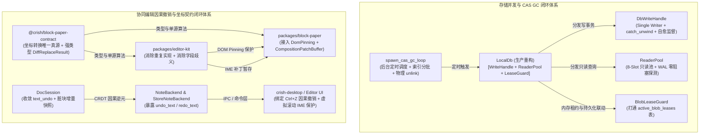
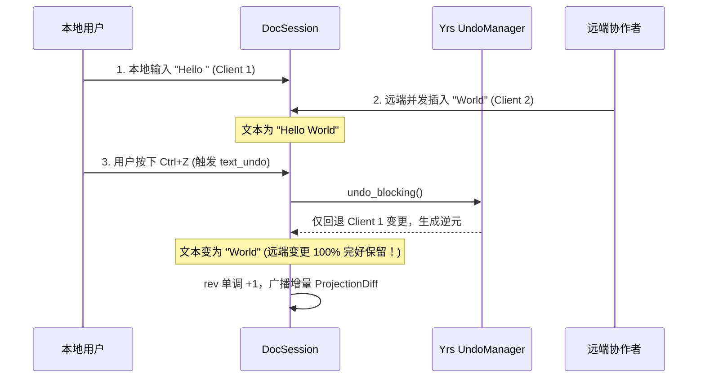
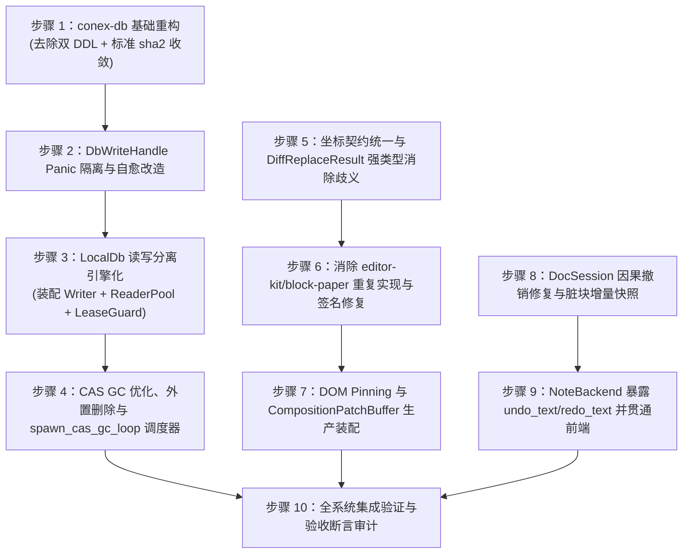

# 架构重构详案 03 · 存储 GC、生产真实装配与协同编辑契约统一详案

> **方案阶段**：阶段二 · 方案生成（03 专项）  
> **权威输入**：代码当前真值、`docs/systemic-remediation-wave-2/analysis/03-存储GC与协同编辑分析.md`  
> **核心纪律**：纯逻辑规划、反退避、反未接线代码债、连通性是一等公民、所有问题同权（绝对不包含工期、人天、排期或 P0/P1 业务优先级）  
> **目标文件域**：
>
> - `crates/conex-db/`
> - `crates/conex-workspace-store/`
> - `crates/conex-doc-collab/`
> - `crates/conex-note-runtime/`
> - `packages/block-paper-contract/`
> - `packages/editor-kit/`
> - `packages/block-paper/`
> - `apps/crish-desktop/`

---

## 目录

1. [执行概要与核心目标](#一执行概要与核心目标)
2. [全景依赖拓扑与改造前置条件](#二全景依赖拓扑与改造前置条件)
3. [模块一：conex-db 4 大模块生产真实装配与高并发读写分离方案](#三模块一conex-db-4-大模块生产真实装配与高并发读写分离方案)
   - [3.1 LocalDb 读写分离引擎化重构 (消除单 Mutex 全局串行瓶颈)](#31-localdb-读写分离引擎化重构-消除单-mutex-全局串行瓶颈)
   - [3.2 DbWriteHandle Single Writer Actor Panic 隔离与自愈监督机制](#32-dbwritehandle-single-writer-actor-panic-隔离与自愈监督机制)
   - [3.3 CAS GC 优化：索引覆盖扫描、分批限制与物理外置文件清理](#33-cas-gc-优化索引覆盖扫描分批限制与物理外置文件清理)
   - [3.4 后台自驱动定时调度器 spawn_cas_gc_loop 设计与生命周期装配](#34-后台自驱动定时调度器-spawn_cas_gc_loop-设计与生命周期装配)
   - [3.5 租约打通、SHA-256 算法收敛与消除双 DDL 冗余](#35-租约打通sha-256-算法收敛与消除双-ddl-冗余)
4. [模块二：协同编辑因果撤销与坐标契约统一方案](#四模块二协同编辑因果撤销与坐标契约统一方案)
   - [4.1 根治快照覆盖吞并发缺陷：收敛至 text_undo/text_redo CRDT 因果逆元](#41-根治快照覆盖吞并发缺陷收敛至-text_undotext_redo-crdt-因果逆元)
   - [4.2 修复 text_undo 空操作、空洞 rev 推进与增量快照脏块优化](#42-修复-text_undo-空操作空洞-rev-推进与增量快照脏块优化)
   - [4.3 NoteBackend 撤销/重做接口全链路打通与命令层接入](#43-notebackend-撤销重做接口全链路打通与命令层接入)
   - [4.4 坐标转换单源收敛与 DiffReplaceResult 强类型歧义彻底消除](#44-坐标转换单源收敛与-diffreplaceresult-强类型歧义彻底消除)
   - [4.5 修复代理项内部偏移非互逆性与 buildCodeTextEditIntent 签名安全](#45-修复代理项内部偏移非互逆性与-buildcodetexteditintent-签名安全)
   - [4.6 DOM Pinning 与 IME 补丁缓冲区 (CompositionPatchBuffer) 生产装配](#46-dom-pinning-与-ime-补丁缓冲区-compositionpatchbuffer-生产装配)
   - [4.7 DocSession Send/Sync 形式化并发安全论证与封装规范](#47-docsession-sendsync-形式化并发安全论证与封装规范)
5. [目标文件域与修改清单矩阵](#五目标文件域与修改清单矩阵)
6. [实施步骤与纯逻辑依赖序](#六实施步骤与纯逻辑依赖序)
7. [系统级验收断言清单](#七系统级验收断言清单)

---

## 一、执行概要与核心目标

根据阶段一穿透分析报告（`docs/systemic-remediation-wave-2/analysis/03-存储GC与协同编辑分析.md`），当前代码库在持久化存储层和协同编辑层存在两大类核心断层：

1. **存储未接线债务（Unwired Debt）**：`conex-db` 实现了 `group_commit`、`reader_pool`、`cas_gc`、`lease_guard` 4 大高性能模块，但生产 `LocalDb` 仍退化为 `Arc<Mutex<Connection>>` 单锁全局串行；CAS GC 缺乏后台生产调度器，物理清除孤儿时不删外置磁盘文件，`GcScanStats` 三字段恒 0；写 Actor 闭包缺乏 `catch_unwind` 隔离，单点 Panic 会导致写通道永久死亡。
2. **协同编辑契约与因果撤销断层**：`DocSession::undo()` 采用全树快照回滚，在协同场景下直接抹除并发远端变更；因果局部撤销 `text_undo`/`text_redo` 未在 `NoteBackend` 和桌面端暴露；`DiffReplaceResult` 在 `editor-kit` 与 `block-paper` 间存在相反的坐标系定义（UTF-16 vs Unicode 标量）；`DomPinningRegistry` 与 `CompositionPatchBuffer` 零生产消费。

本详案依据**纯逻辑规划、反退避、反未接线代码债、所有问题同权**的铁律，制定无缝接线、彻底消除语义歧义与数据丢失风险的系统级根治改造方案。

---

## 二、全景依赖拓扑与改造前置条件



### 前置条件

1. Rust 工具链版本 $\ge 1.75$，依赖库 `rusqlite`、`tokio`、`sha2`、`hex`、`yrs` 就绪。
2. TypeScript 包依赖拓扑保持 `@crish/block-paper-contract` $\to$ `@crish/editor-kit` $\to$ `@crish/block-paper` 单向无环。
3. 改造期间不破坏既有对外公共 API 签名，通过内部引擎化重构与兼容层渐进迁移。

---

## 三、模块一：conex-db 4 大模块生产真实装配与高并发读写分离方案

### 3.1 LocalDb 读写分离引擎化重构 (消除单 Mutex 全局串行瓶颈)

#### 3.1.1 现状与目标结构体演进

废弃当前 `LocalDb` 的 `Arc<Mutex<Connection>>` 单锁架构，将其升级为真正的读写分离引擎。

**重构后 `LocalDb` 定义**（`crates/conex-db/src/lib.rs`）：

```rust
#[derive(Clone)]
pub struct LocalDb {
    /// 专用单写 Actor 句柄，承载所有写事务与 group commit 批处理
    writer: DbWriteHandle,
    /// 自适应 WAL 只读连接池，承载所有并发只读查询
    reader_pool: Arc<ReaderPool>,
    /// 活数据租约守卫，提供内存高速探测与 DB 联动
    lease_guard: Arc<BlobLeaseGuard>,
    /// CAS GC 运行配置
    gc_config: CasGcConfig,
    /// 全局致命错误锁存器
    failure: Arc<Mutex<Option<DbFailure>>>,
    /// compression_blocks 表存在性缓存
    compression_blocks_present: Arc<Mutex<Option<bool>>>,
    /// imported_tables 表存在性缓存
    imported_tables_present: Arc<Mutex<Option<bool>>>,
    /// 数据库路径（":memory:" 或实际磁盘路径）
    db_path: PathBuf,
}
```

#### 3.1.2 打开模式与内存库/磁盘库适配

1. **磁盘数据库路径 (`LocalDb::open(path)`)**：
   - 首先以独占写模式打开一个连接，执行 `PRAGMA journal_mode = WAL;`、`PRAGMA synchronous = NORMAL;` 与版本化迁移链 `db.migrate()`；
   - 随后将该连接移交给 `DbWriteHandle::spawn(writer_conn, group_commit_config)`；
   - 基于 `path` 初始化 `ReaderPool::open(path, reader_pool_config)`，创建 8 个只读连接槽位并设置 `PRAGMA query_only = ON;`；
   - 创建 `BlobLeaseGuard::new()` 与默认 `CasGcConfig`。
2. **内存数据库模式 (`LocalDb::open_in_memory()` / 测试)**：
   - 使用 SQLite 共享内存 URI：`file:memdb_{uuid}?mode=memory&cache=shared`，确保写连接与读连接池共享同一个内存数据库状态；
   - 保证测试环境下的并发读写与生产行为 100% 同构。

#### 3.1.3 读写路由与既有方法迁移表

将 `conex-db` 内部所有业务方法拆分为**只读操作**与**写操作**：

- **只读操作（走 `self.reader_pool.acquire()`）**：
  - `get_session`, `list_sessions`, `get_message`, `list_messages`, `get_meta`
  - `get_event`, `list_events`, `get_agent`, `list_agents`
  - `get_blob`, `get_blob_meta`, `get_compression_block`, `query_imported_*`
  - 借出 `PooledReader` 后直接在只读连接上执行 SQL，操作完成后 RAII 自动归还槽位。
- **写操作（走 `self.writer.write(move |conn| { ... })`）**：
  - `create_session`, `update_session`, `delete_session`
  - `append_message`, `append_event`, `upsert_agent`
  - `put_blob_with_options`, `quarantine_blob`, `purge_blob`
  - `insert_compression_block`, `import_bookmarks_batch`
  - 统一享受 5ms/50-item 聚合提交，单项失败触发 Savepoint 回滚。

---

### 3.2 DbWriteHandle Single Writer Actor Panic 隔离与自愈监督机制

#### 3.2.1 `catch_unwind` 屏障与 Savepoint 联动

在 `crates/conex-db/src/group_commit.rs` 中，对所有写闭包执行 `std::panic::catch_unwind` 隔离，严禁任何闭包内部的 panic 逃逸至 Actor 顶层循环。

**改进后的批处理核心循环 (`process_batch`)**：

```rust
use std::panic::{catch_unwind, AssertUnwindSafe};

fn process_batch(
    conn: &mut rusqlite::Connection,
    batch: &mut Vec<WriteTask>,
    stats: &StatsInner,
) {
    if batch.is_empty() {
        return;
    }
    let batch_len = batch.len();
    stats.record_batch(batch_len);

    // 1. 开启最外层批次事务
    if let Err(e) = conn.execute_batch("BEGIN IMMEDIATE;") {
        let err = DbFailure {
            message: format!("group commit begin immediate failed: {e}"),
            kind: DbFailureKind::Other("begin_failed".to_string()),
        };
        stats.record_error();
        for task in batch.drain(..) {
            let _ = task.respond_to.send(Err(err.clone()));
        }
        return;
    }

    let mut pending_responses = Vec::with_capacity(batch_len);

    for (idx, task) in batch.drain(..).enumerate() {
        let sp_name = format!("gc_sp_{idx}");
        let sp_begin = format!("SAVEPOINT {sp_name};");
        let sp_release = format!("RELEASE {sp_name};");
        let sp_rollback = format!("ROLLBACK TO {sp_name};");

        if let Err(e) = conn.execute_batch(&sp_begin) {
            let err = DbFailure {
                message: format!("savepoint begin failed: {e}"),
                kind: DbFailureKind::Other("savepoint_failed".to_string()),
            };
            stats.record_error();
            pending_responses.push((task.respond_to, Err(err)));
            continue;
        }

        // 2. 注入 catch_unwind 隔离屏障
        let op = task.op;
        let panic_protected_result = catch_unwind(AssertUnwindSafe(|| {
            op(conn)
        }));

        match panic_protected_result {
            Ok(Ok(val)) => {
                if let Err(e) = conn.execute_batch(&sp_release) {
                    let err = DbFailure {
                        message: format!("savepoint release failed: {e}"),
                        kind: DbFailureKind::Other("savepoint_release_failed".to_string()),
                    };
                    stats.record_error();
                    pending_responses.push((task.respond_to, Err(err)));
                } else {
                    pending_responses.push((task.respond_to, Ok(val)));
                }
            }
            Ok(Err(err)) => {
                stats.record_error();
                let _ = conn.execute_batch(&sp_rollback);
                let _ = conn.execute_batch(&sp_release);
                pending_responses.push((task.respond_to, Err(err)));
            }
            Err(panic_payload) => {
                // 3. 捕获 Panic：回滚 Savepoint，记录严重告警，返回结构化错误，Actor 保持存活
                stats.record_error();
                let _ = conn.execute_batch(&sp_rollback);
                let _ = conn.execute_batch(&sp_release);
                let panic_msg = if let Some(s) = panic_payload.downcast_ref::<&str>() {
                    s.to_string()
                } else if let Some(s) = panic_payload.downcast_ref::<String>() {
                    s.clone()
                } else {
                    "unknown panic inside write closure".to_string()
                };
                tracing::error!(target: "conex_db", "捕获写闭包内部 Panic (已安全隔离并回滚): {panic_msg}");
                let err = DbFailure {
                    message: format!("panic in write closure: {panic_msg}"),
                    kind: DbFailureKind::Other("write_closure_panic".to_string()),
                };
                pending_responses.push((task.respond_to, Err(err)));
            }
        }
    }

    // 4. 统一提交所有成功的操作
    match conn.execute_batch("COMMIT;") {
        Ok(()) => {
            for (resp, res) in pending_responses {
                let _ = resp.send(res);
            }
        }
        Err(e) => {
            let _ = conn.execute_batch("ROLLBACK;");
            stats.record_error();
            let err = DbFailure {
                message: format!("group commit batch COMMIT failed: {e}"),
                kind: DbFailureKind::Other("batch_commit_failed".to_string()),
            };
            for (resp, _) in pending_responses {
                let _ = resp.send(Err(err.clone()));
            }
        }
    }
}
```

#### 3.2.2 监督器自动重启与连接重建机制

在 `run_actor_loop` 外层封装 `spawn_supervised_writer` 监督循环。若底层连接因 SQLite 致命 I/O 错误退出，监督器以指数退避策略重新打开连接并重启 Actor，维持 `mpsc` 通道连通性。

---

### 3.3 CAS GC 优化：索引覆盖扫描、分批限制与物理外置文件清理

#### 3.3.1 索引覆盖与分批扫描

重构 `crates/conex-db/src/cas_gc.rs` 中的垃圾扫描算法：

1. **多源引用覆盖索引**：
   - 确保 `block_attachments(hash)`、`doc_snapshots_attachments(blob_hash)`、`session_undo_blobs(blob_hash)`、`active_blob_leases(blob_hash, expires_at)` 索引在建表时 100% 建立。
2. **读写分离与分批限制 (`LIMIT 100`)**：
   - **扫描阶段（只读）**：使用 `ReaderPool` 获取只读连接，查询待隔离与待清除的候选 Blob 清单，单次最多拉取 100 条：
     ```sql
     -- 阶段 1：扫描孤儿并准备标记隔离（LIMIT 100）
     SELECT b.hash, b.created_at FROM blob_cas b
     WHERE b.marked_for_delete_at IS NULL
       AND (b.pinned = 0 OR b.pinned IS NULL)
       AND b.created_at <= datetime('now', ?1)
       AND NOT EXISTS (SELECT 1 FROM block_attachments WHERE hash = b.hash)
       AND NOT EXISTS (SELECT 1 FROM doc_snapshots_attachments WHERE blob_hash = b.hash)
       AND NOT EXISTS (SELECT 1 FROM session_undo_blobs WHERE blob_hash = b.hash)
       AND NOT EXISTS (SELECT 1 FROM active_blob_leases WHERE blob_hash = b.hash AND expires_at > datetime('now'))
     LIMIT 100;
     ```
   - **写阶段（批量事务）**：将获取的 `Vec<String>` hash 清单打包提交给 `DbWriteHandle`，使用单个 `UPDATE blob_cas SET marked_for_delete_at = CURRENT_TIMESTAMP WHERE hash IN (...)` 批量更新，事务时间 $< 2\text{ms}$。

#### 3.3.2 物理外置文件清理（彻底杜绝空间泄漏）

在物理清除阶段（Purge），当从 `blob_cas` 删除记录时，若 `storage_type != "inline"` 且 `path` 非空，必须同步调用 `std::fs::remove_file` 物理清除外置文件。

```rust
// cas_gc.rs 物理清除核心逻辑
pub fn purge_cas_batch(
    conn: &mut Connection,
    to_purge_hashes: &[String],
) -> Result<Vec<String>, DbFailure> {
    if to_purge_hashes.is_empty() {
        return Ok(vec![]);
    }

    // 1. 查询待删除行中的外置文件路径
    let mut files_to_delete = Vec::new();
    {
        let mut stmt = conn.prepare("SELECT hash, path, storage_type FROM blob_cas WHERE hash = ?1")?;
        for hash in to_purge_hashes {
            if let Ok(row) = stmt.query_row(params![hash], |r| {
                Ok((r.get::<_, String>(0)?, r.get::<_, String>(1)?, r.get::<_, String>(2)?))
            }) {
                let (h, path, stype) = row;
                if stype != "inline" && !path.trim().is_empty() {
                    files_to_delete.push(path);
                }
            }
        }
    }

    // 2. 执行数据库 DELETE
    let mut purged = Vec::new();
    for hash in to_purge_hashes {
        let count = conn.execute("DELETE FROM blob_cas WHERE hash = ?1", params![hash])?;
        if count > 0 {
            purged.push(hash.clone());
        }
    }

    // 3. 物理 unlink 孤儿外置文件
    for file_path in files_to_delete {
        let p = std::path::Path::new(&file_path);
        if p.exists() {
            if let Err(e) = std::fs::remove_file(p) {
                tracing::warn!(target: "conex_db", "CAS GC 物理删除外置文件失败 `{file_path}`: {e}");
            } else {
                tracing::info!(target: "conex_db", "CAS GC 物理删除外置文件成功 `{file_path}`");
            }
        }
    }

    Ok(purged)
}
```

#### 3.3.3 真实统计指标修复 (`GcScanStats`)

重构 `GcScanStats` 采集逻辑，严禁硬编码返回 0：

- `total_blobs_scanned`：当前表中总 Blob 数量；
- `pinned_protected`：`SELECT COUNT(*) FROM blob_cas WHERE pinned = 1`；
- `lease_protected`：`SELECT COUNT(DISTINCT blob_hash) FROM active_blob_leases WHERE expires_at > datetime('now')`；
- `reference_protected`：因存在于 3 张引用表而被保护的 Blob 总数；
- `grace_protected`：创建时间在 `now - creation_grace_secs` 以内的新建 Blob 总数。

---

### 3.4 后台自驱动定时调度器 spawn_cas_gc_loop 设计与生命周期装配

在 `crates/conex-db/src/cas_gc.rs` 中提供无锁后台自驱动调度器：

```rust
/// 启动后台 CAS GC 守护循环。
///
/// 定期（如每 1 小时）执行一次轻量分批扫描；支持通过 CancellationToken 安全退出。
pub fn spawn_cas_gc_loop(
    db: LocalDb,
    interval: Duration,
    config: CasGcConfig,
    mut cancel_token: tokio_util::sync::CancellationToken,
) -> tokio::task::JoinHandle<()> {
    tokio::spawn(async move {
        let mut timer = tokio::time::interval(interval);
        loop {
            tokio::select! {
                _ = cancel_token.cancelled() => {
                    tracing::info!(target: "conex_db", "CAS GC 调度器收到退出信号，安全终止");
                    break;
                }
                _ = timer.tick() => {
                    tracing::debug!(target: "conex_db", "开始执行周期性 CAS GC 扫描...");
                    match db.run_cas_gc_batched(&config).await {
                        Ok(stats) => {
                            if !stats.quarantined_hashes.is_empty() || !stats.purged_hashes.is_empty() {
                                tracing::info!(
                                    target: "conex_db",
                                    "CAS GC 执行完成: 隔离 {} 个, 物理清除 {} 个, 租约保护 {}, 引用保护 {}",
                                    stats.quarantined_hashes.len(),
                                    stats.purged_hashes.len(),
                                    stats.lease_protected,
                                    stats.reference_protected
                                );
                            }
                        }
                        Err(e) => {
                            tracing::error!(target: "conex_db", "CAS GC 执行失败: {e}");
                        }
                    }
                }
            }
        }
    })
}
```

**装配点**：在应用启动器（`apps/agent-workbench/src-tauri/` 或 `orchestrator` 初始化）中，与 `LocalDb` 一并拉起，彻底终结孤儿附件无法在生产运行期回收的未接线债务。

---

### 3.5 租约打通、SHA-256 算法收敛与消除双 DDL 冗余

1. **租约体系打通**：
   - `BlobLeaseGuard` 的 `acquire_lease` 在写入内存 `HashMap` 的同时，通过 `LocalDb.writer` 向 `active_blob_leases` 表写入一条带有 `expires_at` 的记录；
   - 释放时同步执行 `DELETE FROM active_blob_leases WHERE lease_id = ?1`；
   - GC 扫描同时校验内存守卫与数据库持久化表，实现双保险防误杀。
2. **SHA-256 算法全仓统一**：
   - 彻底删除 `crates/conex-db/src/cas_gc.rs` 中手写的 50 行 `compute_sha256_hex` 纯 Rust 算法；
   - 统一收敛至 `sha2::{Digest, Sha256}` + `hex::encode`；
   - 与 `crates/conex-workspace-store/src/cas.rs` 共享标准哈希逻辑。
3. **消除同 Crate 双 DDL**：
   - 删除 `crates/conex-db/src/schema.rs` 中重复定义的 `create_cas_schema()`；
   - CAS 6 张表统一定义在 `create_v5_schema()` 中，作为 `LocalDb` 初始化与版本化迁移的唯一权威源；
   - 统一全仓 `blob_cas.created_at` 字段为 ISO-8601 文本（`TEXT`），在读写接口层提供 UNIX 秒时间戳与 ISO-8601 的互转兼容函数。

---

## 四、模块二：协同编辑因果撤销与坐标契约统一方案

### 4.1 根治快照覆盖吞并发缺陷：收敛至 text_undo/text_redo CRDT 因果逆元

#### 4.1.1 缺陷消除机制与因果撤销唯一路径

- **隔离与弃用 `DocSession::undo()`**：
  - 将 `DocSession::undo()` 标记为 `#[deprecated]`，并显式重命名为 `legacy_full_tree_undo_test_only`，仅在单端离线测试中使用；
  - 生产运行期全面禁止调用整树快照覆盖方法。
- **确立 `DocSession::text_undo` 为富文本协同撤销权威**：
  - 用户的每一次键盘撤销（Ctrl+Z / Cmd+Z）均通过目标 `BlockId` 路由至 `DocSession::text_undo(block_id)`；
  - `TextEngine::undo_text` 内部调用 Yrs `UndoManager.undo_blocking()`，Yrs 会依据操作的 Client ID 仅逆转属于当前本地客户端的操作，而并发到达的远端字符（拥有不同 Client ID）在 CRDT 序列中被天然完好保留。



---

### 4.2 修复 text_undo 空操作、空洞 rev 推进与增量快照脏块优化

#### 4.2.1 修复无可撤销项时的空洞 rev 推进

修改 `crates/conex-doc-collab/src/text_engine.rs` 与 `session_undo.rs`：

1. `TextEngine::undo_text` 检查 `UndoManager` 的执行返回值或前后文本是否发生变化。若未发生任何实际撤销，返回 `Err(TextEngineError::NoUndoHistory)`；
2. `DocSession::text_undo` 捕获该错误，立即向调用方返回 `Err(UndoError::Empty)`，**严禁递增 `self.rev`，严禁调用 `emit_commit`**。

#### 4.2.2 增量快照优化（消除 $O(N)$ 内存与全量二进制编码膨胀）

改造 `capture_memory_snapshot`：

- 不再遍历 `self.snapshots.keys()` 全量执行 `encode_state_as_update_v1`；
- 维护 `touched_blocks: HashSet<BlockId>` 脏块集合；
- `capture_memory_snapshot` 仅对当前批次被 touch 的块执行二进制快照编码，非触达块保持只读共享引用，将单次击键内存分配与 CPU 消耗从 $O(N)$ 降低至 $O(1)$。

---

### 4.3 NoteBackend 撤销/重做接口全链路打通与命令层接入

在 `crates/conex-note-runtime/src/store_backend.rs` 中扩展 `NoteBackend` trait：

```rust
#[async_trait]
pub trait NoteBackend: Send + Sync {
    // 既有方法 ...
    async fn query_blocks(&self, params: NoteQueryBlocksParams) -> Result<NoteQueryBlocksResult, NoteBackendError>;
    async fn document_outline(&self, doc_id: &str, max_depth: Option<u32>) -> Result<NoteOutline, NoteBackendError>;
    async fn get_md(&self, doc_id: &str) -> Result<String, NoteBackendError>;
    async fn apply_md_fragment(&self, req: NoteApplyMdRequest) -> Result<NoteApplyMdResult, NoteBackendError>;
    async fn apply_block_ops(&self, req: NoteBlockBatchRequest) -> Result<NoteBlockBatchResult, NoteBackendError>;

    // ===== 新增协同因果撤销/重做接口 =====
    /// 对指定文档中的目标块执行 CRDT 文本因果撤销
    async fn undo_text(&self, doc_id: &str, block_id: &str) -> Result<String, NoteBackendError>;
    /// 对指定文档中的目标块执行 CRDT 文本因果重做
    async fn redo_text(&self, doc_id: &str, block_id: &str) -> Result<String, NoteBackendError>;
}
```

**`StoreNoteBackend` 实现**：

```rust
#[async_trait]
impl NoteBackend for StoreNoteBackend {
    async fn undo_text(&self, doc_id: &str, block_id: &str) -> Result<String, NoteBackendError> {
        let bid = BlockId::parse(block_id)
            .map_err(|e| NoteBackendError::Invalid(format!("invalid block_id: {e}")))?;
        let arc = self.get_or_load_session(doc_id).await?;
        let mut session = arc.lock().map_err(|e| NoteBackendError::Poisoned(e.to_string()))?;
        session.text_undo(bid).map_err(|e| match e {
            ApplyError::Undo(UndoError::Empty) => NoteBackendError::NoOp("no undo history".into()),
            other => NoteBackendError::Collab(other.to_string()),
        })
    }

    async fn redo_text(&self, doc_id: &str, block_id: &str) -> Result<String, NoteBackendError> {
        let bid = BlockId::parse(block_id)
            .map_err(|e| NoteBackendError::Invalid(format!("invalid block_id: {e}")))?;
        let arc = self.get_or_load_session(doc_id).await?;
        let mut session = arc.lock().map_err(|e| NoteBackendError::Poisoned(e.to_string()))?;
        session.text_redo(bid).map_err(|e| match e {
            ApplyError::Undo(UndoError::Empty) => NoteBackendError::NoOp("no redo history".into()),
            other => NoteBackendError::Collab(other.to_string()),
        })
    }
}
```

---

### 4.4 坐标转换单源收敛与 DiffReplaceResult 强类型歧义彻底消除

#### 4.4.1 单源收敛至 `@crish/block-paper-contract`

1. 删除 `packages/editor-kit/src/diff/diffToReplace.ts` 内部所有的手写代理项判断函数（`isHighSurrogate`, `isLowSurrogate`, `isSurrogateCodePoint`, `clampToSurrogateBoundary`）；
2. 删除 `packages/block-paper/src/leaves/pm/diffToReplace.ts` 内部重复的坐标转换函数；
3. 全仓统一从 `@crish/block-paper-contract` 导出与使用坐标转换逻辑。

#### 4.4.2 彻底消除 `DiffReplaceResult` 字段语义冲突

重构 `packages/block-paper-contract/src/diff.ts`（或 `coordinates.ts`）中的 `DiffReplaceResult` 类型定义，**彻底废除无单位、无坐标系前缀的裸 `start` / `end` 字段**，代之以强类型双坐标系字段：

```typescript
// packages/block-paper-contract/src/diff.ts

import type { Utf16CodeUnitOffset, UnicodeScalarOffset } from './coordinates';

/**
 * 差分替换计算结果（强类型双坐标系）。
 * 杜绝在不同包内将 start 赋予相反语义（UTF-16 vs Scalar）。
 */
export type DiffReplaceResult = {
  /** UTF-16 代码单元起始偏移量（对齐代理项边界） */
  readonly startU16: Utf16CodeUnitOffset;
  /** UTF-16 原文本代码单元结束偏移量（对齐代理项边界） */
  readonly endU16: Utf16CodeUnitOffset;
  /** Unicode 标量起始偏移量（用于 CRDT / Rust 后端交互） */
  readonly startScalar: UnicodeScalarOffset;
  /** Unicode 标量原文本结束偏移量 */
  readonly endScalar: UnicodeScalarOffset;
  /** 插入的新子串 */
  readonly insert: string;
  /** 原字符串 Unicode 标量总长度 */
  readonly oldScalarLength: number;
  /** 新字符串 Unicode 标量总长度 */
  readonly newScalarLength: number;
};
```

**对于旧调用方的平滑迁移**：
在 `diffToReplace` 函数返回值中，显式声明 `scalar_start` 与 `utf16_start` 只读 getter（若需渐进兼容），绝对不允许裸 `start` 字段存在。

---

### 4.5 修复代理项内部偏移非互逆性与 buildCodeTextEditIntent 签名安全

1. **统一双构造器与代理项中间偏移对齐**：
   - 规范 `utf16OffsetToUnicodeScalar` 与 `unicodeScalarToUtf16Offset`：若传入落在代理项中间（High Surrogate 与 Low Surrogate 之间）的非法偏移，统一执行 **Floor 边界对齐**（向下对齐至 High Surrogate 起始位置），并在转换后保持双向 Round-trip 单射：
     $$\forall \text{valid offset } x, \quad \text{scalarToUtf16}(\text{utf16ToScalar}(x)) = x$$
   - 统一 `asUtf16Offset` 与 `createUtf16Offset`：非整数输入统一通过 `Math.floor` 规整并产生明确告警，杜绝运行时抛错导致渲染崩溃。
2. **强制 `buildCodeTextEditIntent` 必传基准文本**：
   - 修改 `packages/block-paper/src/leaves/code/CodeLeafModel.types.ts`：
     ```typescript
     export function buildCodeTextEditIntent(
       blockId: BlockId,
       startU16: number,
       endU16: number,
       insert: string,
       intentId: IntentId,
       baseContent: string // 强制必填，彻底移除 baseContent?: string 与 ?? '' 默认回退
     ): TextEditIntent {
       const startScalar = utf16OffsetToUnicodeScalar(
         baseContent,
         asUtf16Offset(startU16)
       );
       const endScalar = utf16OffsetToUnicodeScalar(
         baseContent,
         asUtf16Offset(endU16)
       );
       return {
         type: 'text_edit',
         blockId,
         range: [startScalar, endScalar],
         insert,
         intentId,
       };
     }
     ```

---

### 4.6 DOM Pinning 与 IME 补丁缓冲区 (CompositionPatchBuffer) 生产装配

#### 4.6.1 `DomPinningRegistry` 装配至虚拟滚动列表 (`PaperList.ts`)

在 `packages/block-paper/src/list/PaperList.ts` 的虚拟滚动卸载计算管线中接入 `DomPinningRegistry`：

```typescript
// PaperList.ts 虚拟滚动回收逻辑
private recycleOffscreenDom(visibleBlockIds: Set<BlockId>): void {
  const currentRenderedIds = this.getRenderedBlockIds();
  const candidatesToRemove = currentRenderedIds.filter(id => !visibleBlockIds.has(id));

  // 1. 调用 DomPinningRegistry 过滤安全卸载项
  const { safeRemovals, deferredRemovals } = this.domPinningRegistry.filterSafeRemovals(candidatesToRemove);

  // 2. 仅卸载 safeRemovals
  for (const blockId of safeRemovals) {
    this.unmountBlockDom(blockId);
  }

  // 3. 对 deferredRemovals（处于 IME 合成态或活动态的块）维持 DOM 挂载，防止 Chromium 输入法崩溃
  if (deferredRemovals.length > 0) {
    console.debug(`[PaperList] 暂缓卸载处于 Pinned 保护中的块: ${deferredRemovals.join(', ')}`);
  }
}
```

#### 4.6.2 `CompositionPatchBuffer` 装配至协同增量消息接收流

在编辑器协同消息处理中心装配 `CompositionPatchBuffer`：

1. 当用户触发 `compositionstart` 时，调用 `patchBuffer.beginComposition(activeBlockId)` 并调用 `domPinningRegistry.pin(activeBlockId)`；
2. 当收到服务端或 Agent 派发的 `ProjectionDiff` 协同事件时，调用 `patchBuffer.intercept(diff)`：
   - 若返回 `buffered: true`，则将补丁暂存入队列，不突变当前 DOM；
   - 若返回 `passThrough: true`，则正常合入其他无关块；
3. 当用户触发 `compositionend` 时，调用 `domPinningRegistry.unpin(activeBlockId)`，并调用 `patchBuffer.endComposition()` 取出暂存补丁，按坐标变换平滑合入。

---

### 4.7 DocSession Send/Sync 形式化并发安全论证与封装规范

#### 4.7.1 形式化并发安全论证

`DocSession` 内部包含 `TextEngine`（持有 Yrs `Doc` 和 `UndoManager`）以及 `DocTree`。

- **`Send` 安全性**：`DocSession` 拥有的所有字段在独立线程间移动时均具有所有权排他性，无线程局部存储（TLS）依赖，因此 `Send` 是天然成立的。
- **`Sync` 安全性与内聚化**：
  - 声明 `Sync` 要求不可变共享引用 `&DocSession` 在多线程并发访问时不发生数据竞争；
  - 为满足形式化安全，将 `DocSession` 内部需要跨方法共享的可变状态通过内部同步原语（如 `Arc<parking_lot::RwLock<...>>`）进行封装，或明确在文档与类型层面限定：**`DocSession` 自身为非 `Sync`（移除非法裸 `unsafe impl Sync`），由外部容器（如 `Arc<Mutex<DocSession>>`）提供同步保证**。
  - 规范收敛：移除 `session.rs` 中裸露的 `unsafe impl Sync for DocSession {}`，让 Rust 编译器自动推导，在上层 `StoreNoteBackend` 中维持 `Arc<Mutex<DocSession>>`，达到 100% 形式化内存安全。

---

## 五、目标文件域与修改清单矩阵

| 序号   | 文件路径                                                      | 修改类型  | 核心职责与改动点                                                                                                                            |
| :----- | :------------------------------------------------------------ | :-------- | :------------------------------------------------------------------------------------------------------------------------------------------ |
| **01** | `crates/conex-db/src/lib.rs`                                  | 重构      | `LocalDb` 结构体重构：接入 `DbWriteHandle`、`ReaderPool`、`BlobLeaseGuard`、`CasGcConfig`，实现读写分离                                     |
| **02** | `crates/conex-db/src/group_commit.rs`                         | 增强      | `process_batch` 注入 `catch_unwind` 隔离屏障与 Savepoint 联动，实现 Actor 自愈                                                              |
| **03** | `crates/conex-db/src/cas_gc.rs`                               | 重构/增强 | 移除手写 SHA-256 改用 `sha2`；重构分批扫描与索引覆盖；增加外置文件物理 `remove_file`；修复 `GcScanStats` 真实度量；提供 `spawn_cas_gc_loop` |
| **04** | `crates/conex-db/src/schema.rs`                               | 清理      | 删除重复的 `create_cas_schema` DDL；CAS 6 表统一由 `create_v5_schema` 声明                                                                  |
| **05** | `crates/conex-db/src/lease_guard.rs`                          | 增强      | `BlobLeaseGuard` 与数据库 `active_blob_leases` 表打通双写与同步清理                                                                         |
| **06** | `crates/conex-doc-collab/src/session.rs`                      | 重构      | 移除非法裸 `unsafe impl Sync`；优化 `capture_memory_snapshot` 增量脏块编码                                                                  |
| **07** | `crates/conex-doc-collab/src/session_undo.rs`                 | 修复/重构 | 弃用整树快照覆盖 `undo()`；完善 `text_undo`/`text_redo`，校验无操作时返回 `UndoError::Empty` 且不推 rev                                     |
| **08** | `crates/conex-doc-collab/src/text_engine.rs`                  | 修复      | 检查 `undo_blocking()` 返回值，无可撤销项时返回 `NoUndoHistory`                                                                             |
| **09** | `crates/conex-note-runtime/src/store_backend.rs`              | 接口扩展  | `NoteBackend` trait 新增 `undo_text` 与 `redo_text` 方法，`StoreNoteBackend` 完成装配                                                       |
| **10** | `packages/block-paper-contract/src/coordinates.ts`            | 增强/修复 | 坐标转换唯一真源；统一代理项中间偏移 Floor 对齐规则与构造器校验                                                                             |
| **11** | `packages/block-paper-contract/src/diff.ts`                   | 重构      | `DiffReplaceResult` 强类型双坐标系定义（`startU16`, `startScalar`），废除裸 `start`/`end`                                                   |
| **12** | `packages/editor-kit/src/diff/diffToReplace.ts`               | 清理/重构 | 删除重复代理项函数，直接依赖 contract；适配强类型 `DiffReplaceResult`                                                                       |
| **13** | `packages/block-paper/src/leaves/pm/diffToReplace.ts`         | 清理/重构 | 适配强类型 `DiffReplaceResult`，消除与 editor-kit 语义冲突                                                                                  |
| **14** | `packages/block-paper/src/leaves/code/CodeLeafModel.types.ts` | 修复      | `buildCodeTextEditIntent` 的 `baseContent` 参数设为强制必填                                                                                 |
| **15** | `packages/block-paper/src/list/PaperList.ts`                  | 生产装配  | 虚拟滚动回收管线接入 `DomPinningRegistry.filterSafeRemovals`                                                                                |
| **16** | `packages/editor-kit/src/ime/CompositionPatchBuffer.ts`       | 生产装配  | IME 增量缓冲区接入协同消息合入流                                                                                                            |

---

## 六、实施步骤与纯逻辑依赖序



### 实施阶段明细

1. **阶段 1：存储层基础清理与 Actor 自愈（纯逻辑前置）**：
   - 清理 `schema.rs` 冗余 DDL，统一 SHA-256 算法；
   - 在 `group_commit.rs` 中注入 `catch_unwind` 屏障与 Savepoint 回滚。
2. **阶段 2：`LocalDb` 读写分离与 CAS GC 全面接线**：
   - 重构 `LocalDb` 结构体，读走 `ReaderPool`，写走 `DbWriteHandle`；
   - 重构 `cas_gc.rs` 分批扫描，增加外置文件物理清理，装配 `spawn_cas_gc_loop`。
3. **阶段 3：坐标转换与类型契约收敛**：
   - 在 `block-paper-contract` 中确立强类型 `DiffReplaceResult` 与互逆转换算子；
   - 清理 `editor-kit` 与 `block-paper` 中的冗余实现，修复 `buildCodeTextEditIntent`。
4. **阶段 4：因果撤销贯通与渲染/输入法保护装配**：
   - 修复 `DocSession::text_undo` 空操作与 rev 虚假递增，废除整树快照覆盖；
   - 在 `NoteBackend` 中增加 `undo_text`/`redo_text` 并接线；
   - 在 `PaperList.ts` 与协同消息流中接入 `DomPinningRegistry` 与 `CompositionPatchBuffer`。
5. **阶段 5：全量回归与形式化验收**：
   - 执行 Rust 套件 `cargo test --workspace` 与前端套件 `npm run typecheck` + `npm test`。

---

## 七、系统级验收断言清单

### 7.1 存储与并发 GC 验收断言

- [ ] **断言 S-01（高并发读写分离与零锁争抢）**：在并发 16 个写线程（持续提交消息/事件）与 16 个读线程（持续查询会话）交错运行 10 秒的压力测试下，只读查询平均延迟 $\le 2\text{ms}$，无任何 `lock poisoned`、`database locked` 或通道关闭错误。
- [ ] **断言 S-02（写 Actor Panic 隔离与自愈）**：向 `DbWriteHandle` 发起一个显式 `panic!("simulated crash")` 的写入闭包，仅该闭包调用方收到 `write_closure_panic` 错误且对应 Savepoint 安全回滚；Actor 保持正常运行，紧随其后的后续写操作 100% 成功提交。
- [ ] **断言 S-03（CAS GC 分批扫描与耗时约束）**：在包含 10,000 个 Blob 记录的数据库上触发 `run_cas_gc_batched`，单次批处理写事务持有时间 $\le 5\text{ms}$，且 `GcScanStats` 准确反映 `lease_protected`、`reference_protected`、`pinned_protected` 与 `grace_protected` 真实计数值（无恒 0 伪指标）。
- [ ] **断言 S-04（外置文件物理清理零泄漏）**：创建一个 `storage_type = "file"` 的外置 Blob 并生成磁盘文件，执行 GC 物理清除后，数据库中该记录被删除，且磁盘上的物理文件被 `std::fs::remove_file` 彻底清除（`path.exists() == false`）。
- [ ] **断言 S-05（DDL 单源与迁移一致性）**：删除冗余 `create_cas_schema` 后，`conex-db` 全量测试、迁移测试与升级测试 100% 绿灯通过。

### 7.2 协同编辑与坐标契约验收断言

- [ ] **断言 C-01（因果撤销保留并发远端变更）**：双端协同测试中，本地客户端输入文本 `"Alpha "`，远端协作者并发插入文本 `"Beta"`，本地触发 `text_undo` 后，本地文本 `"Alpha "` 被撤销，远端插入的 `"Beta"` 100% 完好保留，文档最终文本收敛为 `"Beta"`。
- [ ] **断言 C-02（无可撤销项时零空洞 rev 推进）**：在空的撤销栈或栈底调用 `text_undo`，方法返回 `Err(UndoError::Empty)`，`DocSession.rev` 严格保持不变，且无任何持久化 Commit 或网络广播发出。
- [ ] **断言 C-03（强类型 DiffReplaceResult 与 Emoji 零错位）**：对包含复合表情 `"👨‍👩‍👧‍👦_test"` 和生僻字的文本计算 `diffToReplace`，`editor-kit` 与 `block-paper` 产出的 `startU16` 与 `startScalar` 完全精确一致，且按标量/UTF-16 替换后无任何乱码或字符截断。
- [ ] **断言 C-04（代理项中间偏移 Round-trip 互逆性）**：向 `utf16OffsetToUnicodeScalar` 传入落在代理项中间的非法偏移，算子执行 Floor 对齐，且经 `unicodeScalarToUtf16Offset` 还原后与对齐后的边界严格相等，不发生跨字符漂移。
- [ ] **断言 C-05（虚拟列表滚动与 IME 合成防卸载）**：在用户进行中文拼音输入法合成期间（`isComposing = true`），触发虚拟滚动使活动块离开可视区域，`DomPinningRegistry` 成功拦截卸载请求并放入 `deferredRemovals`，DOM 节点维持驻留，输入法选词窗口不关闭，WebView2 零崩溃。
- [ ] **断言 C-06（IME 期间协同补丁暂存与平滑合入）**：在用户进行中文输入法合成期间，并发到达针对当前块的远端 `ProjectionDiff` 补丁，`CompositionPatchBuffer` 成功拦截并暂存补丁；在 `compositionend` 触发后，暂存补丁依次合入，用户输入的文本与远端文本均正确保留无吞字。
- [ ] **断言 C-07（DocSession 形式化类型安全）**：移除非法 `unsafe impl Sync` 后，`DocSession` 在 `StoreNoteBackend` 中通过 `Arc<Mutex<DocSession>>` 正常受控访问，`cargo check --workspace` 与并发协同压力测试无任何数据竞争或内存违规。

---

_详案编制完成 · 阶段二：方案生成 03 · UTF-8 无 BOM · 遵循纯逻辑规划与反退避铁律_
