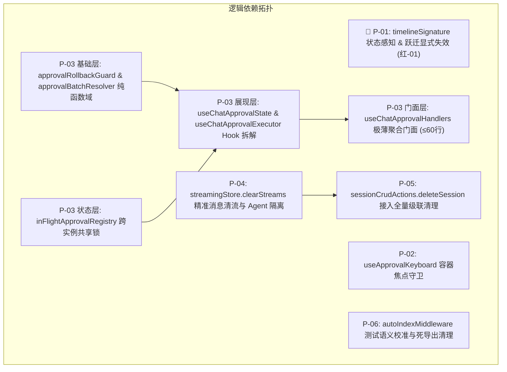

# 阶段二：实施详案 04 — 前端流式渲染、Timeline签名与状态管理

> **执行依据**：`.agents/LOGIC_PLAN_NO_RETREAT.md`（纯逻辑规划、反退避与单调不变量）、`AGENTS.md`、`docs/systemic-remediation-wave-2/analysis/04-前端流式与状态管理分析.md`。  
> **纪律声明**：本详案坚持纯逻辑规划、代码真值定性与可验证性优先；所有缺陷问题同权，严禁包含工期、人天、排期或 P0/P1 优先级划分。

---

## 1. 方案总纲与逻辑依赖拓扑

本方案针对阶段一分析报告中确认的 6 项前端核心缺陷（包含 🔴 红-01 文本截断严重缺陷、Esc 全局按键劫持、445 行业务上帝 Hook 触顶、并发清流误伤、级联清理半拆未接线及测试语义注水），确立端到端强类型的工程落地方案。



### 核心设计契约与公理化单调不变量

1. **流式到完成态单调不变量（Monotonic Invariant）**：
   $$\forall t_1, t_2 \text{ with } t_{\text{start}} \le t_1 \le t_2 \le t_{\text{completed}},\quad \text{RenderedText}(t_1) \subseteq_{\text{prefix}} \text{RenderedText}(t_2)$$
   $$\text{len}(\text{RenderedText}(t_{\text{completed}})) \ge \text{len}(\text{RenderedText}(t_{\text{streaming\_final}}))$$
   严禁在流式完成态切换瞬间由于视图缓存命中陈旧快照而发生正文文本缩水与视觉撕裂。
2. **全局按键容器作用域约束（Focus Containment Contract）**：
   任何卡片或局部交互组件注册的全局快捷键（`Escape`、`Enter`），必须严格受 `rootRef.current?.contains(target)` 容器焦点校验保护，严禁劫持外部全局弹窗（Modal）、设置抽屉与编辑器的按键行为。
3. **并发数据流隔离契约（Stream Isolation Contract）**：
   同会话下多 Agent 并行运行时，单个 Agent 的生命周期收口（`finalizeAgentMessages`）只能精确清理属于该 Agent 的消息流，绝不允许使用会话级前缀清除抹除并行 Agent 的活跃数据流。
4. **单一职责与分层解耦契约（Single Responsibility & Decoupling）**：
   UI 组件业务 Hook 行数严格限制在 400 行以内；纯逻辑与防御性守卫下沉至 `api/` 纯函数；消除所有 `as string === 'completed'` 等类型逃逸死分支。

---

## 2. 目标文件域与改动范围清单

| 任务单元    | 目标文件路径                                                               | 改动性质  | 核心改动职责                                                                       |
| :---------- | :------------------------------------------------------------------------- | :-------- | :--------------------------------------------------------------------------------- |
| **🔴 P-01** | `apps/crish-desktop/src/api/tool-presentation/timelineNormalizer.ts`       | 修改      | `timelineSignature` 引入 `msg.status` 感知与尾文本全量投影，补齐 A-06 签名特征兜底 |
| **🔴 P-01** | `apps/crish-desktop/src/components/chat-message/MessageContent.tsx`        | 修改      | 增加 `streaming: true -> false` 及状态跃迁显式失效机制，清空 `timelineCacheRef`    |
| **🔴 P-01** | `apps/crish-desktop/src/api/tool-presentation/timelineNormalizer.test.ts`  | 修改/新增 | 新增交错块状态翻转签名不同断言与完成态尾部文本变更断言                             |
| **🔴 P-01** | `apps/crish-desktop/src/components/chat-message/MessageContent.test.tsx`   | 修改/新增 | 新增交错块 `[text, tool_call, text]` 流式到完成态全生命周期单调不减集成测试        |
| **P-02**    | `apps/crish-desktop/src/components/agent-card/useApprovalKeyboard.ts`      | 修改      | 在 `Escape` 监听中补齐 `rootRef.current?.contains(target)` 作用域校验              |
| **P-02**    | `apps/crish-desktop/src/components/agent-card/useApprovalKeyboard.test.ts` | 新增      | 测试外部聚焦按 Esc 不拦截与内部聚焦按 Esc 安全 disarm                              |
| **P-03**    | `apps/crish-desktop/src/api/chat-approval/approvalRollbackGuard.ts`        | 新建      | 下沉强类型防倒退纯函数守卫，彻底消除 `as string === 'completed'` 死分支            |
| **P-03**    | `apps/crish-desktop/src/api/chat-approval/approvalBatchResolver.ts`        | 新建      | 下沉批量工具配对纯计算逻辑 `resolveBatchApprovalPairs`                             |
| **P-03**    | `apps/crish-desktop/src/api/chat-approval/inFlightApprovalRegistry.ts`     | 新建      | 跨实例共享审批锁注册表，支持防重入与并发锁订阅                                     |
| **P-03**    | `apps/crish-desktop/src/components/chat-card/useChatApprovalState.ts`      | 新建      | 提取只读 UI 状态投影 Hook（行数 < 90 行）                                          |
| **P-03**    | `apps/crish-desktop/src/components/chat-card/useChatApprovalExecutor.ts`   | 新建      | 提取操作执行器 Hook（行数 < 160 行）                                               |
| **P-03**    | `apps/crish-desktop/src/components/chat-card/useChatApprovalHandlers.ts`   | 重构      | 门面收敛至 60 行以内，向下兼容聚合导出                                             |
| **P-03**    | `apps/crish-desktop/src/hooks/useAgentToolApproval.ts`                     | 修改      | 接入 `approvalRollbackGuard.ts`，消除子 Agent 审批中的类型逃逸                     |
| **P-04**    | `apps/crish-desktop/src/store/streamingStore.ts`                           | 修改      | 新增 `clearStreams(sessionId, messageIds)` 精准清流接口及快捷导出                  |
| **P-04**    | `apps/crish-desktop/src/store/sessionAgentActions.ts`                      | 修改      | `finalizeAgentMessages` 替换为 `clearStreams` 精确清理，避免会话级误伤             |
| **P-04**    | `apps/crish-desktop/src/store/streamingStore.test.ts`                      | 新增/修改 | 新增多 Agent 同会话并发流式隔离测试                                                |
| **P-05**    | `apps/crish-desktop/src/store/sessionCrudActions.ts`                       | 修改      | `deleteSession` 成功分支显式补齐 `useStreamingStore.getState().clearSession(id)`   |
| **P-05**    | `apps/crish-desktop/src/store/SessionCoordinator.test.ts`                  | 修改      | 补齐生产路径删除与跨 Store 级联清理断言                                            |
| **P-06**    | `apps/crish-desktop/src/store/autoIndexMiddleware.ts`                      | 修改      | 移除生产零引用的 `sessionsIdKey` 死导出                                            |
| **P-06**    | `apps/crish-desktop/src/store/autoIndexMiddleware.test.ts`                 | 修改      | 校准测试用例名称与断言，精准锁定数组引用变化时原子重建 map 语义                    |

---

## 3. 🔴 详案单元 1: `timelineSignature` 截断根治与流式单调不变量落地方案 (P-01)

### 3.1 根因与三层纵深防御体系

在交错块（`[{type: 'text'}, {type: 'tool_call'}, {type: 'text'}]`）场景下，最后 text 块在流式阶段被 `timelineSignature` 屏蔽内容（仅记 `{ t: 'text', last: 1, e: 0 }`）。完成态提交时，由于签名未区分消息状态，导致 `buildAssistantTimelineCached` 误判为缓存命中，返回流式初期的旧 `timeline` 快照；随后 `MessageContent.tsx` 卸载 `<StreamingTextBlock>` 并渲染陈旧快照，造成不可逆的文本截断。

三层纵深防御架构：

1. **防线 1（签名算法状态感知）**：在 `timelineNormalizer.ts` 中，当 `msg.status !== 'processing'` 时，尾部 text 块必须将其全量内容（`content`）纳入签名，彻底打破完成态签名死盲区；
2. **防线 2（组件状态跃迁显式失效）**：在 `MessageContent.tsx` 中追踪 `streaming` 与 `msg.status`，检测到 `streaming: true -> false` 或 `status: processing -> completed` 时，显式重置 `timelineCacheRef.current.sig = null`；
3. **防线 3（A-06 签名特征兜底投影）**：在 blocks 无显式 text 块时，将 `msg.text` 纳入签名投影，消除 `text-full` 兜底路径的签名盲区。

### 3.2 详细代码实现规范

#### 3.2.1 `apps/crish-desktop/src/api/tool-presentation/timelineNormalizer.ts`

```typescript
/**
 * 助手消息渲染时间线签名（T1.2 / 🔴 红-01 根治修复版）。
 *
 * 核心契约：
 * 1. 流式运行态（msg.status === 'processing'）：最后 text 块只记标记与空态，内容不进签名，
 *    保证流式每帧打字时不触发 timeline 重建，保护 memo 渲染性能；
 * 2. 完成态（msg.status !== 'processing'）：最后 text 块必须将完整 content 纳入签名，
 *    保证持久化提交时签名结构发生绝对改变，强力击穿旧缓存；
 * 3. 兜底特征（A-06）：当 blocks 中无有效 text 块时，将 msg.text 纳入签名投影。
 */
export function timelineSignature(msg: SessionMessage): string {
  const isLiveProcessing = msg.status === 'processing';
  const blocks = msg.blocks || [];
  let lastTextIdx = -1;
  for (let i = blocks.length - 1; i >= 0; i--) {
    if (blocks[i]?.type === 'text') {
      lastTextIdx = i;
      break;
    }
  }

  const blocksProj = blocks.map((b, i) => {
    if (b.type === 'text') {
      if (i === lastTextIdx) {
        return isLiveProcessing
          ? { t: 'text', last: 1, e: (b.content || '') === '' ? 1 : 0 }
          : { t: 'text', last: 1, c: b.content || '' };
      }
      return { t: 'text', c: b.content || '' };
    }
    return { t: b.type, id: b.id };
  });

  const toolsProj = (msg.toolCalls || []).map((tc) => ({
    id: tc.id,
    n: tc.name,
    s: tc.status,
    o: tc.output,
    a: tc.arguments,
    e: tc.explanation,
  }));

  const hasExplicitText = blocks.some(
    (b) => b.type === 'text' && (b.content || '').trim().length > 0
  );

  if (blocks.length === 0 || !hasExplicitText) {
    return JSON.stringify({
      b: blocksProj,
      t: toolsProj,
      st: msg.status || 'unknown',
      hasText: Boolean((msg.text || '').trim()),
      txt: isLiveProcessing ? undefined : msg.text || '',
    });
  }

  return JSON.stringify({
    b: blocksProj,
    t: toolsProj,
    st: msg.status || 'unknown',
  });
}
```

#### 3.2.2 `apps/crish-desktop/src/components/chat-message/MessageContent.tsx`

在 `MessageContent` 组件内增加状态跃迁跟踪，拦截流态到终态的缓存残留：

```typescript
// 跟踪上一帧流式状态与消息状态，落实防线 2
const prevStreamingRef = useRef(streaming);
const prevStatusRef = useRef(msg.status);

// 状态跃迁检测：流式态结束 或 processing 转为 completed/stopped/error
if (
  (prevStreamingRef.current && !streaming) ||
  (prevStatusRef.current === 'processing' && msg.status !== 'processing')
) {
  timelineCacheRef.current.sig = null;
  timelineCacheRef.current.timeline = null;
  splitRef.current.timeline = EMPTY_TIMELINE;
  splitRef.current.streamIdx = -1;
}
prevStreamingRef.current = streaming;
prevStatusRef.current = msg.status;
```

### 3.3 验收断言与测试用例套件

#### 3.3.1 `timelineNormalizer.test.ts` 签名感知单元测试

```typescript
describe('timelineSignature 状态感知与单调性防线', () => {
  it('交错 blocks 消息在 processing 与 completed 状态下生成不同的签名', () => {
    const baseMsg: SessionMessage = {
      id: 'msg-interleaved',
      sender: 'assistant',
      status: 'processing',
      blocks: [
        { type: 'text', content: '前置分析：' },
        { type: 'tool_call', id: 't1' },
        { type: 'text', content: '最终结论：扫描完成。' },
      ],
      toolCalls: [
        { id: 't1', name: 'search', status: 'success', arguments: '' },
      ],
    };

    const sigProcessing = timelineSignature(baseMsg);
    const sigCompleted = timelineSignature({ ...baseMsg, status: 'completed' });

    expect(sigProcessing).not.toBe(sigCompleted);
  });

  it('completed 状态下尾部 text 块内容变化必须导致签名改变', () => {
    const msgA: SessionMessage = {
      id: 'msg-interleaved',
      sender: 'assistant',
      status: 'completed',
      blocks: [
        { type: 'text', content: '前置分析：' },
        { type: 'tool_call', id: 't1' },
        { type: 'text', content: '阶段文本 A' },
      ],
      toolCalls: [
        { id: 't1', name: 'search', status: 'success', arguments: '' },
      ],
    };
    const msgB: SessionMessage = {
      ...msgA,
      blocks: [
        { type: 'text', content: '前置分析：' },
        { type: 'tool_call', id: 't1' },
        { type: 'text', content: '阶段文本 A + 追加的长文本 B' },
      ],
    };

    expect(timelineSignature(msgA)).not.toBe(timelineSignature(msgB));
  });
});
```

#### 3.3.2 `MessageContent.test.tsx` 交错块全周期单调不减集成测试

```typescript
it('交错块 [text, tool_call, text] 从流式到完成态全周期单调不减，完成态绝不截断', async () => {
  const sessionId = 'test-sess-interleaved';
  const msgId = 'msg-int-1';

  // 1. 初始流式状态：工具执行完毕，尾部正文正在流式输出
  const streamingMsg: SessionMessage = {
    id: msgId,
    sender: 'assistant',
    status: 'processing',
    toolCalls: [{ id: 't1', name: 'read_file', status: 'success', arguments: '', output: 'ok' }],
    blocks: [
      { type: 'text', content: '准备读取文件...' },
      { type: 'tool_call', id: 't1' },
      { type: 'text', content: '读取结果：' }, // 流式初期快照
    ],
  };

  act(() => {
    useStreamingStore
      .getState()
      .setStreamText(sessionId, msgId, '读取结果：全量内容已完整加载完毕，无任何截断。');
  });

  const { container, rerender } = render(
    <MessageContent
      msg={streamingMsg}
      isThinkingMsg={true}
      toolStackProps={{ activeSessionId: sessionId }}
    />
  );

  expect(container.textContent).toContain('读取结果：全量内容已完整加载完毕，无任何截断。');

  // 2. 状态跃迁至完成态：持久化提交全量文本
  const completedMsg: SessionMessage = {
    ...streamingMsg,
    status: 'completed',
    blocks: [
      { type: 'text', content: '准备读取文件...' },
      { type: 'tool_call', id: 't1' },
      { type: 'text', content: '读取结果：全量内容已完整加载完毕，无任何截断。' },
    ],
  };

  rerender(
    <MessageContent
      msg={completedMsg}
      isThinkingMsg={false}
      toolStackProps={{ activeSessionId: sessionId }}
    />
  );

  // 3. 断言：完成态渲染文本必须严格包含全量内容，绝对不发生截断回退到 '读取结果：'
  expect(container.textContent).toContain('读取结果：全量内容已完整加载完毕，无任何截断。');
  expect(container.textContent).not.toBe('准备读取文件...读取结果：');
});
```

---

## 4. 详案单元 2: 全局按键容器守卫与上帝 Hook 深度解耦详案 (P-02, P-03)

### 4.1 `useApprovalKeyboard.ts` Esc 容器焦点作用域约束改造 (P-02)

#### 4.1.1 缺陷与修复方案

`useApprovalKeyboard.ts:47-58` 在 `window` 捕获阶段监听 `Escape`，无 `e.target` 校验，导致页面任意位置按 Esc 均被无条件拦截并取消卡片武装。  
修复方案：补齐 `rootRef.current?.contains(target)` 判定，非卡片内部焦点直接放行。

```typescript
// apps/crish-desktop/src/components/agent-card/useApprovalKeyboard.ts
// 2. Esc：仅当焦点在卡片容器内时，取消「再次确认」武装
useEffect(() => {
  if (!confirmArmed) return;
  const onKey = (e: KeyboardEvent) => {
    if (e.key !== 'Escape') return;
    const target = e.target as HTMLElement | null;
    if (!rootRef.current || !rootRef.current.contains(target)) {
      return; // 焦点在卡片容器外部，严禁拦截全局按键
    }
    e.preventDefault();
    e.stopPropagation();
    onDisarmRef.current();
  };
  window.addEventListener('keydown', onKey, true);
  return () => window.removeEventListener('keydown', onKey, true);
}, [confirmArmed, rootRef]);
```

---

### 4.2 `useChatApprovalHandlers.ts` 上帝 Hook 分层重构设计 (P-03)

#### 4.2.1 架构分层蓝图

将原 445 行、揉杂 5 种职责的上帝 Hook 彻底拆解为纯函数下沉域、跨实例锁管理器、两个单一职责子 Hook 与极薄门面：

```
apps/crish-desktop/src/
├── api/chat-approval/
│   ├── approvalRollbackGuard.ts     # 纯函数：强类型防倒退判定，根除 as string 逃逸
│   ├── approvalBatchResolver.ts     # 纯函数：批量工具配对纯逻辑
│   └── inFlightApprovalRegistry.ts   # 跨实例共享请求锁管理器（单例 Set + 订阅）
└── components/chat-card/
    ├── useChatApprovalState.ts      # 只读 UI 状态投影 Hook (<90行)
    ├── useChatApprovalExecutor.ts   # 操作执行器 Hook (<160行)
    └── useChatApprovalHandlers.ts   # 极薄聚合门面 (≤60行，100% 向下兼容)
```

#### 4.2.2 纯函数与共享锁实现

##### 1. `apps/crish-desktop/src/api/chat-approval/approvalRollbackGuard.ts`

```typescript
import type { MessageToolCall } from '../../store/types';

/**
 * 判定在允许操作（Approve）失败后，是否跳过错误回滚。
 * 若工具已被并发推进至 success 终态，或已在 running 且输出了真实结果，严禁回滚为 error。
 */
export function shouldSkipApprovalRollback(
  currentTc?: MessageToolCall | null
): boolean {
  if (!currentTc) return false;
  if (currentTc.status === 'success') return true;
  if (
    currentTc.status === 'running' &&
    currentTc.output &&
    currentTc.output !== '执行中…'
  ) {
    return true;
  }
  return false;
}

/**
 * 判定在拒绝操作（Deny）失败后，是否跳过回滚。
 * 若工具已被并发推进至 running 或 success，严禁回退为 pending_approval。
 */
export function shouldSkipDenyRollback(
  currentTc?: MessageToolCall | null
): boolean {
  if (!currentTc) return false;
  return currentTc.status === 'running' || currentTc.status === 'success';
}
```

##### 2. `apps/crish-desktop/src/api/chat-approval/approvalBatchResolver.ts`

```typescript
import { getSessionById } from '../store-access/componentAccess';

export interface ApprovalBatchPair {
  toolId: string;
  msgId: string;
}

/**
 * 纯逻辑：根据给定的 msgIds 和可选 toolIds，从当前会话解析待审批的 (toolId, msgId) 对
 */
export function resolveBatchApprovalPairs(
  sessionId: string,
  msgIds: string[],
  toolIds?: string[]
): ApprovalBatchPair[] {
  const sess = getSessionById(sessionId);
  if (!sess?.messages?.length) return [];
  const pairs: ApprovalBatchPair[] = [];
  const seen = new Set<string>();

  if (toolIds && toolIds.length > 0) {
    const n = Math.min(toolIds.length, msgIds.length || toolIds.length);
    for (let i = 0; i < n; i++) {
      const tid = String(toolIds[i] || '').trim();
      const mid = String(msgIds[i] ?? msgIds[0] ?? '').trim();
      if (!tid || !mid || seen.has(tid)) continue;
      seen.add(tid);
      pairs.push({ toolId: tid, msgId: mid });
    }
    return pairs;
  }

  const targetMsgs = new Set(
    msgIds.map((id) => String(id || '').trim()).filter(Boolean)
  );
  for (const m of sess.messages) {
    const mid = String(m.id || '').trim();
    if (!mid || !targetMsgs.has(mid)) continue;
    for (const tc of m.toolCalls || []) {
      if (tc.status !== 'pending_approval') continue;
      const tid = String(tc.id || '').trim();
      if (!tid || seen.has(tid)) continue;
      seen.add(tid);
      pairs.push({ toolId: tid, msgId: mid });
    }
  }
  return pairs;
}
```

##### 3. `apps/crish-desktop/src/api/chat-approval/inFlightApprovalRegistry.ts`

```typescript
/**
 * 跨实例共享审批锁管理器：
 * 解决 ChatCard 与 InlineAgentPanel 之间同 toolId 并发重复提交问题
 */
class InFlightApprovalRegistry {
  private inFlight = new Set<string>();
  private listeners = new Set<() => void>();

  public isBusy(toolId: string): boolean {
    return this.inFlight.has(toolId);
  }

  public getCount(): number {
    return this.inFlight.size;
  }

  public acquire(toolIds: string[]): string[] {
    const acquired: string[] = [];
    for (const tid of toolIds) {
      if (!this.inFlight.has(tid)) {
        this.inFlight.add(tid);
        acquired.push(tid);
      }
    }
    if (acquired.length > 0) {
      this.notify();
    }
    return acquired;
  }

  public release(toolIds: string[]): void {
    let changed = false;
    for (const tid of toolIds) {
      if (this.inFlight.delete(tid)) {
        changed = true;
      }
    }
    if (changed) {
      this.notify();
    }
  }

  public subscribe(listener: () => void): () => void {
    this.listeners.add(listener);
    return () => this.listeners.delete(listener);
  }

  private notify(): void {
    for (const l of this.listeners) {
      try {
        l();
      } catch (err) {
        console.error('[InFlightApprovalRegistry] listener error', err);
      }
    }
  }
}

export const inFlightApprovalRegistry = new InFlightApprovalRegistry();
```

#### 4.2.3 Hook 分层实现

##### 4. `apps/crish-desktop/src/components/chat-card/useChatApprovalState.ts`

```typescript
import { useMemo } from 'react';
import type { SessionMessage, SessionAgent } from '../../store/types';
import { toolHumanLabel } from '../../api/toolPresentation';
import {
  approvalDockLabel,
  collectPendingApprovals,
  planApprovalUi,
} from '../../api/chatApprovalUi';

export function useChatApprovalState(
  messages: SessionMessage[],
  agents: SessionAgent[]
) {
  const pendingApprovalScan = useMemo(() => {
    const agentLists = (agents || []).map((ag) => ag.messages || []);
    return collectPendingApprovals(messages, agentLists);
  }, [messages, agents]);

  const pendingApprovalMsgId = pendingApprovalScan.first?.msgId || '';
  const pendingApprovalToolId = pendingApprovalScan.first?.toolId || '';

  const approvalUiPlan = useMemo(
    () => planApprovalUi(pendingApprovalScan.counts),
    [pendingApprovalScan.counts]
  );
  const pendingApprovalCount = approvalUiPlan.total;

  const pendingApprovalSummary = useMemo(() => {
    const first = pendingApprovalScan.first;
    if (!first) return '';
    if (first.summary) {
      const fromMsg =
        messages
          .flatMap((m) => m.toolCalls || [])
          .find((tc) => tc.id === first.toolId) ||
        (agents || [])
          .flatMap((ag) => ag.messages || [])
          .flatMap((m) => m.toolCalls || [])
          .find((tc) => tc.id === first.toolId);
      if (fromMsg) return toolHumanLabel(fromMsg);
      return first.summary;
    }
    return '';
  }, [pendingApprovalScan.first, messages, agents]);

  const approvalDockVisible = approvalUiPlan.showDock;
  const pendingApprovalDockLabel = approvalDockLabel(
    pendingApprovalScan.counts,
    pendingApprovalSummary
  );

  return {
    pendingApprovalScan,
    pendingApprovalMsgId,
    pendingApprovalToolId,
    approvalUiPlan,
    pendingApprovalCount,
    pendingApprovalSummary,
    approvalDockVisible,
    pendingApprovalDockLabel,
  };
}
```

##### 5. `apps/crish-desktop/src/components/chat-card/useChatApprovalExecutor.ts`

```typescript
import { useCallback, useEffect, useState } from 'react';
import { getSessionById } from '../../api/store-access/componentAccess';
import {
  addCommandPermission,
  updateMessageToolCall,
} from '../../api/storeAccess';
import { rememberPrefixFromToolArgs } from '../../api/approvalMeta';
import { extractCommandForMatch } from '../../api/commandPermissions';
import { engineApproveTool, engineDenyTool } from '../../api/chatBridge';
import type { ShowToastFn } from '../../hooks/useToastQueue';
import {
  shouldSkipApprovalRollback,
  shouldSkipDenyRollback,
} from '../../api/chat-approval/approvalRollbackGuard';
import { resolveBatchApprovalPairs } from '../../api/chat-approval/approvalBatchResolver';
import { inFlightApprovalRegistry } from '../../api/chat-approval/inFlightApprovalRegistry';

function findChatTool(sessionId: string, msgId: string, toolId: string) {
  const sess = getSessionById(sessionId);
  const m = sess?.messages?.find((x) => x.id === msgId);
  const t =
    m?.toolCalls?.find((x) => x.id === toolId) ??
    sess?.messages
      ?.flatMap((x) => x.toolCalls ?? [])
      .find((x) => x.id === toolId);
  return { sess, m, t };
}

export function useChatApprovalExecutor(
  activeSessionId: string | null,
  onShowToast: ShowToastFn
) {
  const [, setLockVersion] = useState(0);

  useEffect(() => {
    return inFlightApprovalRegistry.subscribe(() => {
      setLockVersion((v) => v + 1);
    });
  }, []);

  const isToolBusy = useCallback((toolId: string): boolean => {
    return inFlightApprovalRegistry.isBusy(toolId);
  }, []);

  const handleApprovalAllow = useCallback(
    async (toolId: string, msgId: string, remember = false) => {
      const tid = String(toolId || '').trim();
      const mid = String(msgId || '').trim();
      if (!activeSessionId || !tid || !mid) return;

      const acquired = inFlightApprovalRegistry.acquire([tid]);
      if (acquired.length === 0) return;

      try {
        if (remember) {
          const { t: tc } = findChatTool(activeSessionId, mid, tid);
          const prefix = rememberPrefixFromToolArgs(
            tc?.name || '',
            tc?.arguments || '',
            extractCommandForMatch
          );
          if (prefix) addCommandPermission(prefix);
        }
        updateMessageToolCall(activeSessionId, mid, tid, {
          status: 'running',
          output: '执行中…',
        });
        for (const m of getSessionById(activeSessionId)?.messages || []) {
          const tc = m.toolCalls?.find(
            (t) => t.id === tid && t.status === 'pending_approval'
          );
          if (tc && m.id !== mid) {
            updateMessageToolCall(activeSessionId, m.id, tid, {
              status: 'running',
              output: '执行中…',
            });
          }
        }
        await engineApproveTool(tid);
      } catch (_err) {
        const { t: currentTc } = findChatTool(activeSessionId, mid, tid);
        if (shouldSkipApprovalRollback(currentTc)) return;

        updateMessageToolCall(activeSessionId, mid, tid, {
          status: 'error',
          output: '批准失败',
        });
        onShowToast?.('批准失败，请重试');
      } finally {
        inFlightApprovalRegistry.release([tid]);
      }
    },
    [activeSessionId, onShowToast]
  );

  const handleApprovalDeny = useCallback(
    async (toolId: string, msgId: string) => {
      const tid = String(toolId || '').trim();
      const mid = String(msgId || '').trim();
      if (!activeSessionId || !tid || !mid) return;

      const acquired = inFlightApprovalRegistry.acquire([tid]);
      if (acquired.length === 0) return;

      try {
        updateMessageToolCall(activeSessionId, mid, tid, {
          status: 'error',
          output: '已拒绝',
        });
        await engineDenyTool(tid);
      } catch (_err) {
        const { t: currentTc } = findChatTool(activeSessionId, mid, tid);
        if (shouldSkipDenyRollback(currentTc)) return;

        updateMessageToolCall(activeSessionId, mid, tid, {
          status: 'pending_approval',
          output: '拒绝未送达',
        });
        onShowToast?.('拒绝未送达，请重试');
      } finally {
        inFlightApprovalRegistry.release([tid]);
      }
    },
    [activeSessionId, onShowToast]
  );

  const handleBatchApprove = useCallback(
    async (msgIds: string[], toolIds: string[] = []) => {
      if (!activeSessionId) return;
      const pairs = resolveBatchApprovalPairs(activeSessionId, msgIds, toolIds);
      if (pairs.length === 0) return;

      const allTids = pairs.map((p) => p.toolId);
      const acquiredTids = new Set(inFlightApprovalRegistry.acquire(allTids));
      const runnablePairs = pairs.filter((p) => acquiredTids.has(p.toolId));
      if (runnablePairs.length === 0) return;

      for (const { toolId, msgId } of runnablePairs) {
        updateMessageToolCall(activeSessionId, msgId, toolId, {
          status: 'running',
          output: '执行中…',
        });
      }

      try {
        const results = await Promise.allSettled(
          runnablePairs.map(({ toolId }) => engineApproveTool(toolId))
        );
        let failCount = 0;
        results.forEach((r, i) => {
          if (r.status === 'rejected') {
            const { toolId, msgId } = runnablePairs[i]!;
            const { t: currentTc } = findChatTool(
              activeSessionId,
              msgId,
              toolId
            );
            if (shouldSkipApprovalRollback(currentTc)) return;
            failCount += 1;
            updateMessageToolCall(activeSessionId, msgId, toolId, {
              status: 'error',
              output: '批准失败',
            });
          }
        });
        if (failCount > 0) {
          onShowToast?.(
            failCount === runnablePairs.length
              ? '批量批准失败，请重试'
              : `${failCount} 个工具批准失败，请重试`
          );
        }
      } catch (_err) {
        for (const { toolId, msgId } of runnablePairs) {
          const { t: currentTc } = findChatTool(activeSessionId, msgId, toolId);
          if (shouldSkipApprovalRollback(currentTc)) continue;
          updateMessageToolCall(activeSessionId, msgId, toolId, {
            status: 'error',
            output: '批准失败',
          });
        }
        onShowToast?.('批量批准失败，请重试');
      } finally {
        inFlightApprovalRegistry.release(runnablePairs.map((p) => p.toolId));
      }
    },
    [activeSessionId, onShowToast]
  );

  const handleBatchDeny = useCallback(
    async (msgIds: string[], toolIds: string[] = []) => {
      if (!activeSessionId) return;
      const pairs = resolveBatchApprovalPairs(activeSessionId, msgIds, toolIds);
      if (pairs.length === 0) return;

      const allTids = pairs.map((p) => p.toolId);
      const acquiredTids = new Set(inFlightApprovalRegistry.acquire(allTids));
      const runnablePairs = pairs.filter((p) => acquiredTids.has(p.toolId));
      if (runnablePairs.length === 0) return;

      for (const { toolId, msgId } of runnablePairs) {
        updateMessageToolCall(activeSessionId, msgId, toolId, {
          status: 'error',
          output: '已拒绝',
        });
      }

      try {
        const results = await Promise.allSettled(
          runnablePairs.map(({ toolId }) => engineDenyTool(toolId))
        );
        let failCount = 0;
        results.forEach((r, i) => {
          if (r.status === 'rejected') {
            const { toolId, msgId } = runnablePairs[i]!;
            const { t: currentTc } = findChatTool(
              activeSessionId,
              msgId,
              toolId
            );
            if (shouldSkipDenyRollback(currentTc)) return;
            failCount += 1;
            updateMessageToolCall(activeSessionId, msgId, toolId, {
              status: 'pending_approval',
              output: '拒绝未送达',
            });
          }
        });
        if (failCount > 0) {
          onShowToast?.(
            failCount === runnablePairs.length
              ? '批量拒绝未送达，请重试'
              : `${failCount} 个工具拒绝未送达，请重试`
          );
        }
      } catch (_err) {
        for (const { toolId, msgId } of runnablePairs) {
          const { t: currentTc } = findChatTool(activeSessionId, msgId, toolId);
          if (shouldSkipDenyRollback(currentTc)) continue;
          updateMessageToolCall(activeSessionId, msgId, toolId, {
            status: 'pending_approval',
            output: '拒绝未送达',
          });
        }
        onShowToast?.('批量拒绝未送达，请重试');
      } finally {
        inFlightApprovalRegistry.release(runnablePairs.map((p) => p.toolId));
      }
    },
    [activeSessionId, onShowToast]
  );

  return {
    approvalBusy: inFlightApprovalRegistry.getCount() > 0,
    isToolBusy,
    handleApprovalAllow,
    handleApprovalDeny,
    handleBatchApprove,
    handleBatchDeny,
  };
}
```

##### 6. `apps/crish-desktop/src/components/chat-card/useChatApprovalHandlers.ts`（收敛聚合门面，<60行）

```typescript
import type { SessionMessage, SessionAgent } from '../../store/types';
import type { ShowToastFn } from '../../hooks/useToastQueue';
import { useChatApprovalState } from './useChatApprovalState';
import { useChatApprovalExecutor } from './useChatApprovalExecutor';

export interface UseChatApprovalHandlersOptions {
  activeSessionId: string | null;
  messages: SessionMessage[];
  agents: SessionAgent[];
  onShowToast: ShowToastFn;
}

export function useChatApprovalHandlers({
  activeSessionId,
  messages,
  agents,
  onShowToast,
}: UseChatApprovalHandlersOptions) {
  const state = useChatApprovalState(messages, agents);
  const executor = useChatApprovalExecutor(activeSessionId, onShowToast);

  return {
    ...state,
    ...executor,
  };
}
```

##### 7. 联动清理 `apps/crish-desktop/src/hooks/useAgentToolApproval.ts`

在 `useAgentToolApproval.ts` 中引入 `shouldSkipApprovalRollback` 与 `shouldSkipDenyRollback`，彻底移除 `:114` 与 `:171` 的 `(currentTc?.status as string) === 'completed'`。

---

## 5. 详案单元 3: Store 级联清理、并发清流精准化与中间件测试校准详案 (P-04, P-05, P-06)

### 5.1 `streamingStore` 精确清流与 `finalizeAgentMessages` 并发隔离 (P-04)

#### 5.1.1 改造 `streamingStore.ts`

新增 `clearStreams` 接口，支持仅对指定 `messageIds` 列表做局部清流：

```typescript
// apps/crish-desktop/src/store/streamingStore.ts
export interface StreamingStoreState {
  // ...既有字段
  clearStreams: (sessionId: string, messageIds: string[]) => void;
}

// 在 create 内部实现：
clearStreams: (sessionId, messageIds) => {
  if (!messageIds || messageIds.length === 0) return;
  const targetKeys = new Set(
    messageIds.map((mid) => streamStoreKey(sessionId, mid))
  );
  set((state) => {
    let changed = false;
    const next: Record<string, StreamEntry> = Object.create(null);
    for (const [k, v] of Object.entries(state.byKey)) {
      if (targetKeys.has(k)) {
        changed = true;
        continue;
      }
      next[k] = v;
    }
    return changed ? { byKey: next } : state;
  });
},

// 导出快捷函数：
export function clearStreams(sessionId: string, messageIds: string[]): void {
  useStreamingStore.getState().clearStreams(sessionId, messageIds);
}
```

#### 5.1.2 改造 `sessionAgentActions.ts:finalizeAgentMessages`

```typescript
// apps/crish-desktop/src/store/sessionAgentActions.ts
finalizeAgentMessages: (sessionId, agentId) =>
  set((state) => {
    const sess = getSessionForWrite(state, sessionId);
    if (!sess) return;
    const ag = getSessionAgent(sess, agentId);
    if (!ag?.messages) return;

    const finalizedMsgIds: string[] = [];
    for (const m of ag.messages) {
      if (m.sender !== 'assistant') continue;
      finalizedMsgIds.push(m.id);
      if (m.status === 'processing') {
        m.status = 'completed';
        if (m.thinking === '正在处理…') m.thinking = '';

        const liveText = getStreamText(sessionId, m.id);
        if (liveText && (!m.text || liveText.length > m.text.length)) {
          m.text = liveText;
        }
        const liveThinking = getStreamThinking(sessionId, m.id);
        if (liveThinking && !m.thinking) {
          m.thinking = liveThinking;
        }
      }
      for (const tc of m.toolCalls || []) {
        if (tc.status === 'running' || tc.status === 'pending_approval') {
          tc.status = 'error';
          tc.output =
            tc.output && tc.output !== '执行中…' ? tc.output : '已停止';
        }
      }
    }
    rebindSessionById(state, sessionId, sess);

    // 精确清理当前 Agent 关联的消息流，绝不误伤同会话下其它 Agent 的并发流
    if (finalizedMsgIds.length > 0) {
      queueMicrotask(() => {
        useStreamingStore.getState().clearStreams(sessionId, finalizedMsgIds);
      });
    }
  }),
```

---

### 5.2 `sessionCrudActions.deleteSession` 接入级联清理闭环 (P-05)

在 `sessionCrudActions.ts:440-444` 中补齐 `streamingStore` 清理：

```typescript
// apps/crish-desktop/src/store/sessionCrudActions.ts
if (removed) {
  sessionRuntimeRegistry.remove(id);
  clearMessageSnapshots(id);
  useStreamingStore.getState().clearSession(id); // 彻底消除幽灵流与内存泄漏
}
```

---

### 5.3 `autoIndexMiddleware.ts` 语义断言校准与死代码清理 (P-06)

#### 5.3.1 `autoIndexMiddleware.ts`

- 移除死导出 `sessionsIdKey`；
- 移除未使用的 `sessionsIdKey` 函数实现；
- 保留 `buildSessionsMap` 与 `withAutoIndex`。

#### 5.3.2 `autoIndexMiddleware.test.ts`

更正第 103 行注水测试用例为严谨的引用与原子性断言：

```typescript
// apps/crish-desktop/src/store/autoIndexMiddleware.test.ts
it('rebuilds sessionsById instance when sessions array ref changes with identical content', () => {
  const store = createTestStore([{ id: 'a', title: 'A' }]);
  const mapBefore = store.getState().sessionsById;

  store.getState().replaceSessionsArrayOnly();

  const mapAfter = store.getState().sessionsById;
  // 数组引用改变触发 map 实例重建以防元素内部突变引用过时，但结构内容与新 sessions 严格一致
  expect(mapAfter).not.toBe(mapBefore);
  expect(mapAfter).toStrictEqual(mapBefore);
  expect(mapAfter.a).toBe(store.getState().sessions.find((s) => s.id === 'a'));
});
```

---

## 6. 验收断言清单与全量验证套件

### 6.1 核心验收断言矩阵

| 编号     | 验收项                   | 验证方式 / 测试文件                | 预期断言                                                                  |
| :------- | :----------------------- | :--------------------------------- | :------------------------------------------------------------------------ |
| **A-01** | 交错块完成态文本单调不减 | `MessageContent.test.tsx`          | `expect(container.textContent).toContain('全量文本')`，完成态无内容收缩   |
| **A-02** | 签名状态感知             | `timelineNormalizer.test.ts`       | `expect(sigProcessing).not.toBe(sigCompleted)`                            |
| **A-03** | Esc 按键焦点作用域隔离   | `useApprovalKeyboard.test.ts`      | 外部聚焦 Esc：`defaultPrevented === false`；内部聚焦 Esc：`onDisarm` 触发 |
| **A-04** | 审批防倒退与无类型逃逸   | `approvalRollbackGuard.test.ts`    | 强类型断言，`status: 'success'` 时回滚被跳过                              |
| **A-05** | 跨实例审批锁防重入       | `inFlightApprovalRegistry.test.ts` | 并发 `acquire` 仅首个成功，`release` 后订阅者收到通知                     |
| **A-06** | 并发 Agent 清流隔离      | `streamingStore.test.ts`           | Agent A finalize 后，Agent B 的流式文本完整保留                           |
| **A-07** | 会话删除全量级联清理     | `SessionCoordinator.test.ts`       | `deleteSession` 后 `streamingStore.byKey` 中对应会话条目为 0              |
| **A-08** | autoIndex 引用重建断言   | `autoIndexMiddleware.test.ts`      | `expect(mapAfter).not.toBe(mapBefore)` 且内容结构一致                     |

### 6.2 门禁命令套件

实施完成后，依次运行以下标准校验指令：

```powershell
# 1. 针对性单元与集成测试验证
npx vitest run src/api/tool-presentation/timelineNormalizer.test.ts
npx vitest run src/components/chat-message/MessageContent.test.tsx
npx vitest run src/store/autoIndexMiddleware.test.ts
npx vitest run src/store/SessionCoordinator.test.ts

# 2. 全量类型与行数规范检查
npm run typecheck
npm run check:line-counts

# 3. 前端测试覆盖率与单元测试门禁
npm run test:coverage -- --project=unit
```
