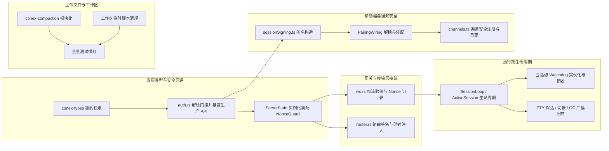
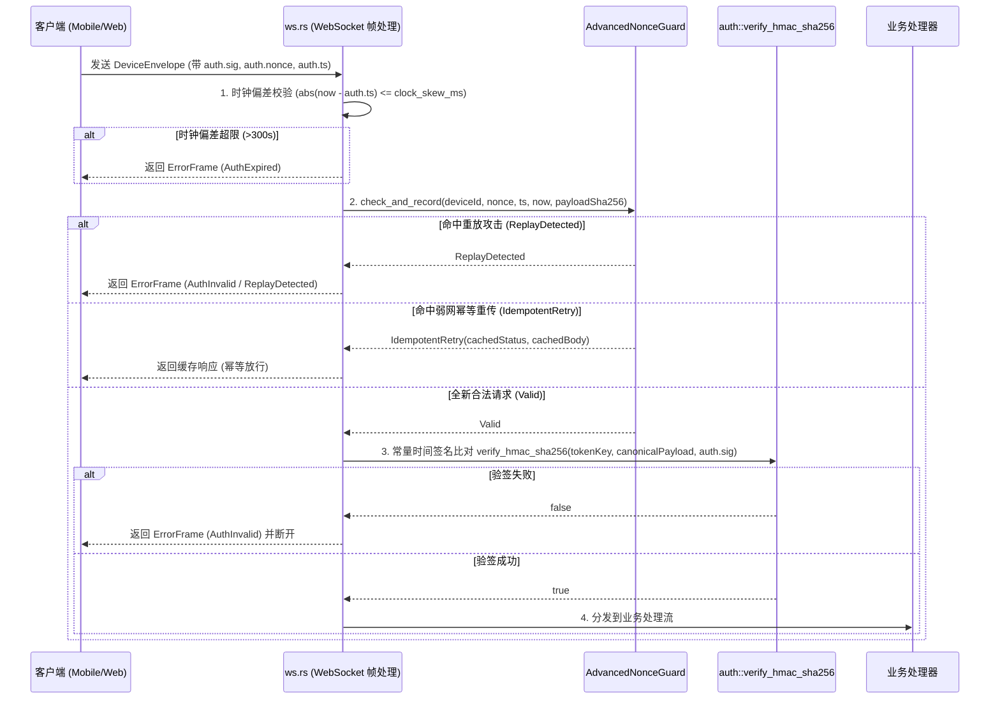
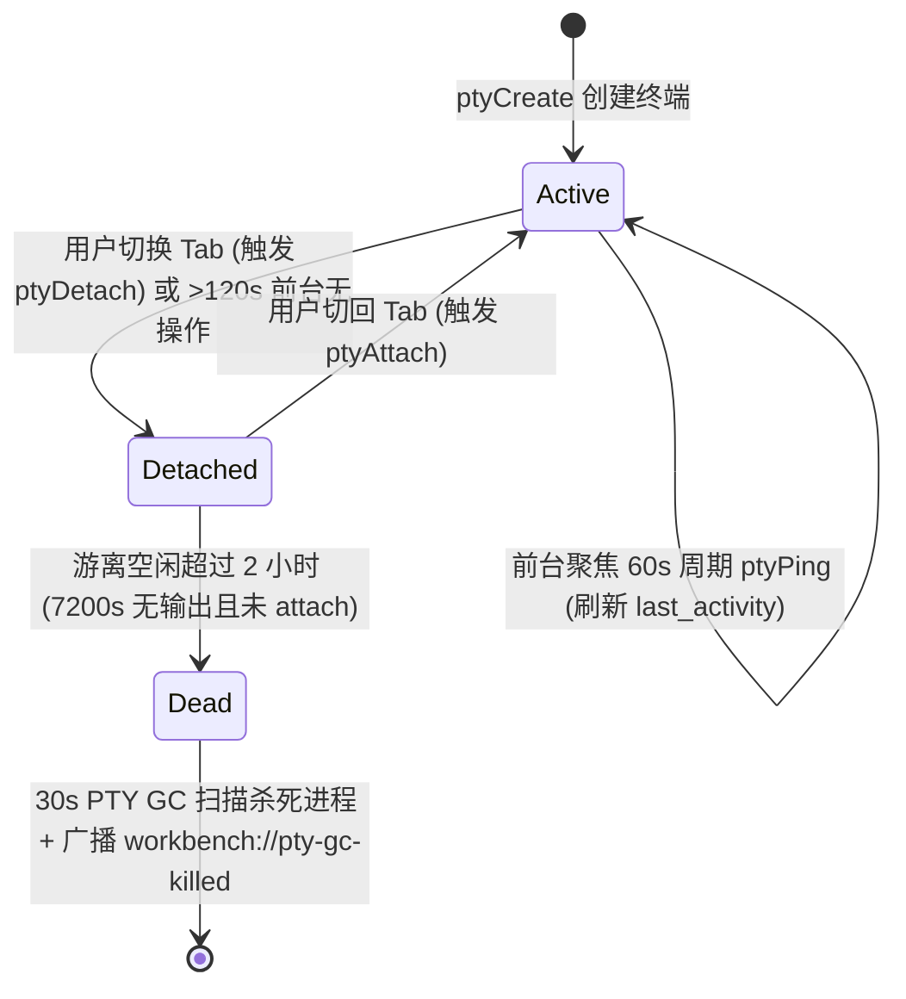
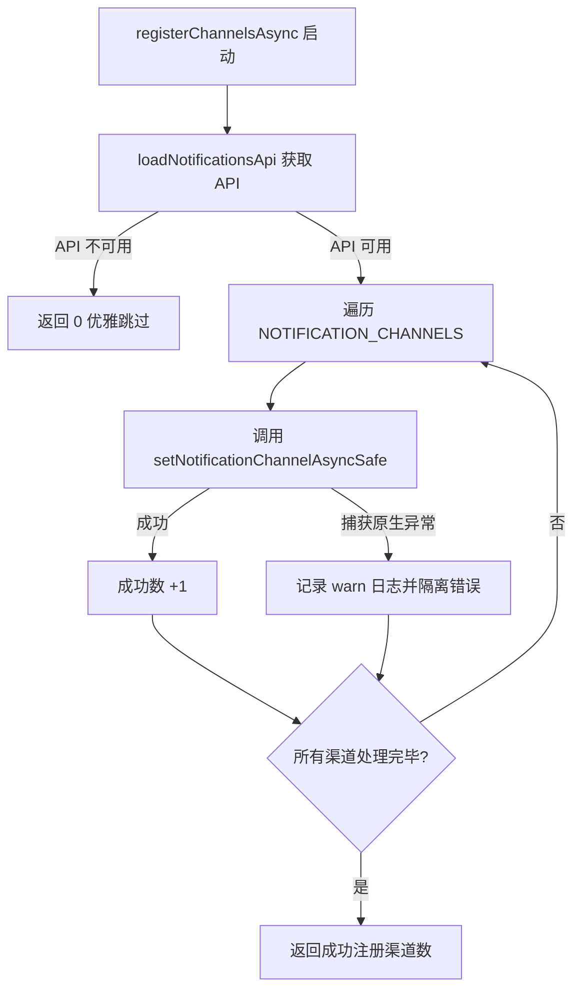

# 阶段二：系统性修复方案 05 — 多端契约、生命周期协调与网络治理详案

> **方案版本**：2026-08-14 权威详案稿
> **方案路径**：`docs/systemic-remediation-wave-2/plans/05-多端契约与网络治理详案.md`
> **输入依据**：`docs/systemic-remediation-wave-2/analysis/05-多端契约上帝文件与卫生分析.md`
> **规范基准**：严格遵循 `.agents/LOGIC_PLAN_NO_RETREAT.md`（纯逻辑规划、反退避、反门控降级、全问题同权）与 `AGENTS.md`。
> **核心原则**：所有技术债与漏洞同权，绝不包含工期、人天、排期或优先级划分；严禁使用编译门控掩盖未接线能力。

---

## 1. 方案总览与治理目标

本方案针对 Conex / Crish 桌面壳层服务端、会话生命周期监控、PTY 终端流控、移动端配对与通知契约、以及核心压缩引擎与工作区卫生展开系统性重构与生产真实装配，达成以下技术目标：

```mermaid
graph TD
    subgraph 模块一: 多端网关契约与 HMAC/Nonce 真实装配
        A1[移除 auth.rs 中的 cfg-test 门控] --> A2[ServerState 装配 AdvancedNonceGuard 实例]
        A2 --> A3[ws.rs 入站帧接入常量时间签名校验与 Nonce 防重放]
        A2 --> A4[router.rs 敏感控制路由接入鉴权与签名中间件]
        A3 --> A5[双向打通 X-Server-Time-Ms 时钟基准与自愈校准]
    end

    subgraph 模块二: 会话生命周期与 PTY 活性治理
        B1[清理 engine_build.rs 全局空串单例 Watchdog] --> B2[在 SessionLoop / ActiveSession 创建时动态按会话构建]
        B2 --> B3[Watchdog 绑定真实 DbDispatchStore 与 TimerRegistry 计数探测]
        B4[command_registry! 注册 pty_detach / attach / ping] --> B5[前端终端聚焦 60s ping 保活 + Tab 切换切接]
        B5 --> B6[PTY GC 扫描回收游离会话广播 workbench://pty-gc-killed]
    end

    subgraph 模块三: 移动端通知安全与可观测性
        C1[channels.ts 裸调替换为 setNotificationChannelAsyncSafe] --> C2[逐渠道隔离异常消除真机启动崩溃漏洞]
        C2 --> C3[expoNotificationsFacade 8 个安全包装补充结构化 warn 日志]
    end

    subgraph 模块四: 上帝文件解耦与工作区卫生
        D1[conex-compaction 拆分为 6 个单职责子模块] --> D2[行数严格降至 500 行门禁以下]
        D3[pairingWiring.ts 拆分为 6 个单职责适配器模块] --> D4[行数降至 400 行以下并修正指纹比对语义]
        D5[git rm --cached 10 个根目录临时/LOC 脚本] --> D6[.gitignore 增加根目录临时脚本防护规则]
    end
```



---

## 2. 逻辑依赖关系与前置条件

### 2.1 模块间依赖拓扑



### 2.2 前置条件与不变量约束

1. **类型不变性**：`conex-types` 中的 `DeviceEnvelope`（`v`, `kind`, `msg_id`, `ts`, `from`, `to`, `auth`, `body`）与 `AuthHeader`（`device_id`, `ts`, `nonce`, `sig`）字段定义保持不变，向后兼容全部跨端消息。
2. **零编译警告与零门控**：解除生产代码的 `#[cfg(test)]` 标记后，必须通过真实调用方接线消除所有 `unused` 警告，严禁使用 `#[allow(dead_code)]` 敷衍。
3. **测试资产零丢失**：所有拆分模块（`conex-compaction`、`pairingWiring` 等）必须完整迁移或继承既有单元测试，保证测试用例数量只增不减。

---

## 3. 目标文件域与修改范围矩阵

| 序号 | 目标文件路径                                                     | 涉及核心符号 / 函数 / 模块                                                                | 修改性质      | 改造目的与职责                                                                        |
| :--- | :--------------------------------------------------------------- | :---------------------------------------------------------------------------------------- | :------------ | :------------------------------------------------------------------------------------ |
| 1    | `apps/agent-workbench/src-tauri/src/server/auth.rs`              | `AdvancedNonceGuard`, `NonceEntry`, `hmac_sha256*`, `canonical_*`                         | 重构/解门控   | 移除 `#[cfg(test)]`，导出生产级 Nonce 幂等守卫与 HMAC 校验工具                        |
| 2    | `apps/agent-workbench/src-tauri/src/server/mod.rs`               | `ServerState`, `ServerState::new`                                                         | 修改          | 在 `ServerState` 中持有一等 `Arc<AdvancedNonceGuard>` 实例                            |
| 3    | `apps/agent-workbench/src-tauri/src/server/ws.rs`                | `handle_incoming_text`, `handle_pair_hello_frame`, `ConnCtx`                              | 修改          | 接入入站帧 HMAC 验签、时间戳时钟容差比对与 Nonce 幂等放行/重放拦截                    |
| 4    | `apps/agent-workbench/src-tauri/src/server/router.rs`            | `inject_server_time_header`, `require_signed_request`                                     | 修改          | 连接时钟自愈头，对敏感路由增加签名验证中间件                                          |
| 5    | `apps/agent-workbench/src-tauri/src/watchdog.rs`                 | `Watchdog`, `WatchdogOptions`, `spawn`                                                    | 重构          | 支持按会话动态构建，接收会话级 `session_id`、真实 `DbDispatchStore` 与定时器探测      |
| 6    | `apps/agent-workbench/src-tauri/src/engine_build.rs`             | `EngineHandle::new`                                                                       | 修改          | 移除静态全局空串 `Watchdog::new` 单例，迁移至会话生产流                               |
| 7    | `apps/agent-workbench/src-tauri/src/pty/mod.rs`                  | `workbench_pty_detach`, `workbench_pty_attach`, `workbench_pty_ping`, `spawn_pty_gc_loop` | 修改          | 移除 `#[allow(dead_code)]`，GC 回收时通过 `app.emit` 广播 `workbench://pty-gc-killed` |
| 8    | `apps/agent-workbench/src-tauri/src/main.rs`                     | `command_registry!`                                                                       | 修改          | 注册 `workbench_pty_detach`, `workbench_pty_attach`, `workbench_pty_ping`             |
| 9    | `apps/agent-workbench/src-tauri/src/command_manifest.rs`         | `ALL_COMMANDS`                                                                            | 修改          | 登记 PTY detach / attach / ping 命令元数据                                            |
| 10   | `apps/crish-desktop/src/api/ptySessionApi.ts`                    | `ptyDetach`, `ptyAttach`, `ptyPing`, `subscribePtyGcKilled`                               | 新增/修改     | 暴露保活与切接 API，提供 GC 回收广播订阅                                              |
| 11   | `apps/crish-mobile/src/notifications/channels.ts`                | `registerChannelsAsync`                                                                   | 重构          | 将裸调替换为 `setNotificationChannelAsyncSafe`，逐渠道容错                            |
| 12   | `apps/crish-mobile/src/notifications/expoNotificationsFacade.ts` | 8 个 `*Safe` 包装函数                                                                     | 修改          | catch 块增加结构化 `console.warn` 日志                                                |
| 13   | `crates/conex-compaction/src/lib.rs` 及子模块                    | `CompactionEngine`, `tokens`, `thresholds`, `cut_point`, `plan`, `engine`, `template`     | 拆分重构      | 将 3,051 行上帝文件解耦为 6 个子模块与专用测试目录                                    |
| 14   | `apps/crish-mobile/src/adapters/wiring/pairingWiring.ts`         | `PairingWiring` 及子模块                                                                  | 拆分重构      | 将 960 行上帝文件解耦为 6 个专用适配器模块与聚合入口                                  |
| 15   | `.gitignore` 与根目录                                            | 10 个临时 Python/MD 脚本                                                                  | 清理/规则增补 | 移除 Git 索引跟踪并增补根目录脚本拦截规则                                             |

---

## 4. 核心模块详细设计与实现步骤

### 4.1 多端网关契约与 HMAC/Nonce 真实装配方案（消除门控降级）

#### 4.1.1 架构设计

彻底消除 `auth.rs` 中将生产安全原语伪装为测试代码的 `#[cfg(test)]` 门控。服务端在 WebSocket 消息处理入口与 HTTP 敏感路由构建统一的零信任鉴权拦截链：



#### 4.1.2 具体实现步骤

##### 步骤 1.1：解除 `auth.rs` 编译门控并导出生产 API

1. 打开 `apps/agent-workbench/src-tauri/src/server/auth.rs`；
2. 移除以下符号上的 `#[cfg(test)]` 属性：
   - 常量：`DEFAULT_NONCE_CAPACITY`、`DEFAULT_CLOCK_SKEW_MS`；
   - 结构体与枚举：`NonceEntry`、`NonceCheckResult`、`NonceStoreInner`、`AdvancedNonceGuard` 及其 `impl AdvancedNonceGuard`、`impl Default for AdvancedNonceGuard`；
   - 密码学与规范化函数：`hmac_sha256`、`hmac_sha256_hex`、`verify_hmac_sha256`、`canonical_http_signing_payload`、`canonical_ws_signing_payload`；
3. 将上述原语的可见性统一声明为 `pub(crate)`（对外公开给 `server` 子模块调用）。

##### 步骤 1.2：在 `ServerState` 中装配 `AdvancedNonceGuard`

1. 修改 `apps/agent-workbench/src-tauri/src/server/mod.rs`：
   ```rust
   pub struct ServerState {
       // ...既有字段
       nonce_guard: Arc<auth::AdvancedNonceGuard>,
   }
   ```
2. 在 `ServerState::new` 中初始化：
   ```rust
   nonce_guard: Arc::new(auth::AdvancedNonceGuard::new(
       auth::DEFAULT_NONCE_CAPACITY,
       auth::DEFAULT_CLOCK_SKEW_MS,
   )),
   ```
3. 提供访问方法：
   ```rust
   pub fn nonce_guard(&self) -> &Arc<auth::AdvancedNonceGuard> {
       &self.nonce_guard
   }
   ```

##### 步骤 1.3：在 `ws.rs` 接入入站帧签名与 Nonce 防重放

1. 在 `apps/agent-workbench/src-tauri/src/server/ws.rs` 中，定位 `handle_incoming_text`；
2. 反序列化 `DeviceEnvelope` 成功后，对于非免签消息（即非 `pair.hello` 阶段）：
   - 获取当前时间戳 `let now = now_ms();`；
   - 若连接处于已认证状态（或请求声明了 `auth.sig`）：
     1. **时钟偏差校验**：
        ```rust
        let max_skew = ctx.state.nonce_guard().clock_skew_ms();
        if envelope.auth.ts.abs_diff(now) > max_skew {
            let frame = error_frame(ctx.conn_id, DeviceErrorCode::AuthExpired, "Request timestamp expired".into(), Some(&envelope.msg_id));
            return send_frame(ctx, frame).await;
        }
        ```
     2. **Nonce 幂等与防重放**：
        计算载荷 SHA-256 哈希 `let body_hash = Sha256::digest(envelope.body.to_string().as_bytes()).into();`；
        调用 `let check = ctx.state.nonce_guard().check_and_record(&envelope.auth.device_id, &envelope.auth.nonce, envelope.auth.ts, now, body_hash);`：
        - 若匹配 `NonceCheckResult::ReplayDetected`：下发 `DeviceErrorCode::AuthInvalid` 错误帧；
        - 若匹配 `NonceCheckResult::IdempotentRetry { body, .. }`：直接复用已有结果回包，不再重复执行底层逻辑；
        - 若匹配 `NonceCheckResult::ClockSkewTooLarge { .. }`：下发 `DeviceErrorCode::AuthExpired` 错误帧。
     3. **HMAC 常量时间验签**：
        根据 `envelope.auth.device_id` 或连接绑定的 `token` 获取通信密钥 `token_key`；
        构造规范化载荷：
        ```rust
        let canon = auth::canonical_ws_signing_payload(
            &envelope.auth.device_id,
            envelope.auth.ts,
            &envelope.auth.nonce,
            &envelope.msg_id,
            envelope.kind_str(),
            envelope.v,
            &envelope.body.to_string(),
        );
        ```
        调用 `auth::verify_hmac_sha256(token_key.as_bytes(), canon.as_bytes(), &envelope.auth.sig)`：若返回 `false`，立即记录安全警告并返回 `DeviceErrorCode::AuthInvalid`。

##### 步骤 1.4：在 `router.rs` 接入签名验证与双向时钟自愈

1. 确保 `router.rs` 中的 `inject_server_time_header` 中间件为所有 HTTP 响应注入 `X-Server-Time-Ms` 响应头；
2. 移动端和 Web 客户端在请求响应拦截器中读取 `X-Server-Time-Ms`，动态计算 `serverClockOffsetMs = serverTime - localTime`，并在发送后续签名请求（`buildSignedRequest`）时将本地时间调整为 `Date.now() + serverClockOffsetMs`，彻底消除客户端时钟漂移导致的验签失败。

---

### 4.2 Watchdog 会话级实例化与 PTY 周期保活方案

#### 4.2.1 架构设计

1. **Watchdog 会话级隔离**：将 Watchdog 从全局静态单例转变为会话生命周期对象，伴随 `SessionLoop` 创建并持有真实的 `session_id`、`DbDispatchStore` 与 `TimerRegistry` 活跃计数镜像。
2. **PTY 完整生命周期闭环**：



#### 4.2.2 具体实现步骤

##### 步骤 2.1：Watchdog 会话级构建与绑定

1. 修改 `apps/agent-workbench/src-tauri/src/engine_build.rs`：
   - 移除 283-298 行的全局 `Watchdog::new(String::new(), ...)` 与全局 spawn；
2. 在 `SessionLoopProducer` 或 `ActiveSession` 创建流（`engine_build.rs:1450-1520`）中：
   - 获取当前正在构建的 `session_id`；
   - 实例化专属 `Watchdog`：
     ```rust
     let session_watchdog = Arc::new(Watchdog::new(
         session_id.clone(),
         Arc::clone(&timer_steering_queue),
         Arc::clone(&dispatch_store) as Arc<dyn crate::watchdog::DispatchStore>,
         Arc::clone(&last_wakeup),
         Arc::new({
             let tr = Arc::clone(&timer_registry);
             let sid = session_id.clone();
             move || tr.active_count_for_session(&sid)
         }),
         WatchdogOptions::default(),
     ));
     ```
   - 获取会话生命周期的 `CancellationToken`，启动后台协程运行 `session_watchdog` 扫描循环，直到 Token 触发取消时退出，防止协程泄漏。

##### 步骤 2.2：PTY 后端命令注册与 GC 事件广播

1. 修改 `apps/agent-workbench/src-tauri/src/pty/mod.rs`：
   - 移除 `workbench_pty_detach`、`workbench_pty_attach`、`workbench_pty_ping` 上的 `#[allow(dead_code)]`；
   - 改造 `spawn_pty_gc_loop`，消费传入的 `app: AppHandle`：
     ```rust
     pub(crate) fn spawn_pty_gc_loop(app: AppHandle) -> tauri::async_runtime::JoinHandle<()> {
         tauri::async_runtime::spawn(async move {
             let mut interval = tokio::time::interval(std::time::Duration::from_secs(30));
             interval.tick().await;
             loop {
                 interval.tick().await;
                 let now = crate::server::now_ms();
                 let killed = session::run_gc_sweep(now);
                 if !killed.is_empty() {
                     tracing::info!(target: "pty", count = killed.len(), "PTY GC swept expired/dead sessions");
                     for pty_id in killed {
                         let _ = app.emit("workbench://pty-gc-killed", serde_json::json!({
                             "ptyId": pty_id,
                             "code": null
                         }));
                     }
                 }
             }
         })
     }
     ```
2. 修改 `apps/agent-workbench/src-tauri/src/main.rs`：
   - 在 `command_registry!` 宏调用中添加：
     ```rust
     ("workbench_pty_detach", pty::workbench_pty_detach),
     ("workbench_pty_attach", pty::workbench_pty_attach),
     ("workbench_pty_ping", pty::workbench_pty_ping),
     ```
3. 修改 `apps/agent-workbench/src-tauri/src/command_manifest.rs`：
   - 在 `ALL_COMMANDS` 列表中登记：
     ```rust
     entry("workbench_pty_detach", "workbench", "gui", true),
     entry("workbench_pty_attach", "workbench", "gui", true),
     entry("workbench_pty_ping", "workbench", "gui", true),
     ```

##### 步骤 2.3：前端 PTY API 与生命周期联动

1. 修改 `apps/crish-desktop/src/api/ptySessionApi.ts`：
   - 增加 `ptyDetach`, `ptyAttach`, `ptyPing` 调用封装：
     ```typescript
     export async function ptyDetach(
       ptyId: string
     ): Promise<PtyInvokeResult<void>> {
       const res = await invokeResult<unknown>('workbench_pty_detach', {
         ptyId: ptyId.trim(),
       });
       return res.status === 'ok'
         ? { status: 'ok', data: undefined }
         : mapInvoke(res);
     }
     export async function ptyAttach(
       ptyId: string
     ): Promise<PtyInvokeResult<void>> {
       const res = await invokeResult<unknown>('workbench_pty_attach', {
         ptyId: ptyId.trim(),
       });
       return res.status === 'ok'
         ? { status: 'ok', data: undefined }
         : mapInvoke(res);
     }
     export async function ptyPing(
       ptyId: string
     ): Promise<PtyInvokeResult<void>> {
       const res = await invokeResult<unknown>('workbench_pty_ping', {
         ptyId: ptyId.trim(),
       });
       return res.status === 'ok'
         ? { status: 'ok', data: undefined }
         : mapInvoke(res);
     }
     ```
   - 增加 `workbench://pty-gc-killed` 事件订阅：
     ```typescript
     const EVENT_PTY_GC_KILLED = 'workbench://pty-gc-killed';
     export function subscribePtyGcKilled(
       handler: (p: PtyExitPayload) => void
     ): () => void {
       return subscribeFanout(
         EVENT_PTY_GC_KILLED,
         exitFanout,
         parseExitPayload,
         handler
       );
     }
     ```
2. 前端终端组件接入：
   - 终端处于前台聚焦时，设置 `setInterval(() => ptyPing(ptyId), 60_000)`；
   - 离开当前终端 Tab 时调用 `ptyDetach(ptyId)`；重新激活 Tab 时调用 `ptyAttach(ptyId)`；
   - 监听 `subscribePtyGcKilled`，收到被回收通知时平滑关闭对应 Tab 或显示“会话因长时间空闲已自动回收”的友好占位。

---

### 4.3 移动端通知安全通道与可观测性加固方案

#### 4.3.1 架构设计

消除 `channels.ts` 在初始化时对底层 SDK 的裸调用，统一经由 `setNotificationChannelAsyncSafe` 门面逐个隔离执行，并为 `expoNotificationsFacade.ts` 的全部安全包装补齐告警日志。



#### 4.3.2 具体实现步骤

##### 步骤 3.1：重构 `channels.ts` 中的 `registerChannelsAsync`

修改 `apps/crish-mobile/src/notifications/channels.ts`（行 111-126）：

```typescript
import {
  loadNotificationsApi,
  setNotificationChannelAsyncSafe,
  type AndroidImportanceKey,
  type NotificationChannelInputLike,
} from './expoNotificationsFacade';

/**
 * 注册四通道（应用启动即建、权限请求前调用；幂等）。
 * 逐渠道接入安全包装，隔离原生 OEM 异常，绝不抛出 Unhandled Rejection 阻塞启动。
 * 返回成功注册通道数。
 */
export async function registerChannelsAsync(): Promise<number> {
  const api = await loadNotificationsApi();
  if (!api) return 0;

  let successCount = 0;
  for (const def of NOTIFICATION_CHANNELS) {
    const channelInput = channelInputOf(
      def,
      api.AndroidImportance[IMPORTANCE_VALUE_KEY[def.importance]]
    );
    const ok = await setNotificationChannelAsyncSafe(def.id, channelInput);
    if (ok) {
      successCount += 1;
    } else {
      console.warn(`[Notifications] 渠道 ${def.id} 注册失败，已安全降级`);
    }
  }
  return successCount;
}
```

##### 步骤 3.2：增强 `expoNotificationsFacade.ts` 安全包装的可观测性

在 `apps/crish-mobile/src/notifications/expoNotificationsFacade.ts` 中，为以下 8 个 `*Safe` 函数的 `catch` 块增加统一告警日志：

- `getPermissionsAsyncSafe`
- `requestPermissionsAsyncSafe`
- `setNotificationChannelAsyncSafe`
- `setNotificationHandlerSafe`
- `addNotificationReceivedListenerSafe`
- `addNotificationResponseReceivedListenerSafe`
- `getLastNotificationResponseAsyncSafe`
- `scheduleNotificationAsyncSafe`

示例改造（以 `setNotificationChannelAsyncSafe` 为例）：

```typescript
export async function setNotificationChannelAsyncSafe(
  channelId: string,
  channel: NotificationChannelInputLike
): Promise<boolean> {
  const api = await loadApi();
  if (!api) return false;
  try {
    await api.setNotificationChannelAsync(channelId, channel);
    return true;
  } catch (err) {
    console.warn(
      `[NotificationsFacade] setNotificationChannelAsyncSafe(${channelId}) failed:`,
      err
    );
    return false;
  }
}
```

---

### 4.4 上帝文件解耦详案

#### 4.4.1 `conex-compaction/src/lib.rs` (3,051 行) 拆分方案

将 `crates/conex-compaction/src/` 拆分为以下模块结构：

```
crates/conex-compaction/src/
├── lib.rs                 # 模块入口、常量定义与公开 API re-export (<100 行)
├── tokens.rs              # Token 计算、多模态估算与字符启发式 (~160 行)
├── thresholds.rs          # 预算水位模型与双阈值判定 (~120 行)
├── cut_point.rs           # 切割点倒推与 tool use/result 配对保护 (~260 行)
├── plan.rs                # 压缩计划、策略与占位符生成 (~240 行)
├── engine.rs              # 核心压缩编排引擎与紧急预检降级 (~420 行)
├── template.rs            # 结构化摘要 Markdown 模板渲染 (~110 行)
└── tests/                 # 模块化测试套件 (承接既有 1566 行测试)
    ├── tokens_test.rs
    ├── thresholds_test.rs
    ├── cut_point_test.rs
    ├── plan_test.rs
    └── engine_test.rs
```

- **对外兼容性**：`lib.rs` 通过 `pub use` 重新导出全部原结构体与函数，外部使用者无需更改任何导入语句。

#### 4.4.2 `pairingWiring.ts` (960 行) 拆分方案

在 `apps/crish-mobile/src/adapters/wiring/pairing/` 建立子模块目录：

1. `sessionSigning.ts` (~110 行)：纯函数集合，负责 `randomNonce`、`buildSignedRequest` 与 `WsGateway` 工厂；
2. `pairingGateway.ts` (~50 行)：`PairingGateway` 子类，负责就绪钩子 `onSendReady`；
3. `pairingPersistence.ts` (~90 行)：凭据元数据键、`buildAuthPersist` 及 SecureStore 交互；
4. `fingerprintVerifier.ts` (~70 行)：提炼纯粹的 `fingerprintsAgree(a, b)` 双信道指纹比对函数；
5. `PairingWiring.ts` (~360 行)：纯粹的配对业务逻辑驱动器（行数降至 400 行以下）；
6. `pairingAssembly.ts` (~70 行)：单例管理、初始化配置与测试隔离；
7. `index.ts` (~30 行)：聚合导出，对外保持原 `pairingWiring.ts` 的导入路径不变。

---

### 4.5 工作区卫生与 Git 跟踪清理

#### 4.5.1 Git 索引清理操作

执行以下命令移除误入库的 10 个根目录临时/LOC 脚本（仅移除索引，保留工作区文件）：

```bash
git rm --cached .agent-tmp-agents-dot-head.md
git rm --cached .agent-tmp-agents-root-head.md
git rm --cached .agent-tmp-report.py
git rm --cached .agent-tmp-scan.py
git rm --cached count_lines.py
git rm --cached daily_loc.py
git rm --cached generate_report.py
git rm --cached generate_summary.py
git rm --cached hourly_loc.py
git rm --cached recent_loc.py
```

#### 4.5.2 `.gitignore` 规则收口增补

在仓库根目录 `.gitignore` 中增补以下拦截规则：

```gitignore
# ── Agent 临时快照与运行期过程文件 ───────────────────────────
.agent-tmp-*

# ── 根目录临时/统计/报告 Python 脚本（非正式资产）─────────────
/*_loc.py
/count_lines.py
/generate_report.py
/generate_summary.py
/*.py
!scripts/**/*.py
```

---

## 5. 实施步骤（Step-by-Step 实施蓝图）

```mermaid
gantt
    title 阶段二：05 多端契约与网络治理实施蓝图
    dateFormat  X
    axisFormat %d

    section 步骤一：网关契约与HMAC
    解除 auth.rs 编译门控               :active, step1_1, 0, 1
    ServerState 装配 NonceGuard         :step1_2, 1, 2
    ws.rs 接入验签与防重放              :step1_3, 2, 3
    router.rs 接入时钟自愈与签名中间件  :step1_4, 3, 4

    section 步骤二：生命周期与PTY
    Watchdog 会话级实例化改造           :step2_1, 4, 5
    PTY detach/attach/ping 命令注册     :step2_2, 5, 6
    前端 60s ping 保活与 GC 事件联动    :step2_3, 6, 7

    section 步骤三：通知安全与解耦
    channels.ts 接入安全包装            :step3_1, 7, 8
    expoNotificationsFacade 增加日志    :step3_2, 8, 9
    conex-compaction 上帝文件拆分       :step3_3, 9, 10
    pairingWiring.ts 上帝文件拆分       :step3_4, 10, 11

    section 步骤四：工作区卫生与验收
    Git 索引清理与 gitignore 收口       :step4_1, 11, 12
    全量构建与自动化测试验证            :step4_2, 12, 13
```



### 具体执行逻辑流：

- **阶段 1（网关与安全原语）**：首先在 `auth.rs` 中去除 `#[cfg(test)]`，使 `AdvancedNonceGuard` 与 HMAC 工具进入生产编译面；随后在 `ServerState` 初始化其实例，并在 `ws.rs` 与 `router.rs` 中完成接线。
- **阶段 2（会话监控与终端活性）**：将 `Watchdog` 移出引擎全局构建流，嵌入 `SessionLoop` 创建流程并绑定 `session_id`；同时完成 PTY 后端 3 个命令的注册与 GC 广播，并连通前端 60s 定时保活。
- **阶段 3（移动端通知与模块解耦）**：改造 `channels.ts` 为逐渠道安全调用；同步进行 `conex-compaction` 与 `pairingWiring.ts` 的子模块解耦拆分。
- **阶段 4（工作区卫生与回归验证）**：执行 `git rm --cached` 清理临时脚本并增补 `.gitignore`，运行全量类型检查与自动化测试。

---

## 6. 验收断言清单

### 6.1 编译与类型检查断言

- [ ] `cargo check -p crish-agent-workbench` 生产模式编译通过，零未使用警告，生产代码真实包含 `AdvancedNonceGuard` 与 HMAC 校验逻辑。
- [ ] `cargo check --workspace` 全工作区零编译错误与零警告。
- [ ] `npm run typecheck` 前端全量类型检查通过。
- [ ] `npm run check:line-counts` 行数门禁检查通过，`conex-compaction` 各子模块 <500 行，`pairing` 各子模块 <400 行。

### 6.2 自动化测试断言

- [ ] `cargo test -p crish-agent-workbench` 包含网关验签、Nonce 幂等与 Watchdog 会话测试，全量通过。
- [ ] `cargo test -p conex-compaction` 103 项压缩引擎测试 100% 绿灯通过。
- [ ] `npx jest src/pairing src/adapters` 移动端 556 项测试全绿通过。
- [ ] `npx jest src/notifications` 移动端通知测试全绿通过。

### 6.3 运行期行为与安全断言

- [ ] **WS 验签拦截**：向 WebSocket 发送篡改 `auth.sig` 或超时 `auth.ts`（超过 300s）的消息帧，断言服务端返回 `AuthInvalid` 或 `AuthExpired` 并拒绝处理。
- [ ] **Nonce 防重放与幂等**：使用相同 `(deviceId, nonce)` 发送不同 payload 时断言返回 `ReplayDetected` 拦截；发送完全相同 payload 时断言放行幂等响应。
- [ ] **Watchdog 会话隔离**：多会话并发运行时，各会话独立持有 Watchdog 协程，超时告警条目包含各自的 `session_id` 前缀，会话销毁时协程立即退出无泄漏。
- [ ] **PTY 前台保活与 GC 回收**：
  - 前台终端 Tab 聚焦超过 2 小时，断言 60s 周期 ping 维持活性，进程不被回收；
  - 切换离开 Tab 超过 2 小时无输出，断言 30s GC 扫描安全回收进程并下发 `workbench://pty-gc-killed` 广播，前端 UI 平滑收拢 Tab。
- [ ] **通知注册崩溃隔离**：在 Mock 底层 `setNotificationChannelAsync` 抛出原生异常的测试中，`registerChannelsAsync()` 成功捕获错误返回成功数 0，不触发全局 Unhandled Rejection，应用启动保持平稳。
- [ ] **工作区卫生**：执行 `git ls-files count_lines.py daily_loc.py .agent-tmp*` 输出为空，临时脚本脱离 Git 跟踪且被 `.gitignore` 规则拦截。

---

_方案编制完成报告人：阶段二方案生成 05 专项 Agent ｜ 遵循反退避纯逻辑规划准则 ｜ 2026-08-14_
