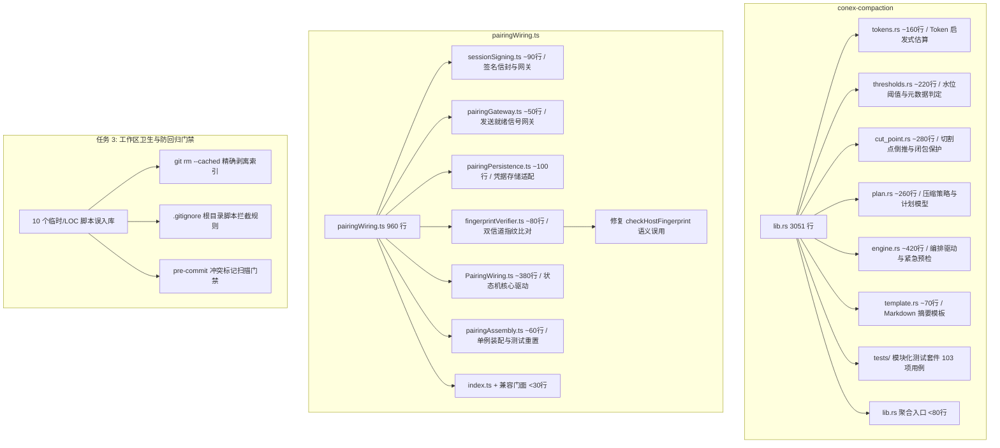
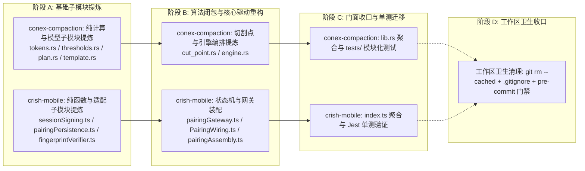

# 阶段二：系统性修复方案 06 — 上帝文件拆分、契约解耦与代码卫生详案

> **方案版本**：2026-08-14 权威实施详案
> **方案路径**：`docs/systemic-remediation-wave-2/plans/06-上帝文件拆分与代码卫生详案.md`
> **输入依据**：`docs/systemic-remediation-wave-2/analysis/05-多端契约上帝文件与卫生分析.md`
> **契约约束**：严格遵循 `.agents/LOGIC_PLAN_NO_RETREAT.md`（纯逻辑规划、反退避、Rust/TS 双端防上帝文件、工作区卫生）与 `AGENTS.md`。
> **核心原则**：所有问题同权；严禁包含工期、人天、排期或 P0/P1 业务优先级；严禁伪完成与门控式降级；保持 100% 接口向后兼容与测试资产零丢失。

---

## 1. 方案总览与问题拓扑

本方案针对 Conex / Crish 核心压缩引擎（Rust）、移动端配对接线（TypeScript）以及仓库根目录工作区卫生展开系统性物理重构与解耦，消除单文件行数超标、职责缠结、语义错位与临时文件污染等结构性技术债：



---

## 2. 逻辑依赖关系与前置条件

### 2.1 任务间逻辑依赖图



### 2.2 前置条件与不变量要求

1. **文件域完全正交**：任务 1（Rust 引擎 `crates/conex-compaction/`）、任务 2（移动端 `apps/crish-mobile/`）与任务 3（仓库根目录及 `.husky/`）处于独立文件域，无跨域依赖冲突。
2. **测试基线不变量**：
   - `conex-compaction` 当前 103 项单元测试必须 100% 保持绿灯，无任何测试被删除或跳过；
   - `crish-mobile` 配对相关 31 项 Jest 单测及全量 556 项测试必须 100% 保持绿灯；
   - 外部调用方（如 `session-loop`、`agent-workbench`、`crish-desktop`）引用的公共符号签名必须 100% 保持向后兼容。
3. **行数门禁硬约束**：
   - Rust 所有拆分子模块源码有效行均严格控制在 **500 行以内**，`lib.rs` 控制在 **100 行以内**；
   - TS 所有拆分子模块有效代码行均严格控制在 **400 行以内**，`PairingWiring.ts` 从 960 行降至 **380 行左右**。

---

## 3. 目标文件域清单与行数预算

| 任务    | 操作类型 | 文件路径                                                               | 当前行数 | 目标行数 (有效行) | 核心职责                                            |
| :------ | :------- | :--------------------------------------------------------------------- | :------- | :---------------- | :-------------------------------------------------- |
| **1.1** | 新增     | `crates/conex-compaction/src/tokens.rs`                                | 0        | ~160 行           | Token 计数、字符/CJK 启发式、块级/工具估算          |
| **1.2** | 新增     | `crates/conex-compaction/src/thresholds.rs`                            | 0        | ~220 行           | 水位双阈值模型、估算上下文、时间戳护栏解析          |
| **1.3** | 新增     | `crates/conex-compaction/src/cut_point.rs`                             | 0        | ~280 行           | 尾部预算倒推、折叠链起始、ToolBatch 闭包保护        |
| **1.4** | 新增     | `crates/conex-compaction/src/plan.rs`                                  | 0        | ~260 行           | 压缩策略、计划模型、Summarizer trait、StubPolicy    |
| **1.5** | 新增     | `crates/conex-compaction/src/engine.rs`                                | 0        | ~420 行           | CompactionEngine 结构体、双面压缩、紧急预检         |
| **1.6** | 新增     | `crates/conex-compaction/src/template.rs`                              | 0        | ~70 行            | 结构化摘要 Markdown 模板渲染                        |
| **1.7** | 重构     | `crates/conex-compaction/src/lib.rs`                                   | 3,051    | <80 行            | 模块入口、子模块声明、全量公开 API re-export        |
| **1.8** | 新增     | `crates/conex-compaction/tests/compaction_tests.rs`                    | 0        | ~1,560 行         | 103 项全量单元测试与回归测试资产                    |
| **2.1** | 新增     | `apps/crish-mobile/src/adapters/wiring/pairing/sessionSigning.ts`      | 0        | ~90 行            | 随机 Nonce、HMAC 签名信封与会话网关工厂             |
| **2.2** | 新增     | `apps/crish-mobile/src/adapters/wiring/pairing/pairingGateway.ts`      | 0        | ~50 行            | `PairingGateway` 继承类、发送就绪信号 `onSendReady` |
| **2.3** | 新增     | `apps/crish-mobile/src/adapters/wiring/pairing/pairingPersistence.ts`  | 0        | ~100 行           | 元数据键定义、SecureStore 适配器 `buildAuthPersist` |
| **2.4** | 新增     | `apps/crish-mobile/src/adapters/wiring/pairing/fingerprintVerifier.ts` | 0        | ~80 行            | 指纹格式验证、双信道指纹比对 `fingerprintsAgree`    |
| **2.5** | 新增     | `apps/crish-mobile/src/adapters/wiring/pairing/PairingWiring.ts`       | 0        | ~380 行           | 状态机核心驱动器、帧分发、收口与会话连接            |
| **2.6** | 新增     | `apps/crish-mobile/src/adapters/wiring/pairing/pairingAssembly.ts`     | 0        | ~60 行            | 单例生命周期、全局配置与测试隔离重置                |
| **2.7** | 新增     | `apps/crish-mobile/src/adapters/wiring/pairing/index.ts`               | 0        | ~40 行            | 模块内聚统一导出                                    |
| **2.8** | 重构     | `apps/crish-mobile/src/adapters/wiring/pairingWiring.ts`               | 960      | <30 行            | 外部调用兼容门面（re-export `pairing/`）            |
| **3.1** | 剥离     | 10 个根目录临时/LOC Python/Markdown 文件                               | ~100 KB  | 0 (脱离 Git)      | `git rm --cached` 脱离 Git 跟踪并保留本地文件       |
| **3.2** | 修改     | `.gitignore`                                                           | 458      | +15 行            | 拦截根目录临时 Python、LOC 脚本与 `.agent-tmp-*`    |
| **3.3** | 新增     | `scripts/check-conflict-markers.mjs`                                   | 0        | ~60 行            | 纳秒级扫描 staged 文件中的未解析冲突标记            |
| **3.4** | 修改     | `.husky/pre-commit`                                                    | 3        | +1 行             | 接入冲突标记扫描门禁                                |

---

## 4. 任务 1 详案：`conex-compaction` 模块化物理拆分

### 4.1 拆分前现状与职责缠结分析

`crates/conex-compaction/src/lib.rs` 现状 3,051 行，存在 7 类异构职责紧密耦合：

1. **字符/Token 启发式**：`count_tokens`, `count_agent_message_tokens`, `count_tool_output_tokens`；
2. **水位阈值与决策**：`CompactionThresholds`, `ThresholdDecision`, `EstimateContext`, usage 元数据解析；
3. **切割点算法**：`fold_start_of`, `enforce_tool_batch_closure`, `find_cut_point`；
4. **策略与计划模型**：`CompactionPolicy`, `CompactionPlan`, `Summarizer`, `StubPolicy`；
5. **压缩编排与预检**：`CompactionEngine`, `compact`, `compact_agent_messages`, `emergency_preflight`；
6. **Markdown 模板**：`structured_summary_template`, `days_from_civil`；
7. **内联单测套件**：1,566 行测试混杂在 `mod tests` 中。

### 4.2 子模块设计与符号迁移矩阵

#### 4.2.1 `tokens.rs`（Token 计算与估算）

- **职责**：负责纯文本、块级消息及工具输出的 Token 估算，包含 ASCII 4 字符折算、CJK 逐字折算与图片固定计价。
- **导出符号**：
  ```rust
  pub const IMAGE_TOKEN_COST: usize = 1_600;
  pub fn count_tokens(text: &str) -> usize;
  pub fn count_agent_message_tokens(message: &conex_types::AgentMessage) -> usize;
  pub fn count_tool_output_tokens(output: &conex_types::ToolOutput) -> usize;
  ```
- **依赖**：`conex-types::{AgentMessage, AgentMessageBlock, ToolOutput}`。无内部循环依赖。

#### 4.2.2 `thresholds.rs`（水位阈值与决策模型）

- **职责**：双阈值判定（85% 常规线、95% 临界线）、上下文占用估算结果封装、时间戳解析护栏与 usage 提取。
- **导出符号**：
  ```rust
  pub const COMPACT_THRESHOLD_RATIO_DEFAULT: f64 = 0.85;
  pub const COMPACT_CRITICAL_RATIO_DEFAULT: f64 = 0.95;
  pub const SESSION_META_KEY_COMPACT_THRESHOLD_RATIO: &str = "compact_threshold_ratio";
  pub const SESSION_META_KEY_COMPACT_CRITICAL_RATIO: &str = "compact_critical_ratio";
  pub const SESSION_META_KEY_COMPACT_SUMMARY_MAX_TOKENS: &str = "compact_summary_max_tokens";

  #[derive(Debug, Clone, Copy, PartialEq, Eq)]
  pub enum ThresholdDecision { UnderBudget, Regular, Critical }

  #[derive(Debug, Clone, Copy, PartialEq)]
  pub struct CompactionThresholds { pub regular_ratio: f64, pub critical_ratio: f64 }

  #[derive(Debug, Clone, Copy, PartialEq, Eq)]
  pub enum EstimateSource { Usage, Heuristic }

  #[derive(Debug, Clone, PartialEq, Eq)]
  pub struct EstimateContext {
      pub tokens: u64,
      pub source: EstimateSource,
      pub usage_message_id: Option<String>,
  }

  pub(crate) fn find_usage_message(messages: &[Arc<AgentMessage>], last_compaction_at: Option<i64>) -> Option<(usize, u64)>;
  pub(crate) fn estimate_with_usage(messages: &[Arc<AgentMessage>], tools: Option<&str>, system: Option<&str>, usage: Option<(usize, u64)>) -> EstimateContext;
  pub(crate) fn parse_iso8601_epoch_ms(value: &str) -> Option<i64>;
  ```
- **依赖**：`conex-types::AgentMessage`, `crate::tokens::{count_tokens, count_agent_message_tokens}`。

#### 4.2.3 `cut_point.rs`（切割点倒推与 ToolBatch 闭包）

- **职责**：折叠链起始下标推导、从尾部向前累计预算倒推切割点、用户回合下限扩展、ToolCall/ToolResult 双向完整性闭包保护。
- **导出符号**：
  ```rust
  pub const KEEP_RECENT_TOKENS_DEFAULT: usize = 20_000;
  pub const MIN_RECENT_TURNS_DEFAULT: u32 = 2;

  pub(crate) fn fold_start_of(messages: &[Arc<AgentMessage>]) -> usize;
  pub fn enforce_tool_batch_closure(
      messages: &[Arc<AgentMessage>],
      cut: usize,
      fold_start: usize,
  ) -> Option<usize>;
  pub(crate) fn find_cut_point_inner(
      messages: &[Arc<AgentMessage>],
      keep_recent_tokens: usize,
      min_recent_turns: u32,
      tool_pair_protection: bool,
  ) -> Option<usize>;
  ```
- **依赖**：`conex-types::{AgentMessage, AgentMessageBlock, AgentMessageRole}`, `crate::tokens::count_agent_message_tokens`。

#### 4.2.4 `plan.rs`（策略、计划与占位符生成）

- **职责**：压缩策略参数、计划模型输出、LLM 摘要器 trait、Stub 降级策略、占位符渲染及摘要长度截断。
- **导出符号**：
  ```rust
  pub const MAX_SUMMARY_TOKENS_DEFAULT: usize = 1_024;

  #[derive(Debug, Clone, PartialEq, Eq)]
  pub struct CompactionPolicy { ... }

  #[derive(Debug, Clone, PartialEq)]
  pub struct CompactionPlan { ... }

  pub trait Summarizer: Send + Sync {
      fn summarize(&self, dropped: &[AgentMessage], existing: Option<&str>) -> Result<String, String>;
  }

  #[derive(Debug, Clone, Copy, PartialEq, Eq)]
  pub enum StubPolicy { StubAllowed, LlmRequired }

  pub(crate) fn noop_plan(messages: &[Arc<AgentMessage>]) -> CompactionPlan;
  pub(crate) fn llm_blocked_plan(messages: &[Arc<AgentMessage>], cut: usize, dropped_ids: &[String], tokens_before: u64) -> CompactionPlan;
  pub(crate) fn stub_placeholder(block_id: &str, count: usize, generation: u32) -> String;
  pub(crate) fn truncate_summary(summary: &str, max_tokens: usize) -> String;
  ```
- **依赖**：`conex-types::{AgentMessage, CompactionResult, Message}`, `crate::tokens::{count_tokens, count_agent_message_tokens}`。

#### 4.2.5 `engine.rs`（核心编排引擎与紧急预检）

- **职责**：压缩主驱动器 `CompactionEngine`，涵盖旧 `Message` 面兼容压缩、`AgentMessage` 双面流式压缩、迭代合并摘要、以及超出预算时的 `Emergency Preflight` 兜底截断算法。
- **导出符号**：
  ```rust
  pub struct CompactionEngine {
      max_tokens: usize,
  }

  impl CompactionEngine {
      pub fn new(max_tokens: usize) -> Self;
      pub fn compact(&self, messages: &[conex_types::Message]) -> conex_types::CompactionResult;
      pub fn find_cut_point(&self, messages: &[Arc<AgentMessage>], keep_recent_tokens: usize, min_recent_turns: u32) -> Option<usize>;
      pub fn compact_agent_messages(&self, messages: &[Arc<AgentMessage>], budget_tokens: usize, policy: &CompactionPolicy, summarizer: Option<&dyn Summarizer>) -> CompactionPlan;
      pub fn compact_agent_messages_with_stub_policy(&self, messages: &[Arc<AgentMessage>], budget_tokens: usize, policy: &CompactionPolicy, summarizer: Option<&dyn Summarizer>, stub_policy: StubPolicy) -> CompactionPlan;
      pub fn emergency_preflight(&self, messages: &[Arc<AgentMessage>], budget_tokens: usize, policy: &CompactionPolicy, summarizer: Option<&dyn Summarizer>) -> CompactionPlan;
      pub fn should_compact(&self, estimate: u64, budget_tokens: u64) -> bool;
  }
  ```
- **依赖**：`crate::tokens`, `crate::thresholds`, `crate::cut_point`, `crate::plan`, `crate::tool_output`, `crate::summary_document`。

#### 4.2.6 `template.rs`（结构化摘要模板渲染）

- **职责**：渲染 Goal / Constraints / Progress / Key Decisions / Next Steps / Critical Context 六段式 Markdown 摘要骨架。
- **导出符号**：
  ```rust
  pub fn structured_summary_template(dropped: &[conex_types::AgentMessage], existing: Option<&str>) -> String;
  ```

#### 4.2.7 `lib.rs`（对外门面与 Re-export）

- **代码结构**（<80 行）：
  ```rust
  pub mod ai_summary;
  pub mod clean_output;
  pub mod cut_point;
  pub mod engine;
  pub mod plan;
  pub mod recovery;
  pub mod summary_document;
  pub mod template;
  pub mod thresholds;
  pub mod tokens;
  pub mod tool_output;

  pub use cut_point::{
      enforce_tool_batch_closure, KEEP_RECENT_TOKENS_DEFAULT, MIN_RECENT_TURNS_DEFAULT,
  };
  pub use engine::CompactionEngine;
  pub use plan::{
      CompactionPlan, CompactionPolicy, StubPolicy, Summarizer, MAX_SUMMARY_TOKENS_DEFAULT,
  };
  pub use template::structured_summary_template;
  pub use thresholds::{
      CompactionThresholds, EstimateContext, EstimateSource, ThresholdDecision,
      COMPACT_CRITICAL_RATIO_DEFAULT, COMPACT_THRESHOLD_RATIO_DEFAULT,
      SESSION_META_KEY_COMPACT_CRITICAL_RATIO, SESSION_META_KEY_COMPACT_SUMMARY_MAX_TOKENS,
      SESSION_META_KEY_COMPACT_THRESHOLD_RATIO,
  };
  pub use tokens::{
      count_agent_message_tokens, count_tokens, count_tool_output_tokens, IMAGE_TOKEN_COST,
  };
  ```

### 4.3 单元测试物理隔离方案

在 `crates/conex-compaction/tests/compaction_tests.rs` 建立独立集成/单元测试入口，迁移原有 `lib.rs` 中 1,566 行的 103 项测试用例，按领域分为：

- `tokens_suite`（字符估算、中英混排、多模态计价）；
- `thresholds_suite`（双阈值判定、时间戳护栏、usage 优先级）；
- `cut_point_suite`（倒推累计、回合下限、ToolBatch 闭包、折叠链下界保护）；
- `plan_suite`（默认策略、占位符生成、LlmRequired 策略阻断）；
- `engine_suite`（全流程压缩、迭代摘要合并、紧急预检二次兜底截断）。

---

## 5. 任务 2 详案：移动端 `pairingWiring.ts` 模块化物理拆分与指纹修复

### 5.1 拆分前 11 项职责耦合分析

`apps/crish-mobile/src/adapters/wiring/pairingWiring.ts` 存在以下 11 项异构职责：

1. Nonce 生成与签名信封构造（`randomNonce`, `buildSignedRequest`）；
2. 会话网关与连接器工厂（`buildSessionGateway`, `defaultConnectSession`）；
3. 安全存储持久化适配器（`buildAuthPersist`）；
4. 发送就绪信号感知网关（`PairingGateway`）；
5. 证书指纹一致性比对与格式校验（`checkHostFingerprint` 逻辑）；
6. 凭据与接线元数据常量定义与读写（`PAIRING_META_*`）；
7. 配对状态机驱动核心（`PairingWiring` 类轮转）；
8. 配对期网络连接生命周期管理（`ReconnectingWsClient` 创建/重置）；
9. 领域 Store 反向同步绑定（`authStore`, `connectionStore`）；
10. 桌面撤销事件监听与解绑（`attachRevokedHandler`, `unpair`）；
11. 单例装配与测试隔离重置（`ensurePairingWiring`, `resetPairingWiringForTest`）。

### 5.2 `pairing/` 目录结构与子模块划分

```
apps/crish-mobile/src/adapters/wiring/
├── pairingWiring.ts                 # 兼容门面（<30 行，向后兼容导出）
└── pairing/
    ├── index.ts                     # 统一聚合导出
    ├── sessionSigning.ts            # Nonce、签名帧构建、会话网关与连接器
    ├── pairingGateway.ts            # PairingGateway 发送就绪感知网关
    ├── pairingPersistence.ts        # 元数据键、buildAuthPersist 适配
    ├── fingerprintVerifier.ts       # 指纹校验、双信道一致性比对
    ├── PairingWiring.ts             # 核心配对状态机驱动器 (<380 行)
    └── pairingAssembly.ts           # 单例模式、全局配置与测试隔离
```

### 5.3 子模块符号与接口设计

#### 5.3.1 `sessionSigning.ts`（签名信封与网关工厂）

```typescript
export function randomNonce(rand: () => number = Math.random): string;
export function buildSignedRequest(
  signer: FrameSigner,
  deviceId: string,
  kind: string,
  msgId: string,
  body: JsonValue,
  ts: number,
  nonce: string = randomNonce()
): OutgoingEnvelope;
export function buildSessionGateway(
  deviceId: string,
  tokenKey: string
): WsGateway;
export function defaultConnectSession(
  ctx: PairingSessionContext,
  opts?: { factory?: WebSocketFactory; gateway?: WsGateway }
): void;
```

#### 5.3.2 `pairingGateway.ts`（发送就绪信号网关）

```typescript
export class PairingGateway extends WsGateway {
  private sendReadyHooks: Array<() => void> = [];
  attachSend(send: SendFrame): void;
  onSendReady(hook: () => void): () => void;
}
```

#### 5.3.3 `pairingPersistence.ts`（持久化适配与元数据）

```typescript
export const PAIRING_META_DEVICE_ID_KEY = 'pairing.meta.device_id';
export const PAIRING_META_DESKTOP_ID_KEY = 'pairing.meta.desktop_id';
export const PAIRING_META_HOST_KEY = 'pairing.meta.host';
export const DEFAULT_DEVICE_NAME = 'crish-mobile';

export function engineTlsEnabled(): boolean;
export function buildAuthPersist(driver: SecureStoreDriver): AuthPersist;
```

#### 5.3.4 `fingerprintVerifier.ts`（指纹比对与语义修复）

- **核心修复**：区分“双信道下发指纹一致性比对”与“持久化存储指纹比对”。

```typescript
import {
  checkHostFingerprint as protoCheckHostFingerprint,
  isValidTlsFingerprint,
  type FingerprintCheck,
} from '@/pairing/pairProtocol';

export { isValidTlsFingerprint, type FingerprintCheck };

/**
 * 纯粹的双信道下发指纹一致性判断（O(1) 纯函数，解决原代码将 challenge 下发值当做 stored 传入的语义错位）。
 * challengeFp: pair.challenge 权威载体下发的指纹
 * okFp: pair.ok 扩展下发的指纹
 * 返回：若两信道均有值但内容不一致返回 false；其余情况（单信道下发或两信道一致）返回 true。
 */
export function fingerprintsAgree(
  challengeFp: string | null | undefined,
  okFp: string | null | undefined
): boolean {
  if (!challengeFp || !okFp) return true;
  return challengeFp.trim().toLowerCase() === okFp.trim().toLowerCase();
}

/**
 * 封装底层的存储指纹比对逻辑，用于 finalizePairing 阶段
 */
export function verifyStoredFingerprint(
  stored: string | undefined,
  delivered: string | undefined
): FingerprintCheck {
  return protoCheckHostFingerprint(stored, delivered);
}
```

#### 5.3.5 `PairingWiring.ts`（核心状态机驱动器，<380 行）

- **职责收敛**：专注于纯粹的配对流程（`beginPairing`, `submitCode`, `handlePairOk`, `handlePairError`, `finalizePairing`, `unpair`, `hydrate`）。
- **指纹比对调用重构**：
  ```typescript
  // 替换原有 725-729 行语义错位代码：
  const okFingerprint = parsed.data.tlsFingerprint ?? null;
  if (!fingerprintsAgree(this.pendingHostFingerprint, okFingerprint)) {
    this.reportError({
      code: 'pairing.fingerprint_mismatch',
      message: 'pair.challenge 与 pair.ok 下发的证书指纹不一致，拒绝完成配对',
      retryable: false,
    });
    authStore.getState().setPairingMeta({ stage: 'failed' });
    this.closePairingConnection();
    return;
  }
  ```

#### 5.3.6 `pairingAssembly.ts`（单例装配与测试隔离）

```typescript
export function startPairingWiring(opts: PairingWiringOptions): PairingWiring;
export function ensurePairingWiring(opts: PairingWiringOptions): PairingWiring;
export function getPairingWiring(): PairingWiring | null;
export function resetPairingWiringForTest(): void;
```

#### 5.3.7 `pairingWiring.ts`（兼容门面）

保持根层 `src/adapters/wiring/pairingWiring.ts` 文件（约 25 行），仅作 re-export：

```typescript
export * from './pairing';
```

确保外部导入（如 `src/adapters/wiring/index.ts`、`src/presentation/pair/`、测试用例）完全零修改、零编译断裂。

---

## 6. 任务 3 详案：工作区卫生清理、Git 跟踪剥离与防回归门禁

### 6.1 10 个被误入库的临时/LOC 脚本清单

在提交 `66af5b32` 中被误入库的 10 个根目录非资产文件：

1. `.agent-tmp-agents-dot-head.md`
2. `.agent-tmp-agents-root-head.md`
3. `.agent-tmp-report.py`
4. `.agent-tmp-scan.py`
5. `count_lines.py`
6. `daily_loc.py`
7. `generate_report.py`
8. `generate_summary.py`
9. `hourly_loc.py`
10. `recent_loc.py`

### 6.2 索引剥离方案 (`git rm --cached`)

- **原则**：保留本地工作区文件，仅从 Git 跟踪索引中剔除。
- **执行命令**：
  ```bash
  git rm --cached .agent-tmp-agents-dot-head.md .agent-tmp-agents-root-head.md .agent-tmp-report.py .agent-tmp-scan.py count_lines.py daily_loc.py generate_report.py generate_summary.py hourly_loc.py recent_loc.py
  ```

### 6.3 `.gitignore` 系统性规则增补

在根目录 `.gitignore` 的 `# Temporary files` 区域追加以下白名单与黑名单规则：

```gitignore
# ── Agent 临时快照与运行期过程文件 ───────────────────────────
.agent-tmp-*

# ── 根目录临时/统计/报告 Python 脚本（非正式工程资产）────────
/*_loc.py
/count_lines.py
/generate_report.py
/generate_summary.py
/*.py
!scripts/**/*.py
```

### 6.4 Git 冲突标记扫描门禁 (`check-conflict-markers`)

为了防止由于多 Agent 并行开发或合并失误导致的未解析 Git 冲突标记（`<<<<<<<`, `=======`, `>>>>>>>`）混入仓库，建立提交前硬性扫描门禁：

#### 6.4.1 脚本实现：`scripts/check-conflict-markers.mjs`

```javascript
#!/usr/bin/env node
import { execSync } from 'child_process';
import fs from 'fs';

// 获取当前 staged 文本文件
const stagedFiles = execSync(
  'git diff --cached --name-only --diff-filter=ACM',
  { encoding: 'utf-8' }
)
  .split('\n')
  .map((f) => f.trim())
  .filter((f) => f.length > 0 && fs.existsSync(f) && fs.statSync(f).isFile());

const CONFLICT_MARKER_REGEX = /^(<{7}|={7}|>{7})(?:\s+.*)?$/m;
let violations = 0;

for (const file of stagedFiles) {
  // 排除二进制或测试固件
  if (file.endsWith('.png') || file.endsWith('.jpg') || file.endsWith('.lock'))
    continue;
  try {
    const content = fs.readFileSync(file, 'utf-8');
    const match = CONFLICT_MARKER_REGEX.exec(content);
    if (match) {
      console.error(
        `❌ [ConflictMarker] Staged file contains unresolved Git conflict marker: ${file}`
      );
      violations++;
    }
  } catch {
    // 忽略无法读取的临时文件
  }
}

if (violations > 0) {
  console.error(
    `\n❌ Total ${violations} conflict marker violation(s) detected. Commit aborted.`
  );
  process.exit(1);
} else {
  process.exit(0);
}
```

#### 6.4.2 接入 `.husky/pre-commit` 与 `package.json`

- 在 `package.json` 中配置 `"check:conflict-markers": "node scripts/check-conflict-markers.mjs"`；
- 在 `.husky/pre-commit` 中追加执行 `node scripts/check-conflict-markers.mjs`。

---

## 7. 详细实现步骤与执行次序

所有任务步骤按照纯逻辑依赖关系组织，无工期与排期设置：

### 阶段一：Rust `conex-compaction` 模块化解耦

1. **创建子模块源码骨架**：
   - 建立 `crates/conex-compaction/src/tokens.rs` 并迁移 Token 估算函数及常量；
   - 建立 `crates/conex-compaction/src/thresholds.rs` 并迁移水位模型与元数据解析逻辑；
   - 建立 `crates/conex-compaction/src/cut_point.rs` 并迁移切割点倒推与 ToolBatch 闭包保护逻辑；
   - 建立 `crates/conex-compaction/src/plan.rs` 并迁移策略配置、CompactionPlan 模型及 Summarizer trait；
   - 建立 `crates/conex-compaction/src/engine.rs` 并迁移 `CompactionEngine` 实现、流式压缩编排及紧急预检截断逻辑；
   - 建立 `crates/conex-compaction/src/template.rs` 并迁移结构化 Markdown 摘要模板。
2. **重构 `lib.rs` 门面**：
   - 清理所有内联实现，仅声明子模块并通过 `pub use` 完整重导出所有公共符号（<80 行）。
3. **迁移测试套件**：
   - 创建 `crates/conex-compaction/tests/compaction_tests.rs`，完整搬移 103 项测试并适配导入路径；
   - 运行 `cargo test -p conex-compaction` 确认 103 项测试全部绿灯。

### 阶段二：移动端 `pairingWiring.ts` 物理拆分与语义修复

1. **创建 `pairing/` 子模块**：
   - 建立 `src/adapters/wiring/pairing/sessionSigning.ts`（Nonce + 签名帧构建 + 会话网关工厂）；
   - 建立 `src/adapters/wiring/pairing/pairingGateway.ts`（`PairingGateway` 继承类）；
   - 建立 `src/adapters/wiring/pairing/pairingPersistence.ts`（元数据常量 + `buildAuthPersist`）；
   - 建立 `src/adapters/wiring/pairing/fingerprintVerifier.ts`（提炼 `fingerprintsAgree` 消除语义错位）；
   - 建立 `src/adapters/wiring/pairing/PairingWiring.ts`（核心状态机驱动器，接入 `fingerprintsAgree`，控制在 380 行）；
   - 建立 `src/adapters/wiring/pairing/pairingAssembly.ts`（单例与测试隔离）；
   - 建立 `src/adapters/wiring/pairing/index.ts`（统一聚合）。
2. **配置根门面与测试验证**：
   - 将 `src/adapters/wiring/pairingWiring.ts` 简化为 re-export 门面；
   - 运行 `npm --workspace @crish/crish-mobile run test -- src/adapters/wiring/pairingWiring.test.ts` 确保 31 项测试全部绿灯；
   - 编写针对 `fingerprintsAgree` 的单元测试，断言双信道一致性比对与语义正确性。

### 阶段三：工作区卫生治理与防回归门禁配置

1. **执行 Git 索引剥离**：
   - 执行 `git rm --cached` 移除 10 个被误入库的临时 Python/Markdown 脚本；
   - 验证本地工作区文件未被物理删除。
2. **增补 `.gitignore` 规则**：
   - 在 `.gitignore` 中追加 `.agent-tmp-*` 与根目录 Python 脚本拦截规则；
   - 运行 `git check-ignore -v count_lines.py daily_loc.py .agent-tmp-scan.py` 验证规则生效。
3. **部署冲突标记扫描门禁**：
   - 编写 `scripts/check-conflict-markers.mjs`；
   - 在 `package.json` 与 `.husky/pre-commit` 中接入门禁；
   - 进行人工注入冲突标记的红灯阻断实测与清理后绿灯实测。

---

## 8. 验收断言清单 (Acceptance Assertions)

### 8.1 Rust 引擎 `conex-compaction` 解耦验收

- [ ] **行数门禁**：`crates/conex-compaction/src/lib.rs` 源码行数 <100 行。
- [ ] **子模块行数**：`tokens.rs`、`thresholds.rs`、`cut_point.rs`、`plan.rs`、`engine.rs`、`template.rs` 每个文件有效行严格 <500 行。
- [ ] **测试全绿**：执行 `cargo test -p conex-compaction`，103 项测试全部绿灯通过，无警告、无 ignored。
- [ ] **零破坏兼容**：`cargo check --workspace` 编译通过，其他引用 `conex_compaction` 的 crate（如 `session-loop`、`agent-workbench`）无需修改任何导入路径。

### 8.2 移动端 `pairingWiring.ts` 拆分与语义修复验收

- [ ] **行数门禁**：`apps/crish-mobile/src/adapters/wiring/pairing/PairingWiring.ts` 源码行数 <400 行。
- [ ] **子模块行数**：`sessionSigning.ts`、`pairingGateway.ts`、`pairingPersistence.ts`、`fingerprintVerifier.ts`、`pairingAssembly.ts` 每个文件有效行均 <200 行。
- [ ] **语义修复断言**：在 `handlePairOk` 中，双信道指纹比对直接调用 `fingerprintsAgree(pending, ok)`，消除原 `checkHostFingerprint` 将 challenge 下发值当做 stored 传入的伪 `no-stored` / `verified` 语义错位。
- [ ] **单测全绿**：执行 `npm --workspace @crish/crish-mobile run test -- src/adapters/wiring/pairingWiring.test.ts`，31 项测试全部绿灯。
- [ ] **门面无损**：`apps/crish-mobile/src/adapters/wiring/pairingWiring.ts` 作为聚合门面正常生效，`src/adapters/wiring/index.ts` 零改动。

### 8.3 工作区卫生与防回归门禁验收

- [ ] **索引清理**：执行 `git ls-files count_lines.py daily_loc.py generate_report.py generate_summary.py hourly_loc.py recent_loc.py .agent-tmp*` 输出为空。
- [ ] **规则阻断**：执行 `git check-ignore -v count_lines.py .agent-tmp-test.md` 命中 `.gitignore` 规则。
- [ ] **白名单保护**：执行 `git check-ignore scripts/check-line-counts.mjs` 确认未被忽略，仍受 Git 正常跟踪。
- [ ] **冲突标记拦截**：暂存包含 `<<<<<<< HEAD` 的测试文件并尝试 `git commit`，断言 pre-commit 钩子触发非零退出并阻断提交。

---

## 9. 风险评估与防御设计

1. **Rust 模块间可见性溢出风险**：
   - _风险_：拆分后部分内部函数若设为 `pub` 可能污染 crate 外部可见 API。
   - _防御_：严格采用 `pub(crate)` 控制内部跨模块调用（如 `fold_start_of`, `find_cut_point_inner`, `find_usage_message`），只有需要对外暴露的类型和函数才在 `lib.rs` 进行 `pub use`。
2. **TS 循环引用风险**：
   - _风险_：`PairingWiring.ts` 与 `pairingAssembly.ts` 或 `pairingGateway.ts` 之间可能存在交叉依赖。
   - _防御_：依赖单向流动：`pairingPersistence` / `sessionSigning` / `fingerprintVerifier`（底层）→ `pairingGateway` → `PairingWiring`（中层）→ `pairingAssembly`（顶层单例），严格禁止逆向导入。
3. **并行 Agent 提交安全**：
   - _风险_：Git 索引清理或文件移动可能影响其他并行工作中的 Agent。
   - _防御_：遵循 `AGENTS.md` §3 多 Agent Git 提交纪律，提交时使用 `git commit --only <paths...>` 精确限定自身文件域，严禁全局 `reset` 或 `--no-verify`。

---

_方案编制人：阶段二方案生成 06 专项 Agent ｜ 严格遵循反退避纯逻辑规划准则 ｜ 2026-08-14_
