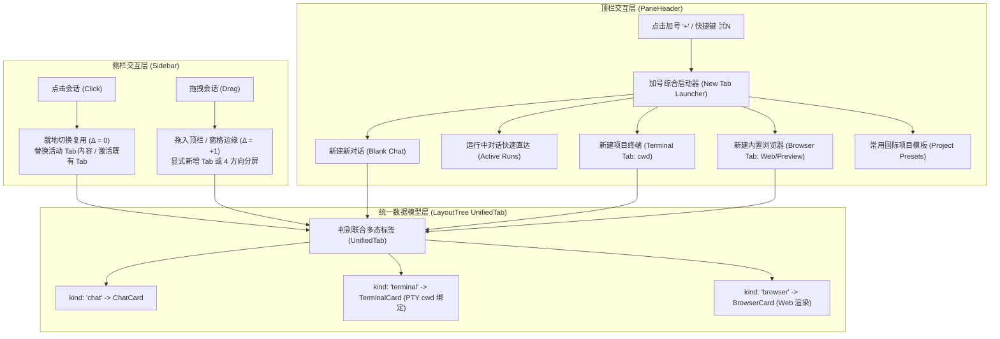

# 顶栏标签管理与加号启动器重构总方案

> **文档位置**：`docs/tab-management-and-launcher-redesign/00-顶栏标签管理与加号启动器重构总方案.md`  
> **所属战役**：`docs/tab-management-and-launcher-redesign/`  
> **评审终审评级**：S+ 级（综合加权评分 96.00 / 100，全票通过）  
> **核心原则**：就地复用守恒律、显式创建权、判别联合一等公民模型、轻量三层 Popover 启动器、零补丁净收敛。

---

## 1. 现状痛点与重构核心目标

### 1.1 核心痛点回顾
1. **侧栏点击标签无限滋生**：既有 `workspaceShellStore.openSession` 在会话未在树中打开时无条件向叶子 `tabs` 追加新 Tab，导致用户在侧边栏切换会话时，顶栏迅速挤满 Tab 药丸，几何排版崩塌，极度消耗心智与系统渲染资源；
2. **缺乏显式创建与综合启动入口**：加号直接粗暴切入未提交草稿态，无法便捷开启终端、浏览器，缺乏对后台运行中会话的全局感知，也没有常用项目快速初始化模板；
3. **终端与浏览器呈二等公民态**：此前主要作为侧边抽屉（Dock）或独立页面，无法作为标准标签与大模型聊天标签平齐分屏、自由拖拽。

### 1.2 目标架构拓扑（Target Architecture）



---

## 2. 评选胜出的四大核心决策（Winning Decisions）

经过多 Agent 方案竞赛与独立 Jury 评选，确立以下终审裁决：

### 2.1 决策一：极简纯粹就地复用（In-Place Reuse）
- **常规侧栏点击**：若目标会话已在树中任意标签打开，直接聚焦激活该标签；若未打开，直接就地修改当前活动 Tab 的会话指向（`sessionId`、`title`、`workspaceKey`），保持 Tab 数量恒定（$\Delta = 0$）；
- **草稿态平滑物化**：若当前窗格处于空白草稿态（`activeTabId: ''`），点击侧栏会话直接将草稿槽物化填充，不留存脏草稿（$\Delta = +1$），精准兑现用户显式新建的意图；
- **显式创建严格收窄**：只有主动点击加号、快捷键（`Ctrl/Cmd+T`、`Ctrl/Cmd+N`）、或拖拽会话卡片至 TabStrip 或窗格边缘时，才产生新 Tab。

### 2.2 决策二：判别联合型多态标签模型（UnifiedTab Polymorphism）
- 彻底摒弃 URI 字符串前缀（`terminal:1`）的打补丁模式，重构 `SessionTab` 为高内聚的 `UnifiedTab` 判别联合：
  ```typescript
  export type UnifiedTab =
    | ChatTab
    | TerminalTab
    | BrowserTab;

  export interface BaseTab {
    readonly tabId: string;
    readonly title: string;
    readonly workspaceKey?: string;
    readonly dock?: Partial<RightToolDockState>;
  }

  export interface ChatTab extends BaseTab {
    readonly kind: 'chat';
    readonly sessionId: string;
  }

  export interface TerminalTab extends BaseTab {
    readonly kind: 'terminal';
    readonly terminalKey: string;
    readonly cwd: string;
  }

  export interface BrowserTab extends BaseTab {
    readonly kind: 'browser';
    readonly url: string;
    readonly favicon?: string;
  }
  ```
- `TreeLeafPanel` 遵从 G-08 动态视图解析规范，基于 `resolveTabView` 动态挂载对应视图。

### 2.3 决策三：轻量三层 Popover 启动器（New Tab Quick Launcher）
- 点击加号触发 Radix 浮层（336px 黄金宽度），提供：
  1. **Header 核心动作区**：新建对话（`⌘N`）、新建终端（`⌃\``）、新建浏览器（`⌥B`）；
  2. **Section 运行中对话区**：实时感知后台处于生成、思考或工具执行中的会话，显示动态微光呼吸灯，一键直达；
  3. **Footer 项目预置区**：精选 4 个通用模板，点击快速初始化工作区。
- 键盘无障碍漫游（`↑`/`↓`/`Enter`/`Esc`），严格遵循 Conex 规范（§12 自定义 Tooltip、§13 克制软阴影与边框、§14 现代 CSS 语法）。

### 2.4 决策四：后台流式无头解耦与确定性进程管理
- **就地切换后台保活**：切走当前会话时不发送 `cancel()`，后台继续接收 Tokens 写入 Store；侧栏保留转动微光，切回即刻呈现最新累积内容；
- **终端与浏览器资源清理**：关闭 Tab 时两阶段析构（前端释放 xterm/WebGL/iframe，后端显式 kill PTY 进程并由 OS Job Object 回收子进程），杜绝任何僵尸进程。

---

## 3. 分维实现详案映射

本总方案拆解为 3 大落地分维详案：
- [`01-会话就地切换与标签生命周期详案.md`](./01-会话就地切换与标签生命周期详案.md)
- [`02-加号综合启动器Popover交互与视觉详案.md`](./02-加号综合启动器Popover交互与视觉详案.md)
- [`03-终端与浏览器一等公民标签页模型详案.md`](./03-终端与浏览器一等公民标签页模型详案.md)

---

## 4. 全量质量门禁与验收断言（Verification Matrix）

1. **类型安全性**：`npm run typecheck` 11 个工程全量 0 报错；
2. **标签数量守恒断言**：连续点击侧边栏 10 个未开过的会话，顶栏 Tab 数量恒定保持为 1，DOM 节点无异常抖动；
3. **显式创建与分屏断言**：点击加号或拖拽会话分别正确创建新 Tab 与 4 方向分屏；
4. **启动器交互断言**：键盘完全可导航，点击各选项分别正确开启新草稿、终端、浏览器或直达运行中会话；
5. **桌面全量治理门禁**：`npm run check:desktop`、`check:preferences-ssot`、`check:convergence` 100% 绿灯。
