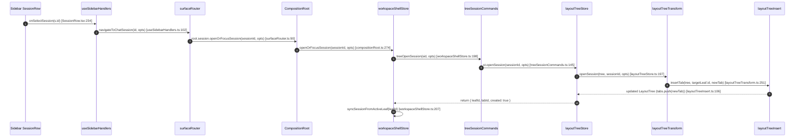
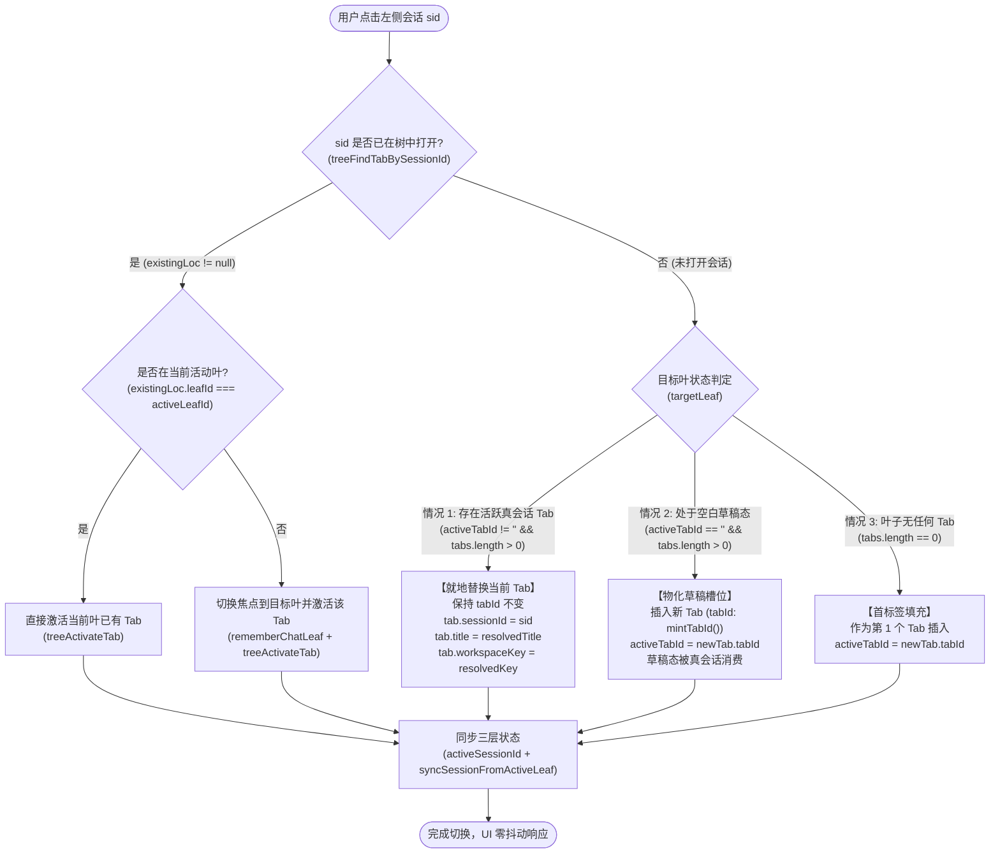
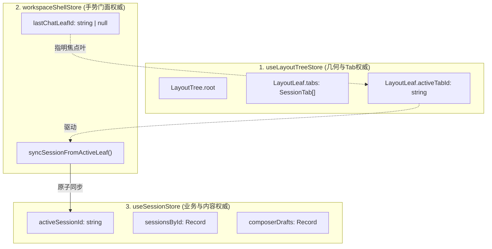
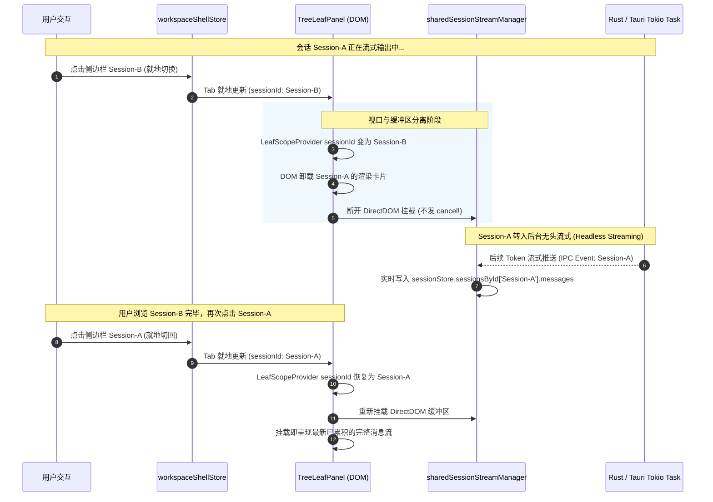
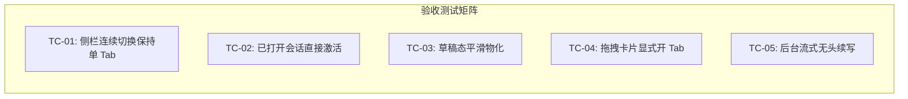

# 会话切换与标签栏就地复用架构分析

> **战役工作区**：`docs/tab-management-and-launcher-redesign/`  
> **文档位置**：`docs/tab-management-and-launcher-redesign/analysis/01-会话切换与标签栏就地复用架构分析.md`  
> **角色归属**：会话切换与标签栏就地复用架构分析师  
> **核心诉求**：点击左侧对话列表时顶栏会多出一个标签，导致切换对话时标签无限滋生；用户不点加号/快捷键/拖拽时，尽量不在顶部添加标签，实现就地复用切换。  
> **遵循规范**：根目录 `AGENTS.md`、`.agents/LOGIC_PLAN_NO_RETREAT.md`、`ANTI_OVERENGINEERING_GUARDRAILS.md`。

---

## 一、现状病灶深度剖析与根因链条（Root Cause Analysis）

### 1.1 物理调用链追踪与源码定位

在当前架构中，用户在左侧侧边栏列表（`SidebarSessionList`）中单击任意历史会话时，顶栏窗格会无节制地新增标签页。通过对完整交互链路的静态与动态追踪，完整的函数调用链如下：



#### 关键源码节点深度审视：

1. **入口层** [`apps/crish-desktop/src/components/sidebar/useSidebarHandlers.ts:98-125`](file:///c:/Software/conex/apps/crish-desktop/src/components/sidebar/useSidebarHandlers.ts#L98-L125)：
   ```typescript
   const handleSelectSession = useCallback(
     (id: string) => {
       const root = getCompositionRoot();
       const target = root.session.getState().sessionsById[id];
       navigateToChatSession(id, {
         title: target?.title,
         workspaceKey:
           target?.folder || currentWorkspaceFolderKey(getActiveProjectId()),
       });
       // ... 折叠展开逻辑
     },
     [...]
   );
   ```
   侧边栏单选会话后，直接调用 `navigateToChatSession`，并未传递任何指示是“新开标签”还是“就地复用”的上下文选项（`options` 为空）。

2. **路由与门面层** [`apps/crish-desktop/src/store/workspace-shell/workspaceShellStore.ts:156-208`](file:///c:/Software/conex/apps/crish-desktop/src/store/workspace-shell/workspaceShellStore.ts#L156-L208)：
   ```typescript
   openOrFocusSession: (sessionId, opts) => {
     const sid = (sessionId || '').trim();
     if (!sid || isPendingDraft(sid)) return;
     // ...
     const existingLoc = treeFindTabBySessionId(sid);
     const existingLeafId = existingLoc?.leafId ?? null;
     if (
       existingLoc &&
       existingLeafId &&
       (!opts?.activeLeafId || opts.activeLeafId === existingLeafId)
     ) {
       // 分支 1：如果已经在某个 Tab 打开，则仅仅激活现有 Tab
       treeActivateTab(existingLeafId, existingLoc.tab.tabId);
       rememberChatLeaf(set, existingLeafId);
       useSessionStore.getState().setActiveSessionId(sid);
       useLayoutStore.getState().setChatMainSurface('chat');
       syncSessionFromActiveLeaf(existingLeafId);
       return;
     }

     const targetLeaf = opts?.activeLeafId
       ? { id: opts.activeLeafId }
       : resolveActiveChatLeaf(get().lastChatLeafId);

     // 分支 2：如果该会话尚未在任何 Tab 中打开，无条件调用 treeOpenSession
     const result = treeOpenSession(sid, {
       title,
       workspaceKey,
       activeLeafId: targetLeaf.id,
       insertIdx: opts?.insertIdx,
     });
     rememberChatLeaf(set, result.leafId);
     useSessionStore.getState().setActiveSessionId(sid);
     useLayoutStore.getState().setChatMainSurface('chat');
     syncSessionFromActiveLeaf(result.leafId);
   },
   ```

3. **树变换纯函数层** [`apps/crish-desktop/src/store/layout-tree/layoutTreeTransform.ts:195-258`](file:///c:/Software/conex/apps/crish-desktop/src/store/layout-tree/layoutTreeTransform.ts#L195-L258)：
   ```typescript
   export function openSession(
     tree: LayoutTree,
     sessionId: string,
     opts: {
       title?: string;
       workspaceKey?: string;
       activeLeafId: string;
       insertIdx?: number;
     }
   ): { tree: LayoutTree; leafId: string; tabId: string; created: boolean } {
     const existing = findTabBySessionId(tree.root, sessionId);
     if (existing) {
       // ... 存在则激活或移动
     }
     const chatLeaves = collectLeaves(tree.root).filter((l) => l.panelId === 'chat');
     const targetLeaf =
       chatLeaves.find((l) => l.id === opts.activeLeafId) ?? chatLeaves[0];
     if (!targetLeaf) {
       return { tree, leafId: opts.activeLeafId, tabId: '', created: false };
     }
     // 核心病灶：如果不在树中，一律无条件实例化新 SessionTab 并 push 进 leaf.tabs
     const newTab = createSessionTab({
       sessionId,
       title: opts.title,
       workspaceKey: opts.workspaceKey,
     });
     const nextTree = insertTab(tree, targetLeaf.id, newTab, opts.insertIdx);
     return {
       tree: nextTree,
       leafId: targetLeaf.id,
       tabId: newTab.tabId,
       created: true,
     };
   }
   ```

4. **追加插入层** [`apps/crish-desktop/src/store/layout-tree/layoutTreeInsert.ts:85-116`](file:///c:/Software/conex/apps/crish-desktop/src/store/layout-tree/layoutTreeInsert.ts#L85-L116)：
   ```typescript
   export function insertTab(
     tree: LayoutTree,
     leafId: string,
     tab: SessionTab,
     insertIdx?: number
   ): LayoutTree {
     const leaf = requireChatLeaf(tree.root, leafId);
     // ...
     const tabs = [...leaf.tabs];
     const idx = insertIdx;
     if (
       idx === undefined ||
       !Number.isFinite(idx) ||
       idx < 0 ||
       idx > tabs.length
     ) {
       tabs.push(tab);
     } else {
       tabs.splice(idx, 0, tab);
     }
     const updated: LayoutLeaf = {
       ...leaf,
       tabs,
       activeTabId: tab.tabId,
     };
     return { ...tree, root: replaceNode(tree.root, leafId, updated) };
   }
   ```

### 1.2 现有单向追加模型（Append-Only）对系统的负面影响

当前系统的核心设计假设是将顶栏标签视为**会话历史浏览栈（Browser-like Unconditional History Stack）**，而不是**受控视图槽位（Controlled Viewport Slots）**。这种设计带来了四个维度的严重破坏：

1. **顶栏视觉溢出与排版崩塌（Tab Strip Degeneration）**：
   - 在 [`PaneHeader.tsx:233-234`](file:///c:/Software/conex/apps/crish-desktop/src/components/binary-tree/PaneHeader.tsx#L233-L234) 中，`computeNaturalTabWidth(visibleTabs.length, currentMeasuredWidth)` 根据容器宽度和标签总数动态计算单个标签宽度 `--pane-tab-item-width`；
   - 当用户在侧边栏快速翻阅 10~20 个会话时，`visibleTabs.length` 达到 20，单个 Tab 宽度被硬性压缩至极限小值（例如 30px~40px），文字被全部截断省略，图标重叠挤压，完全丧失了标签栏辨识与切换功能；
   - 严重破坏了用户在 UI 交互规范中要求的“高可读性”、“圆角胶囊”与“克制边框”的视觉标准。

2. **内存与虚拟 DOM 驻留压力（Memory & VDOM Leaks）**：
   - 尽管当前会话视图只渲染活动标签（`TreeLeafPanel` 中根据 `activeTabId` 渲染 `ChatCard`），但顶栏的 `PaneHeader` 必须遍历 `visibleTabs` 渲染全部 `PaneTabItem`；
   - 每个 Tab 项挂载独立的 DOM 节点、无障碍属性监听、右键/中键事件处理器、拖拽传感器、离场动画 `@starting-style` 与 `transitionend` 监听器；
   - 标签数过大导致渲染重排（Forced Reflow）开销剧增，尤其是关闭某一标签或触发拖拽时，整栏几何重算极其迟钝。

3. **用户心智模型与操作负担倒挂（Cognitive Load & Fatigue）**：
   - **用户意图与系统响应的严重错位**：用户点击侧边栏的心理预期是“**跳转并查看该对话**”（View Navigation），而不是“**我想在顶上钉住一个新的标签**”（Pin/Open Tab）；
   - 用户翻阅侧边栏 15 个会话进行快速查阅后，顶栏堆积了 15 个标签，用户必须机械地连续点击 14 次“X”关闭按钮才能清理工作区，造成极度负面的交互体验。

4. **既有测试契约的历史局限**：
   - 在 [`workspaceShellStore.test.ts:394-440`](file:///c:/Software/conex/apps/crish-desktop/src/store/workspace-shell/workspaceShellStore.test.ts#L394-L440) 中，单元测试将“未放置进活动叶追加新 Tab”作为既成事实予以断言（`expect(leafB.tabs.map((t) => t.sessionId)).toEqual(['s2', 's3'])`）；
   - 该测试固化了无条件追加的旧有实现，缺乏显式“就地复用（In-Place Reuse）”与“显式新增（Explicit Creation）”的区分契约。

---

## 二、会话就地复用与显式创建的架构设计（Architecture Design）

### 2.1 双轨制标签生命周期原则（The Dual-Track Lifecycle Principles）

重构后的标签生命周期彻底遵循以下核心宪法：

> [!IMPORTANT]
> **标签生命周期核心宪法**：
> 1. **浏览导航一律就地复用（In-Place Reuse by Default）**：点击侧边栏、快捷搜索跳转等常规导航手势，顶栏 Tab 数量保持恒定，当前活动 Tab 的内容就地替换；
> 2. **标签数量增加必须显式触发（Explicit Gestures for New Tabs）**：只有用户显式发出创建意图（加号、快捷键、拖拽卡片），顶栏才允许新增 Tab。

#### 交互手势与标签生命周期映射矩阵：

| 触发手势 / 用户操作 | 意图类型 | 目标行为（Target Action） | 顶栏 Tab 数量变化 | 详细机制 |
| :--- | :--- | :--- | :--- | :--- |
| **侧栏对话卡片常规单击** | 查看/切换 | **就地复用（In-Place Reuse）** | **$\Delta = 0$**（保持不变） | 若已在某 Tab 打开则 Focus；否则就地替换当前叶活跃 Tab 的会话内容 |
| **侧栏对话卡片键盘上下导航** | 连续翻阅 | **就地复用（In-Place Reuse）** | **$\Delta = 0$**（保持不变） | 当前 Tab 连续重定向，Tab 数量始终恒定 |
| **点击已被某 Tab 打开的会话** | 定位激活 | **直接聚焦（Direct Focus）** | **$\Delta = 0$**（保持不变） | 直接激活已存在的 Tab；若在另一分屏，则转移窗格焦点 |
| **在空白草稿态点击侧栏会话** | 草稿填充 | **平滑物化（Smooth Materialization）** | **$\Delta = +1$**（从草稿态物化） | 将空白草稿槽位直接填充为该会话，不残留脏草稿 |
| **点击顶栏“+”加号按钮** | 显式新建 | **进入新草稿（Enter Draft Composer）** | 展现草稿界面（`activeTabId: ''`） | 弹出 Quick Launcher 启动器或进入空白草稿界面 |
| **快捷键 `Ctrl/Cmd+T`** | 显式新建 | **进入新草稿（Enter Draft Composer）** | 展现草稿界面（`activeTabId: ''`） | 同加号按钮行为，提供键盘高速通道 |
| **拖拽卡片至顶栏 Tab Strip** | 显式开 Tab | **指定下标插入（Tab Insertion）** | **$\Delta = +1$**（显式新增） | 按照拖拽放置游标（Drop Indicator）插入真实会话 Tab 并激活 |
| **拖拽卡片至窗格边框（Split）** | 显式分屏 | **切分新建叶（Pane Split）** | 新窗格包含 1 个 Tab | 触发 `splitTab` 或 `splitSessionFromSidebar` |
| **中键单击 / `Ctrl+单击` 侧栏卡片** | 极客开 Tab | **后台打开（Open in Background Tab）** | **$\Delta = +1$**（显式新增） | 在当前活动叶末尾插入新 Tab，但焦点保持在当前会话（可选高级交互） |

---

### 2.2 就地切换复用（In-Place Reuse）状态机与算法推导

#### 状态转移全景图：



#### 算法分支详解：

##### 分支 A：全局已打开会话（Direct Focus）
若用户点击的会话已经在任意一个分屏叶子中打开（`existingLoc != null`）：
- **绝对不创建新标签，也不修改当前标签**；
- 若处于相同叶子：调用 `treeActivateTab(leafId, existingLoc.tab.tabId)`；
- 若处于不同叶子：先转移全局焦点叶 `rememberChatLeaf(leafId)`，随后激活该叶子中的该 Tab；
- 避免同一个 `sessionId` 在整棵树中重复出现（坚决捍卫不变量 $\text{Inv}_2$）。

##### 分支 B：当前叶存在活跃 Tab（In-Place Tab Reuse）
若用户点击的会话从未在树中打开，且当前叶节点存在活跃标签（`targetLeaf.activeTabId != ''`）：
- **槽位保持机制（Slot Preservation）**：不修改 `leaf.tabs` 的数组长度，也不重新生成 `tabId`；
- **就地投影修改**：仅更新当前活跃 Tab 的属性：
  ```typescript
  const updatedTabs = leaf.tabs.map((tab) =>
    tab.tabId === leaf.activeTabId
      ? {
          ...tab,
          sessionId: sid,
          title: resolvedTitle,
          workspaceKey: resolvedWorkspaceKey,
          // dock: 可选择保持当前抽屉展开状态，或重置为会话默认坞
        }
      : tab
  );
  ```
- **视图性能增益**：
  - `PaneHeader` 接收到的 `visibleTabs` 长度完全一致，不触发 Tab 条带的 flex 宽度重排动画；
  - `PaneTabItem` 的 `key={tab.tabId}` 保持不变，React DOM 节点复用，仅发生微小的文字更新，彻底杜绝闪烁；
  - 下层 `TreeLeafPanel` 的 `LeafScopeProvider` 捕获到新的 `effectiveSessionId`，驱动 `ChatCard` 纯粹地切换会话数据源。

##### 分支 C：空白新草稿态平滑物化（Smooth Draft Materialization）
若当前叶节点处于草稿态（用户先前按了“+”加号或 `Ctrl+T`，导致 `leaf.activeTabId === ''`）：
- 用户先前触发了新建手势，但尚未键入消息，此时在左侧点击历史会话；
- **用户心智模型推导**：用户此时是“借由新建的空位来打开此历史会话”；
- **物化动作**：
  1. 调用 `createSessionTab({ sessionId: sid, title, workspaceKey })`；
  2. 插入到 `targetLeaf.tabs` 中（追加在末尾或加号原定槽位）；
  3. 将 `targetLeaf.activeTabId` 设为此新建的 `tabId`；
  4. 清理 `sessionStore.enterDraftMode` 的哨兵残留，使 `activeSessionId` 顺畅对齐为真实 `sid`；
  5. 顶栏 Tab 数量由 $N$ 变为 $N+1$，精准兑现了加号的新开意图，且没有遗留任何垃圾草稿 Tab。

---

## 三、接口改造与数据流定义（Contract & Interface Refactoring）

### 3.1 `workspaceShellStore` 门面接口契约升级

在 [`workspaceShellStore.ts`](file:///c:/Software/conex/apps/crish-desktop/src/store/workspace-shell/workspaceShellStore.ts) 中，扩展 `OpenSessionOpts`，赋予外部指定打开模式的能力，并默认启用就地复用。

```typescript
export type TabOpenMode = 
  | 'reuse'   // 默认：优先就地复用活动 Tab（侧边栏点击、历史导航）
  | 'create'  // 强制显式新开 Tab（快捷键、拖拽放置、中键点击）
  | 'auto';   // 智能：草稿态则物化，有活跃 Tab 则复用

export interface OpenSessionOpts {
  title?: string;
  workspaceKey?: string;
  activeLeafId?: string;
  insertIdx?: number;
  split?: 'left' | 'right' | 'top' | 'bottom';
  /**
   * 标签打开模式（默认为 'reuse'）
   */
  mode?: TabOpenMode;
}

export interface WorkspaceShellStore {
  // ... 既有字段保持
  /**
   * 打开或聚焦会话（核心门面）
   * @param sessionId 真实会话 ID
   * @param opts 包含 mode 的配置选项
   */
  openOrFocusSession: (sessionId: string, opts?: OpenSessionOpts) => void;
  
  /**
   * 显式新开会话 Tab（语义化快捷入口，等价于 mode: 'create'）
   */
  openSessionInNewTab: (sessionId: string, opts?: Omit<OpenSessionOpts, 'mode'>) => void;
}
```

### 3.2 `layoutTreeTransform` 纯函数层算法升级

在 [`layoutTreeTransform.ts`](file:///c:/Software/conex/apps/crish-desktop/src/store/layout-tree/layoutTreeTransform.ts) 中，升级 `openSession` 纯函数，注入就地复用分支：

```typescript
export interface OpenSessionResult {
  tree: LayoutTree;
  leafId: string;
  tabId: string;
  created: boolean;
  reused: boolean;
}

export function openSession(
  tree: LayoutTree,
  sessionId: string,
  opts: {
    title?: string;
    workspaceKey?: string;
    activeLeafId: string;
    insertIdx?: number;
    mode?: TabOpenMode;
  }
): OpenSessionResult {
  const mode = opts.mode ?? 'reuse';

  // 1. 全局去重激活守卫（捍卫 I1 / Inv_2）
  const existing = findTabBySessionId(tree.root, sessionId);
  if (existing) {
    const isDifferentLeaf = opts.activeLeafId && existing.leaf.id !== opts.activeLeafId;
    const isDifferentIndex =
      opts.insertIdx !== undefined &&
      existing.leaf.tabs.findIndex((t) => t.tabId === existing.tab.tabId) !== opts.insertIdx;

    if (isDifferentLeaf || isDifferentIndex) {
      // 跨分屏或指定下标的显式移动
      const targetLeafId = opts.activeLeafId || existing.leaf.id;
      const targetTabs =
        collectLeaves(tree.root).find((l) => l.id === targetLeafId)?.tabs.length ?? 0;
      const finalInsertIdx = opts.insertIdx !== undefined ? opts.insertIdx : targetTabs;

      const movedTree = moveTab(
        tree,
        existing.leaf.id,
        existing.tab.tabId,
        targetLeafId,
        finalInsertIdx
      );
      return {
        tree: movedTree,
        leafId: targetLeafId,
        tabId: existing.tab.tabId,
        created: false,
        reused: false,
      };
    }
    const nextTree = activateTabInTree(tree, existing.leaf.id, existing.tab.tabId);
    return {
      tree: nextTree,
      leafId: existing.leaf.id,
      tabId: existing.tab.tabId,
      created: false,
      reused: false,
    };
  }

  // 2. 定位目标叶
  const chatLeaves = collectLeaves(tree.root).filter((l) => l.panelId === 'chat');
  const targetLeaf =
    chatLeaves.find((l) => l.id === opts.activeLeafId) ?? chatLeaves[0];
  if (!targetLeaf) {
    return { tree, leafId: opts.activeLeafId, tabId: '', created: false, reused: false };
  }

  // 3. 核心分水岭：就地复用 vs 显式创建
  const hasActiveTab = Boolean(
    targetLeaf.activeTabId &&
    targetLeaf.tabs.some((t) => t.tabId === targetLeaf.activeTabId)
  );

  if (mode === 'reuse' && hasActiveTab) {
    // 【就地复用分支】
    const currentActiveTab = targetLeaf.tabs.find((t) => t.tabId === targetLeaf.activeTabId)!;
    const updatedTabs = targetLeaf.tabs.map((tab) =>
      tab.tabId === targetLeaf.activeTabId
        ? {
            ...tab,
            sessionId,
            title: opts.title || tab.title,
            workspaceKey: opts.workspaceKey || tab.workspaceKey,
          }
        : tab
    );
    const updatedLeaf: LayoutLeaf = {
      ...targetLeaf,
      tabs: updatedTabs,
    };
    return {
      tree: { ...tree, root: replaceNode(tree.root, targetLeaf.id, updatedLeaf) },
      leafId: targetLeaf.id,
      tabId: currentActiveTab.tabId,
      created: false,
      reused: true,
    };
  }

  // 【显式创建 / 草稿物化分支】
  const newTab = createSessionTab({
    sessionId,
    title: opts.title,
    workspaceKey: opts.workspaceKey,
  });
  const nextTree = insertTab(tree, targetLeaf.id, newTab, opts.insertIdx);
  return {
    tree: nextTree,
    leafId: targetLeaf.id,
    tabId: newTab.tabId,
    created: true,
    reused: false,
  };
}
```

---

## 四、状态一致性与防回归设计（State Invariants & Synchronization）

### 4.1 三大 Store 权威关系与单一真理源（SSOT）

在 Conex 桌面端架构中，涉及会话与标签展示的一共有三个核心状态存储：



#### 四层刚性不变量（Hard Invariants）：

- $\text{Inv}_1$（**焦点与内容同轴**）：在任何用户操作完成后的 Microtask 边界，`workspaceShellStore.lastChatLeafId` 所指的活动叶中，其 `activeTabId` 对应的 `SessionTab.sessionId` 必须与 `useSessionStore.activeSessionId` 完全一致（草稿态则同为草稿哨兵）；
- $\text{Inv}_2$（**全树全局唯一性 / I1 入口**）：除草稿哨兵外，任意合法真实 `sessionId` 在整棵 `LayoutTree` 的所有叶子节点的 `tabs` 列表中，**最多只能出现一次**；
- $\text{Inv}_3$（**活跃指针合法性**）：`LayoutLeaf.activeTabId` 要么是空字符串 `''`（且仅当处于未提交新对话草稿态），要么必须严格属于该叶子 `tabs` 中某个对象的 `tabId`，严禁悬空指针；
- $\text{Inv}_4$（**标签数量守恒律**）：在未触发 `+` 加号、快捷键新建或拖拽操作的前提下，任何侧边栏会话点选导航操作，全树的 `tabs` 节点总数严格满足：
  $$\sum_{L \in \text{Leaves}} |L.\text{tabs}|_{\text{after}} \le \sum_{L \in \text{Leaves}} |L.\text{tabs}|_{\text{before}}$$
  （当处于草稿物化时 $\Delta = +1$，当就地复用时 $\Delta = 0$）。

---

## 五、极端边界与流式任务安全解绑（Streaming & Edge Cases）

在会话就地切换的设计中，最敏感、最具挑战性的边界在于：**如果当前正在进行大模型流式输出（Streaming），用户从侧边栏点击另一会话进行就地切换，系统如何保证正在运行的任务不中断，同时新会话干净展现？**

### 5.1 视口解绑（Viewport Detachment）与后台无头流式（Headless Streaming）

在现有的流式架构中，底层由 [`apps/crish-desktop/src/api/sessionStreamManager.ts`](file:///c:/Software/conex/apps/crish-desktop/src/api/sessionStreamManager.ts) 和 [`apps/crish-desktop/src/hooks/chat-stream/sessionStreamManager.ts`](file:///c:/Software/conex/apps/crish-desktop/src/hooks/chat-stream/sessionStreamManager.ts) 统一管理：



#### 关键安全防护措施：

1. **严禁级联 Abort / Cancel 信号**：
   - 绝不能将组件 Unmount 与流式中断绑定；
   - 只有用户在 UI 上显式点击“停止生成（Stop）”按钮，或调用 `cancelStream(sessionId)` 时，才向 Rust 后端下发 `StreamCancelFn`；
   - 就地切换触发的组件销毁，仅解除前台 DOM 引用，后台任务完全自治运行。

2. **`StreamRenderBuffer` 的无头缓冲保护**：
   - 参考 [`sessionStreamManager.ts:47-57`](file:///c:/Software/conex/apps/crish-desktop/src/hooks/chat-stream/sessionStreamManager.ts#L47-L57)，`sessionRenderBuffers` 按 `sessionId` 单独隔离；
   - 当前台切换时，调用 `buffer.detachDom()` 脱离 DOM 树挂载，缓存区直接将后续增量 Token 降级写入 `sessionStore` 的状态镜像中，避免出现向已卸载 DOM 节点写入抛错。

3. **侧边栏运行态指示器（Running Indicator）联动**：
   - 依据 [`SessionRow.tsx:228`](file:///c:/Software/conex/apps/crish-desktop/src/components/sidebar/session-list/SessionRow.tsx#L228)：
     `const isRunning = s.messages?.some((m) => m.status === 'processing') ?? false;`
   - 当会话切入后台无头流式状态时，侧边栏对应项仍然保持微光旋转动画或状态角标；
   - 与后续分维详案 `02-加号Popover启动器` 中的“运行中对话快速导航”无缝融合，用户随时可以一键切回正在运行的任务。

### 5.2 输入框草稿（Composer Draft）的无损暂存与隔离

在就地切换会话时，用户在当前输入框未发出的草稿文本不能丢失，也不能串入新会话：

- 在切换动作触发前，当前输入框内容被即时回填至 `useSessionStore.getState().setComposerDraft(oldSessionId, text)`；
- 切入新会话后，输入框重置并读取 `useSessionStore.getState().composerDrafts[newSessionId] || ''` 进行回填；
- 完美实现会话间草稿的无感知平滑迁移。

---

## 六、验收断言与防回归测试矩阵（Acceptance Criteria & Test Matrix）

为确保就地复用机制的落地零隐患、零回归，制定以下立体化验证矩阵：



### 6.1 单元测试断言设计（Vitest）

```typescript
describe('会话就地复用与标签生命周期 (In-Place Reuse & Tab Lifecycle)', () => {
  it('TC-01: 单叶下连续点击 5 个未打开会话，Tab 总数严格保持为 1', () => {
    const store = useWorkspaceShellStore.getState();
    store.openOrFocusSession('s-1');
    const leaf1 = getActiveChatLeaf();
    expect(leaf1.tabs).toHaveLength(1);
    expect(leaf1.tabs[0]!.sessionId).toBe('s-1');

    // 连续在侧边栏点击 4 个新会话
    store.openOrFocusSession('s-2');
    store.openOrFocusSession('s-3');
    store.openOrFocusSession('s-4');
    store.openOrFocusSession('s-5');

    const leafFinal = getActiveChatLeaf();
    // 刚性断言：Tab 数量恒定为 1，不滋生新标签
    expect(leafFinal.tabs).toHaveLength(1);
    expect(leafFinal.tabs[0]!.sessionId).toBe('s-5');
    expect(leafFinal.activeTabId).toBe(leafFinal.tabs[0]!.tabId);
    expect(useSessionStore.getState().activeSessionId).toBe('s-5');
  });

  it('TC-02: 存在 2 个 Tab 时，点击未打开会话仅就地替换当前活跃 Tab', () => {
    // 构造 [Tab-A (s1), Tab-B (s2)]，当前激活 Tab-B
    setupTreeWithTabs([
      { tabId: 't1', sessionId: 's1' },
      { tabId: 't2', sessionId: 's2' },
    ], 't2');

    useWorkspaceShellStore.getState().openOrFocusSession('s3');

    const leaf = getActiveChatLeaf();
    expect(leaf.tabs).toHaveLength(2); // 总数依然是 2
    expect(leaf.tabs[0]!.sessionId).toBe('s1'); // Tab-A 保持不变
    expect(leaf.tabs[1]!.tabId).toBe('t2'); // Tab-B 槽位保持不变
    expect(leaf.tabs[1]!.sessionId).toBe('s3'); // Tab-B 就地复用为 s3
    expect(leaf.activeTabId).toBe('t2');
  });

  it('TC-03: 点击已在其他 Tab 或分屏打开的会话，直接激活而不修改任何内容', () => {
    setupTreeWithTabs([
      { tabId: 't1', sessionId: 's1' },
      { tabId: 't2', sessionId: 's2' },
    ], 't2');

    // 点击已经在 t1 打开的 s1
    useWorkspaceShellStore.getState().openOrFocusSession('s1');

    const leaf = getActiveChatLeaf();
    expect(leaf.tabs).toHaveLength(2);
    expect(leaf.tabs[0]!.sessionId).toBe('s1');
    expect(leaf.tabs[1]!.sessionId).toBe('s2');
    expect(leaf.activeTabId).toBe('t1'); // 直接聚焦 t1
  });

  it('TC-04: 点击加号进入草稿态后，点击侧栏会话平滑物化，Tab 总数从 N 变为 N+1', () => {
    setupTreeWithTabs([{ tabId: 't1', sessionId: 's1' }], 't1');
    
    // 用户点击加号
    useWorkspaceShellStore.getState().openNewDraftTab();
    const leafDraft = getActiveChatLeaf();
    expect(leafDraft.activeTabId).toBe(''); // 进入草稿态

    // 用户在侧栏点击 s2
    useWorkspaceShellStore.getState().openOrFocusSession('s2');
    const leafMaterialized = getActiveChatLeaf();
    expect(leafMaterialized.tabs).toHaveLength(2);
    expect(leafMaterialized.tabs[1]!.sessionId).toBe('s2');
    expect(leafMaterialized.activeTabId).toBe(leafMaterialized.tabs[1]!.tabId);
  });

  it('TC-05: 显式拖拽卡片到 TabStrip 时，即便已有活跃 Tab 也执行插入', () => {
    setupTreeWithTabs([{ tabId: 't1', sessionId: 's1' }], 't1');

    // 模拟拖拽放置（mode: 'create'）
    useWorkspaceShellStore.getState().openOrFocusSession('s2', { mode: 'create' });

    const leaf = getActiveChatLeaf();
    expect(leaf.tabs).toHaveLength(2);
    expect(leaf.tabs.map((t) => t.sessionId)).toEqual(['s1', 's2']);
  });
});
```

---

## 七、架构演进与后续分维详案衔接（Roadmap & Handoff）

本技术架构分析报告为**顶栏标签管理与加号启动器重构战役**提供了坚实的第一支柱。各子任务的接口契约与后续分工衔接如下：

1. **衔接《02-加号Popover启动器交互与视觉设计方案.md》**：
   - 明确了点击加号“+”仅进入草稿或呼出 Popover，不预先向 `leaf.tabs` 插入空白脏数据；
   - 为 Popover 中的“② 运行中对话快速导航”提供了 `sharedSessionStreamManager` 和 `SessionRow.isRunning` 的状态感知接口。

2. **衔接《03-LayoutTree统一标签数据模型扩展方案.md》**：
   - 本文验证了保持 `tabId` 槽位稳定、就地替换 `sessionId` 的可行性；
   - 后续在支持终端（Terminal）与浏览器（Browser）标签时，`SessionTab` 可平滑泛化为 `UnifiedTab { tabId, kind: 'chat' | 'terminal' | 'browser', payload }`，完全继承本文的“就地复用”与“显式开 Tab”双轨制状态机。

3. **结论与实现指引**：
   - 彻底废除“侧栏点击即新增标签”的流毒设计；
   - 以极小、纯粹的架构改动（修改 `openSession` 纯函数分支判定与 `workspaceShellStore.openOrFocusSession` 门面参数），换取顶栏视觉与用户心智的全面净化。
