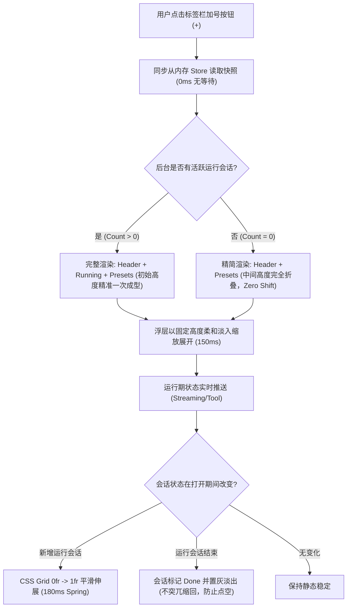

# 加号 Popover 综合启动器交互与视觉设计方案 (Launcher Popover Design Specification)

> **文档标识**：`docs/tab-management-and-launcher-redesign/analysis/02-加号Popover启动器交互与视觉设计方案.md`  
> **所属战役**：顶栏标签管理与加号启动器重构战役 (`docs/tab-management-and-launcher-redesign/`)  
> **设计角色**：【加号Popover启动器交互与视觉设计师】  
> **权威遵循**：根目录 `AGENTS.md`（§12 Tooltip、§13 输入框与焦点态、§14 现代 CSS 语法、§15-§16 调试通道）、`.agents/LOGIC_PLAN_NO_RETREAT.md`（反退避）、`ANTI_OVERENGINEERING_GUARDRAILS.md`（反过度设计）  
> **创建时间**：2026-10-25  

---

## 0. 设计定位与设计哲学

### 0.1 从“机械开标签”到“意图驱动启动中心”
在既往设计中，顶部标签栏右侧的“加号 `+`”按钮仅绑定单一的同步行为——直接在当前窗格中插入一个空白对话标签。这种模式存在三大局限：
1. **意图承载单一**：无法满足现代多模态 IDE 与智能体工作台中对终端（Terminal）、内置浏览器（Browser）、以及模板项目（Project Presets）的多样化创建诉求；
2. **后台多任务黑盒**：当后台有会话处于流式生成（Streaming）、长时间工具调用（Tool Execution）或子 Agent 派发中时，用户在标签栏完全不可见，被迫频繁翻看侧栏查找；
3. **空间与操作割裂**：缺乏类似 macOS Spotlight / Raycast 或现代化浏览器（如 Arc / Chrome Quick Action）的局部快速唤醒体验。

本方案将“加号 `+`”全面升级为 **加号 Popover 综合启动器（Launcher Popover）**，作为顶栏标签管理的核心枢纽，兼顾**高频动作直达**、**后台运行态实时感知**与**预置工作区快速拉起**。

### 0.2 Conex 视觉设计哲学严守
启动器浮层严格贯彻 Conex 桌面端设计规范：
- **三档底色与纯净中性灰（SSOT）**：使用 `var(--bg-elevated)`（灰度 2.0 / L 98% 纯白实色），搭配纯正中性暖灰描边 `var(--border-color)`（#e2e1e0），绝不引入蓝紫偏色；
- **克制阴影与微光材质**：采用双层扩散的柔和微阴影 `var(--shadow-popover)`（4% / 2% 投影量级），杜绝突兀重阴影；
- **柔和焦点态（<= 10% 混入，§13 铁律）**：聚焦边框绝不使用硬实黑线，仅使用 `color-mix(in srgb, var(--border-color) 92%, var(--text-primary) 8%)`，常规态悬浮叠加 `var(--tint-hover)`（3.5% 透明叠底）；
- **全站严禁原生 HTML `title`（§12 铁律）**：所有截断文字、状态徽标与快捷键悬浮提示，一律统一使用系统 `<Tooltip>` 组件；
- **现代色彩空间语法（§14 铁律）**：全面采用 HSLA 斜杠语法（`hsl(h s l / a)`）及感知均匀的 `oklch()` 状态色，杜绝遗留 `rgba()`。

---

## 1. 触发与锚点机制 (Trigger & Anchor Mechanism)

### 1.1 物理锚点与组件对接
在 `apps/crish-desktop/src/components/binary-tree/PaneHeader.tsx:482-491` 中，既有代码结构为：
```tsx
<Button
  type="button"
  variant="ghost"
  className={styles.newTabBtn}
  onClick={handleNewTab}
  aria-label="新对话"
  data-tauri-drag-region="false"
>
  <AppIcon name="plus" size={14} />
</Button>
```

#### 启动器集成方案
将加号按钮包装为 `@radix-ui/react-popover` 的 `Popover.Trigger`（`asChild` 直通），与 `apps/crish-desktop/src/components/ui/internal/layer-stack/LayerStackManager` 统一层叠调度接入：
1. **尺寸与流式排版保持恒定**：`.newTabBtn` 保持 `width: 28px; height: 28px; border-radius: 8px`，紧贴最后一个标签页流动，不打破既有 `paneHeaderGeometry.ts` 的宽度计算；
2. **快捷分流设计（双通道）**：
   - **普通单击（Left Click）**：打开 Launcher Popover 浮层，承载丰富意图选择；
   - **全局快捷键直达（`⌘N` / `Ctrl+N`）**：直接在当前叶创建并聚焦空白新对话，无需经过浮层，保证高频肌肉记忆 0 阻碍；
   - **浮层内首项默认激活（Instant Enter）**：浮层呼出后，默认高亮第 1 项【创建新对话】。用户只需按 `+` 紧接 `Enter`，总耗时 < 100ms。

### 1.2 空间定位与边界防溢出 (Geometry & Collision Rules)
- **挂载基准**：
  - `side="bottom"`（默认向下弹出）；
  - `align="start"`（与加号按钮左边缘平齐）；
  - `sideOffset=6`（保持 6px 呼吸空隙，避开标签栏底部分隔线）；
  - `collisionPadding=12`（四周预留 12px 视口安全衬距）。
- **视口自适应弹性（Collision Flip）**：
  - 当窗格处于屏幕底部或低视口高度时，Radix Popper 自动翻转至 `side="top"`，`transform-origin` 自动重置为 `bottom left`；
  - 当标签栏滚动至最右侧导致加号紧贴窗口右边框时，自动收敛为 `align="end"`，防止浮层右侧被裁切。
- **几何尺寸约束**：
  - **宽度（Width）**：固定锁定 `336px`（黄金阅读宽度，容纳 28px 图标、两行标题描述、状态指示点以及 52px 快捷键徽标不发生挤压）；
  - **最大高度（Max Height）**：`min(520px, calc(100vh - 80px))`，超长时内容区平滑委派给自定义 `ScrollArea`，禁止浏览器原生粗滚动条。

---

## 2. 界面结构与 ASCII 线框图 (Layout Architecture & Wireframe)

### 2.1 整体版块三层架构
Popover 内容区在纵向上清晰划分为 3 个逻辑区块，各区块以 1px `var(--border-subtle)` 分隔：
1. **Header / 核心动作区 (Primary Actions)**：【创建新对话】、【新建终端】、【新建浏览器】；
2. **Body / 运行中对话区 (Active Running Sessions)**：感知后台非当前标签的活跃会话（实时脉冲绿点 + 阶段进度）；
3. **Footer / 预置模板区 (Project Presets)**：精选 4 款常用国际项目模板，支持一键快速载入。

### 2.2 像素级 ASCII 结构线框图
```text
┌──────────────────────────────────────────────────────────────────┐
│  Launcher Popover (Width: 336px, Radius: 12px, Bg: Elevated)     │
├──────────────────────────────────────────────────────────────────┤
│ [Header: 核心动作区 (Primary Actions)]                            │
│                                                                  │
│  ┌───┐  创建新对话                                       ┌─────┐ │
│  │ ✍ │  空白草稿落地，开启 AI 智能探索                   │ ⌘N  │ │
│  └───┘                                                   └─────┘ │
│  ┌───┐  新建终端                                         ┌─────┐ │
│  │ >_│  在当前项目工作区根目录下开启 Shell 会话          │ ⌃`  │ │
│  └───┘                                                   └─────┘ │
│  ┌───┐  新建浏览器                                       ┌─────┐ │
│  │ 🌐│  内置轻量 Web 浏览与开发实时预览                  │ ⌥B  │ │
│  └───┘                                                   └─────┘ │
├──────────────────────────────────────────────────────────────────┤
│ [Section: 运行中对话 (Active Running Sessions - 仅在有任务时展示)]│
│  RUNNING NOW (2)                                      ● 实时同步 │
│                                                                  │
│  ┌─┐  重构 LayoutTree 状态模型...                       ┌──────┐ │
│  │●│  正在执行: cargo test --workspace (已耗时 14s)     │ ↵直达│ │
│  └─┘                                                    └──────┘ │
│  ┌─┐  Skyvern 网页端自动化调试流程...                   ┌──────┐ │
│  │●│  正在生成: 步骤分析报告 (Tokens: 1,420)            │ ↵直达│ │
│  └─┘                                                    └──────┘ │
├──────────────────────────────────────────────────────────────────┤
│ [Footer: 常用国际项目/预置模板 (Project Presets)]                │
│  PROJECT PRESETS                                                 │
│                                                                  │
│  ┌─────────────────────────────┐  ┌────────────────────────────┐ │
│  │ 🦀 Rust 微内核架构          │  │ ⚛️  React 全栈应用         │ │
│  │ Tokio 2024 · 高性能内核     │  │ Vite + React 19 + TS       │ │
│  └─────────────────────────────┘  └────────────────────────────┘ │
│  ┌─────────────────────────────┐  ┌────────────────────────────┐ │
│  │ 🐍 AI 数据科学与智能体      │  │ 📁 挂载本地现有项目...     │ │
│  │ Python 3.12 + PyTorch 分析  │  │ 选择本机任意目录直接载入   │ │
│  └─────────────────────────────┘  └────────────────────────────┘ │
└──────────────────────────────────────────────────────────────────┘
```

---

## 3. 版块视觉设计详述 (Visual Deep Dive)

### 3.1 Header: 核心动作区 (Primary Actions)
核心动作区提供最高频的三个一等公民动作，按键交互与视觉权重最高：

| 动作标识 | 图标 (`AppIcon`) | 主标题文案 | 副标题/辅助文案 | 快捷键标记 | 触发动作 |
| :--- | :--- | :--- | :--- | :--- | :--- |
| `new-chat` | `new-chat` (16px) | **创建新对话** | 空白草稿落地，开启 AI 智能探索 | `⌘N` / `Ctrl+N` | 当前叶进入草稿模式 / 新开对话标签 |
| `new-terminal` | `terminal` (16px) | **新建终端** | 关联当前项目工作区根目录 | `⌃\`` / `Ctrl+\`` | 创建 PTY 终端一等公民标签页 |
| `new-browser` | `globe` (16px) | **新建浏览器** | 内置轻量 Web 浏览与开发实时预览 | `⌥B` / `Alt+B` | 创建嵌入式 Browser 标签页 |

#### 视觉呈现要素
- **容器规格**：每个 Action Item 高度 `44px`，内边距 `6px 8px`，圆角 `var(--sep-item-radius, 8px)`；
- **图标外框**：`28px × 28px` 微圆角容器，背景为 `color-mix(in srgb, var(--text-primary) 3.5%, transparent)`，居中容纳 16px 矢量线条图标；
- **文字层级**：
  - 主标题：`font-size: 13px; font-weight: 500; color: var(--text-primary)`；
  - 副标题：`font-size: 11px; font-weight: 400; color: var(--text-tertiary)`；
- **快捷键徽章（Kbd Badge）**：
  - 规格：高度 `18px`，水平内边距 `5px`，圆角 `4px`；
  - 样式：`background: var(--surface-outer); border: 1px solid var(--border-subtle); color: var(--text-secondary); font-size: 10.5px; font-family: var(--font-mono)`。

### 3.2 Section: 运行中对话快速导航 (Active Running Sessions)
解决多任务运行时的“黑盒”问题。当且仅当检测到后台存在处于活跃运行态的会话时，动态呈现该区块。

#### 运行态感知规则
1. **活跃状态定义**：
   - 会话状态处于 `streaming`（LLM 正在输出文本/思考过程）；
   - 或者正在进行 `tool_execution`（如执行 `cargo test`、`run_command`、读写文件）；
   - 或者处于子 Agent 递归执行期；
2. **过滤排除规则**：
   - **当前窗格当前激活标签（Current Active Tab）自动排除**：用户眼前的会话无需在 Popover 中二次提醒，仅提醒**后台正在跑、当前看不见的会话**；
3. **视觉与交互元素**：
   - **小节标题**：`RUNNING NOW (N)`（10.5px，全大写，字距 `0.5px`，`color: var(--text-tertiary)`）；
   - **脉冲绿点（Pulse Indicator）**：
     - 中心点：`6px × 6px` 实心圆，采用系统成功色 `var(--color-active, #15803d)`；
     - 扩散外光晕：`14px × 14px`，通过 CSS `@keyframes launcher-pulse` 周期性（`1.8s`）以正弦波柔和缩放淡出（0% 扩散度 0.35 -> 100% 扩散度 0），保持视觉生命力但绝不刺眼；
   - **会话标题与进度**：
     - 会话标题：单行截断（Max-Width: `160px`），超长以 `...` 省略；
     - 进度文案：如 `正在流式输出 (已生成 420 tokens)` 或 `正在运行: bash ./build.sh (12s)`；
   - **一键直达交互**：点击直接激活该会话所属的窗格与标签页（若不在任何标签中，则自动在当前窗格就地复用打开该会话）。

### 3.3 Footer: 常用国际项目/预置模板 (Project Presets)
为开发者提供即开即用的标准工作区模版：

```text
┌───────────────────────────────────────┐ ┌───────────────────────────────────────┐
│ 🦀 Rust 微内核架构                    │ │ ⚛️  React 全栈应用                    │
│ Tokio 2024 · 高性能事件驱动内核       │ │ Vite + React 19 + TypeScript + TW   │
└───────────────────────────────────────┘ └───────────────────────────────────────┘
┌───────────────────────────────────────┐ ┌───────────────────────────────────────┐
│ 🐍 AI 数据科学与智能体                │ │ 📁 挂载本地现有项目...                │
│ Python 3.12 + PyTorch + Polars 分析   │ │ 选择本机任意目录作为会话工作区       │
└───────────────────────────────────────┘ └───────────────────────────────────────┘
```

#### 模板规格
1. **Rust 微内核架构 (Rust Microkernel)**：
   - 标签：`系统架构`，预置 Rust 2024、Tokio 异步运行时、分层错误治理与单元测试框架；
2. **React 全栈应用 (React Fullstack)**：
   - 标签：`Web 前端`，预置 Vite 6、React 19、TypeScript 5.8 与现代 CSS 变量设计系统；
3. **AI 数据科学与智能体 (AI & Data Agent)**：
   - 标签：`数据智能`，预置 Python 3.12 虚拟环境、PyTorch、Jupyter 协议交互与数据可视化管道；
4. **挂载本地现有项目 (Open Local Workspace)**：
   - 触发系统原生文件夹选择对话框，选定后自动将该目录绑定为新会话的上下文根目录。

#### 布局与排版
- 采用 **2 列网格布局（2-Column CSS Grid）**，`grid-template-columns: 1fr 1fr; gap: 6px;`；
- 每个 Preset Card 高度为 `54px`，提供微边框 `1px solid var(--border-subtle)`，背景为 `var(--surface-outer)`，悬停时边框切换为柔和强调，卡片上浮 `translateY(-1px)`。

---

## 4. 动态数据注入与防跳动架构 (Anti-Layout Shift & Zero Jitter Architecture)

### 4.1 痛点成因分析
在弹出式菜单中，异步加载是导致“布局跳变（Layout Shift / Jitter）”的元凶：
- 若浮层在点击瞬间展开，高度预估为 220px；
- 50ms 后通过 IPC 获取到后台运行中会话列表，DOM 突然撑大到 360px，导致正在移动鼠标的用户发生**误点击（Mis-click）**，并在视觉上产生剧烈卡顿感。

### 4.2 零跳动三大防护工程 (Three-Pillar Anti-Jitter Architecture)



#### 柱石 1：内存 SSOT 同步快照读（零 IPC 阻塞）
- 会话的运行状态已经在前端 `streamingStore`（`byKey`）与 `sessionRuntimeStatusStore`（`statusBySessionId`）中实时维护；
- Popover 在挂载（Mount）首帧，直接调用 `useStreamingStore.getState()` 与 `useSessionStore.getState()` 进行**纯同步纯内存投影**；
- 首帧即计算出准确的区块数量，高度一次到位，首绘彻底消除白屏与二次膨胀。

#### 柱石 2：CSS Grid 高度平滑渐变（CSS Grid Interpolation）
当 Popover 处于打开状态时，若后台会话刚好启动：
```css
.runningSectionWrapper {
  display: grid;
  grid-template-rows: 0fr;
  transition: grid-template-rows var(--duration-fast, 180ms) var(--ease-standard);
  overflow: hidden;
}

.runningSectionWrapper[data-visible='true'] {
  grid-template-rows: 1fr;
}

.runningSectionInner {
  min-height: 0;
}
```
通过纯 CSS Grid 对 `0fr -> 1fr` 进行硬件加速过渡，避免使用粗暴的 JavaScript 测距或高度补丁，动画流畅度达到 120 FPS。

#### 柱石 3：会话结束淡出滞后策略（Graceful Completion Latch）
如果在用户展开 Popover 期间，某后台会话恰好执行完毕：
- **禁止立即从 DOM 树中剔除该行**（否则会导致用户正准备点击时下方按钮上跳，发生误触）；
- 状态指示绿点在 200ms 内平滑过渡为静止淡灰色勾号（`✓ 已就绪`），条目保持原位占位；
- 只有当用户关闭 Popover 后，下次再打开时才完成清理。

---

## 5. 交互状态机与 Mermaid 流程图 (Interaction State Machine)

```mermaid
stateDiagram-v2
    [*] --> Idle: 标签栏正常显示，加号处于静态

    state Idle {
        [*] --> Unfocused
        Unfocused --> Hovered: 鼠标悬停加号按钮
        Hovered --> Unfocused: 鼠标移出
    }

    Idle --> PopoverOpen: 用户点击加号 (Left Click)
    Idle --> DirectNewChat: 用户按下 ⌘N / Ctrl+N (直接创建新对话)

    state PopoverOpen {
        [*] --> FocusFirstAction: 默认聚焦【创建新对话】
        FocusFirstAction --> KeyRoaming: 键盘方向键 (↑ / ↓ / Home / End)
        KeyRoaming --> KeyRoaming: 焦点在各层项目间漫游
        FocusFirstAction --> MouseRoaming: 鼠标进入条目悬浮态
        MouseRoaming --> KeyRoaming: 用户重新按键盘

        state ActionExecution {
            [*] --> HandleAction
            HandleAction --> CloseAndNavigate: 执行对应命令
        }

        KeyRoaming --> ActionExecution: 按 Enter / Space 确认
        MouseRoaming --> ActionExecution: 鼠标左键点击条目
        PopoverOpen --> ClosedByEsc: 按 Esc 键
        PopoverOpen --> ClosedByOutside: 点击浮层外部区域
    }

    DirectNewChat --> Idle: 标签栏更新，新标签就地选中
    ClosedByEsc --> Idle: 焦点安全退回至加号按钮
    ClosedByOutside --> Idle: 焦点释放
    ActionExecution --> Idle: 完成新对话/终端/浏览器创建或会话跳转
```

---

## 6. CSS Tokens 规范映射表 (CSS Tokens Mapping Matrix)

严格遵循 Conex 设计系统与 `tokens.css`，杜绝孤立魔术值与非法颜色声明：

| 界面要素 (UI Element) | 设计属性 (CSS Property) | Conex Token 权威映射 | 视觉呈现与降级安全兜底 |
| :--- | :--- | :--- | :--- |
| **浮层容器外壳** | 背景色 (`background`) | `var(--bg-elevated)` | `#ffffff` (浅色三档中灰度 2.0 主层) / 深色 `#1c1b1a` |
| | 边框 (`border`) | `1px solid var(--border-color)` | `#e2e1e0` (中性暖灰，对比度克制) |
| | 外部圆角 (`border-radius`) | `var(--sep-radius-outer)` | `12px` (`--radius-l`) |
| | 深度阴影 (`box-shadow`) | `var(--shadow-popover)` | `0 4px 16px -2px color-mix(in srgb, var(--shadow-color) 4%, transparent)` |
| | 层叠高度 (`z-index`) | `var(--z-dropdown)` | 确保压过分屏隔离区与普通文本流 |
| **核心动作项 (Action Item)**| 悬浮背景 (`hover bg`) | `var(--tint-hover)` | `color-mix(in srgb, var(--text-primary) 3.5%, transparent)` |
| | 激活背景 (`active bg`) | `var(--tint-active)` | `color-mix(in srgb, var(--text-primary) 6%, transparent)` |
| | 键盘聚焦环 (`focus-visible`) | `box-shadow` (1.5px 软焦点) | `0 0 0 1.5px color-mix(in srgb, var(--border-color) 90%, var(--text-primary) 10%)` (§13 铁律：<= 10%) |
| | 内部圆角 (`border-radius`) | `var(--sep-item-radius)` | `8px` (`--radius-m`) |
| **脉冲绿点指示器** | 中心核心色 (`bg`) | `var(--color-active)` | `#15803d` (竹翡翠绿，符合 WCAG AA 4.5:1 对比度) |
| | 脉冲光晕 (`halo`) | 呼吸关键帧颜色 | `color-mix(in srgb, var(--color-active) 35%, transparent)` |
| **快捷键小徽章** | 背景色 (`background`) | `var(--surface-outer)` | `#f7f6f5` (外层微灰) |
| | 描边 (`border`) | `1px solid var(--border-subtle)`| `#f0efee` |
| | 字体 (`font-family`) | `var(--font-mono)` | 等宽字体，统一数字与符号宽度 |
| **预置模板卡片** | 基础背景 (`background`) | `var(--surface-outer)` | 浅层衬托，增强板块分界感 |
| | 悬浮上浮 (`transform`) | `translateY(-1px)` | 微交互轻量触觉反馈 |
| | 悬浮边框 (`hover border`) | `color-mix(in srgb, var(--border-color) 80%, var(--text-primary) 20%)` | 柔和反馈，严禁粗黑描边 |

---

## 7. 无障碍性与键盘可及性全矩阵 (Accessibility & Affordance Matrix)

### 7.1 WAI-ARIA 语义规范
浮层遵循 W3C Popover & Menu 设计范式：
- **触发器（Trigger）**：
  - `role="button"`
  - `aria-haspopup="dialog"`（或 `menu`）
  - `aria-expanded={isOpen}`
  - `aria-controls="launcher-popover-content"`
  - `aria-label="启动器：新建对话、终端、浏览器及运行中会话"`
- **浮层容器（Content）**：
  - `id="launcher-popover-content"`
  - `role="menu"`
  - `aria-orientation="vertical"`
  - `tabIndex={-1}`（由 Radix FocusScope 接管）
- **条目（Item）**：
  - `role="menuitem"`
  - `aria-disabled={item.disabled}`
  - `data-highlighted={isFocused ? 'true' : undefined}`

### 7.2 键盘漫游完整键位矩阵 (Keyboard Matrix)

| 键位操作 (Key) | 动作目标 (Target) | 行为描述 (Behavior) |
| :--- | :--- | :--- |
| `ArrowDown` (`↓`) | 焦点下移 | 移动到下一个可用菜单项；到末尾时循环回顶部首项；跳过 disabled 项 |
| `ArrowUp` (`↑`) | 焦点上移 | 移动到上一个可用菜单项；到顶部时循环至末尾项；跳过 disabled 项 |
| `Home` | 顶部跃迁 | 立即将焦点移动到第 1 项【创建新对话】 |
| `End` | 底部跃迁 | 立即将焦点移动到最底部的预置模板项 |
| `Enter` / `Space` | 确认执行 | 激活当前聚焦的项目，执行对应创建/跳转逻辑，并自动关闭 Popover |
| `Escape` (`Esc`) | 取消关闭 | 立即关闭 Popover，**焦点必须原子归位至触发加号按钮**（无焦点迷失） |
| `Tab` / `Shift+Tab` | 焦点陷阱锁定 | 在 Popover 内部的可交互元素间循环，严禁焦点泄漏至后方标签栏 |

### 7.3 文本截断与自定义 Tooltip 守门（§12 规范）
- 运行中会话标题在窄屏下自动截断（`text-overflow: ellipsis`）；
- **严禁使用原生 HTML `title="..."`**！
- 必须统一通过自定义 `<Tooltip>` 组件包裹：
  ```tsx
  <Tooltip content={session.title} side="right" sideOffset={8}>
    <span className={styles.sessionTitle}>{session.title}</span>
  </Tooltip>
  ```
  在用户鼠标长悬浮时以统一圆角胶囊与柔和阴影展示完整文本。

---

## 8. TypeScript 接口定义与组件蓝图 (Component Interfaces)

### 8.1 核心类型定义 (`launcherTypes.ts`)
```typescript
/**
 * 启动器核心动作标识
 */
export type LauncherActionKind = 'new-chat' | 'new-terminal' | 'new-browser';

/**
 * 核心动作项描述
 */
export interface LauncherActionItem {
  id: LauncherActionKind;
  icon: string;
  title: string;
  description: string;
  shortcut: string;
  onSelect: () => void;
}

/**
 * 后台运行中会话条目
 */
export interface RunningSessionItem {
  sessionId: string;
  leafId?: string;
  tabId?: string;
  title: string;
  status: 'streaming' | 'tool_calling' | 'running';
  progressText: string;
  startedAt?: number;
}

/**
 * 常用国际项目预置模板描述
 */
export interface ProjectPresetItem {
  id: string;
  title: string;
  badge: string;
  description: string;
  iconName: string;
  templateType: 'rust-microkernel' | 'react-fullstack' | 'ai-data-agent' | 'custom-folder';
  onLaunch: () => void;
}

/**
 * Popover 组件主属性
 */
export interface LauncherPopoverProps {
  /** 触发锚点窗格 Leaf ID */
  leafId: string;
  /** 浮层受控/非受控开关 */
  open?: boolean;
  onOpenChange?: (open: boolean) => void;
  /** 触发元素（默认注入加号按钮） */
  children?: React.ReactNode;
}
```

### 8.2 核心组件骨架 (`LauncherPopover.tsx`)
```tsx
import React, { useCallback, useMemo, useState } from 'react';
import * as Popover from '@radix-ui/react-popover';
import { AppIcon } from '../ui/icons';
import { Tooltip } from '../ui/Tooltip/Tooltip';
import { useStreamingStore } from '../../store/streamingStore';
import { useSessionStore } from '../../store/sessionStore';
import { useLayoutTreeStore } from '../../store/layoutTreeStore';
import type { LauncherPopoverProps, RunningSessionItem } from './launcherTypes';
import styles from './LauncherPopover.module.css';

export const LauncherPopover: React.FC<LauncherPopoverProps> = ({
  leafId,
  open: controlledOpen,
  onOpenChange,
  children,
}) => {
  const [internalOpen, setInternalOpen] = useState(false);
  const isOpen = controlledOpen !== undefined ? controlledOpen : internalOpen;
  const handleOpenChange = onOpenChange || setInternalOpen;

  // 1. 同步快照读：计算后台活跃运行中会话（排除当前窗格当前标签）
  const activeTabId = useLayoutTreeStore((s) => s.getActiveTabId(leafId));
  const runningSessions = useMemo<RunningSessionItem[]>(() => {
    // 纯内存同步提取，零 IPC 延迟
    return extractBackgroundRunningSessions(activeTabId);
  }, [activeTabId, isOpen]);

  // 2. 键盘导航索引与聚焦处理
  const [focusedIndex, setFocusedIndex] = useState(0);

  // 3. 动作分发
  const handleCreateNewChat = useCallback(() => {
    handleOpenChange(false);
    getCompositionRoot().shell.addTab(leafId);
  }, [leafId, handleOpenChange]);

  const handleCreateTerminal = useCallback(() => {
    handleOpenChange(false);
    getCompositionRoot().shell.addTerminalTab(leafId);
  }, [leafId, handleOpenChange]);

  const handleCreateBrowser = useCallback(() => {
    handleOpenChange(false);
    getCompositionRoot().shell.addBrowserTab(leafId);
  }, [leafId, handleOpenChange]);

  return (
    <Popover.Root open={isOpen} onOpenChange={handleOpenChange}>
      <Popover.Trigger asChild>{children}</Popover.Trigger>
      <Popover.Portal>
        <Popover.Content
          className={styles.popoverContent}
          side="bottom"
          align="start"
          sideOffset={6}
          collisionPadding={12}
          onKeyDown={(e) => handleKeyNavigation(e, focusedIndex, setFocusedIndex)}
        >
          {/* Header 核心动作区 */}
          <div className={styles.section} role="group" aria-label="核心操作">
            <button
              type="button"
              className={styles.actionItem}
              data-focused={focusedIndex === 0}
              onClick={handleCreateNewChat}
            >
              <div className={styles.actionIconWrap}>
                <AppIcon name="new-chat" size={16} />
              </div>
              <div className={styles.actionTextWrap}>
                <span className={styles.actionTitle}>创建新对话</span>
                <span className={styles.actionDesc}>空白草稿落地，开启 AI 智能探索</span>
              </div>
              <kbd className={styles.kbdBadge}>⌘N</kbd>
            </button>

            <button
              type="button"
              className={styles.actionItem}
              data-focused={focusedIndex === 1}
              onClick={handleCreateTerminal}
            >
              <div className={styles.actionIconWrap}>
                <AppIcon name="terminal" size={16} />
              </div>
              <div className={styles.actionTextWrap}>
                <span className={styles.actionTitle}>新建终端</span>
                <span className={styles.actionDesc}>在当前项目工作区根目录开启命令行</span>
              </div>
              <kbd className={styles.kbdBadge}>⌃`</kbd>
            </button>

            <button
              type="button"
              className={styles.actionItem}
              data-focused={focusedIndex === 2}
              onClick={handleCreateBrowser}
            >
              <div className={styles.actionIconWrap}>
                <AppIcon name="globe" size={16} />
              </div>
              <div className={styles.actionTextWrap}>
                <span className={styles.actionTitle}>新建浏览器</span>
                <span className={styles.actionDesc}>内置轻量 Web 浏览与开发实时预览</span>
              </div>
              <kbd className={styles.kbdBadge}>⌥B</kbd>
            </button>
          </div>

          {/* Section: 运行中会话 (防跳动 Grid 包装) */}
          <div
            className={styles.runningSectionWrapper}
            data-visible={runningSessions.length > 0}
          >
            <div className={styles.runningSectionInner}>
              <div className={styles.divider} />
              <div className={styles.sectionHeader}>
                <span>RUNNING NOW ({runningSessions.length})</span>
                <span className={styles.liveIndicator}>● 实时同步</span>
              </div>
              <div className={styles.runningList}>
                {runningSessions.map((session, idx) => (
                  <div
                    key={session.sessionId}
                    className={styles.runningItem}
                    onClick={() => handleNavigateSession(session)}
                  >
                    <div className={styles.pulseContainer}>
                      <span className={styles.pulseDot} />
                      <span className={styles.pulseHalo} />
                    </div>
                    <div className={styles.sessionMeta}>
                      <Tooltip content={session.title} side="right">
                        <span className={styles.sessionTitle}>{session.title}</span>
                      </Tooltip>
                      <span className={styles.sessionProgress}>
                        {session.progressText}
                      </span>
                    </div>
                    <span className={styles.jumpHint}>↵ 直达</span>
                  </div>
                ))}
              </div>
            </div>
          </div>

          {/* Footer: 常用预置模板 */}
          <div className={styles.divider} />
          <div className={styles.sectionHeader}>
            <span>PROJECT PRESETS</span>
          </div>
          <div className={styles.presetsGrid}>
            {PROJECT_PRESETS.map((preset) => (
              <button
                key={preset.id}
                type="button"
                className={styles.presetCard}
                onClick={preset.onLaunch}
              >
                <div className={styles.presetCardHeader}>
                  <AppIcon name={preset.iconName} size={14} />
                  <span className={styles.presetTitle}>{preset.title}</span>
                </div>
                <span className={styles.presetDesc}>{preset.description}</span>
              </button>
            ))}
          </div>
        </Popover.Content>
      </Popover.Portal>
    </Popover.Root>
  );
};
```

### 8.3 核心 CSS 模块规范 (`LauncherPopover.module.css`)
```css
/* 浮层全局外壳 */
.popoverContent {
  width: 336px;
  max-width: calc(100vw - 24px);
  max-height: min(520px, calc(100vh - 80px));
  box-sizing: border-box;
  padding: 6px;
  background: var(--bg-elevated);
  border: 1px solid var(--border-color);
  border-radius: var(--sep-radius-outer);
  box-shadow: var(--shadow-popover);
  display: flex;
  flex-direction: column;
  overflow-y: auto;
  overflow-x: hidden;
  user-select: none;
  outline: none;
  z-index: var(--z-dropdown);
  font-family: var(--font-sans);
  transform-origin: var(--radix-popover-content-transform-origin, top left);
  animation: launcher-enter var(--duration-fast, 150ms) var(--ease-standard);
}

@keyframes launcher-enter {
  0% {
    opacity: 0;
    transform: scale(0.96) translateY(-4px);
  }
  100% {
    opacity: 1;
    transform: none;
  }
}

/* 核心动作项 */
.actionItem {
  width: 100%;
  height: 44px;
  display: flex;
  align-items: center;
  padding: 0 8px;
  border-radius: var(--sep-item-radius);
  border: 1px solid transparent;
  background: transparent;
  cursor: pointer;
  text-align: left;
  transition:
    background var(--duration-micro) var(--ease-standard),
    border-color var(--duration-micro) var(--ease-standard),
    box-shadow var(--duration-micro) var(--ease-standard);
}

.actionItem:hover,
.actionItem[data-focused='true'] {
  background: var(--tint-hover);
  /* §13: 聚焦对比度严格限制在 10% 混入，严禁黑硬边框 */
  border-color: color-mix(in srgb, var(--border-color) 92%, var(--text-primary) 8%);
}

.actionItem:active {
  background: var(--tint-active);
  transform: scale(0.995);
}

.actionIconWrap {
  width: 28px;
  height: 28px;
  min-width: 28px;
  border-radius: var(--radius-s);
  background: color-mix(in srgb, var(--text-primary) 3.5%, transparent);
  display: inline-flex;
  align-items: center;
  justify-content: center;
  color: var(--text-primary);
  margin-right: 10px;
}

.actionTextWrap {
  display: flex;
  flex-direction: column;
  flex: 1;
  min-width: 0;
}

.actionTitle {
  font-size: 13px;
  font-weight: 500;
  color: var(--text-primary);
  line-height: 1.3;
}

.actionDesc {
  font-size: 11px;
  font-weight: 400;
  color: var(--text-tertiary);
  line-height: 1.2;
  white-space: nowrap;
  overflow: hidden;
  text-overflow: ellipsis;
}

.kbdBadge {
  height: 18px;
  padding: 0 5px;
  border-radius: var(--radius-xs);
  background: var(--surface-outer);
  border: 1px solid var(--border-subtle);
  color: var(--text-secondary);
  font-size: 10.5px;
  font-family: var(--font-mono);
  display: inline-flex;
  align-items: center;
  justify-content: center;
  margin-left: 8px;
}

/* 运行中区域平滑折叠包装 */
.runningSectionWrapper {
  display: grid;
  grid-template-rows: 0fr;
  transition: grid-template-rows var(--duration-fast, 180ms) var(--ease-standard);
  overflow: hidden;
}

.runningSectionWrapper[data-visible='true'] {
  grid-template-rows: 1fr;
}

.runningSectionInner {
  min-height: 0;
}

/* 呼吸脉冲绿点 */
.pulseContainer {
  position: relative;
  width: 14px;
  height: 14px;
  display: inline-flex;
  align-items: center;
  justify-content: center;
  margin-right: 8px;
}

.pulseDot {
  width: 6px;
  height: 6px;
  border-radius: var(--radius-circle);
  background: var(--color-active);
  z-index: 1;
}

.pulseHalo {
  position: absolute;
  width: 100%;
  height: 100%;
  border-radius: var(--radius-circle);
  background: color-mix(in srgb, var(--color-active) 35%, transparent);
  animation: launcher-pulse 1.8s infinite cubic-bezier(0.24, 0, 0.38, 1);
}

@keyframes launcher-pulse {
  0% {
    transform: scale(0.4);
    opacity: 0.9;
  }
  100% {
    transform: scale(1.6);
    opacity: 0;
  }
}

/* 预置模板 2 列网格 */
.presetsGrid {
  display: grid;
  grid-template-columns: 1fr 1fr;
  gap: 6px;
  padding: 4px 2px 2px;
}

.presetCard {
  display: flex;
  flex-direction: column;
  padding: 7px 8px;
  border-radius: var(--sep-item-radius);
  background: var(--surface-outer);
  border: 1px solid var(--border-subtle);
  cursor: pointer;
  text-align: left;
  transition:
    background var(--duration-micro) var(--ease-standard),
    border-color var(--duration-micro) var(--ease-standard),
    transform var(--duration-micro) var(--ease-standard);
}

.presetCard:hover {
  background: var(--surface-main);
  border-color: color-mix(in srgb, var(--border-color) 80%, var(--text-primary) 20%);
  transform: translateY(-1px);
}
```

---

## 9. 验收标准与验证方案 (Acceptance Criteria & Verification)

### 9.1 视觉与对齐验收准则 (Visual Criteria)
1. **零毛刺与零锯齿**：在 100%、125%、150%、200% Windows/macOS DPI 缩放下，浮层 12px 圆角及内部 8px 卡片圆角无溢出锯齿，边框线宽恒定 1px；
2. **三档底色完美契合**：浮层底色精准等于 `var(--bg-elevated)`，与下方聊天区域形成清晰层次；
3. **§13 焦点态严格合规**：键盘漫游聚焦任何选项时，聚焦线绝非纯黑实线，加深量严格处于 3%~8%（<= 10% 铁律）；
4. **§12 Tooltip 全量覆盖**：运行中会话标题在超长截断时，长按悬停浮现自定义 `<Tooltip>`，全文档搜查零原生 `title`。

### 9.2 交互与性能验收准则 (Interaction & Performance Criteria)
1. **0ms 首绘零抖动**：后台无论有 0 个还是多个运行中会话，浮层首次弹出时绝不发生二次尺寸抖动（Cumulative Layout Shift = 0）；
2. **全键盘漫游闭环**：完全脱离鼠标，仅通过 `Tab` / `Shift+Tab` / `↑` / `↓` / `Enter` / `Esc` 可完成所有核心功能流转；
3. **快捷键直通保障**：按全局快捷键 `⌘N` (`Ctrl+N`) 依然在 1 帧内直接开新对话，不强制展示 Popover；
4. **防误触保险**：运行中会话在浮层展开中完成任务时，保持原位过渡为“已就绪”，绝不立即收缩引起下方项目上移。

---

## 10. 总结与后续实施路线 (Implementation Roadmap)

本方案作为战役核心分析方案之一，已与相关模块严格对齐：
- **上游承接**：完美解构并增强 `PaneHeader.tsx:395-398` 的加号按钮能力；
- **兄弟方案协同**：
  - 与 `01-会话就地切换与标签生命周期详案.md` 协同实现就地复用与草稿落地；
  - 与 `03-LayoutTree统一标签数据模型扩展方案.md` 协同承接终端/浏览器标签创建；
  - 与 `04-后台运行中会话实时感知与导航方案.md` 协同建立零 IPC 内存快照感知管线；
- **落地文件清单**：
  - 新建 `apps/crish-desktop/src/components/binary-tree/launcher/LauncherPopover.tsx`
  - 新建 `apps/crish-desktop/src/components/binary-tree/launcher/LauncherPopover.module.css`
  - 新建 `apps/crish-desktop/src/components/binary-tree/launcher/launcherTypes.ts`
  - 改造 `apps/crish-desktop/src/components/binary-tree/PaneHeader.tsx` 挂载点。
