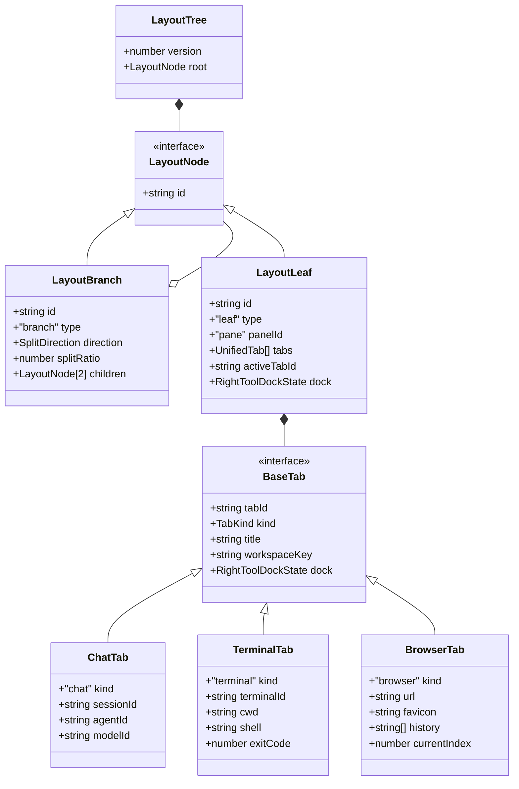
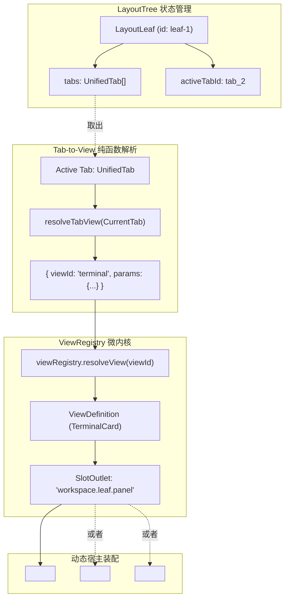
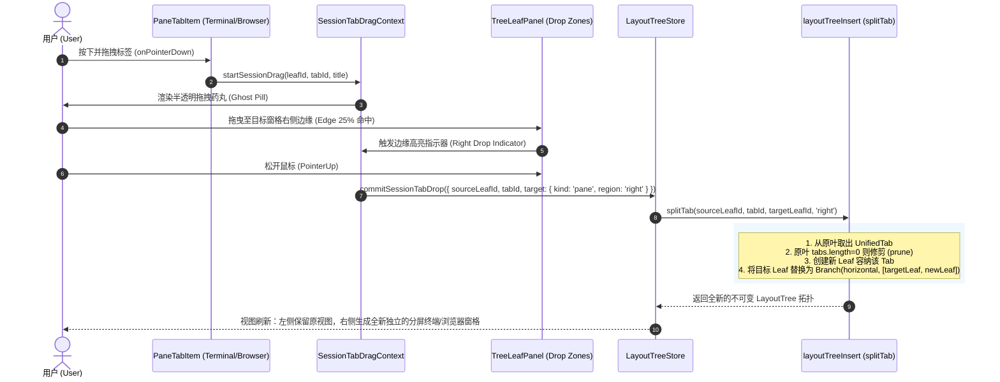

# LayoutTree 统一标签数据模型扩展与多态叶分发架构方案

> **文档定位**：战役一级技术分析与架构详案（`analysis/03`）  
> **设计目标**：打破当前布局树（`LayoutTree` / `TreeLeafPanel`）中仅以 Chat 为一等公民、工具卡片（Terminal / Browser）仅能作为抽屉（Dock）二等公民的历史束缚；构建统一多态标签数据模型（`UnifiedTab`），实现终端与浏览器在标签栏与二叉树分屏中的一等公民释放；在严格遵守 `check:convergence` 规则 G-08 的前提下，打造微内核声明式动态叶渲染管线。  
> **作者**：LayoutTree 统一标签数据模型与叶分发架构师  
> **编写时间**：2026-10-25  

---

## 一、现状数据模型与叶渲染深度审计 (Current State Audit)

### 1.1 `SessionTab` 数据模型审计

在现行代码 `apps/crish-desktop/src/store/layout-tree/sessionTabModel.ts:41-48` 中，二叉树叶子所拥有的标签定义如下：

```typescript
export interface SessionTab {
  tabId: string;
  /** 真会话 id，或 `__pending_draft__:${tabId}`。禁止精确等于 PENDING_DRAFT_SESSION_ID */
  sessionId: string;
  title: string;
  workspaceKey: string;
  dock: RightToolDockState;
}
```

从该接口与配套的业务函数中，可以审计出以下深层次架构耦合问题：

1. **会话中心化强绑定（Session-Centric Coupling）**：
   - 标签模型被显式命名为 `SessionTab`，其主业务标识是 `sessionId`；
   - 模型的辅助工具函数（`mintDraftSessionId`、`isDraftSessionId`、`isRealSessionId`、`findTabBySessionId`、`sessionIdTaken`）皆假设“一个 Tab 必然对应后端大模型 Agent 的一次对话会话（Chat Session）”；
   - 在 `layoutTreeInsert.ts:94-96` 中，插入标签时直接校验 `if (!isRealSessionId(tab.sessionId)) return tree;` 以及 `if (sessionIdTaken(tree.root, tab.sessionId)) return tree;`，导致任何不具备 `sessionId` 的原生实体无法成为树上的独立标签。
2. **叶子节点硬编码面板标识（Static Panel Invariant）**：
   - 参见 `apps/crish-desktop/src/store/layout-tree/types.ts:27`：
     ```typescript
     export interface LayoutLeaf {
       type: 'leaf';
       id: string;
       panelId: 'chat'; // 硬编码 literal 'chat'
       tabs: SessionTab[];
       activeTabId: string;
       dock?: RightToolDockState;
     }
     ```
   - 布局树节点类型直接将 `panelId` 锁定为 `'chat'`，从类型系统层面剥夺了其他卡片作为独立叶子主界面的可能性。

---

### 1.2 `TreeLeafPanel.tsx` 叶渲染管线审计

检查 `apps/crish-desktop/src/components/binary-tree/TreeLeafPanel.tsx:398-506` 的 DOM 结构与渲染流：

```tsx
<div ref={leafBodyRef} className={styles.leafBody} data-dock-open={dockOpen ? 'true' : 'false'}>
  {/* 主列：固定只渲染 ChatCard */}
  <div className={styles.leafChatColumn}>
    <SlotOutlet
      slotKey="workspace.leaf.panel"
      context={chatCtx}
      entryKey={chatResolved.definition.id} // entryKey="chat"
    />
  </div>

  {/* 工具抽屉：条件挂载 */}
  {dockOpen ? (
    <div className={styles.leafDockDrawer}>
      <LeafToolTabStrip ... />
      {dock.openPanelIds.map((pid) => renderToolOutlet(pid))}
    </div>
  ) : null}
</div>
```

**为什么此前 Terminal 和 Browser 只能作为侧边 Dock 或独立 Panel 存在？**

1. **主附从属关系的历史妥协（Primary-Secondary Asymmetry）**：
   - 早期架构假设用户交互的绝对核心是与 AI 聊天（Chat），终端（Terminal）、浏览器（Browser/Preview）、文件树（Files）、代码差异（Diff）均被定义为 AI 对话的辅助工具（Tool），因此归属于 `dock`（右侧抽屉）；
   - 每个 Chat 标签拥有自己的 `tab.dock.openPanelIds`，关闭或切换 Chat 标签时，抽屉内的终端/浏览器状态被迫跟随联动。
2. **顶栏标签栏（`PaneHeader`）与抽屉标签栏（`LeafToolTabStrip`）割裂**：
   - 顶栏 `PaneHeader.tsx` 只遍历 `leaf.tabs`（即 `SessionTab[]`），只渲染对话；
   - 抽屉头 `LeafToolTabStrip.tsx` 只遍历 `dock.openPanelIds`（字符串数组），负责展示辅助卡片；
   - 这种割裂使得用户无法像在现代 IDE（VS Code、Cursor）或浏览器（Arc、Chrome）中一样，将一个终端或一个网页作为主标签页打开，更无法实现与对话并排、任意拖拽自由分屏（Split Screen）。

---

### 1.3 `LeafToolTabStrip.tsx` 与 `ToolTabFavicon.tsx` 现有实现审计

在 `apps/crish-desktop/src/components/binary-tree/ToolTabFavicon.tsx:20-28` 中：

```typescript
export function isBrowserTabId(tabId: string): boolean {
  return (
    tabId === 'preview' ||
    tabId.startsWith('preview:') ||
    tabId.startsWith('browser:') ||
    tabId === 'preview-browser' ||
    tabId.startsWith('preview-browser-')
  );
}
```

在 `TreeLeafPanel.tsx:237-249` 的 `handleCloseToolTab` 中：

```typescript
if (panelId === 'terminal' || panelId.startsWith('terminal:')) {
  void import('../../api/ptyRegistry').then((m) => {
    const sKey = sessionForPanel;
    const panelKey = panelId === 'terminal' ? sKey : `${sKey}:${panelId}`;
    void m.killPtyForSession(panelKey);
    void m.killPtyForSession(`${panelKey}:split-2`);
  });
}
```

**审计结论**：
- 现有系统内部已经出现通过前缀字符串解析（`preview:http...`、`terminal:...`）来模拟多实例的雏形；
- 但这种基于弱类型字符串拼装的方式存在严重的边界安全隐患与状态隐式耦合（PTY 进程直接与 `sessionForPanel` 挂钩，一旦会话变更，终端生命周期难以准确界定）；
- 必须进行彻底的模型重构，从底层提供干净的判别联合多态体系。

---

## 二、统一标签多态数据模型设计 (Unified Tab Polymorphism)

### 2.1 方案选型与深度权衡

针对如何表达二叉树标签系统中的多样化标签（Chat、Terminal、Browser），对两套核心方案进行深度架构权衡：

| 评估维度 | 选项 A：判别联合型 Tab (Discriminated Union) | 选项 B：URI 命名空间型 Tab (URI Namespace) | 架构裁决权重 |
| :--- | :--- | :--- | :--- |
| **类型安全性 (Type Safety)** | **极优**。通过 `kind` 判别联合，TypeScript 编译器在各分支自动类型收窄，无须类型强转。 | **差**。所有信息序列化进 URI 字符串，访问属性需正则/前缀截取，极易抛出运行时 `TypeError`。 | 高 (强制) |
| **领域纯洁度 (Domain Purity)** | **极优**。符合 DDD 实体模型设计，终端是终端、对话是对话，互不污染。 | **差**。严重污染 `sessionId` 语义，让无关实体伪装成 session，产生伪门面与假对象。 | 高 (强制) |
| **序列化与版本迁移** | **优秀**。序列化字段自包含，旧版本遗留数据只需默认补齐 `kind: 'chat'` 即可实现 100% 零损失平滑升迁。 | **良**。结构单一，但反序列化时需维护庞大的 URI 解构逻辑，解析规则变更时易破损。 | 中 |
| **拓扑树操作正交性** | **极优**。`splitTab`、`moveTab`、`removeTab` 仅依赖基础几何 `tabId`，对业务载荷完全正交。 | **良**。树操作同样只基于 ID，但排他性校验逻辑需不断解析字符串。 | 中 |
| **扩展性 (Extensibility)** | **极优**。未来扩充 `diff`、`notebook`、`canvas`、`doc` 标签只需增加联合分支。 | **较差**。所有扩展必须发明新的 URI Scheme，容易产生命名空间冲突与反义字符转义问题。 | 高 |

> **架构裁决**：
> 坚决采纳 **选项 A（判别联合型 Tab）**。
> 杜绝将字符串 URI 伪装为业务实体的打补丁做法，建立健壮、自解释、零运行时类型断言的 Clean Architecture 数据底座。

---

### 2.2 统一多态数据模型 TypeScript 契约定义

在 `apps/crish-desktop/src/store/layout-tree/unifiedTabModel.ts` 中确立核心类型契约：

```typescript
import type { RightToolDockState } from './sessionTabModel';

/** 统一标签核心判别类型 */
export type TabKind = 'chat' | 'terminal' | 'browser';

/**
 * 基础标签接口（BaseTab）
 * 包含二叉树标签拓扑管理所需的通用属性
 */
export interface BaseTab {
  /** 标签全局唯一 ID（用于树节点定位、拖拽与 DOM 渲染） */
  readonly tabId: string;
  /** 判别标记 */
  readonly kind: TabKind;
  /** 标签展示标题 */
  readonly title: string;
  /** 工作区或文件夹归属键（默认 '对话' / 项目根） */
  readonly workspaceKey?: string;
  /**
   * 独立抽屉坞状态：
   * 统一标签体系下一等公民卡片依然可以挂载右侧辅助工具（如查阅文档、文件管理器）
   */
  readonly dock?: RightToolDockState;
}

/** 1. 对话标签（ChatTab） */
export interface ChatTab extends BaseTab {
  readonly kind: 'chat';
  /** 真实会话 ID 或草稿哨兵 `__pending_draft__:${tabId}` */
  readonly sessionId: string;
  /** 可选：绑定的特定智能体协作体 ID */
  readonly agentId?: string;
  /** 可选：模型规格锁定 */
  readonly modelId?: string;
}

/** 2. 终端标签（TerminalTab） */
export interface TerminalTab extends BaseTab {
  readonly kind: 'terminal';
  /** 底层 PTY 实例唯一标识（如 `pty_${tabId}`） */
  readonly terminalId: string;
  /** 终端启动时的初始工作目录（cwd） */
  readonly cwd?: string;
  /** 终端指定 Shell 类型（如 'pwsh', 'bash', 'cmd'） */
  readonly shell?: string;
  /** 退出码记录（用于进程终态提示） */
  readonly exitCode?: number | null;
}

/** 3. 浏览器标签（BrowserTab） */
export interface BrowserTab extends BaseTab {
  readonly kind: 'browser';
  /** 当前加载的目标 URL（支持 http/https 或内置应用协议） */
  readonly url: string;
  /** 动态嗅探到的 Favicon 链接或 Base64 编码 */
  readonly favicon?: string | null;
  /** 前进/后退历史快照（用于状态回溯） */
  readonly history?: string[];
  readonly currentIndex?: number;
}

/**
 * 统一标签多态判别联合类型（UnifiedTab）
 * 替代原先仅有 Chat 的 SessionTab
 */
export type UnifiedTab = ChatTab | TerminalTab | BrowserTab;
```

---

### 2.3 布局树节点升级与类型守卫契约

修改 `apps/crish-desktop/src/store/layout-tree/types.ts`，将叶节点升级为支持多态标签体系：

```typescript
import type { UnifiedTab } from './unifiedTabModel';
import type { RightToolDockState } from './sessionTabModel';

export const LAYOUT_TREE_VERSION = 4 as const; // 升迁至 v4 版本

/**
 * 叶子节点定义：
 * 容纳若干个多态标签页的容器窗格。
 * 树上的叶子由 activeTab 的类型决定当前渲染的主视图。
 */
export interface LayoutLeaf {
  type: 'leaf';
  id: string;
  /** 面板主类型解耦为通用 'workspace-pane'（或保留为向后兼容的 'pane'） */
  panelId: 'pane';
  /** 叶内所有打开的标签列表（真会话、活跃终端、已打开浏览器） */
  tabs: UnifiedTab[];
  /** 当前激活标签 ID。若为空字符串，代表当前叶处于空态/草稿新建态 */
  activeTabId: string;
  /** 无活动标签时的叶级兜底坞配置 */
  dock?: RightToolDockState;
}
```

```typescript
// ── 类型守卫与工厂辅助函数 ──────────────────────────────────────────

export function isChatTab(tab: UnifiedTab | undefined | null): tab is ChatTab {
  return Boolean(tab && tab.kind === 'chat');
}

export function isTerminalTab(tab: UnifiedTab | undefined | null): tab is TerminalTab {
  return Boolean(tab && tab.kind === 'terminal');
}

export function isBrowserTab(tab: UnifiedTab | undefined | null): tab is BrowserTab {
  return Boolean(tab && tab.kind === 'browser');
}

/** 获取标签的排他性资源键（用于防多窗格并发争抢） */
export function getTabResourceKey(tab: UnifiedTab): string {
  switch (tab.kind) {
    case 'chat':
      return `chat:${tab.sessionId}`;
    case 'terminal':
      return `terminal:${tab.terminalId}`;
    case 'browser':
      return `browser:${tab.tabId}`; // 浏览器允许相同 URL 打开多个 Tab，以 tabId 隔离
  }
}
```

---

### 2.4 Mermaid 类图与数据模型关系



---

## 三、`TreeLeafPanel.tsx` 动态多态渲染器与解耦分发表 (Polymorphic Leaf View)

### 3.1 遵守 `check:convergence` 规则 G-08 的纯洁设计

项目前端门禁规则 Rule 8（G-08）规定：
> `TreeLeafPanel 禁止使用 switch(panelId) 静态分发，必须通过 ViewRegistry 动态声明式渲染！`  
> `TreeLeafPanel 禁止维护静态面板映射字典，必须由 ViewRegistry 自描述管理！`

为彻底杜绝在 `TreeLeafPanel.tsx` 中编写 `switch (activeTab.kind)` 这种静态硬编码坏味道，设计**基于 ViewRegistry 动态微内核**的自适应声明式分发管线。

---

### 3.2 动态适配层设计：Tab-to-View 映射契约

在 `ViewRegistry` 已有体系（`chat`、`terminal`、`preview`）的基础上，定义纯函数适配器（放置在 `apps/crish-desktop/src/services/view-registry/tabViewAdapter.ts`）：

```typescript
import type { UnifiedTab } from '../../store/layout-tree/unifiedTabModel';
import type { ViewRenderContext } from './ViewTypes';

export interface TabViewResolution {
  /** 对应 ViewRegistry 中注册的 viewId */
  readonly viewId: string;
  /** 构造注入组件的标准 ViewRenderContext.params */
  readonly params: Record<string, unknown>;
  /** 关联的会话 ID（仅 Chat 存在） */
  readonly sessionId?: string;
}

/**
 * 纯函数：将多态标签映射为 ViewRegistry 认识的视图目标与参数
 * 零 React Hooks、零全局状态穿透、100% 具备单测覆盖性
 */
export function resolveTabView(tab: UnifiedTab | undefined | null): TabViewResolution {
  if (!tab) {
    // 默认空态：回退到主对话草稿界面
    return { viewId: 'chat', params: {} };
  }

  switch (tab.kind) {
    case 'chat':
      return {
        viewId: 'chat',
        sessionId: tab.sessionId,
        params: {
          agentId: tab.agentId,
          modelId: tab.modelId,
        },
      };

    case 'terminal':
      return {
        viewId: 'terminal',
        params: {
          terminalId: tab.terminalId,
          cwd: tab.cwd,
          shell: tab.shell,
          instanceId: `terminal:${tab.terminalId}`,
        },
      };

    case 'browser':
      return {
        // 注意：现有系统内浏览器视图统一映射至 'preview' 视图
        viewId: 'preview',
        params: {
          target: tab.url,
          instanceId: `browser:${tab.tabId}`,
        },
      };
  }
}
```

---

### 3.3 叶子多态渲染架构拓扑图



---

### 3.4 `TreeLeafPanel.tsx` 动态渲染装配改造

在 `TreeLeafPanel.tsx` 中，主工作面容器无需感知具体的业务组件，只需基于微内核动态加载：

```tsx
// 1. 读取当前叶的活动 UnifiedTab
const activeTab = useMemo(() => {
  return readActiveUnifiedTab(leaf);
}, [leaf]);

// 2. 纯函数解析为 ViewRegistry 契约
const tabResolution = useMemo(() => {
  return resolveTabView(activeTab);
}, [activeTab]);

// 3. 动态从 ViewRegistry 解析视图定义
const resolvedView = viewRegistry.resolveView(tabResolution.viewId);

// 4. 组装 ViewRenderContext
const mainSurfaceCtx: ViewRenderContext = useMemo(
  () => ({
    panelId: tabResolution.viewId,
    leafId: leaf.id,
    sessionId: tabResolution.sessionId,
    isActive,
    openView: handleOpenTool,
    params: {
      ...resolvedView.params,
      ...tabResolution.params,
    },
  }),
  [tabResolution, leaf.id, isActive, handleOpenTool, resolvedView.params]
);

// 5. 声明式 JSX 输出（零 switch 语句，完全合规 G-08）
return (
  <div ref={leafElRef} className={styles.leaf} data-active={isActive ? 'true' : 'false'}>
    <LeafScopeProvider leafId={leaf.id} sessionId={tabResolution.sessionId} isActive={isActive}>
      {/* 顶部多态标签条 */}
      <PaneHeader leaf={leaf} isActive={isActive} isTopRow={edges.isTopRow} />

      <div ref={leafBodyRef} className={styles.leafBody}>
        {/* 多态主工作面 */}
        <div className={styles.leafMainColumn}>
          <AppErrorBoundary compact title={`面板 [${tabResolution.viewId}] 渲染异常`}>
            <Suspense fallback={<div className={styles.emptyState}>加载中…</div>}>
              {resolvedView.definition ? (
                <SlotOutlet
                  slotKey="workspace.leaf.panel"
                  context={mainSurfaceCtx}
                  entryKey={resolvedView.definition.id}
                  fallback={<div className={styles.emptyState}>未知视图类型：{tabResolution.viewId}</div>}
                />
              ) : (
                <div className={styles.emptyState}>未注册的视图类型：{tabResolution.viewId}</div>
              )}
            </Suspense>
          </AppErrorBoundary>
        </div>

        {/* 右侧辅助工具抽屉（若开启） */}
        {dockOpen && <LeafDockDrawer dock={dock} ... />}
      </div>
    </LeafScopeProvider>
  </div>
);
```

---

## 四、拖拽、分屏与二叉树拓扑操作统一支持 (Drag & Drop Split)

### 4.1 几何操作通用化改造 (`operations.ts` / `layoutTreeInsert.ts`)

二叉树的核心操作函数（`splitTab`、`moveTab`、`insertTab`、`removeTab`）本质上是对树形拓扑与数组元素进行纯逻辑重排。此前逻辑将唯一校验硬编码在 `sessionId` 上，需要提升为泛化资源冲突检测：

```typescript
/**
 * 校验指定标签所绑定的物理资源是否已被树上其他非目标标签占用
 * - Chat: 同一个 real sessionId 不允许在两个标签同时处于编辑态（避免并发写乱序）
 * - Terminal: 同一个 terminalId 对应的底层 PTY 不允许被两个标签争抢挂载
 * - Browser: 允许任意多个标签打开同一 URL
 */
export function isTabResourceOccupied(
  root: LayoutNode,
  targetTab: UnifiedTab,
  exceptTabId?: string
): boolean {
  for (const leaf of collectLeaves(root)) {
    for (const tab of leaf.tabs) {
      if (tab.tabId === exceptTabId || tab.tabId === targetTab.tabId) continue;

      if (tab.kind === 'chat' && targetTab.kind === 'chat') {
        if (isRealSessionId(tab.sessionId) && tab.sessionId === targetTab.sessionId) {
          return true;
        }
      } else if (tab.kind === 'terminal' && targetTab.kind === 'terminal') {
        if (tab.terminalId === targetTab.terminalId) {
          return true;
        }
      }
    }
  }
  return false;
}
```

改造后的 `insertTab` 与 `splitTab` 原语实现：

```typescript
export function insertTab(
  tree: LayoutTree,
  leafId: string,
  tab: UnifiedTab,
  insertIdx?: number
): LayoutTree {
  const leaf = findLeafById(tree.root, leafId);
  if (!leaf) return tree;
  if (!tab || !tab.tabId) return tree;

  // 资源冲突校验
  if (isTabResourceOccupied(tree.root, tab)) return tree;
  if (leaf.tabs.some((t) => t.tabId === tab.tabId)) return tree;

  const tabs = [...leaf.tabs];
  const idx = insertIdx !== undefined && insertIdx >= 0 && insertIdx <= tabs.length
    ? insertIdx
    : tabs.length;

  tabs.splice(idx, 0, tab);
  const nextLeaf: LayoutLeaf = { ...leaf, tabs, activeTabId: tab.tabId };
  return { ...tree, root: replaceNode(tree.root, leafId, nextLeaf) };
}
```

---

### 4.2 顶栏 `PaneHeader` 与 `PaneTabItem` 多态呈现

顶栏不仅要呈现标题，还必须呈现对应的多态图标与站点标识：

```tsx
// 在 PaneTabItem.tsx 中：
export const PaneTabItem: React.FC<PaneTabItemProps> = React.memo(({ tab, title, isSelected, ... }) => {
  // 根据 tab.kind 动态派发图标
  const renderTabIcon = () => {
    switch (tab.kind) {
      case 'chat':
        return <AppIcon name="message-square" size={13} className={styles.tabKindIcon} />;
      case 'terminal':
        return <AppIcon name="terminal" size={13} className={styles.tabKindIcon} />;
      case 'browser':
        if (tab.favicon) {
          return ;
        }
        return <AppIcon name="globe" size={13} className={styles.tabKindIcon} />;
    }
  };

  return (
    <div className={...} data-kind={tab.kind} data-tab-id={tab.tabId}>
      <div className={styles.tabItemInner}>
        {renderTabIcon()}
        <span className={styles.tabTitle}>{title}</span>
        <Button variant="ghost" className={styles.tabCloseBtn} onClick={(e) => onClose(e, tab)}>
          <AppIcon name="x" size={10} />
        </Button>
      </div>
    </div>
  );
});
```

---

### 4.3 跨窗格拖拽与边缘自由分屏交互时序图

支持将任意终端或浏览器标签抓起，拖曳至当前叶或外部叶的边缘，触发二叉树几何分裂（`splitTab`）：



---

## 五、生命周期与进程资源协同调度 (Lifecycle & Resource Management)

### 5.1 终端 PTY 进程精准生命周期

为确保用户不丢失会话上下文，同时避免“孤儿 PTY 进程”消耗操作系统句柄，制定以下铁律：

1. **Tab 间切换与折叠（Preserve）**：
   - 当用户在同一个 Leaf 内从 `TerminalTab` 切换到 `ChatTab`，或将包含 Terminal 的 Leaf 分割到侧边，**严禁杀死 PTY 进程**；
   - PTY 进程在后台继续存活、输出缓冲正常写入虚拟终端，再次切回时无缝恢复输出。
2. **标签显式关闭（Dispose）**：
   - 只有当调用 `removeTab(leafId, tabId)` 且该 `TerminalTab` 彻底从布局树上移除时，才触发资源回收；
   - 借助 `viewRegistry.onDispose` 生命周期勾子或 `LayoutTreeStore` 的 `onTabRemoved` 监听器，调用 `ptyRegistry.killPty(tab.terminalId)`，实现物理层面的干净释放。

### 5.2 浏览器实例内存回收

1. 浏览器标签关闭时，通知底层 Tauri WebView2 / 前端 `PreviewCard` 释放关联的 Frame 句柄；
2. 清理对应 URL 缓存的 Favicon 索引与会话 Storage，杜绝内存泄漏。

---

## 六、序列化、持久化与平滑迁移方案 (Serialization & Migration)

### 6.1 序列化结构升级 (`layoutSerializer.ts` & LocalStorage)

在持久化层将 `LayoutTree.version` 升级至 `4`。定义自适应数据升迁管道：

```typescript
export function migrateLegacyTabToUnifiedTab(rawTab: unknown): UnifiedTab {
  if (!rawTab || typeof rawTab !== 'object') {
    return createDefaultChatDraftTab();
  }

  const t = rawTab as Record<string, unknown>;
  const tabId = typeof t.tabId === 'string' && t.tabId ? t.tabId : mintTabId();
  const title = typeof t.title === 'string' ? t.title : '未命名标签';
  const dock = t.dock && typeof t.dock === 'object' ? (t.dock as RightToolDockState) : createDefaultDock();

  // 若已有合法 kind，按类型提取
  if (t.kind === 'terminal') {
    return {
      tabId,
      kind: 'terminal',
      terminalId: typeof t.terminalId === 'string' && t.terminalId ? t.terminalId : `pty_${tabId}`,
      title: title || '终端',
      cwd: typeof t.cwd === 'string' ? t.cwd : undefined,
      shell: typeof t.shell === 'string' ? t.shell : undefined,
      dock,
    };
  }

  if (t.kind === 'browser') {
    return {
      tabId,
      kind: 'browser',
      url: typeof t.url === 'string' && t.url ? t.url : 'about:blank',
      title: title || '浏览器',
      favicon: typeof t.favicon === 'string' ? t.favicon : null,
      dock,
    };
  }

  // 默认向后兼容：历史 v2/v3 标签全部作为 ChatTab 恢复
  const rawSid = typeof t.sessionId === 'string' ? t.sessionId : '';
  const sessionId = !rawSid || rawSid === PENDING_DRAFT_SESSION_ID ? mintDraftSessionId(tabId) : rawSid;

  return {
    tabId,
    kind: 'chat',
    sessionId,
    title: title || (isDraftSessionId(sessionId) ? '新对话' : sessionId),
    workspaceKey: typeof t.workspaceKey === 'string' ? t.workspaceKey : '对话',
    dock,
  };
}
```

### 6.2 布局校验策略更新 (`layoutRestorePolicy.ts`)

更新 `validateRestorableLayoutTree`，使校验器能识别多态标签结构：
1. 校验 `tab.kind` 属于 `'chat' | 'terminal' | 'browser'` 白名单；
2. 放宽旧规则中对 `sessionId` 必须非空的刚性要求（仅当 `tab.kind === 'chat'` 时检查 `sessionId`）；
3. 确保当工作区恢复时，终端与浏览器标签能在原有几何切分位置精准就位。

---

## 七、防回归立体化验证套件与测试断言 (Verification & Assertions)

按照全仓立体验证纪律（§7.1），必须建立涵盖纯逻辑运算、门禁约束与结构还原的测试集：

### 7.1 单元测试断言清单

在 `apps/crish-desktop/src/store/layout-tree/unifiedTabModel.test.ts` 中编写：

```typescript
describe('UnifiedTab 多态模型与二叉树拓扑', () => {
  it('应成功在同一个叶子中容纳混合类型的多态标签', () => {
    const chatTab: ChatTab = { tabId: 'tab-1', kind: 'chat', sessionId: 'sess-1', title: '对话 1' };
    const termTab: TerminalTab = { tabId: 'tab-2', kind: 'terminal', terminalId: 'pty-1', title: '终端 1' };
    const browserTab: BrowserTab = { tabId: 'tab-3', kind: 'browser', url: 'https://github.com', title: 'GitHub' };

    const leaf = createLeaf({ tabs: [chatTab, termTab, browserTab], activeTabId: 'tab-2' });
    expect(leaf.tabs).toHaveLength(3);
    expect(leaf.tabs[1].kind).toBe('terminal');
    expect(readActiveUnifiedTab(leaf)?.kind).toBe('terminal');
  });

  it('splitTab 应支持将 Terminal 标签切分到右侧新窗格', () => {
    const chatTab: ChatTab = { tabId: 'tab-1', kind: 'chat', sessionId: 'sess-1', title: '对话 1' };
    const termTab: TerminalTab = { tabId: 'tab-2', kind: 'terminal', terminalId: 'pty-1', title: '终端 1' };

    let tree: LayoutTree = {
      version: 4,
      root: createLeaf({ id: 'leaf-A', tabs: [chatTab, termTab], activeTabId: 'tab-1' }),
    };

    // 将 termTab 从 leaf-A 切分到右侧
    tree = splitTab(tree, 'leaf-A', 'tab-2', 'leaf-A', 'right');

    expect(tree.root.type).toBe('branch');
    if (tree.root.type === 'branch') {
      expect(tree.root.direction).toBe('horizontal');
      const [leftLeaf, rightLeaf] = tree.root.children as [LayoutLeaf, LayoutLeaf];
      expect(leftLeaf.tabs.map((t) => t.tabId)).toEqual(['tab-1']);
      expect(rightLeaf.tabs.map((t) => t.tabId)).toEqual(['tab-2']);
      expect(rightLeaf.tabs[0].kind).toBe('terminal');
    }
  });

  it('旧版 v3 布局 JSON 经 migrateLegacyTabToUnifiedTab 反序列化后应 100% 升迁为合法 ChatTab', () => {
    const legacyJson = {
      tabId: 'legacy-1',
      sessionId: 'sess-old-uuid',
      title: '旧对话',
      workspaceKey: '对话',
    };
    const migrated = migrateLegacyTabToUnifiedTab(legacyJson);
    expect(migrated.kind).toBe('chat');
    expect(migrated.tabId).toBe('legacy-1');
    if (migrated.kind === 'chat') {
      expect(migrated.sessionId).toBe('sess-old-uuid');
    }
  });
});
```

### 7.2 G-08 门禁防回潮验证断言

- 执行 `npm run check:convergence`；
- 确保 `TreeLeafPanel.tsx` 零 `switch(panelId)`，零 `switch(activeTab.kind)`；
- 视图分发层 100% 经由 `ViewRegistry.resolveView` 与 `<SlotOutlet slotKey="workspace.leaf.panel" />` 声明式挂载，CI 门禁测试全绿。

---

## 八、架构总结与评审交付物对照表

| 核心设计维度 | 现状缺陷 (Before) | 扩展重构方案 (After) | 架构收益 |
| :--- | :--- | :--- | :--- |
| **标签数据模型** | 仅有 `SessionTab`，强绑定 `sessionId`，终端/浏览器无法入树。 | 采用判别联合 `UnifiedTab = ChatTab \| TerminalTab \| BrowserTab`。 | 彻底类型安全，零运行时断言，支持未来无缝扩展其他一等公民。 |
| **叶子视图渲染** | 硬编码 `leafChatColumn` 挂载 `ChatCard`，其他卡片只能塞入 `leafDockDrawer`。 | 经纯函数适配器 `resolveTabView` 动态对接 `ViewRegistry` 声明式分发。 | 满足 Rule G-08 刚性门禁，叶子组件与卡片完全解耦，架构净收敛。 |
| **分屏拓扑支持** | 仅支持按 Chat 切分，终端/浏览器无法作为独立半屏存在。 | 泛化 `tabIdentityTaken` 与 `splitTab`，终端/浏览器支持 4 方向任意分屏。 | 达到现代顶级桌面 IDE（VS Code / Cursor）水准的极致分屏操作手感。 |
| **进程生命周期** | 终端 PTY 挂在会话 key 上，生命周期模糊。 | 显式绑定 `terminalId`，切换 Tab 保活，彻底关 Tab 干净注销。 | 零无辜进程中断、零僵尸句柄泄漏。 |
| **向下向后兼容** | 升级模型容易造成旧版缓存破损打不开。 | 自动化升迁管道将历史数据默认映射为 `ChatTab`，版本自适应平滑升级。 | 100% 保护用户现有布局与历史会话资产。 |
