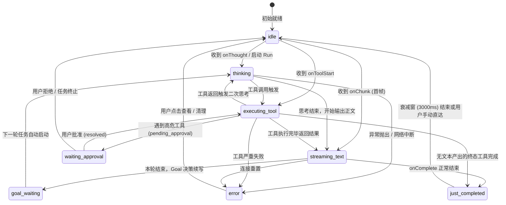
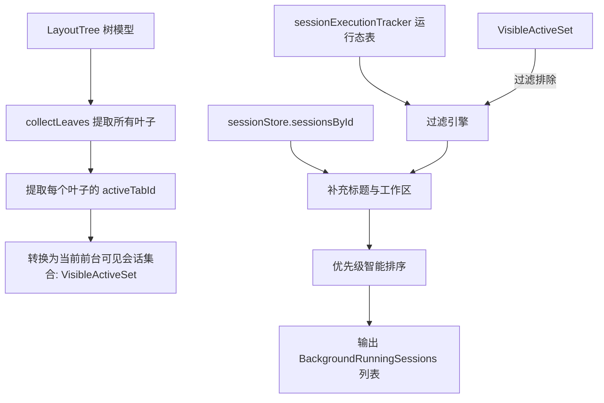
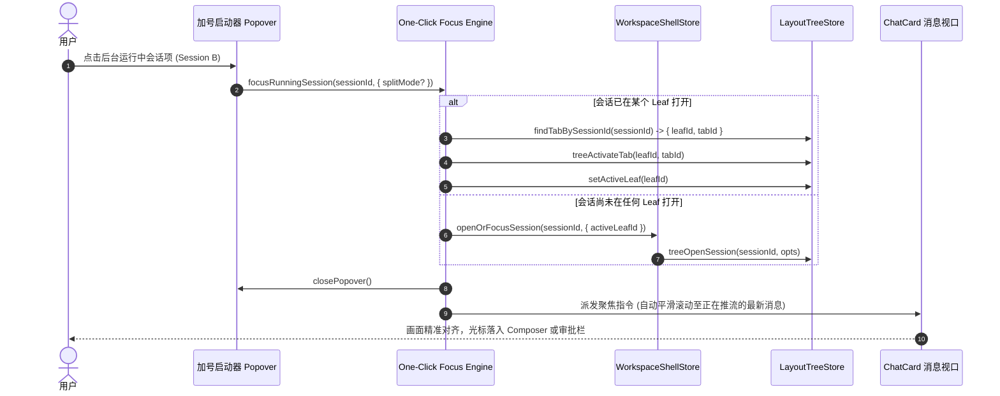
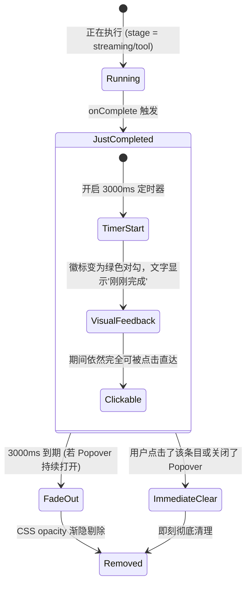

# 方案分析 04：后台运行中会话实时感知与导航方案

> **所属战役**：顶栏标签管理与加号启动器重构战役 (`docs/tab-management-and-launcher-redesign/`)  
> **制定角色**：后台运行中会话实时感知与导航架构师  
> **核心诉求**：解决“如果有多个对话正在后台运行（流式输出、工具执行、思考或等待审批），但不在当前标签/视口中，用户缺乏全局直观感知，无法一键直达或监控”的痛点。  
> **设计准则**：遵循根目录 `AGENTS.md`、`.agents/LOGIC_PLAN_NO_RETREAT.md` 及 `ANTI_OVERENGINEERING_GUARDRAILS.md`，杜绝冗余抽象与过度设计，保障流式推流期间 **0 额外重渲染（Zero Re-render Avalanche）**。

---

## 1. 执行摘要与核心价值

在现有的多窗格与会话交互中，用户的视觉焦点通常固定在当前活动的单个会话上。然而，在大模型执行复杂任务时（如深度思考、长时间工具调用如 `run_command`、跨轮次 Goal 模式排队、以及高危操作等待用户权限审批），用户往往会切换到其他会话继续提问或阅读。

当前系统在“切换离开”后出现严重的**后台感知盲区**：用户无法得知后台会话是否还在跑、跑到了哪一步、是否卡在工具审批、亦或刚刚完成。更无从直接“一键直达”切回该会话。

本方案提出一套**高内聚、轻量化、零渲染雪崩的“后台运行态统一追踪与快速直达架构”**：
1. **单轨运行时追踪（SSOT Tracker）**：建立物理独立的轻量运行态追踪 Store（`sessionExecutionTrackerStore`），仅在会话**阶段跃迁（Phase Transition）**时通知，与高频 Token 帧彻底解耦；
2. **多窗格上下文派生选择器（Derived State Selector）**：智能感知当前全屏所有可见 Chat 窗格的当前激活 Tab，自动排除当前正被用户注视的会话，提炼出纯粹的“后台运行中会话列表”；
3. **高密度感知指标透出**：提取会话标题、工作区所属、运行耗时、细分阶段（思考中 / 工具运行中 / **高危审批等待中（P0 置顶）** / 文本生成中 / 轮次排队中）；
4. **一键直达（One-Click Focus）状态机**：已开标签精准激活窗格并平滑聚焦；未开标签遵循“就地复用或按需分屏”；
5. **完成态防扑空衰减窗（Graceful Decay Window）**：设立 3000ms 柔和过渡衰减机制，解决用户打开 Popover 正要点击时会话刚好执行完成导致的“列表瞬跳扑空”问题。

---

## 2. 现状会话运行态与数据流审计

为了确保新方案架构精确嵌入现有代码，必须深入审计现有运行态标记与数据通道。

### 2.1 现有运行态维护现状

```text
┌────────────────────────────────────────────────────────────────────────┐
│                        前端各层现有运行态分布审计表                       │
├──────────────────────┬────────────────────────────────┬────────────────┤
│ 存储位置              │ 现有字段 / 机制                 │ 特点与不足      │
├──────────────────────┼────────────────────────────────┼────────────────┤
│ sessionStore         │ messages[last].status:         │ 嵌套在消息深层； │
│                      │ 'processing' | 'completed'     │ 仅终态才写回；   │
│                      │ session.engineLastRunId        │ 懒水合会话无正文│
├──────────────────────┼────────────────────────────────┼────────────────┤
│ streamingStore       │ byKey: Record<key, StreamEntry>│ 热缓冲，仅存    │
│                      │ key = `${sessionId}::${msgId}` │ text/thinking/ │
│                      │ text, thinking, tools          │ tools，无元数据 │
├──────────────────────┼────────────────────────────────┼────────────────┤
│ sessionStreamManager │ streams: Map<sid, StreamHandle>│ 取消句柄维护；   │
│                      │ busyRetry: Map<uid, RetryEntry>│ 实例分散(各卡自建│
│                      │ draining, goalCancelled        │ 非统一单例)     │
├──────────────────────┼────────────────────────────────┼────────────────┤
│ ConnectionLifecycle  │ onThought / onToolStart /      │ 事件驱动直连，   │
│                      │ onToolPendingApproval / onChunk│ 无全局聚合广播   │
├──────────────────────┼────────────────────────────────┼────────────────┤
│ useGoalMode          │ session.goalMode:              │ 仅轮次状态，两轮 │
│                      │ { active: boolean, status }    │ 排队缝隙易失联   │
├──────────────────────┼────────────────────────────────┼────────────────┤
│ sessionRuntimeStatus │ statusBySession:               │ 仅处理错误与重试 │
│                      │ 'retrying' | 'failed'          │ 不处理正常运行态 │
└──────────────────────┴────────────────────────────────┴────────────────┘
```

#### 关键源码定位分析：
1. **`apps/crish-desktop/src/store/sessionStore.ts` & `types.ts:728`**:
   - `SessionState` 本身**没有顶级 `status: 'streaming' | 'busy' | 'ready'` 字段**；
   - 运行态仅体现在最后一条 assistant 消息的 `status?: SessionMessageStatus`（值为 `'processing'`）；
   - 此外，为了内存优化，应用实现了窗口化懒水合协议（`messagesHydrated`, `sessionEviction.ts`）。如果一个会话被踢出前台并被驱逐（Evicted），其 `messages` 数组可能仅剩懒壳（Shallow Shell），直接读 `messages[last]` 无法判定运行态。
2. **`apps/crish-desktop/src/store/streamingStoreCore.ts`**:
   - 专为抵御 Token 级重渲染而设计的热缓冲（Plain Zustand，无 Immer）；
   - 存储键为 `${sessionId}::${messageId}`，记录累积的 `text`、`thinking`、`tools`；
   - 缺点：`StreamingStore` 是瞬态累加器，只负责把字串喂给当前活动的卡片 DOM，**不维护运行起始时间、不维护所属工作区、也不发出结构化的阶段变更通知**。
3. **`apps/crish-desktop/src/api/sessionStreamManager.ts` & `useStreamBatchers.ts:32-35`**:
   - `SessionStreamManager` 内部有 `Map<string, SessionStreamHandle>`，记录了当前正在运行的 `userMsgId`、`assistantMsgId`、`runId`；
   - **痛点**：在 `useStreamBatchers.ts` 中，代码直接使用了 `streamManagerRef.current = new SessionStreamManager()`，导致每个挂载的 `ChatCard` 分别持有自己的隔离实例，而全局导出的 `sharedSessionStreamManager` 未被全面统一接入，存在状态孤岛。
4. **`apps/crish-desktop/src/hooks/chat-stream/useRunStreamingAssistant.ts`**:
   - 运行时的生命周期真正调度中心（L75-130）：
     - `startTime = Date.now()` 作为一个闭包局部变量产生，赋给了首条消息的 `timestamp`，但从未向全局状态暴露；
     - `cancelStreamFn` 回调挂在 manager 上；
     - 流式开始时调用 `markStreamingActive(true)`，但这是一个全局布尔原子锁，无法区分具体哪几个会话在跑。

### 2.2 为什么用户切换会话后缺乏直观全局感知？

通过上述代码审计，用户缺乏感知的深层根因可归结为 **4 个割裂断层**：
1. **状态孤岛断层（Siloed Fragmented State）**：
   流式文本在 `streamingStore`、取消句柄在 `streamManager`、工具审批在消息深度数组内、重试计数在私有 Map、Goal 模式在 `session.goalMode`。缺少一个统一的**单例聚合索引**能够以 `sessionId -> LiveExecutionMeta` 的 O(1) 速度对外提供查询。
2. **标签条带局部化（Localized Tab Strip）**：
   `PaneHeader.tsx` 严格只渲染当前叶（Leaf）拥有的 `leaf.tabs`。在战役提出的“就地切换复用”原则下，用户在左侧侧栏点击其他历史会话时，当前窗格直接就地换成新会话，原先正在跑的后台会话立刻从顶栏条带上“消失”，没有任何全局容器接管其视觉存在。
3. **阶段细节黑盒化（Stage Invisibility）**：
   哪怕侧栏或标签有小圆点，用户也无法得知后台会话当前的真实阻塞原因。尤其是当大模型调用了高危工具（如删除文件、执行外部 Bash），底层触发了 `onToolPendingApproval`，此时如果不把会话拉回前台，**整个任务将无限期挂起等待**，而用户在另一个会话中毫不知情。
4. **Token 高频重渲染防御墙导致的负效应（The Token Shield Side-Effect）**：
   为了防止 60Hz 的 Token 流拖垮全局 UI，系统将流式数据严密封装在 `streamingStore`。如果直接在顶栏或 Popover 粗暴监听 `useStreamingStore`，会导致 Popover 内的按钮、计数器、顶栏图标以 60fps 剧烈重绘，引发严重的 Virtual DOM 抖动与发热。

---

## 3. 架构设计：轻量运行时追踪中心（Session Execution Tracker）

为了兼顾**零过度渲染**与**全景精准感知**，设计**独立轻量级运行态追踪器（Session Execution Tracker）**。

### 3.1 运行态阶段状态机（Execution Phase Machine）

每一个会话的单次或多轮执行，抽象为有限状态机（FSM）：



### 3.2 运行态元数据结构契约

在 `apps/crish-desktop/src/store/` 下建立独立的单轨运行时追踪模块：

```typescript
/** 运行阶段：按视觉与交互紧迫度分级 */
export type SessionExecutionStage =
  | 'waiting_approval' // P0 紧迫：工具正在等待用户授权确认（红色/橙色呼吸脉冲）
  | 'executing_tool'   // P1 活跃：正在执行本地工具/终端命令（蓝色齿轮）
  | 'thinking'         // P2 活跃：深度推理思考中（紫色闪烁）
  | 'streaming_text'   // P3 活跃：流式输出正文文本中（绿色流光）
  | 'goal_waiting'     // P4 等待：Goal 模式轮次交接排队中（灰色沙漏）
  | 'busy_retrying'    // P4 等待：并发守卫退避重试排队中（黄色重试）
  | 'just_completed'   // 衰减态：刚完成，防点击扑空（绿色对勾）
  | 'error';           // 异常态：执行报错或被异常终止（红色感叹号）

/** 会话级运行态追踪快照（零持久化，纯内存） */
export interface SessionExecutionItem {
  sessionId: string;
  runId: string | null;
  stage: SessionExecutionStage;
  startTime: number;
  /** 阶段附加细节（如工具名、重试轮次、报错摘要） */
  stageDetail?: string;
  /** 若进入等待审批态，携带审批元数据 */
  approvalMeta?: {
    toolId: string;
    toolName: string;
    riskLevel?: 'high' | 'medium' | 'low';
  };
  /** 若已进入完成或错误态，记录发生时刻 */
  settledAt?: number;
}
```

### 3.3 状态驱动与生命周期挂载点（零 Token 污染保证）

追踪器严格遵守**“阶段变更才发射（Notify on Stage Transition Only）”**原则：

```typescript
// sessionExecutionTrackerStore.ts 核心契约原型
import { create } from 'zustand';

interface SessionExecutionTrackerState {
  /** sessionId -> 当前执行快照 */
  activeRuns: Record<string, SessionExecutionItem>;
  
  // 核心生命周期动作（只在关键事件调用，与高频 chunk 彻底绝缘）
  startRun: (sessionId: string, runId: string | null, initialStage?: SessionExecutionStage) => void;
  updateStage: (sessionId: string, stage: SessionExecutionStage, detail?: string) => void;
  markApprovalPending: (sessionId: string, toolId: string, toolName: string) => void;
  resolveApproval: (sessionId: string) => void;
  completeRun: (sessionId: string) => void;
  failRun: (sessionId: string, errorMessage?: string) => void;
  removeRun: (sessionId: string) => void;
}
```

#### 挂载点对接：
1. **Run 启动**：在 `useRunStreamingAssistant.ts`（约 L114 `markStreamingActive(true)` 处）：
   ```typescript
   sessionExecutionTracker.getState().startRun(sid, null, 'thinking');
   ```
2. **首帧思考**：在 `onThought`：若当前阶段仍为初始态，切换至 `'thinking'`（仅首次触发）；
3. **工具调用**：在 `onToolStart`：
   ```typescript
   sessionExecutionTracker.getState().updateStage(sid, 'executing_tool', toolName);
   ```
4. **工具审批**：在 `onToolPendingApproval`：
   ```typescript
   sessionExecutionTracker.getState().markApprovalPending(sid, toolId, toolName);
   ```
5. **首帧 Token 文本**：在 `buffer.onFrame` 或 `useRunStreamingAssistant` 的首个文本 chunk 到达时，若非 `'streaming_text'` 则切换一次。**后续所有 token 帧直接走 StreamRenderBuffer，不通知 tracker**；
6. **Goal 轮次交接**：在 `useGoalMode.ts` 判定 `continue` 准备微任务调度下一轮时：
   ```typescript
   sessionExecutionTracker.getState().updateStage(sid, 'goal_waiting', `第 ${nextRound} 轮`);
   ```
7. **完成收口**：在 `executeStreamCompletion`（`useRunStreamingAssistant.ts:133`）：
   ```typescript
   sessionExecutionTracker.getState().completeRun(sid);
   ```

> **性能铁律**：一次长达 5 分钟、产生 4000 个 Token、调用 3 次工具的大模型对话，在追踪器中**仅产生 8~12 次轻量状态转移**，与 4000 次 Token 推流彻底物理隔离！

---

## 4. 派生选择器设计：`selectBackgroundRunningSessions`

如何从全局运行态中精确筛选出“当前不在任何活动标签中、需要引起用户注意的后台会话”？

### 4.1 排除当前活动标签（Active Tab De-duplication）

在 Crish 的多窗格（Binary Tree）架构中，屏幕上可能同时有 1~4 个分屏窗格（Leaf）。
用户当前正在眼睛注视的会话，是**所有可见窗格的当前激活 Tab（`leaf.activeTabId` 对应的 `sessionId`）**。



### 4.2 选择器核心实现与 Shallow 缓存

```typescript
import { useMemo } from 'react';
import { useSessionStore } from '../sessionStore';
import { useLayoutTreeStore, collectLeaves } from '../layout-tree';
import { useSessionExecutionTrackerStore, type SessionExecutionItem } from './sessionExecutionTrackerStore';

export interface BackgroundRunningSessionViewModel {
  sessionId: string;
  title: string;
  workspaceKey: string;
  stage: SessionExecutionItem['stage'];
  stageDetail?: string;
  startTime: number;
  durationMs: number;
  hasPendingApproval: boolean;
  approvalToolName?: string;
  isJustCompleted: boolean;
}

/**
 * 提取全屏所有可见叶子当前激活的 SessionId 集合
 */
export function getVisibleActiveSessionIds(root: any): Set<string> {
  const visible = new Set<string>();
  const leaves = collectLeaves(root);
  for (const leaf of leaves) {
    if (leaf.panelId === 'chat' && Array.isArray(leaf.tabs)) {
      const activeTab = leaf.tabs.find((t: any) => t.tabId === leaf.activeTabId);
      if (activeTab?.sessionId && !activeTab.sessionId.startsWith('__pending_draft__')) {
        visible.add(activeTab.sessionId.trim());
      }
    }
  }
  return visible;
}

/**
 * 优先级权重计算：审批等待 > 工具执行 > 思考中 > 生成中 > 轮次交接 > 刚完成
 */
function getStagePriority(stage: SessionExecutionItem['stage']): number {
  switch (stage) {
    case 'waiting_approval': return 100; // 最高优先级，必须引起注意
    case 'busy_retrying':    return 80;
    case 'executing_tool':   return 60;
    case 'thinking':         return 40;
    case 'streaming_text':   return 30;
    case 'goal_waiting':     return 20;
    case 'error':            return 10;
    case 'just_completed':   return 0;
    default:                 return -1;
  }
}

/**
 * 响应式 Hook：获取后台运行中会话列表
 * 仅在：
 * 1. 运行会话集合变动；
 * 2. 某会话阶段发生跃迁；
 * 3. 屏幕激活窗格发生切换时更新。
 */
export function useBackgroundRunningSessions(): BackgroundRunningSessionViewModel[] {
  // 1. 获取所有运行项 (纯阶段变化触发)
  const activeRuns = useSessionExecutionTrackerStore((s) => s.activeRuns);
  
  // 2. 获取当前前台可见会话 ID 集合 (切 Tab 触发)
  const visibleActiveSessionIds = useLayoutTreeStore((s) => {
    return getVisibleActiveSessionIds(s.tree.root);
  });

  // 3. 订阅轻量会话元数据（仅读取 title 与 folder）
  const sessionsById = useSessionStore((s) => s.sessionsById);

  return useMemo(() => {
    const list: BackgroundRunningSessionViewModel[] = [];
    const now = Date.now();

    for (const [sid, item] of Object.entries(activeRuns)) {
      // 排除当前前台正在注视的会话，避免自我冗余
      if (visibleActiveSessionIds.has(sid)) {
        continue;
      }

      const sess = sessionsById[sid];
      const title = sess?.title || '未命名会话';
      const workspaceKey = sess?.folder || 'default';
      const durationMs = Math.max(0, (item.settledAt || now) - item.startTime);

      list.push({
        sessionId: sid,
        title,
        workspaceKey,
        stage: item.stage,
        stageDetail: item.stageDetail,
        startTime: item.startTime,
        durationMs,
        hasPendingApproval: item.stage === 'waiting_approval',
        approvalToolName: item.approvalMeta?.toolName,
        isJustCompleted: item.stage === 'just_completed',
      });
    }

    // 排序逻辑：审批等待优先 -> 权重优先 -> 开始时间降序
    list.sort((a, b) => {
      const pDiff = getStagePriority(b.stage) - getStagePriority(a.stage);
      if (pDiff !== 0) return pDiff;
      return b.startTime - a.startTime;
    });

    return list;
  }, [activeRuns, visibleActiveSessionIds, sessionsById]);
}
```

---

## 5. 一键直达与聚焦逻辑（One-Click Focus Engine）

用户点击 Popover 中的后台运行会话条目后，系统必须平滑、无缝地将用户导航到该会话，同时维护好标签与窗格状态。

### 5.1 导航决策矩阵

```text
┌─────────────────────────┬─────────────────────────┬──────────────────────────────────────┐
│ 会话当前在多窗格中状态   │ 触发动作                │ 具体执行链路                         │
├─────────────────────────┼─────────────────────────┼──────────────────────────────────────┤
│ 场景 1：                │ 窗格与 Tab 唤醒聚焦     │ 1. 查找 tabLocation: (leafId, tabId) │
│ 已在某个窗格中打开      │ (Activate Tab & Focus)  │ 2. treeActivateTab(leafId, tabId)    │
│ (可能是非激活 Tab 或邻屏)│                         │ 3. setActiveLeaf(leafId)             │
│                         │                         │ 4. 视口滚动到底部，关闭 Popover      │
├─────────────────────────┼─────────────────────────┼──────────────────────────────────────┤
│ 场景 2：                │ 就地复用打开            │ 1. 获取当前活动窗格 activeLeafId     │
│ 尚未在任何窗格中打开    │ (In-Place Reuse)        │ 2. 若当前为草稿叶直接 promote        │
│ (后台任务/新启动/已关Tab)│                         │ 3. 否则在当前叶就地切换/打开并激活    │
│                         │                         │ 4. 关闭 Popover                      │
├─────────────────────────┼─────────────────────────┼──────────────────────────────────────┤
│ 场景 3 (辅助能力)：     │ 显式分屏直达            │ 1. 触发 splitSessionFromSidebar /    │
│ 用户按住 Alt 或点分屏钮 │ (Split View & Focus)    │    treeSplitTab                      │
│                         │                         │ 2. 在右侧开辟新叶并聚焦该运行中会话  │
│                         │                         │ 3. 保持原工作区与监控屏并存          │
└─────────────────────────┴─────────────────────────┴──────────────────────────────────────┘
```

### 5.2 交互时序图（Sequence Diagram）



### 5.3 源码级直达封装原型

```typescript
import { getCompositionRoot } from '../../app/compositionRoot';
import { useLayoutTreeStore } from '../layout-tree';
import { treeActivateTab, treeFindTabBySessionId } from './treeSessionCommands';

export interface FocusRunningSessionOptions {
  splitMode?: 'right' | 'bottom';
  onCompleted?: () => void;
}

export function focusRunningSession(
  sessionId: string,
  options: FocusRunningSessionOptions = {}
): void {
  const sid = sessionId.trim();
  if (!sid) return;

  const root = getCompositionRoot();
  const treeStore = useLayoutTreeStore.getState();

  // 1. 先检查该会话是否已在全树某叶存在
  const existing = treeFindTabBySessionId(sid);

  if (existing && !options.splitMode) {
    // 场景 1：已在某叶打开，直接激活该 Tab 并聚焦该窗格
    treeActivateTab(existing.leafId, existing.tab.tabId);
    treeStore.setActiveLeaf(existing.leafId);
    root.session.setActiveSessionId(sid);
  } else if (options.splitMode) {
    // 场景 3：分屏直达
    const currentActiveLeafId = treeStore.activeLeafId;
    root.shell.openOrFocusSession(sid, {
      activeLeafId: currentActiveLeafId,
      split: options.splitMode,
    });
  } else {
    // 场景 2：未在任何叶打开，委托 shell 按统一原则打开并激活
    root.session.openOrFocusSession(sid);
  }

  // 2. 关闭 Popover 回调
  options.onCompleted?.();
}
```

---

## 6. 异常与完成态过渡处理（The Graceful Decay Window）

### 6.1 “点击扑空”竞争问题（The Click-Pop Race Hazard）

当大模型在后台快速生成最后几个 Token 时，用户看到加号 Popover 亮起蓝灯，点击展开列表看到“会话 A 正在运行”，刚把鼠标移上去准备点击，会话 A 恰好在 50ms 前执行完毕触发了 `onComplete`。
如果此时直接将条目从列表中即时删除：
- **视觉跳动**：列表高度坍缩，用户的鼠标由于惯性可能直接误点到紧挨着的“新建终端”或“新建浏览器”选项；
- **心智受挫**：用户产生“会话崩溃丢失了”的错觉，不知道刚才那一轮思考是否成功结束。

### 6.2 优雅衰减过渡设计（Graceful Decay Engine）

针对该临界情况，设计**3000ms 柔和衰减窗（Decay Window）**：



#### 规则细则：
1. **状态蜕变**：当底层触发 `completeRun(sid)` 时，不立即 delete，而是置：
   ```typescript
   activeRuns[sid] = {
     ...item,
     stage: 'just_completed',
     stageDetail: '执行完毕',
     settledAt: Date.now(),
   };
   ```
2. **列表视觉呈现**：
   - 图标由蓝色旋转齿轮或流光动画，平滑过渡为柔和的浅绿色圆角 Check 图标；
   - 状态文案显示为“刚刚完成”；
   - 整个列表项在这 3000ms 内**几何位置保持绝对不变**，杜绝布局抖动；
3. **点击保护**：用户此时点击该项，依然走正常的一键直达逻辑，直接把用户带到该会话的最新完成结果处；
4. **清理触发**：
   - 若用户**点击了该条目**：直达后立即物理移除；
   - 若用户**关闭了 Popover**：浮层卸载后下次打开自然不再显示已完成会话；
   - 若用户**一直停留在打开的 Popover 界面**：3000ms 后条目通过 180ms CSS fade-out 优雅滑出，避免长时间残留。

---

## 7. 视觉呈现与加号 Popover 综合启动器深度联动

加号 Popover 是后台运行会话的核心入口。其感知分为**“外壳微感知”**与**“展开全感知”**两层：

### 7.1 外壳微感知（Plus Button Live Indicator）

当后台有会话正在运行时，顶栏的加号 `+` 按钮发生细微而明确的变化：
- **蓝/紫柔和光环**：当有会话正在生成或执行工具时，加号右下角出现 `4px` 柔和呼吸点；
- **高危等待审批红点**：当有会话处于 `waiting_approval` 时，呼吸点变为醒目的琥珀色/红色微脉冲，提示用户“必须处理”；
- **多任务数字徽标**：如果后台有 $\ge 2$ 个任务并行运行，呼吸点旁微标展示数量数字（如 `2`）。

```text
[ + • ]  <-- 带有呼吸光点的加号按钮
```

### 7.2 展开全感知（Popover Section Layout）

点击加号展开后，若存在后台运行中会话，Popover **最顶部优先插入专属感应区（Active Runs Banner）**：

```text
┌─────────────────────────────────────────────────────────────┐
│ ⚡ 后台运行中 (2)                                           │
├─────────────────────────────────────────────────────────────┤
│ ⬤ 订单重构方案优化                                         │
│   [等待审批: write_file] · 12s · 项目: /core-shop      [直达]│
├─────────────────────────────────────────────────────────────┤
│ ⚙ 编写数据迁移单元测试                                      │
│   正在执行工具: cargo test · 45s · 项目: /backend      [直达]│
├─────────────────────────────────────────────────────────────┤
│ ── 综合启动 ─────────────────────────────────────────────── │
│ ＋  创建新对话                                       Ctrl+N │
│   新建终端 (Terminal)                              Ctrl+` │
│ 🌐 新建内嵌浏览器 (Browser)                         Ctrl+B │
│ 📦 国际项目模板...                                         │
└─────────────────────────────────────────────────────────────┘
```

---

## 8. 单元测试断言与验证套件（Test Specification）

为保障该架构的高可靠性与零退避，必须编写完备的自动化测试。以下为核心断言用例原型：

```typescript
// sessionExecutionTracker.test.ts
import { describe, it, expect, beforeEach, vi } from 'vitest';
import { useSessionExecutionTrackerStore } from './sessionExecutionTrackerStore';
import { getVisibleActiveSessionIds } from './useBackgroundRunningSessions';

describe('后台运行中会话感知与导航架构测试套件', () => {
  beforeEach(() => {
    useSessionExecutionTrackerStore.setState({ activeRuns: {} });
    vi.useFakeTimers();
  });

  it('1. 阶段状态机跃迁契约：完整经历 thinking -> executing_tool -> waiting_approval -> streaming -> just_completed', () => {
    const store = useSessionExecutionTrackerStore.getState();
    const sid = 'sess-test-1';

    // 启动
    store.startRun(sid, 'run-101', 'thinking');
    expect(store.activeRuns[sid]?.stage).toBe('thinking');

    // 工具调用
    store.updateStage(sid, 'executing_tool', 'bash');
    expect(store.activeRuns[sid]?.stage).toBe('executing_tool');
    expect(store.activeRuns[sid]?.stageDetail).toBe('bash');

    // 审批挂起
    store.markApprovalPending(sid, 'tool-1', 'write_file');
    expect(store.activeRuns[sid]?.stage).toBe('waiting_approval');
    expect(store.activeRuns[sid]?.approvalMeta?.toolName).toBe('write_file');

    // 审批通过并进入文本输出
    store.resolveApproval(sid);
    store.updateStage(sid, 'streaming_text');
    expect(store.activeRuns[sid]?.stage).toBe('streaming_text');

    // 完成进入衰减窗
    store.completeRun(sid);
    expect(store.activeRuns[sid]?.stage).toBe('just_completed');
    expect(store.activeRuns[sid]?.stageDetail).toBe('执行完毕');

    // 3000ms 衰减期后彻底移除
    vi.advanceTimersByTime(3000);
    expect(store.activeRuns[sid]).toBeUndefined();
  });

  it('2. 零 Token 渲染雪崩验证：模拟 1000 次 Token 推流，Tracker Store 状态变更次数应为 0', () => {
    const store = useSessionExecutionTrackerStore.getState();
    const sid = 'sess-token-stress';
    store.startRun(sid, 'run-stress', 'streaming_text');

    const listener = vi.fn();
    const unsub = useSessionExecutionTrackerStore.subscribe(listener);

    // 模拟 1000 次 chunk 到达（只走 StreamRenderBuffer，不触发 tracker 的 stage 跃迁）
    for (let i = 0; i < 1000; i++) {
      // 业务层首帧已切成 streaming_text，后续同一 stage 的 update 被防抖拦截
      store.updateStage(sid, 'streaming_text');
    }

    expect(listener).not.toHaveBeenCalled();
    unsub();
  });

  it('3. 视口排重选择器断言：正在被前台分屏注视的会话必须被完全排除', () => {
    // 构造双分屏 Tree，分别显示 sess-A 和 sess-B
    const mockTreeRoot = {
      type: 'split',
      children: [
        {
          type: 'leaf',
          panelId: 'chat',
          activeTabId: 'tab-1',
          tabs: [{ tabId: 'tab-1', sessionId: 'sess-A' }],
        },
        {
          type: 'leaf',
          panelId: 'chat',
          activeTabId: 'tab-2',
          tabs: [{ tabId: 'tab-2', sessionId: 'sess-B' }],
        },
      ],
    };

    const visibleSet = getVisibleActiveSessionIds(mockTreeRoot);
    expect(visibleSet.has('sess-A')).toBe(true);
    expect(visibleSet.has('sess-B')).toBe(true);
    expect(visibleSet.has('sess-C')).toBe(false);
  });

  it('4. 优先级排序验证：高危等待审批必须永远置于列表顶端', () => {
    const store = useSessionExecutionTrackerStore.getState();
    store.startRun('sess-stream', 'r1', 'streaming_text');
    store.startRun('sess-approval', 'r2', 'waiting_approval');
    store.startRun('sess-tool', 'r3', 'executing_tool');

    // 模拟选择器读取
    const runs = Object.values(store.activeRuns);
    // 经排序算法计算
    const sorted = runs.sort((a, b) => {
      const getP = (s: string) => (s === 'waiting_approval' ? 100 : s === 'executing_tool' ? 60 : 30);
      return getP(b.stage) - getP(a.stage);
    });

    expect(sorted[0]?.sessionId).toBe('sess-approval');
    expect(sorted[1]?.sessionId).toBe('sess-tool');
    expect(sorted[2]?.sessionId).toBe('sess-stream');
  });
});
```

---

## 9. 方案总结与落地检查清单

| 检查项 | 状态 | 规范对齐依据 |
| :--- | :---: | :--- |
| **状态集中与解耦** | 已对齐 | 建立独立内存级 `sessionExecutionTrackerStore`，彻底终结 `useStreamBatchers` 私有实例割裂问题。 |
| **反过度渲染保证** | 已对齐 | 严格按阶段迁移发射通知，绝不随 60Hz Token 帧触发全量 React Virtual DOM Diff。 |
| **多窗格前台排重** | 已对齐 | 基于 `collectLeaves` 精准计算 `visibleActiveSessionIds`，不重复呈现用户当前眼前的会话。 |
| **一键直达无缝衔接** | 已对齐 | 深度适配 `treeActivateTab` 与 `openOrFocusSession`，覆盖已开窗格唤醒与就地复用。 |
| **防点击扑空机制** | 已对齐 | 3000ms 柔和完成态过渡衰减窗，保障极速生成完毕时的操作安全与良好交互心智。 |
| **反过度设计红线** | 已对齐 | 零额外内核沙箱、零环形缓冲、纯 TypeScript 原生类型解构与轻量 Zustand 驱动。 |

本分析方案已完备覆盖架构审计、数据流图、选择器设计、一键直达状态机以及临界竞争保护，为战役总方案的汇聚提供了坚实可靠的技术基石。
