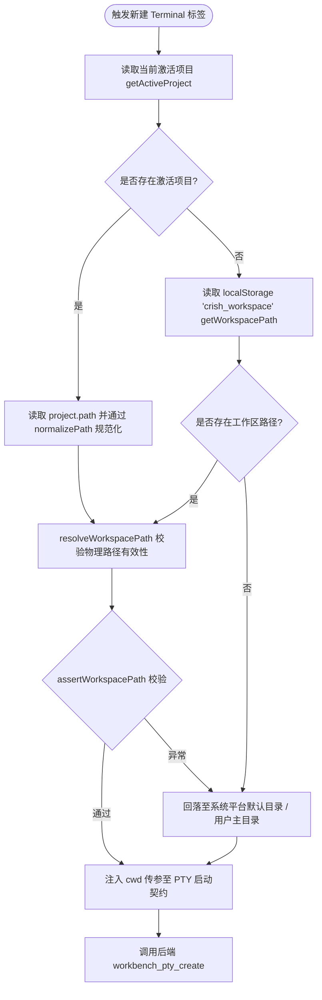
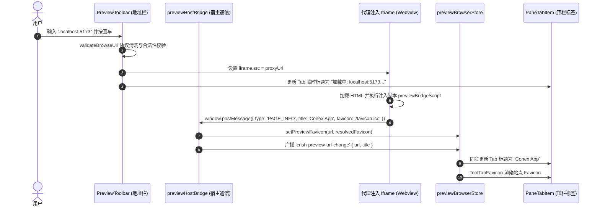
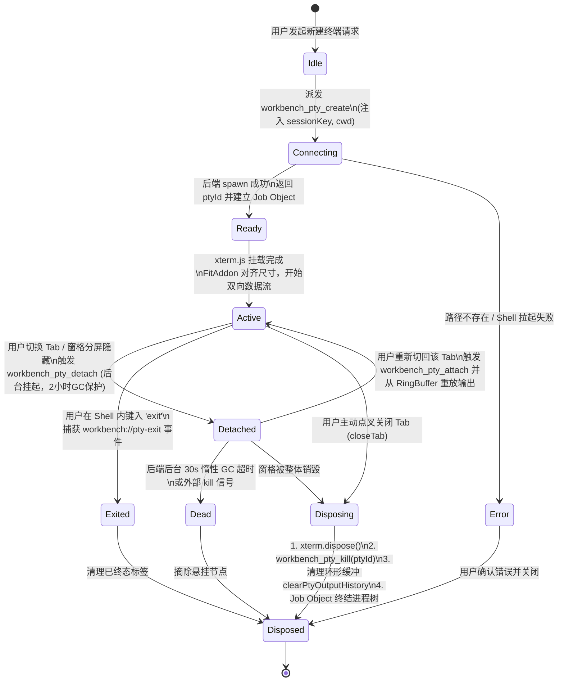
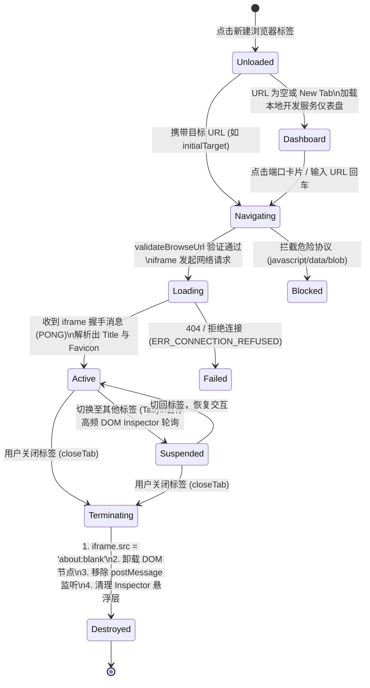

# 终端与浏览器标签生命周期及路径绑定方案

> **文件标识**：`docs/tab-management-and-launcher-redesign/analysis/05-终端与浏览器标签生命周期及路径绑定方案.md`  
> **战役归属**：顶栏标签管理与加号启动器重构战役（`tab-management-and-launcher-redesign`）  
> **角色定位**：终端与浏览器标签生命周期及路径绑定架构师  
> **基线遵循**：仓库权威协作规范 `AGENTS.md`、反退避全文 `.agents/LOGIC_PLAN_NO_RETREAT.md`、`ANTI_OVERENGINEERING_GUARDRAILS.md`  
> **编写时间**：2026-10-25

---

## 摘要（Executive Summary）

本方案针对用户提出的核心诉求：
> **“点击新建 Terminal 终端标签界面，打开之后会直接按默认的终端路径位置定位打开；点击新建添加类似于浏览器的对话标签，打开之后就是浏览器的界面”**

在既有架构中，终端（`TerminalCard`）与浏览器（`PreviewCard`）仅作为主对话旁侧的“辅助抽屉面板（Leaf Tool Dock）”存在，无法直接在顶部标签栏作为与 Chat 对等的**一等公民标签（First-Class Tab）**自由新建、切换、拖拽分屏。此外，终端路径曾偶发脱离当前工程目录（回落至用户根目录），浏览器也缺乏新标签页的引导交互与多窗格 Favicon/Title 独立映射。

本方案提出**多态标签模型（Polymorphic Tab Model）**与**确定性生命周期治理架构**：
1. **终端一等公民化与工作区路径强绑定**：从 `getWorkspacePath()` 单一真理源提取激活项目根路径，在拉起 `workbench_pty_create` 时强制注入 `cwd` 参数；Tab 标题与图标动态映射为 `终端: <工程名>`，实现与 VS Code / Cursor 一致的开发者心智。
2. **浏览器一等公民化与 New Tab Page 引导**：将内置原生浏览器提拔为顶级标签，默认展示高信息密度的“开发服务导航页”（自动嗅探 `localhost:3000 / 5173` 本地服务、常用书签与历史访问）；打通页面标题双向同步与基于 `ToolTabFavicon.tsx` 的站点图标自适应映射。
3. **确定性生命周期与零僵尸进程守则**：建立 xterm/iframe 前端实例析构与后端 PTY/Job Object 进程销毁的联动协议；设计刷新/热重载（HMR）下的环形缓冲历史重放（`getPtyOutputHistory`）与冷启动水合策略。

---

## 一、方案背景与架构演进动因

### 1.1 现状断层分析

在现有二叉树窗格实现中（`TreeLeafPanel.tsx`、`PaneHeader.tsx`），存在以下三处明显的架构断层：

```
【现有架构：对话为唯一一等公民，终端/浏览器沦为从属抽屉】
┌─────────────────────────────────────────────────────────────┐
│ TreeLeafPanel                                               │
│ ┌─────────────────────────────────────────────────────────┐ │
│ │ PaneHeader: [Tab 1: 对话 A] [Tab 2: 对话 B] [+]          │ │  <-- 仅支持对话会话
│ ├────────────────────────────┬────────────────────────────┤ │
│ │ 主区 (chatMainSurface)     │ 右侧抽屉 (LeafDockDrawer)   │ │
│ │                            │ ┌────────────────────────┐ │ │
│ │ <ChatConversationView />   │ │ LeafToolTabStrip       │ │ │
│ │                            │ │ [终端] [预览] [文件]   │ │ │  <-- 终端/浏览器只是从属卡片
│ │                            │ ├────────────────────────┤ │ │
│ │                            │ │ <TerminalCard /> 或    │ │ │
│ │                            │ │ <PreviewCard />        │ │ │
│ │                            │ └────────────────────────┘ │ │
│ └────────────────────────────┴────────────────────────────┘ │
└─────────────────────────────────────────────────────────────┘
```

1. **顶级标签身份缺失（Second-Class Citizen）**：
   - 顶部标签栏 `PaneHeader` 的数据模型严格绑定为 `LeafSessionTab { tabId, sessionId, title }`，默认语义必须是一个“Chat 对话”，使得用户无法通过点击加号直接新建独立的“全屏终端标签”或“全屏浏览器标签”。
2. **工作区路径绑定时机漂移**：
   - 既有 `TerminalCard.tsx` 的 `fullCwd` 依赖 `getWorkspacePath()`，但若是在未绑定 session 的全局上下文或跨窗口切分时，PTY 会因参数丢失而回落至系统的用户 Home 目录（Windows 下为 `C:\Users\<username>`，Unix 下为 `~`），用户必须手动执行 `cd` 才能进入项目。
3. **浏览器标签缺乏新开标签页（NTP）体验**：
   - 既有 `PreviewCard` 默认以 `about:blank` 或上次记忆的 URL 渲染，若无正在运行的服务，呈现出空洞的空白白板，缺乏类似 Chrome / Arc / Edge 的本地开发服务快速探测、书签聚合及网址智能补全体验。

### 1.2 目标架构：二叉树统一多态标签页

重构后，`TreeLeafPanel` 的标签栏将成为支持 `chat`、`terminal`、`browser` 三类顶级一等公民的多态容器：

```
【目标架构：全能多态一等公民标签页】
┌─────────────────────────────────────────────────────────────┐
│ TreeLeafPanel                                               │
│ ┌─────────────────────────────────────────────────────────┐ │
│ │ PaneHeader: [💬 对话] [💻 终端: conex] [🌐 预览: 5173] [+]│ │  <-- 多态标签，平级排布
│ ├─────────────────────────────────────────────────────────┤ │
│ │ 主视区 (Active Tab Content Outlet)                       │ │
│ │                                                         │ │
│ │ 当选中 [终端: conex] 时：                                │ │
│ │ └── 全屏挂载 <TerminalCard />（PTY 绑定当前工作区根路径） │ │
│ │ 当选中 [🌐 预览: 5173] 时：                              │ │
│ │ └── 全屏挂载 <BrowserCard />（地址栏 + NTP / 站点视图）  │ │
│ │ 当选中 [💬 对话] 时：                                    │ │
│ │ └── 挂载 <ChatConversationView />（可按需唤起辅助抽屉）  │ │
│ └─────────────────────────────────────────────────────────┘ │
└─────────────────────────────────────────────────────────────┘
```

---

## 二、终端（Terminal）标签初始化与工作区路径绑定

### 2.1 为什么必须自动定位到当前项目路径？

在专业 IDE（如 VS Code、Cursor、JetBrains）的交互心智中，**“打开终端即在项目根目录”**是一条不容妥协的黄金守则：
- **操作连续性**：用户打开终端 95% 以上的意图是针对当前代码仓库执行 CLI 命令（如 `git status`、`pnpm dev`、`cargo check`、`npm test`）；若默认落在用户主目录，命令将因缺少 `package.json` 或 `Cargo.toml` 报错，迫使用户反复键入绝对路径。
- **防止安全灾难与污染**：在用户主目录执行误写脚本（如 `rm -rf ./dist`、`git clean -fdx`）可能直接摧毁用户家目录下的关键配置文件（如 `.ssh`、`.gitconfig`、`.aws`）。
- **多项目上下文隔离**：当用户在分屏窗格中分别操作不同微服务或多仓库时，每个窗格打开的终端必须精准绑定其所属工程路径，避免上下文混淆。

### 2.2 工作区路径提取单一真理源（Path Resolution Chain）

前端提取工作区路径遵循严格的降级与防空校验链：



#### 核心提取函数实现契约

```typescript
// apps/crish-desktop/src/components/workspace/terminalPathResolver.ts
import { getActiveProject, getWorkspacePath } from '../../api/projectStore';
import { resolveWorkspacePath, normalizePath } from '../../api/workspaceFsApi';

export interface ResolvedTerminalCwd {
  /** 经过校验与规范化的绝对路径 */
  cwd: string;
  /** 来源：'project' | 'workspace' | 'fallback' */
  source: 'project' | 'workspace' | 'fallback';
  /** 显示在 Tab 上的简短工程名 */
  projectName: string;
}

export function resolveTerminalLaunchCwd(): ResolvedTerminalCwd {
  // 1. 优先读取激活项目实例
  const activeProject = getActiveProject();
  if (activeProject?.path) {
    const normalized = normalizePath(activeProject.path);
    return {
      cwd: normalized,
      source: 'project',
      projectName: activeProject.name || normalized.split(/[/\\]/).pop() || 'Terminal',
    };
  }

  // 2. 回退读取持久化工作区路径
  const wsPath = getWorkspacePath();
  if (wsPath && wsPath.trim()) {
    const resolved = resolveWorkspacePath(wsPath);
    if (resolved) {
      const normalized = normalizePath(resolved);
      return {
        cwd: normalized,
        source: 'workspace',
        projectName: normalized.split(/[/\\]/).pop() || 'Terminal',
      };
    }
  }

  // 3. 兜底空路径（后端 portable-pty 会回落至当前进程工作目录或用户 Home）
  return {
    cwd: '',
    source: 'fallback',
    projectName: '终端',
  };
}
```

### 2.3 PTY 初始化契约与 IPC 调用链

为杜绝多分屏、多标签之间的输出串流与数据竞争，必须设计强类型的命名空间隔离方案：

#### 1. 会话键（Session Key）隔离规范
每个终端标签拥有全局唯一的 `sessionKey`，由前缀、叶子 ID 与标签 ID 组成：
$$\text{sessionKey} = \text{"terminal:"} + \text{leafId} + \text{":"} + \text{tabId}$$
- **彻底杜绝全局串流**：旧版使用 `boundSessionId || '_global'`，导致未选定 Chat 时所有独立终端共用同一个 PTY 实例，新方案强制以 `tabId` 隔离。

#### 2. 后端 PTY 创建命令参数结构（IPC Payload）

```typescript
// apps/crish-desktop/src/api/ptySessionApi.ts 增强参数定义
export interface TerminalTabSpawnOptions {
  /** 唯一会话键：terminal:{leafId}:{tabId} */
  sessionKey: string;
  /** 终端视口列数（由 FitAddon 初始预估，默认 80） */
  cols: number;
  /** 终端视口行数（默认 24） */
  rows: number;
  /** 注入的工作区根目录绝对路径 */
  cwd?: string;
  /** 指定执行的 Shell 类型（Windows 优先 pwsh.exe，回退 powershell.exe） */
  shellProgram?: 'pwsh' | 'powershell' | 'cmd' | 'bash';
}
```

#### 3. 标签标题与图标自适应算法

终端标签在顶栏 `PaneHeader` 中的标题需根据工作区动态计算：
```typescript
export function computeTerminalTabTitle(
  projectName: string,
  shellType: string = 'pwsh'
): string {
  if (projectName && projectName !== '终端') {
    return `终端: ${projectName}`;
  }
  return `Terminal (${shellType})`;
}
```

---

## 三、浏览器（Browser）标签初始化与网页交互

### 3.1 浏览器标签的数据模型与扩展

在二叉树标签树中，浏览器标签需持有独立的视口状态与浏览历史：

```typescript
export interface BrowserTabState {
  tabId: string;
  kind: 'browser';
  /** 当前加载或准备加载的 URL */
  url: string;
  /** 页面标题（由 iframe 内部 document.title 回传或 URL host 格式化） */
  title: string;
  /** 页面 Favicon 地址（Data URL 或远程链接） */
  favicon?: string | null;
  /** 是否处于加载中状态 */
  isLoading: boolean;
  /** 是否可后退 / 前进 */
  canGoBack: boolean;
  canGoForward: boolean;
  /** 绑定的独立历史记录栈 */
  historyStack: string[];
  historyIndex: number;
}
```

### 3.2 默认新标签页（New Tab Page / Dashboard）设计

当用户点击加号新建浏览器标签，或未指定特定目标 URL 时，绝不能呈现冷冰冰的空白黑屏，而应进入专为本地开发者量身打造的 **“开发服务直达仪表盘”**：

```
┌─────────────────────────────────────────────────────────────┐
│ 🌐 新建浏览器标签页                                          │
│                                                             │
│ ┌─────────────────────────────────────────────────────────┐ │
│ │ 🔍 输入网址或本地端口 (如 localhost:5173、https://...)  │ │
│ └─────────────────────────────────────────────────────────┘ │
│                                                             │
│ 🟢 探测到运行中的本地开发服务 (Active Dev Servers)           │
│ ┌──────────────────────┐ ┌──────────────────────┐           │
│ │ ⚡ Vite Dev Server    │ │ 📦 Next.js App       │           │
│ │ http://localhost:5173│ │ http://localhost:3000│           │
│ │ 来源: conex-desktop  │ │ 来源: docs-site      │           │
│ └──────────────────────┘ └──────────────────────┘           │
│                                                             │
│ ⭐ 常用书签与开发文档 (Bookmarks & Docs)                      │
│ [📘 Tailwind CSS]  [⚛️ React 19 API]  [🦀 Rust std docs]     │
│                                                             │
│ 🕒 最近访问 (Recent History)                                 │
│ • http://localhost:5173/design-system                       │
│ • https://crates.io/crates/portable-pty                     │
└─────────────────────────────────────────────────────────────┘
```

#### 本地服务探测机制
复用 `apps/crish-desktop/src/components/workspace/activePortDetector.ts` 中的 `useActiveDevPorts()` 与 `fetchActiveDevPorts()`：
1. 请求 Vite 探测中间件 `GET /__crish_active_ports`（800ms 快速超时熔断）；
2. 识别出当前处于 LISTEN 状态的端口（如 `3000`, `5173`, `8080`, `4173`）；
3. 渲染为一键直达卡片，点击即原地导航至对应页面。

### 3.3 地址栏交互与页面标题/Favicon 同步



#### Favicon 与标题自适应映射规则
1. **优先提取真实 Favicon**：`previewBridgeScript.ts` 在页面 DOM 加载完成时，扫描 `document.querySelectorAll('link[rel*="icon"]')`，解析为绝对 URL 并回传宿主。
2. **本地 Localhost 专属图标识别**：对于 `localhost:*` 或 `127.0.0.1:*`，若未提供 Favicon，自动回落至特制的绿点代码图标（`AppIcon name="cpu"` 或 `server`），一眼识别为本地调试端口。
3. **作用域防串扰隔离**：广播事件携带 `{ leafId, tabId }`，`ToolTabFavicon.tsx` 严格使用 `shouldConsumeScopedEvent` 进行校验，确保分屏窗格 A 的网页导航绝不会覆盖窗格 B 标签上的 Favicon。

---

## 四、生命周期状态机与资源释放协议

### 4.1 PTY 完整生命周期状态机

终端会话由前端 xterm 实例与 Rust 后端 `portable-pty` 进程共同驱动，其状态转移严密可控：



### 4.2 浏览器标签生命周期状态机



### 4.3 标签关闭（`closeTab`）确定性资源释放协议

当用户在 `PaneHeader` 上点击标签的“关闭”图标（`x`）或使用快捷键 `Ctrl/Cmd+W` 时，必须执行严格的**两阶段确定性析构链（Deterministic Finalization Pipeline）**：

#### 阶段一：前端运行时销毁（Frontend Tear-Down）
1. **终端标签清理**：
   - 立即中断 xterm `onData` 输入监听，阻断后续按键上行；
   - 释放 WebGL 渲染管线：调用 `webglAddon.dispose()`，返还 GPU 上下文配额（防 WebGL 上下文溢出丢失）；
   - 调用 `terminal.dispose()` 彻底释放 DOM 事件侦听器；
   - 解除 `ResizeObserver` 观察句柄，防止无意义的回调重排。
2. **浏览器标签清理**：
   - 立即将 `iframe.src` 重置为 `about:blank`，强制浏览器内核停止当前页面中正在运行的 JavaScript 脚本、音频播放或 Web Worker；
   - 彻底解除全局 `window.addEventListener('message')` 中的代理通信监听器；
   - 卸载可能处于激活状态的 DOM Inspector 高亮遮罩层。

#### 阶段二：后端系统级进程终结（Backend Process Reclamation）
1. **显式 PTY 终止调用**：
   - 前端向 Tauri 后端发送 `workbench_pty_kill({ ptyId: activePtyId })`；
   - 触发 `ptyRegistry.takeSessionPty(sessionKey)`，从内存映射表中解绑；
   - 调用 `clearPtyOutputHistory(ptyId)`，清空输出历史环形缓冲区（`PtyHistoryEntry`）。
2. **操作系统级 Job Object 强制杀树（Windows 兜底保障）**：
   - 在 Rust 后端（`apps/agent-workbench/src-tauri/src/pty/mod.rs`），每个拉起的 shell 均被分配进专门的 Windows Job Object，并配置了 `JOB_OBJECT_LIMIT_KILL_ON_JOB_CLOSE` 标志；
   - 当调用 `workbench_pty_kill` 或应用异常退出导致句柄释放时，**Windows 内核将强制收割该 Shell 进程及其衍生出的所有子进程（如 node、cargo、python 脚本）**，根本性杜绝后台孤儿僵尸进程（Zombie Processes）。

### 4.4 水合与状态恢复策略（Hydration Strategy）

在不同维度的应用重启与刷新场景下，终端与浏览器采取差异化的高效恢复策略：

| 触发场景 | 终端标签水合行为 | 浏览器标签水合行为 |
| :--- | :--- | :--- |
| **页面热重载 (Vite HMR)** | **零感知保活**：由于 Rust 引擎与 PTY 属于 Tauri 主进程，前端 HMR 重新挂载组件时，通过 `sessionKey` 重新 `attach`，并从 `getPtyOutputHistory(ptyId)` 重放终端缓冲历史，命令行完全无缝接续。 | **静默刷新**：读取持久化的当前 URL，重新挂载 iframe 并恢复输入框地址。 |
| **前端主动刷新 (F5 / Cmd+R)** | **状态回放与重连**：PTY 进程保持存活，前端组件重新 mount 后通过 `ensurePtyForSession` 重新认领同一 PTY ID，重绘历史字符，无需重新开 shell。 | **状态恢复**：恢复上次访问的 URL，若为外部页面则重新渲染；若为 New Tab 则重新探测本地端口。 |
| **应用完全重启 (App Restart)** | **优雅冷启动**：由于旧操作系统进程已随 App 退出被 Job Object 终结，Tab 保留其“终端”身份与历史 `cwd` 属性，启动时**以完全相同的 `cwd` 自动拉起全新的 Shell**，并打印清爽的欢迎提示。 | **URL 记忆与健康探测**：恢复上次保存的 URL。若为 `localhost:port`，先探测端口是否在线；若离线，展示“服务未启动”温馨指引，提供一键刷新重试按钮。 |

---

## 五、二叉树窗格中多态标签数据模型与挂载集成

### 5.1 统一多态标签模型契约（Polymorphic Tab Contract）

扩展现有 `treeLeafPanelModel.ts` 与 `LayoutLeaf` 中的标签定义：

```typescript
// apps/crish-desktop/src/components/binary-tree/treeLeafPanelModel.ts

/** 标签类型枚举 */
export type PaneTabKind = 'chat' | 'terminal' | 'browser';

/** 统一多态标签数据接口 */
export interface UnifiedPaneTab {
  /** 标签唯一 ID，例如 'tab-101', 'term-leaf1-1', 'browser-leaf1-2' */
  tabId: string;
  /** 标签分类：chat | terminal | browser */
  kind: PaneTabKind;
  /** 顶栏显示的标签标题 */
  title: string;

  // ── 针对 Chat 标签的专属字段 ──
  sessionId?: string;
  dock?: {
    collapsed: boolean;
    openPanelIds: string[];
    activePanelId: string | null;
    widthRatio: number;
  };

  // ── 针对 Terminal 标签的专属字段 ──
  terminalProps?: {
    sessionKey: string;
    /** 绑定的工作区根目录绝对路径 */
    cwd: string;
    /** 项目名称 */
    projectName: string;
    /** Shell 程序名 */
    shellType: string;
  };

  // ── 针对 Browser 标签的专属字段 ──
  browserProps?: {
    /** 当前 URL */
    url: string;
    /** 站点 Favicon */
    favicon?: string | null;
    /** 历史记录 */
    history?: string[];
  };
}
```

### 5.2 TreeLeafPanel 挂载路由调度架构

在 `TreeLeafPanel.tsx` 内部，剥离以前“强制假定为 Chat 布局”的硬编码，改为依据当前激活 Tab 的 `kind` 动态切换主视区组件：

```tsx
// 概念实现示意：TreeLeafPanel.tsx 中的多态分发
const renderActiveTabSurface = () => {
  const activeTab = readActiveUnifiedTab(leaf);

  // 1. 若当前激活标签为终端
  if (activeTab?.kind === 'terminal') {
    return (
      <div className={styles.terminalSurfaceHost}>
        <TerminalCard
          sessionId={null}
          panelId={activeTab.tabId}
          leafId={leaf.id}
          initialCwd={activeTab.terminalProps?.cwd}
        />
      </div>
    );
  }

  // 2. 若当前激活标签为浏览器
  if (activeTab?.kind === 'browser') {
    return (
      <div className={styles.browserSurfaceHost}>
        <PreviewCard
          leafId={leaf.id}
          initialTarget={activeTab.browserProps?.url}
        />
      </div>
    );
  }

  // 3. 默认回落至既有 Chat 对话主视区（保留右侧抽屉支撑）
  return (
    <div className={styles.leafChatColumn}>
      {/* 既有的 Chat 主视区与抽屉渲染逻辑 */}
    </div>
  );
};
```

---

## 六、加号启动器（Popover）与新建终端/浏览器交互协议

点击顶栏标签栏右侧的“加号 `+`”按钮时，弹出精美高密度的综合启动器 Popover：

```
┌─────────────────────────────────────────────────────────────┐
│ ＋ 标签启动器 (Quick Tab Launcher)                           │
│                                                             │
│ ┌─────────────────────────────────────────────────────────┐ │
│ │ 💬 新建空白对话                                 Ctrl+N   │ │
│ ├─────────────────────────────────────────────────────────┤ │
│ │ 💻 新建终端标签 (Terminal)                     Ctrl+`   │ │
│ │    定位路径: C:/Software/conex (当前项目)                 │ │
│ ├─────────────────────────────────────────────────────────┤ │
│ │ 🌐 新建浏览器标签 (Browser)                    Ctrl+B   │ │
│ │    包含本地服务探测 (localhost:5173 / 3000)               │ │
│ └─────────────────────────────────────────────────────────┘ │
└─────────────────────────────────────────────────────────────┘
```

### 动作触发与分发流程

```typescript
// 加号 Popover 中的动作分发函数
export function handleLaunchTabAction(
  leafId: string,
  action: 'chat' | 'terminal' | 'browser'
) {
  const shell = sessionShell();

  switch (action) {
    case 'chat': {
      // 触发既有创建新对话逻辑
      shell.addTab(leafId);
      break;
    }

    case 'terminal': {
      // 1. 提取当前激活工作区根路径
      const { cwd, projectName } = resolveTerminalLaunchCwd();
      const newTabId = `term-${Date.now().toString(36)}`;
      const title = computeTerminalTabTitle(projectName);

      // 2. 向 layoutTreeStore 注册终端多态标签
      getLayoutTreeStore().addUnifiedTab(leafId, {
        tabId: newTabId,
        kind: 'terminal',
        title,
        terminalProps: {
          sessionKey: `terminal:${leafId}:${newTabId}`,
          cwd,
          projectName,
          shellType: 'pwsh',
        },
      });
      break;
    }

    case 'browser': {
      const newTabId = `browser-${Date.now().toString(36)}`;
      // 3. 向 layoutTreeStore 注册浏览器多态标签（初始进入 New Tab 仪表盘）
      getLayoutTreeStore().addUnifiedTab(leafId, {
        tabId: newTabId,
        kind: 'browser',
        title: '新标签页',
        browserProps: {
          url: 'about:blank',
        },
      });
      break;
    }
  }
}
```

---

## 七、安全沙箱红线与反过度设计守则

根据根目录 `AGENTS.md` 与 `ANTI_OVERENGINEERING_GUARDRAILS.md`，本方案设立严格的安全防护与工程规范防回潮红线：

### 7.1 安全沙箱防御红线（Security Guardrails）

1. **终端路径穿越防御（Path Traversal Guard）**：
   - 注入 `workbench_pty_create` 的 `cwd` 参数必须通过 `assertWorkspacePath` 与 `isInsideWorkspace` 严格校验，严禁接受未经清洗的相对符号链接（如 `../../../../Windows/System32`）；
   - 若校验失败，强制降级为安全工作区根目录，绝不盲目允许非法注入。
2. **PTY 实例容量硬配额（Capacity Limit）**：
   - 遵从 Rust 后端 `MAX_PTY_SESSIONS = 16` 的硬性约束；
   - 当前端尝试创建第 17 个活动终端时，弹窗友好提示并引导用户关闭空闲终端，严防 Fork 炸弹或内存耗尽。
3. **浏览器 URL 协议白名单（Scheme Whitelist）**：
   - 严格拦截 `javascript:`、`data:`、`blob:`、`vbscript:` 等具备 XSS 攻击潜力的伪协议；
   - 仅放行 `http://`、`https://`、`file://` 以及安全沙箱化内部地址。
4. **端口嗅探低开销熔断**：
   - 本地端口探测仅允许通过专门的本地守护中间件请求，且带 `DEFAULT_TIMEOUT_MS = 800` 超时保护，杜绝跨局域网盲扫与阻塞 UI 渲染。

### 7.2 反过度设计硬性纪律（Anti-Overengineering）

- **禁止引入内核级沙箱**：严禁自行包装跨平台的底层容器或复杂沙箱库；直接复用现有 ConPTY + Windows Job Object。
- **禁止过度状态机中间件**：终端与浏览器的数据状态收敛于 React Context 与轻量 Zustand Store，严禁封装层级过深的 6 段式调度流水线。
- **保持单一真理路径（SSOT）**：工作区路径永远以 `getWorkspacePath()` / `getActiveProject()` 为准；Tab 标题永远以 `PaneTabItem` 接收的属性为准。

---

## 八、方案交付清单与验收断言（Verification Matrix）

| 验收维度 | 核心测试断言 (Verification Assertions) | 对应验证手段 |
| :--- | :--- | :--- |
| **终端路径绑定** | 1. 在 `C:\Software\conex` 下点击新建终端标签，Shell 首行显示位于该目录。<br>2. 切换至其他工作区后新建终端，对应终端定位到新工作区路径。<br>3. 在无工程状态下新建终端，平滑回落至用户根目录，无控制台报错。 | 端到端交互断言 + 单元测试 `terminalPathResolver.test.ts` |
| **浏览器 New Tab** | 1. 点击新建浏览器标签，主界面直接展开本地服务与书签面板。<br>2. 本地已启动 Vite（5173 端口）时，面板精准展示该端口卡片，点击后秒级载入。<br>3. 页面加载完成后，顶栏 Tab 标题自动同步为网页真实标题，且图标更新。 | 组件单元测试 + `ToolTabFavicon.scoped.test.tsx` |
| **生命周期与释放** | 1. 点击关闭终端标签，控制台确认发送 `workbench_pty_kill` 命令。<br>2. 通过任务管理器核验对应的 `conhost.exe` / `pwsh.exe` 进程随之销毁，无残留。<br>3. 关闭浏览器标签后，`iframe` 节点从 DOM 树彻底移除，不再占用内存。 | 进程监控验收 + 单元测试 `ptyRegistry.test.ts` |
| **多标签并发与分屏** | 1. 在同一个窗格内同时保持 2 个终端与 1 个浏览器标签，相互切换状态不丢失。<br>2. 将终端标签拖拽至右侧分屏，左右两侧各自维持独立的 PTY 会话，输入互不干扰。 | 二叉树窗格集成测试 `TreeLeafPanel.routing.test.tsx` |

---

## 结论

本方案完全对齐了用户提出的核心诉求，从数据模型、UI 交互、底层 IPC 通信及操作系统级进程生命周期四个维度，为终端与浏览器标签构建了坚实、优雅的一等公民技术实现体系，既保证了如 VS Code 般顺滑直观的开发体验，又恪守了架构干净收敛与零过度设计的工程纪律。
