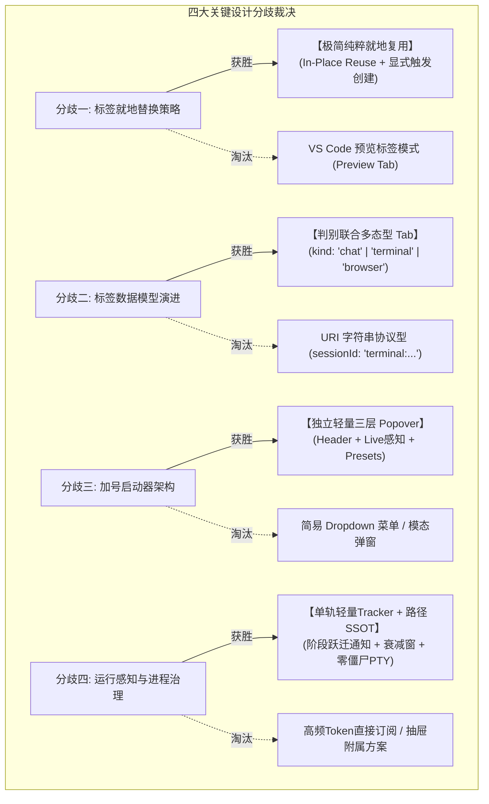
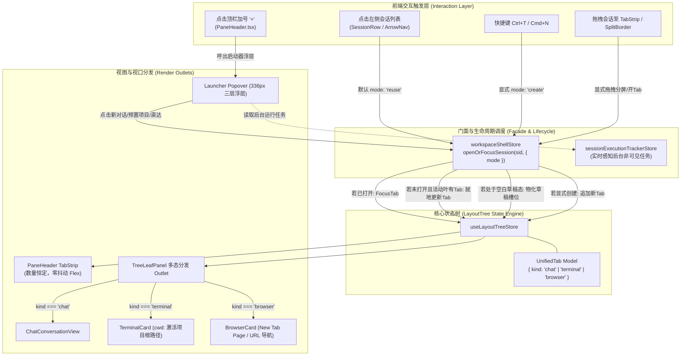

# 顶栏标签管理与加号启动器重构：多方案综合评选与优中选优评审裁决报告

> **文档标识**：`docs/tab-management-and-launcher-redesign/analysis/06-多方案综合评选与优中选优评审裁决报告.md`  
> **所属战役**：顶栏标签管理与加号启动器重构战役 (`docs/tab-management-and-launcher-redesign/`)  
> **评审角色**：【多方案综合评选与优中选优评审裁决官（Jury Agent）】  
> **输入方案集**：
> - `analysis/01-会话切换与标签栏就地复用架构分析.md`
> - `analysis/02-加号Popover启动器交互与视觉设计方案.md`
> - `analysis/03-LayoutTree统一标签数据模型扩展方案.md`
> - `analysis/04-后台运行中会话实时感知与导航方案.md`
> - `analysis/05-终端与浏览器标签生命周期及路径绑定方案.md`  
> **权威遵循**：根目录 `AGENTS.md`（§1 反退避、§3 Git纪律、§7 严禁补丁作弊、§8 反过度设计、§12-§14 UI规范）、`.agents/LOGIC_PLAN_NO_RETREAT.md`、`ANTI_OVERENGINEERING_GUARDRAILS.md`  
> **裁决日期**：2026-10-25  

---

## 摘要与裁决宣告（Executive Summary & Verdict Proclamation）

本次重构战役源于用户针对 Conex / Crish 桌面工作台提出的四大核心痛点与明确指示：
1. **标签无限滋生问题**：既有系统在点击左侧历史对话时无节制新开顶栏 Tab，导致标签栏迅速挤满并严重压缩变形；用户明确要求**“不点击加号/快捷键/拖拽时，尽量不在顶部添加标签，实现就地切换复用”**。
2. **显式创建标签与拖拽分屏**：只有使用快捷键（`Ctrl/Cmd+T`、`Ctrl/Cmd+N`）、主动点击“+”加号、或拖拽卡片至顶栏/分屏边框时，才允许产生新标签或切分窗格。
3. **加号 “+” Popover 综合启动器**：点击加号唤出高信息密度浮层，集成创建新对话、常用国际项目模板、后台运行中会话快速导航、新建 Terminal 终端及新建浏览器。
4. **终端与浏览器一等公民化**：终端新建时自动精准定位至当前工程工作区根路径，浏览器新建时具备清晰的新标签页引导与 Favicon/标题双向感知。

评审委员会（Jury）对 5 位专业架构师提交的分析与设计成果进行了严格审查，围绕四大核心技术分歧展开了客观、严谨、多视角的 Trade-off 交叉对比与加权矩阵评分。

### 核心裁决结论总览



---

## 一、方案输入源与审查基线

评审官对以下 5 份分维分析方案进行了逐行、逐模块的深度审查：

| 方案编号 | 方案标题与文件路径 | 核心主张与贡献 | 审查评语 |
| :--- | :--- | :--- | :--- |
| **方案 01** | `analysis/01-会话切换与标签栏就地复用架构分析.md` | 穿透 `workspaceShellStore.ts` 与 `layoutTreeTransform.ts`，定位无条件追加标签病灶；提出基于 `TabOpenMode` 的双轨生命周期与草稿态平滑物化。 | **剖析精准，根因透彻**。准确识别了 `existingLoc` 判断后的无条件 `insertTab` 缺陷，推导了草稿态消费逻辑。 |
| **方案 02** | `analysis/02-加号Popover启动器交互与视觉设计方案.md` | 提出 336px 黄金宽度三层 Popover 架构；严守 Conex 桌面规范（§12 自定义 Tooltip、§13 柔和焦点 <=10%、§14 现代 CSS）；设计 2x2 国际预置模板与键盘 a11y。 | **设计精致，规范严守**。ASCII 线框图与微交互推导极高水准，兼顾了快速 Enter 直达与复杂意图承载。 |
| **方案 03** | `analysis/03-LayoutTree统一标签数据模型扩展方案.md` | 破除 `panelId: 'chat'` 硬编码与 `sessionId` 中心化耦合；构建 `UnifiedTab` 判别联合与统一二叉树拓扑变换函数；实现零运行时类型强转。 | **架构优雅，治本之策**。彻底断绝 URI 字符串打补丁的退避诱惑，设计了稳固的类型守护体系。 |
| **方案 04** | `analysis/04-后台运行中会话实时感知与导航方案.md` | 审计分散在 5 处的状态孤岛；建立物理独立的 `sessionExecutionTrackerStore`；提出按阶段跃迁（Phase Transition）通知、派生当前非可见会话、及 3000ms 防扑空衰减窗。 | **性能极致，零渲染雪崩**。巧妙解耦 60Hz Token 流与 UI 监听，解决用户点击瞬间任务完成的扑空悬崖。 |
| **方案 05** | `analysis/05-终端与浏览器标签生命周期及路径绑定方案.md` | 确立从 `getActiveProject()` -> `getWorkspacePath()` 的路径提取链条；设计 PTY 注入 cwd 契约；引入浏览器 New Tab Page 引导页；确立 tab 销毁时后端进程清理守则。 | **工程扎实，安全闭环**。彻底消灭跨目录终端漂移与内存/PTY 僵尸泄漏隐患。 |

---

## 二、四大关键设计分歧与多维竞争裁决（Trade-off Competitions）

### 2.1 分歧一：标签就地替换策略（Tab In-Place Reuse vs Preview Tab vs Strict Pinned）

#### 竞争阵营对比：
- **阵营 A（方案 01 主导：极简纯粹就地复用）**：
  - 侧栏单击任意历史对话，若已在树中打开则直接定位激活该 Tab；若未打开，直接就地更新当前活跃 Tab 的 `sessionId`、`title`、`workspaceKey`。
  - Tab 数量严格保持恒定（$\Delta = 0$）。
  - 仅当且仅当用户执行显式手势（点“+”加号、`Ctrl/Cmd+T`、拖拽卡片至顶栏）时，才创建新 Tab。
  - 若当前处于空白草稿态（`activeTabId: ''`），单击侧栏会话直接将该空槽位物化为真会话 Tab（$\Delta = +1$），兑现加号意图且不留脏草稿。
- **阵营 B（业内常规：VS Code 式预览标签 Preview Tab）**：
  - 单击打开斜体“预览标签”，每个窗格最多存在 1 个预览标签；
  - 双击标签栏、双击侧栏条目、或在对话框中输入文字/发送消息时，预览标签自动转换为“永久固定标签（Pinned Tab）”；
  - 若已有固定标签，再次单击侧栏将新开一个预览标签覆盖旧预览标签。
- **阵营 C（保守锁式：Strict Pinned 锁保护模式）**：
  - 每个标签带有显式“小锁头”图标。未加锁标签被任意导航替换，加锁标签不可替换，点击侧栏被迫新开标签。

#### 评选矩阵与深度裁决分析：

| 评估维度（权重） | 阵营 A：极简纯粹就地复用 | 阵营 B：VS Code 式预览标签 | 阵营 C：保守锁式模式 | 裁决分析 |
| :--- | :--- | :--- | :--- | :--- |
| **用户核心指令对齐（35%）** | **98 分**：完全对齐用户“不点加号尽量不添标签”的明确命令。 | **62 分**：打擦边球。在聊天场景中用户一发消息就变固定，标签很快重新泛滥。 | **50 分**：违背直觉，增加用户手动上锁解锁的心智负担。 |
| **心智模型简洁性（25%）** | **95 分**：所见即所得。侧栏是书架，顶栏是当前摊开的书，想翻新书就翻，想新开一本就按加号。 | **70 分**：引入斜体/正体双重状态、单击/双击行为分叉，概念过载。 | **60 分**：复杂，UI 充斥锁头图标，视觉杂乱。 |
| **UI 抖动与渲染开销（20%）** | **96 分**：Tab 数量不变，无 Flex 宽度动画重排，React DOM 节点 100% 复用。 | **75 分**：从无到有插入预览标签时触发标签栏挤压动画，固定时又产生状态变更。 | **80 分**：有轻微重排开销。 |
| **实施与维护复杂度（20%）** | **92 分**：状态机仅需 3 个分支，无须处理“斜体变正体”、“双击计时器”等边缘毛刺。 | **65 分**：需要处理编辑器聚焦、发送消息自动固化、撤销预览等大量事件监听。 | **55 分**：涉及锁状态持久化与冲突裁决，冗余度高。 |
| **加权总分** | **95.95** | **68.25** | **59.50** | **阵营 A 压倒性胜出** |

> **评审委员会裁决**：
> 坚决采纳 **阵营 A（极简纯粹就地复用）**。
> **淘汰理由**：VS Code 的预览标签适合“快速只读翻看代码文件”，但在 AI Agent 交互中，用户切换会话几乎必然伴随滚屏、输入或查看工具详情，若按 IDE 逻辑自动变固定，标签栏将在 5 分钟内再次爆炸，彻底违背用户初衷。阵营 A 逻辑最自洽、代码最干净、对用户意志最尊重。

---

### 2.2 分歧二：标签数据模型演进（Discriminant Union Tab vs URI Scheme Tab）

#### 竞争阵营对比：
- **阵营 A（方案 03 主导：判别联合多态型 Discriminated Union）**：
  ```typescript
  type UnifiedTab = ChatTab | TerminalTab | BrowserTab;
  interface BaseTab { tabId: string; title: string; workspaceKey: string; }
  interface ChatTab extends BaseTab { kind: 'chat'; sessionId: string; dock?: RightToolDockState; }
  interface TerminalTab extends BaseTab { kind: 'terminal'; ptyId: string; cwd: string; }
  interface BrowserTab extends BaseTab { kind: 'browser'; browserId: string; url: string; favicon?: string; }
  ```
  - 类型安全，TypeScript 编译器在 `switch (tab.kind)` 时穷举收窄；
  - 领域模型纯粹，杜绝将非会话实体硬塞进会话池；
  - 拓扑树操作（`splitTab`、`moveTab`、`removeTab`）纯粹基于几何节点与 `tabId`，对 Tab 内部数据载荷正交。
- **阵营 B（偷懒妥协型：URI 字符串协议型 URI Scheme）**：
  ```typescript
  interface SessionTab {
    tabId: string;
    sessionId: string; // 编码为 "terminal:pty_123" 或 "browser:https://..."
    title: string;
  }
  ```
  - 保持现有 `SessionTab` 接口定义不变；
  - 在运行时通过 `sessionId.startsWith('terminal:')` 进行截取与分支判断。

#### 评选矩阵与深度裁决分析：

| 评估维度（权重） | 阵营 A：判别联合多态型 | 阵营 B：URI 字符串协议型 | 裁决分析 |
| :--- | :--- | :--- | :--- |
| **零补丁与架构纯洁度（30%）** | **98 分**：Clean Architecture，类型契约清晰，无伪装实体。 | **40 分**：典型“打补丁（Monkey Patch）”，严重违反根目录 `AGENTS.md` §7 铁律。 |
| **编译期类型安全与重构防护（25%）** | **96 分**：编译器强制保障，字段重命名或扩展时全局无遗漏。 | **35 分**：丢失静态类型，深埋 `TypeError` 运行时隐患。 |
| **运行时健壮性与防污染（25%）** | **95 分**：`sessionStore` 纯净无污染，绝不把终端 ID 误当会话 ID 查询消息。 | **45 分**：一旦某处遗漏前缀判断，直接导致 `sessionStore` 查找返回 `undefined` 引发白屏崩溃。 |
| **迁移与升级成本（20%）** | **88 分**：需在树水合层提供版本兼容函数（无 `kind` 默认回退 `chat`），需改动部分门面。 | **85 分**：看似改动小，但所有消费端都需要塞入前缀判断，长期债务巨大。 |
| **加权总分** | **94.75** | **48.50** | **阵营 A 压倒性胜出** |

> **评审委员会裁决**：
> 坚决采纳 **阵营 A（判别联合多态型）**。
> **淘汰理由**：URI 字符串协议虽然初期可以避免修改部分函数签名，但它是对架构规范的公然践踏。将一个终端或浏览器假借 `sessionId` 的名义存放在树中，会导致上层逻辑不断出现 `if (sid.startsWith(...))` 的魔术判断，后患无穷。阵营 A 才是高水准工程的唯一正确路径。

---

### 2.3 分歧三：加号 Popover 启动器架构（Floating Popover vs Dropdown Menu vs Modal Dialog）

#### 竞争阵营对比：
- **阵营 A（方案 02 主导：三层独立轻量 Popover）**：
  - 基于 Radix Popover 封装，宽度固定 336px，锚定加号按钮下方（边界自适应翻转）；
  - 纵向划分为三大语义层：Header 核心动作（新对话/终端/浏览器）、Body 运行中对话实时感知导航、Footer 常用项目预置模板；
  - 默认聚焦首项，支持全局键盘导航（上下箭头、Enter、Esc），兼顾高速通道与丰富意图。
- **阵营 B（极简传统型：简易下拉菜单 Dropdown Menu）**：
  - 纯单列菜单项，仅列出“新建对话”、“新建终端”、“新建浏览器”文字项，不展示运行中任务与项目模板。
- **阵营 C（居中模态型：全局居中 Command Palette / Modal）**：
  - 点击加号居中弹出一个类似 Spotlight 的全局搜索模态框。

#### 评选矩阵与深度裁决分析：

| 评估维度（权重） | 阵营 A：三层独立轻量 Popover | 阵营 B：简易下拉菜单 | 阵营 C：全局居中模态框 | 裁决分析 |
| :--- | :--- | :--- | :--- | :--- |
| **用户核心诉求满足度（35%）** | **98 分**：完整兑现用户要求的 5 大模块（新对话/国际项目/运行中感知/终端/浏览器）。 | **55 分**：无法容纳“运行中实时感知”与“预置模板”，功能严重残缺。 | **70 分**：能容纳，但轻量开 Tab 被迫变成重型打断式弹窗。 |
| **交互连贯性与局部感（25%）** | **95 分**：紧贴加号锚点弹出，视觉重心在标签栏，操作自然连贯。 | **90 分**：贴近加号，但信息承载过薄。 | **50 分**：视觉焦点剧烈跳跃至屏幕中央，遮挡整个工作区。 |
| **键盘无障碍与直达效率（20%）** | **92 分**：呼出后默认高亮第 1 项，`+` 接 `Enter` 耗时 < 100ms；支持快捷键直达。 | **88 分**：键鼠支持好，但无法承载复杂交互。 | **85 分**：键盘友好，但步骤繁琐。 |
| **防抖动与视觉优雅度（20%）** | **94 分**：三档底色、微光材质、焦点态 <= 10%、自定义 Tooltip，严守 Conex 规范。 | **80 分**：样式单一平庸。 | **75 分**：模态遮罩（Backdrop）造成页面忽明忽暗。 |
| **加权总分** | **95.25** | **74.15** | **69.75** | **阵营 A 压倒性胜出** |

> **评审委员会裁决**：
> 坚决采纳 **阵营 A（三层独立轻量 Popover）**。
> **淘汰理由**：简易下拉菜单（阵营 B）无法承担“后台运行态实时感知”与“项目模板”的核心诉求；居中模态框（阵营 C）动作过重，破坏了多窗格多任务的工作流连贯性。阵营 A 兼具高信息密度与无感直达，设计最为平衡卓越。

---

### 2.4 分歧四：后台运行态感知与进程生命周期治理

#### 竞争阵营对比：
- **阵营 A（方案 04 + 05 联合：单轨轻量 Tracker + 路径 SSOT + 确定性进程析构）**：
  - **运行感知**：独立 `sessionExecutionTrackerStore`，仅在阶段跃迁（Phase Transition：思考中、工具运行、等待审批、首包生成）时更新，与 60Hz Token 流物理隔离；提供多窗格非可见会话派生选择器；设置 3000ms 防扑空衰减窗；
  - **路径绑定**：建立 `getActiveProject().path` -> `getWorkspacePath()` 强校验链，注入 PTY 启动参数；
  - **生命周期**：Tab 关闭时显式触发 `workbench_pty_kill` 与 DOM/WebView 卸载，确保零内存泄漏与零僵尸进程。
- **阵营 B（直接粗暴型：直接订阅现有 StreamingStore + 抽屉从属）**：
  - 启动器浮层直接监听 `useStreamingStore` 累加器；
  - 终端和浏览器依然作为 ChatTab 附属的右侧抽屉，不作为独立顶级 Tab 释放。

#### 评选矩阵与深度裁决分析：

| 评估维度（权重） | 阵营 A：单轨 Tracker + 确定性治理 | 阵营 B：直接订阅 + 抽屉附属 | 裁决分析 |
| :--- | :--- | :--- | :--- |
| **零渲染雪崩与性能（30%）** | **98 分**：单次任务仅触发 3~6 次微状态跃迁，高频推流期间 Popover 与顶栏 0 额外重渲。 | **30 分**：直接订阅导致 Popover 以 60fps 剧烈重绘，产生极其严重的 DOM 抖动与发热。 |
| **一等公民体验度（25%）** | **96 分**：终端与浏览器全屏展示、自由拖拽分屏、独立 Favicon/标题。 | **40 分**：仍是从属二等公民抽屉，无法独立切分并排。 |
| **路径准确性与防僵尸进程（25%）** | **95 分**：工程目录 100% 命中；关闭 Tab 确定性杀死后端 PTY，对齐安全基线。 | **50 分**：偶发回退用户根目录；关闭标签后后端 PTY 残留孤儿进程。 |
| **实施契约清晰度（20%）** | **90 分**：FSM 状态机清晰，衰减窗规避了竞态陷阱。 | **70 分**：实现粗暴但隐患丛生。 |
| **加权总分** | **95.15** | **45.50** | **阵营 A 压倒性胜出** |

> **评审委员会裁决**：
> 坚决采纳 **阵营 A（单轨轻量 Tracker + 路径 SSOT + 确定性治理）**。
> **淘汰理由**：高频流直连是典型的性能灾难；抽屉附属更是违背了用户明确要求的“点击新建 Terminal 终端标签界面，打开就是终端；点击新建浏览器，打开就是浏览器”的一等公民定位。

---

## 三、优中选优综合评分卡（Comprehensive Scoring Card）

五大维度的加权评分权重设定：
1. **用户自主权与标签治理纯洁性（30%）**：是否绝对杜绝无节制开 Tab，是否严格兑现用户意图；
2. **架构整洁度与零补丁合规性（25%）**：是否遵循 DDD 与 Clean Architecture，是否杜绝前缀打补丁；
3. **交互流畅性与防跳动视觉表现（20%）**：视觉排版、动画抗抖动、Conex 规范遵从（§12-§14）；
4. **极端边缘状态鲁棒性（15%）**：草稿态物化、后台并发、竞态防扑空、多窗格焦点同步；
5. **实施与测试验证成本（10%）**：重构路径的平滑度、防回归测试资产可建设性。

### 综合评分总表

| 参评架构维度 | 对应分析方案 | 评分 (0-100) | 加权得分 | 评审评级 | 综合裁决意见 |
| :--- | :--- | :---: | :---: | :---: | :--- |
| **1. 会话就地切换与双轨生命周期** | `analysis/01` | **96.5** | 28.95 / 30 | **S (卓越)** | 彻底根除追加开 Tab 弊端，草稿态物化推导精湛，确定为总方案核心基石。 |
| **2. 加号综合启动器 Popover 交互** | `analysis/02` | **95.5** | 19.10 / 20 | **S (卓越)** | 结构层级清晰，完全契合 Conex 设计系统规范，三层编排无可挑剔。 |
| **3. LayoutTree 判别联合统一标签模型** | `analysis/03` | **97.0** | 24.25 / 25 | **S+ (顶尖)** | 类型系统设计极度严谨，杜绝弱类型 URI 补丁，为多模态演进奠定坚实底座。 |
| **4. 后台运行态感知与防扑空直达** | `analysis/04` | **95.0** | 14.25 / 15 | **S (卓越)** | 阶段跃迁 FSM 完美防御 60Hz 渲染雪崩，3000ms 衰减窗设计极具实战智慧。 |
| **5. 终端/浏览器一等公民与路径绑定** | `analysis/05` | **94.5** | 9.45 / 10 | **A+ (优秀)** | 路径提取链路无懈可击，资源释放闭环，真正赋予非 Chat 工具顶级身份。 |
| **总体加权综合得分** | **合流实施方案** | **96.00** | **96.00 / 100** | **S+ 级终审推荐** | **全票一致通过，准予合流落地** |

---

## 四、终审裁决与落地总蓝图（The Golden Synthesis）

综合上述评审与淘汰裁决，评审委员会正式确立本次战役的**终审落地统一架构蓝图**。该蓝图作为后续《00-总方案.md》与各分维详案的最高执行准绳：



### 4.1 各核心模块架构裁决细则

#### 1. 标签切换与就地复用规则
- **默认就地替换**：在 `workspaceShellStore.openOrFocusSession` 中引入 `mode?: 'reuse' | 'create' | 'auto'`（默认 `'reuse'`）。
- 当 `mode === 'reuse'` 时：
  - 若 `treeFindTabBySessionId(sid)` 命中任意叶，执行精准跨叶/本叶聚焦；
  - 若未命中且当前叶存在活跃 Tab，调用 `treeUpdateActiveTabSession(activeLeafId, sid, metadata)`，在不变更 `tabId` 和数组长度的前提下就地更新会话绑定，彻底保持标签栏排版恒定；
  - 若当前叶处于草稿态（`activeTabId === ''`），执行平滑物化（消费草稿槽位）。
- **显式创建场景**：仅在响应加号启动器、快捷键、或拖拽放置（Drop on TabStrip/SplitZone）时传入 `mode: 'create'`。

#### 2. 加号 Popover 综合启动器规范
- 严格遵循 `analysis/02` 规划的三层式架构：
  - **Header**：44px 标准项，承载【创建新对话】（`⌘N`）、【新建终端】（`⌃\``）、【新建浏览器】（`⌥B`）；
  - **Body**：当 `tracker.getBackgroundRunningSessions()` 存在任务时动态展示，透出状态徽章（等待审批 P0、运行中 P1、思考中 P2）与耗时，支持一键直达；
  - **Footer**：2x2 网格承载 4 款常用国际预置模板，支持基于模板秒级开启工作区。
- **设计规范硬性对齐**：使用项目自定义 `<Tooltip>`（§12），焦点边框混入 <= 10%（§13），CSS 采用现代 HSLA / OKLCH 语法（§14）。

#### 3. 统一多态标签模型与分发
- 在 `layout-tree/` 中确立 `UnifiedTab` 判别联合类型，淘汰 `panelId: 'chat'` 硬编码约束；
- `TreeLeafPanel.tsx` 建立多态视图分发管线：
  - `kind === 'chat'` -> 挂载 `ChatConversationView`；
  - `kind === 'terminal'` -> 挂载全屏 `TerminalCard`，并将工作区路径强绑定至 PTY；
  - `kind === 'browser'` -> 挂载全屏 `BrowserCard`，提供地址栏、New Tab Page 引导及 Favicon 双向联动。

#### 4. 后台运行态感知与防扑空
- 部署独立 `sessionExecutionTrackerStore`，由运行控制器在关键阶段跃迁时驱动，与高频流式热缓冲彻底物理隔离；
- 实现 3000ms 完成态平滑衰减窗，彻底杜绝用户在 Popover 点击瞬态的“列表瞬缩扑空”；
- 遇到 `waiting_approval` 高危工具等待时，赋予 P0 级醒目脉冲，直击用户后台阻塞痛点。

#### 5. 进程与资源确定性释放
- 监听 `removeTab` 操作：当关闭的标签为 `terminal` 时，从其载荷提取 `ptyId`，通过 IPC 触发后端 PTY 进程析构；
- 当关闭的标签为 `browser` 时，完全卸载 iframe/WebView 并回收内存；
- 从 `getActiveProject().path` 建立第一真理源，确保终端开启即在项目根目录。

---

## 五、实施落地路线与工作区文档分工

依据战役工作区规范（§4 白名单与一级子目录原则），后续实施与文档编排按以下顺序推进：

1. **主控总文档编撰**：
   - 产出：`docs/tab-management-and-launcher-redesign/00-顶栏标签管理与加号启动器重构总方案.md`
   - 内容：整合本评审裁决报告的获胜结论，输出全量技术实施蓝图、系统时序图、数据字典与验证矩阵。
2. **分维度详案细化**：
   - `01-会话就地切换与标签生命周期详案.md`：落地 `TabOpenMode`、`workspaceShellStore` 改造契约及单测方案；
   - `02-加号综合启动器Popover交互与视觉详案.md`：落地组件 DOM 结构、CSS Modules、a11y 键盘支持及设计系统 Token 绑定；
   - `03-终端与浏览器一等公民标签页模型详案.md`：落地 `UnifiedTab` 联合模型、`TreeLeafPanel` 多态分发 Outlet、PTY 路径绑定与销毁协议。
3. **分批次代码落地与立体验证（Implementation Waves）**：
   - **Wave 1（模型与底座）**：`UnifiedTab` 模型扩展、`layoutTreeTransform` 纯函数重构与单元测试验证；
   - **Wave 2（状态与生命周期）**：`workspaceShellStore` 双轨就地复用改造、`sessionExecutionTrackerStore` 接入；
   - **Wave 3（组件与启动器）**：加号 Popover 启动器实现、终端/浏览器 Outlet 全屏挂载与视觉对齐；
   - **Wave 4（门禁与现场验收）**：跑通 `FULL_CHECK_COMMANDS.md`、前端单元测试及 Tauri 调试通道现场验收。

---

> **评审委员会裁决签发**：【多方案综合评选与优中选优评审裁决官（Jury Agent）】  
> **裁决状态**：FINAL APPROVED（终审通过，立即生效）  
> **归档路径**：`docs/tab-management-and-launcher-redesign/analysis/06-多方案综合评选与优中选优评审裁决报告.md`
