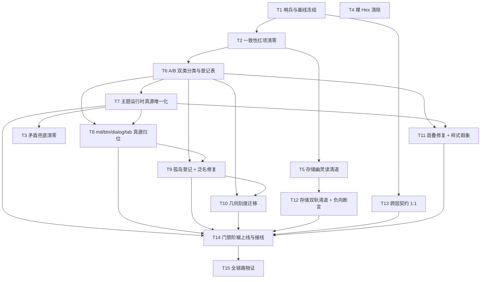

# 00 · Token 消费面统一与分裂收敛 · 总方案（系统性端到端修复）

> **性质**：自上而下的端到端修复总纲。**只含逻辑执行顺序与依赖拓扑**——不含工期、人天、人员分配、优先级排序；下列全部问题**逻辑同权**。
> **上游勘测**：`audits/00-勘测-消费面分裂实况与初版方案.md` · `audits/01-消费面扫描明细-2026-09-11.md` · `audits/02-运行时与门禁勘测-2026-09-11.md`
> **分维详案**：`01-分维-防御脚本断言阶梯.md` · `02-分维-真源唯一化与多轨物理清退.md` · `03-分维-消费面物理清零.md`
> **执行契约**：`04-纪律-执行拓扑与Agent派发契约.md`
> **反作弊总则**：`AGENTS.md` §1（反退避）· §7（严禁补丁/绕过/作弊）· §7.1（立体验证纪律）· §9（测试资产保护铁律）

---

## 〇、结论先行

**这不是「token 不够用」，而是同一语义存在三条并行真源，且优先级最高的一条是 JS 内联注入。**

| 轨 | 位置 | 层叠优先级 | 现状 |
|---|---|---|---|
| 轨 1 静态真源 | `styles/tokens.css` | `:root` / `[data-theme]` 选择器 | **34 个语义 token 被轨 2 遮蔽** |
| 轨 2 运行时注入 | **11 个 `setProperty` 写入点** | **内联样式（最高）** | 覆写轨 1 的同一批 token 名 |
| 轨 3 兜底影子 | **2,036 处 `var(--x, 裸字面量)`** | fallback 仅在轨 1 缺失时生效 | 其中 **59 个 token 的兜底与真值互相矛盾** |

**推论**：改 `tokens.css` 界面不一定变（被轨 2 遮蔽）；轨 1 一旦失效界面不是「无样式」而是**静默换规格**（轨 3 接管）；而轨 3 本身**与真值矛盾**——三者叠加，**当前不存在任何一个「改一处即全局生效」的点**。这就是「体系没问题、用起来四分五裂」的机械根因。

**修复目标不是清理数值，而是重建单向链**：偏好 → 参数 → 派生 → 语义 token → 消费点，每一环只有一个写者、一个读者，且**链上任一环的缺席都必须被门禁捕获，而不是被兜底掩盖**。

---

## 一、问题总清单（按域编号，全部带证据，逻辑同权）

### 域 I · 真源分裂（多轨并存）

| # | 问题 | 证据 |
|---|---|---|
| **P1** | **34 个语义 token 既在 `tokens.css` 静态定义、又被 JS 内联注入覆写**，内联优先级高于选择器 → 静态真源被遮蔽 | 双写清单 `audits/02` §1.3；注入点 `themePersonalization.ts:83,344-345,360-404`、`fontStore.ts:156-165`、`main.tsx:119,123`、`codeBlockIndent.ts:66` |
| **P2** | `--text-primary` / `--text-secondary` / `--text-tertiary` **被两个 JS 写者争用**（皮肤引擎 + 对比度守卫），后写者胜出、顺序耦合 | `themePersonalization.ts:360-404` vs `oklchColorGuard.ts:117,122-126` |
| **P3** | `--ui-scale` **只有 JS 注入、`tokens.css` 无静态定义** → 静态面不可知、无法门禁 | `visualThemeController.ts:32` |
| **P4** | `--md-*` **46 个 token 双定义**，**胜出方按主题翻转**（亮色 `tokens.css`、暗色 `markdown-typography.css`） | `tokens.css:484-680`/`:1081-1268` vs `markdown-typography.css:12-81`；结合 `index.css:2-4` 导入序与特异性 0,1,1 vs 0,1,0 |
| **P5** | `--btn-*` **11 个 ×4 文件**；`--dialog-z` **×5 文件**；`--tab-duration`/`--tab-press-duration`/`--tab-spring-bezier` **×2 文件** | `audits/01` §六 全表 |
| **P6** | `--duration-*`/`--transition-*` **13 个在 `reduced-motion.css:22-40` 二次定义**（机制授权，但选择器列表冗余 4 个 + `!important`） | `reduced-motion.css:22-25` |
| **P7** | `--z-*` **23 个外置于 `z-index.css`**（已授权，`tokens.css:476` 有注释），但未建索引登记 → 外部无法从 `tokens.css` 发现 | `tokens.css:476`、`z-index.css:32` |
| **P8** | 单点遮蔽：`--scrollbar-width`(ScrollArea) · `--seg-inner/outer-radius`(SegmentedControl) · `--tab-gap`(Tabs) · `--sidebar-width`(responsive.css) · `--diff-gutter-bg`(FileViewerCard) · `--focus-ring-color`(focus-visible.css) | `audits/01` §六 |
| **P9** | **123 个组件孤岛 token**；`ToastStackModern.module.css` 用**无前缀泛名** `--gap`/`--height`/`--scale`，会误命中任意后代消费者 | `audits/01` §七 |

### 域 II · 消费面影子系统（兜底与裸值）

| # | 问题 | 证据 |
|---|---|---|
| **P10** | **2,036 处 `var(--x, 裸字面量)`**（占 var 引用 24.4%），其中 **59 个 token 的兜底与真值矛盾** | `audits/01` §一、§五 |
| **P11** | `--font-size-*` 兜底全是裸 px，**绕过 `calc(… + var(--font-size-adjust))`** → 兜底一生效，字号调节功能静默失效 | `audits/01` §五 |
| **P12** | `--transition-*` 兜底**私藏 5–10 种动效规格**（`--transition-fast` 5 种、`--transition-micro` 10 种）→ 降动网格改的是 token、**改不动这 2,036 处兜底**，无障碍链路存在缺口 | `audits/01` §五 |
| **P13** | `--font-mono` 兜底 **8 种**字体栈（`monospace`×49 等），真值是 8 段栈 | `audits/01` §五 |
| **P14** | **3,662 处几何裸 px**（`padding` 698 / `font-size` 610 / `gap` 511 / `border-radius` 451 / `height` 445 / `width` 321），而 13 档 `--space-*`、10 档 `--radius-*`、13 档 `--font-size-*` **全部齐备** | `audits/01` §四.3 |
| **P15** | **85 处裸色 / 32 文件**（`ChatMessageRow` 27、`ChatComposer` 12，后者含 `hsl(38, 90%, 50%)` 而 `--color-warning` 已存在） | `audits/02` §5.6 |
| **P16** | **152 处 `!important` / 21 文件**；`ChatComposer` 21 处、`PreviewCard` 13 处用于压制第三方组件 | `audits/02` §5.1 |
| **P17** | **14 处魔术数字补偿**（负 `margin` 抵消、`translateY(-46px)` 浮钮位移、`-10px 舌头补偿`、`margin-bottom:-38px`） | `audits/02` §5.4 |

### 域 III · 幽灵契约与伪连通

| # | 问题 | 证据 |
|---|---|---|
| **P18** | **悬空无兜底**：`background: var(--bg-surface-active)` 全仓无定义、无注入、无 fallback → 声明整条失效 | `ui/Tooltip/Tooltip.module.css:84` |
| **P19** | `--chat-stream-pad-x` **无定义、靠 20px 兜底存活**；`--radix-popover-content-transform-origin` 同类 | `ChatMessageList.module.css:38`、`ChatScrollFloorSlot.module.css:20`、`PermissionModeMenu.module.css:145` |
| **P20** | **5 个死 token**（有定义、零消费） | `tokens.css:432-435`（4 个 `--shell-*`）· `z-index.css:32`（`--z-pinned-bar`） |
| **P21** | **死框架**：`localStorageApi.migrateLegacyKeys()` 恒返 0 且**零调用方**；`themeStore.disposeSolarTimer()` no-op 零调用方；`themeStore` re-export `getDynamicSolarAdjustments` 外部零消费 | `localStorageApi.ts:156-160`、`themeStore.ts:192-194`、`themeStore.ts:26-29` |
| **P22** | `AppBootstrap.ts:251-267` **重复写** `data-ui-size`/`data-density`/`data-shell-chrome`（注释自称 "fallback if not handled by visualThemeController"），而 `visualThemeController.ts:30-31` 已写 → **DOM 属性双轨** | 两处对比 |
| **P23** | `SettingsQuickMenu.tsx:215-217` **直调 `setTheme`**，绕过文档声明的唯一写端（`settingsStore` → `themeProjection`）→ **第二入口** | 与 `useAppearanceSettings.ts:223-224` 对比 |
| **P24** | Rust `#[tauri::command]` **166 个声明 vs 142 条注册** → 24 个函数名不在注册路径内（含 dev-only 6、退役残留 `md_render_stream`/`md_clear_cache`/`delete_session`/`touch_session`、`perf_*` 8 等；**部分为解析误报，需逐个裁决**） | `main.rs:156-511` |
| **P25** | **10 条死命令**（已注册、前端零静态调用），全部躺在 `GHOST_EXEMPTIONS` 手工豁免集内；其中 `core_cancel_run` 为**陈旧豁免**（实际有调用点 `daemonClient.ts:115`） | `command-contract-drift.test.ts:198-227` |
| **P26** | **四份命令清单并存且数量不一致**（`main.rs` 142 / `command_manifest.rs` 142 / `tauri-command-registry.ts` 132 / `commandManifest.ts`）；注释仍引用已不存在的 `make_handlers!` 与旧条数「127」 | 四处对比 |

### 域 IV · 存储孤岛与兼容 Shim

| # | 问题 | 证据 |
|---|---|---|
| **P27** | **11 个双轨 key**，核心重复字段：`theme`/`fonts`/`tabModeEnabled`/`uiSize`/`restoreLastWorkspace`/`openTabs` | `audits/02` §3 |
| **P28** | **幽灵读**：`crish_ui_size`/`crish_shell_chrome`/`crish_sidebar_collapsed`/`crish_tab_mode` **无任何写入方**却仍被 `minimalConfig.ts:9-24` 读取；`crish_send_shortcut` 无写入方却仍被 `settingsAccess.ts:73` 读取 | 写入面全仓为空 |
| **P29** | **只读回退 shim 仍在存活**：`themeStore.ts:47-58`、`fontStore.ts:124-135`、`codeBlockIndent.ts:34-56`（store 无值则回退读 `crish_settings`/`conex_pi_settings`） | 三处 |
| **P30** | **迁移写回（倒灌）**：`conex_pi_settings`→`crish_settings`（`clientApiSettings.ts:29-34`）、unscoped→`::windowId`（`shellWindowScope.ts:130-151`）、`crish-layout-v1`→tree（`migration.ts:83-121`）、`migrateFromLocalStorage`、`modelsLsImport`、`migrateLegacyProfiles` | 六处 |
| **P31** | `registeredKeys` 注册表仅 **6 个成员**，文件头声明「新增 key 时在此登记」但**无任何消费者或测试强制**（全仓仅自身引用） | `localStorageApi.ts:40-74` |
| **P32** | `ConfigService.define(key, schema, default, storage)` **生产代码零登记**（仅 `tests/fuzz/config-service.test.ts:7-9`）；生产 `get/set` 使用 `shortcuts.overrides`/`workspace.layout` 等**未登记键** → 幽灵契约 | 对比 `ConfigService.ts:7-24` 与 `ShortcutService.ts:287,329`、`useSidebarResize.ts:21,100,103` |
| **P33** | **无任何「旧 key 零写入」负向断言**；`localStorageApi.ts:156 migrateLegacyKeys()` 为恒返 0 的**无行为框架** | 全仓检索为零 |

### 域 V · 层叠、生效与门禁

| # | 问题 | 证据 |
|---|---|---|
| **P34** | **密度档层叠失效**：`[data-ui-size='small'\|'large']` 特异性 **0,1,0** 被基础块 `html[data-theme='light']` **0,1,1** 压制 → **亮色下密度档静默失效、暗色下正常**（`--space-1` large 声明 6px，亮色实得 4px） | `tokens.css:33-35` vs `:1300`/`:1364`；属性落点 `themeStore.ts:80`、`AppBootstrap.ts:255` |
| **P35** | **门禁盲区**：`layout-contract.test.ts:73-135` 只验三档块的**存在性/整数性/单调性**（文本匹配），**从不评估层叠胜出方** → 门禁绿、功能死 | 该测试全文 |
| **P36** | **层叠上下文陷阱 10 处**：`fixed` + `transform`/`isolation`/`contain` 同体（`GlobalErrorBanner`、`ToastStack`、`SettingsPanel`、`sessionTabDrag` 的 `z-index:100000`、`PreviewCard`、`Sidebar` 的 `contain+translateZ`、`FilesCard` 的 `isolate` 等）；`Menu.module.css:3` 自述「只给 `.menuContent` 设 z 压不住 `isolation:isolate` 的壳」 | `audits/02` §5.2 |
| **P37** | **sticky 靠注释自述脆弱契约**：`ModelsSettingsTab.module.css:280-281`「`overflow:hidden` 会把 footer 的 sticky 截断在中间祖先里」→ `.mrdModelList{overflow:visible}`(282) | 同处 |
| **P38** | **门禁接线缺口**：15 个 token 相关门禁**无任何自动触发点**（`package.json:46` 的 `check:desktop` 链在 husky / CI / turbo 中均无调用）；`check-ui-negative-churn`/`check-legacy-shim`/`check-no-pseudo-dispatch` 等 **6 个脚本零引用** | husky `pre-commit`/`pre-push`、`.github/workflows/*` |
| **P39** | **门禁覆盖盲区**：`check-color-ssot` 仅匹配 `background(\|-color)?`/`color`（L75），**不匹配** `border`/`box-shadow`/`fill`/`stroke`/`outline`；`tokens.css` 层仅查 `--(bg\|surface)-` 前缀（L62）；`style-contract` 裸 z-index 仅查 **4 个指定文件** | 各脚本源码 |
| **P40** | 当前 `check-token-consistency` **FAIL**（`undefined_refs 2/0`、`nofallback_refs 1/0`、`dead_tokens 5/0`）；且基线文件记录的建线期 4 项 dead token 与当前实测 5 项**已漂移** | 实跑 + `token-consistency-baseline.md:55-59,101-116` |

**正向事实（需锁死，不得回退）**：全仓**无**动态拼接 token 名（`var(--${x})` 为零），所有 token 名**静态可验证**；Tauri **幽灵命令为 0**（前端调用集合 ⊆ 注册表集合）。

---

## 二、目标态架构

### 2.1 A/B 双类 Token 模型（P1/P3/P19 的结构性解）

当前把两类完全不同的东西混在一个命名空间里，是 P1/P3/P19 的总根因。**必须显式二分**：

| 类 | 定义 | 写者 | 消费者 | 例子 |
|---|---|---|---|---|
| **A 类 · 设计 Token** | 设计决策的静态声明 | **只有 `tokens.css`**（+ `z-index.css` 授权外置） | 业务 CSS **只读** | `--space-*` `--radius-*` `--text-*` `--bg-*` `--border-*` `--shadow-*` `--duration-*` `--z-*` |
| **B 类 · 运行期量** | 用户交互/测量驱动的**状态量**，非设计决策 | JS（唯一写者） | 组件 CSS 只读 | `--sidebar-width` `--chat-col-max` `--leaf-dock-width` `--anchor-width` `--toast-index` `--tab-item-width` `--tree-level` `--files-list-ratio` `--tooltip-translate` |

**规则（刚性）**：

1. **A 类 token 禁止被任何 JS 写入**（`setProperty` / `style={{}}` 均禁止）。违反即门禁 FAIL。
2. **B 类 token 必须登记**，且**必须在 `tokens.css` 声明静态默认值**（如 `--sidebar-width: 260px;`）——消除 P3「静态不可知」与 P19「靠兜底存活」。消费点一律写 `var(--x)` **不带兜底**（默认值由静态声明提供）。
3. **A 类与 B 类命名空间不得重叠**（消除同名遮蔽）。

### 2.2 偏好派生链（P1/P2 的结构性解）

当前：偏好直接覆写语义 token。目标：**偏好只写「参数」，语义 token 由 CSS 内派生**。

```
用户偏好（skin / accent / fontSizeAdjust / brightness）
        │  JS 唯一写者：ThemeProjection
        ▼
  ┌─ 参数层（B 类，唯一注入面）──────────────────────────┐
  │  --user-accent-h / --user-accent-s / --user-accent-l │
  │  --user-surface-tint  --font-size-adjust             │
  │  --user-brightness    --ui-scale                     │
  └──────────────────────────────────────────────────────┘
        │  CSS 内派生（color-mix / calc / hsl），零 JS 参与
        ▼
  语义层（A 类，静态声明，只读）
  --accent-primary: hsl(var(--user-accent-h) var(--user-accent-s) var(--user-accent-l));
  --bg-card:  color-mix(in srgb, var(--surface-card) calc(var(--user-brightness) * 1%), …);
  --text-primary: …;   --border-color: …;   --composer-bg: …;
        │
        ▼
  消费层（业务 CSS）：var(--bg-card) —— 零兜底、零裸值
```

**收益（唯一性即正确性）**：

- 改 `tokens.css` **必然**生效（不再有内联覆写遮蔽）→ 消灭 P1。
- `--text-primary` 只有一条派生公式 → 消灭 P2 的「两 JS 写者争用 + 顺序耦合」。
- 降动网格改 token **必然**穿透全部消费点 → 修复 P12 的无障碍缺口。
- 亮/暗/密度/性能四档组合在 **CSS 层**一次性定义，JS 不再参与主题语义 → JS 侧只剩「参数」。

### 2.3 单向链的四条硬约束

1. **单写者**：任一 token 名在静态定义面只有一个写者；B 类之外，JS 不是任何 A 类 token 的写者。
2. **无兜底即默认**：默认值由静态声明提供；消费点写裸 `var(--x)`。兜底只允许**语义降级链**（`var(--hairline, var(--border-subtle))`）。
3. **缺席即失败**：token 缺失必须被门禁捕获（`undefined_refs`/`nofallback_refs`），**不得**被裸值兜底掩盖。
4. **物理切除**：废弃 token / 旧 key / 旧命令 / 死框架一律**删除**，禁止注释保留、隐藏、`_deprecated` 命名续命、永久 Shim。

---

## 三、任务单元

> 每单元给出：**文件域**（写路径互斥）· **验收断言**。单元间依赖见 §四。

| 单元 | 内容 | 文件域 | 验收断言 |
|---|---|---|---|
| **T1** 门禁哨兵与基线冻结 | 新增真源唯一化门禁 + B 类登记表 + 防漂移哨兵（战役期冻结当前值，只降不升） | `scripts/`、`docs/token-consumption-unification/基线记录/` | 新门禁可跑；基线生成；**不触碰任何 CSS** |
| **T2** 消费面一致性红项清零 | P18/P19/P20 | `tokens.css`、`z-index.css`、`ui/Tooltip/Tooltip.module.css`、`chat-message-list/ChatMessageList.module.css`、`chat-message-list/ChatScrollFloorSlot.module.css` | `check-token-consistency` **PASS**；基线**未提升**；`--bg-surface-active` 不再出现；5 个死 token 物理删除 |
| **T3** 矛盾兜底清零（动效/不透明度/阴影/焦点环） | P10/P12/P13 中动效与视觉族 → **去兜底**形态 | 全部 CSS **除** T2 五个文件、**除** `tokens.css` | 该族「矛盾兜底」= 0；兜底次数单调下降 |
| **T4** 裸 Hex 清除（第一批） | P15：`ChatMessageRow` 27 处 + `ChatComposer` 12 处 | 这 2 个文件 | 两文件裸色为 0 |
| **T5** 存储幽灵读与零调用桩清退 | P21/P28：幽灵读面与死框架**物理删除** | `api/settings/minimalConfig.ts`、`api/settings/settingsAccess.ts`、`api/localStorageApi.ts`、`api/themeStore.ts` | 幽灵读 key 零引用；`migrateLegacyKeys`/`disposeSolarTimer` 不存在；负向断言上线 |
| **T6** A/B 双类分类与登记表落地 | §2.1；B 类补静态默认声明 | `tokens.css`、新增登记表 JSON、`scripts/` | 登记表覆盖全部 B 类；`JS注入 ∩ A类 = ∅`；`每个 B 类有静态默认` |
| **T7** 主题运行时真源唯一化 | §2.2：11 注入点 → 1 投影；偏好参数化；语义 token 改 CSS 派生 | `api/themePersonalization.ts`、`api/oklchColorGuard.ts`、`api/fontStore.ts`、`api/codeBlockIndent.ts`、`api/themeStore.ts`、`services/visualThemeController.ts`、`styles/tokens.css`、`app/AppBootstrap.ts`、`main.tsx` | `JS 写 A 类 token` = **0**；删 `AppBootstrap.ts:251-267` 重复写；`SettingsQuickMenu` 第二入口收敛 |
| **T8** `--md-*`/`--btn-*`/`--dialog-z`/`--tab-*` 真源归位 | P4/P5/P8 | `styles/markdown-typography.css`、`ui/Button`、`diff/DiffCard`、`workspace/PreviewCard`、`sidebar/SidebarNav`、`ui/Dialog`、5 个 dialog 文件、`ui/Tabs`、`ui/SegmentedControl` | 「跨文件重复定义」= 0（授权白名单外） |
| **T9** 孤岛命名空间登记 + 泛名修复 | P9：123 个孤岛登记；`ToastStackModern` 泛名改前缀 | 11 个孤岛文件 + 登记表 | 泛名 `--gap`/`--height`/`--scale` 为 0；孤岛全部在册 |
| **T10** 几何刻度迁移 | P14：按属性逐族迁至既有档位 | 热点榜头部 10 文件 | 裸 px 棘轮单调下降；**不为迁移新增任何档位** |
| **T11** 层叠修复与样式假象整治 | P34/P36/P37：密度档特异性修复；层叠陷阱登记；魔术数字补偿清零 | `tokens.css`（选择器）、`layout-contract.test.ts`、层叠 10 处、补偿 14 处 | **四组合真机断言**：`theme ∈ {light,dark}` × `uiSize ∈ {medium,large}` 下档位 token 计算值 == 声明值 |
| **T12** 存储双轨清退与负向断言 | P27/P29/P30/P31/P32/P33 | `api/localStorageApi.ts`、`api/themeStore.ts`、`api/fontStore.ts`、`api/clientApiSettings.ts`、`store/`、`api/settings/` | 双轨 key 归零；`registeredKeys` 覆盖全部 key 且**有门禁强制**；旧 key 零写入**负向断言**上线 |
| **T13** 跨层契约 1:1 对齐 | P24/P25/P26 | `apps/agent-workbench/src-tauri/src/**`、`api/transport/command-contract-drift.test.ts` | `#[tauri::command]` 声明集合 **==** 注册表集合；`GHOST_EXEMPTIONS` 收敛至 0；四份清单**归并为单一真源** |
| **T14** 门禁阶梯上线与接线 | P38/P39/P40；§五 L0–L8 | `scripts/`、`package.json`、`.husky/`、CI | 全部 token 门禁**有自动触发点**；单一入口 `check:tokens-all`；棘轮只降不升 |
| **T15** 全链路物证采集与终局校验 | §七物证清单 | 只读 + 测试代码 | 五类物证齐备 |

---

## 四、依赖拓扑（纯逻辑，无工期）



**依赖理由（关键边——为何必须串行）**：

| 边 | 理由 |
|---|---|
| `T1 → T2` | 哨兵必须先冻结当前漂移值，否则 T2 的改善无法与「其他 Agent 新增漂移」区分 |
| `T2 → T6` | 门禁未回绿时无法判断 A/B 分类是否引新债（当前 5 个死 token 即属分类未决） |
| `T6 → T7` | **未分类就动运行时注入 = 必然误删**：`--sidebar-width` 等 B 类一旦被 T7 当 A 类禁写，侧栏拖动即失效 |
| `T6 → T8` | `--md-*`/`--btn-*` 归位后谁是 A 类需先定，否则归位目标不明 |
| `T7 → T3` | 兜底改写要与**最终 token 名**对齐；T7 会重命名/合并 token，先改兜底会被二次冲销 |
| `T7 → T8` | 二者共享 `tokens.css` 写域 → **写路径互斥，必须串行** |
| `T8 → T9` | `--tab-gap` 等单点遮蔽属 T8；泛名修复须在遮蔽消解后做，否则无法判定「谁在消费」 |
| `{T6,T9} → T10` | 几何迁移要落到**已登记**档位；未登记孤岛档位不得被当迁移目标 |
| `T7 → T11` | 密度档修复改 `tokens.css` 选择器，T7 也在改 `tokens.css` → 串行 |
| `T5 → T12` | 先删零调用桩与幽灵读（确定死面），再清双轨（活面），否则无法区分「可删」与「需迁移」 |
| `T11 → T14` | 层叠门禁需在档位结构定稿后才能写「计算值 == 声明值」断言 |
| `所有 → T14` | 每条门禁必须**紧随其守护的维度修复之后**上线（§五「分级锁定」），T14 是接线收口 |
| `T14 → T15` | 物证采集依赖门禁全量可自动触发，否则「全绿」不可复现 |

**并行边界（文件域不重叠，可同时开工）**：`{T3, T4, T5}`；`{T5, T13}`。
**必须串行**：`T3` 与 `T4` 在 `ToastStackModern` 上重叠；`T7` 与 `T8`/`T11` 共享 `tokens.css`。

---

## 五、断言阶梯

> 详案见 `01-分维-防御脚本断言阶梯.md`。此处只给阶梯与锁定时机。

**设计原则：每条门禁随其守护的维度修复**同一批**上线**（分级锁定），而非战役收尾统一补。这样后续 Agent 一改代码，门禁立即以「你违反了 X，正确做法是 Y」的形式给出指引。

| 级 | 门禁 | 守护 | 锁定时机 | 类型 |
|---|---|---|---|---|
| **L0** | 缺口登记（**不提升基线**） | P40 | 战役起点 | 登记 |
| **L1** | 防漂移哨兵（现有全部门禁接入 CI + `pre-push`） | 全维 | T1 | 棘轮 |
| **L2** | `G-SSOT-DEF` 跨文件重复定义 = 0 | P4/P5/P8 | T8 | 硬失败 |
| | `G-SSOT-INJECT` JS 注入 ∩ A 类 = ∅ | P1/P2 | T7 | 硬失败 |
| | `G-STATIC-DEFAULT` 每个 B 类有静态默认声明 | P3/P19 | T6 | 硬失败 |
| | `G-B-CLASS` B 类写入点 == 登记表 | P3 | T6 | 硬失败 |
| **L3** | `G-FALLBACK-BARE` 裸值兜底棘轮递减 | P10/P13 | T3 | 棘轮 |
| | `G-FALLBACK-CONFLICT` 矛盾兜底 = 0 | P10/P12 | T3 | 硬失败 |
| | `G-BARE-COLOR-EXHAUSTIVE` 颜色全属性 + oklch = 0 | P15/P39 | T4 | 硬失败 |
| | `G-BARE-GEOMETRY` 几何裸 px 棘轮递减 | P14 | T10 | 棘轮 |
| | `G-IMPORTANT` `!important` 棘轮递减 | P16 | T11 | 棘轮 |
| | `G-MAGIC-COMP` 负 margin/translate 补偿棘轮递减 | P17 | T11 | 棘轮 |
| **L4** | `G-CASCADE` 四组合 `getComputedStyle` == 声明值 | P34/P35 | T11 | 硬失败 |
| | `G-DOM-ATTR-SINGLE-WRITER` DOM 属性单一写者 | P22 | T7 | 硬失败 |
| **L5** | `G-KEY-REGISTRY` 全部 localStorage key ∈ 注册表 | P31 | T12 | 硬失败 |
| | `G-NO-LEGACY-WRITE` 旧 key 零写入（**负向断言**） | P27/P28/P30/P33 | T12 | 硬失败 |
| | `G-NO-READ-FALLBACK` 禁止「store 空则回退读 LS」 | P29 | T12 | 硬失败 |
| | `G-CONFIG-REGISTERED` `ConfigService` 生产键必须 `define` | P32 | T12 | 硬失败 |
| **L6** | `G-COMMAND-1TO1` 声明集合 == 注册表集合 | P24 | T13 | 硬失败 |
| | `G-GHOST-EXEMPTIONS-EMPTY` 豁免集收敛至 0 | P25 | T13 | 硬失败 |
| | `G-MANIFEST-SINGLE-SOURCE` 四份清单唯一化 | P26 | T13 | 硬失败 |
| | `G-BOUNDARY-CATCH` IPC 边界 catch 需 rethrow / 显式登记 | 红线 3 | T13 | 棘轮+登记 |
| **L7** | `G-STACKING-REGISTERED` 层叠陷阱登记 | P36 | T11 | 登记 |
| | `G-DEAD-FRAMEWORK` 零调用导出棘轮 | P21 | T5 | 棘轮 |
| **L8** | `check:tokens-all` 单一入口 + 全量接入 CI/`pre-push` | P38 | T14 | 接线 |

**门禁输出的指引性要求**（后续 Agent 可用性的关键）：每条 FAIL 必须输出
`违反项 · 文件:行号 · 当前值 · 阈值 · 正确做法（可复制的修复形态）`。
**禁止**只报「FAIL: X = N > baseline」。

---

## 六、负向红线（零容忍，逐条给出可自动化断言）

| # | 红线 | 断言形态 |
|---|---|---|
| 1 | **功能伪连通** | `G-DEAD-FRAMEWORK` 棘轮禁零调用导出；禁止真实调用处传 `Default`/`None`/空配置；禁止 `#[allow(dead_code)]` 留存死快照 |
| 2 | **多轨并存 / 给旧岛续命** | `G-SSOT-DEF`/`G-SSOT-INJECT`/`G-NO-LEGACY-WRITE`；重构必须**物理切除**，禁止注释、隐藏、永久 Shim |
| 3 | **幽灵契约 / 截肢式降级** | `G-COMMAND-1TO1`；禁止 `catch { return {} }` 丢字段（现存 6 处）、禁止 `PAYLOAD_SHAPERS` 剥字段（现存 `commandMap.ts:87-100`）、禁止 IPC 边界静默吞咽（现存前端 353 处空 catch）、禁止 `unwrap_or_default()` 掩盖 IPC 解析失败（现存 47 处） |
| 4 | **虚构 Token / 样式欺骗** | `G-B-CLASS`（禁发明伪变量）；`G-BARE-COLOR-EXHAUSTIVE`（禁裸 Hex）；`G-CASCADE` + `G-STACKING-REGISTERED`（穿透祖先盒模型与 Stacking Context，杜绝样式假象） |
| 5 | **魔术数字补偿** | `G-MAGIC-COMP` 棘轮（现存 14 处，含 `translateY(-46px)`、`margin-bottom:-38px`、`-10px 舌头补偿`） |
| 6 | **提升基线掩盖新增** | 棘轮基线**只降不升**；`--update` 须在提交信息中显式说明理由 |

---

## 七、全链路物证清单（交付唯一依据）

严禁以「模块内自测绿灯 / 类型检查无报错 / 文档声明完成」作为交付依据。每类物证须**可复现、可复核**：

| 端 | 物证 | 采集方式 |
|---|---|---|
| **触发端** | 用户在 UI 的交互能准确发起请求：切换主题 / 密度档 / 字号调节 / 皮肤 / 强调色 | 真机操作 + 截图组（light×dark × medium×large） |
| **传输端** | 跨层契约在主注册表中真实存在并有效收发 | `G-COMMAND-1TO1` 输出 + 注册表行号引用 |
| **介质端** | 数据无损落盘至法定存储；**旧孤岛零写入且被物理清退** | `G-NO-LEGACY-WRITE` 负向断言 + 存储快照前后 diff |
| **消费端** | 内核真实业务调用处读取并应用新配置；出站数据/渲染树真实携带 | `getComputedStyle` 四组合实测值 + 渲染树属性导出 |
| **负向断言** | 旧字段/旧方法/旧类名已彻底根除 | 负向测试用例；须避免 `check-token-consistency` 把 `not.toContain('--x')` 误计为消费（P39） |

---

## 八、不做 / 白名单（避免过度设计，禁止无序扩档）

| 对象 | 理由 |
|---|---|
| `assets/icons/fileIcons.ts`(373) / `modelVendorIcons.ts`(187) / `modelVendorCatalog.ts`(81) | 品牌图标数据，非 UI 表面色 |
| `api/themePresets.ts`(209) 的**色值本身** | 属 `design-token-ssot` A1 范围；本战役只处理它与 `tokens.css` 的**遮蔽关系**，不重做色板 |
| `parseAnsi.ts` / `codeHighlight.ts` / `oklchColorGuard.ts` 的**颜色算法** | 数据层算法，非样式声明 |
| `shell/WindowControls.module.css` 的 `#e81123` | 系统 chrome 关闭键 |
| `components/gallery/ComponentGallery.module.css` | 展示组件，需单独裁决 |
| 布局约束类裸值（容器 `width`/`height` 约束、`grid-template` 尺寸） | 非设计刻度，强制 token 化即过度设计 |
| `--radix-*` 外部注入（2 项已登记白名单） | 框架契约 |
| `LoggerService` console 色 / 导出 HTML 字符串 | 开发与离线导出路径 |
| `--z-*` 定义于 `z-index.css` | 已授权 + 需补索引登记（P7） |
| **新增 token 档位** | **只为已有档位寻找最近档**；确需新档 → 登记问题与证据并**请示裁决**，禁止 Agent 自行扩容 |

---

## 九、与既有战役的关系

| 战役 | 关系 |
|---|---|
| `docs/design-token-ssot/` | 其 A1（多注入点/平行色板真源唯一化）未完成 → 本战役 T7/T12 承接落地 |
| `docs/layout-token-system/` | 其 §8 门禁为本战役 L3 棘轮范式来源；其密度矩阵未验层叠 → T11 补 `G-CASCADE` |
| `docs/ui-unification-redesign/` | 其四维定案与 8 个契约测试为一等公民，**本战役只扩展、不删除**（`AGENTS.md` §9） |
| `docs/multi-agent-repair/` | `token-consistency-baseline.md` 为 L0 基线载体 |
| 2026-09 `17-Token体系与样式硬编码现状审查` | 其 G3–G6 未落成 → 本战役 L3–L4 承接 |
