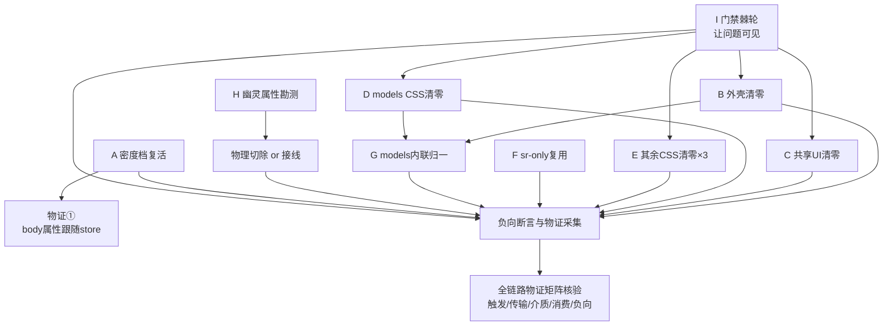

# 05 · 分维 — 设置界面消费面清零与密度档复活（2026-09-11）

> **上游**：`audits/04-审计-设置界面Token遵循度-2026-09-11.md`（41 文件 / 9,439 行逐元素实测）· `00-总方案` §四拓扑 · `01-分维-防御脚本断言阶梯.md`（门禁规格）· `04-纪律-执行拓扑与Agent派发契约.md`。
> **定位**：本分维是 `03-分维-消费面物理清零.md`（T3/T10）在**设置域**的落地实例，叠加两件 T3 覆盖不到的事——**密度档复活（偏好派生链断裂）** 与 **门禁盲区补全（裸兜底不可见）**。
> **规划口径**：仅含纯逻辑执行顺序与依赖拓扑。不含工期、人员、优先级——**下列全部问题逻辑同权**。

---

## 一、问题清单（全部来自 04 审计实测，逻辑同权）

| # | 问题 | 实测证据 | 形态 |
|---|---|---|---|
| P1 | 浅色/默认主题下界面尺寸三档对 50 个密度 token 全部失效 | Chromium 实测：`--space-1` 三档均 4px（应 4/4/6）；暗色三档 4/4/6 正常 | F5 层叠 + 偏好派生链断裂 |
| P2 | `App.tsx:117` 调 `useAppBootstrap` 未传 `uiSize`/`shellChromeMode` → `body` 恒 `data-ui-size="medium"` | `AppBootstrap.ts:252` 取 `uiSize \|\| 'medium'` | 功能伪连通（设置项写得出、链路断） |
| P3 | `data-density`、`data-shell-chrome` 全仓 CSS **零消费**；设置域反而硬编码 `data-density="compact"` 7 处 | grep `src/**/*.css` 0 命中 | 幽灵契约 / 多轨 |
| P4 | 430 处消费面裸兜底（355 与真值一致 + 54 声明真矛盾 + 7 白名单） | `SettingsPanel:218` vs `:252` 同 token 两套兜底 | F1 第二真源 |
| P5 | `var(--button-radius, 7px)` 47 处——tokens.css:335 注明「唯一权威定义；密度档/主题块禁止覆写」，兜底即旁路 | SettingsUI:151/205/229 等 | F1 旁路真源 |
| P6 | 751 处声明含裸几何 px；其中 **127 处取值落在既有刻度之外**（`999px`×7 胶囊圆角写错、`140px`×7 表单魔数、`22px`×7、小数刻度 15 处） | off-scale 实测表 | F4 |
| P7 | 180 个组件私域 token（Button `--btn-*`、Switch `--thumb-*`、Badge `--badge-*`、SegmentedControl `--seg-*`）与全局 `--control-height/--font-size-*/--radius-*` 平行，未进档位矩阵 | `03-分维` §七 | F3 双轨 |
| P8 | 41 处硬编码内联 `style={{}}`，35 处集中在 `settings-models/` 7 个子组件；2 处内联重写仓库已有 `sr-only` | `AccountAuthCard.tsx:135`、`SkillCardList.tsx:136` | **F7 第三轨** |
| P9 | 3 处组件级主题分支 `:global(html[data-theme='dark'])` 绕过「换主题只换 token 值」契约 | SettingsShortcutsTab:74、ModelsSettingsTab:36/558 | 主题逻辑下沉 |
| P10 | 现有门禁不覆盖裸兜底 / 矛盾兜底 / 内联硬编码 / 幽灵属性 | `check-token-consistency` 只查 `nofallback_refs`(=0) | 门禁盲区 |
| P11 | `Menu.module.css:9` `var(--z-dropdown, 100)` 兜底把层级压到 100（真值 300） | z-index.css:16 | F1 兼样式假象 |
| P12 | `--font-size-xl` 页标题兜底 `20px`（真值 22px），13 屏共用 | SettingsUI:42 | F1 |

**红线映射（零容忍 → 门禁）**：P2/P3 → 功能伪连通与幽灵契约门禁；P4/P5 → 第二真源门禁；P6 → 裸几何刻度门禁；P7/P8 → 多轨并存门禁；P9 → 主题分支下沉门禁；P11 → 层叠样式假象（穿透祖先盒模型 / stacking context 检查）。

---

## 二、根因分层（自上而下）

```
L0 偏好派生链断裂        uiSize/shellChromeMode 未从 React 树传入 bootstrap → body 属性钉死
L1 定义面档位层叠        主题块 (0,1,1) 压制密度块 (0,1,0)（tokens.css 结构性）
L2 消费面兜底依赖        var(--x, 裸值) 泛滥 → 兜底成为第二真源，真值改动被静默旁路
L3 组件私域双轨          --btn-*/--seg-*/--thumb-*/--badge-* 自建微型体系
L4 内联样式第三轨        settings-models 7 子组件用 style={{}} 造样式
L5 门禁盲区              既有门禁只查「无兜底」，对 L2/L4/P3 全部不可见
```

**因果**：L0 使「设置改密度」在浅色主题下不可感知 → L1 使其不可修复（改 token 值无效）→ L2/L3/L4 使「改 tokens.css 界面不变」在更多位置成立 → L5 使以上全部静默。**因此修复顺序必须是 L5 先行（让问题可见），再 L0（恢复链路），再 L1（定义面结构），再 L2→L3→L4（消费面物理清零）。**

> L1 的结构性修复（主题块与密度块解耦）属 `02-分维-真源唯一化` 与 `tokens.css` 串行序（T2→T6→T7→T8→T11）的职权，**本分维不动 `tokens.css`**；本分维以 L0 传参修复使密度档先复活，L1 结构修复留待其归属单元，并在 §五标注依赖。

---

## 三、修复手段（A–H，逻辑同权）

| 手段 | 对应问题 | 物理动作 | 禁止事项 |
|---|---|---|---|
| **A 密度档复活** | P1 P2 | `App.tsx` 向 `useAppBootstrap` 传入 store 的 `uiSize`/`shellChromeMode`；补 jsdom 断言 `body[data-ui-size]` 跟随 store | 禁止在 CSS 里加 `html[data-ui-size='medium']` 块来「绕过」；禁止用 `!important` |
| **B 外壳消费面清零** | P4 P5 P6 P11 P12 | `SettingsPanel/SettingsQuickMenu/SettingsUI` 三个 module.css：与真值一致的兜底**物理删除**（`var(--space-2, 8px)` → `var(--space-2)`）；矛盾兜底改指正确 token；刻度外裸值迁既有档或登记扩档 | 禁止「把兜底值改成真值」式保留兜底；禁止注释保留旧值 |
| **C 共享 UI 组件兜底清零** | P4 P11 | `ui/{Button,Input,Menu,Select/SelectContent,Tooltip}`：同 B 口径 | 禁止改动组件 DOM/类名（会波及全 app） |
| **D models 屏 CSS 清零** | P4 P6 | `ModelsSettingsTab/ScanResultsModal/YamlConfigEditorModal` 三个 module.css，仅限**既有选择器** | 禁止新增类（内联归一另列 G，与其串行） |
| **E settings 域其余 CSS 清零（三组）** | P4 P6 | 账户/外观组、工作/安全/诊断/用量组、扩展域组——同 B 口径 | `SettingsExtensionsTab.module.css` 已被并行会话占用 → **跳过并上报** |
| **F sr-only 复用** | P8 | `AccountAuthCard.tsx`、`SkillCardList.tsx` 内联视觉隐藏 → 改用 `styles/sr-only.css` 既有类 | 禁止再写第三份 sr-only |
| **G models 屏内联样式归一** | P8 | 7 个子组件 `style={{}}` 迁入 `ModelsSettingsTab.module.css`（或就近 module），token 化 | **与 D 串行**（同文件）；禁止保留「内联 + 注释说明」的双轨 |
| **H 幽灵属性裁决与主题分支收编** | P3 P9 | 先勘测 JS 侧真实消费方；无消费方 → **物理切除**写入点与 7 处硬编码 `data-density`；有消费方 → 登记并接线。主题分支 → 语义 token（扩档走 §七登记） | 禁止保留「写了但没人读」的属性；禁止用注释降级 |
| **I 门禁棘轮（独立新脚本）** | P10 | 新建 `scripts/check-token-fallback-drift.mjs`（`bare_fallback_refs` / `contradictory_fallback_refs`）+ `scripts/check-inline-style-hardcode.mjs`；基线取本次实测值，**只降不升**；每条门禁配**负向用例** | 禁止改 `check-token-consistency.mjs`（他方域）；禁止抬基线掩盖 |

---

## 四、纯逻辑依赖拓扑



**串行对（同文件不可并行）**：
- `D → G`（`ModelsSettingsTab.module.css`）
- `E-组3 与 H 的物理切除`（`SettingsExtensionsTab.module.css` 域）
- 本分维**不写** `styles/tokens.css`（归 T2→T6→T7→T8→T11 串行序）；H 的扩档需求只**登记**，不落 `tokens.css`。

---

## 五、断言阶梯（从实测问题逐步加强；每级都是可执行门禁或测试）

| 级 | 断言 | 防住哪个问题 | 现状 |
|---|---|---|---|
| L0 | `node scripts/check-token-consistency.mjs` 三指标 ≤0 | 悬空/无兜底/死 token | ✅ 已绿（既有） |
| L1 | **新增** `check-token-fallback-drift.mjs`：`bare_fallback_refs ≤ 430` 且 `contradictory_fallback_refs ≤ 54`（设置域口径），棘轮只降不升 | P4 P5 | ❌ 待建（手段 I） |
| L2 | **新增** `check-inline-style-hardcode.mjs`：设置域 `style={{}}` 硬编码 ≤ 41，棘轮只降不升 | P8 | ❌ 待建（手段 I） |
| L3 | **新增** 幽灵属性断言：`data-density`/`data-shell-chrome` 要么存在 CSS 消费方、要么源码零写入（二值，不允许中间态） | P3 | ❌ 待建（手段 H） |
| L4 | jsdom/单测：`uiSize` store 变更 → `document.body.getAttribute('data-ui-size')` 同步 | P1 P2 | ❌ 待建（手段 A） |
| L5 | 负向检索：`grep -rn "999px" components/settings*/` === 0；`var(--control-height-lg,` 兜底为空 | P6 P4 | ❌ 待建（手段 B） |
| L6 | 层叠穿透断言：设置内浮层 `z-index` 实际计算值 ≥ 全局 `--z-dropdown`（防 Menu:9 类兜底压层） | P11 | ❌ 待建（手段 C） |
| L7 | 真机物证：浅色主题 `html[data-ui-size='large']` 下 `getComputedStyle(body).getPropertyValue('--space-1')` === `6px` | P1 | ❌ 待建（手段 A 后人工/Playwright 采集） |
| L8 | 全链路物证矩阵（§六）全部为真 | 交付终点 | ❌ 待建 |

---

## 六、全链路物证矩阵（交付终点唯一依据）

| 端 | 物证 | 对应手段 |
|---|---|---|
| **触发端** | 设置页「外观 → 界面尺寸」切 large：`layoutStore.uiSize` 变更被 React 订阅并流入 `useAppBootstrap` | A |
| **传输端** | `AppBootstrap.ts` 收到非空 `uiSize`，`document.body.setAttribute('data-ui-size', size)` 执行且值 === store 值（非 `'medium'` 恒值） | A |
| **介质端** | `localStorage`/偏好存储中 `ui_size` 与 DOM 属性一致；旧孤岛（若有）零写入 | A + `02-分维` 存储单元 |
| **消费端** | 渲染树真实取值：浅色 large 下 probe 元素 `--space-1`===`6px`、`--control-height`===`34px`（样式真生效，非只写属性） | A + B/C/D/E 清零后无兜底遮蔽 |
| **负向断言** | ① `999px` 零命中；② `settings-models/*.tsx` 内联硬编码 = 0；③ `data-density` 无消费方时源码零写入；④ 门禁脚本对人工注入的裸兜底用例 **FAIL**（防门禁恒绿） | I + 各清零单元 |

---

## 七、Token 有序扩档登记（不无序扩充）

扩档**只登记、不落 `tokens.css`**（归 `03-待裁决扩档需求.md` 与 tokens.css 串行序裁决）：

| 候选 | 依据 | 归属 |
|---|---|---|
| `--form-field-min-width: 140px` | 3 文件 7 处重复同一魔数（SettingsUI:183、FontSelectField:3 等），是「表单字段最小宽」语义而非一次性布局 | E-组1 登记 |
| `--recording-bg`（或语义等价） | SettingsShortcutsTab:74 主题分支下沉所需 | H 登记 |
| models 屏浮层底色语义 token | ModelsSettingsTab:36/558 主题分支下沉所需 | H 登记 |
| `999px` | **不扩档** —— 是 `--radius-full`(9999px) 的错值，直接改指 | E-组2 |

**扩档纪律**：同一语义在 ≥2 文件重复出现才可登记；单文件一次性取值 → 就地注释授权，不入库。

---

## 八、红线自检表（每个单元完成前逐条勾）

1. 无 `#[allow(dead_code)]` / 零真实调用的死快照；新样式类必须在真实 TSX 调用链中被引用。
2. 无注释保留旧实现、无隐藏元素、无永久兼容 Shim；旧值物理删除。
3. 无新增裸 hex / 伪变量 / 未登记 token；`--radius-full` 等既有档不得被兜底旁路。
4. 层叠/滚动/粘性改动已穿透祖先盒模型与 stacking context 检查（P11 类）。
5. 交付依据 = §六物证矩阵，非「自测绿灯 / typecheck 通过 / 文档声明」。
6. 未抬任何棘轮基线；未 `--no-verify`；未改 `styles/tokens.css`。
