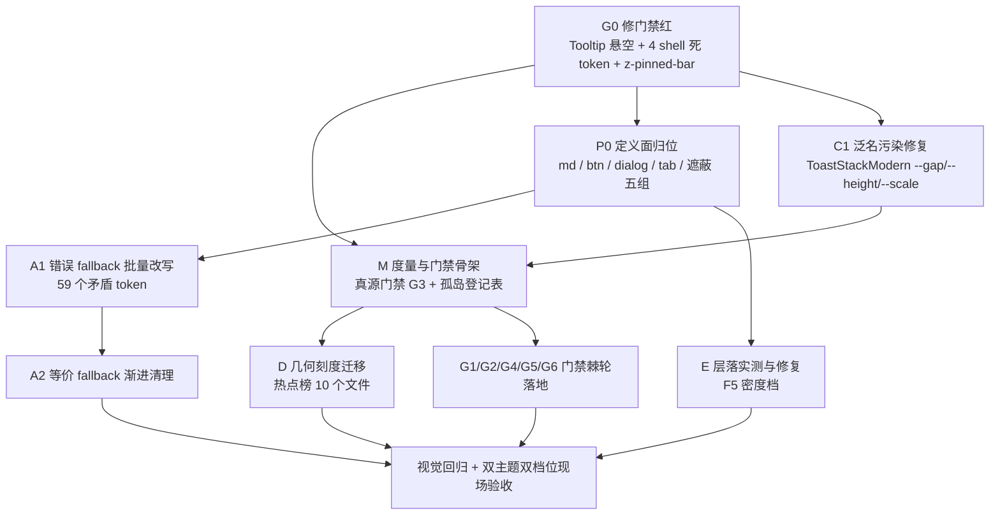

# Token 消费面统一与分裂收敛 · 总方案

> **性质**：只读勘测 + 收敛方案。本文件不含生产代码改动。
> **范围**：`apps/crish-desktop/src`（151 个生产 CSS，35,586 行；源数据排除 `node_modules` / `dist` / `coverage` / `*.test.*`）。
> **勘测日期**：2026-09-11
> **上游承接**：`docs/design-token-ssot/`（定义真源唯一化）、`docs/layout-token-system/`（几何刻度 + 棘轮门禁）、`docs/ui-unification-redesign/`（四维定案）。
> **本战役的边界**：**不重建 token 体系**（体系层判定为健康），只收敛**消费面**——即「定义得对，但用起来四分五裂」。

---

## 〇、结论先行

**用户的判断被数据完全证实**：`tokens.css` 定义面是健康的（498 个 token，分亮/暗、密度档、性能档、降动网格，组织有序）；分裂全部发生在**消费面**。

| 层 | 指标 | 实测 | 判定 |
|---|---|---:|---|
| 定义面 | `tokens.css` 唯一定义 token | **498** | 健康 |
| 定义面 | 跨 ≥2 个文件被重复定义的 token | **82** | 分裂 |
| 消费面 | `var(--x, 裸字面量)` 出现次数 | **2,036** | **重度分裂** |
| 消费面 | 同一 token 出现 ≥2 种互相矛盾 fallback 变体 | **59 个 token** | **重度分裂** |
| 消费面 | 几何属性裸 px 写死 | **3,662** | 重度分裂 |
| 消费面 | 组件私有孤岛 token（未进全局体系） | **123 个** | 分裂 |
| 门禁 | `check-token-consistency` | **FAIL**（3 项超基线） | 红 |
| 门禁 | 其余 6 项脚本 + 5 个契约测试 | PASS | 绿但存在覆盖盲区 |

**一句话**：真正的问题不是「token 不够用」，而是 **fallback 层已经长成了第二套未经授权的 token 系统**——2,036 处消费点各自把「候选值」写进了业务 CSS，而其中 59 个 token 的候选值与真值**互相矛盾**。这套影子系统在 token 正常时不可见，一旦触发就静默降级到另一个（且不一致的）视觉规格。

---

## 一、现状实测

### 1.1 定义面：体系健康（无需重建）

`tokens.css`（1,373 行 / 62 KB）的 token 命名空间分布（前 20）：

```
--md-* 83   --sep-* 24   --diff-* 22   --usage-* 22   --font-* 21   --filetree-* 18
--xterm-* 17  --composer-* 16  --color-* 15  --stream-* 15  --accent-* 15  --bg-* 15
--text-* 14  --transition-* 13  --artifact-* 11  --scrollbar-* 11  --syntax-* 10
--tint-* 10  --radius-* 10  --space-* 9   --control-* 8   --terminal-* 8  --surface-* 8
```

层级结构完整：亮色块（`tokens.css:35` 起）、暗色块（`:771`）、密度档（`:1300`/`:1364`）、性能档（`:1500-1514`）、`@supports oklch` 渐进增强（`:1460`）、降动网格（`reduced-motion.css:22-40`）。**该体系不是空的，也不缺维度。**

例外（**授权外置**，已在源码注释登记，不计为分裂）：`tokens.css:476` 明确写「Z-Index levels are authoritative in styles/z-index.css」，23 个 `--z-*` 定义在 `z-index.css`。

### 1.2 消费面：五项量化指标

| 指标 | 定义 | 实测 |
|---|---|---:|
| `var()` 引用总数 | 全部生产 CSS | 8,333 |
| **裸 fallback** | `var(--x, #hex / hsl / Npx / Nms / 关键词)` | **2,036**（占 var 引用 **24.4%**） |
| **裸 px** | `padding/margin/gap/border-radius/font-size/height/width/... ：Npx` | **3,662** |
| **孤岛 token** | 定义于非 `tokens.css`、且命名空间未被第二处消费 | **123** |
| 裸颜色字面量 | `#hex` / `rgb()` / `hsl()` / `oklch()` | 451 |

裸 px 按属性拆解（Top 8）：`padding 698` / `font-size 610` / `gap 511` / `border-radius 451` / `height 445` / `width 321` / `min-height 201` / `max-width 129`。

> 对照：`--space-*` 仅被消费 749 次，`--radius-*` 474 次，`--font-size-*` 约 660 次。**几何刻度与裸值大致五五开**——这正是「token 有、组件不用」的量化形态。

### 1.3 现有门禁实测（本回合实跑）

```
check-token-consistency.mjs   FAIL   undefined_refs 2/0 · nofallback_refs 1/0 · dead_tokens 5/0
check-layout-tokens.mjs       PASS   negative_margin_gt2=7 · bad_space_fallback=0 · density_matrix_viol=0
check-color-ssot.mjs          PASS
check-text-color-tokens.mjs   PASS
check-input-guardrails.mjs    PASS
check-layout-geometry.mjs     PASS
check-layoutstore-actions.mjs PASS
```

`check-token-consistency` 高危清单（`--list`）：

| 类别 | 项 | 位置 |
|---|---|---|
| undefined | `--chat-stream-pad-x`（有 fallback 兜住） | `ChatMessageList.module.css:38`、`ChatScrollFloorSlot.module.css:20` |
| **nofallback** | **`--bg-surface-active`（无 fallback，直接悬空）** | **`ui/Tooltip/Tooltip.module.css:84`** |
| dead | `--shell-safe-inset-left` / `--shell-safe-inset-right` | `tokens.css:432-433` |
| dead | `--shell-canvas-gutter` / `--shell-canvas-gutter-compact` | `tokens.css:434-435` |
| dead | `--z-pinned-bar` | `z-index.css:32` |

`--bg-surface-active` 是**真实视觉缺陷**：`Tooltip.module.css:84` 用 `background: var(--bg-surface-active)`（**无兜底**）渲染 `kbd` 键帽；该名字在全仓无任何定义 → 声明无效 → 键帽底色透明。同一 8 行块内还并存 `padding: 0 4px` / `height: 16px` / `font-size: 10px` 三个裸值（`Tooltip.module.css:79-81`）——**一个 5 行规则里同时存在「悬空 token + 裸 px + 错值 fallback」三种病灶**（`--radius-xs, 3px`，真值为 2px/4px，3px 是不存在的档位），堪称缩影。

---

## 二、分裂的六种形态

### F1 · 裸 fallback 漂移（最大宗，2,036 处）

**机理**：`var(--x, 候选值)` 的候选值本应是「定义缺失时的安全网」，但仓内把它当成了**本地默认值**在写。后果有三层：

1. **静默降级到异规格**：token 一旦缺失，界面不是「无样式」而是「换了一套值」。
2. **漂移即矛盾**：候选值从不随 token 演进——**59 个 token 的候选值与真值互相矛盾**。
3. **屏蔽能力**：`var(--font-size-base, 14px)` 的兜底是裸 px，**绕过了 `calc(14px + var(--font-size-adjust))`** → 兜底一旦生效，字号调节偏好静默失效。

**矛盾证据（择要）**：

| token | tokens.css 真值 | 实际出现的 fallback 变体 |
|---|---|---|
| `--transition-fast` | `150ms var(--ease-standard)` | `120ms ease`×68 · `150ms ease`×35 · `120ms`×13 · `0.15s`×7 · `150ms ease-out`×3 — **5 种** |
| `--transition-micro` | `100ms ease-out` | `100ms ease`×51 · `120ms`×33 · `120ms ease`×32 · `100ms ease-out`×19 · `100ms`×14 · `80ms`×6 · … — **10 种** |
| `--font-mono` | 8 段字体栈（Cascadia Mono, JetBrains Mono, SF Mono, Consolas…） | `monospace`×49 · `ui-monospace, monospace`×11 · `"IBM Plex Mono"…`×2 · `'JetBrains Mono', 'Fira Code', Consolas…`×2 … — **8 种** |
| `--font-size-xs` | `calc(11px + var(--font-size-adjust))` | `12px`×144 · `11px`×18 |
| `--font-size-sm` | `calc(13px + var(--font-size-adjust))` | `13px`×72 · `12px`×7 · `11px`×1 |
| `--radius-sm` | `4px` / `6px` | `4px`×95 · `6px`×5 · **`3px`×4** · **`5px`×1** |
| `--radius-xs` | `2px` / `4px` | `2px`×27 · `4px`×8 · **`3px`×6** |
| `--opacity-disabled` | `0.5` | **`0.45`×16** · `0.5`×1 |
| `--text-primary` | `#1a1a1a` / `#cccccc` | `#111111`×3 · `#cccccc`×3 · **`hsl(0 0% 94%)`×2** · **`hsl(0 0% 7%)`×2** · `#f0f0f0` · `#ffffff` · `var(--terminal-fg)` |
| `--bg-card` | `var(--surface-card)` | `#ffffff`×8 · **`#0c0c0c`×2** · `hsl(0 0% 100%)` · `hsl(0 0% 12%)` |
| `--shadow-lg` | `0 4px 16px -2px color-mix(…)` | `0 10px 25px -5px color-mix(…)`×2 · `0 10px 25px -5px rgba(0,0,0,.1)` · `0 8px 32px rgba(0,0,0,.12)` · `var(--shadow-md)` |
| `--md-heading-margin-top` | `0.65em` | `0.40em` · `0.55em` · `0.45em` · `0.35em` · `0.30em` · `0.65em` — **6 种** |
| `--chat-col-max` | `760px` | `760px`×15 · **`840px`×1** |
| `--composer-attach-card-size` | `52px` | `52px`×21 · **`58px`×6** |

**`--text-primary` / `--bg-card` 出现亮暗值混写**（`#111111` 与 `hsl(0 0% 94%)` 同时作为同一 token 的兜底）——说明兜底是在**不同主题语境下随手抄的**，与 token 的语义层级无关。这是「影子系统」最硬的证据。

> 注：`--transition-*` 族的 10 种变体与真值（`150ms var(--ease-standard)`）不符，等于**在业务 CSS 里私藏了另一份动效规格**。降动网格（`reduced-motion.css`）改的是 token，改不动这 2,036 处兜底——无障碍链路因此存在缺口。

### F2 · 跨文件真源分裂（82 个 token）

同一 token 名在 ≥2 个文件被定义，**胜出方取决于导入顺序与选择器特异性**：

| 族 | 分裂文件 | 备注 |
|---|---|---|
| `--md-*`（46 个） | `tokens.css` **+** `markdown-typography.css` | **最严重**，见下 |
| `--btn-*`（11 个） | `Button.module.css` + `DiffCard.module.css` + `PreviewCard.module.css` + `SidebarNav.module.css` | `--btn-radius`/`--btn-h` 各 4 处；**4 个文件各自重新定义「一个按钮」** |
| `--dialog-width` / `--dialog-z` | CheatsheetModal / FirstRunWizard / SettingsRulesTab / SettingsPanel / SkillEditorModal | `--dialog-z` 被 5 个文件各自定义 |
| `--tab-duration` / `--tab-press-duration` / `--tab-spring-bezier` | `Tabs.module.css` + `SegmentedControl.module.css` | 动效规格双写 |
| `--duration-*` / `--transition-*`（13 个） | `reduced-motion.css` + `tokens.css` | **合理**（降动覆盖），但形态上是第二定义点 |
| `--z-*`（23 个） | `z-index.css` | **授权外置**，`tokens.css:476` 已登记 |
| 单点遮蔽 | `--scrollbar-width`(ScrollArea) · `--seg-inner/outer-radius` · `--tab-gap`(Tabs) · `--sidebar-width`(responsive.css) · `--diff-gutter-bg`(FileViewerCard) · `--focus-ring-color`(focus-visible.css) | 组件局部覆盖全局同名 token |

**`--md-*` 的病最典型**：46 个 token 在 `tokens.css:484-680`（亮）与 `:1081-1268`（暗）定义一遍，又在 `markdown-typography.css:12-81` 定义一遍。由于：

- `tokens.css` 亮色块选择器是 `:root, html[data-theme='default'], html[data-theme='light']`（**0,1,1**），
- `markdown-typography.css` 用裸 `:root`（**0,1,0**），且在 `index.css:4` **后**导入，暗色块 `html[data-theme='dark']` 与 tokens.css 同特异性、靠导入顺序取胜，

**实际真源按主题翻转：亮色下赢家是 `tokens.css`，暗色下赢家是 `markdown-typography.css`。** 改任一个文件都无法在两个主题下同时生效——这就是「改 tokens 界面不一定变」的根因形态。

### F3 · 组件私有孤岛命名空间（123 个）

组件自建 `--x` 族，从未进入全局体系，也无第二消费方：

| 数量 | 文件 | 命名空间 |
|---:|---|---|
| 9 | `ui/Switch/Switch.module.css` | `--track-w/h` `--thumb-d/pad/travel/stretch-w` `--stretch-x-on/off` `--spinner-size` |
| 9 | `chat-composer/ChatComposer.module.css` | `--ann-*` `--composer-line-height/max-lines/min-lines` `--composer-radius-outer` `--composer-shell-bg(-focus)` |
| 7 | `overlay/ToastStackModern.module.css` | `--gap` `--height` `--peek` `--scale` `--shrink` `--swipe-x/y` |
| 7 | `ui/Badge/Badge.module.css` | `--badge-bg/-border/-fg/-fs/-h/-px/-radius` |
| 7 | `ui/Tabs/Tabs.module.css` | `--tab-font-size/-height/-icon-size/-inner-radius/-item-px/-outer-radius/-pad` |
| 5 | `ui/SegmentedControl/SegmentedControl.module.css` | `--seg-fs/-h/-icon-size/-item-px/-pad` |
| 2 / 2 / 1×4 | NotePaperPanel · WorkspaceEmptyState · Button · ScrollArea · FlowPlanMilestone | `--np-focus-*` `--empty-focus-*` `--btn-icon-size` `--scrollbar-button-height` `--plan-gap` |

**泛名污染**：`ToastStackModern` 定义 `--gap` / `--height` / `--scale`（无命名空间前缀），一旦这些元素成为某处 `var(--gap)` 的祖先，会**误命中**任意消费者的泛名引用。`ui/Badge` 与 `ui/Tabs` 的 `--badge-*` / `--tab-*` 更是**组件自建了一套与全局同名的子系统**——`--tab-gap` 与 `tokens.css` 全局同名（见 F2 遮蔽表）。

### F4 · 几何刻度裸写（3,662 处）

`--space-*`（13 档）、`--radius-*`（10 档）、`--font-size-*`（13 档）都已齐备，但裸值仍是主流量。

高密度样本（Split/行数）：

| 文件 | 行数 | 裸 fallback | 裸 px | 孤岛 | 分裂密度 |
|---|---:|---:|---:|---:|---:|
| `ui/Input/Input.module.css` | 194 | 35 | 45 | 0 | **41.2%** |
| `chat-message-row/TurnErrorNode.module.css` | 88 | 20 | 22 | 0 | **47.7%** |
| `ui/Input/Textarea.module.css` | 92 | 20 | 17 | 0 | **40.2%** |
| `workflow-confirm/WorkflowConfirmCard.module.css` | 87 | 16 | 18 | 0 | **39.1%** |
| `note-paper/NotePaperPanel.module.css` | 797 | **133** | 108 | 2 | 30.5% |
| `chat-attachment/AttachmentCard.module.css` | 313 | 43 | 52 | 0 | 30.4% |
| `settings/AccountAuthCard.module.css` | 138 | 17 | 27 | 0 | 31.9% |
| `styles/z-index.css` | 34 | 0 | 0 | **23** | **67.6%** |

### F5 · 层叠特异性导致密度档静默失效（新发现 · 高危）

**这是本回合新增的一条，既有审查与门禁均未覆盖。**

`tokens.css` 中同一批 token（`--space-*`、`--font-size-*`、`--control-height*`、`--icon-size*`…）在**两个块**里各定义一次：

| 定义点 | 选择器 | 特异性 |
|---|---|---|
| `tokens.css:33-35`（基础/亮色） | `:root, html[data-theme='default'], html[data-theme='light']` | `:root`→0,1,0；`html[data-theme='light']`→**0,1,1** |
| `tokens.css:1300`（small 档） | `[data-ui-size='small']` | **0,1,0** |
| `tokens.css:1364`（large 档） | `[data-ui-size='large']` | **0,1,0** |

`data-theme` 与 `data-ui-size` **都写在 `<html>` 上**（`themeStore.ts:80`、`themePersonalization.ts:132`；`visualThemeController.ts:30`、`AppBootstrap.ts:255/264`）。

推论（`--space-1` 为最小可验样本）：

```
--space-1  基础块 :702  = 4px   （选择器含 html[data-theme='light'] → 0,1,1）
--space-1  small :1323  = 4px   （[data-ui-size='small']            → 0,1,0）
--space-1  large :1387  = 6px   （[data-ui-size='large']            → 0,1,0）
```

- **亮色主题**：`html[data-theme='light']`（0,1,1）胜过 `[data-ui-size='large']`（0,1,0）→ 计算值恒为 **4px**，large 档不生效。
- **暗色主题**：匹配的只有 `:root`（0,1,0），与 `[data-ui-size='large']` 同特异性 → 源码序在后 → 计算值 **6px**，large 档生效。

**即「密度档在暗色下工作、在亮色下失效」——同一功能的主题相关不一致**。

`layout-contract.test.ts:73-135` 无法捕获：它只断言三档块的**存在性、整数性与单调性**（`extractBlock` 文本匹配），从不评估层叠胜出方。`check-layout-tokens.mjs` 的 `density_matrix_viol` 同理只看声明文本。**这是「门禁绿、功能死」的教科书案例。**

> 建议按 AGENTS.md §7.1「真实环境现场验收」以真机 `getComputedStyle(document.documentElement).getPropertyValue('--space-1')` + `data-theme='light'`/`data-ui-size='large'` 组合实测确认，再定修法（把密度档选择器升到 `html[data-ui-size=…]` 即可对齐 0,1,1，或把基础块选择器降级）。

### F6 · 悬空引用与死 token

- **悬空（无兜底）**：`--bg-surface-active` @ `Tooltip.module.css:84` —— **真实缺陷**，见 §1.3。
- **悬空（有兜底，被容忍）**：`--chat-stream-pad-x` @ `ChatMessageList.module.css:38`、`ChatScrollFloorSlot.module.css:20`（`AGENTS.md` 要求 token 化却未定义，靠 20px 兜底活着）。
- **运行时注入（合规，勿动）**：`--radix-popover-content-*`（白名单已登记）、`--toast-index` / `--toast-offset-y`（`ToastCard.tsx:103/108`）、`--tab-item-width` 等（`PaneHeader.tsx:470-473`）、`--leaf-dock-width`、`--sidebar-visible-width`、`--files-list-ratio`、`--tree-level`、`--tooltip-translate`、`--flow-output-max`、`--active-pin-color`、`--user-bubble-pin-color`、`--tick-pin-color`、`--palette-pure-hue` —— 均由 TS 内联注入，属 `check-token-consistency` 的 76 项 js 运行时注入面。
- **死 token 5 个**：`tokens.css:432-435` 的 4 个 `--shell-*`（布局战役半成品）+ `z-index.css:32` 的 `--z-pinned-bar`。
- **CSS 侧零引用 52 个**：其中 `--xterm-*` 17 个由 `useXtermTerminal.ts` 消费（非死），`--usage-color-*` 15 个、`--breakpoint-*` 4 个、`--stream-pulse-*` 3 个、`--color-text-dim`/`--color-text-secondary`（`tokens.css:27-28` 自述「悬空兜底安全网」）、`--tint-scrollbar-track`、`--ui-text-*` 3 个 需逐个复核归属。

---

## 三、逐文件落地实况（热点榜）

**分裂指数** = 裸 fallback + 裸 px + 孤岛定义。前 12 名：

| # | 文件 | 行数 | var | 裸 fallback | 裸 px | 孤岛 | Split | 密度 |
|---:|---|---:|---:|---:|---:|---:|---:|---:|
| 1 | `chat-composer/ChatComposer.module.css` | 1,555 | 298 | 78 | 206 | 9 | 293 | 18.8% |
| 2 | `note-paper/NotePaperPanel.module.css` | 797 | 234 | **133** | 108 | 2 | 243 | 30.5% |
| 3 | `settings-models/ModelsSettingsTab.module.css` | 886 | 223 | 88 | 145 | 0 | 233 | 26.3% |
| 4 | `chat-tool-call/ModernToolCall.module.css` | 844 | 242 | 97 | 127 | 0 | 224 | 26.5% |
| 5 | `chat-message-row/ChatMessageRow.module.css` | 1,019 | 267 | 114 | 95 | 0 | 209 | 20.5% |
| 6 | `chat-tool-call/ChatToolCallBlock.module.css` | 1,172 | 235 | 58 | 148 | 0 | 206 | 17.6% |
| 7 | `diff/DiffCard.module.css` | 1,102 | 215 | 59 | 111 | 10 | 180 | 16.3% |
| 8 | `files/FilesCard.module.css` | 898 | 197 | 43 | 101 | 0 | 144 | 16.0% |
| 9 | `workspace/PreviewCard.module.css` | 707 | 199 | 53 | 83 | 5 | 141 | 19.9% |
| 10 | `files/FileViewerCard.module.css` | 476 | 133 | 28 | 78 | 0 | 106 | 22.3% |
| 11 | `chat-attachment/AttachmentCard.module.css` | 313 | 78 | 43 | 52 | 0 | 95 | 30.4% |
| 12 | `workspace/TerminalCard.module.css` | 602 | 180 | 52 | 42 | 0 | 94 | 15.6% |

**完全在体系外**（`var()` ≤ 3 次）：`gallery/ComponentGallery.module.css`（197 行，**28 处裸色**，`var` 仅 3）、`App.module.css`、`styles/sr-only.css`、`styles/breakpoints.css`、`styles/shell/shell-layout.css`、`ui/TabStrip/TabStrip.module.css`、`note-paper/NoteLeafHost.module.css`。其中 `ComponentGallery` 是唯一仍以裸色为主的业务文件（展示组件，需单独裁决是否纳入）。

---

## 四、统一方案：三层消费契约

### 4.1 目标态

把「谁能定义 token」和「消费点能写什么」用**三层**划清，让分歧在编译期/门禁期暴露，而不是在运行时静默降级：

```
L1 定义层   只有 tokens.css（+ z-index.css 授权外置）可定义全局 token
L2 组件层   组件私有 token 必须带命名空间前缀，且只能定义在组件根选择器内、只服务自身
L3 消费层   业务 CSS 只允许 var(--token) 裸引用；禁止裸色、禁止裸几何刻度、禁止自造兜底
```

**核心原则：兜底能力收归定义层，消费层不再承担兜底职责。** token 缺席应当是**可见的失败**（门禁报错），而不是**静默的换规格**。

### 4.2 手段 A —— fallback 分级治理（解决 F1，收益最大）

对 2,036 处裸 fallback 分四档处理，**不做一次性全量改写**（避免大面积视觉回归）：

| 档 | 判定 | 处理 |
|---|---|---|
| **A1 错误兜底** | 兜底值与真值不符（含 59 个矛盾 token 的全部变体） | **必改**：改写为与真值一致的形态，或直接去兜底。优先级最高——它们是「假通过」的来源 |
| **A2 等价兜底** | 兜底值与真值数值一致（如 `var(--radius-sm, 4px)` 且真值 4px） | **渐进清理**：按文件分批去兜底（`--space-*` 已有 `bad_space_fallback` 棘轮为范式，扩展到 radius / font-size / transition） |
| **A3 语义兜底** | 兜底是**另一个 token**（如 `var(--hairline, var(--border-subtle))`、`var(--shadow-lg, var(--shadow-md))`） | **保留**：这是合法的语义降级链，不是裸值 |
| **A4 白名单** | `--radix-*` 等外部注入、`--tooltip-translate, translate(0)`（`style-contract.test.ts:486-491` 已钉） | **保留** |

**A1 清单是本次收益最高的工作面**：改掉 59 个 token 的错误变体，即可消除「同一视觉语义在不同文件里是不同数值」的现象。建议按 token 族批量推进（`--transition-*` → `--font-size-*` → `--radius-*` → `--text-*`/`--bg-*`）。

**关于 `--font-size-*` 的专项裁决**：所有字号兜底都是裸 px（`14px`/`13px`/`12px`），**绕过了 `--font-size-adjust`**。由于字号调节是产品功能，建议对 `--font-size-*` **一律去兜底**，让缺失直接暴露为门禁红。

### 4.3 手段 B —— 真源归位（解决 F2）

| 对象 | 动作 |
|---|---|
| `--md-*`（46 个） | **删 `markdown-typography.css:12-81` 的 `:root` / `html[data-theme='dark']` 定义块**，只保留 `tokens.css` 单源；该文件仅保留 `.conex-markdown` / `.md-rendered` 的**消费规则**。因两文件当前**主题相关地互相覆盖**，此项必须配视觉回归 |
| `--btn-*`（11 个 ×4 文件） | 归口 `ui/Button` 单源；`DiffCard` / `PreviewCard` / `SidebarNav` 改为**消费** Button 的 token 或改用 `ui/Button` 组件，禁止各自定义 |
| `--dialog-width` / `--dialog-z` | 归口 `ui/Dialog` 单源（`--dialog-z` 直接改用全局 `--z-modal`，5 处私定义删除） |
| `--tab-duration` / `--tab-press-duration` / `--tab-spring-bezier` | 归口 `ui/Tabs` 单源，`SegmentedControl` 消费 |
| 单点遮蔽（`--scrollbar-width` / `--seg-*` / `--tab-gap` / `--sidebar-width` / `--diff-gutter-bg`） | 逐个裁决：**要么**提升为全局语义 token（含组件维度），**要么**改名为带前缀的私有 token（`--scrollarea-width`、`--seg-control-inner-radius`）以消除同名遮蔽 |
| `--z-*`（`z-index.css`） | **维持现状**（已授权 + 已登记）；仅在 `tokens.css:476` 注释处补一行「唯一真源索引」指向说明 |
| `--duration-*` / `--transition-*`（`reduced-motion.css`） | **维持机制**，但把 `!important` + 多主题选择器列表收敛为单一 `:root` 覆盖块（当前 `reduced-motion.css:22-25` 列了 4 个选择器，冗余） |

### 4.4 手段 C —— 组件私有命名空间登记制（解决 F3）

1. **强制前缀**：所有组件私有 token 必须带文件/组件前缀。**立即修的泛名污染**：`ToastStackModern.module.css` 的 `--gap` / `--height` / `--scale` → `--toast-gap` / `--toast-height` / `--toast-scale`（文件名已有 `--toast-*` 前缀惯例，`--toast-index` 就是对的）。
2. **作用域收敛**：私有 token 只定义在组件根选择器（如 `.root { --badge-fg: … }`），不许上 `:root`。
3. **登记表**：123 个孤岛 token 进 `tokens.css` 顶部**索引注释区**（只登记名字与归属，不搬定义），使「全局体系」与「组件私有」的边界显式可查。
4. **晋升通道**：当第二个文件需要同一语义时，必须**晋升为全局 token**，禁止复制定义。

### 4.5 手段 D —— 几何刻度迁移（解决 F4）

按「属性 → token」映射批量推进，**从热点榜头部开工**：

| 属性 | 裸值量 | 目标 |
|---|---:|---|
| `padding` / `margin` / `gap` | 698 / 116 / 511 | `--space-*`（13 档已齐备） |
| `font-size` | 610 | `--font-size-*`（13 档已齐备） |
| `border-radius` | 451 | `--radius-*`（10 档已齐备）；`0` / `50%` / `9999px` 走白名单 |
| `height` / `width` / `min-*` / `max-*` | 445 / 321 / 201 / 129 | 有语义的升为 `--control-height*` / `--icon-size*`；**纯布局约束保留裸值**（见 §7） |
| `transition` 内联 `cubic-bezier` | ~73 | `--ease-standard` / `--ease-emphasized` |

**优先批次**（Split 最高且 token 齐备）：`ChatComposer`、`ModernToolCall`、`ChatToolCallBlock`、`ChatMessageRow`、`ModelsSettingsTab`、`FilesCard`、`PreviewCard`、`NotePaperPanel`、`DiffCard`、`AttachmentCard`。

**反过度设计红线遵守**：本手段**只为已有刻度档寻找最近的档位**，不新增 token 档位（除 §4.3 明列的归口 token）。若发现某处裸值确实需要新档，**先登记问题与证据，由用户裁决**，禁止 Agent 自行扩容刻度（对齐 `AGENTS.md` §7 严禁打补丁 与 `ANTI_OVERENGINEERING_GUARDRAILS.md`）。

### 4.6 手段 E —— 层叠修复 + 单点缺陷（解决 F5 / F6）

| 项 | 动作 |
|---|---|
| **F5 密度档特异性** | 先按 §2-F5 做真机实测确认；确认后二选一：① 密度档选择器升为 `html[data-ui-size='small'\|'large']`（0,1,1 → 与基础块同特异，靠源码序取胜）；② 基础块去掉 `html[data-theme='light']`，只留 `:root`。**推荐 ②**——语义上「基础档」本就不该与主题挂钩 |
| `--bg-surface-active` | 二选一：定义它（若确是语义 token），或改写为已存在的等价 token（`Tooltip.module.css:84` 的键帽底色，语义上接近 `--tint-strong` / `--bg-hover`）。**禁止留悬空** |
| `--chat-stream-pad-x` | 按 `AGENTS.md` 意图在 `tokens.css` 定义（`20px`，与 `chatScrollGeometry` SSOT 对齐），消除「靠兜底活着」 |
| 死 token 5 个 | `--shell-*` 4 个：若布局战役已改路线 → 删；若仍规划 → 补消费。`--z-pinned-bar`：删或补消费。**禁止注释保留**（对齐 `17-审查` §七） |
| 52 个 CSS 零引用 | 逐个复核后二分类：`--xterm-*`（TS 消费，保留）／真死（删）。`--usage-color-*` 15 个需确认是否被 `usageChartModel.ts` 间接使用 |

---

## 五、门禁强化：把「通过」变成真约束

现有门禁的问题是**只验证文本形态，不验证语义生效**（F5 是铁证）。建议按依赖序逐级加固：

| 序 | 门禁 | 内容 | 依据 |
|---|---|---|---|
| G0 | **修红** | 先让 `check-token-consistency` 回绿（2 undefined + 1 nofallback + 5 dead） | 现状 FAIL |
| G1 | **裸 fallback 棘轮（扩展）** | 把 `check-layout-tokens.mjs` 已验证的 `bad_space_fallback` 范式扩展到 `--radius-*` / `--font-size-*` / `--transition-*` / `--shadow-*`；**新增「矛盾变体」指标**（同一 token 的 fallback 值集合 size ≥2 即违规） | §2-F1 |
| G2 | **消费层裸值棘轮** | 按属性统计裸 px 与裸 `cubic-bezier`，基线棘轮递减（对齐 `style-contract.test.ts:216` 的 `RADIUS_999_BASELINE` 范式） | §2-F4 |
| G3 | **跨文件真源门禁** | 同一 token 名在 ≥2 个非授权文件被定义 → FAIL；授权名单硬编码（`z-index.css`、`reduced-motion.css`） | §2-F2 |
| G4 | **孤岛命名空间门禁** | 组件私有 token 必须在登记表内 + 必须带前缀 + 不许定义在 `:root` | §2-F3 |
| G5 | **层叠生效门禁** | 对密度档/主题档的关键 token 做**真机 `getComputedStyle` 断言**（jsdom 或 Playwright），断言「large + light」「large + dark」两组合的计算值均等于 large 档声明值 | §2-F5 |
| G6 | **门禁覆盖补齐** | 按 `17-审查` §2.2：`check-color-ssot` 目前只匹配 `background`/`color`，需扩到 `border-color` / `box-shadow` / `fill` / `stroke` / `outline` + `oklch()` + TSX 内联 | `17-审查` §2.2 |

**G5 是本方案新增的关键一条**：它是唯一能阻止「定义正确但被层叠覆盖」类问题复发的门禁。没有它，F5 修完还会在新档位上复发。

---

## 六、执行顺序（逻辑依赖序）

> 依 `AGENTS.md` §1「纯逻辑规划」：以下只表达依赖关系，不含工期与人天；未排序的并行项同权。



**依赖说明**：

- `G0` 无条件最先（当前门禁红，且 `--bg-surface-active` 是真实视觉缺陷）。
- `P0 → A1`：真源未归位前批量改 fallback，会与归位动作互相冲销（改完又被删掉）。**必须先归位、后改兜底。**
- `P0 → E`：`--md-*` 归位会改变暗色胜出方，必须与层叠修复一起做视觉回归。
- `M（真源门禁 + 孤岛登记）` 是所有批量的前置——没有基线，棘轮无从谈起。
- `D` 与 `E` 可并行（文件域不重叠：`E` 只动 `tokens.css` 选择器 + `Tooltip`）。

---

## 七、验收断言（可复核）

1. `node scripts/check-token-consistency.mjs` → **PASS**（三项均回到基线 0）。
2. **矛盾 fallback 变体数 = 0**：对每个 token，其出现的 fallback 值集合 size ≤ 1，且（若保留）等于真值。
3. **裸 fallback 总量单调递减**：2,036 → 目标值（棘轮登记，禁提升基线）。
4. **几何裸 px 单调递减**：3,662 → 目标值。
5. **跨文件真源分裂 = 0**（授权名单除外）。
6. **孤岛 token 全部带前缀且登记在册**；`:root` 上无组件私有 token。
7. **双主题 × 双档位现场验收**：`data-theme ∈ {light, dark}` × `data-ui-size ∈ {medium, large}` 四组合下，密度档关键 token 的 `getComputedStyle` 计算值与声明值一致（F5 修复断言）。
8. **`--md-*` 单源断言**：`markdown-typography.css` 不再含 `--md-*` 定义。
9. 双主题截图与 `--duration-*` 降动下零未捕获异常、零非预期告警。
10. 现有 5 个契约测试 + 6 个门禁脚本全绿（**不得删改测试资产**，对齐 `AGENTS.md` §9 测试资产保护铁律）。

---

## 八、不做 / 白名单

| 对象 | 理由 |
|---|---|
| `assets/icons/fileIcons.ts`（373 hex）、`modelVendorIcons.ts`（187）、`modelVendorCatalog.ts`（81） | 品牌图标数据，非 UI 表面色 |
| `api/themePresets.ts`（209）、`themePersonalization.ts`（42 hsl） | **架构级**平行色板，属 `design-token-ssot` 的 A1 真源唯一化，非本战役 CSS 收尾范围 |
| `api/oklchColorGuard.ts`、`codeHighlight.ts`、`parseAnsi.ts` | 颜色算法/语法映射，偏数据层 |
| `shell/WindowControls.module.css` 的 `#e81123` | 系统 chrome 关闭键 |
| `components/gallery/ComponentGallery.module.css` | 展示组件，需单独裁决是否纳入体系 |
| 布局约束类裸值（`width`/`height` 中的容器约束、`grid-template` 尺寸） | 语义上不是「设计刻度」，强行 token 化即过度设计 |
| `--radix-*` 外部注入 | 框架契约 |
| `LoggerService` console 色 / 导出 HTML 字符串 | 开发与离线导出路径 |
| `--z-*` 定义于 `z-index.css` | 已授权 + 已登记 |

---

## 附录 A · 勘测方法与复现

**全部指标来自只读脚本扫描**，脚本位于仓库根（勘测临时物，不入库）：

| 脚本 | 产出 |
|---|---|
| `_scan3.ps1` → `_scan3.txt` | 逐文件指标（var/hex/rgb/named/本地定义/暗色分支/裸 px/悬空引用）、悬空引用清单、CSS 零引用 token 清单 |
| `_scan4.ps1` → `_scan4.txt` | 命名空间消费计数、几何族定义 vs 消费、裸 px 按属性、遮蔽清单、fallback 分布、TS 侧硬编码 |
| `_scan7.ps1` → `_scan7.txt` | **59 个矛盾 fallback 变体全表**（含真值对照与 ok/MISMATCH 判定） |
| `_scan8.ps1` → `_scan8.txt` | 逐文件分裂指数排行榜 + 全局合计 |
| `_scan9.ps1` → `_scan9.txt` | 82 个跨文件真源分裂全表 + 123 个孤岛命名空间清单 |
| `_gate.ps1` → `_gate.txt`、`_gate2.ps1` → `_gate2.txt` | 7 个门禁脚本实跑结果 + `check-token-consistency --list` 明细 |

**注意**：上述 `_scan*.ps1/txt`、`_gate*.ps1/txt`、`_probe.txt` 为勘测过程物，**不进入版本库**（与 `.agent-outputs/` 同级性质）。

**复现命令**（pwsh）：

```powershell
& 'C:\Users\orange\.workbuddy\binaries\node\versions\22.22.2-3\node.exe' scripts/check-token-consistency.mjs --list
& 'C:\Users\orange\.workbuddy\binaries\node\versions\22.22.2-3\node.exe' scripts/check-layout-tokens.mjs
```

---

## 附录 B · 关键证据索引

| 结论 | 证据位置 |
|---|---|
| z-index 授权外置 | `tokens.css:476`（注释） |
| `--md-*` 双源 | `tokens.css:484-680`、`tokens.css:1081-1268`、`markdown-typography.css:12-81` |
| `--md-*` 主题翻转胜出 | `index.css:2-4`（导入序）+ `tokens.css:33-35`（0,1,1）vs `markdown-typography.css:12`（0,1,0） |
| `--btn-*` 四文件私定义 | `Button.module.css` / `DiffCard.module.css` / `PreviewCard.module.css` / `SidebarNav.module.css` |
| `--dialog-z` 五文件私定义 | `CheatsheetModal` / `FirstRunWizard` / `SettingsPanel` / `SettingsRulesTab` / `SkillEditorModal` |
| F5 密度档失效 | `tokens.css:35`（0,1,1）· `:1300`/`:1364`（0,1,0）· `--space-1` @ `:702`=4px / `:1323`=4px / `:1387`=6px |
| 属性落点 | `themeStore.ts:80`、`themePersonalization.ts:132`（`data-theme`）；`visualThemeController.ts:30`、`AppBootstrap.ts:255/264`（`data-ui-size`） |
| 契约测试盲区 | `layout-contract.test.ts:73-135`（只验存在性/整数性/单调性） |
| Tooltip 悬空 | `ui/Tooltip/Tooltip.module.css:84`（`--bg-surface-active`），同块 `:79-81` 三个裸值，`:86` 错值兜底 `var(--radius-xs, 3px)` |
| 泛名污染 | `overlay/ToastStackModern.module.css`（`--gap` / `--height` / `--scale`） |
| 外部注入白名单 | `check-token-consistency.mjs` 命中 `--radix-popover-content-available-height` / `-transform-origin` |
| `--tooltip-translate` 白名单 | `style-contract.test.ts:486-491`（要求静态 fallback `translate(0)`） |
| 圆角/裸混色棘轮范式 | `style-contract.test.ts:216`（`RADIUS_999_BASELINE`） |
| 空间兜底棘轮范式 | `scripts/check-layout-tokens.mjs:10-13`（`bad_space_fallback`） |
