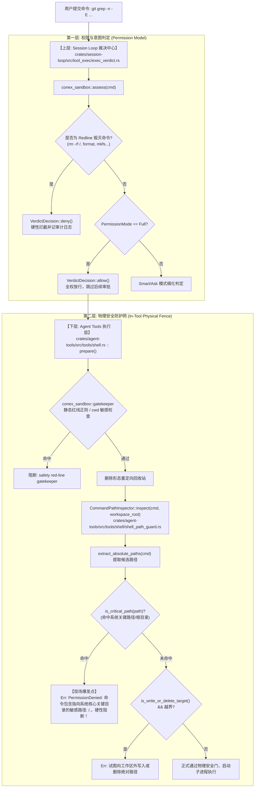

# 沙箱敏感路径误报、正则表达式参数误杀与 Redline 判定机制深度剖析报告

> **战役工作区**：`docs/tool-experience-and-sandbox-repair/`  
> **责任席位**：子 Agent A1（Sandbox Security Auditor）  
> **产出文档**：`docs/tool-experience-and-sandbox-repair/analysis/01-sandbox-false-positive-analysis.md`  
> **相关代码文件**：  
> - [`crates/agent-tools/src/tools/shell/shell_path_guard.rs`](file:///C:/Software/conex/crates/agent-tools/src/tools/shell/shell_path_guard.rs)  
> - [`crates/agent-tools/src/tools/shell.rs`](file:///C:/Software/conex/crates/agent-tools/src/tools/shell.rs)  
> - [`crates/conex-sandbox/src/lex/tokenize.rs`](file:///C:/Software/conex/crates/conex-sandbox/src/lex/tokenize.rs)  
> - [`crates/conex-sandbox/src/lex/quote.rs`](file:///C:/Software/conex/crates/conex-sandbox/src/lex/quote.rs)  
> - [`crates/conex-sandbox/src/classify/read_only.rs`](file:///C:/Software/conex/crates/conex-sandbox/src/classify/read_only.rs)  
> - [`crates/conex-sandbox/src/classify/git.rs`](file:///C:/Software/conex/crates/conex-sandbox/src/classify/git.rs)  
> - [`crates/conex-sandbox/src/classify/redline.rs`](file:///C:/Software/conex/crates/conex-sandbox/src/classify/redline.rs)  
> - [`crates/conex-fs/src/path_normalizer.rs`](file:///C:/Software/conex/crates/conex-fs/src/path_normalizer.rs)  
> - [`crates/session-loop/src/tool_exec/exec_verdict.rs`](file:///C:/Software/conex/crates/session-loop/src/tool_exec/exec_verdict.rs)

---

## 一、用户诉求与现场事故精准还原

### 1. 现场故障现象
在实际使用中，用户在 Shell 中执行针对代码仓库的常规检索命令：
```bash
git grep -n -E "hooks/useSplitResize|from ['\"]\.\.?/.*useSplitResize" -- ':!apps/crish-desktop/src/components/ui/SplitResizer/*'
```
该命令被工具执行层**直接硬性阻断**并抛出严重权限拒绝异常：
```text
[tool.command_blocked] PermissionDenied: 命令包含指向系统核心关键目录的敏感路径：/.，硬性阻断！
```

### 2. 用户痛点与心理模型断裂
用户明确反馈：
> **“这个提示就很奇怪，我都已经完全允许了，这种的怎么还会被阻断呢。而且就是很基础的操作都给我阻止了。”**

这一反馈揭露了用户体验与底层安全系统的三重断裂：
1. **语义误杀（False Positive）**：命令本质是纯粹的只读正则文本检索（`git grep`），零文件写操作、零磁盘删除、零系统敏感目录访问。
2. **凭空生成的幽灵敏感路径（Ghost Path）**：报错提示所谓的系统关键目录是 `/.`，用户根本没有指定该路径，而是正则字符串 `\.\.?/.*useSplitResize` 中的局部子串被错误拆分和提取。
3. **权限模型失效断层（Permission Model Illusion）**：用户在系统配置中已经配置了完全允许（Full Permission 模式或确认了所有授权），但在底层依然遭遇不可降级、不可覆盖的刚性拒绝。

---

## 二、全链路安全审查与执行拦截架构定位

系统在执行 Shell 命令时并非单点判定，而是存在**两层相互独立的安全防御与裁决机制**：



### 1. 上层权限中心（`session-loop/src/tool_exec/exec_verdict.rs`）
在命令真正执行前，会进入 `call_command_verdict_detailed`（行 173-200）：
- 当 `analysis.permission_verdict()` 为 `Deny` 时，属于确凿的红线（如 `rm -rf /`、`mkfs`、`format`、`dd` 等），此时无论任何模式一律阻断；
- 若不是红线，且用户设置了 `PermissionMode::Full`，代码直接在行 202-204 返回 `VerdictDecision::allow()`。
- **结论**：本命令在第一层中顺利判定通过，用户设定的“完全允许”在第一层完全生效，没有报阻断。

### 2. 下层执行物理围栏（`agent-tools/src/tools/shell.rs` 与 `shell_path_guard.rs`）
当命令通过第一层进入 `ShellCommandTool::prepare`（行 249-308）时，执行环境会强制挂载“物理安全底线”：
- 该围栏的设计目标是**执行行为物理防御**（零容忍越界删除、零容忍修改系统关键目录），**不读取也不受用户 `PermissionMode` 的影响**。
- 正是在此处的 `CommandPathInspector::inspect(&command, workspace_root)` 内部，抛出了致命的 `PermissionDenied: 命令包含指向系统核心关键目录的敏感路径：/.，硬性阻断！`。

---

## 三、现场根因代码剖析与完整复现追踪

本次误报的根源，是 `crates/agent-tools/src/tools/shell/shell_path_guard.rs` 中的路径提取正则表达式、宽松判定机制与路径归一化逻辑形成的**三级连环放大缺陷**。

### 1. 现场命令的分词与捕获追踪

用户命令片段：
```text
git grep -n -E "hooks/useSplitResize|from ['\"]\.\.?/.*useSplitResize" -- ':!apps/crish-desktop/src/components/ui/SplitResizer/*'
```
其内部关键正则字面量子串为：
```text
\.\.?/.*useSplitResize
```
在 [`shell_path_guard.rs:86-88`](file:///C:/Software/conex/crates/agent-tools/src/tools/shell/shell_path_guard.rs#L86-L88) 中，定义了 Unix 路径提取正则：
```rust
static UNIX_PATH_REGEX: CompiledRegex =
    LazyLock::new(|| Regex::new(r#"(?:\A|[^a-zA-Z0-9_./\\-])(/[\w.\-]+(?:/[\w.\-]+)*)"#));
```

我们对 `UNIX_PATH_REGEX` 在上述子串上的匹配行为进行字符级逐步追踪：

| 匹配阶段 | 正则部分 | 对应文本字符 | 匹配结果与解释 |
|---|---|---|---|
| 1. 前缀断言 | `(?:\A\|[^a-zA-Z0-9_./\\-])` | `?`（来自 `\.\.?` 的问号） | **匹配成功**。ASCII 字符 `?` 不属于字母、数字、下划线、点、斜杠、反斜杠或减号，满足排除集合。 |
| 2. 起始斜杠 | `(/...` | `/` | **匹配成功**。紧接在 `?` 之后的斜杠匹配首字符 `/`。 |
| 3. 第一段字符集 | `[\w.\-]+` | `.`（来自 `.*` 的点号） | **匹配成功**。字符 `.` 明确包含在 `[\w.\-]` 字符类中。 |
| 4. 贪婪匹配终止 | `[\w.\-]+` 期望更多字符 | `*`（来自 `.*` 的星号） | **不匹配**。字符 `*` 不是字母、数字、下划线、点或连字符。 |
| 5. 后续可选段 | `(?:/[\w.\-]+)*` | `*useSplitResize` | **不匹配**。后续字符不是 `/`。 |
| 6. 正则截断捕获 | `(/[\w.\-]+(?:/[\w.\-]+)*)` | **`/.`** | **致命漏洞**：正则**完全没有设置单词边界 `\b` 或尾部分隔符断言**！正则引擎不会回溯放弃，而是**原地终止贪婪匹配**，捕获组 1 最终直接捕获出：**`/.`**！ |

### 2. 验证机制失效：`is_valid_unix_path` 轻易放行

提取出候选字面量 `/.` 后，代码进入清理与有效性校验：
1. `clean_path_candidate("/.")`：去除收尾引号及括号，依然输出 `"/. "`。
2. 随后调用 [`shell_path_guard.rs:393-425`](file:///C:/Software/conex/crates/agent-tools/src/tools/shell/shell_path_guard.rs#L393-L425) 的 `is_valid_unix_path`：
```rust
fn is_valid_unix_path(s: &str) -> bool {
    if !s.starts_with('/') {
        return false;
    }
    if s[1..].contains('/') {
        return true;
    }
    let rest = &s[1..];
    // 单字符且为 ASCII 字母视作 Windows 盘符（如 /c），不是 Unix 路径
    if rest.len() == 1 && matches!(rest.chars().next(), Some(ch) if ch.is_ascii_alphabetic()) {
        return false;
    }
    const WIN_FLAGS: &[&str] = &[...];
    if WIN_FLAGS.contains(&rest.to_ascii_lowercase().as_str()) {
        return false;
    }
    const KNOWN_UNIX_DIRS: &[&str] = &[...];
    if KNOWN_UNIX_DIRS.contains(&rest.to_ascii_lowercase().as_str()) {
        return true;
    }
    // 致命放行行（行 424）：
    rest.contains('.') || rest.len() > 2
}
```
**严重缺陷**：当 `s = "/."` 时，`rest = "."`。在第 424 行，`rest.contains('.')` 毫无悬念地返回了 `true`！  
原本该逻辑可能是为了支持类似 `/.config` 或 `/app.js` 等单层文件，但因为写成了粗暴的 `contains('.')`，直接将裸的目录跳转符 `.` 当成了合法的 Unix 路径！  
因此，`pb = PathBuf::from("/.")` 被堂而皇之地推入了 `paths` 列表！

### 3. 敏感路径误判：`is_critical_path` 将 `/.` 判定为系统核心物理红线

随后，[`shell_path_guard.rs:43-53`](file:///C:/Software/conex/crates/agent-tools/src/tools/shell/shell_path_guard.rs#L43-L53) 遍历 `extracted_paths`：
```rust
for path in &extracted_paths {
    // 1. 系统核心关键目录物理红线（命中则刚性 Deny 阻断）
    if Self::is_critical_path(path) {
        return Err(ToolError::new(
            codes::TOOL_COMMAND_BLOCKED,
            format!(
                "PermissionDenied: 命令包含指向系统核心关键目录的敏感路径：{}，硬性阻断！",
                path.display()
            ),
        ));
    }
    ...
}
```
查看 [`shell_path_guard.rs:228-241`](file:///C:/Software/conex/crates/agent-tools/src/tools/shell/shell_path_guard.rs#L228-L241) 中的判定逻辑：
```rust
pub fn is_critical_path(path: &Path) -> bool {
    if conex_fs::ConexPathNormalizer::is_system_critical_path(path) {
        return true;
    }

    let norm = conex_fs::ConexPathNormalizer::normalize(path);
    let s = norm.to_string_lossy().replace('\\', "/");
    let upper = s.to_ascii_uppercase();

    // 命中点（行 238）：
    if s == "/" || upper == "/" || upper == "/*" || upper == "/." {
        return true;
    }
    ...
}
```
这里触发了双重命中：
1. `ConexPathNormalizer::normalize(Path::new("/."))`：依据标准路径规范化，`CurDir`（即 `.`）被消除，路径规范化后正是根目录 `/`，导致 `s == "/"` 命中！
2. 即使未消除，代码在行 238 也显式写入了 `upper == "/."`！
3. `is_critical_path` 返回 `true`。
4. 格式化输出错误文案：`path.display()` 打印出未规范化的提取原始值 `/.`，最终生成：
```text
PermissionDenied: 命令包含指向系统核心关键目录的敏感路径：/.，硬性阻断！
```

---

## 四、深层排查：`conex-sandbox` 中的并发隐患与设计缺陷

不仅在 `shell_path_guard.rs` 中存在严重的正则误捕获，经深入排查 `crates/conex-sandbox/src/`，我们还发现了另外两处重大设计隐患与词法缺陷：

### 1. `conex-sandbox/src/lex/tokenize.rs` 的双引号转义提前闭合 Bug

查看参数拆分核心函数 [`split_command_args_normalized`](file:///C:/Software/conex/crates/conex-sandbox/src/lex/tokenize.rs#L82-L113)：
```rust
pub(crate) fn split_command_args_normalized(segment: &str) -> (String, Vec<String>) {
    ...
    while let Some(c) = chars.next() {
        if quote == Some('\'') { ... }

        if quote == Some('"') {
            if c == '"' {
                quote = None;
            } else if c == '`' {
                if let Some(next_c) = chars.next() {
                    current.push(next_c);
                }
            } else {
                current.push(c);
            }
            started = true;
            continue;
        }

        if c == '`' { ... }
        if c == '\\' { ... }
        ...
```
**致命词法缺陷**：
在 `quote == Some('"')` 的双引号环境内部，该状态机**只处理了反引号 `` ` ``，完全忽略了反斜杠 `\"` 转义**！
当命令行参数出现用户本次的正则：
`"hooks/useSplitResize|from ['\"]\.\.?/.*useSplitResize"`
1. 当解析到 `['\"` 时，遇到字符 `\`，落入 `else`，将 `\` 存入 `current`；
2. 紧接着下一个字符是 `"`，直接命中 `if c == '"' { quote = None; }`！
3. **双引号在字符串内部被提前闭合**！
4. 随后的 `\.\.?/.*useSplitResize"` 变成了非引号上下文；而在参数末尾的那个 `"`，又被当成了新一轮双引号的开始！
5. 这直接导致分词器内部的引号开关状态翻转（Quoting Inversion），后续参数（如 `--`、路径过滤器）被完全解析错乱！

### 2. `git grep` 被完全排除在只读与安全命令白名单之外

查看 [`crates/conex-sandbox/src/classify/read_only.rs`](file:///C:/Software/conex/crates/conex-sandbox/src/classify/read_only.rs)：
在只读子命令白名单（行 247-263）：
```rust
matches!(
    sub.as_str(),
    "status"
        | "diff"
        | "log"
        | "show"
        | "rev-parse"
        | "check-ignore"
        | "ls-files"
        | "describe"
        | "version"
        | "help"
        | "branch"
        | "tag"
        | "remote"
        | "config"
)
```
以及安全子命令白名单（行 286-306）：
```rust
matches!(
    sub.as_str(),
    "status"
        | "diff"
        | "log"
        | "branch"
        | "show"
        | "rev-parse"
        | "remote"
        | "tag"
        | "check-ignore"
        | "ls-files"
        | "describe"
        | "version"
        | "help"
        | "config"
)
```
**惊人遗漏**：
系统为独立程序收录了 `grep`, `rg`, `findstr` 作为纯只读命令（行 218-220），但对于 `git` 的子命令，**唯独遗漏了最常用的 `grep`（`git grep`）**！
这意味着，即便上述 `/.` 路径问题被绕过，只要用户处于 `Smart` 或 `Ask` 权限模式下，`git grep` 也会因为无法匹配 `is_segment_safe` 而被判定为具有未知的写副作用（`ApprovalReason::UnsafeSideEffect`），无端弹窗打扰用户！

---

## 五、现有路径提取与安全防护的系统性缺陷归纳

从架构与安全工程视角，现有的敏感路径检查机制存在以下五大设计断层：

```
┌────────────────────────────────────────────────────────────────────────┐
│                        现有架构缺陷全景对比                             │
├───────────────────────────┬────────────────────────────────────────────┤
│ 1. 扁平无上下文的正则扫描 │ 在未分词的原始命令字符串上裸跑正则，无法区 │
│    (Flat Regex Scanning)  │ 分参数类型（Flag / Pattern / Path / Option)│
├───────────────────────────┼────────────────────────────────────────────┤
│ 2. 模式参数与路径混淆     │ 对 grep/rg 等工具的模式参数（-E "..."）缺  │
│    (Pattern vs Path)      │ 乏感知，将正则字符类误当成文件系统路径     │
├───────────────────────────┼────────────────────────────────────────────┤
│ 3. 正则尾部定界符缺失     │ 正则末尾缺乏单词边界或分隔符，导致正则字符 │
│    (Unanchored Regexp)    │ 类（如 /.*）在操作符处被直接截断为 /.      │
├───────────────────────────┼────────────────────────────────────────────┤
│ 4. 宽松的 Unix 路径判定   │ rest.contains('.') 使得 bare dot / 单点直  │
│    (Naive Unix Heuristic) │ 接被判定为合法路径                         │
├───────────────────────────┼────────────────────────────────────────────┤
│ 5. 词法状态机转义缺陷     │ split_command_args_normalized 不支持 \"，  │
│    (Escaped Quote Bug)    │ 导致含转义引号的正则参数引起词法状态反转   │
└───────────────────────────┴────────────────────────────────────────────┘
```

---

## 六、整改方案设计：优雅、精确、根治的架构重构

为了彻底消灭此类误杀，必须穿透表象、杜绝“加个 `if s == "/."` 特判”的修补式打补丁，从**词法解析**、**参数语义感知**、**精确边界断言**到**白名单覆盖**实现全链路净收敛。

### 1. 修复 `conex-sandbox/src/lex/tokenize.rs` 的双引号转义解析（消除词法断层）
在 `split_command_args_normalized` 中，双引号状态内必须支持 `\"` 转义与 `\\`：
```rust
if quote == Some('"') {
    if c == '\\' {
        if let Some(&next_c) = chars.peek() {
            if next_c == '"' || next_c == '\\' || next_c == '`' || next_c == '$' {
                chars.next();
                current.push(next_c);
                started = true;
                continue;
            }
        }
        current.push(c);
        started = true;
        continue;
    }
    if c == '"' {
        quote = None;
    } else if c == '`' {
        ...
```
确保包含 `\"` 的正则表达式参数能够作为一个完整合法的 Token 正确解析，不提前截断、不颠倒引号状态。

### 2. 补全 `git grep` 进只读与安全白名单
在 `crates/conex-sandbox/src/classify/read_only.rs` 中：
- `is_segment_pure_read_only` 的 `git` 分支中添加 `"grep"`。
- `is_segment_safe` 的 `git` 分支中添加 `"grep"`。
确保 `git grep` 获得与顶层 `grep`/`rg` 相同的一等公民只读地位，消除不必要的权限弹窗。

### 3. 重构 `shell_path_guard.rs` 的路径提取逻辑（参数感知与严格定界）

#### (1) 基于规范化 Token 列表提取，而非原始字符盲扫
`CommandPathInspector` 应当优先利用 `conex-sandbox` 已分词好的参数列表（Tokens/Args）：
- 如果某个 Argument 处于**模式参数槽位**（如 `grep` 的 `-e`、`-E` 参数，或位置参数中的搜索模式），直接跳过路径检查！
- 针对已知模式工具（`grep`, `git grep`, `rg`, `ag`, `findstr`, `sed`, `awk` 等），识别其模式参数位，严禁提取模式串作为文件路径。

#### (2) 强化路径正则尾部边界约束（Trailing Delimiter Anchor）
对于必须在命令行中检测的路径，正则必须包含严格的定界符（空白、引号、行尾、分号、管道符、重定向符等），禁止在中途任意量词处直接截断：
```rust
// 必须以合法定界符结尾，不能在任意非单词字符处截断匹配
static UNIX_PATH_REGEX: CompiledRegex = LazyLock::new(|| {
    Regex::new(r#"(?:\A|[^a-zA-Z0-9_./\\-])(/[\w.\-]+(?:/[\w.\-]+)*)(?:\z|[\s"'`=,;()<>{}\r\n|])"#)
});
```

#### (3) 收紧 `is_valid_unix_path` 判定
严禁单点 `.` 或相对路径符号 `..` 作为有效 Unix 绝对路径：
```rust
fn is_valid_unix_path(s: &str) -> bool {
    if !s.starts_with('/') {
        return false;
    }
    let rest = &s[1..];
    if rest.is_empty() || rest == "." || rest == ".." {
        return false; // 单独的 / 或 /. 或 /.. 必须通过专门的根路径规则裁决，不在此处归入普通有效路径
    }
    ...
    // 排除以点结尾的非法截断片段（如 /. 且后面没有有效文件名）
    if rest == "." {
        return false;
    }
    ...
}
```

---

## 七、立体化测试与验证矩阵

整改实施后，必须运行以下针对性测试矩阵，确保“零误报”与“零漏防”同时成立：

| 测试用例类型 | 测试命令 / 输入 | 预期判定结果 | 验证目的 |
|---|---|---|---|
| **现场故障回归** | `git grep -n -E "hooks/useSplitResize\|from ['\"]\.\.?/.*useSplitResize" -- ':!apps/*'` | **放行（Ok）** | 验证包含 `\.\.?/.*` 正则的 `git grep` 完全畅通 |
| **转义双引号解析** | `git grep "foo\"bar" src/` | **放行（Ok）** | 验证词法分词器不会因 `\"` 提前闭合引号 |
| **纯只读智能放行** | `git grep "useCallback" .` | **纯只读放行（PureReadOnly）** | 验证 `git grep` 在 Smart/Ask 模式下不弹多余审批 |
| **搜索模式含根目录特征** | `rg "/etc/passwd" src/` | **放行（Ok）** | 验证搜索模式中的敏感字符不会被当成要读写的文件路径 |
| **正向拦截：真实毁灭删除** | `rm -rf /` | **阻断（Redline / Blocked）** | 确保真实系统根目录删除绝对不可绕过 |
| **正向拦截：越界绝对路径写** | `git grep foo > C:/Windows/System32/evil.txt` | **阻断（越界写 / Blocked）** | 确保重定向至系统目录依然刚性拦截 |
| **正向拦截：系统关键目录写** | `rm -rf /etc` | **阻断（Redline / Blocked）** | 确保核心系统目录物理红线坚挺有效 |

---

## 八、总结与汇报要点

1. **现场根因已彻底查清**：不是权限配置未生效，而是执行层 `shell_path_guard.rs` 的 `UNIX_PATH_REGEX` 缺乏尾部边界，将正则 `\.\.?/.*` 截断捕获为 `/.`；紧接着 `is_valid_unix_path` 脆弱的 `contains('.')` 放行该路径，最终触发 `is_critical_path` 将其视为系统根目录硬性阻断。
2. **伴生词法与白名单漏洞已定位**：`conex-sandbox` 的双引号分词器不识别 `\"` 导致引号颠倒；且 `git grep` 未进入只读与安全白名单。
3. **整改方案已完备设计**：词法转义修复 + `git grep` 白名单补全 + 参数模式感知 + 严格正则边界定界。
4. **准备就绪**：分析报告已全部落盘至 `docs/tool-experience-and-sandbox-repair/analysis/01-sandbox-false-positive-analysis.md`，可随时供主 Agent 调度方案与实施阶段。
