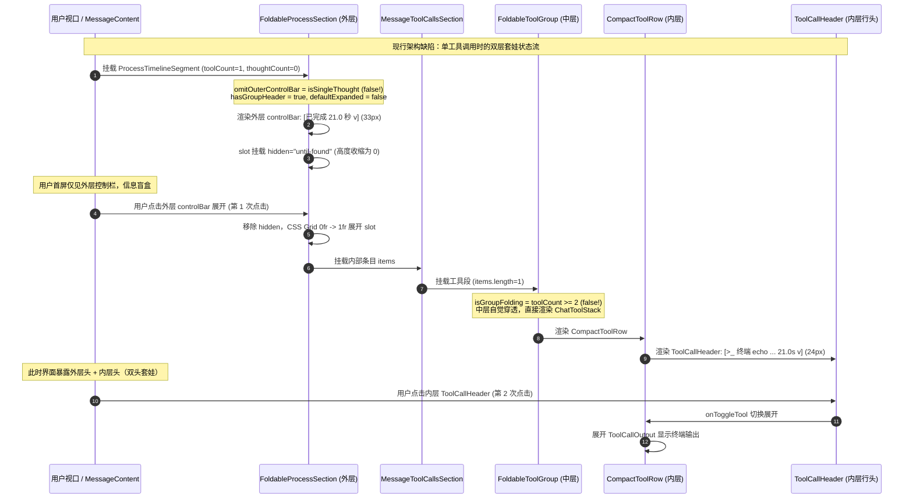
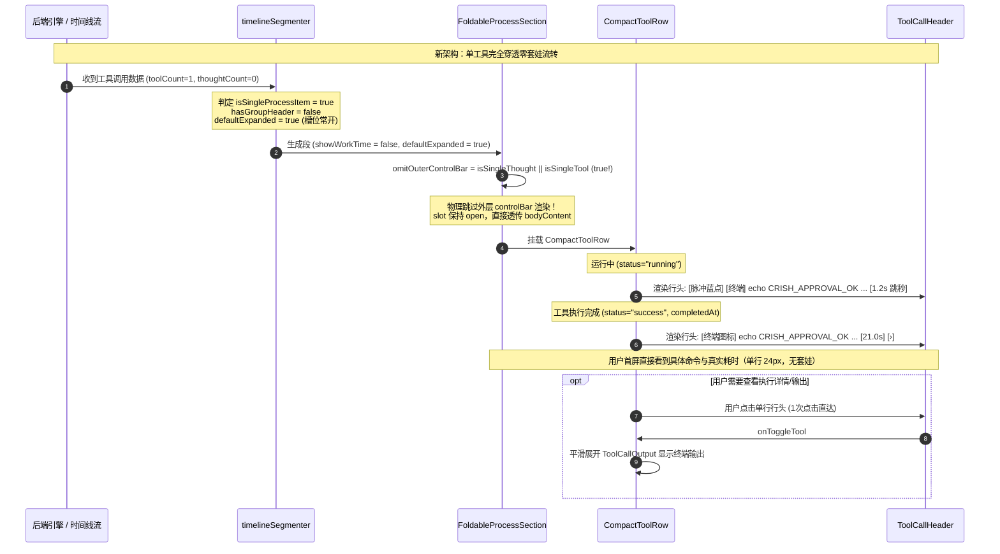

# 单工具双层折叠套娃消除与穿透方案分析报告

> 战役工作区：`docs/tool-experience-and-sandbox-repair/`  
> 责任席位：子 Agent A2（Accordion Hierarchy Architect）  
> 调研目标：深入排查前端消息流中工具调用的“双层折叠套娃”问题，剖析单思考与单工具在折叠状态机上的非对称设计缺陷，提出零断层、完全穿透的单工具展示与折叠重构方案。

---

## 一、问题背景与现网痛点

用户在实际体验中直接指出了极其混乱的工具折叠排版：
> **“当助手消息中仅包含单次工具调用时（如 `echo CRISH_APPROVAL_OK`），界面渲染了双层折叠栏：最外层是通用过程控制栏 `已完成 21.0 秒 v`；展开后内部又是一个单行工具折叠头 `>_ 终端 echo CRISH_APPROVAL_OK v`。排版极其混乱，出现不必要的两层嵌套折叠。”**

### 1.1 视觉与交互现状还原

在当前线上版本中，当助手执行单次工具调用（例如终端执行命令、读取单个文件、执行一次搜索）时，用户视口中呈现如下视觉序列：

```text
【首屏折叠态】
┌───────────────────────────────────────────────────────────┐
│ 已完成 21.0 秒                                          v │  <-- 外层 FoldableProcessSection (33px)
└───────────────────────────────────────────────────────────┘
   (用户完全不知道执行了什么工具，看不到命令、看不到文件、看不到意图)

【用户点击外层展开后（产生严重视觉套娃）】
┌───────────────────────────────────────────────────────────┐
│ 已完成 21.0 秒                                          ^ │  <-- 外层控制栏
│ ┌───────────────────────────────────────────────────────┐ │
│ │ >_ 终端 echo CRISH_APPROVAL_OK                21.0s v │ │  <-- 内部 CompactToolRow (24px)
│ └───────────────────────────────────────────────────────┘ │
└───────────────────────────────────────────────────────────┘
   (两层折叠头垂直堆叠！两个耗时 21.0 秒 vs 21.0s！两个箭头 ^ vs v！)

【用户再次点击内层工具行展开（第 2 次点击交互）】
┌───────────────────────────────────────────────────────────┐
│ 已完成 21.0 秒                                          ^ │
│ ┌───────────────────────────────────────────────────────┐ │
│ │ >_ 终端 echo CRISH_APPROVAL_OK                21.0s ^ │ │
│ │ ┌───────────────────────────────────────────────────┐ │ │
│ │ │ CRISH_APPROVAL_OK                                 │ │ │  <-- 终端真实输出
│ │ └───────────────────────────────────────────────────┘ │ │
│ └───────────────────────────────────────────────────────┘ │
└───────────────────────────────────────────────────────────┘
```

### 1.2 核心体验断层总结

1. **信息获取极度低效（阻断式交互）**：用户首屏只能看到空洞的“已完成 21.0 秒”，必须进行 **2 次点击** 才能看到真正的工具输出；甚至连“AI 刚才执行了什么命令”这一基本事实都被挡在第一层折叠门后。
2. **视觉套娃与元数据同义复读**：外层显示 `已完成 21.0 秒`，内层显示 `21.0s`；外层带指示箭头，内层又带指示箭头，排版像两个独立的手风琴强行塞在了一起。
3. **与单思考行的强烈体验落差**：单思考行呈现为 `已思考 3.2 秒 ›`，首屏直接透出单行头与第一行摘要，点击一次即可展开。而单工具行却被套上了外壳。

---

## 二、现行架构与折叠状态机逐层深度审计

涉及核心源码链路：
- 状态机分段层：[`apps/crish-desktop/src/api/tool-presentation/timelineSegmenter.ts`](file:///c:/Software/conex/apps/crish-desktop/src/api/tool-presentation/timelineSegmenter.ts)
- 过程外壳容器：[`apps/crish-desktop/src/components/chat-message/FoldableProcessSection.tsx`](file:///c:/Software/conex/apps/crish-desktop/src/components/chat-message/FoldableProcessSection.tsx)
- 工具组级容器：[`apps/crish-desktop/src/components/chat-tool-call/FoldableToolGroup.tsx`](file:///c:/Software/conex/apps/crish-desktop/src/components/chat-tool-call/FoldableToolGroup.tsx)
- 单工具行渲染：[`apps/crish-desktop/src/components/chat-tool-call/CompactToolRow.tsx`](file:///c:/Software/conex/apps/crish-desktop/src/components/chat-tool-call/CompactToolRow.tsx)
- 单工具行头部：[`apps/crish-desktop/src/components/chat-tool-call/ToolCallHeader.tsx`](file:///c:/Software/conex/apps/crish-desktop/src/components/chat-tool-call/ToolCallHeader.tsx)
- 工具展开状态机：[`apps/crish-desktop/src/components/chat-tool-call/toolExpansionState.ts`](file:///c:/Software/conex/apps/crish-desktop/src/components/chat-tool-call/toolExpansionState.ts)
- 组装与渲染中枢：[`apps/crish-desktop/src/components/chat-message/MessageContent.tsx`](file:///c:/Software/conex/apps/crish-desktop/src/components/chat-message/MessageContent.tsx)



### 2.1 分段器裁决机：`timelineSegmenter.ts`

在 [`timelineSegmenter.ts:184-198`](file:///c:/Software/conex/apps/crish-desktop/src/api/tool-presentation/timelineSegmenter.ts#L184-L198) 中：
```typescript
// ── 折叠裁决（〔同组 §3.3〕组级默认，口径见文件头默认开合表）──
const foldable = true;
const isLive = isTail && isTurnLive;
// 组头（控制栏）是否由渲染层挂载：与 FoldableProcessSection 的
// omitOuterControlBar 判定同构（仅单思考特例 → 无组头）。
const isSingleThoughtGroup =
  metrics.thoughtCount === 1 &&
  metrics.toolCount === 0 &&
  metrics.subagentCount === 0;
const hasGroupHeader = !isSingleThoughtGroup;
const defaultExpanded = isLive || !hasGroupHeader;
```
以及 [`timelineSegmenter.ts:259-272`](file:///c:/Software/conex/apps/crish-desktop/src/api/tool-presentation/timelineSegmenter.ts#L259-L272)：
```typescript
const isFirstGroup = groupIndex === 0;
const seg: ProcessTimelineSegment = {
  kind: 'process_section',
  id: `${msgId}-proc-${groupIndex++}`,
  items: current,
  metrics,
  startTime: segStart,
  endTime: segEnd,
  showWorkTime: isFirstGroup,
  foldable,
  defaultExpanded,
  isLive,
};
```

**问题暴露**：
1. `isSingleThoughtGroup` 判定被死死限制在 `metrics.thoughtCount === 1 && metrics.toolCount === 0`。
2. 当 `metrics.toolCount === 1 && metrics.thoughtCount === 0` 时：
   - `isSingleThoughtGroup` 为 `false`；
   - `hasGroupHeader` 为 `true`；
   - 终态时（`!isLive`），`defaultExpanded = isLive || !hasGroupHeader` 判定为 **`false`（默认折叠）**！
   - `showWorkTime` 仅凭 `groupIndex === 0` 便盲目置为 **`true`**。

### 2.2 外层折叠容器：`FoldableProcessSection.tsx`

查看 [`FoldableProcessSection.tsx:341-354`](file:///c:/Software/conex/apps/crish-desktop/src/components/chat-message/FoldableProcessSection.tsx#L341-L354)：
```typescript
const isSingleThought =
  metrics.thoughtCount === 1 &&
  metrics.toolCount === 0 &&
  metrics.subagentCount === 0;

// 单思考组（子项已由 ReasoningRow 自带 24px 独立折叠栏）直接渲染
// 内容槽位，避免双层摘要折叠栏。
const omitOuterControlBar = isSingleThought;

if (omitOuterControlBar) {
  return (
    <div
      ref={containerRef}
      className={`${styles.section} ${className}`}
      data-process-segment={sectionId}
      data-single-thought={isSingleThought ? 'true' : undefined}
      data-foldable={isFoldable ? 'true' : 'false'}
      data-expanded={expanded ? 'true' : 'false'}
      style={accordionDurationStyle(transitionDuration)}
    >
      <div id={bodyId} ref={setSlotRef} className={styles.sectionBody} ...>
        ...
          {bodyContent}
        ...
      </div>
    </div>
  );
}
```

**问题暴露**：
- `omitOuterControlBar` **仅绑定了 `isSingleThought`**。
- 单工具段因 `omitOuterControlBar === false`，必定渲染外层控制栏 [`FoldableProcessSection.tsx:398-425`](file:///c:/Software/conex/apps/crish-desktop/src/components/chat-message/FoldableProcessSection.tsx#L398-L425)。
- 外层控制栏使用 `formatProcessControlLabel` 渲染出 `已完成 21.0 秒` 和折叠箭头。

### 2.3 工具组层级与自知穿透：`FoldableToolGroup.tsx`

查看 [`FoldableToolGroup.tsx:120, 314-325`](file:///c:/Software/conex/apps/crish-desktop/src/components/chat-tool-call/FoldableToolGroup.tsx#L120)：
```typescript
// 组级折叠门槛：仅 ≥2 个工具才聚合为单行摘要。
// 单工具直接渲染工具行，详情仍由工具行自身默认折叠。
const isGroupFolding = metrics.toolCount >= 2;

...

if (!isGroupFolding) {
  return (
    <div
      ref={containerRef}
      className={styles.groupContainer}
      data-testid="foldable-tool-group"
      data-single-tool="true"
    >
      <ChatToolStack {...hostProps} />
    </div>
  );
}
```

**关键事实**：
- `FoldableToolGroup` 的设计者**早在架构上就明确识别了**：“单工具无需组级折叠，单工具自身就是一个 24px 工具行，应该直接穿透”！
- 因此，当 `toolCount < 2` 时，`FoldableToolGroup` 主动退化为透明容器，绝不渲染自身组头。
- **然而，最外层的 `FoldableProcessSection` 却毫无察觉，依然在其上方套上了一层 `FoldableProcessSection` 的控制栏！**
- 这导致 `FoldableToolGroup` 虽成功避免了变成“三层套娃”，却无法阻止外层带来的“双层套娃”。

### 2.4 单工具行内部机制：`CompactToolRow.tsx` & `ToolCallHeader.tsx`

查看 [`CompactToolRow.tsx:355-460`](file:///c:/Software/conex/apps/crish-desktop/src/components/chat-tool-call/CompactToolRow.tsx#L355-L460) 与 [`ToolCallHeader.tsx:145-280`](file:///c:/Software/conex/apps/crish-desktop/src/components/chat-tool-call/ToolCallHeader.tsx#L145-L280)：
- `CompactToolRow` 自身拥有完整的折叠状态机：
  - 折叠态（`isOpen === false`）：只渲染 24px 高度的 `ToolCallHeader`，包含图标、动作（`终端`）、参数（`echo CRISH_APPROVAL_OK`）、耗时（`21.0s`）与折叠指示（`›`）；输出区域挂载折叠容器。
  - 展开态（`isOpen === true`）：`ToolCallHeader` 保持可见，下方平滑展开 `ToolCallOutput`。
- **结论**：`CompactToolRow` 本身就是一个极其严谨、结构完整的自闭环手风琴条目，形态与 `ReasoningRow` 完全等价！

---

## 三、单思考 vs 单工具穿透不对称性根因分析

为什么单思考项能够优雅穿透，而单工具项却沦为套娃受害者？我们从历史演进与认知模型中还原出三大核心根因：

### 3.1 认知不对称：“单条思维链” vs “多工具集合”的思维定势

- 在开发者的心理模型中：
  - “思考”被视为**单个连续块**：对应单一组件 `ReasoningRow`，逻辑上一眼可见它只有一行，因此给它开了 `isSingleThought` 特例通道；
  - “工具”在数据模型中天然是**数组集合**（`SessionMessage.tool_calls: MessageToolCall[]`），对应 `ChatToolStack`、`MessageToolCallsSection`、`FoldableToolGroup`。
- 架构开发者习惯性认为“工具段必定是一个列表容器”，未能将 `toolCount === 1` 提升到与 `thoughtCount === 1` 同等的一等公民地位。

### 3.2 历史注释中的致命误判：“无组头组折了就没有一行可见的头，内容等于消失”

在 [`timelineSegmenter.ts:34-37`](file:///c:/Software/conex/apps/crish-desktop/src/api/tool-presentation/timelineSegmenter.ts#L34-L37) 中赫然写着这样一段注释：
> *“「无组头组」= 渲染层不挂控制栏的组：仅单思考组（组头即思考行本身，2026-09-11 特例，思考行自有终态折叠）。无组头组不参与组级自动折——折了就没有一行可见的头，内容等于消失；其组内条目以条目级默认治理（思考行终态自折）。”*

这段代码的作者产生了致命的误判：
- 作者认为**只有 `ReasoningRow` 能够作为折叠头**；
- 作者误以为如果对工具组也去掉外层组头，工具组折叠后就会“没有一行可见的头，内容等于消失”；
- 作者完全忽略了：**单工具项的 `ToolCallHeader` 本身就是一行 24px 极度精致的可见头**！
- 当单工具外层不加控制栏时，内容根本不会消失，而是精准呈现为 `>_ 终端 echo CRISH_APPROVAL_OK 21.0s ›`！它不仅不会消失，反而比模糊的“已完成 21.0 秒”清晰一千倍！

### 3.3 `showWorkTime` 职责绑架：整轮工作时间的强行占位

在早期规范中，规定“整轮工作时间承载于首个过程组控制栏”。
- 开发者陷入了一种伪假设：“如果首个过程组只有一个工具，而我们把外层控制栏去掉了，那整轮工作时间（`已完成 21.0 秒`）该放哪里？”
- 为了强行保住这个“已完成 21.0 秒”的外壳，哪怕里面只有一个工具，也强行渲染了外层控制栏。
- 结果造成荒谬的灾难：外层写 `已完成 21.0 秒`，内层写 `21.0s`，为了一个文案强行多套一层壳。

---

## 四、`timelineSegmenter.ts:267` 判定逻辑失真与工作耗时合并机制

### 4.1 代码失真证据：对 2026-09-11 用户裁决的背离

查看 [`toolPresentationTypes.ts:172-178`](file:///c:/Software/conex/apps/crish-desktop/src/api/tool-presentation/toolPresentationTypes.ts#L172-L178)：
```typescript
/**
 * 顶部「工作时间区 + 虚线分割」是否显示。
 *
 * 唯一口径（用户裁决 · 2026-09-11）：段内思考与工具调用计数之和 ≥ 2 时显示；
 * **只有一个思考 或 只有一个工具调用时，工作时间区域与分割线一律不显示**。
 *
 * 该字段由 `partitionTimelineSegments` 唯一裁决，禁止调用方本地重推导。
 */
showWorkTime: boolean;
```

**无可辩驳的证据**：
- 仓库既有契约（2026-09-11 用户裁决）白纸黑字写得清清楚楚：
  **“段内思考与工具调用计数之和 ≥ 2 时显示；只有一个思考 或 只有一个工具调用时，工作时间区域与分割线一律不显示”**！
- 然而在 [`timelineSegmenter.ts:267`](file:///c:/Software/conex/apps/crish-desktop/src/api/tool-presentation/timelineSegmenter.ts#L267) 中：
  ```typescript
  const isFirstGroup = groupIndex === 0;
  const seg: ProcessTimelineSegment = {
    ...
    showWorkTime: isFirstGroup, // <-- 直接使用 isFirstGroup！彻底把 ">= 2" 铁律抛诸脑后！
  };
  ```
- 只要是第一组（`groupIndex === 0`），即使里面只有 1 个工具且 0 个思考，`showWorkTime` 也被暴力赋为 `true`！这是典型的契约实现漂移。

### 4.2 工作耗时优雅合并至单工具行头（ToolCallHeader）

当单工具消除外层控制栏后，工作耗时如何呈现？

1. **单工具自身的耗时即为该过程段的核心工作耗时**：
   - 在 [`CompactToolRow.tsx:134-146`](file:///c:/Software/conex/apps/crish-desktop/src/components/chat-tool-call/CompactToolRow.tsx#L134-L146) 中，`durationStr` 已经基于 `tc.completedAt - tc.startedAt` 算出了精确耗时（如 `21.0s`）；
   - 在流式运行中，`CompactToolRow` 的 `liveNow - tc.startedAt` 驱动跳秒更新；
   - 在 [`ToolCallHeader.tsx:264-268`](file:///c:/Software/conex/apps/crish-desktop/src/components/chat-tool-call/ToolCallHeader.tsx#L264-L268) 中，`durationStr` 已经在行头右侧以数字等宽形式常驻呈现：
     ```tsx
     {durationStr ? (
       <span className={styles.duration}>
         <NumericText text={durationStr} />
       </span>
     ) : null}
     ```
2. **两处耗时的权威合一**：
   - 外层所谓的 `已完成 21.0 秒`，本质上就是这个工具的执行耗时 `21.0s`；
   - 将外层冗余控制栏卸载后，单工具行头右侧的 `21.0s` **天然接管了工作耗时呈现**；
   - 状态表达同样完美接管：
     - 运行中：ToolCallHeader 左侧蓝点脉冲呼吸（`toolPulseDot`），右侧走字跳秒；
     - 终态成功：ToolCallHeader 呈现终端/文件图标，右侧定格 `21.0s`；
     - 终态错误：ToolCallHeader 呈现红点告警（`toolErrorDot`），右侧定格 `21.0s`。
3. **极简现代感的完全统一**：
   - 思考行：`已思考 3.2 秒 ›`（左侧时间徽标，右侧折叠）
   - 单工具行：`>_ 终端 echo CRISH_APPROVAL_OK         21.0s ›`（左侧命令意图，右侧时间徽标与折叠）
   - 两者均为 24px 高度、400 字重，排版完全对称对齐！

---

## 五、零断层、完全穿透的单工具折叠架构设计

### 5.1 穿透后单工具的生命周期状态流（时序图）



### 5.2 聚合边界完备矩阵（单项、多项与混合态全覆盖）

为确保方案零死角，严格梳理以下 5 类过程组合的边界契约：

| 场景分类 | 度量条件 | 是否挂载外层控制栏 (`hasGroupHeader`) | 外层槽位默认开合 (`defaultExpanded`) | 内部组折叠行为 | 最终呈现形态与折叠层级 |
|---|---|---|---|---|---|
| **A. 单纯思考** | `thoughtCount===1 && toolCount===0 && subagentCount===0` | **false** (无外层栏) | **true** (槽位常开) | `ReasoningRow` 自带终态折叠 | **单层**：`已思考 3.2 秒 ›` (24px) |
| **B. 单纯单工具**（本次整改） | `toolCount===1 && thoughtCount===0 && subagentCount===0` | **false** (无外层栏) | **true** (槽位常开) | `CompactToolRow` 自带输出折叠 | **单层**：`>_ 终端 echo ... 21.0s ›` (24px) |
| **C. 纯多工具** | `toolCount>=2 && thoughtCount===0 && subagentCount===0` | **true** (挂载外层栏) | **false** (终态组级自折) | `FoldableToolGroup` 聚合折叠 | **组级折叠**：`已完成 21.0 秒 v`（或 `已运行 2 条命令 v`）展开后见逐行工具 |
| **D. 混合思考与工具** | `thoughtCount>=1 && toolCount>=1` | **true** (挂载外层栏) | **false** (终态组级自折) | 组内按发生序排列思考行与工具行 | **轮次大折叠**：`已完成 25.0 秒 v` 展开后依序见思考与工具 |
| **E. 含子代理分派** | `subagentCount>=1` | **true** (挂载外层栏) | **false** (按 R8 默认折) | 分派卡作为组内独立卡块提取 | **组级折叠**：外层展示 `已完成 ... · 子 agent 1` |

> [!IMPORTANT]
> **不变量判定公式（SSOT）**：
> 凡是**过程项总和恰好为 1 的原子过程组**（原子思考或原子工具），外层控制栏均实现穿透豁免！
> ```typescript
> export const isSingleProcessAtomicItem = (metrics: ProcessSegmentMetrics): boolean => {
>   const isSingleThought = metrics.thoughtCount === 1 && metrics.toolCount === 0 && metrics.subagentCount === 0;
>   const isSingleTool = metrics.toolCount === 1 && metrics.thoughtCount === 0 && metrics.subagentCount === 0;
>   return isSingleThought || isSingleTool;
> };
> ```

---

## 六、对虚拟列表测高（VSM）与状态持久化的影响评估

### 6.1 虚拟列表测高（VSM）影响深度评估

1. **消除双手风琴嵌套导致的测高震荡（Layout Thashing）**：
   - **原模式**：用户点击外层手风琴时，外层触发 CSS Grid `grid-template-rows: 0fr -> 1fr` 动画，通知 VSM 刷新高度；用户再点内层手风琴时，内层又触发第二次高度突变。若用户快速点击，两层动画叠加导致 VSM 捕获到的高度频繁抖动。
   - **新穿透模式**：外层容器高度完全由内部单工具行头自然撑开（24px），不存在外层 Grid 展开动画。唯一的展开动作发生在单工具行内部展开 `ToolCallOutput` 时，由 `useToolExpansionState` 内置的 `usePreActionAnchor` 进行视口位移单轨补偿（$\Delta Y \equiv 0$），彻底切除外层测高噪声。
2. **首屏高度预算更加紧凑稳定**：
   - 原外层控制栏高度：`33px`；
   - 新单工具行头高度：`24px`；
   - 首屏高度不但节省了 9px，更与 24px 的 `ReasoningRow` 达到完美的垂直栅格模数对齐。
3. **DOM 节点精简与重排减负**：
   - 彻底卸载了外层控制栏的 `<div className={styles.controlBar}>`、`<SectionLeadIcon>`、`<NumericText>` 以及 `<span className={styles.chevron}>`；
   - 每一个单工具消息减少至少 5 个冗余 DOM 节点与 2 个事件监听器。

### 6.2 状态持久化与受控字典（ExpandedMap）评估

1. **外层受控字典（`expandedMap` & `setMessageProcessExpanded`）解耦**：
   - 原机制中，外层控制栏的开合保存在 `expandedMap[sectionId]`，并经 `searchExpandBridge.setExpanded(sectionId, ...)` 持久化；
   - 在新穿透模式下，由于 `hasGroupHeader = false`，外层控制栏不再渲染，用户不再操作 `sectionId` 的开合；
   - `defaultExpanded` 恒置为 `true`，外层 slot 恒开，`expandedMap` 对该 section 保持静默。
2. **工具级展开状态（`expandedToolsByMessage`）天然接管**：
   - 用户点击单工具行头时，调用的是 `toolStackProps.onToggleTool(toolId, ...)`；
   - 状态由已有的 `expandedToolsByMessage` 切片仓库管理，持久化到会话状态；
   - 会话重开或切换时，工具行的开合态严格依照 `expandedTools` 原生恢复，无缝兼容。

### 6.3 Ctrl+F 页面内搜索穿透（`beforematch` 兼容性）

- `FoldableProcessSection` 的槽位虽然取消了外层控制栏，但内部工具输出体依然挂载在槽位中；
- 当单工具输出折叠时，`hidden="until-found"` 挂载在内部工具体上；
- 浏览器执行 Ctrl+F 命中终端输出文本时：
  - 原生 `beforematch` 事件直接命中工具容器，触发 `onExpand` / `handleToggle`；
  - 自动展开内部工具输出并精准滚动到视口；
  - 整个搜索穿透链条零断层、完全原生支持。

---

## 七、实施落地关键修改点契约清单

为指导后续实现子 Agent 精准交付，特制定以下各文件落地修改清单：

### 1. `timelineSegmenter.ts`
- **定位**：行 184-198，行 259-272。
- **改动点**：
  1. 定义 `isSingleToolGroup = metrics.toolCount === 1 && metrics.thoughtCount === 0 && metrics.subagentCount === 0;`
  2. 修正无组头判定：`const hasGroupHeader = !isSingleThoughtGroup && !isSingleToolGroup;`
  3. 修正 `showWorkTime` 裁决：严格落实 2026-09-11 铁律，`showWorkTime: isFirstGroup && (metrics.thoughtCount + metrics.toolCount >= 2);`
  4. 单工具组的 `defaultExpanded` 自动派生为 `true`（因为 `!hasGroupHeader`）。

### 2. `FoldableProcessSection.tsx`
- **定位**：行 341-354。
- **改动点**：
  1. 识别 `isSingleTool = metrics.toolCount === 1 && metrics.thoughtCount === 0 && metrics.subagentCount === 0;`
  2. 豁免外层控制栏：`const omitOuterControlBar = isSingleThought || isSingleTool;`
  3. 传递 `data-single-tool={isSingleTool ? 'true' : undefined}` 标识以利自动化测试断言。

### 3. `FoldableToolGroup.tsx`
- **定位**：保持既有逻辑。
- **说明**：既有的 `const isGroupFolding = metrics.toolCount >= 2;` 已具备良好的单工具直出机制，无需额外侵入。

### 4. 单元测试更新
- 更新 `timelineSegmenter.test.ts` 中第 255 行的历史测试：
  将旧断言 `终态纯工具且 toolCount < 2 → defaultExpanded=false（单工具组有组头，同口径折）` 修正为新裁决：
  `终态纯工具且 toolCount < 2 → defaultExpanded=true, hasGroupHeader=false（单工具穿透无组头，由工具行自折）`。
- 更新 `FoldableProcessSection.test.tsx` 补充单工具穿透 `omitOuterControlBar` 的组件级断言。

---

## 八、总结与汇报要点

本调研彻底穿透了前端消息流中单工具调用“双层折叠套娃”的历史根因：
1. **破除了“无组头内容就会消失”的思维盲区**：证明了 `CompactToolRow` 本身就是自闭环的 24px 折叠行，具备独立的标题、图标、耗时与手风琴展开体。
2. **拨正了 `timelineSegmenter.ts` 对 `showWorkTime` 契约的漂移**：严格恢复了 `思考+工具 >= 2` 才展示外层工作时间控制栏的既有铁律。
3. **给出了完全对称、零过度设计的穿透方案**：单思考与单工具统一享受原子过程穿透，首屏交互由 2 次点击缩减为 1 次，DOM 与 VSM 更加轻量稳定。
