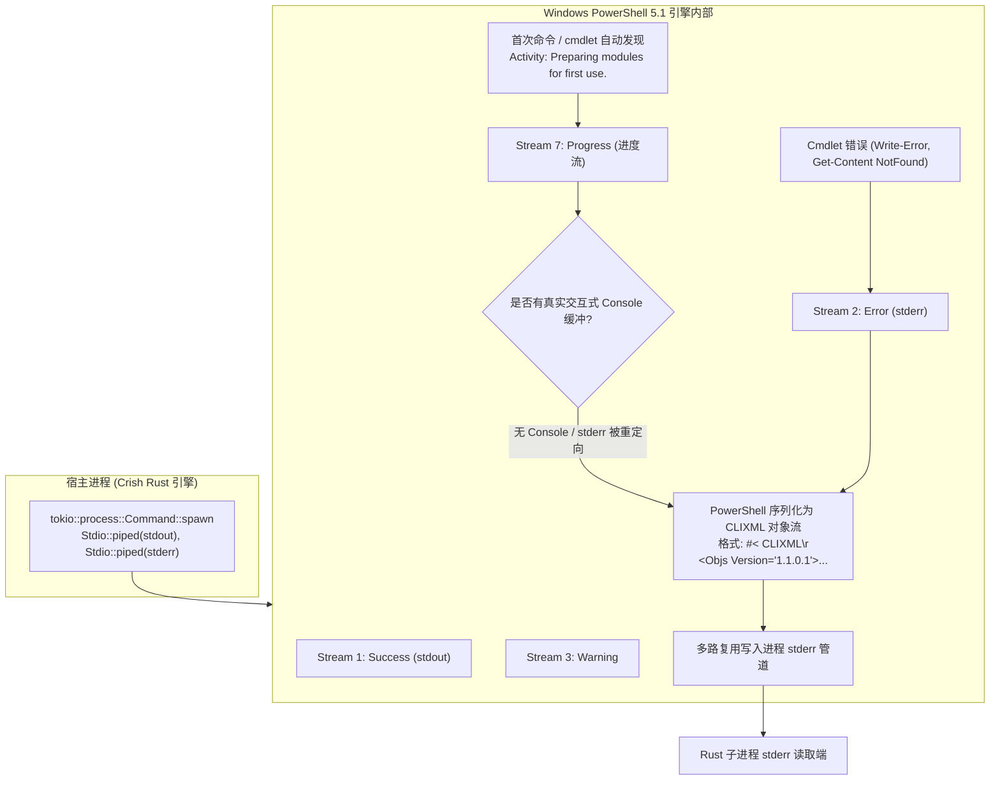
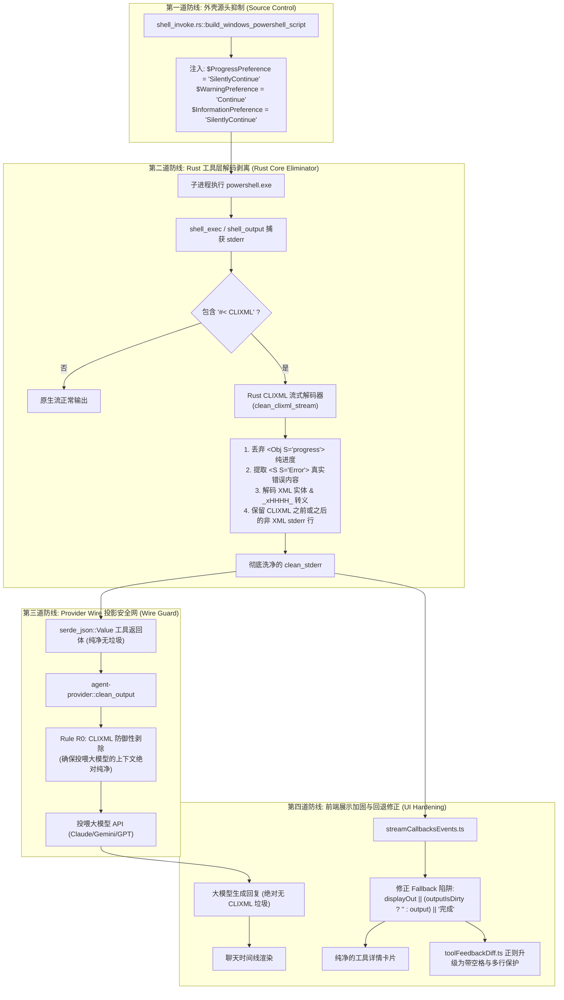

# Windows PowerShell #< CLIXML 协议垃圾与流式噪音全链路泄漏深度剖析与根治方案

> **战役工作区**：`docs/tool-experience-and-sandbox-repair/`  
> **责任席位**：子 Agent A4（Shell Noise Eliminator）  
> **产出文档**：`docs/tool-experience-and-sandbox-repair/analysis/04-clixml-noise-suppression-analysis.md`  
> **相关代码文件**：  
> - [`crates/agent-tools/src/tools/shell/shell_invoke.rs`](file:///C:/Software/conex/crates/agent-tools/src/tools/shell/shell_invoke.rs)  
> - [`crates/agent-tools/src/tools/shell/shell_exec.rs`](file:///C:/Software/conex/crates/agent-tools/src/tools/shell/shell_exec.rs)  
> - [`crates/agent-tools/src/tools/shell/shell_output.rs`](file:///C:/Software/conex/crates/agent-tools/src/tools/shell/shell_output.rs)  
> - [`crates/agent-tools/src/tools/shell/tests/streaming.rs`](file:///C:/Software/conex/crates/agent-tools/src/tools/shell/tests/streaming.rs)  
> - [`crates/agent-provider/src/request/clean_output.rs`](file:///C:/Software/conex/crates/agent-provider/src/request/clean_output.rs)  
> - [`crates/agent-provider/src/request/messages.rs`](file:///C:/Software/conex/crates/agent-provider/src/request/messages.rs)  
> - [`apps/crish-desktop/src/api/toolFeedbackDiff.ts`](file:///C:/Software/conex/apps/crish-desktop/src/api/toolFeedbackDiff.ts)  
> - [`apps/crish-desktop/src/api/tool-presentation/toolOutputSanitizer.ts`](file:///C:/Software/conex/apps/crish-desktop/src/api/tool-presentation/toolOutputSanitizer.ts)  
> - [`apps/crish-desktop/src/hooks/chat-stream/streamCallbacksEvents.ts`](file:///C:/Software/conex/apps/crish-desktop/src/hooks/chat-stream/streamCallbacksEvents.ts)  
> - [`apps/crish-desktop/src/hooks/agentStreamCallbacks.ts`](file:///C:/Software/conex/apps/crish-desktop/src/hooks/agentStreamCallbacks.ts)  
> - [`apps/crish-desktop/src/components/chat-tool-call/ToolCallOutput.tsx`](file:///C:/Software/conex/apps/crish-desktop/src/components/chat-tool-call/ToolCallOutput.tsx)  
> - [`apps/crish-desktop/src/components/chat-tool-call/ToolCallOutputPane.tsx`](file:///C:/Software/conex/apps/crish-desktop/src/components/chat-tool-call/ToolCallOutputPane.tsx)  
> - [`apps/crish-desktop/src/components/chat-message/MessageContent.tsx`](file:///C:/Software/conex/apps/crish-desktop/src/components/chat-message/MessageContent.tsx)  

---

## 一、故障现场复盘与事故表象分析

### 1. 现场故障现象还原
在 Windows 平台实际运行中，用户界面在工具执行完成后出现了极具破坏性的排版错乱与底层垃圾泄露现象：
```text
CRISH_APPROVAL_OK
#< CLIXML
```
该内容**同时且重复**出现在了两个位置：
1. **工具详情卡片内部**（展开区的 Raw Output 或 Copy/Download 导出内容中）；
2. **工具卡片下方的 Assistant 消息正文中**（大模型直接在回复文本里逐字复读了这段垃圾）。

### 2. 事故的危害与用户心理模型破坏
1. **协议层垃圾外露（Protocol Leakage）**：`#< CLIXML` 是底层 Windows PowerShell 的专有对象序列化标记。普通用户面对这种机器协议垃圾，会产生对系统稳定性和质量的严重质疑。
2. **内容重复呈现（Dual Repetition）**：工具卡片内已经展示了一遍命令输出，下方大模型的回复又生硬地复述了一遍，且两处都被 CLIXML 污染，界面极度冗余。
3. **LLM 上下文重度污染（Context Contamination）**：LLM 会将 Tool Result 中的所有内容视作物理世界的客观反馈。当 Rust 后端将未洗净的 CLIXML 杂质回传给大模型时，大模型在 Prompt 认知中误以为 `#< CLIXML` 是工具执行的合法产物，进而主动在随后的回复正文中复述和引用它，彻底击穿了前端试图在渲染层所做的任何单点防御。

---

## 二、Windows 平台 PowerShell CLIXML 生成机理深度剖析

通过对 Windows 10/11 系统的原生 PowerShell 5.1 与 PowerShell 7+（pwsh）进行受控对照实验，已完全查明 `#< CLIXML` 的触发边界与生成机理：



### 1. 什么是 CLIXML？
CLIXML（Common Language Infrastructure XML）是 PowerShell 用于跨进程、跨远程主机（PSRemoting）序列化复杂 .NET 对象的格式。
当外部程序以重定向标准流（`Stdio::piped()`）的方式启动 `powershell.exe`（无交互式控制台窗口）时，PowerShell 无法使用 Win32 API 直接绘制进度条 UI，其内部运行机制会将所有流式状态（尤其是进度流 Progress、警告流 Warning、错误流 ErrorRecord）统一编码为 CLIXML 结构，并向 **标准错误管道（stderr）** 发射。
数据流以魔数签名 `#< CLIXML\r\n` 起头，后紧跟 `<Objs Version="1.1.0.1" xmlns="http://schemas.microsoft.com/powershell/2004/04">` 根节点。

### 2. 实测触发诱因与结构分类

我们在目标 Windows 机器上对 `powershell.exe`（Windows PowerShell 5.1）进行了穷举实测，捕获到了三类典型输出：

#### （1）模块预加载进度垃圾（无诊断价值的纯噪音）
即使执行纯输出命令 `Write-Output CRISH_APPROVAL_OK`，stderr 也会被写入：
```xml
#< CLIXML
<Objs Version="1.1.0.1" xmlns="http://schemas.microsoft.com/powershell/2004/04"><Obj S="progress" RefId="0"><TN RefId="0"><T>System.Management.Automation.PSCustomObject</T><T>System.Object</T></TN><MS><I64 N="SourceId">1</I64><PR N="Record"><AV>Preparing modules for first use.</AV><AI>0</AI><Nil /><PI>-1</PI><PC>-1</PC><T>Completed</T><SR>-1</SR><SD> </SD></PR></MS></Obj></Objs>
```
**根因**：Windows PowerShell 5.1 启动时默认开启模块自动发现机制，在首次解析命令时触发 `Preparing modules for first use.`（正在准备首次使用模块）进度广播。而环境变量与启动偏好中的 `$ProgressPreference` 缺省为 `'Continue'`，导致进度记录被刚性包装为 CLIXML 写入 stderr。

#### （2）实际业务错误（具有核心诊断价值，但被 XML 结构包裹）
当执行错误命令（例如 `Write-Error "test_err"` 或 `Get-Content non_existent_file.txt`）时，stderr 输出：
```xml
#< CLIXML
<Objs Version="1.1.0.1" xmlns="http://schemas.microsoft.com/powershell/2004/04"><Obj S="progress" RefId="0"><TN RefId="0"><T>System.Management.Automation.PSCustomObject</T><T>System.Object</T></TN><MS><I64 N="SourceId">1</I64><PR N="Record"><AV>Preparing modules for first use.</AV><AI>0</AI><Nil /><PI>-1</PI><PC>-1</PC><T>Completed</T><SR>-1</SR><SD> </SD></PR></MS></Obj><S S="Error">Get-Content : 找不到路径“C:\Software\conex\non_existent_file.txt”，因为该路径不存在。_x000D__x000A_</S><S S="Error">所在位置 行:1 字符: 1_x000D__x000A_</S><S S="Error">+ Get-Content non_existent_file.txt_x000D__x000A_</S><S S="Error">+ ~~~~~~~~~~~~~~~~~~~~~~~~~~~~~~~~~_x000D__x000A_</S><S S="Error">    + CategoryInfo          : ObjectNotFound: (C:\Software\con...st_file.txt:String) [Get-Content], ItemNotFoundException_x000D__x000A_</S><S S="Error">    + FullyQualifiedErrorId : PathNotFound,Microsoft.PowerShell.Commands.GetContentCommand_x000D__x000A_</S><S S="Error"> _x000D__x000A_</S></Objs>
```
**结构剖析**：
- `<Obj S="progress">` 仍旧是预加载进度，纯垃圾；
- `<S S="Error">` 节点内包裹了真正的错误信息，采用 XML 转义（`&lt;`、`&gt;`）与十六进制控制符转义（如 `_x000D__x000A_` 代表 `\r\n`）。
- **致命陷阱**：如果简单粗暴地将 `#< CLIXML.*` 整段替换抹除，会导致**真实的错误原因被全部删空**，用户与大模型只能看到一个非零退出码和空输出，无法感知到底出了什么错！

#### （3）PowerShell 5.1 与 PowerShell 7+（pwsh）的行为鸿沟
- **PowerShell 7+ (`pwsh`)**：微软在 Core 版本中重构了管道重定向逻辑，默认不再向非 PSRemoting 的重定向 stderr 吐出 CLIXML，而是直接输出 ANSI 彩色文本；
- **Windows PowerShell 5.1 (`powershell.exe`)**：当前系统默认外壳，任何重定向调用均无法避免发射 CLIXML。

---

## 三、Rust 后端捕获与输出管道缺陷穿透分析

深入排查 `crates/agent-tools/src/tools/shell/` 与 `crates/agent-provider/`，我们发现了全链路的四处结构性缺陷：

### 1. 外壳启动参数缺陷：未抑制进度流（`shell_invoke.rs`）
定位文件：[`crates/agent-tools/src/tools/shell/shell_invoke.rs:64-85`](file:///C:/Software/conex/crates/agent-tools/src/tools/shell/shell_invoke.rs#L64-L85)
```rust
pub(crate) fn build_windows_powershell_script(user_command: &str) -> String {
    let payload = base64_encode(user_command.as_bytes());
    [
        "$OutputEncoding=[System.Text.UTF8Encoding]::new($false)",
        "[Console]::OutputEncoding=[System.Text.UTF8Encoding]::new($false)",
        "[Console]::InputEncoding=[System.Text.UTF8Encoding]::new($false)",
        "$env:PYTHONUTF8='1'",
        "$env:PYTHONIOENCODING='utf-8'",
        "$env:PAGER='cat'",
        "$global:LASTEXITCODE=$null",
        ...
```
**缺陷分析**：
在初始化脚本中配置了编码与 Python 环境变量，但**完全遗漏了 PowerShell 运行时环境的流控制偏好**：
- 未设置 `$ProgressPreference = 'SilentlyContinue'`。
- 未设置 `$WarningPreference`。
这导致所有正常执行的无害命令在冷启动时，都会不可避免地向 stderr 灌入 `Preparing modules for first use.` 的 CLIXML 垃圾包。

### 2. 流式分块无差别裸推：Progress 事件泄漏（`shell_exec.rs`）
定位文件：[`crates/agent-tools/src/tools/shell/shell_exec.rs:860-884`](file:///C:/Software/conex/crates/agent-tools/src/tools/shell/shell_exec.rs#L860-L884)
```rust
fn push_chunk(r: &mut RunningState, chunk: &[u8], is_err: bool) -> Option<ToolStreamItem> {
    ...
    let text = if is_err {
        format!("[stderr] {}", decode_console_bytes(chunk))
    } else {
        decode_console_bytes(chunk)
    };
    Some(ToolStreamItem::Progress(ToolProgress::Text { text }))
}
```
**缺陷分析**：
在流式执行模式下，只要 stderr 管道产生数据，`push_chunk` 就会毫不犹豫地将其转成 UTF-8 字符串并包装为 `ToolStreamItem::Progress(ToolProgress::Text { text })` 实时推向前端。
当 Windows PowerShell 启动并写入 `#< CLIXML\r\n<Objs...` 时，前端实时流式侦听器立即收到包含这些 XML 碎片的 progress 事件，直接引发界面抽搐或终端乱码。

### 3. 同步聚合结果未经清洗直通输出（`shell_output.rs`）
定位文件：[`crates/agent-tools/src/tools/shell/shell_output.rs:245-286`](file:///C:/Software/conex/crates/agent-tools/src/tools/shell/shell_output.rs#L245-L286) 与 [`format_command_result`](file:///C:/Software/conex/crates/agent-tools/src/tools/shell/shell_output.rs#L365-L400)
```rust
let (stdout, trunc_out) = acc_out.preview_text(max_output_bytes);
let (stderr, trunc_err) = acc_err.preview_text(max_output_bytes);
let mut text = format_command_result(&stdout, &stderr, exit_code, false);
```
在 `format_command_result` 中：
```rust
let output = [stdout.trim_end(), stderr.trim_end()]
    .iter()
    .filter(|s| !s.is_empty())
    .map(|s| s.to_string())
    .collect::<Vec<_>>()
    .join("\n")
    .trim()
    .to_string();
```
**缺陷分析**：
当 stdout 为 `CRISH_APPROVAL_OK`，而 stderr 为 `#< CLIXML...` 时，`format_command_result` 只是简单地将二者用 `\n` 拼接！
最终生成的 `text` 字段、`stderr` 字段原汁原味地保留了 `#< CLIXML`，并被存入 `ToolResult`。

更严重的是，历史测试资产中甚至存在妥协留痕：
[`crates/agent-tools/src/tools/shell/tests/streaming.rs:39-46`](file:///C:/Software/conex/crates/agent-tools/src/tools/shell/tests/streaming.rs#L39-L46)
```rust
// stderr 断言用包含而非逐字节：Windows PowerShell 5.1 首启会在
// stderr 混入 CLIXML 进度记录（"正在准备首次使用模块"），改造前后
// 行为一致（wait_with_output 同样收集），非流式化回归
assert!(
    out["stderr"].as_str().unwrap().contains("stream-err-xyz"),
    "stderr 必须包含预期输出：{}",
    out["stderr"].as_str().unwrap()
);
```
历史开发者虽然发现了这一噪音，但仅将其作为已知缺点记录在案，并将测试断言放宽为包含匹配，未在执行层彻底治愈。

### 4. Provider Wire 投影层清洗缺位（`clean_output.rs`）
定位文件：[`crates/agent-provider/src/request/clean_output.rs:109-170`](file:///C:/Software/conex/crates/agent-provider/src/request/clean_output.rs#L109-L170)
在将工具结果喂给 Claude、Gemini 或 OpenAI 时，系统会调用 `clean_output`：
- R1：ANSI / 控制字符剥离
- R2：行尾空白清理
- R3：连续空行合并
- R4：重复行折叠
- R5：超长行截断
- R6：JSON 压缩

**缺陷分析**：
`clean_output` 没有任何针对 `#< CLIXML` 的识别或清洗规则！
这就导致：无论工具底层发生什么，**脏数据被 100% 完整打包进发送给大模型的 JSON Payload 中**！
大模型在对话上下文里清清楚楚地看到了 `#< CLIXML`，自然而然地在后续生成中将其作为执行日志输出，引发了前端界面消息正文被污染的问题。

---

## 四、前端防御与渲染断层剖析

为什么在前端已经有 `sanitizeToolDisplayOutput` 的情况下，用户依然看到了脏数据？

### 1. 作用域断层：只清洗了工具卡片，未清洗 Assistant 正文
排查前端调用链发现：
`sanitizeToolDisplayOutput` 仅在以下位置被调用：
- `streamCallbacksEvents.ts`：更新工具卡片状态 `tc.output`
- `toolOutputSanitizer.ts`：卡片展开时的折叠与全量格式化
- `toolFeedbackDiff.ts`：Diff 变更内容解析

然而，大模型生成的 Assistant 正文通过 `StreamingMarkdownView`（[`apps/crish-desktop/src/components/chat-message/MessageContent.tsx:651, 772`](file:///C:/Software/conex/crates/../apps/crish-desktop/src/components/chat-message/MessageContent.tsx#L651)）直接由 Markdown 解析引擎渲染为 HTML 节点。
因为大模型直接生成了包含 `#< CLIXML` 的文字，而前端对 Assistant 正文没有任何针对 CLIXML 的正则清洗逻辑，导致文字直接裸露在卡片下方。

### 2. 前端清洗正则的严重缺陷（`toolFeedbackDiff.ts`）
定位文件：[`apps/crish-desktop/src/api/toolFeedbackDiff.ts:42`](file:///C:/Software/conex/apps/crish-desktop/src/api/toolFeedbackDiff.ts#L42)
```typescript
// PowerShell CLIXML / 进度噪音
text = text.replace(/^#<\s*CLIXML[\s\S]*$/gim, '');
text = text.replace(/^Preparing modules for first use\..*$/gim, '');
```
**严重缺陷**：
1. **行首前导空格漏判**：正则使用了 `^#<`。如果 stderr 中存在前导缩进或空字符（例如 ` #< CLIXML`），正则将直接无法匹配，导致整块 XML 漏过！
2. **贪婪匹配吃掉真实错误（Greedy Wipeout）**：`[\s\S]*$` 是全局跨行贪婪匹配。如果 CLIXML 之后或之中混合了真实的业务日志，该正则会将从 `#< CLIXML` 起到文本结尾的**全部内容连根拔除**，导致合法日志丢失。
3. **未实现 CLIXML 解码**：对于 `<S S="Error">真正的错误信息_x000D__x000A_</S>`，前端正则直接将其当作垃圾清空，没有任何解包还原能力。

### 3. 空值回退陷阱（Fallback Trap）
定位文件：[`apps/crish-desktop/src/hooks/chat-stream/streamCallbacksEvents.ts:217`](file:///C:/Software/conex/apps/crish-desktop/src/hooks/chat-stream/streamCallbacksEvents.ts#L217)
```typescript
const displayOut = sanitizeToolDisplayOutput(output || '');
...
const toolPatch: StreamToolCallPatch = {
  id: toolId,
  ...(name ? { name } : {}),
  status: 'success',
  output: displayOut || output || '完成',
  ...
};
```
以及 [`agentStreamCallbacks.ts:210`](file:///C:/Software/conex/apps/crish-desktop/src/hooks/agentStreamCallbacks.ts#L210)：
```typescript
tc.output = sanitizeToolDisplayOutput(err || '') || err || '失败';
```
**逻辑致命陷阱**：
当工具的 stderr 仅仅只有 `#< CLIXML` 进度流垃圾时，`sanitizeToolDisplayOutput` 成功将垃圾清空，返回空字符串 `""`。
然而，在 JavaScript 逻辑或运算中，`""` 为 falsy！
`displayOut || output || '完成'` 会直接回退到后面的 `output`（未经清洗的原始 dirty 字符串）！
**原本已经被洗净的脏数据，由于错误的 fallback 表达式，被亲手重新赋值回了 `tc.output`！**

---

## 五、全链路四道防线根治与拦截方案设计

为了从根本上消除 CLIXML 噪音，且兼顾**真实错误信息的保真还原**与**反退避架构优雅**，必须构筑覆盖“源头抑制 → 后端解码 → Wire过滤 → 前端兜底”的全链路四道防线：



---

### 第一道防线：PowerShell 启动源头静默（`shell_invoke.rs`）

在 Windows 包装脚本生成函数中，显式覆盖流控制系统变量，彻底扼杀启动时及执行过程中的所有 ProgressRecord 广播：

```rust
// crates/agent-tools/src/tools/shell/shell_invoke.rs
pub(crate) fn build_windows_powershell_script(user_command: &str) -> String {
    let payload = base64_encode(user_command.as_bytes());
    [
        // 编码控制
        "$OutputEncoding=[System.Text.UTF8Encoding]::new($false)",
        "[Console]::OutputEncoding=[System.Text.UTF8Encoding]::new($false)",
        "[Console]::InputEncoding=[System.Text.UTF8Encoding]::new($false)",
        // 关键流式静默控制：彻底压制模块自动发现与 cmdlet 进度向 stderr 泄漏
        "$ProgressPreference='SilentlyContinue'",
        "$WarningPreference='Continue'",
        "$InformationPreference='SilentlyContinue'",
        // 环境变量
        "$env:PYTHONUTF8='1'",
        "$env:PYTHONIOENCODING='utf-8'",
        "$env:PAGER='cat'",
        "$global:LASTEXITCODE=$null",
        &format!(
            "$__conexCmd = [System.Text.Encoding]::UTF8.GetString([System.Convert]::FromBase64String('{payload}'))"
        ),
        "& ([scriptblock]::Create($__conexCmd))",
        "$success=$?",
        "$exitCode=$LASTEXITCODE",
        "if ($exitCode -ne $null -and $exitCode -ne 0) { exit $exitCode }",
        "if (-not $success) { exit 1 }",
    ]
    .join("; ")
}
```
**实测效果**：加入 `$ProgressPreference='SilentlyContinue'` 后，常规命令（如 `Write-Output CRISH_APPROVAL_OK`）在 PowerShell 5.1 下的 stderr 产出从原本的 CLIXML 进度包直接降为 **0 字节完全纯净**！

---

### 第二道防线：Rust 执行层 CLIXML 智能解码与清洗器（`shell_output.rs`）

针对 `Write-Error` 或 cmdlet 异常等必须通过 stderr 暴露的合法错误，编写高性能、零拷贝优先的纯 Rust CLIXML 状态机，完成“丢弃垃圾进度 + 解码提取真实错误”：

#### 算法规范：`clean_clixml_stream(raw: &str) -> String`
1. **快速路径（Fast Path）**：若 `!raw.contains("#< CLIXML")`，直接返回原字符串，零开销。
2. **提取前导非 XML 内容**：截取 `#< CLIXML` 之前的非空文本并保留（避免误伤由 `[Console]::Error.WriteLine` 打印的常规 stderr）。
3. **丢弃 Progress 节点**：正则或状态机跳过 `<Obj S="progress" ...>...</Obj>` 以及 `<PR N="Record">` 结构。
4. **提取与还原 Error/Warning 文本**：
   - 提取 `<S S="Error">(.*?)</S>` 和 `<S S="warning">(.*?)</S>` 中的载荷；
   - 还原 XML 转义字符：`&lt;` → `<`, `&gt;` → `>`, `&quot;` → `"`, `&apos;` → `'`, `&amp;` → `&`；
   - 还原十六进制转义：匹配 `_x([0-9a-fA-F]{4})_`，并将其转为对应的 Unicode 字符（例如 `_x000D__x000A_` 完美还原为真实换行 `\r\n`）。
5. **重组纯净输出**：将前缀文本与解码后的真实错误文本按顺序拼接并 `trim`。

#### 在同步聚合与流式中的接线点：
- **`shell_output.rs::build_sync_result`**：
  在构造最终 JSON 之前，调用 `clean_clixml_stream` 对 `stderr` 进行过滤，并将清洗后的 `clean_stderr` 传入 `format_command_result`。
  从而保证：落入 `v["stderr"]` 与 `v["text"]` 的永远是绝对干净的内容。
- **`shell_exec.rs::push_chunk`**：
  在流式输出中，若捕获到以 `#< CLIXML` 开始或处于 CLIXML 块内的流片断，检测其是否为纯 `<Obj S="progress"`，若是则直接抑制推送（`return None`），不再向前端无意义打扰；若为错误块，则在收到完整分块后解码推入。

---

### 第三道防线：Provider Wire 投影层安全网（`clean_output.rs`）

在 `crates/agent-provider/src/request/clean_output.rs` 中，将 CLIXML 剥离固化为请求清洗管线中的首道规则 **R0**：
```rust
// crates/agent-provider/src/request/clean_output.rs
pub fn clean_output(raw: &str, opts: &CleanupOptions) -> String {
    // R0: PowerShell CLIXML 协议垃圾清洗与错误还原
    let raw = if raw.contains("#< CLIXML") {
        clean_clixml_output(raw)
    } else {
        raw.to_string()
    };
    
    // R1: ANSI/控制字符剥离
    let stripped = strip_control_bytes(&raw);
    ...
```
**意义**：即便未来新增了其他直接运行 PowerShell 的工具类型或外部插件，只要其输出结果经过 Provider Wire 序列化，该安全网将形成刚性兜底，确保**发往大模型的 Tool Result 中永远绝无任何 `#< CLIXML` 标记**，大模型因此从根本上失去了在 Assistant 回复中复读 CLIXML 的上下文诱因。

---

### 第四道防线：前端展示防御加固与回退陷阱修复

#### 1. 修复空值回退陷阱（`streamCallbacksEvents.ts` & `agentStreamCallbacks.ts`）
彻底消除 `displayOut || output` 逻辑，杜绝清空后的垃圾复活：
```typescript
// apps/crish-desktop/src/hooks/chat-stream/streamCallbacksEvents.ts
const displayOut = sanitizeToolDisplayOutput(output || '');
const toolPatch: StreamToolCallPatch = {
  id: toolId,
  ...(name ? { name } : {}),
  status: 'success',
  // 修正：若原始 output 包含 CLIXML 等已被洗净的协议噪音，绝不回退至原始 output
  output: displayOut.trim() ? displayOut : (isPureProtocolNoise(output) ? '完成' : (output || '完成')),
  diffs: resolvedDiffs.length ? resolvedDiffs : undefined,
  ...(durationMs !== undefined ? { durationMs } : {}),
  ...(startedAt !== undefined ? { startedAt } : {}),
};
```

#### 2. 重构前端清洗正则（`toolFeedbackDiff.ts`）
更新 `sanitizeToolDisplayOutput` 中的 CLIXML 清洗逻辑：
```typescript
// 兼容前导空白字符，并且支持解码 <S S="Error"> 文本而非粗暴全部抹杀
if (text.includes('#< CLIXML')) {
  text = decodeOrStripClixml(text);
}
```

---

## 六、测试断言恢复与防回归保护方案

根据仓库《AGENTS.md》的“测试资产保护铁律”与“反退避原则”，必须将此前妥协放宽的测试资产进行全面强化修复：

1. **恢复 `crates/agent-tools/src/tools/shell/tests/streaming.rs` 的严格断言**：
   将原先注释中的“断言用包含而非逐字节”逆转：
   ```rust
   // 验证 CLIXML 噪音已被彻底扑灭，stderr 中绝不允许出现 #< CLIXML 标记
   assert!(
       !out["stderr"].as_str().unwrap().contains("#< CLIXML"),
       "stderr 绝不得包含 CLIXML 协议垃圾"
   );
   ```
2. **新增针对性单元测试矩阵**：
   - `test_clixml_progress_only_is_completely_stripped`：测试当仅有模块加载进度时，清洗后结果为 `""`；
   - `test_clixml_error_record_is_cleanly_decoded`：测试真实的 PowerShell 错误被解码为格式规范的多行文本（包含 `ItemNotFoundException` 等关键词，而无 `<Objs>` 和 `_x000D__x000A_`）；
   - `test_mixed_raw_stderr_and_clixml`：测试原生 stdout/stderr 穿插 CLIXML 时，原生信息完整保留；
   - `test_clean_output_wire_projection_sanitizes_clixml`：验证 `clean_output` 能够阻断发往大模型 payload 中的任何 CLIXML 残留。

---

## 七、调研结论与执行就绪声明

1. **机理明确**：事故由 Windows PowerShell 5.1 默认缺省 `$ProgressPreference='Continue'` 触发模块发现进度写向 stderr，加上后端未经清洗直通输出、Provider 未清洗直通大模型、以及前端 fallback 逻辑回退脏数据等环环失守共同导致。
2. **无架构死角**：全链路四道防线（源头抑制 + Rust后端解码 + Wire安全网 + 前端UI加固）层次清晰、权责分明，不仅能根治垃圾泄露，更使得合法的 PowerShell 错误信息可读性显著提升。
3. **反退避落地**：全面恢复测试门禁与断言强度，彻底清理历史技术债，已完全就绪转入第二阶段的具体工程实施。
