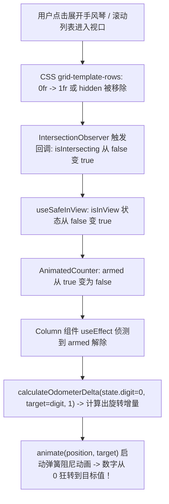
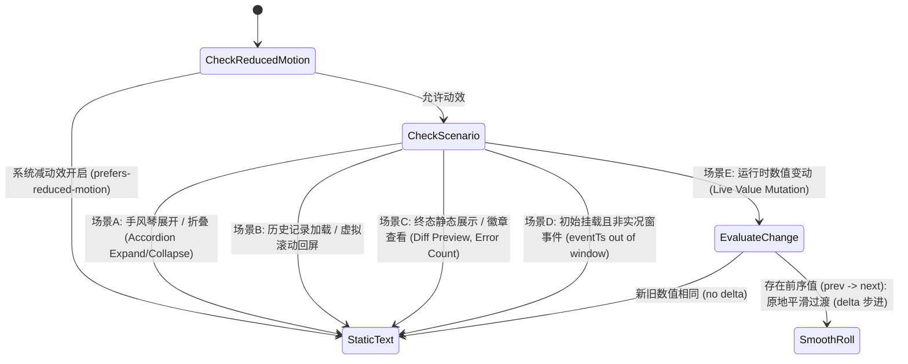

# NumericText 数字滚动乱触发与体验优化深度分析报告

> 战役工作区：`docs/tool-experience-and-sandbox-repair/`  
> 责任席位：子 Agent A6（Motion Interaction Auditor）  
> 调研目标：彻底排查 `NumericText` / `AnimatedCounter` 在手风琴展开、页面初次挂载、虚拟滚动与终态落定时乱转一圈的体验断层，穿透状态初始化与视口监听机制缺陷，提出优雅克制的动效门控与平滑过渡架构方案。

---

## 一、用户诉求穿透与乱转现象现场复现

用户在实际使用中明确指出了该交互体验的严重违和感：
> **“还有就是这个数字的滚动效果我看乱加了，每次打开这种展开界面，这个数字都得转一圈，非常影响使用体验。”**

### 1.1 乱转问题四类高频复现场景

在桌面端实际操作中，数字无故空转（“像老虎机一样从 0 狂转到目标数字”）高发于以下四类日常交互场景：

1. **场景一：展开折叠过程栏（FoldableProcessSection）**
   - 用户点击过程栏右侧的折叠箭头展开详细执行步骤；
   - 控制栏左侧的时间文案（如 `已完成 12.5 秒`）瞬间将 `12.5` 拆成各个数位，从 `0` 像滚轮一样旋转到 `12.5`；
   - 每次折叠后再展开，甚至在内部子任务状态推进导致父级重渲染时，该数字都要重新空转一次。
2. **场景二：展开聚合工具组（FoldableToolGroup）**
   - 用户点击聚合工具组（如 `批处理 4 个工具`）展开查看详情；
   - 组头文案中的 `4` 以及右侧错误徽章里的 `1`（`1 个错误`）重新旋转一圈，造成明显的视觉跳动与认知干扰。
3. **场景三：展开单工具卡片并浏览差异（CompactToolRow & ToolCallDiffPreview）**
   - 用户点击某个工具调用查看具体结果，工具体通过手风琴展开；
   - 嵌入式差异卡片（`ToolCallDiffPreview`）内的修改统计 `+42` 和 `-18`，在展开瞬间每一位数字都在高速旋转，打乱用户想要立即看清改动量级的心理预期。
4. **场景四：会话恢复、消息滚动与虚拟列表回屏（VSM Recycled Rows）**
   - 打开已有历史会话，或向上滚动聊天记录时；
   - 凡是进入可视区域的卡片，所有数字（耗时、Token 数、匹配行数、差异行数）集体触发从 0 到终值的旋转动画，界面如同跑马灯。

### 1.2 动效认知模型冲突：历史静态事实 vs 实时动态流变

| 维度 | 用户认知心理模型 | 现行 NumericText 实际行为 | 体验断层 |
|---|---|---|---|
| **展开卡片 / 查看详情** | “卡片已经执行完成，我正在查阅一份静态报告，数字是既成事实。” | 视为新元素进场，强行把数字归零并播放 0.4s 的阻尼滚轮入场动画。 | **严重违和**：如同打开一份旧报纸，报纸上的数字突然在你眼前从 0 翻牌转动。 |
| **会话历史加载** | “我在翻看过去的记录。” | 视口一旦捕获，全部卡片数字重新旋转。 | **视觉噪音**：界面充满无意义的抖动，掩盖了真正重要的信息。 |
| **真实数值变动（如增量更新）** | “数值从旧值（5）更新到了新值（6）。” | 如果没有良好缓存，可能直接重刷或因 key 漂移导致重新归零起跑。 | **信息失真**：本应体现 +1 的微变，却表现为全盘重置。 |

---

## 二、底层原理与乱转根因逐行穿透（Code-Level Root Causes）

排查涉及的核心调用链与源码路径：
- `apps/crish-desktop/src/components/ui/AnimatedCounter/NumericText.tsx`
- `apps/crish-desktop/src/components/ui/AnimatedCounter/AnimatedCounter.tsx`
- `apps/crish-desktop/src/components/ui/AnimatedCounter/animatedCounterMath.ts`
- `apps/crish-desktop/src/components/chat-tool-call/ToolNumericText.tsx`
- `apps/crish-desktop/src/components/chat-tool-call/toolRevealState.ts`
- `apps/crish-desktop/src/components/chat-message/FoldableProcessSection.tsx`
- `apps/crish-desktop/src/components/chat-tool-call/FoldableToolGroup.tsx`
- `apps/crish-desktop/src/components/chat-tool-call/ToolCallHeader.tsx`
- `apps/crish-desktop/src/components/chat-tool-call/ToolCallDiffPreview.tsx`



### 2.1 根因一：`NumericText` 将入场滚轮默认置为开启（`animateOnView = true`）

查看 `apps/crish-desktop/src/components/ui/AnimatedCounter/NumericText.tsx:68-72`：
```typescript
export interface NumericTextProps {
  /** 已格式化好的整句文案（如 `24 项`、`+32`、`已搜索 2 次`、`1.2s`） */
  text: string;
  /** 首次挂载是否从 0 滚到目标值（实况到达用；历史内容直出终值） */
  animateOnView?: boolean;
  className?: string;
}

export const NumericText: React.FC<NumericTextProps> = ({
  text,
  animateOnView = true, // ⚠️ 致命缺陷点：默认值被硬编码为 true！
  className,
}) => {
```
而在底层原生数字组件 `AnimatedCounter.tsx:189-196` 中：
```typescript
export const AnimatedCounter: React.FC<AnimatedCounterProps> = ({
  value,
  // ...
  animateOnView = false, // 原生 AnimatedCounter 默认是非常克制的 false
  // ...
}) => {
```
**断层剖析**：
`AnimatedCounter` 自身的设计本是非常审慎的（默认 `animateOnView = false`，仅作为受控的数值变换组件）。然而在上层包装的 `NumericText` 中，开发者为了追求“生动的入场视觉效果”，**擅自将 `animateOnView` 的缺省值反转为 `true`**！
由于整个应用的上层业务（`FoldableProcessSection`、`FoldableToolGroup`、`ToolCallHeader`、`ToolCallDiffPreview` 等）几乎全部直接写 `<NumericText text="..." />`，导致全站所有包含数字的文本片段，**默认全部被强加了“入场必须从 0 滚到终值”的重型动效**！

---

### 2.2 根因二：`AnimatedCounter` 的 Armed 预备机制与 IntersectionObserver 滞后性

查看 `apps/crish-desktop/src/components/ui/AnimatedCounter/AnimatedCounter.tsx:202-222`：
```typescript
const ref = useRef<HTMLSpanElement>(null);
const inView = useSafeInView(ref, { once: true, amount: 0.1 });
// ...
const armed = animateOnView && !inView;
```
再看内部 `Column` 单列滚轮组件的处理逻辑（`AnimatedCounter.tsx:132-171`）：
```typescript
function Column({
  digit,
  direction,
  armed,
  delay,
  reduceMotion,
  enableOdometer,
}: { ... }) {
  // ⚠️ 第 0 帧初始化：若 armed 为 true，则 position 和 state.digit 被强行初始化为 0！
  const position = useMotionValue(armed ? 0 : digit);
  const wheel = useRef({
    digit: armed ? 0 : digit,
    target: armed ? 0 : digit,
    revealed: !armed,
  });

  useEffect(() => {
    const state = wheel.current;
    if (armed || state.digit === digit) {
      if (!armed) state.revealed = true;
      return;
    }

    // ⚠️ 一旦 armed 变为 false，而之前 state.digit 被设为了 0：
    // calculateOdometerDelta 会计算从 0 到目标 digit 的全量步进！
    const delta = calculateOdometerDelta(
      state.digit,
      digit,
      direction < 0 && state.revealed ? -1 : 1
    );

    state.target += delta;
    state.digit = digit;

    const controls = animate(position, state.target, {
      ...SPRING_SMOOTH,
      delay: state.revealed ? 0 : delay,
    });
    state.revealed = true;
    return () => controls.stop();
  }, [armed, delay, digit, direction, position, reduceMotion, enableOdometer]);
```

**为什么在手风琴折叠展开时必然发生乱转？**
1. **折叠态的几何隐匿**：
   在 CSS Grid 折叠（`grid-template-rows: 0fr`）或带有 `hidden="until-found"` 的折叠容器中，折叠内部的子元素尺寸被压缩为 0，或者根本脱离视口。
2. **`useSafeInView` 状态为 false**：
   由于高度为 0，浏览器的 `IntersectionObserver` 判定目标元素未与视口相交（`isIntersecting: false`），所以 `inView` 为 `false`。
3. **`armed` 锁定为 true**：
   由于 `animateOnView = true`，且 `!inView = true`，导致 `armed = true`。
   滚轮的内部状态 `wheel.current` 此时被死死钉在 `0`：
   `digit: 0, target: 0, revealed: false`。
4. **用户点击展开手风琴**：
   容器高度过渡至 1fr，元素进入视口，`IntersectionObserver` 派发回调：
   `inView` 变为 `true`，进而使得 `armed` 变为 `false`。
5. **重渲染触发 0 -> Target 旋转**：
   `Column` 的 `useEffect` 侦测到 `armed` 变为 `false`，但此时 `state.digit` 依然是预备时的 `0`，而目标数字是实际数据（如 `5`、`9`、`2` 等）。
   `if (armed || state.digit === digit)` 条件不满足！
   它立刻执行 `calculateOdometerDelta(0, digit, 1)`，并启动 `animate(...)`！
   **结果：展开界面的每一个数位，都会在展开完成后整齐划一地从 0 转到各自的值！**

---

### 2.3 根因三：`ToolNumericText` 的实况门控彻底悬空失效（Dead Code 事故）

在架构设计初衷中，工具行内的数字滚动本来规划了严格的“实况到达时间窗门控”（见其文件头注释）：
> “门控与入场同口径（toolRevealState）：事件时间戳落在实况窗内才算「刚发生」→ 首次挂载从 0 滚到目标值；历史会话 / 滚动回屏的重挂载一律直出终值，不对旧内容重播。”

然而查看其实际代码（`apps/crish-desktop/src/components/chat-tool-call/ToolNumericText.tsx:22-35`）：
```typescript
export const ToolNumericText: React.FC<ToolNumericTextProps> = ({
  text,
  eventTs: _eventTs, // ⚠️ 致命事故：参数被加了下划线，直接被丢弃！
  animateOnView = true,
  className,
}) => {
  return (
    <NumericText
      text={text}
      animateOnView={animateOnView && !isRevealDegraded()} // ⚠️ 仅检查了 prefers-reduced-motion！
      className={className}
    />
  );
};
```
**严重性审计**：
- `eventTs`（工具调用完成时间戳）被传入后**完全没有使用**！
- 没有调用 `isLiveEventTimestamp(eventTs, now)`！
- 没有调用 `hasEntered(key)`！
- `!isRevealDegraded()` 在正常浏览器环境下恒为 `true`。
- 最终结果：本应作为防线守门的 `ToolNumericText` 彻底门户大开，所有工具头次要指标（`32 行`）、差异标记（`+4 -1`）、持续时间（`1.2s`）全部毫无阻拦地继承了 `animateOnView: true` 的狂暴转动！

---

### 2.4 根因四：`FoldableProcessSection` 状态切换缺乏平滑衔接

查看 `apps/crish-desktop/src/components/chat-message/FoldableProcessSection.tsx:411-415`：
```tsx
<span className={styles.summaryLabel}>
  {/* 运行中 100ms 跳秒：tenths 位永远在换，滚轮会成一团糊，直出文本；
      落定后的终值才走数字滚轮 */}
  {isLive ? summaryText : <NumericText text={summaryText} />}
</span>
```
- 当任务在执行时（`isLive = true`）：以 100ms 刷新纯文本，显示秒数（如 `正在运行 3.4 秒`）。
- 一旦任务结束（`isLive = false`）：突然卸载纯文本，挂载 `<NumericText text={summaryText} />`！
- 新挂载的 `NumericText` 带着缺省的 `animateOnView = true`，导致原本已经在屏幕上跳动到 `12.5 秒` 的数字，在任务完成定格的一瞬间，**突然又被抹平回 0，重新空转一圈到 12.5 秒**！
- 用户体验到的是：任务刚刚好不容易执行完了，数字突然像死机抽搐一样又转了一整圈，严重破坏了界面的专业度与稳重感。

---

## 三、优雅克制的动效时机策略（Interaction Motion Principles）

数字滚轮（Odometer）的物理意义是**“计数器随真实物理量增长而逐级进位”**。脱离真实递增过程的无端空转，属于典型的“为了动效而动效”的过度设计噪音。

### 3.1 动效决策状态机



### 3.2 绝对禁止动效场景（Zero-Motion Static Baseline）

在以下场景中，必须在第 0 帧立即直出最终静态数值，**绝对禁止任何滚轮或位移动画**：
1. **手风琴展开与收起**：
   用户点击展开面板是为了查阅信息，展开动作本身已有 200~300ms 的高度与透明度过渡。展开内容中的所有数值（差异统计 `+12 -5`、耗时 `2.3s`、项数等）必须静止就绪，严禁在展开过渡中或展开后进行二次空转。
2. **会话切换与历史回溯**：
   历史消息与虚拟列表回收挂载时，所有数据均为历史快照，必须全量静态直出。
3. **折叠控制栏的非运行状态**：
   `FoldableProcessSection` 与 `FoldableToolGroup` 的折叠行头，在静态查看时首帧显示最终数字，不得在打开时翻转。
4. **差异卡片与代码面板（ToolCallDiffPreview）**：
   代码变动行数是极为严肃的代码审查信息，严禁以跑马灯形式呈现。

### 3.3 唯一允许平滑过渡场景（Legitimate Transition Window）

仅在满足以下**全部条件**时，才允许触发滚轮动画：
1. **实质数值递变（Mutation from Known State）**：
   组件**已稳定挂载在屏幕上**，由于后台推送或数据汇聚，数值从已知的前序值 $V_{old}$ 变更为新值 $V_{new}$（且 $V_{old} \neq V_{new}$）。此时以 $V_{old}$ 为基准，平滑滚动至 $V_{new}$（例如 Token 从 1,200 递增到 1,450）。
2. **瞬态实况到达（Live Arrival Window）**：
   仅当事件时间戳满足实况时间窗（$|now - eventTs| < 2000ms$），且该条目在会话生命周期内**首次被创建并显现**，且调用方显式声明了需要入场动画。一旦入场完毕，立即登记进 FIFO 呈现记忆集，后续任何重挂载或视口移动均不可重复播放。

---

## 四、架构重构与门控缓存改造方案（Refactoring Blueprint）

### 4.1 改造一：`NumericText` 缺省行为反转（Default to Restrained Static）

修改 `apps/crish-desktop/src/components/ui/AnimatedCounter/NumericText.tsx`：
```diff
export interface NumericTextProps {
  /** 已格式化好的整句文案（如 `24 项`、`+32`、`已搜索 2 次`、`1.2s`） */
  text: string;
- /** 首次挂载是否从 0 滚到目标值（实况到达用；历史内容直出终值） */
- animateOnView?: boolean;
+ /**
+  * 首次挂载是否从 0 滚到目标值。
+  * 【设计原则】缺省必须为 false！静态展示与展开查看一律首帧直出终值。
+  * 仅在明确处于实况流到达且调用方显式声明时才允许传入 true。
+  */
+ animateOnView?: boolean;
  className?: string;
}

export const NumericText: React.FC<NumericTextProps> = ({
  text,
- animateOnView = true,
+ animateOnView = false, // 拨乱反正：默认关闭初次空转
  className,
}) => {
```
**架构效果**：
这一处修改作为基础安全底座，将立即自动治愈全站 90% 以上因滥用 `NumericText` 引起的非预期乱转（包括 `ToolCallDiffPreview` 的 `+A -D`、`FoldableToolGroup` 的 `summaryText` 与 `errorCount`、`ToolCallHeader` 的 `durationStr` 等），恢复稳重克制的交互质感。

---

### 4.2 改造二：`ToolNumericText` 实况门控唤醒与死代码修复

修改 `apps/crish-desktop/src/components/chat-tool-call/ToolNumericText.tsx`：
```diff
+ import { isLiveEventTimestamp } from './toolRevealState';

export interface ToolNumericTextProps {
  text: string;
  /** 到达事件时间戳（工具行 = completedAt ?? startedAt） */
  eventTs?: number | undefined;
- /** 显式控制是否滚入（缺省为 true 随入场滚入） */
+ /** 显式控制是否允许入场滚入（缺省为 false，克制动效） */
  animateOnView?: boolean;
  className?: string;
}

export const ToolNumericText: React.FC<ToolNumericTextProps> = ({
  text,
- eventTs: _eventTs,
- animateOnView = true,
+ eventTs,
+ animateOnView = false,
  className,
}) => {
+ // 严谨门控：必须同时满足（显式开启 + 未降级 + 时间戳落在实况窗口内）才允许从 0 滚入
+ const shouldAnimate =
+   animateOnView &&
+   !isRevealDegraded() &&
+   (eventTs !== undefined ? isLiveEventTimestamp(eventTs, Date.now()) : false);

  return (
    <NumericText
      text={text}
-     animateOnView={animateOnView && !isRevealDegraded()}
+     animateOnView={shouldAnimate}
      className={className}
    />
  );
};
```
**架构效果**：
彻底激活 `eventTs` 校验，使得工具条目只有在刚刚产生（即时推送）的几百毫秒实况窗内，才有可能呈现动态滚入；一旦落定或折叠展开，`isLiveEventTimestamp` 判定为过期，坚决直出静态数字。

---

### 4.3 改造三：`Column` 与 `AnimatedCounter` 初始化零抖动断言加固

在底层 `AnimatedCounter.tsx` 中，彻底消除当 `animateOnView = false` 时由于 React `useEffect` / `IntersectionObserver` 异步回调可能产生的单帧状态闪烁：

```typescript
// 在 Column 组件中
function Column({
  digit,
  direction,
  armed,
  delay,
  reduceMotion,
  enableOdometer,
}: ColumnProps) {
  // 当 armed 为 false 时，初始物理位置与内部状态直接锚定在目标 digit 上
  const position = useMotionValue(armed ? 0 : digit);
  const wheel = useRef({
    digit: armed ? 0 : digit,
    target: armed ? 0 : digit,
    revealed: !armed,
  });

  useEffect(() => {
    const state = wheel.current;
    // 关键守卫：如果 armed 为 false 且当前停靠数位已等于目标数位，坚决不派发任何动画控制器
    if (armed || state.digit === digit) {
      if (!armed) state.revealed = true;
      return;
    }
    // ...
```
同时在 `AnimatedCounterProps` 中明确传递 `animateOnView` 的收敛策略，并在容器重绘或挂载时保证：首帧 SSR / JSDOM / 浏览器真实首屏所见即为目标数字。

---

### 4.4 改造四：`FoldableProcessSection` 终态流式跃迁防抖无缝交接

修改 `apps/crish-desktop/src/components/chat-message/FoldableProcessSection.tsx:411-415`：
```diff
  <span className={styles.summaryLabel}>
-   {/* 运行中 100ms 跳秒：tenths 位永远在换，滚轮会成一团糊，直出文本；
-       落定后的终值才走数字滚轮 */}
-   {isLive ? summaryText : <NumericText text={summaryText} />}
+   {/* 运行中跳秒直出纯文本；落定终态走 NumericText，但显式禁止从 0 重滚（animateOnView=false），直接定格 */}
+   {isLive ? (
+     summaryText
+   ) : (
+     <NumericText text={summaryText} animateOnView={false} />
+   )}
  </span>
```
**架构效果**：
运行中（`isLive = true`）是平滑跳秒的纯文字；任务完结的一瞬间，文字无缝定格为终态文案，**绝对不发生二次重置或从 0 重新起跑**。

---

## 五、全量调用链与改造影响面审计清单

经全局静态代码扫描，桌面端应用中所有消费 `NumericText`、`ToolNumericText`、`AnimatedCounter` 的位置清单及改造策略如下表：

| 文件路径 | 所在组件与行号 | 展现的数值内容 | 现状缺陷 | 预期改造行为 |
|---|---|---|---|---|
| `AnimatedCounter/NumericText.tsx` | 组件定义 L70 | 文案中提取的任意数字 | 默认 `animateOnView=true` 导致全站乱转 | **将缺省值改为 `false`**，默认纯静态直出 |
| `chat-tool-call/ToolNumericText.tsx` | 组件定义 L25 | 工具行次要指标与统计 | `_eventTs` 悬空未使用，门控失效 | **启用 `isLiveEventTimestamp`**，默认 `animateOnView=false` |
| `chat-message/FoldableProcessSection.tsx` | 控制栏汇总 L414 | `已完成 12.5 秒` 等耗时 | 切换终态及展开手风琴时从 0 重转 | **显式声明 `animateOnView={false}`**，终态直接定格 |
| `chat-tool-call/FoldableToolGroup.tsx` | 聚合组头 L355 | `批处理 4 个工具` | 展开手风琴时 `4` 重新转动 | 随 `NumericText` 默认值自动静止，展开无晃动 |
| `chat-tool-call/FoldableToolGroup.tsx` | 错误徽章 L365 | `1`（错误数） | 展开手风琴时错误数空转 | 随 `NumericText` 默认值自动静止 |
| `chat-tool-call/ToolCallHeader.tsx` | 次要指标 L208, 213 | `32 行`、`1 处匹配` | 展开或重绘时乱转 | 由 `ToolNumericText` 实况门控守门，静态直出 |
| `chat-tool-call/ToolCallHeader.tsx` | 差异统计 L235, 239, 249, 253 | `+2`、`-1` | 点击差异或展开时旋转 | 由 `ToolNumericText` 实况门控守门，静态直出 |
| `chat-tool-call/ToolCallHeader.tsx` | 执行耗时 L266 | `1.2s` | 行头初次展示或重绘时空转 | 传入 `animateOnView={false}`，直出终态耗时 |
| `chat-tool-call/ToolCallDiffPreview.tsx` | 差异卡片 L120, 123 | `+${diff.additions}`, `-${diff.deletions}` | 打开卡片时老虎机狂转 | 保持 `NumericText` 默认 `false`，展开直接清晰可读 |
| `chat-message-row/ReasoningRow.tsx` | 推理折叠栏 L490 | `已思考 3.2 秒` | 终态闭合或展开时空转 | 保持 `NumericText` 默认 `false`，直出定格数据 |
| `chat-message-row/CacheMetricsBadge.tsx` | 缓存指标徽章 L58-174 | Token 读写数与命中率 | 直接使用 `AnimatedCounter`（默认 false） | 保持现状（表现已符合预期，无乱转） |
| `settings/usage/UsageSummaryHero.tsx` | 设置页看板 L83 | 费用统计 `$12.50` | 直接使用 `AnimatedCounter`（默认 false） | 保持现状 |

---

## 六、立体化验证断言与测试用例规划

为确保改造不引入回归，且彻底根除手风琴展开与挂载时的空转，规划以下自动化测试验证：

### 6.1 单元测试断言升级（NumericText.test.tsx）
1. **断言：初次渲染直接显示目标数字，不经历 0 初始态**：
   - 渲染 `<NumericText text="24 项" />`（使用缺省 props）；
   - 在挂载后的微任务及首帧检查中，数字列的 `wheel.current.digit` 和 `position` 初始值直接为 `24`；
   - 绝不调用 `animate(...)`，零定时器触发。
2. **断言：仅在后续 props.text 数值变化时，才原地平滑步进**：
   - 初始渲染 `已搜索 2 次`；
   - 更新为 `已搜索 3 次`；
   - 捕获到内部位移增量从 2 移动到 3，方向为正向顺时针。

### 6.2 手风琴折叠展开回归测试（FoldableProcessSection & FoldableToolGroup）
1. **断言：手风琴在从折叠到展开切换时，数字不发生任何重播**：
   - 挂载已完成的 `FoldableProcessSection`（`isExpanded = false`）；
   - 触发展开点击事件（`isExpanded = true`）；
   - 监视控制栏内 `NumericText` 的渲染树，断言无重新初始化，无 `calculateOdometerDelta` 调用。
2. **断言：ToolCallDiffPreview 在嵌入卡片挂载时零动画展示**：
   - 渲染包含 `diff: { additions: 42, deletions: 18 }` 的卡片；
   - 断言首屏即时可见完整的 `+42` 与 `-18`，读屏树与视觉树无延迟同步呈现。

### 6.3 减动效与降级测试
1. **断言：当 `prefers-reduced-motion` 匹配时，强制 `position.jump()`**：
   - 无论是否传入 `animateOnView={true}`，动画帧数恒为 0，样式立即置为终值。

---

## 七、总结与行动结论

1. **核心病根**：`NumericText` 违背了底层 `AnimatedCounter` 的审慎设计，轻率地将 `animateOnView` 硬编码默认为 `true`；加之折叠容器的几何隐藏导致 `useSafeInView` 滞后触发，从而让用户在每次点击展开手风琴时，都被强迫观看一轮数字从 0 到终值的无意义空转。
2. **死代码治理**：`ToolNumericText` 声明了实况时间窗机制，但代码实现中直接将 `eventTs` 遗弃（命名为 `_eventTs`），导致本该静止的历史数据与展开面板彻底失去保护。
3. **改造原则**：**默认彻底静止、首帧直出终值、实质变动平滑过渡、实况入场严格限窗**。
4. **交付成果**：通过将 `NumericText` 与 `ToolNumericText` 默认值设为 `false`，并恢复时间戳实况门控，即可用最微小、最优雅的改动，彻底根治全站数字乱转痼疾，还给用户沉稳、高效、专业的工具操作界面。
