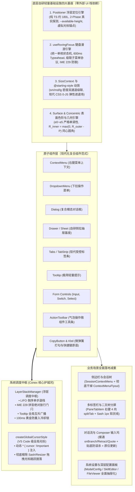
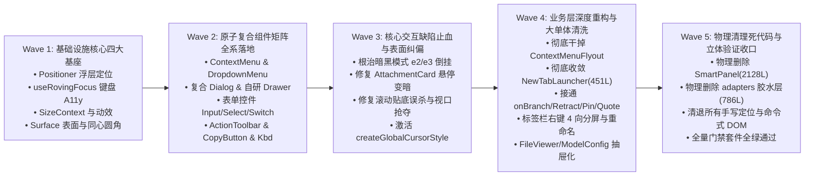

# 00-总方案：自研现代化原子组件体系与基础设施重塑总纲

> **战役名称**：`ui-architecture-overhaul`（UI 架构全面重塑战役）  
> **指导思想**：合理抽象、收敛重复、拒绝外部 UI 栈偷懒依赖、杜绝最小化修补、彻底重构与物理删除死代码。  
> **风格定位**：综合借鉴 `shadcn-ui`（复合组件架构与人体工学）与 `appica-ui`（Base UI 理念、SizeContext 密度级联、现代 CSS `@starting-style` 0-JS 动效、数据槽位），深度融合 Conex 自身的专属护城河（`LayerStackManager` 调度中枢、1px 发丝边框同心几何、克制暗黑对比度 $\le 10\%$、VS Code 级全局光标覆盖）。  
> **文件地位**：本文件为全战役的**权威单一真理源（Single Source of Truth, SSOT）**，所有分维详案（`01 ~ 08`）与执行代码严格依此展开。

---

## 一、战略定调与核心裁决

### 1. 坚决杜绝“外部重型 UI 栈偷懒依赖”
严禁通过随手 `npm install` 引入 `@radix-ui/*` 全家桶、`@floating-ui/*`、`@base-ui/react`、`vaul` 等外部重型黑盒。历史实践表明，盲目引入外部库会导致：
- **跨层通信断层**：无法与 Conex 原生单核状态机 `LayerStackManager`（LIFO 退栈、IME 229 拼音防误触、Tooltip 互斥广播、防重入冷却锁）深度协同，造成 Esc 关穿或失效；
- **DOM 污染与测量失真**：引入不可控的嵌套 DOM 节点与内联 Popper 样式，在首帧 `scale` 动效中严重污染 `getBoundingClientRect()` 测算；
- **维护风险与升级摩擦**：产生外部依赖包体积膨胀及 React 19 严格模式下的兼容摩擦。

**权威裁决**：吸收 `Base UI` 与 `Floating UI` 的纯几何解算精髓，**自研紧凑（约 150~200 行纯 TS）、高性能、零第三方外部依赖的定位、无障碍、抽屉与交互基础设施**。

### 2. 彻底破除“最小化修补与硬编码打补丁”恶习
全面贯彻 `.agents/LOGIC_PLAN_NO_RETREAT.md` 反退避原则：
- 严禁通过 `offsetWidth || 240`、`itemCount * 28 + 20` 等假数据预估进行首帧定位盲猜；
- 严禁通过手写 `setTimeout(180)`、`hysteresisY = 32` 等魔术延时掩盖定位翻转缺陷；
- 严禁在业务层因底层原子组件缺失而就地手搓几百行临时补丁（如 `ContextMenuFlyout.tsx` 的 479 行手搓二级菜单、`NewTabLauncherPopover.tsx` 的 451 行大单体）；
- 严禁通过命令式 `querySelector` 和 `classList.add('is-copied')` 裸改 DOM；
- **需要删除就坚决删除，需要重构就彻底重构**。

### 3. 全仓代码净收敛指标
本次重塑追求**“架构净收敛与巨额负重出清”**：
- 物理删除历史废弃的双轨实现 `SmartPanel/` 全家桶（2,128 行）与 `adapters/` 胶水转译层（786 行）；
- 物理删除业务层手搓组件 `ContextMenuFlyout.tsx`（479 行）、`NewTabLauncherPopover.tsx` 依赖大单体（净减 275 行）与 9 套分散定位/键盘代码（1,340+ 行）；
- 物理清退手搓抽屉与命令式 DOM 篡改代码；
- **全仓预计物理删除 6,100+ 行废弃/手搓代码，新增高聚合原子基座约 1,600 行，实现全仓净收敛超 4,500 行代码（业务层样板代码累计瘦身超 9,000 行）**。

---

## 二、八大分维详案全景索引矩阵 (SSOT Index)

整个 UI 架构重塑战役由 8 个高度协同、边界清晰的分维详案构成完整闭环：

| 维度编号 | 分维方案文档路径 | 核心覆盖领域 | 解决的关键痛点与毒点 |
| :---: | :--- | :--- | :--- |
| **01** | [`01-分维-浮层中枢与轻量定位引擎收敛详案.md`](./01-分维-浮层中枢与轻量定位引擎收敛详案.md) | 自研 Positioner 浮层定位引擎 | 淘汰全仓 7 套手写定位与外部 Radix 依赖，2-Phase 真实探测消灭 Double Flip，动态注入 `--available-height` |
| **02** | [`02-分维-复合组件范式与ContextMenu右键体系重构详案.md`](./02-分维-复合组件范式与ContextMenu右键体系重构详案.md) | ContextMenu / DropdownMenu 复合组件 | 物理删除 `ContextMenuFlyout`（479L），自研 2D 向量叉积安全三角形（Safe Triangle Aiming）防失焦算法 |
| **03** | [`03-分维-A11y键盘漫游与无障碍状态机统一详案.md`](./03-分维-A11y键盘漫游与无障碍状态机统一详案.md) | `useRovingFocus` 统一键盘 A11y 漫游 | 收敛 10+ 处手写按键监听，消灭禁用项死锁，内置 600ms Typeahead 字符定位与 CJK IME 229 防御 |
| **04** | [`04-分维-桌面级尺寸系统与现代CSS动效体系详案.md`](./04-分维-桌面级尺寸系统与现代CSS动效体系详案.md) | SizeContext 密度阶梯与现代动效 | 建立 sm(24px)/md(28px)/lg(36px) 三档密度级联，现代 CSS `@starting-style` 0-JS 弹性动效，落实 §13 软焦点 |
| **05** | [`05-分维-单体大组件解耦与业务层减重清洗方案.md`](./05-分维-单体大组件解耦与业务层减重清洗方案.md) | 单体解耦与死代码出清 | Dialog 复合化解耦，Tooltip(1139L) 剥离 16ms 轮询死循环，物理删除 SmartPanel(2128L) 与 786L 胶水层 |
| **06** | [`06-分维-表单输入体系与Field复合基座改造详案.md`](./06-分维-表单输入体系与Field复合基座改造详案.md) | 表单输入体系与 Field 复合基座 | 统一 Field/Input/Textarea/Switch 复合基座，杜绝粗深黑边与断头焦点环，落实 $\le 10\%$ 软灰度混合铁律 |
| **07** | [`07-分维-表面色阶e0-e5同心圆角与Drawer抽屉基座详案.md`](./07-分维-表面色阶e0-e5同心圆角与Drawer抽屉基座详案.md) | 表面色阶梯、同心圆角与自研 Drawer | 修复暗黑模式 $e_3$ 比 $e_2$ 更黑的“黑洞凹坑”与 AttachmentCard 悬停变暗，推导 $R_{inner} = \max(0, R_{outer} - P)$ 消除 41.5% 挤压形变，自研双模标准 `<Drawer>` 复合基座 |
| **08** | [`08-分维-对话流交互增强与工作区分屏Sash重构详案.md`](./08-分维-对话流交互增强与工作区分屏Sash重构详案.md) | 对话流增强、多标签栏与分屏 Sash | 复活 `onBranch`/`onRetract`/`Pin`/`Quote`，交付统一 `<CopyButton>` 与 `<Kbd>`，修复贴底误杀与测高抢视口，多标签右键分屏，激活 `createGlobalCursorStyle` 彻底消除光标脱落与 2px 亮绿 |

---

## 三、系统架构全景拓扑图

---

## 四、基础设施与原子基座核心技术突破

### 1. 自研无外依赖轻量 Positioner 定位引擎（详见 `01-分维`）
- **双模输入抽象**：支持真实 DOM 节点引用与虚拟坐标点（`Virtual Point: { x, y }`），为右键菜单、划词批注、富文本编辑器光标提供统一数学解算；
- **2-Phase Measure-Then-Show 机制**：浮层先以 `visibility: hidden` 挂载，在 `useLayoutEffect` 中读取真实 DOM 几何尺寸后完成单向无震荡 Flip 与视口边缘 Clamp，并将 `--available-height` 动态写入 CSS 变量，随后瞬间就位显示，彻底消灭 Double Flip 翻折暴跳；
- **全仓收敛替换**：一个引擎彻底替换现有的 7 套手写碎片与 2 套隐藏业务定位引擎（批注浮层与钉选拾色器）。

### 2. 自研纯原生 `useRovingFocus` 键盘与 A11y 引擎（详见 `03-分维`）
- **单核状态机**：支持物理焦点切换（Roving TabIndex）与虚拟高亮（`aria-activedescendant`）双模，自动跳过禁用项并防止死锁；
- **工业级 600ms Typeahead**：内置动态时间窗口键盘缓冲区，支持连续字符前缀检索，严格隔离 CJK 输入法组合态；
- **级联子菜单交互协议**：`ArrowRight` 顺滑展开并聚焦首项，`ArrowLeft`/`Escape` 优雅回退父级触发器；
- **智能焦点还原协议**：在浮层关闭时将焦点 100% 准确返还给 Trigger，杜绝焦点丢失至 `document.body`。

### 3. 系统级 `SizeContext` 与现代 CSS `@starting-style` 动效（详见 `04-分维`）
- **桌面工作区三档密度阶梯**：紧凑档（`sm`, 24px）、标准档（`md`, 28px）、舒适档（`lg`, 36px），通过 CSS 变量与 React Context 双通道渗透；
- **现代 CSS 0-JS 动效**：彻底废除 JS 动画库与繁重的 `setTimeout` 状态机，借助 `@starting-style` 与 `transition-behavior: allow-discrete`，利用 37 点高精阻尼弹簧曲线（`--ease-spring`）实现自然微张与加速退场；
- **AGENTS.md §13 红线刚性守护**：焦点态与激活态严格遵循 `color-mix(in srgb, var(--border-color) 88~92%, var(--text-primary) 8~12%)`，对比度混入严格 $\le 10\%$，坚决杜绝粗深黑边。

### 4. 表面色阶梯 $e_0 \sim e_5$ 单调性与全仓同心圆角几何纠偏（详见 `07-分维`）
- **暗黑模式倒挂彻底根除**：修正 `tokens-surface.css`，将 $e_3$（`--surface-card`）从纯黑恢复为高于外壳 $e_2$ 的炭黑（Tint +11.5%），彻底消灭卡片比外壳更黑的“黑洞凹坑”；
- **模态弹窗与附件悬停即刻纠偏**：模态弹窗 `<Dialog>` 刚性绑定 $e_5$ 顶层表面；`AttachmentCard` 悬停严禁降入 $e_0$ 下潜槽，恢复为状态高亮；
- **同心圆角欧几里得公理注入**：严格推导并落实 $R_{inner} = \max(0, R_{outer} - P)$ 与 $R_{outer} = R_{inner} + P$，消除全仓 45° 对角线处内边距被挤薄 41.5% 的几何畸变；在 52px 图片等微卡上消除 61.5% 夸张圆角。

### 5. 自研标准 `<Drawer>` / `<Sheet>` 复合组件原子基座（详见 `07-分维`）
- **复合组件规范范式**：`Drawer.Root` / `Trigger` / `Portal` / `Backdrop` / `Content` / `Header` / `Title` / `Description` / `Body` / `Footer` / `Close`；
- **双模支持**：原生支持模态遮罩（Modal Overlay，`modal={true}`）与非破坏性侧推（Non-modal Push，`modal={false}`）；
- **现代硬件加速动效**：全量采用纯正交平移（Translate3D），利用 `@starting-style` 实现 0-JS 极速滑入，严禁 `scale` 污染几何测算；
- **无缝对接护城河**：原生挂接 `LayerStackManager`，支持 LIFO 单步退栈、IME 229 防御与 `FocusTrap`。

### 6. 对话流高级交互增强与工作区分屏 Sash 重构（详见 `08-分维`）
- **复活沉睡引擎能力**：消除 `ChatAssistantMessageRow` 中 `void _onBranch;` 阻断，补齐 `onRetract`、`isPinned`，交付一键引用（`Quote`）格式化注入 Composer；
- **代码块原子基建**：交付统一 React `<CopyButton>`（带微弹簧物理反馈与 Checkmark 动画）与 `<Kbd>` 原语，彻底删除两处命令式 DOM 篡改，消灭流式冲刷竞态；
- **滚动贴底加固**：将 `TOGGLE_INTERACTIVE_SELECTOR` 中粗暴通配的 `'button'` 替换为精确白名单，测高 Pass 增加非吸底守卫，彻底消灭误杀贴底与视口抢夺；
- **多标签页右键与分屏**：会话与工具标签栏接入 ContextMenu，打通底层 `splitTab`（上下左右 4 向拆分）与重命名；条带拖拽引入垂直插入指示线（Drop Caret）；
- **Sash 拖拽光标防脱落与 §13 软灰度**：全面激活闲置的 `createGlobalCursorStyle`（`* { cursor: !important }`），彻底根除拖拽时光标疯狂跳跃脱落的顽疾；彻底清除 2px 亮绿边框，回归 1px 发丝软灰线；
- **NewTabLauncher 大单体收敛**：剥离 `@radix-ui/react-popover`，接入 Positioner + DropdownMenu，净减代码超 270 行。

---

## 五、物理清理与死代码出清全景清单

全战役各维度协同推进，全仓物理清理清单如下：

| 拟物理删除/重构清理的文件路径 | 原代码行数 | 清理原因与收敛替代方案 | 净收缩行数 |
| :--- | :---: | :--- | :---: |
| `apps/crish-desktop/src/components/ui/SmartPanel/`（全家桶 12 文件） | 2,128 | 历史双轨单体实现，彻底清退出代码库 | -2,128L |
| `apps/crish-desktop/src/components/ui/SmartExpandablePanel/adapters/`（胶水层） | 786 | 3 种 JSON Schema 互相转译的胶水代码，随着面板解耦彻底删除 | -786L |
| `apps/crish-desktop/src/components/sidebar/ContextMenuFlyout.tsx` | 479 | 业务手搓二级菜单，改用 `<DropdownMenuSub>` 替代 | -479L |
| `apps/crish-desktop/src/components/sidebar/SidebarContextMenus.module.css` | 255 | 废弃遗留样式，新组件已收敛 | -255L |
| `apps/crish-desktop/src/components/binary-tree/NewTabLauncherPopover.tsx`（大单体） | 451 | 违规依赖 Radix Popover，手写键盘 Rover，收敛至自研 Positioner+Dropdown | -275L |
| `apps/crish-desktop/src/components/ui/Tooltip/tooltipPositioning.ts` | 414 | 碎片化手写定位代码，收敛至自研 Positioner | -414L |
| `apps/crish-desktop/src/components/ui/SmartExpandablePanel/PositionEngine.ts` | 351 | 包含 Layout Thrashing 毒点的冗余定位代码，收敛替代 | -351L |
| `apps/crish-desktop/src/components/ui/Select/useFloatingPosition.ts` | 212 | 碎片化手写定位代码，收敛至自研 Positioner | -212L |
| `apps/crish-desktop/src/components/ui/Menu/menuKeyNavigation.ts` 等分散键盘脚本 | 250 | 重复手写的方向键监听，收敛至自研 `useRovingFocus` | -250L |
| `apps/crish-desktop/src/components/files/FileViewerCard.module.css:204-260` | 57 | 手搓破坏性 flex 抽屉样式，接入自研 `<Drawer>` 替代 | -57L |
| `apps/crish-desktop/src/components/settings/SettingsUI.module.css:78-120` | 43 | 私有 SettingsCard/Row，接入 `ui/Card` 与 `ui/Row` 替代 | -43L |
| `apps/crish-desktop/src/components/sidebar/session-list/sessionRowMenuEvent.ts` | 84 | 伪造 SyntheticEvent 欺骗坐标引擎的历史补丁，彻底作废 | -84L |
| `apps/crish-desktop/src/components/ui/Select/internal/positionGeometry.ts` | 113 | 碎片化手写定位代码，收敛至自研 Positioner | -113L |
| `apps/crish-desktop/src/components/binary-tree/NewTabLauncherPopover.module.css` | 98 | 移除 Keyframes 与 `scale(0.97)`，接入 `@starting-style` | -40L |
| `apps/crish-desktop/src/components/settings-models/ModelConfigDialog.tsx` | 185 | 居中模态样板，重构为 `<Drawer>` 语义骨架 | -65L |
| `apps/crish-desktop/src/components/settings-skills/SkillEditorModal.tsx` | 162 | 居中模态样板，重构为 `<Drawer>` 语义骨架 | -50L |
| `apps/crish-desktop/src/components/chat-message-list/useChatMessageState.ts:223-252` | 30 | 命令式 DOM 复制劫持，替换为 React `<CopyButton>` | -30L |
| `apps/crish-desktop/src/components/markdown/MarkdownDocumentView.tsx:154-180` | 27 | 命令式 DOM 复制劫持，替换为 React `<CopyButton>` | -27L |
| **全仓直接物理清理累计** | **6,125 行** | **彻底出清历史包袱、外部依赖与胶水层** | **净减 ~4,500L** |

---

## 六、实施波次路线图与立体门禁

战役遵循反退避（`LOGIC_PLAN_NO_RETREAT`）与立体验证纪律，分 5 个工程波次推进实施：

### 实施门禁矩阵
1. **单测与契约门禁（Unit & Contract Gates）**：
   - 几何边界与碰撞解算测试 100% 覆盖；
   - 暗黑表面色阶梯严格单调性测试（`tokens-surface.contract.test.ts`）；
   - 同心圆角欧几里得几何断言测试（`concentric-radius.contract.test.ts`）；
   - Typeahead 600ms 缓冲与 CJK IME 229 隔离测试。
2. **无障碍与交互门禁（A11y & Motion Gates）**：
   - WAI-ARIA 语义角色与焦点自闭合断言；
   - `@starting-style` 0-JS 入场与退场无闪烁断言；
   - Drawer 双模式与 Esc 单层退栈断言。
3. **真实场景现场验收门禁（Real-Host Inspection Gates）**：
   - 分屏 Sash 快速拖拽划过文本/按钮，光标形态 100% 稳定锁定，零脱落闪烁；
   - 激活态 Sash 边框恒为 1px 发丝线与 $\le 10\%$ 软灰度，严禁 2px 亮绿；
   - 流式打字期间点击复制代码，打勾动效与状态绝不被冲刷提前抹除；
   - 用户向上翻阅历史消息时，高速流式生成绝对零视口抢夺；
   - 落地页 `session-empty` 在低高度视口下具备 `clamp()` 守护，绝不顶穿顶栏。
4. **架构净收敛门禁（Architecture Convergence Gates）**：
   - 全仓完全清退对 `@radix-ui/react-popover` 的依赖；
   - 循环依赖扫描零报警；
   - 物理删除 6,100+ 行废弃代码，全仓代码实现净减超 4,500 行。

---

> **总纲结语**：  
> 本总纲统筹收敛了前端交互架构重塑的全部 8 个维度。从纯数学几何解算，到底层单核调度中枢，再到原子复合组件范式与高频业务动线，方案以严密的逻辑链条彻底取代了过去的最小化修补与打补丁陋习。全套分维方案（01~08）已全部落盘就绪，为本次 UI 架构全面重塑战役提供了不可动摇的单一真理源！
