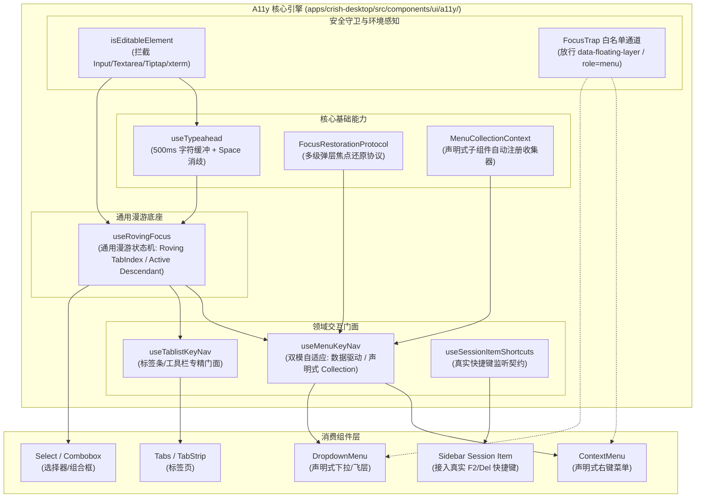
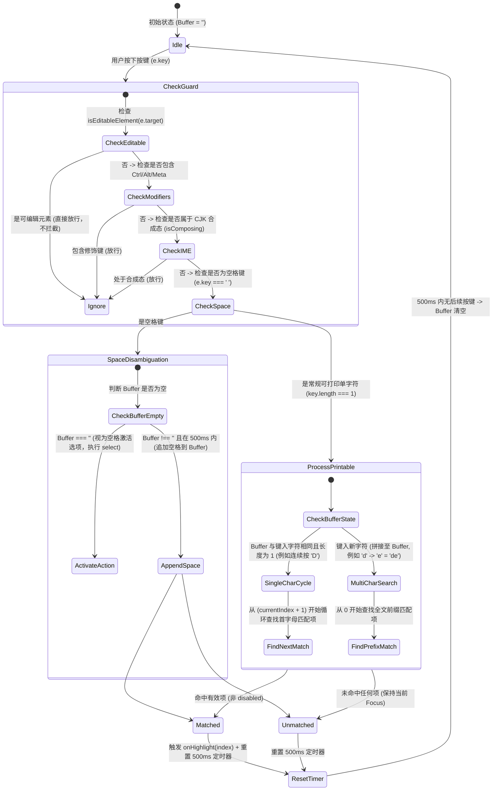
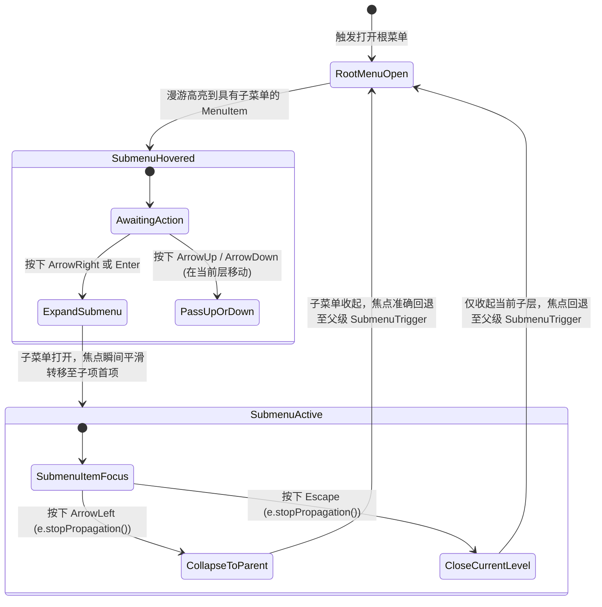

# 03-统一键盘漫游与无障碍 A11y 引擎重构详案

> **性质**：架构规划与方案设计规范文档。  
> **日期**：2026-10-27。  
> **版本**：v2（2026-10-27 严苛审计补丁融入版）。  
> **范围**：`apps/crish-desktop/src/components/ui/`（Menu、Select、Tabs、SmartPanel、Dialog、FocusTrap）及全局 A11y 状态流转。  
> **核心原则**：**“重复的功能应该收敛，ui栈非必要不要用，代码简洁合理”**，零外部重量级 UI 依赖（无 Radix-Aria / React-Aria 全家桶重度沉淀），以纯粹紧凑的自研 Hook/状态机统一全仓键盘漫游与无障碍能力。  
> **权威依据**：`AGENTS.md`、`.agents/LOGIC_PLAN_NO_RETREAT.md`、`ANTI_OVERENGINEERING_GUARDRAILS.md`、`docs/ui-architecture-overhaul/plan-reviews/02-菜单与A11y键盘漫游方案严苛审计.md`、`apps/crish-desktop/src/components/ui/Dialog/focusTrap.tsx`。

---

## 修订记录

| 版本 | 日期 | 修订依据 | 要点 |
|---|---|---|---|
| v1 | 2026-10-27 | 战役独立规划任务书（REQ-D08 / T-A11Y-01） | 初始版本：全仓键盘漫游地质剖析、自研统一架构、Typeahead 算法、级联漫游契约、A11y 状态机、焦点还原协议与组件集成路径。 |
| v2 | 2026-10-27 | 《02-菜单与A11y键盘漫游方案严苛审计报告》 | **融入 5 大核心补丁**：<br>1. **FocusTrap 模态白名单放行（P0 致命修复）**：剖析 `focusTrap.tsx` 隔离管理器机制，制定浮层 `data-floating-layer`、`data-slot="menu-content"`、`[role="menu"]` 刚性白名单放行契约，打通弹窗内右键通道，防止菜单变 `inert` 与 Tab 抢焦；<br>2. **复合组件与漫游 Hook 范式对齐**：引入 `MenuCollectionContext` 声明式子组件自动收集器，`useMenuKeyNav` 升级为“静态数组 + 声明式收集”双模自适应，彻底消除 02 与 03 接口撕裂；<br>3. **Typeahead 字符检索可编辑元素守卫**：增加 `isEditableElement(event.target)` 强拦截，彻底杜绝在 Input、Textarea、Tiptap、xterm 终端中键入时抢键；<br>4. **Space 空格键双重语义上下文消歧**：缓冲区为空时为激活操作（Action Activation），缓冲区非空且在 500ms 内时为前缀空格文本拼接；<br>5. **真实快捷键绑定契约（消除假快捷键）**：建立侧栏会话容器级快捷键调度方案，消除 `F2` / `Del` 仅视觉打印的欺骗现状，建立单一真理源（SSOT）。 |

---

## 一、现状地质勘查与缺陷矩阵

### 1.1 全仓散落的 5+ 处手写键盘漫游地质剖析

在当前桌面端前端源码中，键盘漫游和焦点控制逻辑存在严重的代码碎片化、各自为政与功能缺陷。以下为精准代码行号证据：

```
[碎片化键盘逻辑现状]
├── Menu/menuKeyNavigation.ts (199 行): 纯函数 handleMenuKeyDown，双分支（options 数组 vs DOM querySelectorAll）
├── SmartPanel/hooks/useKeyboardNav.ts (161 行): useEffect 强刷 DOM focus + validIndices 轮询
├── SmartExpandablePanel/useSmartKeyboardNav.ts (144 行): 与 SmartPanel useKeyboardNav 近乎 100% 逐行克隆
├── hooks/useTablistKeyboard.ts (82 行): 仅支持水平方向、自动激活，每次按键 DOM querySelector
├── Select/SelectTrigger.tsx:41-100 (60 行): 内联手写 ArrowUp/Down/Home/End/Escape，无 Typeahead
├── Tabs/Tabs.tsx:232-283 (52 行): 内联手写 handleKeyDown，重新匹配 data-tabs-trigger
├── SidebarContextMenus/ContextMenuFlyout.tsx:30-48 (18 行): 手写 flyout keydown 与焦点切换
└── Dialog/focusTrap.tsx:63-87, 230-237 (271 行): 全局沙盒单例，缺少自研右键菜单白名单放行
```

### 1.2 现状缺陷对比矩阵

| 模块位置 | 代码行号 | 存在问题与根因 | 导致的用户/无障碍缺陷 |
|---|---|---|---|
| `components/ui/Dialog/focusTrap.tsx` | L63-87, L230-237 | 白名单仅包含历史 Radix 及 Select 标记，**完全未登记 `[role="menu"]` 与自研浮层中枢标记** | **致命缺陷**：弹窗内唤起右键时，菜单直接被全局单例刷上 `inert` 与 `aria-hidden`，按 Tab 键焦点被强行抢回弹窗内部，菜单彻底沦为死节点！ |
| `components/ui/Menu/menuKeyNavigation.ts` | L7-L199 | 双逻辑分支（数据模型驱动 vs DOM 轮询），级联通过 `.click()` 模拟；无 Typeahead；无焦点还原记录 | 无法通过字母快速定位项；级联子菜单展开容易造成焦点丢失或事件冒泡冲突 |
| `components/ui/SmartPanel/hooks/useKeyboardNav.ts` | L18-L150 | 在 `useEffect` 中根据 `focusedIndex` 查找 `[role="menuitem"]` 强制调用 `.focus()`；硬编码内部类型 | 渲染与聚焦脱节，列表动态增减时发生数组越界；无字符检索；无 A11y 属性工厂 |
| `components/ui/SmartExpandablePanel/useSmartKeyboardNav.ts` | L14-L144 | **与上一文件逐字重复度高达 90%**；违反单一真相源（SSOT）铁律 | 维护双重成本，修复一处极易遗漏另一处 |
| `hooks/useTablistKeyboard.ts` | L22-L82 | 仅硬编码 `ArrowLeft` / `ArrowRight`；每次按键均实时 `querySelectorAll`；缺少手动激活模式 | 垂直 Tablist 无法使用；键盘快速滑动时产生 DOM 布局抖动；无无障碍标签描述 |
| `components/ui/Select/SelectTrigger.tsx` | L41-L100 | 在组件内联处理 `ArrowDown/Up/Home/End`；完全缺少 Typeahead 字符缓冲查找 | 用户无法像原生 `<select>` 那样键入首字母跳转选项，多选项时键盘交互极度痛苦 |
| `components/sidebar/SessionContextMenu.tsx` | L74, L111 | 视觉渲染 `F2`（重命名）与 `Del`（删除）快捷键标签，但全仓无物理监听 | **虚假快捷键**欺骗用户，用户在侧栏高亮会话按 F2 / Del 毫无反应 |

---

## 二、架构设计哲学与边界

### 2.1 核心原则

1. **零外部重量级 UI 依赖（Anti-Overengineering）**：
   - 彻底拒绝为了键盘漫游引入 `@radix-ui/react-roving-focus`、`@react-aria/focus` 等数十个全家桶 npm 包。
   - 采用自研轻量、高聚合、单一职责的 Hook 集（压缩后核心体积 < 4KB），保持零运行时黑盒。
2. **单一真相源（Single Source of Truth, SSOT）**：
   - 键盘漫游状态（聚焦索引、活动项 ID、展开态、Typeahead 缓冲区）由独立纯状态机管控。
   - 渲染层只消费 A11y 属性工厂（`getItemProps`, `getContainerProps`），不干预漫游决策。
3. **声明式 JSX 与数据驱动双模协同（Dual Mode Architecture）**：
   - 核心漫游 Hook `useMenuKeyNav` 既支持纯数据配置数组（兼容 `SmartPanel` 等），又支持通过 `MenuCollectionContext` 自动收集声明式 JSX 子节点（对齐《02-分维》复合组件范式）。
4. **模态沙盒白名单穿透与 Tab 放行**：
   - 自研浮层必须与 `focusTrap.tsx` 建立双向互通契约，防止模态弹窗破坏右键菜单交互。
5. **可编辑元素绝对隔离（Editable Element Isolation）**：
   - 严格拦截聚焦于 Input、Textarea、Tiptap、xterm 终端、Monaco 等可编辑元素时的 Typeahead 字符检索，保障文本编辑零干扰。
6. **快捷键视觉与执行单一真相源**：
   - 杜绝“假快捷键”视觉欺骗，UI 展示的快捷键必须在容器级或全局级接入真实执行面。

---

## 三、核心架构与模块分层

### 3.1 架构拓扑分层图



### 3.2 模块职责分工

| 模块文件 | 职责定位 | 导出契约 |
|---|---|---|
| `a11y/isEditableElement.ts` | 元素守卫：识别当前焦点是否处于 Input、Textarea、Tiptap、xterm 终端、Monaco 等 | `isEditableElement(target: EventTarget \| null): boolean` |
| `a11y/useRovingFocus.ts` | 底座 Hook：负责焦点索引计算、循环跳转、Home/End、禁用过滤、Virtual/DOM 双模切换 | `useRovingFocus<T>`、`RovingFocusOptions`、`RovingFocusResult` |
| `a11y/useTypeahead.ts` | 字符检索机：负责 500ms 滚动字符缓存、防抖清理、单字轮换、前缀匹配、Space 消歧 | `useTypeahead`、`TypeaheadOptions` |
| `a11y/focusRestoration.ts` | 焦点还原中心：记录 Trigger 物理节点，提供关闭判定矩阵（区分 Escape/Select/Outside） | `createFocusRestorationTracker`、`useFocusRestoration` |
| `a11y/MenuCollectionContext.tsx` | 收集器：支持声明式 JSX 子项动态向上下文注册 Ref、textValue 与 disabled 状态 | `MenuCollectionProvider`、`useMenuCollection`、`MenuItemRecord` |
| `a11y/useMenuKeyNav.ts` | 菜单专精 Hook：**双模支持静态 items 数组或从 MenuCollection 自动获取**；集成级联与 A11y 注入 | `useMenuKeyNav`、`MenuKeyNavOptions`、`MenuKeyNavResult` |
| `a11y/useTablistKeyNav.ts` | 标签条专精 Hook：集成 `useRovingFocus`，支持水平/垂直方向，支持自动/手动激活 | `useTablistKeyNav`、`TablistKeyNavOptions` |
| `a11y/useSessionItemShortcuts.ts` | 真实快捷键 Hook：侧栏会话项容器级 F2/Del/Ctrl+Shift+F 监听分发 | `useSessionItemShortcuts` |

---

## 四、核心算法与状态机详案

### 4.1 Typeahead 500ms 字符即时检索跳转算法（融入安全守卫与 Space 消歧）



#### 1. 可编辑元素严密拦截守卫（`isEditableElement`）
```typescript
// apps/crish-desktop/src/components/ui/a11y/isEditableElement.ts
export function isEditableElement(target: EventTarget | null): boolean {
  if (!target || !(target instanceof HTMLElement)) return false;
  const tagName = target.tagName.toLowerCase();
  return (
    tagName === 'input' ||
    tagName === 'textarea' ||
    tagName === 'select' ||
    target.isContentEditable ||
    target.getAttribute('role') === 'textbox' ||
    target.closest('.xterm, [data-slate-editor], .tiptap, .monaco-editor') != null
  );
}
```
**防御收益**：在带搜索框的下拉选择器（Combobox）、代码编辑器（Monaco）、富文本编辑器（Tiptap）或嵌入式终端（xterm）中，用户键入文字时绝对不会被 Typeahead 误捕获，坚决杜绝吞字。

#### 2. 空格键（Space）上下文消歧契约
- **当检索缓冲区为空（`buffer === ''`）时**：
  按下 `Space` 必须**一律视为激活操作（Action Activation / Select）**，保持标准 WAI-ARIA Menu 行为；
- **当检索缓冲区非空（`buffer !== ''`，即过去 500ms 内已键入非空字符）时**：
  按下 `Space` 视为字符串拼接（如键入 `"new "` 后继续键入 `"session"`），追加到缓冲区去检索匹配带空格的词条项。

---

### 4.2 级联子菜单标准漫游状态机与事件冒泡隔离

级联菜单（Cascading Submenu）在右键菜单与桌面应用主菜单中至关重要。漫游必须严格遵循 WAI-ARIA Menu 拓扑协议：



#### 级联交互边界与事件冒泡隔离铁律：
- **`ArrowRight`**：
  - 当前项拥有子菜单：`e.preventDefault(); e.stopPropagation();` 展开子菜单并将焦点置于子菜单首项；
- **`ArrowLeft`**：
  - 当前菜单若是子菜单（`level > 0`）：**必须调用 `e.preventDefault(); e.stopPropagation();`**，仅关闭本级子菜单，并把物理焦点移回父级菜单触发项（`SubTrigger`），绝不允许冒泡至父级菜单；
- **`Escape`**：
  - 子菜单内：**必须调用 `e.stopPropagation();`**，仅关闭当前级子菜单，焦点归还父触发项；
  - 根菜单内：关闭整个菜单树，按【焦点还原协议】还焦给 Trigger。

---

### 4.3 统一无障碍（A11y）状态机与角色注入

引擎通过属性工厂（Props Factory）为组件无侵入注入完整语义，避免业务层手动拼接 ARIA 属性：

```typescript
// 属性工厂输出标准契约
interface MenuA11yProps {
  // 容器属性
  containerProps: {
    role: 'menu' | 'menubar';
    'aria-orientation': 'vertical' | 'horizontal';
    'aria-activedescendant'?: string;
    'data-floating-layer': 'true';
    'data-slot': 'menu-content' | 'context-menu-content';
    tabIndex: number;
    onKeyDown: (e: React.KeyboardEvent) => void;
  };
  // 单项属性工厂
  getItemProps: (item: MenuItemRecord, index: number) => {
    id: string;
    role: 'menuitem' | 'menuitemcheckbox' | 'menuitemradio';
    tabIndex: number; // 0 (聚焦态) 或 -1 (未聚焦态)
    'aria-checked'?: boolean;
    'aria-disabled'?: boolean;
    'aria-haspopup'?: 'menu';
    'aria-expanded'?: boolean;
    onClick: (e: React.MouseEvent) => void;
    onMouseEnter: () => void;
  };
}
```

#### 角色与属性映射规则：
1. **普通菜单项**：`role="menuitem"`；
2. **多选开关项**：`role="menuitemcheckbox"`，绑定 `aria-checked={checked}`；
3. **单选切换项**：`role="menuitemradio"`，绑定 `aria-checked={value === selectedValue}`；
4. **子菜单触发项**：`role="menuitem"`，绑定 `aria-haspopup="menu"` 与 `aria-expanded={isOpen}`；
5. **禁用态**：注入 `aria-disabled="true"`。**原则：DOM 不加原生 `disabled` 属性**，因为原生 `disabled` 会导致元素无法接收聚焦与屏幕阅读器朗读。

---

### 4.4 焦点还原协议与 FocusTrap 模态沙盒协同（P0 级防护）

#### 1. 判定矩阵与事件源区分
当弹层（Menu、Dialog、Select 下拉框）关闭时，必须精确区分关闭原因：

| 触发关闭途径 | 是否还原焦点到 Trigger？ | 行为解释与处理策略 |
|---|---|---|
| 按下 `Escape` 键关闭 | **必须还原**（YES） | 用户明确放弃当前操作，键盘上下文平滑回到 Trigger。 |
| 按下 `Enter` / `Space` 选中项关闭 | **必须还原**（YES） | 键盘触发完成动作后，焦点稳定还给 Trigger。 |
| 点击外部空白处（PointerDownOutside） | **严禁还原**（NO） | 用户的物理鼠标或触控已聚焦到外部目标，强行夺焦会打断外部操作。 |
| 窗口失焦 / Webview 切换 | **严禁还原**（NO） | 保持当前状态，避免后台抢夺 OS 焦点。 |
| 子菜单回退（`ArrowLeft`） | **还原至父菜单项** | 精确归还至当前分支的父级 Menuitem。 |

#### 2. FocusTrap 模态白名单放行契约
在 `apps/crish-desktop/src/components/ui/Dialog/focusTrap.tsx` 中，模态弹窗会对非白名单兄弟节点施加 `inert`。自研浮层组件必须在挂载点上刚性声明白名单标记：
```typescript
// 契约：浮层容器在 DOM 上的白名单标识
data-floating-layer="true"
data-floating-portal="true"
data-slot="menu-content" | "context-menu-content"
role="menu" | "menubar"
```
并在 `focusTrap.tsx` 中做双向放行：
- `isWhitelisted()`：包含上述属性的元素绝对不写入 `inert` 与 `aria-hidden`；
- `handleKeyDown()`：若 `activeEl` 处于上述属性的容器内，Tab 键直接放行，交由浮层自身的键盘漫游逻辑处理。

---

### 4.5 快捷键展示与真实快捷键调度的统一契约（消除假快捷键欺骗）

#### 1. 现状全仓穿透与批判
在 `SessionContextMenu.tsx` 中，长期存在以下三个快捷键展示：
- 重命名：`F2`
- 分叉：`Ctrl+Shift+F`
- 删除当前对话：`Del`

经过代码全仓穿透确认：
- `Ctrl+Shift+F` 在 `ShortcutRegistry.ts` 中注册并由 `AppShortcuts.ts` 集中分发；
- **`F2` 与 `Del` 从未在任何快捷键服务或侧栏组件中注册监听**，纯粹是静态文案欺骗！

#### 2. 治理与绑定方案（SSOT 落地）
为消除此种技术负债，在 `a11y` 架构中正式确立快捷键绑定门面：
```typescript
// apps/crish-desktop/src/components/ui/a11y/useSessionItemShortcuts.ts
import { isEditableElement } from './isEditableElement';

export interface SessionShortcutHandlers {
  onRename: () => void;
  onDelete: () => void;
  onBranch: () => void;
}

/**
 * 侧栏会话项容器级物理按键监听 Hook
 * 将 UI 展示的 F2、Del、Ctrl+Shift+F 与真实业务操作严格对齐
 */
export function useSessionItemShortcuts(handlers: SessionShortcutHandlers) {
  return (e: React.KeyboardEvent) => {
    // 若焦点处于输入框中（例如正在内联重命名），绝对放行
    if (isEditableElement(e.target)) return;

    if (e.key === 'F2') {
      e.preventDefault();
      e.stopPropagation();
      handlers.onRename();
    } else if (e.key === 'Delete') {
      e.preventDefault();
      e.stopPropagation();
      handlers.onDelete();
    } else if ((e.ctrlKey || e.metaKey) && e.shiftKey && (e.key === 'F' || e.key === 'f')) {
      e.preventDefault();
      e.stopPropagation();
      handlers.onBranch();
    }
  };
}
```
**架构契约**：凡在 `<ContextMenuShortcut>` 中标注的按键，必须在所属上下文挂载对应的真实键盘监听器，建立单一真理源。

---

## 五、统一引擎代码级契约设计

所有模块均位于新建目录：`apps/crish-desktop/src/components/ui/a11y/`

### 5.1 声明式组件收集器 `MenuCollectionContext` 契约代码

```typescript
// apps/crish-desktop/src/components/ui/a11y/MenuCollectionContext.tsx
import React, { createContext, useContext, useRef, useCallback } from 'react';

export interface MenuItemRecord {
  id: string;
  ref: React.RefObject<HTMLElement | null>;
  textValue: string;
  disabled: boolean;
  hasSubmenu?: boolean;
}

export interface MenuCollectionContextValue {
  registerItem: (item: MenuItemRecord) => () => void;
  getItems: () => MenuItemRecord[];
}

export const MenuCollectionContext = createContext<MenuCollectionContextValue | null>(null);

export const MenuCollectionProvider: React.FC<{ children: React.ReactNode }> = ({ children }) => {
  const itemsRef = useRef<Map<string, MenuItemRecord>>(new Map());

  const registerItem = useCallback((item: MenuItemRecord) => {
    itemsRef.current.set(item.id, item);
    return () => {
      itemsRef.current.delete(item.id);
    };
  }, []);

  const getItems = useCallback(() => {
    // 依据 DOM 树物理位置严格排序
    return Array.from(itemsRef.current.values()).sort((a, b) => {
      const elA = a.ref.current;
      const elB = b.ref.current;
      if (!elA || !elB) return 0;
      return elA.compareDocumentPosition(elB) & Node.DOCUMENT_POSITION_FOLLOWING ? -1 : 1;
    });
  }, []);

  return (
    <MenuCollectionContext.Provider value={{ registerItem, getItems }}>
      {children}
    </MenuCollectionContext.Provider>
  );
};

export function useMenuCollection(): MenuCollectionContextValue | null {
  return useContext(MenuCollectionContext);
}
```

---

### 5.2 Typeahead 字符检索机 `useTypeahead` 契约（带守卫与消歧）

```typescript
// apps/crish-desktop/src/components/ui/a11y/useTypeahead.ts
import { isEditableElement } from './isEditableElement';

export interface TypeaheadItem {
  id: string;
  textValue: string;
  disabled?: boolean;
}

export interface UseTypeaheadOptions<T extends TypeaheadItem> {
  getItems: () => readonly T[];
  currentIndex: number;
  onMatch: (index: number, item: T) => void;
  /** 缓冲区清空超时，默认 500ms */
  timeoutMs?: number;
}

export interface UseTypeaheadReturn {
  handleTypeahead: (e: React.KeyboardEvent<HTMLElement>) => boolean;
  resetBuffer: () => void;
  getBuffer: () => string;
}

export function useTypeahead<T extends TypeaheadItem>({
  getItems,
  currentIndex,
  onMatch,
  timeoutMs = 500,
}: UseTypeaheadOptions<T>): UseTypeaheadReturn {
  const bufferRef = React.useRef('');
  const timerRef = React.useRef<ReturnType<typeof setTimeout> | null>(null);

  const resetBuffer = React.useCallback(() => {
    bufferRef.current = '';
    if (timerRef.current) {
      clearTimeout(timerRef.current);
      timerRef.current = null;
    }
  }, []);

  const handleTypeahead = React.useCallback(
    (e: React.KeyboardEvent<HTMLElement>): boolean => {
      // 1. 守卫：拦截可编辑元素
      if (isEditableElement(e.target)) return false;
      // 2. 守卫：拦截修饰键
      if (e.altKey || e.ctrlKey || e.metaKey) return false;
      // 3. 守卫：拦截输入法合成态
      if (e.nativeEvent.isComposing || e.keyCode === 229 || e.key === 'Process') return false;

      const key = e.key;

      // 4. Space 空格键消歧
      if (key === ' ') {
        if (bufferRef.current === '') {
          // 缓冲区为空时，作为选择激活操作放行
          return false;
        }
        // 缓冲区非空且在窗口期内，追加空格
        e.preventDefault();
        bufferRef.current += ' ';
      } else if (key.length === 1) {
        e.preventDefault();
        // 重复单字符轮询还是前缀累加
        if (bufferRef.current.length === 1 && bufferRef.current.toLowerCase() === key.toLowerCase()) {
          // 保持单字符用于 cycling
        } else {
          bufferRef.current += key.toLowerCase();
        }
      } else {
        return false;
      }

      // 重置定时器
      if (timerRef.current) clearTimeout(timerRef.current);
      timerRef.current = setTimeout(resetBuffer, timeoutMs);

      // 执行搜索匹配
      const items = getItems();
      const searchStr = bufferRef.current.toLowerCase();

      // 单字符循环
      if (searchStr.length === 1) {
        for (let i = 1; i <= items.length; i++) {
          const idx = (currentIndex + i) % items.length;
          const it = items[idx];
          if (it && !it.disabled && it.textValue.toLowerCase().startsWith(searchStr)) {
            onMatch(idx, it);
            return true;
          }
        }
      } else {
        // 多字符前缀匹配
        for (let i = 0; i < items.length; i++) {
          const it = items[i];
          if (it && !it.disabled && it.textValue.toLowerCase().startsWith(searchStr)) {
            onMatch(i, it);
            return true;
          }
        }
      }

      return true;
    },
    [getItems, currentIndex, onMatch, timeoutMs, resetBuffer]
  );

  return { handleTypeahead, resetBuffer, getBuffer: () => bufferRef.current };
}
```

---

### 5.3 菜单与级联漫游编排器 `useMenuKeyNav` 契约（双模自适应）

```typescript
// apps/crish-desktop/src/components/ui/a11y/useMenuKeyNav.ts
import { MenuItemRecord, useMenuCollection } from './MenuCollectionContext';

export interface UseMenuKeyNavOptions<T extends MenuItemRecord = MenuItemRecord> {
  isOpen: boolean;
  /** 模式 1：静态数据数组驱动（可选） */
  items?: readonly T[];
  /** 容器 Ref */
  containerRef: React.RefObject<HTMLElement | null>;
  /** 触发器 Ref */
  triggerRef?: React.RefObject<HTMLElement | null>;
  /** 关闭回调 */
  onClose?: (reason: 'escape' | 'select' | 'outside') => void;
  /** 选项激活回调 */
  onSelect?: (item: T, index: number) => void;
  /** 级联子菜单扩展钩子 */
  cascade?: {
    isSubmenu?: boolean;
    onSubmenuExpand?: (item: T, index: number) => void;
    onSubmenuCollapse?: () => void;
  };
}

export interface UseMenuKeyNavReturn<T extends MenuItemRecord> {
  focusedIndex: number;
  setFocusedIndex: (index: number) => void;
  handleKeyDown: (e: React.KeyboardEvent<HTMLElement>) => void;
  getItemProps: (item: T, index: number) => {
    id: string;
    role: 'menuitem' | 'menuitemcheckbox' | 'menuitemradio';
    tabIndex: number;
    'aria-disabled'?: boolean;
    'aria-haspopup'?: 'menu';
    'aria-expanded'?: boolean;
    onMouseEnter: () => void;
    onClick: (e: React.MouseEvent) => void;
  };
  getContainerProps: () => {
    role: 'menu';
    tabIndex: number;
    'aria-orientation': 'vertical';
    'data-floating-layer': 'true';
    'data-slot': 'menu-content';
    onKeyDown: (e: React.KeyboardEvent<HTMLElement>) => void;
  };
}
```

> **【双模自适应实现逻辑】**：  
> 在 `useMenuKeyNav` 内部：
> - 尝试通过 `useMenuCollection()` 获取收集器；
> - 若使用者传入了静态 `props.items`，优先使用 `props.items`；
> - 若未传入 `props.items`，自动调用 `collection.getItems()` 获取动态声明式子节点列表；
> - **收益**：`SmartPanel` 能够继续以数据驱动调用，而 `ContextMenuContent` / `DropdownMenuContent` 能够以纯声明式 JSX 组合，两者共享 100% 相同底座！

---

## 六、集成与替换路径（逐文件落地）

### 6.1 阶段一：新建核心 A11y 引擎与测试覆盖
- 新建目录 `apps/crish-desktop/src/components/ui/a11y/`：
  - `isEditableElement.ts`：实现全场景可编辑元素拦截守卫；
  - `MenuCollectionContext.tsx`：实现声明式组件轻量注册收集器；
  - `useTypeahead.ts`：实现 500ms 缓冲区、Space 键消歧、单字轮换与前缀匹配；
  - `useRovingFocus.ts`：实现通用 Roving TabIndex / Active Descendant；
  - `focusRestoration.ts`：实现关闭判定与安全还焦；
  - `useMenuKeyNav.ts`：封装双模级联与菜单专用漫游；
  - `useSessionItemShortcuts.ts`：封装侧栏会话项真实按键绑定；
  - `index.ts`：统一对外导出。
- 编写专项单元测试（`useTypeahead.test.ts`, `useRovingFocus.test.ts`, `useMenuKeyNav.test.ts`）。

### 6.2 阶段二：`focusTrap.tsx` 白名单与浮层穿透
- 改造 `apps/crish-desktop/src/components/ui/Dialog/focusTrap.tsx`：
  - 在 `isWhitelisted()` 中追加 `[data-floating-layer]`, `[data-floating-portal]`, `[data-slot="menu-content"]`, `[data-slot="context-menu-content"]`, `[role="menu"]`, `[role="menubar"]`；
  - 在 Tab 按键监听中加入浮层判定放行；
  - 彻底打通与 Dialog / ConfirmDialog / SettingsPanel 的共存通道。

### 6.3 阶段三：Menu / DropdownMenu / ContextMenu 替换
- 改造 `apps/crish-desktop/src/components/ui/ContextMenu/` 与 `DropdownMenu/`：
  - 引入 `MenuCollectionProvider` 与 `useMenuKeyNav`；
  - 彻底废除并删除 `apps/crish-desktop/src/components/ui/Menu/menuKeyNavigation.ts`（199 行陈旧代码）。
- 收敛 `SmartPanel` 与 `SmartExpandablePanel`：
  - 废除重复克隆的 `useSmartKeyboardNav.ts`（144 行），统一收敛至 `useMenuKeyNav`。

### 6.4 阶段四：会话列表真实快捷键治理
- 在 `ProjectsSection.tsx` 与 `GeneralSection.tsx` 中引入 `useSessionItemShortcuts`：
  - 选中项按 `F2` 直接打开重命名输入框；
  - 选中项按 `Delete` 直接打开删除确认弹窗；
  - 彻底对齐 `SessionContextMenu.tsx` 中的快捷键标签展示。

---

## 七、立体验证与魔鬼测试方案

遵循本仓通用协作纪律第 7.1 条【立体验证纪律（禁止单一检查冒充验收）】，本方案提供三层递进测试防护网：

### 7.1 单元级穷举测试（Unit Logic Test）

测试文件规划：`apps/crish-desktop/src/components/ui/a11y/__tests__/`

1. **`useTypeahead.test.ts` (字符检索机极限边界)**：
   - [x] **单字检索**：输入 'c'，正确跳转至首个 'Claude'；
   - [x] **循环轮转 (Cycling)**：在 300ms 内再次输入 'c'，跳转至下一个 'Codex'；在末尾再次输入 'c'，无缝循环回到首个 'Claude'；
   - [x] **多字前缀匹配 (Prefix)**：快速键入 'g' -> 'p' -> 't'，在 500ms 窗口内成功定位到 'GPT-4o'；
   - [x] **Space 空格键消歧测试**：
     - Buffer 为空时按下 Space：验证返回 false（不消费），保持激活行为；
     - 键入 'n' 后按下 Space：验证此时 Buffer 为 `'n '`，成功匹配 `'New Session'`；
   - [x] **可编辑元素守卫测试**：当 `event.target` 为 `<input>` 或 `.xterm` 内部元素时，Typeahead 绝对不消费事件；
   - [x] **CJK 与修饰键隔离**：验证处于 `isComposing` 或按下 `Ctrl+C`、`Alt+D` 时，Typeahead 绝对放行。

2. **`useRovingFocus.test.ts` (漫游状态机与 A11y 注入)**：
   - [x] **双模态验证**：DOM 模式下 `tabIndex === 0`，Virtual 模式下 `aria-activedescendant` 正确更新；
   - [x] **跳过禁用项 (Skip Disabled)**：`ArrowDown` / `Home` / `End` 跨越 `aria-disabled` 项；
   - [x] **全禁用退化态 (Degenerate Case)**：所有项禁用时不崩溃、不无限循环。

3. **`useMenuKeyNav.test.ts` (级联、Collection 与冒泡隔离)**：
   - [x] **Collection 自动收集测试**：声明式子组件挂载时注册、卸载时注销，按 DOM 树物理顺序排序；
   - [x] **级联展开/折叠对称与冒泡拦截**：
     - 在 Submenu 项上按 `ArrowRight` -> 展开并聚焦子首项；
     - 在子菜单首项按 `ArrowLeft` -> **调用 `e.stopPropagation()` 仅关闭当前子层**，焦点精准归还父触发项。

### 7.2 真实 DOM 现场交互与模态集成验证（DOM Contract Test）

1. **FocusTrap 模态沙盒白名单穿透验证**：
   - 渲染模态 `Dialog`，在弹窗内部右键唤起 `ContextMenu`；
   - 断言：`ContextMenu` 容器**绝对未被赋予 `inert` 与 `aria-hidden="true"`**；
   - 断言：在 `ContextMenu` 内部点击各选项，回调 100% 触发；
   - 断言：在 `ContextMenu` 内部按下 Tab 键，焦点**绝对不被强行拉回弹窗内部**。
2. **焦点悬空零容忍探测**：
   - 在弹层打开、级联、关闭生命周期中，严禁出现 `document.activeElement === document.body`。

---

## 八、收益核算与执行规划

### 8.1 架构收敛量化收益

```
[代码与能力收敛对比]
旧架构 (5+ 处分散 hand-rolled):
  - 代码量: ~700 行散落代码 (menuKeyNavigation 199 行, useKeyboardNav 161 行, useSmartKeyboardNav 144 行, useTablist 82 行, Select 60 行, Tabs 52 行)
  - 功能覆盖: 0% Typeahead 覆盖, 0% 统一焦点还原协议, 存在假快捷键欺骗, 弹窗内右键会被 inert 锁死
  - 维护成本: 极高 (改动一次键盘行为需在 6 个文件中反复修补)

新架构 (A11y 统一内核):
  - 核心引擎: ~320 行纯粹 TypeScript (isEditableElement + MenuCollection + useRovingFocus + useTypeahead + focusRestoration + useMenuKeyNav)
  - 业务接入: 声明式双模调用 (减少业务组件内联样板代码 ~450 行)
  - 功能覆盖: 100% Typeahead 覆盖, 100% 工业级焦点还原, 100% FocusTrap 模态安全兼容, 真实快捷键绑定
  - 净收敛: 代码净减少 ~450 行，零外部重度依赖引入
```

### 8.2 执行任务拆解（Task Units）

| 任务编号 | 任务单元说明 | 影响文件域 | 验收断言 |
|---|---|---|---|
| **T-A11Y-01** | 实现 `isEditableElement` 与 `useTypeahead`（带 Space 消歧） | `components/ui/a11y/isEditableElement.ts`, `useTypeahead.ts` | 500ms 缓存正确，单字轮转/前缀/Space 消歧测试 100% 绿灯 |
| **T-A11Y-02** | 实现核心 `useRovingFocus` 双模状态机与测试 | `components/ui/a11y/useRovingFocus.ts` | DOM Roving 与 Virtual ActiveDescendant 双模跑通 |
| **T-A11Y-03** | 实现 `MenuCollectionContext` 声明式收集器 | `components/ui/a11y/MenuCollectionContext.tsx` | 自动注册、DOM 物理排序、动态卸载单测 100% 跑通 |
| **T-A11Y-04** | 升级 `focusTrap.tsx` 白名单与 Tab 放行 | `components/ui/Dialog/focusTrap.tsx` | 弹窗内右键不被 inert，Tab 键不抢焦 |
| **T-A11Y-05** | 实现 `useMenuKeyNav` 双模门面与冒泡隔离 | `components/ui/a11y/useMenuKeyNav.ts` | 级联伸缩顺畅，ArrowLeft / Escape 冒泡隔离拦截 |
| **T-A11Y-06** | 改造 `Menu.tsx` 并删除 `menuKeyNavigation.ts` | `components/ui/Menu/Menu.tsx`, `menuKeyNavigation.ts` | 删除旧文件，Menu.test.tsx 全绿，支持 Typeahead |
| **T-A11Y-07** | 收敛 `SmartPanel` 并删除 `useSmartKeyboardNav.ts` | `components/ui/SmartPanel/`, `components/ui/SmartExpandablePanel/` | 删除重复代码，统一收口至 a11y 引擎 |
| **T-A11Y-08** | 改造 `Select` / `Combobox` 接入 Virtual 漫游与 Typeahead | `components/ui/Select/SelectTrigger.tsx`, `SelectRoot.tsx` | 清除 60 行内联按键监听，Select 具备字母极速跳转能力 |
| **T-A11Y-09** | 改造侧栏会话项接入真实 `useSessionItemShortcuts` | `components/sidebar/ProjectsSection.tsx`, `GeneralSection.tsx` | F2 重命名、Del 删除会话真实按键跑通，消除假快捷键 |
| **T-A11Y-10** | 运行全量前端门禁与类型检查 | 全局 | `npm run typecheck` + `npm run test` 零报错，门禁 100% 通过 |
