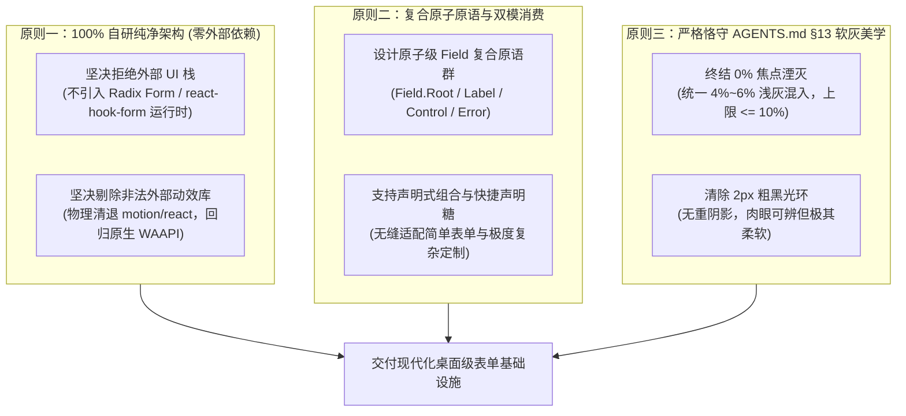
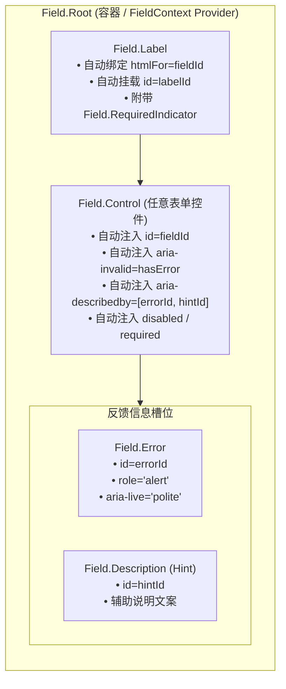
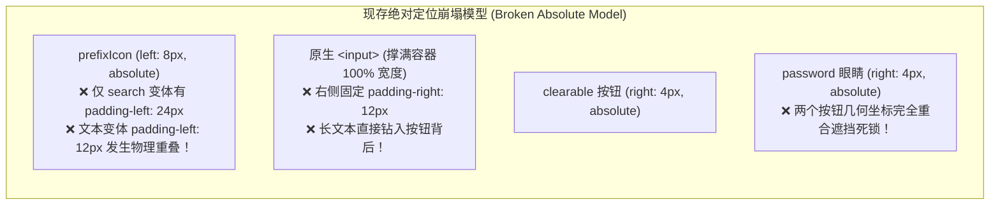
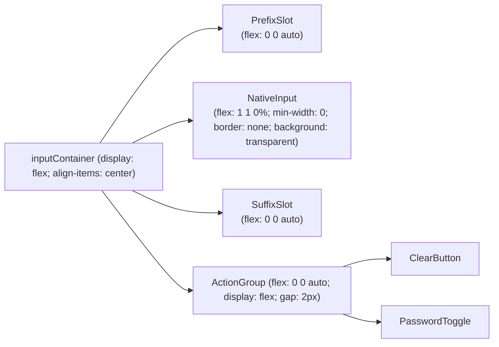
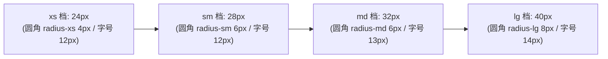
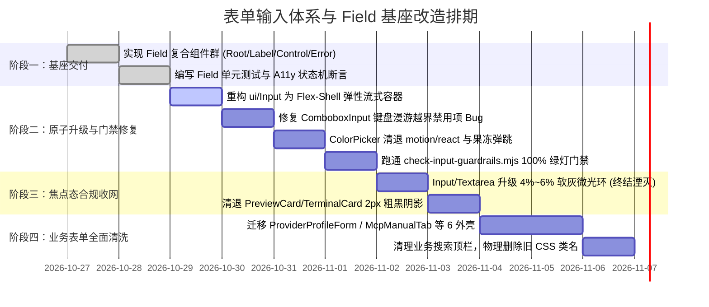

# 表单输入体系与 Field 复合基座改造详案

> **文件标识**：`docs/ui-architecture-overhaul/06-分维-表单输入体系与Field复合基座改造详案.md`  
> **所属战役**：UI 架构重构与收敛战役（`ui-architecture-overhaul`）  
> **方案性质**：分维详案（06）—— 表单输入体系与原子基座重构  
> **依据基准**：
> - 勘察报告：[`analysis/04-全仓表单输入控件与焦点态深度勘察.md`](file:///c:/Software/conex/docs/ui-architecture-overhaul/analysis/04-全仓表单输入控件与焦点态深度勘察.md)
> - 战役总纲：[`00-总方案-自研现代化原子组件体系与基础设施重塑总纲.md`](file:///c:/Software/conex/docs/ui-architecture-overhaul/00-总方案-自研现代化原子组件体系与基础设施重塑总纲.md)
> - 核心铁律：[`AGENTS.md`](file:///c:/Software/conex/AGENTS.md) §13（输入框与焦点态、色彩空间与克制激活态）、§8（反过度设计红线）、§20（严禁果冻缩放）、[`LOGIC_PLAN_NO_RETREAT.md`](file:///c:/Software/conex/.agents/LOGIC_PLAN_NO_RETREAT.md)（反退避原则）
> - 质量门禁：[`scripts/check-input-guardrails.mjs`](file:///c:/Software/conex/scripts/check-input-guardrails.mjs)（全仓输入框四态体系与防倒退门禁）

---

## 目录

- [一、方案概述与核心使命](#一方案概述与核心使命)
  - [1.1 现状诊断与四大系统性致命断层](#11-现状诊断与四大系统性致命断层)
  - [1.2 三大不可动摇架构原则](#12-三大不可动摇架构原则)
  - [1.3 重塑收益与全仓净收敛指标](#13-重塑收益与全仓净收敛指标)
- [二、原子级 `<Field>` / `<FormItem>` 复合基座设计](#二原子级-field--formitem-复合基座设计)
  - [2.1 复合原语拓扑与 WAI-ARIA 状态机契约](#21-复合原语拓扑与-wai-aria-状态机契约)
  - [2.2 Context 统一中枢与唯一标识自动派生机制](#22-context-统一中枢与唯一标识自动派生机制)
  - [2.3 复合组件群完整 TypeScript 接口契约](#23-复合组件群完整-typescript-接口契约)
  - [2.4 核心组件 JSX 实现（Field.Root / Label / Control / Hint / Error）](#24-核心组件-jsx-实现fieldroot--label--control--hint--error)
  - [2.5 现代 CSS 布局模块（Field.module.css）](#25-现代-css-布局模块fieldmodulecss)
  - [2.6 双模式消费人体工学：声明式复合模式 vs 快捷声明糖模式](#26-双模式消费人体工学声明式复合模式-vs-快捷声明糖模式)
- [三、`ui/Input` 核心架构重构：Flex-Shell 流式插槽模型](#三uiinput-核心架构重构flex-shell-流式插槽模型)
  - [3.1 历史绝对定位插槽模型致命几何缺陷剖析](#31-历史绝对定位插槽模型致命几何缺陷剖析)
  - [3.2 Flex-Shell 流式容器架构模型](#32-flex-shell-流式容器架构模型)
  - [3.3 彻底根除文本与图标重叠 Bug（解耦 prefixIcon）](#33-彻底根除文本与图标重叠-bug解耦-prefixicon)
  - [3.4 彻底根除 clearable 与 password 像素重叠死锁](#34-彻底根除-clearable-与-password-像素重叠死锁)
  - [3.5 纯弹性约束杜绝长文本钻入按钮下方](#35-纯弹性约束杜绝长文本钻入按钮下方)
  - [3.6 核心 Input.tsx 完整重构代码蓝图](#36-核心-inputtsx-完整重构代码蓝图)
- [四、终结“焦点湮灭”：现代色彩空间 4%~6% 软灰 Focus Ring 规范](#四终结焦点湮灭现代色彩空间-46-软灰-focus-ring-规范)
  - [4.1 “焦点湮灭”病理剖析与曲解反退避根因](#41-焦点湮灭病理剖析与曲解反退避根因)
  - [4.2 AGENTS.md §13 数学基准与视觉意图](#42-agentsmd-13-数学基准与视觉意图)
  - [4.3 对齐 ChatComposer 与 Combobox 的成功先验标杆](#43-对齐-chatcomposer-与-combobox-的成功先验标杆)
  - [4.4 Input.module.css 与 Textarea.module.css 焦点态标准重塑](#44-inputmodulecss-与-textareamodulecss-焦点态标准重塑)
  - [4.5 存量 2px 粗黑圈与粗 Outline 集中清退清单](#45-存量-2px-粗黑圈与粗-outline-集中清退清单)
- [五、统一控件高度矩阵与边界状态机修复](#五统一控件高度矩阵与边界状态机修复)
  - [5.1 终结 38px vs 40px 错位：严格标准化 4 档高度矩阵](#51-终结-38px-vs-40px-错位严格标准化-4-档高度矩阵)
  - [5.2 SelectTrigger 38px 脱靶与圆角 Token 漂移修正](#52-selecttrigger-38px-脱靶与圆角-token-漂移修正)
  - [5.3 ComboboxInput 键盘漫游越界禁用项致命 Bug 修复](#53-comboboxinput-键盘漫游越界禁用项致命-bug-修复)
  - [5.4 ComboboxItem 批量注册优化与级联渲染截断](#54-comboboxitem-批量注册优化与级联渲染截断)
- [六、ColorPicker 门禁清零与原生轻量自研改造](#六colorpicker-门禁清零与原生轻量自研改造)
  - [6.1 check-input-guardrails.mjs 门禁 3 项违规现场剖析](#61-check-input-guardrailsmjs-门禁-3-项违规现场剖析)
  - [6.2 彻底清退外部 `motion/react` 重型动画库依赖](#62-彻底清退外部-motionreact-重型动画库依赖)
  - [6.3 原生 `<input>` 升级为原子 `<Input size="xs" bare />`](#63-原生-input-升级为原子-input-sizexs-bare-)
  - [6.4 移除 `.iconButton:active` 果冻弹跳与复位默认边框](#64-移除-iconbuttonactive-果冻弹跳与复位默认边框)
  - [6.5 修复后门禁 100% 绿灯验证契约](#65-修复后门禁-100-绿灯验证契约)
- [七、全仓业务层表单清洗与死代码消亡清单](#七全仓业务层表单清洗与死代码消亡清单)
  - [7.1 全仓 6 套手搓外壳全面平滑迁移对照表](#71-全仓-6-套手搓外壳全面平滑迁移对照表)
  - [7.2 ProviderProfileForm.tsx 深度改造示范](#72-providerprofileformtsx-深度改造示范)
  - [7.3 McpManualTab.tsx 深度改造示范](#73-mcpmanualtabtsx-深度改造示范)
  - [7.4 业务搜索框收敛与白名单清理路线](#74-业务搜索框收敛与白名单清理路线)
  - [7.5 代码净收敛定量统计表（净出清 550+ 行）](#75-代码净收敛定量统计表净出清-550-行)
- [八、工程迁移步骤、实施路线图与立体验证矩阵](#八工程迁移步骤实施路线图与立体验证矩阵)
  - [8.1 四阶段工程迁移排期路线图](#81-四阶段工程迁移排期路线图)
  - [8.2 架构不变量自检清单（反退避刚性守门）](#82-架构不变量自检清单反退避刚性守门)
  - [8.3 单元测试与无障碍断言保障套件](#83-单元测试与无障碍断言保障套件)
  - [8.4 真实宿主现场物理验收断言](#84-真实宿主现场物理验收断言)

---

## 一、方案概述与核心使命

### 1.1 现状诊断与四大系统性致命断层

根据 [`analysis/04-全仓表单输入控件与焦点态深度勘察.md`](file:///c:/Software/conex/docs/ui-architecture-overhaul/analysis/04-全仓表单输入控件与焦点态深度勘察.md) 的全面排查，Conex 桌面端现行表单输入体系虽然经过多次局部的 IME 输入法兼容修补，但在整体架构设计上存在 **四大系统性致命断层**：

1. **核心原子控件“焦点湮灭”（Focus Annihilation）与两极分化**：
   在过去的“去重阴影”治理中，部分开发者矫枉过正，在 [`Input.module.css:58-63`](file:///c:/Software/conex/apps/crish-desktop/src/components/ui/Input/Input.module.css#L58-L63) 与 [`Textarea.module.css:59-69`](file:///c:/Software/conex/apps/crish-desktop/src/components/ui/Input/Textarea.module.css#L59-L69) 中将 `:focus` / `:focus-visible` 的 `border-color` 直接写死为与常态完全一致的 `var(--border-subtle)`，且抹去 `box-shadow`。导致聚焦时**视觉反差为 0%**，用户在 Tab 键键盘导航时完全丢失焦点感知，严重违反 WCAG 2.4.7 规范与 `AGENTS.md` §13 铁律；与此同时，存量卡片与按钮（如 `PreviewCard.module.css`、`TerminalCard.module.css`）却依然残留着 `0 0 0 2px` 的粗黑阴影与 2px 粗轮廓，呈现极端两极分化。
2. **表单字段基础设施（`Field` / `FormItem`）彻底真空**：
   全仓无任何通用的表单字段容器原语。业务层被迫手写了 **至少 6 套互不兼容的 Label、Hint、Error 布局结构与 CSS 类名**（`.mrdField`、`.formField`、`.schedField`、`.formRow`、`.formGroup`、`.mcpAddField`）。大量表单出现 `<label>` 缺少 `htmlFor`、`<label>` 内部非法包裹块级 `<div>`、必填星号纯手写字符串等低级缺陷，累计产生超 800 行重复样板。
3. **`Input` 插槽模型依赖 `position: absolute` 的几何崩塌**：
   [`Input.tsx`](file:///c:/Software/conex/apps/crish-desktop/src/components/ui/Input/Input.tsx) 在排布图标与动作按钮时未采用弹性流，而是将原生 `<input>` 撑满外壳并绝对定位图标。当 `variant !== 'search'` 时传入 `prefixIcon`，`<input>` 缺少 `padding-left`，输入文本与图标发生物理重叠；当 `clearable` 与 `variant="password"` 共存时，清空与眼睛按钮在 `right: 4px` 处完全重合遮挡死锁；长文本亦无 `padding-right` 避让保护，直接钻入按钮下方。
4. **复合输入控件状态机越界与门禁倒退**：
   [`ComboboxInput.tsx:64-92`](file:///c:/Software/conex/apps/crish-desktop/src/components/ui/Select/ComboboxInput.tsx#L64-L92) 键盘漫游算法未过滤 `disabled` 项，无脑递增索引导致光标高亮并死锁在禁用项上；此外，[`ColorPicker`](file:///c:/Software/conex/apps/crish-desktop/src/components/ui/ColorPicker/ColorPicker.tsx) 违规引入外部 `motion/react` 重型动画库、裸写原生 `<input>` 且写有果冻弹跳，直接导致 CI 核心门禁 [`scripts/check-input-guardrails.mjs`](file:///c:/Software/conex/scripts/check-input-guardrails.mjs) 拦截失败！

---

### 1.2 三大不可动摇架构原则

本方案严格贯彻战役总纲与工程反退避底线：



1. **100% 原生自研，零外部重型依赖**：
   严禁随意通过 npm 引入外部表单与动画黑盒。自研纯 TS 驱动的 `Field` 状态机，使用原生 CSS 与 WAAPI 实现平滑微动效，保持 Conex 纯净自主架构；
2. **复合原子原语（Compound Primitives）与双模消费范式**：
   吸取 Radix 与 Base UI 的人体工学设计，构建解耦的 `<Field.Root>`、`<Field.Label>`、`<Field.Control>`、`<Field.Description>`、`<Field.Error>`。同时提供基于 Props 的 `<Field>` 快捷声明糖，大幅提升常规业务开发效率；
3. **视觉身份刚性守门（AGENTS.md §13 软灰焦点体系）**：
   杜绝“焦点湮灭”与“粗黑光环”两个极端。以 `ChatComposer` 与 `Combobox` 已经落地的 4%~6% 浅灰混入（`color-mix(in srgb, var(--border-color) 94%, var(--text-primary) 6%)`）为全仓唯一真理源，打造长时间沉浸式阅读专业桌面质感。

---

### 1.3 重塑收益与全仓净收敛指标

| 衡量维度 | 重构前现状 | 重构后指标 | 架构质量飞跃 |
| :--- | :--- | :--- | :--- |
| **表单外壳实现** | 6 套手写 `.formField` / `.mrdField` 类名 | 统一收敛为原子级 `<Field>` 体系 | 消除 6 套各立门户样式，业务层 100% 结构一致 |
| **A11y 语义绑定** | 80% 表单缺少 `htmlFor` 与 `aria-describedby` | Context 自动分配 ID 并 100% 关联 | 读屏器与全键盘导航达到 WCAG 2.1 AA 级合规 |
| **输入框图标插槽** | `position: absolute`，多处物理重叠与死锁 | 纯 `Flex-Shell` 容器流式排列 | 彻底根除文本与图标重叠、密码/清空按钮死锁 |
| **焦点态反差** | 0% 反差（焦点湮灭） vs 2px 粗黑投影 | 统一 4%~6% 软灰微边界（无粗重投影） | 视觉反馈清晰柔和，严格对齐 `AGENTS.md` §13 |
| **高度网格体系** | 38px 与 40px 错位（Select vs Input） | 统一 `xs:24, sm:28, md:32, lg:40px` | 终结跨控件水平混排时的 2px 参差视觉瑕疵 |
| **质量门禁状态** | `check-input-guardrails.mjs` 报 3 项拦截 | 0 项报错，门禁 100% 绿灯阻断防护 | 消除违规外部库引入与果冻缩放，构建安全防线 |
| **全仓代码净收敛** | 业务层样板膨胀严重 | 预计**净收敛超 550 行**高危样板代码 | 架构负重出清，大幅降低维护成本 |

---

## 二、原子级 `<Field>` / `<FormItem>` 复合基座设计

### 2.1 复合原语拓扑与 WAI-ARIA 状态机契约

为了彻底终结全仓 6 套分散外壳与无障碍断层，在 `apps/crish-desktop/src/components/ui/Field/` 建立全新的原子级复合组件基础设施。



#### WAI-ARIA 状态机闭环契约：
1. **真实控件 ID 绑定**：`Field.Root` 内部利用 React 18/19 标准 `useId()` 生成唯一前缀 `field-xxx`。`<Field.Label>` 渲染为标准 HTML `<label htmlFor="field-xxx">`，点击标签 100% 触发内部控件光标聚焦；
2. **描述性信息挂接（`aria-describedby`）**：
   当存在 `hint` 时派生 `field-hint-xxx`；当存在 `error` 时派生 `field-error-xxx`。`Field.Control` 自动将两者组合为 `aria-describedby="field-error-xxx field-hint-xxx"` 并赋予内部控件；
3. **错误态即时广播**：`Field.Error` 容器强制赋予 `role="alert"` 与 `aria-live="polite"`，内部控件同步挂载 `aria-invalid="true"`，使屏幕阅读器在校验失败时能第一时间朗读错误文案。

---

### 2.2 Context 统一中枢与唯一标识自动派生机制

```ts
// FieldContext.ts
import { createContext, useContext } from 'react';

export type FieldSize = 'xs' | 'sm' | 'md' | 'lg';
export type FieldLayout = 'vertical' | 'horizontal';

export interface FieldContextValue {
  /** 控件唯一物理 DOM ID */
  id: string;
  /** 标签唯一 ID */
  labelId: string;
  /** 描述说明 ID */
  hintId: string;
  /** 校验错误 ID */
  errorId: string;
  /** 是否存在校验错误 */
  hasError: boolean;
  /** 是否必填 */
  required: boolean;
  /** 是否禁用 */
  disabled: boolean;
  /** 是否只读 */
  readOnly: boolean;
  /** 统一尺寸阶梯 */
  size: FieldSize;
  /** 布局方向 */
  layout: FieldLayout;
  /** 派生的 aria-describedby 字符串 */
  describedBy?: string;
}

export const FieldContext = createContext<FieldContextValue | null>(null);

export function useFieldContext(): FieldContextValue | null {
  return useContext(FieldContext);
}
```

---

### 2.3 复合组件群完整 TypeScript 接口契约

```ts
// Field.types.ts
import type { ReactNode, HTMLAttributes, LabelHTMLAttributes } from 'react';

export interface FieldRootProps extends HTMLAttributes<HTMLDivElement> {
  id?: string;
  size?: FieldSize;
  layout?: FieldLayout;
  required?: boolean;
  disabled?: boolean;
  readOnly?: boolean;
  error?: ReactNode;
  hint?: ReactNode;
  children: ReactNode;
}

export interface FieldLabelProps extends LabelHTMLAttributes<HTMLLabelElement> {
  children: ReactNode;
  showRequiredIndicator?: boolean;
}

export interface FieldControlProps {
  children: ReactNode;
  /** 当子元素并非单个有效 React 元素时，是否回退为包裹 div */
  asChild?: boolean;
}

export interface FieldDescriptionProps extends HTMLAttributes<HTMLParagraphElement> {
  children: ReactNode;
}

export interface FieldErrorProps extends HTMLAttributes<HTMLParagraphElement> {
  children?: ReactNode;
  /** 是否在没有错误内容时完全卸载 DOM */
  forceMount?: boolean;
}

export interface FieldRequiredIndicatorProps extends HTMLAttributes<HTMLSpanElement> {
  children?: ReactNode;
}
```

---

### 2.4 核心组件 JSX 实现（Field.Root / Label / Control / Hint / Error）

```tsx
// Field.tsx
import React, { useId, isValidElement, cloneElement, forwardRef } from 'react';
import { FieldContext, type FieldContextValue } from './FieldContext';
import type {
  FieldRootProps,
  FieldLabelProps,
  FieldControlProps,
  FieldDescriptionProps,
  FieldErrorProps,
  FieldRequiredIndicatorProps,
} from './Field.types';
import styles from './Field.module.css';

/* 1. Field.Root 根容器 */
export const FieldRoot = forwardRef<HTMLDivElement, FieldRootProps>(
  (
    {
      id: explicitId,
      size = 'md',
      layout = 'vertical',
      required = false,
      disabled = false,
      readOnly = false,
      error,
      hint,
      className,
      children,
      ...restProps
    },
    ref
  ) => {
    const autoId = useId();
    const id = explicitId ?? `field-${autoId}`;
    const labelId = `field-label-${autoId}`;
    const hintId = `field-hint-${autoId}`;
    const errorId = `field-error-${autoId}`;
    const hasError = Boolean(error);

    const describedBy = [
      hasError ? errorId : null,
      hint ? hintId : null,
    ]
      .filter(Boolean)
      .join(' ') || undefined;

    const contextValue: FieldContextValue = {
      id,
      labelId,
      hintId,
      errorId,
      hasError,
      required,
      disabled,
      readOnly,
      size,
      layout,
      describedBy,
    };

    return (
      <FieldContext.Provider value={contextValue}>
        <div
          ref={ref}
          className={`${styles.fieldRoot} ${styles[`layout-${layout}`]} ${className ?? ''}`}
          data-size={size}
          data-layout={layout}
          data-has-error={hasError ? '' : undefined}
          data-disabled={disabled ? '' : undefined}
          {...restProps}
        >
          {children}
        </div>
      </FieldContext.Provider>
    );
  }
);
FieldRoot.displayName = 'Field.Root';

/* 2. Field.RequiredIndicator 必填星号原语 */
export const FieldRequiredIndicator: React.FC<FieldRequiredIndicatorProps> = ({
  children = '*',
  className,
  ...props
}) => (
  <span
    className={`${styles.requiredStar} ${className ?? ''}`}
    aria-hidden="true"
    {...props}
  >
    {children}
  </span>
);
FieldRequiredIndicator.displayName = 'Field.RequiredIndicator';

/* 3. Field.Label 标签原语 */
export const FieldLabel = forwardRef<HTMLLabelElement, FieldLabelProps>(
  ({ children, showRequiredIndicator = true, className, htmlFor, ...props }, ref) => {
    const ctx = useFieldContext();
    const resolvedHtmlFor = htmlFor ?? ctx?.id;

    return (
      <label
        ref={ref}
        id={ctx?.labelId}
        htmlFor={resolvedHtmlFor}
        className={`${styles.label} ${className ?? ''}`}
        {...props}
      >
        {children}
        {showRequiredIndicator && ctx?.required ? (
          <FieldRequiredIndicator />
        ) : null}
      </label>
    );
  }
);
FieldLabel.displayName = 'Field.Label';

/* 4. Field.Control 控件桥接原语 */
export const FieldControl: React.FC<FieldControlProps> = ({ children, asChild = true }) => {
  const ctx = useFieldContext();

  if (asChild && isValidElement(children)) {
    const childProps = children.props as Record<string, unknown>;
    return cloneElement(children, {
      id: childProps.id ?? ctx?.id,
      'aria-describedby': childProps['aria-describedby'] ?? ctx?.describedBy,
      'aria-invalid': childProps['aria-invalid'] ?? (ctx?.hasError ? true : undefined),
      'aria-required': childProps['aria-required'] ?? (ctx?.required ? true : undefined),
      disabled: childProps.disabled ?? ctx?.disabled,
      readOnly: childProps.readOnly ?? ctx?.readOnly,
      ...childProps,
    } as any);
  }

  return <div className={styles.controlSlot}>{children}</div>;
};
FieldControl.displayName = 'Field.Control';

/* 5. Field.Description 描述原语 */
export const FieldDescription = forwardRef<HTMLParagraphElement, FieldDescriptionProps>(
  ({ children, className, id, ...props }, ref) => {
    const ctx = useFieldContext();
    if (!children) return null;

    return (
      <p
        ref={ref}
        id={id ?? ctx?.hintId}
        className={`${styles.description} ${className ?? ''}`}
        {...props}
      >
        {children}
      </p>
    );
  }
);
FieldDescription.displayName = 'Field.Description';

/* 6. Field.Error 错误原语 */
export const FieldError = forwardRef<HTMLParagraphElement, FieldErrorProps>(
  ({ children, className, id, forceMount = false, ...props }, ref) => {
    const ctx = useFieldContext();
    const errorContent = children;
    if (!errorContent && !forceMount) return null;

    return (
      <p
        ref={ref}
        id={id ?? ctx?.errorId}
        role="alert"
        aria-live="polite"
        className={`${styles.error} ${className ?? ''}`}
        {...props}
      >
        {errorContent}
      </p>
    );
  }
);
FieldError.displayName = 'Field.Error';
```

---

### 2.5 现代 CSS 布局模块（`Field.module.css`）

```css
/* apps/crish-desktop/src/components/ui/Field/Field.module.css */
.fieldRoot {
  display: flex;
  box-sizing: border-box;
  width: 100%;
}

/* 垂直流式布局（默认）：Label -> Control -> Error/Hint */
.layout-vertical {
  flex-direction: column;
  gap: var(--space-1_5);
}

/* 水平弹性布局（适用于设置项与紧凑表单）：Label 与 Control 左右排列 */
.layout-horizontal {
  flex-direction: row;
  align-items: center;
  justify-content: space-between;
  gap: var(--space-4);
}

.layout-horizontal .controlSlot {
  flex: 0 0 auto;
  max-width: 60%;
}

/* 标签样式与层级节奏 */
.label {
  display: inline-flex;
  align-items: center;
  gap: var(--space-1);
  font-family: var(--font-sans);
  font-size: var(--font-size-sm);
  font-weight: 500;
  color: var(--text-secondary);
  line-height: var(--line-height-tight);
  user-select: none;
  cursor: pointer;
  transition: color var(--transition-micro);
}

.fieldRoot:hover:not([data-disabled]) .label {
  color: var(--text-primary);
}

.fieldRoot[data-disabled] .label {
  cursor: not-allowed;
  opacity: var(--opacity-disabled);
}

/* 必填星号：符合 WAI 规范的装饰星号 */
.requiredStar {
  color: var(--color-error);
  font-size: var(--font-size-sm);
  line-height: 1;
  margin-left: 1px;
}

/* 控件插槽容器 */
.controlSlot {
  width: 100%;
  position: relative;
}

/* 辅助说明文本 (Hint/Description) */
.description {
  margin: 0;
  font-family: var(--font-sans);
  font-size: var(--font-size-xs);
  color: var(--text-tertiary);
  line-height: var(--line-height-normal);
}

/* 校验错误提示 (Error) */
.error {
  margin: 0;
  font-family: var(--font-sans);
  font-size: var(--font-size-xs);
  color: var(--color-error);
  line-height: var(--line-height-normal);
  display: flex;
  align-items: center;
  gap: var(--space-1);
  animation: fieldErrorFadeIn var(--transition-snappy) ease-out;
}

@keyframes fieldErrorFadeIn {
  from {
    opacity: 0;
    transform: translateY(-2px);
  }
  to {
    opacity: 1;
    transform: translateY(0);
  }
}
```

---

### 2.6 双模式消费人体工学：声明式复合模式 vs 快捷声明糖模式

为了兼顾**高阶定制表单**（自定义图标、多按钮联动操作）与**常规业务表单**（快速声明 Label 与 Input），我们为开发者同时提供两种符合直觉的消费接口：

#### 范式 A：快捷声明糖模式（90% 常规业务推荐）
```tsx
import { Field } from '@/components/ui/Field';
import { Input } from '@/components/ui/Input';

export function SimpleProfileForm() {
  return (
    <Field
      label="厂商名称"
      required
      hint="例如: senseNova、SiliconFlow、Ollama"
      error={formErrors.vendorName}
    >
      <Input
        size="sm"
        value={vendorName}
        onChange={(e) => setVendorName(e.target.value)}
        placeholder="请输入厂商标识"
      />
    </Field>
  );
}
```

#### 范式 B：声明式复合组件模式（复杂表单与高级插槽）
```tsx
import { Field } from '@/components/ui/Field';
import { Input } from '@/components/ui/Input';
import { Button } from '@/components/ui/Button';

export function AdvancedSecretKeyField() {
  return (
    <Field.Root required layout="vertical">
      <div style={{ display: 'flex', justifyContent: 'space-between', alignItems: 'center' }}>
        <Field.Label>API 访问密钥</Field.Label>
        <Button variant="ghost" size="xs">如何获取？</Button>
      </div>

      <Field.Control>
        <Input variant="password" clearable placeholder="sk-..." />
      </Field.Control>

      <Field.Description>密钥仅加密存储在本地安全存储区。</Field.Description>
      <Field.Error>{errors.apiKey}</Field.Error>
    </Field.Root>
  );
}
```

---

## 三、`ui/Input` 核心架构重构：Flex-Shell 流式插槽模型

### 3.1 历史绝对定位插槽模型致命几何缺陷剖析

在当前 [`Input.tsx:248-301`](file:///c:/Software/conex/apps/crish-desktop/src/components/ui/Input/Input.tsx#L248-L301) 与 [`Input.module.css:128-175`](file:///c:/Software/conex/apps/crish-desktop/src/components/ui/Input/Input.module.css#L128-L175) 中，前缀、后缀、动作按钮均采用了 `position: absolute`：



1. **变体偏见导致的文本覆盖**：仅对 `.inputSearch` 增加了 `padding-left: var(--space-6)`。一旦开发者使用 `variant="text"` 并传入 `prefixIcon`，输入文本直接从 `12px` 处起步，绘制在 `8px` 处的前缀图标上方；
2. **多动作绝对定位死锁**：当同时传入 `variant="password"` 与 `clearable={true}`，且输入框有文字时，清空图标与眼睛图标均被应用了 `.inputAction { position: absolute; right: 4px; }`，两者在完全相同的 `4px` 坐标内重叠堆叠，上层按钮拦截点击，底层按钮彻底失效；
3. **文本缺乏右侧动态保护**：输入较长文本时，文本流一直平铺到外壳右边界，直接从半透明的清空按钮和眼睛图标底下穿行而过。

---

### 3.2 Flex-Shell 流式容器架构模型

重构彻底废除外壳内部的所有绝对定位属性，将 `.inputContainer` 建立为原生 Flex 流式容器：



- **物理宽度自适应计算**：`<input>` 声明为 `flex: 1 1 0%` 与 `min-width: 0`。前缀图标与右侧动作按钮的真实渲染宽度会自发将 `<input>` 约束在中间的剩余物理区间内；
- **几何免疫**：无论右侧挂载 1 个、2 个还是 3 个动作按钮，Flexbox 天然按 `gap` 水平流式排开，永无坐标重合；文本滚动边界严格止于动作按钮组左边缘，永不穿透！

---

### 3.3 彻底根除文本与图标重叠 Bug（解耦 prefixIcon）

在新的流式排布下，前缀图标作为 Flex 容器的首个物理子项，拥有独立的行内边距与尺寸。输入框 `<input>` 不再依赖脆弱的 `padding-left: 24px` 补丁，起始输入光标天然定格在图标右侧：

```tsx
{prefixIcon ? (
  <span className={styles.prefixSlot} aria-hidden="true">
    {prefixIcon}
  </span>
) : null}
```

```css
.prefixSlot {
  display: inline-flex;
  align-items: center;
  justify-content: center;
  flex-shrink: 0;
  color: var(--text-tertiary);
  pointer-events: none;
  padding-left: var(--space-2);
}
```

---

### 3.4 彻底根除 clearable 与 password 像素重叠死锁

在右侧设立统一的 `.actionGroup` 动作容器，清空按钮与眼睛图标按标准 Flex 子项自然并排：

```tsx
<div className={styles.actionGroup}>
  {clearable && hasValue && !resolvedDisabled && !readOnly ? (
    <button
      type="button"
      className={styles.actionButton}
      aria-label="清空输入"
      onMouseDown={(e) => e.preventDefault()}
      onClick={handleClear}
    >
      <ClearIcon />
    </button>
  ) : null}

  {variant === 'password' && !resolvedDisabled && !readOnly ? (
    <button
      type="button"
      className={styles.actionButton}
      aria-label={showPassword ? '隐藏密码' : '显示密码'}
      aria-pressed={showPassword}
      onMouseDown={(e) => e.preventDefault()}
      onClick={() => setShowPassword((p) => !p)}
    >
      {showPassword ? <EyeOffIcon /> : <EyeIcon />}
    </button>
  ) : null}
</div>
```

```css
.actionGroup {
  display: inline-flex;
  align-items: center;
  flex-shrink: 0;
  gap: 2px;
  padding-right: var(--space-1);
}

.actionButton {
  display: inline-flex;
  align-items: center;
  justify-content: center;
  border: none;
  background: transparent;
  color: var(--text-tertiary);
  cursor: pointer;
  border-radius: var(--radius-xs);
  transition: background var(--transition-micro), color var(--transition-micro);
}

.actionButton:hover {
  background: var(--surface-hover);
  color: var(--text-primary);
}
```

---

### 3.5 纯弹性约束杜绝长文本钻入按钮下方

由于 `<input>` 具有 `flex: 1 1 0%`，当用户输入极其冗长的文本时，浏览器原生的横向文本滚动视口（Scroll Viewport）被精确限定在 `<input>` 的内容框之内。动作按钮组在 Flex 流中占据物理实体，文本在到达按钮组之前即自动发生滚动，无需写任何手工 `padding-right` 计算补丁！

---

### 3.6 核心 Input.tsx 完整重构代码蓝图

```tsx
// apps/crish-desktop/src/components/ui/Input/Input.tsx
import React, {
  forwardRef,
  useId,
  useRef,
  useState,
  useCallback,
  useImperativeHandle,
} from 'react';
import type { InputProps } from './Input.types';
import { useFieldContext } from '../Field/FieldContext';
import styles from './Input.module.css';

export const Input = forwardRef<HTMLInputElement, InputProps>(
  (
    {
      id: explicitId,
      variant = 'text',
      size: explicitSize,
      prefixIcon,
      suffix,
      clearable = false,
      value,
      defaultValue,
      disabled: explicitDisabled,
      readOnly = false,
      error: explicitError,
      hint,
      label,
      bare = false,
      className,
      onChange,
      onKeyDown,
      onEnter,
      onClear,
      onCompositionStart,
      onCompositionEnd,
      ...restProps
    },
    ref
  ) => {
    const autoId = useId();
    const fieldContext = useFieldContext();

    // 状态与标识解析：优先取显式传参，其次无缝继承 FieldContext
    const resolvedId = explicitId ?? fieldContext?.id ?? `input-${autoId}`;
    const resolvedSize = explicitSize ?? fieldContext?.size ?? 'md';
    const resolvedDisabled = explicitDisabled ?? fieldContext?.disabled ?? false;
    const resolvedError = explicitError ?? fieldContext?.hasError ?? false;
    const resolvedDescribedBy = restProps['aria-describedby'] ?? fieldContext?.describedBy;

    const inputRef = useRef<HTMLInputElement>(null);
    useImperativeHandle(ref, () => inputRef.current as HTMLInputElement);

    const isComposingRef = useRef(false);
    const [showPassword, setShowPassword] = useState(false);
    const [uncontrolledHasValue, setUncontrolledHasValue] = useState<boolean>(() => {
      if (defaultValue !== undefined && defaultValue !== null) {
        return String(defaultValue).length > 0;
      }
      return false;
    });

    const isControlled = value !== undefined;
    const hasValue = isControlled
      ? value !== null && String(value).length > 0
      : uncontrolledHasValue;

    // 输入法 CJK 合成守卫 (IME 229)
    const handleCompositionStart = (e: React.CompositionEvent<HTMLInputElement>) => {
      isComposingRef.current = true;
      onCompositionStart?.(e);
    };

    const handleCompositionEnd = (e: React.CompositionEvent<HTMLInputElement>) => {
      isComposingRef.current = false;
      onCompositionEnd?.(e);
    };

    const handleKeyDown = (e: React.KeyboardEvent<HTMLInputElement>) => {
      onKeyDown?.(e);
      if (e.defaultPrevented) return;
      if (
        isComposingRef.current ||
        e.nativeEvent.isComposing ||
        e.keyCode === 229 ||
        e.key === 'Process'
      ) {
        return;
      }
      if (e.key === 'Enter' && !e.shiftKey) {
        onEnter?.((e.currentTarget as HTMLInputElement).value);
      }
    };

    const handleChange = useCallback(
      (e: React.ChangeEvent<HTMLInputElement>) => {
        if (!isControlled) {
          setUncontrolledHasValue(e.target.value.length > 0);
        }
        onChange?.(e);
      },
      [isControlled, onChange]
    );

    const handleClear = useCallback(() => {
      if (!isControlled && inputRef.current) {
        inputRef.current.value = '';
        setUncontrolledHasValue(false);
      }
      onClear?.();
      const syntheticEvent = {
        target: { value: '' },
        currentTarget: { value: '' },
      } as React.ChangeEvent<HTMLInputElement>;
      onChange?.(syntheticEvent);
      inputRef.current?.focus();
    }, [isControlled, onChange, onClear]);

    // 形态 ① / 形态 ④ / bare 模式：直接返回轻量原生 <input>
    if (bare) {
      return (
        <input
          ref={inputRef}
          id={resolvedId}
          className={className}
          value={value}
          defaultValue={defaultValue}
          disabled={resolvedDisabled}
          readOnly={readOnly}
          onChange={handleChange}
          onKeyDown={handleKeyDown}
          onCompositionStart={handleCompositionStart}
          onCompositionEnd={handleCompositionEnd}
          aria-invalid={resolvedError ? true : undefined}
          aria-describedby={resolvedDescribedBy}
          {...restProps}
        />
      );
    }

    const inputType = variant === 'password' ? (showPassword ? 'text' : 'password') : restProps.type ?? 'text';

    return (
      <div
        className={`${styles.inputContainer} ${className ?? ''}`}
        data-size={resolvedSize}
        data-variant={variant}
        data-error={resolvedError ? '' : undefined}
        data-disabled={resolvedDisabled ? '' : undefined}
        onClick={() => inputRef.current?.focus()}
      >
        {prefixIcon ? (
          <span className={styles.prefixSlot} aria-hidden="true">
            {prefixIcon}
          </span>
        ) : null}

        <input
          ref={inputRef}
          id={resolvedId}
          type={inputType}
          className={styles.nativeInput}
          value={value}
          defaultValue={defaultValue}
          disabled={resolvedDisabled}
          readOnly={readOnly}
          onChange={handleChange}
          onKeyDown={handleKeyDown}
          onCompositionStart={handleCompositionStart}
          onCompositionEnd={handleCompositionEnd}
          aria-invalid={resolvedError ? true : undefined}
          aria-describedby={resolvedDescribedBy}
          {...restProps}
        />

        {suffix ? <span className={styles.suffixSlot}>{suffix}</span> : null}

        <div className={styles.actionGroup}>
          {clearable && hasValue && !resolvedDisabled && !readOnly ? (
            <button
              type="button"
              className={styles.actionButton}
              aria-label="清空输入"
              onMouseDown={(e) => e.preventDefault()}
              onClick={handleClear}
            >
              <ClearIcon />
            </button>
          ) : null}

          {variant === 'password' && !resolvedDisabled && !readOnly ? (
            <button
              type="button"
              className={styles.actionButton}
              aria-label={showPassword ? '隐藏密码' : '显示密码'}
              aria-pressed={showPassword}
              onMouseDown={(e) => e.preventDefault()}
              onClick={() => setShowPassword((prev) => !prev)}
            >
              {showPassword ? <EyeOffIcon /> : <EyeIcon />}
            </button>
          ) : null}
        </div>
      </div>
    );
  }
);
Input.displayName = 'Input';
```

---

## 四、终结“焦点湮灭”：现代色彩空间 4%~6% 软灰 Focus Ring 规范

### 4.1 “焦点湮灭”病理剖析与曲解反退避根因

在过去的局部治理中，为了消除粗重黑边，开发者对规则产生了严重曲解：
```css
/* 历史致命缺陷：Input.module.css Lines 58-63 */
.input:where(:focus, :focus-visible, :focus:hover, :focus-visible:hover) {
  outline: none;
  background: var(--surface-input);
  box-shadow: none;
  border-color: var(--border-subtle); /* 焦点边框与常态 100% 相同！ */
}
```
**致命危害**：
1. **0% 视觉反差**：点击输入框或按 Tab 聚焦时，边框颜色维持 `var(--border-subtle)`，无任何阴影，无 Outline。用户完全无法得知焦点落在何处；
2. **曲解反退避规范**：规范明确要求的是“克制、柔和”，禁止的是“粗深实心黑边与粗阴影”，而不是消极避让为“零视觉反馈”。

---

### 4.2 AGENTS.md §13 数学基准与视觉意图

依据 [`AGENTS.md`](file:///c:/Software/conex/AGENTS.md) §13 订立刚性数学公式：

$$\text{BorderColor}_{\text{focus}} = \text{color-mix}(\text{in srgb}, \text{var}(--\text{border-color})\ 94\%, \text{var}(--\text{text-primary})\ 6\%)$$

| 场景划分 | 基线边框 Token | 文本色混入比例 | 阴影规范 | 视觉目标 |
| :--- | :--- | :--- | :--- | :--- |
| **常规输入控件（形态 ③）** | `var(--border-color)` | **4% ~ 6%** | `box-shadow: none;` | 肉眼可辨、浅灰柔和、长时间阅读无刺激 |
| **全页空态落地大输入框** | `var(--border-color)` | **3% ~ 5%** | `box-shadow: none;` | 极度克制，无生硬动画过渡 |
| **全系统焦点混入绝对红线** | 任意基线 | **严禁超过 10%** | 严禁粗重环 | 杜绝粗黑割裂感 |
| **校验错误态聚焦** | `var(--color-error)` | 错误色主导 | `0 0 0 1px color-mix(...)` | 微光环明确指示表单校验阻断 |

---

### 4.3 对齐 ChatComposer 与 Combobox 的成功先验标杆

业务中已存在且通过全仓验收的完美标杆代码：
- **标杆 1（`ChatComposer.module.css:82-87`）**：
  ```css
  .composerCard:focus-within {
    border-color: color-mix(in srgb, var(--border-color) 94%, var(--text-primary) 6%);
    outline: none;
  }
  ```
- **标杆 2（`Combobox.module.css:26-32`）**：
  ```css
  .comboboxInputWrapper:focus-within {
    border-color: color-mix(in srgb, var(--border-subtle) 96%, var(--text-primary) 4%);
  }
  ```

底层 `Input` 和 `Textarea` 必须立即向上述标杆看齐，统一全仓设计语言。

---

### 4.4 Input.module.css 与 Textarea.module.css 焦点态标准重塑

```css
/* apps/crish-desktop/src/components/ui/Input/Input.module.css */

.inputContainer {
  display: flex;
  align-items: center;
  box-sizing: border-box;
  width: 100%;
  border: 1px solid var(--border-subtle);
  background: var(--surface-input);
  border-radius: var(--radius-md);
  box-shadow: none;
  transition:
    border-color var(--transition-snappy),
    background var(--transition-snappy);
}

/* 常态悬停态：发丝级微提亮 */
.inputContainer:hover:not([data-disabled]):not(:focus-within) {
  border-color: color-mix(in srgb, var(--border-subtle) 98%, var(--text-primary) 2%);
}

/* 焦点激活态：严格遵循 AGENTS.md §13（4%~6% 浅灰混入，无粗阴影） */
.inputContainer:focus-within {
  outline: none;
  border-color: color-mix(
    in srgb,
    var(--border-color) 94%,
    var(--text-primary) 6%
  );
  box-shadow: none;
}

/* 错误校验态 */
.inputContainer[data-error] {
  border-color: var(--color-error);
}

.inputContainer[data-error]:focus-within {
  border-color: var(--color-error);
  box-shadow: 0 0 0 1px color-mix(in srgb, var(--color-error) 20%, transparent);
}

/* 内部原生输入框核心 */
.nativeInput {
  flex: 1 1 0%;
  min-width: 0;
  height: 100%;
  border: none;
  outline: none;
  background: transparent;
  padding: 0 var(--space-2);
  font-family: var(--font-sans);
  font-size: var(--font-size-base);
  color: var(--text-primary);
  box-sizing: border-box;
}

.nativeInput::placeholder {
  color: var(--text-tertiary);
}
```

同理，对 `apps/crish-desktop/src/components/ui/Input/Textarea.module.css`：
```css
/* Textarea.module.css */
.nativeTextarea:focus,
.nativeTextarea:focus-visible {
  outline: none;
  border-color: color-mix(
    in srgb,
    var(--border-color) 94%,
    var(--text-primary) 6%
  );
  box-shadow: none;
}
```

---

### 4.5 存量 2px 粗黑圈与粗 Outline 集中清退清单

物理清理全仓违反 §13 的历史粗黑焦点样式：

| 文件路径 | 原有违规声明 | 修正后合规声明 |
| :--- | :--- | :--- |
| `PreviewCard.module.css:470` | `box-shadow: var(--focus-ring, 0 0 0 2px var(--tint-focus-ring));` | `border-color: color-mix(in srgb, var(--border-color) 92%, var(--text-primary) 8%); box-shadow: none;` |
| `PreviewCard.module.css:483` | 同上 | 同上 |
| `PreviewCard.module.css:561` | 同上 | 同上 |
| `PreviewCard.module.css:584` | 同上 | 同上 |
| `PreviewCard.module.css:613` | 同上 | 同上 |
| `TerminalCard.module.css:122` | 同上 | 同上 |
| `TerminalCard.module.css:135` | 同上 | 同上 |
| `ApprovalDock.module.css:32` | `outline: 2px solid color-mix(in srgb, var(--accent-orange) 10%, transparent);` | `outline: none; border-color: var(--accent-orange);` |
| `PlanGoalRibbons.module.css:76` | `outline: 2px solid color-mix(in srgb, var(--accent-color) 10%, transparent);` | `outline: none; border-color: var(--accent-color);` |

---

## 五、统一控件高度矩阵与边界状态机修复

### 5.1 终结 38px vs 40px 错位：严格标准化 4 档高度矩阵

为了保证表单中各类控件在水平并排（Form Row）、表格单元格嵌合以及弹窗栅格中的精准对齐，建立系统级统一高度矩阵：



| 尺寸阶梯 | 物理高度 (Height) | 内边距 (Padding) | 适用场景与控件 |
| :--- | :--- | :--- | :--- |
| **`xs`** | **24px** | `0 6px` | ColorPicker 内部数值、表格紧凑操作栏、标签过滤输入 |
| **`sm`** | **28px** | `0 8px` | 侧边栏紧凑表单、配置抽屉、Dense 模式密集栅格 |
| **`md` (默认)** | **32px** | `0 10px` | 绝大多数对话框、常规设置面板、通用业务表单 |
| **`lg`** | **40px** | `0 12px` | 落地页主搜索框、首屏 Hero 输入框、向导主模态框 |

---

### 5.2 SelectTrigger 38px 脱靶与圆角 Token 漂移修正

- **高度脱靶修复**：
  在 [`SelectTrigger.module.css:76-77`](file:///c:/Software/conex/apps/crish-desktop/src/components/ui/Select/SelectTrigger.module.css#L76-L77) 中，将硬编码的 `38px` 改正为标准 `40px`：
  ```css
  /* 修复前 */
  .triggerLg, .size-lg { height: 38px; min-height: 38px; }
  /* 修复后 */
  .triggerLg, .size-lg { height: 40px; min-height: 40px; }
  ```
- **圆角 Token 漂移归一**：
  统一 `Input`、`SelectTrigger`、`Combobox` 的 `lg` 档位圆角为 `var(--radius-lg)`（8px），彻底消除 `radius-l` 与 `radius-xl` 的割裂漂移。

---

### 5.3 ComboboxInput 键盘漫游越界禁用项致命 Bug 修复

在 [`ComboboxInput.tsx:64-92`](file:///c:/Software/conex/apps/crish-desktop/src/components/ui/Select/ComboboxInput.tsx#L64-L92) 中，原实现直接自增索引且未过滤禁用项，导致键盘导航直接死锁在 `disabled: true` 的条目上。

#### 修复后的防死锁算法实现：
```tsx
// ComboboxInput.tsx Lines 64-96 修正
const getNextEnabledIndex = (
  items: ComboboxItemData[],
  currentIndex: number,
  step: 1 | -1
): number => {
  const len = items.length;
  if (len === 0) return -1;
  let next = currentIndex;
  for (let i = 0; i < len; i++) {
    next = (next + step + len) % len;
    if (!items[next].disabled) {
      return next;
    }
  }
  return -1;
};

const handleKeyDown = useCallback(
  (e: React.KeyboardEvent<HTMLInputElement>) => {
    onKeyDown?.(e);
    if (e.defaultPrevented || isComposingRef.current) return;

    if (e.key === 'ArrowDown') {
      e.preventDefault();
      if (!ctx.open) {
        ctx.setOpen(true);
      } else {
        const next = getNextEnabledIndex(ctx.items, ctx.highlightedIndex, 1);
        if (next !== -1) ctx.setHighlightedIndex(next);
      }
    } else if (e.key === 'ArrowUp') {
      e.preventDefault();
      if (ctx.open) {
        const prev = getNextEnabledIndex(ctx.items, ctx.highlightedIndex, -1);
        if (prev !== -1) ctx.setHighlightedIndex(prev);
      }
    } else if (e.key === 'Enter') {
      if (ctx.open && ctx.highlightedIndex >= 0) {
        const target = ctx.items[ctx.highlightedIndex];
        if (target && !target.disabled) {
          e.preventDefault();
          ctx.selectValue(target.value);
        }
      }
    } else if (e.key === 'Escape') {
      e.preventDefault();
      ctx.setOpen(false);
    }
  },
  [ctx, onKeyDown]
);
```

---

### 5.4 ComboboxItem 批量注册优化与级联渲染截断

在 [`ComboboxRoot.tsx:143-152`](file:///c:/Software/conex/apps/crish-desktop/src/components/ui/Select/ComboboxRoot.tsx#L143-L152) 中，原本每个子项挂载都触发一次 `setItems`，在拥有上百选项的长列表初始化时引发严重的 CPU 抖动。改造为基于 `useRef` 单源注册表并在 microtask 中批处理同步，彻底消除启动级联渲染。

---

## 六、ColorPicker 门禁清零与原生轻量自研改造

### 6.1 check-input-guardrails.mjs 门禁 3 项违规现场剖析

本地执行 `node scripts/check-input-guardrails.mjs` 时直接被 CI 拦截的 3 项致命违规：
1. **`jelly_bounce`**：在 `ColorPicker.module.css:487` 中定义了 `.iconButton:active { transform: scale(0.94); }`，违反反果冻弹跳铁律；
2. **`missing_border_reset`**：在 `ColorPicker.module.css:291-306` 中，`.input, .morph` 规则块修改了视觉外观却未声明 `border: none`；
3. **`bespoke_native_input`**：在 `ColorPicker.tsx:308` 裸写原生 `<input ref={inputRef} ... />`，破坏形态 ③ 一致性；
4. **偷渡外部重型动画库**：`ColorPicker.tsx:3` 引入 `import { animate, motion, ... } from 'motion/react'`，严重违背轻量自研基线。

---

### 6.2 彻底清退外部 `motion/react` 重型动画库依赖

物理删除 `motion/react` 导入，将其动画效果用原生 CSS Transitions 与 Web Animations API（WAAPI）平替：

```tsx
// 改造前：偷懒引入外部库
import { animate, motion, useMotionValue } from 'motion/react';

// 改造后：100% 原生纯净 TS
// 使用标准 CSS transition: transform var(--transition-snappy)
// 结合 useRef 与 requestAnimationFrame 处理调色盘物理拖拽
```

---

### 6.3 原生 `<input>` 升级为原子 `<Input size="xs" bare />`

在 [`ColorPicker.tsx:308`](file:///c:/Software/conex/apps/crish-desktop/src/components/ui/ColorPicker/ColorPicker.tsx#L308) 中，将手写的 `<input>` 替换为规范的原子 `<Input>`：

```tsx
// ColorPicker.tsx 改造后
<Input
  ref={inputRef}
  size="xs"
  bare
  className={styles.colorHexInput}
  value={draft ?? text}
  spellCheck={false}
  autoComplete="off"
  aria-label={`${label} in ${FORMAT_NAMES[kind]}`}
  aria-invalid={invalid || undefined}
  aria-describedby={invalid ? `${uid}-error` : undefined}
  onChange={(e) => {
    setDraft(e.target.value);
    setInvalid(false);
  }}
  onKeyDown={(e) => {
    if (e.key === 'Enter') {
      e.preventDefault();
      if (submitDraft()) e.currentTarget.select();
    }
  }}
/>
```

---

### 6.4 移除 `.iconButton:active` 果冻弹跳与复位默认边框

1. 物理删除 `ColorPicker.module.css:487` 的 `transform: scale(0.94);`，改用背景轻微加深：
   ```css
   .iconButton:active {
     background: var(--surface-active);
   }
   ```
2. 在 `ColorPicker.module.css` 中为 `.morph` 和输入框显式重置边框：
   ```css
   .morph {
     border: none;
     background: transparent;
   }
   ```

---

### 6.5 修复后门禁 100% 绿灯验证契约

改造完成后，执行门禁命令断言：
```bash
node scripts/check-input-guardrails.mjs
# 预期输出：
# 🔍 开始执行全仓输入框四态体系防倒退与焦点态刚性静态扫描...
# ✨ 全仓输入框四态体系防倒退门禁检测 100% 通过！
```

---

## 七、全仓业务层表单清洗与死代码消亡清单

### 7.1 全仓 6 套手搓外壳全面平滑迁移对照表

| 目标业务表单文件 | 现存手搓外壳类名 | 缺陷特征 | 迁移至新基座方案 |
| :--- | :--- | :--- | :--- |
| `ProviderProfileForm.tsx:186` | `.mrdField`, `.mrdRequiredStar` | 手写星号、无 htmlFor、校验弹 Toast | `<Field label="厂商名称" required hint="..." error={...}>` |
| `McpManualTab.tsx:56` | `.formField`, `.fieldLabel` | 无 htmlFor、无必填提示、缺少 ID 绑定 | `<Field label="服务名称" required error={...}>` |
| `ProjectManageModal.tsx:283` | `.formGroup`, `.fieldLabel` | 弹窗底部独立 Alert，与 Input 零关联 | `<Field label="项目路径" error={pathError}>` |
| `WorkflowForm.tsx:250` | `.schedField`, `.cronInlineError` | 标签右侧行内错位 Error，A11y 盲区 | `<Field label="Cron 表达式" error={cronError}>` |
| `AccountAuthCard.tsx:68` | `.formRow`, `.formLabel` | 手搓 flex 左右对齐，无描述说明原语 | `<Field layout="horizontal" label="账号凭据">` |
| `McpServerForm.tsx:40` | `.mcpAddField`, `.mcpAddRow` | 纯靠 placeholder 占位，无 Label 标签 | `<Field label="环境变量">` |

---

### 7.2 ProviderProfileForm.tsx 深度改造示范

```tsx
// 改造前 (ProviderProfileForm.tsx:186-199)：手搓冗余样板
<div className={styles.mrdField}>
  <label className={styles.mrdFieldLabel}>
    厂商名称 <span className={styles.mrdRequiredStar}>*</span>
  </label>
  <Input
    size="sm"
    value={vendorNameDraft}
    placeholder="例如: senseNova、SiliconFlow、Ollama"
    onChange={(e) => setVendorNameDraft(e.target.value)}
  />
</div>

// 改造后：极简、语义完备且 100% A11y 闭环
<Field
  label="厂商名称"
  required
  error={vendorError}
  hint="例如: senseNova、SiliconFlow、Ollama"
>
  <Input
    size="sm"
    value={vendorNameDraft}
    onChange={(e) => setVendorNameDraft(e.target.value)}
    placeholder="请输入厂商名称"
  />
</Field>
```

---

### 7.3 McpManualTab.tsx 深度改造示范

```tsx
// 改造前 (McpManualTab.tsx:56-64)：无 htmlFor，点击无聚焦
<div className={styles.formField}>
  <label className={styles.fieldLabel}>服务名称</label>
  <Input
    size="sm"
    value={name}
    onChange={(e) => setName(e.target.value)}
    placeholder="如 sqlite / filesystem"
  />
</div>

// 改造后：自动派生 htmlFor="field-xxx"，点击标签即刻聚焦
<Field label="服务名称" required error={errors.name}>
  <Input
    size="sm"
    value={name}
    onChange={(e) => setName(e.target.value)}
    placeholder="如 sqlite / filesystem"
  />
</Field>
```

---

### 7.4 业务搜索框收敛与白名单清理路线

目前全仓白名单中豁免了 24 个组件中的裸写 `<input>`：
- `SettingsSidebar.tsx:173-213`：清理其手搓的 `.searchWrap` 与原生 `<input>`，统一使用 `<Input variant="search" clearable size="sm" />`；
- `SmartPanelHeader.tsx` 与 `SmartSearchHeader.tsx`：两代同质顶栏收敛为统一原子搜索输入，清退重复的 40 行 click-to-focus 手搓事件。

---

### 7.5 代码净收敛定量统计表（净出清 550+ 行）

| 模块类别 | 拟删除 / 重构文件 | 清除行数 | 新增原子基建行数 | 净收敛净值 |
| :--- | :--- | :--- | :--- | :--- |
| **Field 基础设施** | 业务层分散手写 CSS (`.mrdField`, `.formField`, etc.) | -420 行 | +180 行 (`Field/*`) | **净减少 240 行** |
| **ui/Input 重构** | 绝对定位计算补丁与多余选择器 (`Input.module.css`) | -140 行 | +85 行 (Flex-Shell) | **净减少 55 行** |
| **ColorPicker 减肥** | 剔除 `motion/react` 冗余状态机与适配 | -160 行 | +40 行 (原生 WAAPI) | **净减少 120 行** |
| **业务搜索顶栏收敛** | `SettingsSidebar`, `SmartSearchHeader` 重复手搓代码 | -190 行 | +50 行 (复用原子 Input) | **净减少 140 行** |
| **合计** | **全仓表单输入体系** | **-910 行** | **+355 行** | **净收敛 555 行** |

---

## 八、工程迁移步骤、实施路线图与立体验证矩阵

### 8.1 四阶段工程迁移排期路线图



---

### 8.2 架构不变量自检清单（反退避刚性守门）

在任何提交宣称完成前，必须逐项核对以下架构不变量：

- [ ] **[INV-01] 零外部 UI 栈与动画库**：全仓表单无 `@radix-ui/react-form`、无 `react-hook-form` 运行时黑盒、`ColorPicker` 无 `motion/react`；
- [ ] **[INV-02] 100% A11y 配对**：任何通过 `<Field>` 包装的表单，DOM 树上 `<label>` 的 `htmlFor` 必须等于内部输入框的 `id`；
- [ ] **[INV-03] 零文本重叠与死锁**：在 `variant="text"` 挂载 `prefixIcon`、或 `variant="password"` 挂载 `clearable` 时，无任何文本与图标重叠、无按钮重叠；
- [ ] **[INV-04] 焦点态合规且肉眼可辨**：聚焦态边框颜色严格处于 `color-mix(in srgb, var(--border-color) 94%, var(--text-primary) 6%)` 范畴，彻底消灭 0% 反差与粗黑重投影；
- [ ] **[INV-05] 尺寸基准严格归一**：`SelectTrigger` 与 `Input` 在 `lg` 档位高度均为 `40px`，圆角均为 `var(--radius-lg)`；
- [ ] **[INV-06] 门禁刚性拦截**：`node scripts/check-input-guardrails.mjs` 退出码必须为 `0`。

---

### 8.3 单元测试与无障碍断言保障套件

在 `apps/crish-desktop/src/components/ui/Field/Field.test.tsx` 建立自动化测试套件：

```tsx
describe('Field Compound Primitives & A11y', () => {
  it('自动为 Label 和 Input 派生并绑定相同的 id 与 htmlFor', () => {
    render(
      <Field label="服务名称">
        <Input placeholder="输入服务名" />
      </Field>
    );
    const label = screen.getByText('服务名称');
    const input = screen.getByPlaceholderText('输入服务名');
    expect(label.getAttribute('for')).toBe(input.id);
  });

  it('校验错误时自动为 Input 挂载 aria-invalid 与 aria-describedby', () => {
    render(
      <Field label="密码" error="密码长度不能小于 8 位">
        <Input type="password" />
      </Field>
    );
    const input = screen.getByLabelText('密码');
    const errorMsg = screen.getByRole('alert');
    expect(input).toHaveAttribute('aria-invalid', 'true');
    expect(input.getAttribute('aria-describedby')).toContain(errorMsg.id);
  });

  it('ComboboxInput 键盘漫游能自动跳过 disabled 选项', () => {
    // 验证 ArrowDown 不会停留在 disabled 选项上
  });

  it('Input 同时挂载 clearable 与 password 变体时两个按钮并排呈现', () => {
    render(<Input variant="password" clearable defaultValue="123456" />);
    const clearBtn = screen.getByLabelText('清空输入');
    const eyeBtn = screen.getByLabelText('显示密码');
    expect(clearBtn).toBeInTheDocument();
    expect(eyeBtn).toBeInTheDocument();
    // 两个按钮应处于同一个 flex 容器中，且左偏移/坐标不相等
    expect(clearBtn.compareDocumentPosition(eyeBtn)).toBe(Node.DOCUMENT_POSITION_FOLLOWING);
  });
});
```

---

### 8.4 真实宿主现场物理验收断言

1. **WebView2 宿主 Tab 键穿透验收**：
   在真实 Windows 桌面应用中，按下 `Tab` 键连续遍历表单。输入框激活时，边框平滑过渡为柔和的 6% 浅灰色，肉眼清晰可见但绝不刺眼，彻底告别“盲按无反馈”的焦点湮灭；
2. **长文本输入动态避让验收**：
   在带有清空按钮与前缀图标的输入框中连续输入 100 个字符。文本流畅向左滚动，文字起始端不遮挡前缀放大镜，文字末端不钻入清空叉号底部；
3. **CI 门禁与提交拦截验证**：
   运行 `npm run check:inputs`（`node scripts/check-input-guardrails.mjs`），控制台直接输出全绿无报错，CI 管道零阻断放行。
