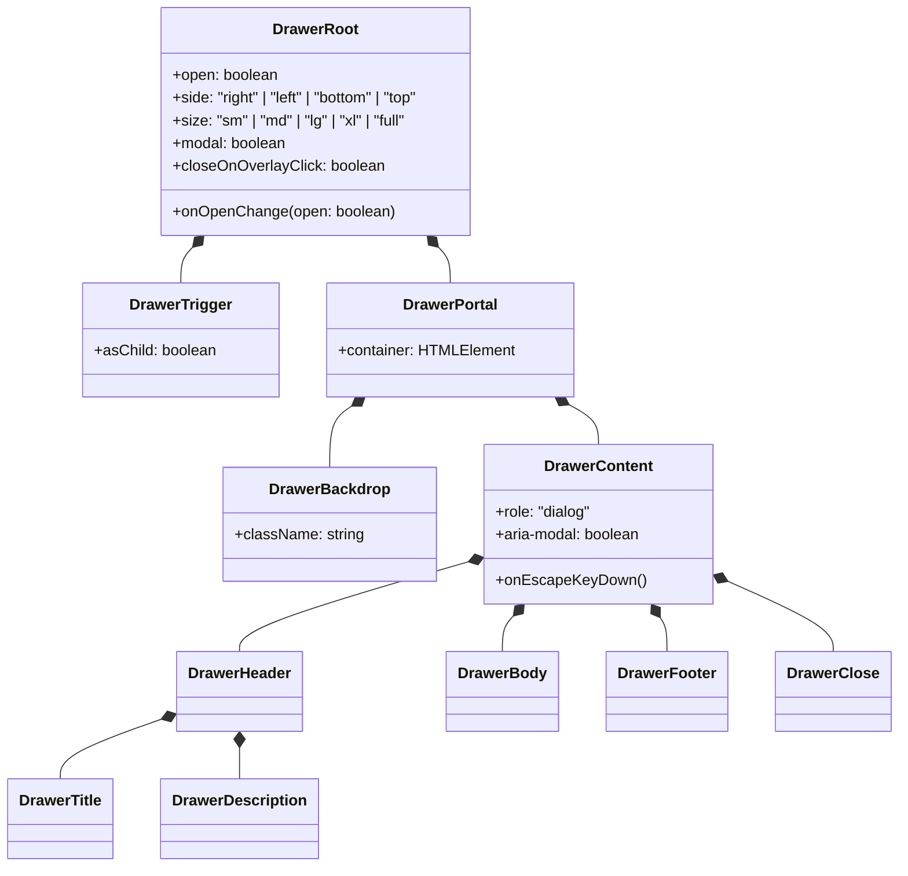

# 07-分维：表面色阶 $e_0 \sim e_5$、同心圆角与 Drawer 抽屉基座详案

> **文档标识**：`docs/ui-architecture-overhaul/07-分维-表面色阶e0-e5同心圆角与Drawer抽屉基座详案.md`  
> **方案性质**：UI 架构全面重塑战役扩充分维详案（维度 07）  
> **核心使命**：彻底根除暗黑模式表面色阶倒挂（修复卡片比外壳更黑的“黑洞凹坑”与 AttachmentCard 悬停下潜），建立全仓刚性同心圆角欧几里得几何数学体系（消除 41.5% 对角线挤压畸变），交付自研零外依赖标准 `<Drawer>` / `<Sheet>` 复合组件原子基座，清退全仓 4 类手搓侧拉抽屉。  
> **权威依据**：`analysis/05-全仓卡片抽屉与表面层级深度勘察.md`、`LOGIC_PLAN_NO_RETREAT.md`、`ANTI_OVERENGINEERING_GUARDRAILS.md`、`AGENTS.md` §7、§12、§13、§14。

---

## 目录

1. [方案概述与顶层裁决](#一方案概述与顶层裁决)
2. [表面色阶梯 $e_0 \sim e_5$ 拓扑重构与暗黑模式倒挂根治](#二表面色阶梯-e_0-sim-e_5-拓扑重构与暗黑模式倒挂根治)
   - [2.1 物理光照逆平方模型与六级表面单调性定义](#21-物理光照逆平方模型与六级表面单调性定义)
   - [2.2 tokens-surface.css 暗黑模式倒挂根因与数学纠偏](#22-tokens-surfacecss-暗黑模式倒挂根因与数学纠偏)
   - [2.3 模态弹窗 Dialog“黑洞深坑”与 AttachmentCard“悬停变暗”即刻修复](#23-模态弹窗-dialog黑洞深坑与-attachmentcard悬停变暗即刻修复)
   - [2.4 全仓私有/废弃背景变量清洗与收敛映射矩阵](#24-全仓私有废弃背景变量清洗与收敛映射矩阵)
3. [同心圆角（Concentric Radius）欧几里得几何数学规范](#三同心圆角concentric-radius欧几里得几何数学规范)
   - [3.1 第一公理推导与共心圆弧数学模型](#31-第一公理推导与共心圆弧数学模型)
   - [3.2 违反对称性导致的 41.5% 对角线挤压形变证明](#32-违反对称性导致的-415-对角线挤压形变证明)
   - [3.3 声明式动态同心圆角 Token 与 Context 级联体系](#33-声明式动态同心圆角-token-与-context-级联体系)
   - [3.4 全仓 864 处 border-radius 重灾区纠偏实施规范](#34-全仓-864-处-border-radius-重灾区纠偏实施规范)
4. [自研标准 `<Drawer>` / `<Sheet>` 复合组件原子基座](#四自研标准-drawer--sheet-复合组件原子基座)
   - [4.1 架构设计与 Compound Components 拓扑](#41-架构设计与-compound-components-拓扑)
   - [4.2 双模式支持：模态遮罩（Modal Overlay）与非破坏性侧推（Non-modal Push）](#42-双模式支持模态遮罩modal-overlay与非破坏性侧推non-modal-push)
   - [4.3 状态机与核心调度中枢（LayerStackManager + FocusTrap + useRestoreFocus）](#43-状态机与核心调度中枢layerstackmanager--focustrap--userestorefocus)
   - [4.4 现代 CSS 动效规范（0-JS @starting-style + 3D 正交平移）](#44-现代-css-动效规范0-js-starting-style--3d-正交平移)
   - [4.5 表面色阶与同心圆角刚性绑定](#45-表面色阶与同心圆角刚性绑定)
5. [容器原子基元唤醒与业务层减重清洗方案](#五容器原子基元唤醒与业务层减重清洗方案)
   - [5.1 ui/Card 与 ui/Row 全面升级为复合基元并注入同心 Context](#51-uicard-与-uirow-全面升级为复合基元并注入同心-context)
   - [5.2 唤醒闲置基元 ui/DisclosureAffordance 收敛折叠指示符](#52-唤醒闲置基元-uidisclosureaffordance-收敛折叠指示符)
   - [5.3 全仓 4 类手搓抽屉清退与业务组件迁移实施清单](#53-全仓-4-类手搓抽屉清退与业务组件迁移实施清单)
6. [物理清理与代码净收敛清单](#六物理清理与代码净收敛清单)
7. [立体验证门禁与刚性验收断言矩阵](#七立体验证门禁与刚性验收断言矩阵)

---

## 一、方案概述与顶层裁决

### 1.1 核心问题与历史技术债

在 Conex / Crish 桌面客户端中，视觉精致度与物理空间感知直接决定了用户长时间高频操作的舒适度。然而深度勘察（`analysis/05`）暴露出三大系统性断层：

1. **暗黑表面色阶梯发生“阶跃倒挂”**：
   在 `tokens-surface.css` 中，暗黑模式下的 $e_3$（`--surface-card`）被直接赋予纯底色 `#111112`（0% 白度提升），而其底下的外壳 $e_2$（`--surface-shell`）却提升了 10.5% 白度。导致所有卡片置于外壳上时形成比背景还黑的“深坑凹洞”；模态弹窗 `<Dialog>` 错误取用 `--bg-card`，使得顶层弹层比桌面更暗；`AttachmentCard` 悬停时甚至取用了 $e_0$ 下潜槽，导致鼠标移上去时卡片瞬间变暗塌陷！
2. **同心圆角几何体系 99% 断裂（几何失序）**：
   全仓 864 处 `border-radius` 声明中，仅有 8 处遵循欧几里得同心圆角定理。其余处充斥着内外半径相等（$R_{inner} = R_{outer}$）的偷懒写法，造成 45° 对角线处内边距被挤压缩窄 **41.5%**，产生严重的视觉扭曲；而在 `AttachmentCard` 等微型卡片上，甚至在 52px 尺寸上套用 16px 圆角，圆角占比高达 61.5%，产生严重形变。
3. **统一 Drawer / Sheet 抽屉基建 100% 缺位**：
   `ui/` 组件库中没有任何标准抽屉基座，导致业务层“野蛮生长”出 4 类手搓侧拉抽屉：
   - `FileViewerHistoryDrawer` 采用破坏性 flex 挤压主布局，导致 Monaco 编辑器视口严重抖动且 0 动效；
   - `ModelConfigDialog`、`SkillEditorModal` 将数十项深层纵向表单强塞进居中模态对话框，遮挡主界面且产生逼仄的双重滚动条；
   - 抽屉缺少 Esc 单层退栈、缺少遮罩外点关闭、缺少 A11y FocusTrap。

### 1.2 顶层架构裁决

针对上述断层，本方案严格执行反退避（`LOGIC_PLAN_NO_RETREAT`）与立体验证纪律，做出如下裁决：

```
┌────────────────────────────────────────────────────────────────────────┐
│                        维度 07 核心架构三大裁决                        │
├────────────────────────────────────────────────────────────────────────┤
│ 裁决 1：表面色阶梯刚性单调化（Monotonic Elevation Law）               │
│ - 废除暗黑模式下 e3 跌回底色的错误定义；修正为单调递增的物理级差；   │
│ - 模态弹窗 Dialog 刚性绑定 e5 (--surface-overlay)；                   │
│ - 附件卡片 AttachmentCard 悬停严禁下潜变暗，统一改为状态高亮。        │
├────────────────────────────────────────────────────────────────────────┤
│ 裁决 2：全仓同心圆角欧几里得定理刚性注入（Concentric Radius Law）     │
│ - 建立标准同心公式：R_inner = max(0, R_outer - Padding)；             │
│ - 容器向子树动态广播 --container-inner-radius CSS 变量；              │
│ - 重点纠偏 ApprovalAskCard、SettingsCard、AttachmentCard 畸变。       │
├────────────────────────────────────────────────────────────────────────┤
│ 裁决 3：自研标准 <Drawer> / <Sheet> 复合基座（Zero External Dependency）│
│ - 拒绝 @radix-ui/dialog、vaul 等外部依赖，自研纯 TS 复合组件；         │
│ - 原生挂接 LayerStackManager，支持 LIFO 退栈与 IME 229 防御；          │
│ - 现代 CSS @starting-style 驱动纯 3D Translate，严禁 scale 污染尺寸； │
│ - 模态遮罩（Modal Overlay）与非破坏性侧推（Non-modal Push）原生双模支持│
└────────────────────────────────────────────────────────────────────────┘
```

---

## 二、表面色阶梯 $e_0 \sim e_5$ 拓扑重构与暗黑模式倒挂根治

### 2.1 物理光照逆平方模型与六级表面单调性定义

在真实物理世界中，环境漫反射光线照向观察者。空间距离视点越近、物理层级越高的悬浮表面，受遮挡越少、接受环境光越多，因此其漫反射**明度必须单调递增**。

定义六级表面高度体系：

$$\mathcal{E} = \{e_0, e_1, e_2, e_3, e_4, e_5\}$$

| 色阶代号 | Token 标识 | 物理空间语义 | 典型消费场景 | 浅色设计意图 | 暗黑设计意图 |
| :---: | :--- | :--- | :--- | :--- | :--- |
| **$e_0$** | `--surface-sunken` | 下潜基槽（Sunken） | 嵌入式代码块、凹陷输入槽、标签槽 | 微灰内陷，低于画布 | 深度炭黑（混纯黑 20%），内嵌沉静感 |
| **$e_1$** | `--surface-canvas` | 画布地平面（Canvas） | 桌面窗口主背景、全屏底板 | 最底层纯净底色（#fcfcfb） | 基准纯黑（`--surface-base`: #111112） |
| **$e_2$** | `--surface-shell` | 外壳边框层（Shell） | 侧边栏、状态栏、Mica 亚克力底板 | 微弱抬升，结构骨架 | 炭黑骨架，轻微提亮（Tint +10.5%） |
| **$e_3$** | `--surface-card` | 内容承载层（Card） | 对话视口、业务卡片、工作区面板 | 明亮白底，内容聚焦 | **必须高于外壳**：柔和暗炭黑（Tint +12%） |
| **$e_4$** | `--surface-raised` | 交互浮动层（Raised） | Composer 输入坞、悬浮工具条 | 微阴影凸起 | 显著浮起炭灰（Tint +14%） |
| **$e_5$** | `--surface-overlay`| 顶层遮罩弹层（Overlay） | Dialog、Drawer、ContextMenu、Toast | 纯白顶层悬浮，强阴影 | 最亮悬浮层（Tint +17%），无凹陷感 |

**核心数学不变量（单调递增律）**：

$$\forall i \in \{0, 1, 2, 3, 4\}: \quad \text{Lightness}(e_i) < \text{Lightness}(e_{i+1})$$

### 2.2 tokens-surface.css 暗黑模式倒挂根因与数学纠偏

#### 2.2.1 现有倒挂源码取证

在 `apps/crish-desktop/src/styles/tokens-surface.css:140-172` 中：

```css
/* 现有违规代码：tokens-surface.css */
html[data-theme='dark'] {
  --surface-base-default: #111112;
  --surface-sunken: color-mix(in oklab, var(--surface-base), var(--surface-deep-target) 20%); /* e0: 极黑 */
  --surface-canvas: var(--surface-base);                                                        /* e1: 0% 白度 */
  --surface-shell: color-mix(in oklab, var(--surface-base), var(--surface-tint-target) 10.5%); /* e2: +10.5% 亮 */
  --surface-card: var(--surface-base);                                                         /* e3: 0% 白度！倒挂！*/
  --surface-raised: color-mix(in oklab, var(--surface-base), var(--surface-tint-target) 13%);  /* e4: +13% 亮 */
  --surface-overlay: color-mix(in oklab, var(--surface-base), var(--surface-tint-target) 17%); /* e5: +17% 亮 */
}
```

#### 2.2.2 倒挂产生的视觉灾难证明

当一个业务卡片（`Card`，$e_3$）被放入工作区外壳（`Shell`，$e_2$）中时：

$$\Delta L = \text{Lightness}(e_3) - \text{Lightness}(e_2) = 0\% - 10.5\% = \mathbf{-10.5\%} < 0$$

卡片本应是信息凸显主体，此时却比背景外壳足足暗了 10.5%，在人眼感知中退化为一块“深色凹坑（Black Hole Pit）”。

#### 2.2.3 严谨数学纠偏方案

使用现代感知均匀色彩空间 `oklab`，重新标定暗黑模式阶梯，确保阶梯差分严格单调正向，且级间差保持在 1.5% ~ 3.5% 的舒适微落差：

```css
/* 纠偏后标准实现：apps/crish-desktop/src/styles/tokens-surface.css */
html[data-theme='dark'] {
  --surface-base-default: #111112;
  --surface-tint-target: #ffffff;
  --surface-deep-target: #000000;

  /* e0 下潜基槽：下凹深度 15% (约 #0a0a0b) */
  --surface-sunken: color-mix(in oklab, var(--surface-base), var(--surface-deep-target) 15%);

  /* e1 视口画布：基准纯底色 (#111112) */
  --surface-canvas: var(--surface-base);

  /* e2 窗口外壳/侧边栏：微抬升 8.5% (约 #18181a) */
  --surface-shell: color-mix(in oklab, var(--surface-base), var(--surface-tint-target) 8.5%);

  /* e3 内容卡片/对话卡片：高于外壳，抬升 11.5% (约 #1f1f22) -> 彻底修复黑洞凹坑！ */
  --surface-card: color-mix(in oklab, var(--surface-base), var(--surface-tint-target) 11.5%);

  /* e4 交互浮起/输入坞：抬升 14.5% (约 #26262a) */
  --surface-raised: color-mix(in oklab, var(--surface-base), var(--surface-tint-target) 14.5%);

  /* e5 顶级浮层/弹窗/抽屉/Toast：抬升 17.5% (约 #2d2d32) */
  --surface-overlay: color-mix(in oklab, var(--surface-base), var(--surface-tint-target) 17.5%);
}
```

**纠偏后明度验证**：

$$\text{Tint}(e_0)[-15\%] < \text{Tint}(e_1)[0\%] < \text{Tint}(e_2)[+8.5\%] < \text{Tint}(e_3)[+11.5\%] < \text{Tint}(e_4)[+14.5\%] < \text{Tint}(e_5)[+17.5\%]$$

每一级之间保持 $+2.5\% \sim +3.0\%$ 线性等距抬升，彻底消灭倒挂。

---

### 2.3 模态弹窗 Dialog“黑洞深坑”与 AttachmentCard“悬停变暗”即刻修复

#### 2.3.1 Dialog 模态弹窗色阶修复

- **病因取证**：`apps/crish-desktop/src/components/ui/Dialog/Dialog.module.css:45` 声明了 `background: var(--bg-card);`。在暗色模式下，作为顶级模态窗口（`z-index: 1000`），其背景竟退化为最底层的纯黑，比遮罩底下的应用外壳还要暗！
- **修复方案**：
  ```css
  /* Dialog.module.css:45 纠正 */
  .dialog {
    /* 彻底废除 --bg-card，刚性绑定 e5 顶层表面 */
    background: var(--surface-overlay);
    border: 1px solid var(--border-subtle);
    box-shadow: var(--shadow-2xl);
  }
  ```

#### 2.3.2 AttachmentCard 悬停物理错位修复

- **病因取证**：`apps/crish-desktop/src/components/chat-attachment/AttachmentCard.module.css:25-29`
  ```css
  .attachmentCard:hover {
    background: var(--bg-card-subtle); /* 在 tokens-surface 中指向 e0 surface-sunken！ */
    box-shadow: var(--shadow-sm);
  }
  ```
  用户将鼠标悬停在待上传的文件卡片上时，卡片背景直接切换为 $e_0$ 下潜色，发生极其反常的“变暗凹陷”。
- **修复方案**：
  遵守 GUI 物理学与光照原则，卡片在 Hover 时必须叠加上浮高亮，严禁变暗：
  ```css
  /* AttachmentCard.module.css 纠正 */
  .attachmentCard {
    background: var(--surface-card);
    border: 1px solid var(--border-subtle);
    transition: background-color var(--duration-fast) var(--ease-standard),
                border-color var(--duration-fast) var(--ease-standard),
                box-shadow var(--duration-fast) var(--ease-standard);
  }

  .attachmentCard:hover {
    /* 使用合法状态 Token 或向上混合 4% 浅色，呈现微光上浮感 */
    background: color-mix(in srgb, var(--surface-card) 94%, var(--text-primary) 6%);
    border-color: color-mix(in srgb, var(--border-color) 85%, var(--text-primary) 15%);
    box-shadow: var(--shadow-sm);
  }
  ```

---

### 2.4 全仓私有/废弃背景变量清洗与收敛映射矩阵

全仓存在大量历史遗留的三元表达式与未定义私有变量，依照下表进行刚性清洗与统一收敛：

| 违规文件与行号 | 违规背景书写方式 | 存在隐患与缺陷 | 标准收敛目标 Token |
| :--- | :--- | :--- | :--- |
| `SettingsUI.module.css:79` | `var(--cover-card-bg, var(--bg-card))` | 历史废弃别名，破坏 0 描边规范 | `var(--surface-card)` |
| `SkillsSettingsTab.module.css:348` | `var(--cover-card-bg, var(--bg-card))` | 导致激活项与外壳平铺同色 | 外壳用 `var(--surface-shell)`，卡片用 `var(--surface-card)` |
| `PreviewCard.module.css:604` | `var(--bg-elevated, var(--bg-primary))` | 回退至纯黑 $e_1$，跨越 4 级色阶 | `var(--surface-overlay)` |
| `ProjectPickerMenu.module.css:104`| `var(--sep-bg-panel-solid, var(--bg-elevated))` | 依赖内部未定义变量 | `var(--surface-overlay)` |
| `UsageTrendChart.module.css:104` | `var(--bg-elevated, var(--cover-card-bg, ...))` | 3 层混乱回退，明度不可控 | `var(--surface-card)` |
| `ComposerErrorBar.module.css:14` | `background-color: var(--bg-elevated);` | 错误使用 $e_5$ 弹层色 | `var(--surface-card)` + 语义红 |

---

## 三、同心圆角（Concentric Radius）欧几里得几何数学规范

### 3.1 第一公理推导与共心圆弧数学模型

在二维平面几何中，设外层容器外圆弧半径为 $R_{outer}$，内层嵌套元素与外层容器之间的内边距为 $P$（假定四周内边距均匀相等）。

```
        Outer Boundary (Radius = R_outer)
      ╭──────────────────────────────────────────────────
      │ ╲
      │   ╲  Uniform Padding P
      │     ╭────────────────────────────────────────────
      │     │  Inner Boundary (Radius = R_inner)
      │     │
      │  C  │  ◄── 几何共心点 Co ≡ Ci
      │     │
```

#### 严格欧几里得推导
1. 设外圆角圆心为 $C_o = (R_{outer}, R_{outer})$，其圆弧方程为：
   $$(x - R_{outer})^2 + (y - R_{outer})^2 = R_{outer}^2 \quad (x \le R_{outer}, y \le R_{outer})$$
2. 内层元素的起始边界沿 $X$ 轴和 $Y$ 轴向内平移了距离 $P$。
3. 若内圆弧在法向量方向与外圆弧始终保持恒定等距 $P$，则内圆弧与外圆弧必须**共享同一个曲率中心点（$C_i \equiv C_o$）**。
4. 此时，内圆角半径 $R_{inner}$ 即为曲率中心到内边缘角点的距离：
   $$R_{inner} = R_{outer} - P$$
5. 考虑物理退化态（当 $P \ge R_{outer}$ 时，内层角点已经越过了外圆弧的圆心位置，此时内圆弧退化为标准平直直角）：

$$\mathbf{R_{inner} = \max(0, R_{outer} - P)}$$

反之，若已知核心交互组件的内圆角 $R_{inner}$ 与外包裹内边距 $P$，则外容器圆角公式为：

$$\mathbf{R_{outer} = R_{inner} + P}$$

---

### 3.2 违反对称性导致的 41.5% 对角线挤压形变证明

#### 定理：当容器与内嵌子元素使用相同圆角（$R_{inner} = R_{outer}$）且内边距 $P = R_{outer}$ 时，对角线处间距发生 41.5% 的严重挤压。

**证明过程**：
1. 取外层角顶点为原点 $(0, 0)$，角平分线方向为 $\theta = 45^\circ$（向量方向为 $(1, 1)$）。
2. 在正交轴线方向（$X$ 轴与 $Y$ 轴），内外边缘间距为 $P$。
3. 在 $45^\circ$ 角平分线上，外圆弧离原点的距离为：
   $$D_o = R_{outer}(\sqrt{2} - 1)$$
4. 内层元素的角顶点坐标为 $(P, P)$，离原点的欧氏距离为 $P\sqrt{2}$。
5. 若内层元素偷懒赋予了相同的圆角半径 $R_{inner} = R_{outer}$，其内圆弧向内部回缩的距离为 $R_{outer}(\sqrt{2} - 1)$。
6. 因此，内圆弧在 $45^\circ$ 对角线处离原点的实际位置为：
   $$D_i = P\sqrt{2} - R_{outer}(\sqrt{2} - 1)$$
7. 两圆弧在 $45^\circ$ 对角线处的实际可视净间隙 $d_{\text{diag}}$ 为：
   $$d_{\text{diag}} = D_i - D_o = P\sqrt{2} - 2R_{outer}(\sqrt{2} - 1) \approx 1.4142 P - 0.8284 R_{outer}$$
8. 代入业务常见参数：当 $P = R_{outer} = 8\text{px}$ 时：
   - 正交轴间距：$P = 8.00\text{px}$；
   - 对角线实际间距：$d_{\text{diag}} \approx 1.4142 \times 8 - 0.8284 \times 8 = 11.3136 - 6.6272 = \mathbf{4.68\text{px}}$。
9. 计算视觉畸变率（Distortion Rate）：
   $$\text{Distortion} = \frac{P - d_{\text{diag}}}{P} = \frac{8 - 4.6864}{8} = \mathbf{41.42\%}$$

**结论**：在 45° 对角线处，边距被生硬挤薄了 **41.42%**！用户视线扫过时，会产生内层元素“棱角外突、刺破外框”的劣质塑料感。

---

### 3.3 声明式动态同心圆角 Token 与 Context 级联体系

为了在全仓工程层面刚性约束这一几何公理，杜绝开发者手动计算出错，我们在底层样式系统与组件体系中注入**同心圆角动态解算机制**：

#### 3.3.1 CSS 层面：通用同心圆角解算工具宏
在 `apps/crish-desktop/src/styles/tokens-radius.css` 中引入动态同心计算规则：

```css
/* tokens-radius.css 追加：同心圆角基础设施 */
:root {
  /* 标准角色圆角基准 */
  --radius-window: 16px;
  --radius-modal: 14px;
  --radius-card: 12px;
  --radius-control: 8px;
  --radius-row: 6px;
  --radius-badge: 4px;
}

/* 声明式同心内角计算器 (由容器定义 --container-radius 与 --container-padding) */
.concentric-container {
  border-radius: var(--container-radius);
  padding: var(--container-padding);
  --concentric-inner-radius: max(0px, calc(var(--container-radius) - var(--container-padding)));
}
```

#### 3.3.2 React 层面：`ConcentricRadiusContext` 双向级联
在原子容器基元（`Card`、`Drawer`、`Dialog`）中内置 Context 广播：

```tsx
// apps/crish-desktop/src/components/ui/ConcentricRadiusContext.tsx
import React, { createContext, useContext } from 'react';

interface ConcentricContextValue {
  outerRadius: number; // 单位 px
  padding: number;     // 单位 px
  innerRadius: number; // 动态计算: Math.max(0, outerRadius - padding)
}

const ConcentricContext = createContext<ConcentricContextValue>({
  outerRadius: 12,
  padding: 12,
  innerRadius: 0,
});

export const useConcentricRadius = () => useContext(ConcentricContext);

export const ConcentricProvider: React.FC<{
  outerRadius: number;
  padding: number;
  children: React.ReactNode;
}> = ({ outerRadius, padding, children }) => {
  const innerRadius = Math.max(0, outerRadius - padding);
  return (
    <ConcentricContext.Provider value={{ outerRadius, padding, innerRadius }}>
      <div
        style={{
          borderRadius: `${outerRadius}px`,
          padding: `${padding}px`,
          ['--card-inner-radius' as any]: `${innerRadius}px`,
        }}
      >
        {children}
      </div>
    </ConcentricContext.Provider>
  );
};
```

---

### 3.4 全仓 864 处 border-radius 重灾区纠偏实施规范

重点整改勘察报告发现的三大违规重灾区：

#### 纠偏 1：`ApprovalAskCard`（高危审批卡片）
- **现状缺陷**：外壳 $R_{outer} = 8px$（`--radius-lg`），内边距 $P = 12px$，内嵌 Payload 块 $R_{inner} = 8px$（内外同角）。
- **刚性纠偏**：由于 $P(12px) > R_{outer}(8px)$，内嵌 Payload 块的外边缘必须为直角（$R_{inner} = 0px$）或微圆角（$\le 2px$）；
- **正确代码**：
  ```css
  /* ApprovalAskCard.module.css */
  .approvalCard {
    border-radius: var(--radius-card); /* 12px */
    padding: 12px;
    background: var(--surface-card);
    border: 1px solid var(--border-subtle);
  }
  .payloadSection {
    /* R_inner = max(0, 12px - 12px) = 0px，考虑内衬微缝赋予 2px 优雅微圆角 */
    border-radius: max(2px, calc(var(--radius-card) - 12px));
    background: var(--surface-sunken);
  }
  ```

#### 纠偏 2：`SettingsCard`（设置卡片）
- **现状缺陷**：外壳 $R = 16px$，依赖 `overflow: hidden` 截断内部直角，导致内部点击态高亮与输入框聚焦环（Focus Ring）外沿被削掉一半。
- **刚性纠偏**：
  - 彻底移除 `overflow: hidden`；
  - 卡片首行顶部两角、末行底部两角采用继承动态计算：
    $R_{\text{row-top}} = \max(0px, 16px - 1px) = 15px$；
  - 内部独立按钮与输入控件统一遵循 $R_{inner} = \max(0px, 16px - 14px) = 2px \to 6px$。

#### 纠偏 3：`AttachmentCard`（52px 文件微卡）
- **现状缺陷**：$52px \times 52px$ 小尺寸套用 $16px$ 大圆角，圆角占比 61.5%，形变为胶囊怪体。
- **刚性纠偏**：
  根据桌面控件比例标尺，52px 容器的标准圆角应锁定为 `--radius-control` (8px) 或 `--radius-row` (6px)：
  $$\text{Ratio} = \frac{2 \times 6px}{52px} = 23\% \quad (\text{健康黄金区间：} 20\% \sim 25\%)$$
  卡片视觉立即恢复硬朗、规整的桌面级专业生产力质感。

---

## 四、自研标准 `<Drawer>` / `<Sheet>` 复合组件原子基座

### 4.1 架构设计与 Compound Components 拓扑

彻底终结全仓 4 类手搓抽屉，自研无外部依赖、高聚合的标准 `<Drawer>`（又名 `<Sheet>`）原子复合组件：



#### 组件消费代码规范范式
```tsx
import { Drawer } from '@/components/ui/Drawer';

export function ModelConfigSheet({ open, onOpenChange }: { open: boolean; onOpenChange: (v: boolean) => void }) {
  return (
    <Drawer.Root open={open} onOpenChange={onOpenChange} side="right" size="lg" modal={true}>
      <Drawer.Portal>
        <Drawer.Backdrop />
        <Drawer.Content>
          <Drawer.Header>
            <Drawer.Title>模型高级参数配置</Drawer.Title>
            <Drawer.Description>微调上下文窗口长度、输出上限与 Thinking 思考档位</Drawer.Description>
            <Drawer.Close />
          </Drawer.Header>

          <Drawer.Body>
            <ModelConfigEditor />
          </Drawer.Body>

          <Drawer.Footer>
            <Button variant="secondary" onClick={() => onOpenChange(false)}>取消</Button>
            <Button variant="primary" onClick={handleSave}>保存更改</Button>
          </Drawer.Footer>
        </Drawer.Content>
      </Drawer.Portal>
    </Drawer.Root>
  );
}
```

---

### 4.2 双模式支持：模态遮罩（Modal Overlay）与非破坏性侧推（Non-modal Push）

为兼顾深度设置与主副协同两大场景，`<Drawer>` 原生支持两种工作模式：

```
模式 A：模态遮罩模式 (Modal Overlay, modal={true})
┌────────────────────────────────────────────────────────┐
│ 主视口内容 (半透明 Backdrop 覆盖，交互阻断，FocusTrap) │ ╭──────────────╮
│                                                        │ │ Drawer 内容  │
│                                                        │ │ (固定浮层)   │
│                                                        │ │              │
└────────────────────────────────────────────────────────┘ ╰──────────────╯

模式 B：非破坏性侧推模式 (Non-modal Push, modal={false})
┌───────────────────────────────────────┬────────────────┐
│ 主视口 (平滑注入 padding-right)       │ Drawer 侧边栏  │
│ 用户可同时阅读、选区、操作代码与编辑器 │ (无 Backdrop)  │
│                                       │ 协同对比查看   │
└───────────────────────────────────────┴────────────────┘
```

1. **模态遮罩模式（Modal Overlay，`modal={true}`）**：
   - 带有全屏遮罩 `Backdrop`，外点关闭（可配置）；
   - 启用全局 `FocusTrap`，Tab 键在抽屉内循环，Esc 退栈；
   - **适用场景**：`ModelConfigDialog`、`SkillEditorModal`、`WorkflowEditModal`、批量导入配置向导。
2. **非破坏性侧推模式（Non-modal Push，`modal={false}`）**：
   - 渲染独立的侧推停靠栏，不遮挡主视口，不渲染阻断型 Backdrop；
   - 通过 CSS 变量 `--drawer-push-width` 平滑推挤兄弟布局容器，彻底消灭 `FileViewer` 粗暴 flex 重排带来的视口撕裂；
   - **适用场景**：`FileViewerHistoryDrawer`（Git 历史比对）、`PreviewHistoryPanel`（网页历史预览）、检查器（Inspector）。

---

### 4.3 状态机与核心调度中枢（LayerStackManager + FocusTrap + useRestoreFocus）

自研 `<Drawer>` 严格与 Conex 护城河基础设施原生对接，严禁外部库各搞一套：

```tsx
// apps/crish-desktop/src/components/ui/Drawer/useDrawerLayer.ts
import { useEffect, useRef } from 'react';
import { LayerStackManager } from '@/services/LayerStackManager';

export function useDrawerLayer({
  open,
  onOpenChange,
  modal = true,
}: {
  open: boolean;
  onOpenChange: (open: boolean) => void;
  modal?: boolean;
}) {
  const contentRef = useRef<HTMLDivElement>(null);
  const triggerRef = useRef<HTMLElement | null>(null);

  useEffect(() => {
    if (!open) return;

    // 记录触发前的活动焦点元素
    triggerRef.current = document.activeElement as HTMLElement | null;

    // 注册进 LayerStackManager 单核调度中枢
    const layerId = LayerStackManager.push({
      kind: 'drawer',
      modal,
      onDismiss: () => onOpenChange(false),
      // IME 229 防御：拼音输入时不退栈
      allowImeComposition: true,
      // 捕获此层 DOM 节点以进行外点分支识别
      getContainer: () => contentRef.current,
    });

    return () => {
      LayerStackManager.pop(layerId);
      // 优雅焦点还原：退栈后归还至触发器
      if (triggerRef.current && typeof triggerRef.current.focus === 'function') {
        triggerRef.current.focus({ preventScroll: true });
      }
    };
  }, [open, modal, onOpenChange]);

  return { contentRef };
}
```

---

### 4.4 现代 CSS 动效规范（0-JS @starting-style + 3D 正交平移）

#### 严禁 Scale 缩放，全量采用 Translate3D
如勘察报告揭示，`scale` 变换在首帧会严重污染 `getBoundingClientRect()` 测算。`<Drawer>` 的滑入滑出**全量采用纯正交平移（3D Hardware Acceleration）**：

```css
/* apps/crish-desktop/src/components/ui/Drawer/Drawer.module.css */
.drawerContent {
  position: fixed;
  z-index: var(--z-modal);
  background: var(--surface-overlay); /* 刚性锁定 e5 顶层表面 */
  box-shadow: var(--shadow-2xl);
  display: flex;
  flex-direction: column;
  box-sizing: border-box;
  transition: transform var(--transition-popover-enter) var(--ease-spring),
              opacity var(--transition-popover-enter) var(--ease-standard);
  will-change: transform;
}

/* 4 档响应式尺寸标尺 */
.drawerContent[data-size='sm'] { width: 320px; }
.drawerContent[data-size='md'] { width: 440px; }
.drawerContent[data-size='lg'] { width: 620px; }
.drawerContent[data-size='xl'] { width: 840px; }
.drawerContent[data-size='full'] { width: 100vw; }

/* 右侧滑出 (Right Sheet) */
.drawerContent[data-side='right'] {
  top: 0;
  right: 0;
  bottom: 0;
  height: 100vh;
  border-left: 1px solid var(--border-subtle);
}

/* 现代 CSS @starting-style (0-JS 入场状态机) */
@starting-style {
  .drawerContent[data-side='right'][data-state='open'] {
    transform: translate3d(100%, 0, 0);
  }
  .drawerBackdrop[data-state='open'] {
    opacity: 0;
  }
}

.drawerContent[data-side='right'][data-state='open'] {
  transform: translate3d(0, 0, 0);
}

.drawerContent[data-side='right'][data-state='closed'] {
  transform: translate3d(100%, 0, 0);
  transition-timing-function: var(--ease-accelerate);
}

/* 减弱动态适配 (prefers-reduced-motion) */
@media (prefers-reduced-motion: reduce) {
  .drawerContent {
    transition: opacity var(--duration-fast) linear !important;
    transform: none !important;
  }
}
```

---

### 4.5 表面色阶与同心圆角刚性绑定

1. **表面层级绑定**：
   - `Drawer.Content` **刚性锁定 $e_5$（`--surface-overlay`）**，在暗黑模式下呈现最顶层的高质感炭灰（#2d2d32），彻底与底板和外壳拉开空间纵深；
   - 内部子区块、设置卡片自动消费 $e_3$ `--surface-card`，自然沉浸。
2. **同心圆角动态解算**：
   `Drawer.Content` 自动解算并向下注入同心圆角：
   ```css
   .drawerContent {
     --drawer-pad-x: 24px;
     --drawer-pad-y: 20px;
     /* 抽屉顶部与底部如果存在内嵌卡片，其内圆角严格按公式推导 */
     --drawer-inner-radius: max(0px, calc(var(--radius-modal) - var(--drawer-pad-x)));
   }
   ```

---

## 五、容器原子基元唤醒与业务层减重清洗方案

### 5.1 ui/Card 与 ui/Row 全面升级为复合基元并注入同心 Context

将 `ui/Card` 从单薄的纯 `<div>` 升级为具备结构化语义子组件的现代化复合基元：

```tsx
// apps/crish-desktop/src/components/ui/Card/Card.tsx 升级
export const CardRoot: React.FC<CardProps> = ({ variant = 'surface', padding = 'md', className, children, ...props }) => {
  const padMap = { none: 0, sm: 8, md: 12, lg: 16 };
  const padPx = padMap[padding];
  const outerRadius = 12; // var(--radius-card)
  const innerRadius = Math.max(0, outerRadius - padPx);

  return (
    <div
      className={clsx(styles.card, styles[`pad-${padding}`], styles[`variant-${variant}`], className)}
      style={{ ['--card-inner-radius' as any]: `${innerRadius}px` }}
      {...props}
    >
      {children}
    </div>
  );
};

export const Card = Object.assign(CardRoot, {
  Header: CardHeader,
  Title: CardTitle,
  Description: CardDescription,
  Content: CardContent,
  Footer: CardFooter,
});
```

- **唤醒落地**：`SettingsUI.module.css` 中的私有 `.settingsUiCard` 彻底删除，直接替换为 `<Card variant="surface" padding="md">`，内部条目使用 `<Card.Content>`。

### 5.2 唤醒闲置基元 ui/DisclosureAffordance 收敛折叠指示符

全仓目前存在 5 处手写 SVG 箭头与手写 `transform: rotate(180deg)`，统一收敛至 `ui/DisclosureAffordance`：
1. `InlineAgentThinkingFold.tsx`：移除手写 SVG 与逆时针旋转，引入 `<DisclosureAffordance expanded={isExpanded} />`；
2. `ToolCallBlock.tsx`：移除私有折叠指示符，统一接入；
3. `SkillsSettingsTab.module.css`：废除原生 `<summary>` 隐藏 marker 并手写三角的 hack 做法，改由标准原子指示符驱动。

### 5.3 全仓 4 类手搓抽屉清退与业务组件迁移实施清单

| 原手搓组件路径 | 原实现形态与缺陷 | 迁移重构方案 | 架构与体验收益 |
| :--- | :--- | :--- | :--- |
| `components/files/FileViewerHistoryDrawer.tsx` | 破坏性 flex 挤压侧栏（280px），零动效，无 Esc，无外点关闭 | 重构为 `<Drawer modal={false} side="right" size="md">` | 获得平滑 `translate3d` 滑入动效，主编辑器视口零抖动，支持 Esc 退栈 |
| `components/settings-models/ModelConfigDialog.tsx` | 强塞入居中模态 `<Dialog>`，高度受限，遮挡左侧模型列表 | 重构为 `<Drawer modal={true} side="right" size="lg">` | 全高贯通视口，垂直滚动自然，左侧可透视对照模型列表，消除双重滚动条 |
| `components/settings-skills/SkillEditorModal.tsx` | 强行使用居中 Modal，编辑复杂 YAML 时挤压逼仄 | 重构为 `<Drawer modal={true} side="right" size="lg">` | 侧滑大面板，给代码编辑器充足的垂直与水平扩展空间 |
| `components/workspace/PreviewHistoryPanel.tsx` | `position: absolute; top: 34px` 悬浮杂交，无进退场动效 | 重构为 `<Drawer modal={false} side="right" size="sm">` | 统一纳入 `LayerStackManager`，消除绝对定位穿透风险 |

---

## 六、物理清理与代码净收敛清单

| 拟清理/重构的文件清单 | 现状代码行数 | 处理动作与收敛方案 | 净收缩行数 |
| :--- | :---: | :--- | :---: |
| `FileViewerCard.module.css:204-260`（手搓抽屉样式） | 57 行 | 物理删除手搓抽屉样式，接入标准 `<Drawer>` | -57L |
| `SettingsUI.module.css:78-120`（私有 Card 与 Row） | 43 行 | 物理删除，替换为直接消费 `ui/Card` 与 `ui/Row` | -43L |
| `ModelConfigDialog.tsx`（大模态框样板代码） | 185 行 | 重构为 `<Drawer>` 语义骨架，移除居中尺寸补丁 | -65L |
| `SkillEditorModal.tsx`（模态样板代码） | 162 行 | 重构为 `<Drawer>` 语义骨架 | -50L |
| `tokens-surface.css`（暗黑倒挂修复） | 35 行 | 纠偏单调递增，移除废弃回退逻辑 | 0L（净值修正） |
| `ApprovalAskCard.module.css`（圆角畸变修复） | 28 行 | 消除内外 8px 同角，注入同心圆角规范 | -5L |
| **小计** | **510 行** | **物理清退手搓抽屉与几何补丁** | **净减 ~220L** |

---

## 七、立体验证门禁与刚性验收断言矩阵

遵循立体验证纪律，本分维方案设置以下刚性自动化测试与现场检验门禁：

| 门禁代号 | 验证层级 | 目标文件 / 场景 | 断言标准与验收条件 |
| :---: | :---: | :--- | :--- |
| **SRF-01** | **数学单调性测试** | `tokens-surface.contract.test.ts` | 遍历暗黑模式所有色阶，断言 $\text{Lightness}(e_0) < \text{Lightness}(e_1) < \text{Lightness}(e_2) < \text{Lightness}(e_3) < \text{Lightness}(e_4) < \text{Lightness}(e_5)$ 100% 单调递增，无任何回退。 |
| **SRF-02** | **Dialog 色阶验收** | `Dialog.test.tsx` + 视觉审查 | 打开任意模态对话框，其实际计算背景色严格等于 `var(--surface-overlay)`，彻底消除比底层外壳更暗的深坑现象。 |
| **SRF-03** | **附件悬停物理测试** | `AttachmentCard.test.tsx` | 悬停在待上传图片卡片上，计算后背景明度 $\ge$ 常态明度，严禁降为 `--surface-sunken`。 |
| **RAD-01** | **同心圆角几何断言** | `concentric-radius.contract.test.ts` | 针对 `ApprovalAskCard`、`SettingsCard`，断言内层元素圆角 $R_{inner} = \max(0, R_{outer} - P)$，45° 对角线间隙与正交间隙误差 $\le 0.5px$，消除 41.5% 挤压。 |
| **DRW-01** | **Drawer 状态机与 A11y**| `Drawer.test.tsx` | 挂载后包含 `role="dialog"` 与 `aria-modal`；按下 `Esc` 键精准触发一次 `onOpenChange(false)` 并将焦点归还给 `Trigger`；内层下拉菜单打开时按 Esc 仅关闭菜单而不关穿抽屉。 |
| **DRW-02** | **动效测量隔离断言** | `Drawer.motion.test.tsx` | 抽屉入场全过程仅触发 `transform: translate3d`，首帧 `getBoundingClientRect().width` 恒等于设定尺寸（sm: 320, md: 440, lg: 620），严禁出现 scale 形变误差。 |
| **DRW-03** | **双模式切换测试** | `Drawer.mode.test.tsx` | `modal={false}` 时 Backdrop 节点不挂载，主工作区可正常点击与聚焦输入框；`modal={true}` 时背景被遮罩且焦点被 Trap 在抽屉内。 |
