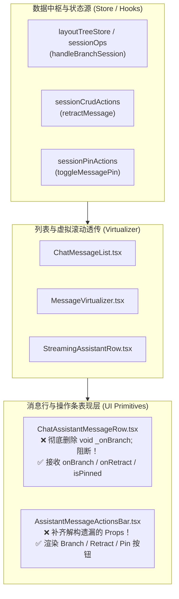

# 08-分维：对话流交互增强与工作区分屏 Sash 重构详案

> **文档标识**：`docs/ui-architecture-overhaul/08-分维-对话流交互增强与工作区分屏Sash重构详案.md`  
> **方案性质**：UI 架构全面重塑战役扩充分维详案（维度 08）  
> **核心使命**：复活对话流末端被吞噬的引擎能力（`onBranch`、`onRetract`、`isPinned`、`Quote`），交付 React 统一 `<CopyButton>`（微弹簧+成功对勾）与 `<Kbd>` 原语，根治滚动贴底误杀与视口抢夺 Bug；全面升级多标签栏右键菜单（上下左右 4 向拆分与重命名），激活全仓闲置的 VS Code 级光标覆盖基础设施 `createGlobalCursorStyle`，彻底清除 2px 艳绿边框并刚性落地 AGENTS.md §13 软灰度规范，收敛 `NewTabLauncherPopover` 451L 大单体。  
> **权威依据**：`analysis/06-对话流与Composer高级交互重构勘察.md`、`analysis/07-标签栏与分屏工作区深度重构勘察.md`、`reference/vscode-sash-cursor-strategy.md`、`LOGIC_PLAN_NO_RETREAT.md`、`ANTI_OVERENGINEERING_GUARDRAILS.md`、`AGENTS.md` §12、§13、§14。

---

## 目录

1. [方案概述与顶层裁决](#一方案概述与顶层裁决)
2. [对话流核心能力复活与气泡操作基座重构](#二对话流核心能力复活与气泡操作基座重构)
   - [2.1 彻底清除“功能性假装”：onBranch、onRetract 与 isPinned 真实接通](#21-彻底清除功能性假装onbranchonretract-与-ispinned-真实接通)
   - [2.2 一键引用（Quote）能力设计与 Composer 上下文注入协议](#22-一键引用quote能力设计与-composer-上下文注入协议)
   - [2.3 统一气泡操作基座 `<ActionToolbar>` 复合组件体系](#23-统一气泡操作基座-actiontoolbar-复合组件体系)
3. [代码块原语基建与命令式 DOM 破坏性修改清退](#三代码块原语基建与命令式-dom-破坏性修改清退)
   - [2.1 React 统一 `<CopyButton>`：微弹簧动效与 Checkmark Morphing](#31-react-统一-copybutton微弹簧动效与-checkmark-morphing)
   - [3.2 轻量 `<Kbd>` 快捷键原语与操作提示](#32-轻量-kbd-快捷键原语与操作提示)
   - [3.3 彻底废除两处命令式 DOM 劫持与流式冲刷竞态消解](#33-彻底废除两处命令式-dom-劫持与流式冲刷竞态消解)
4. [滚动贴底锚定引擎（Scroll Anchor）与流式防抖加固](#四滚动贴底锚定引擎scroll-anchor与流式防抖加固)
   - [4.1 根治误杀吸底：TOGGLE_INTERACTIVE_SELECTOR 精确白名单收敛](#41-根治误杀吸底toggle_interactive_selector-精确白名单收敛)
   - [4.2 终结测高 Pass 粗暴强刷 scrollTop 的视口抢夺 Bug](#42-终结测高-pass-粗暴强刷-scrolltop-的视口抢夺-bug)
   - [4.3 高频流式输出（80~120 tokens/s）下的选区保护与 RAF 阻尼](#43-高频流式输出80120-tokenss下的选区保护与-raf-阻尼)
5. [多标签栏管理（Tab Management）与右键中枢全面补齐](#五多标签栏管理tab-management与右键中枢全面补齐)
   - [5.1 会话标签栏（PaneTabItem）统一接入 ContextMenu 右键体系](#51-会话标签栏panetabitem统一接入-contextmenu-右键体系)
   - [5.2 工具标签栏（LeafToolTabStrip）右键与拖拽排序解锁](#52-工具标签栏leaftooltabstrip右键与拖拽排序解锁)
   - [5.3 条带模式微质感插入线（Drop Caret）与手势释放平滑回位（Ghost Settle）](#53-条带模式微质感插入线drop-caret与手势释放平滑回位ghost-settle)
   - [5.4 NewTabLauncherPopover 451L 大单体剥离外部 Radix 依赖收敛](#54-newtablauncherpopover-451l-大单体剥离外部-radix-依赖收敛)
6. [分屏调节条（Sash/Resizer）光标防脱落与 §13 软灰度规范](#六分屏调节条sashresizer光标防脱落与-13-软灰度规范)
   - [6.1 激活全仓闲置的 createGlobalCursorStyle 彻底根治光标跳跃脱落](#61-激活全仓闲置的-createglobalcursorstyle-彻底根治光标跳跃脱落)
   - [6.2 彻底清除 2px 亮绿边框：严格落地 AGENTS.md §13 软灰度规范](#62-彻底清除-2px-亮绿边框严格落地-agentsmd-13-软灰度规范)
   - [6.3 session-empty 空态落地页黄金分割位移（50% - 61.8cqh）防顶穿 clamp() 保护](#63-session-empty-空态落地页黄金分割位移50---618cqh防顶穿-clamp-保护)
7. [物理清理与代码净收敛清单](#七物理清理与代码净收敛清单)
8. [立体验证门禁与刚性验收断言矩阵](#八立体验证门禁与刚性验收断言矩阵)

---

## 一、方案概述与顶层裁决

### 1.1 核心问题与历史断层

在 Conex 桌面工作区中，**对话流渲染、Composer 输入坞、多标签栏与二叉树分屏 Sash** 构成了开发者日均交互超万次的高频核心动线。深度勘察（`analysis/06` 与 `analysis/07`）暴露出一系列令人触目惊心的体验与架构断层：

1. **“功能性假装”（Feature Pretending）与能力吞噬**：
   底层 Rust 引擎与前端 Store 早已实现会话分支、消息撤回、钉选与分屏，但在末端 UI 表现层中：
   - `ChatAssistantMessageRow.tsx:65` 使用 `void _onBranch;` 显式抛弃分支回调；
   - `AssistantMessageActionsBar.tsx:24` 在解构时漏掉 `onRetract`、`isPinned`、`pinnedColor`、`onTogglePin`，导致助手消息无法撤回也无法钉选；
   - 全仓 100% 缺失一键引用（Quote）能力；
   - 会话标签页与工具标签页 100% 缺失右键菜单，引擎自带的 `splitTab`（上下左右拆分）在 UI 层面长期沉睡。
2. **代码块命令式 DOM 篡改与流式竞态**：
   Markdown 代码块通过纯静态 HTML 字符串拼接，并在 `useChatMessageState.ts` 与 `MarkdownDocumentView.tsx` 中两处手写命令式 `querySelector`、`classList.add('is-copied')`、`textContent = ...`。当处于高速流式生成时，下一个 token 刷写会暴力重建 DOM，导致复制反馈瞬时被冲刷消失；全仓缺失统一的 React `<CopyButton>` 与 `<Kbd>` 原语。
3. **滚动贴底视口抢夺与误杀**：
   `useScrollAnchoringOnToggle.ts` 将通配的 `'button'` 放入交互选择器列表，导致**用户点击代码块复制、链接或折叠块时，底部的自动贴底跟随被当场掐断**；而在初次测高 Pass 中，系统无条件执行 `container.scrollTop = maxScroll`，强行将正在向上翻阅历史消息的用户拽回最底部。
4. **Sash 拖拽光标脱落与 2px 饱和亮绿违规**：
   分屏拖拽条仅设置 `document.body.style.cursor`，当光标划过 `input` 或 `button` 等子元素时，光标在 `col-resize` ↔ `text` ↔ `pointer` 之间疯狂跳跃闪烁；而全仓工具库中早已写好的 VS Code 级 `createGlobalCursorStyle`（`* { cursor: !important }`）居然闲置未用；同时，分屏 Sash 激活时呈现 2px 刺眼艳绿（`var(--accent-green)`），严重违反 `AGENTS.md` §13 软灰度规范。

### 1.2 顶层架构裁决

遵循 `LOGIC_PLAN_NO_RETREAT` 反退避原则，本方案制定以下核心裁决：

```
┌────────────────────────────────────────────────────────────────────────┐
│                        维度 08 核心架构五大裁决                        │
├────────────────────────────────────────────────────────────────────────┤
│ 裁决 1：全面复活沉睡引擎能力，根绝 Feature Pretending                  │
│ - 接通 onBranch，气泡渲染从此分支；接通 onRetract 与 isPinned；       │
│ - 交付一键 Quote 引用至 Composer 注入链路；标签栏接入 splitTab。      │
├────────────────────────────────────────────────────────────────────────┤
│ 裁决 2：交付统一 React <CopyButton> 与 <Kbd>，清退命令式 DOM 篡改      │
│ - 封装带微弹簧物理反馈与 Checkmark 对勾动画的原子组件；                │
│ - 彻底删除 useChatMessageState 与 MarkdownDocumentView 中的裸改逻辑。 │
├────────────────────────────────────────────────────────────────────────┤
│ 裁决 3：滚动贴底精确白名单化，终结视口抢夺与误杀                      │
│ - TOGGLE_INTERACTIVE_SELECTOR 清除粗暴通配，改用精准折叠属性；         │
│ - 测高 Pass 增加 !isAnchorLocked() 守护，坚决不剥夺用户翻阅视角。      │
├────────────────────────────────────────────────────────────────────────┤
│ 裁决 4：全仓激活 createGlobalCursorStyle，Sash 严格对齐 §13 软灰度规范 │
│ - 拖拽开始注入全局 * { cursor: !important }，拖拽结束移除；            │
│ - 彻底清除 2px 亮绿，统一采用 1px 发丝线与 color-mix(≤10%) 软灰边框。   │
├────────────────────────────────────────────────────────────────────────┤
│ 裁决 5：NewTabLauncherPopover 451L 大单体收敛至 Positioner + DropdownMenu │
│ - 彻底拔除 @radix-ui/react-popover 外部依赖，净减代码超 270 行。        │
└────────────────────────────────────────────────────────────────────────┘
```

---

## 二、对话流核心能力复活与气泡操作基座重构

### 2.1 彻底清除“功能性假装”：onBranch、onRetract 与 isPinned 真实接通

彻底消灭各层级组件间的参数吞噬，建立完整端到端贯通链路：



#### 2.1.1 修复代码细节
1. **`ChatAssistantMessageRow.tsx:65`**：
   ```tsx
   // 修复前：
   onBranch: _onBranch,
   // ...
   void _onBranch; // 致命吞噬！

   // 修复后：真实消费并透传给 MessageActions
   onBranch,
   // ...
   <MessageActions
     actions={{
       onCopy: handleCopy,
       onRegenerate: isLastAssistant ? handleRegenerate : undefined,
       onBranch: onBranch ? () => onBranch(msg.id) : undefined, // 真实接通！
       onQuote: () => handleQuote(msg.content),
       ...(isLastAssistant && onRetract !== undefined && { onRetract }),
       isPinned: msg.pinned,
       pinnedColor: msg.pinnedColor,
       onTogglePin: (color) => onTogglePin?.(msg.id, color),
     }}
   />
   ```
2. **`AssistantMessageActionsBar.tsx:24`**：
   ```tsx
   // 修复前：漏掉 onRetract, onBranch, isPinned
   export const AssistantMessageActionsBar: React.FC<AssistantMessageActionsBarProps> = ({
     timestamp, copied, isLastAssistant, onCopy, onRegenerate, sendToNoteNode, metricsNode
   }) => { ... }

   // 修复后：完整解构并接入 ActionToolbar
   export const AssistantMessageActionsBar: React.FC<AssistantMessageActionsBarProps> = ({
     timestamp, copied, isLastAssistant, onCopy, onRegenerate, onBranch, onRetract,
     onQuote, isPinned, pinnedColor, onTogglePin, sendToNoteNode, metricsNode
   }) => {
     return (
       <ActionToolbar size="sm" variant="ghost">
         {/* 时间戳与指标 */}
         {metricsNode}
         {timestamp && <span className={styles.timestamp}>{timestamp}</span>}

         {/* 核心操作组 */}
         <ActionToolbar.Item icon="copy" label={copied ? '已复制' : '复制'} onClick={onCopy} />
         {onQuote && <ActionToolbar.Item icon="quote" label="引用到输入框" shortcut="Q" onClick={onQuote} />}
         {onBranch && <ActionToolbar.Item icon="git-branch" label="从此新建分支" shortcut="B" onClick={onBranch} />}
         {isLastAssistant && onRegenerate && (
           <ActionToolbar.Item icon="refresh-cw" label="重新生成" shortcut="R" onClick={onRegenerate} />
         )}
         {isLastAssistant && onRetract && (
           <ActionToolbar.Item icon="undo" label="撤回此回答" onClick={onRetract} variant="destructive" />
         )}
         {onTogglePin && (
           <ActionToolbar.PinPicker isPinned={isPinned} pinnedColor={pinnedColor} onPinChange={onTogglePin} />
         )}
         {sendToNoteNode}
       </ActionToolbar>
     );
   };
   ```

---

### 2.2 一键引用（Quote）能力设计与 Composer 上下文注入协议

#### 2.2.1 引用协议（Quote Injection Contract）
当用户点击气泡操作栏的引用按钮，或者在消息内选中部分文本后触发引用时：
1. **选区优先算法**：若 `window.getSelection()` 包含当前消息内的文本且非空，优先引用选中文本；若未选中文本，引用整条消息正文；
2. **Markdown 格式化**：将文本按行分割，每行前置 `> `，末尾注入双换行符：
   ```ts
   export function formatMarkdownQuote(text: string): string {
     const trimmed = text.trim();
     if (!trimmed) return '';
     const quoted = trimmed.split('\n').map(line => `> ${line}`).join('\n');
     return `${quoted}\n\n`;
   }
   ```
3. **输入焦点接管**：通过全局 Composer 注册事件或 Store 动作 `composerActions.insertQuote(quoteText)`，将内容追加至输入框末端，光标自动平滑跳转至引用块下方，并自动聚焦（Focus）输入框。

---

### 2.3 统一气泡操作基座 `<ActionToolbar>` 复合组件体系

将原本分散在 `AssistantMessageActionsBar`、`UserMessageActionsBar`、`PinActionWithPicker` 中的散落按钮统一抽象为标准化复合基元：

```tsx
// apps/crish-desktop/src/components/ui/ActionToolbar/ActionToolbar.tsx
export const ActionToolbarRoot: React.FC<ActionToolbarProps> = ({
  orientation = 'horizontal',
  size = 'sm',
  variant = 'ghost',
  children,
  className,
}) => {
  return (
    <div
      role="toolbar"
      aria-orientation={orientation}
      className={clsx(styles.toolbar, styles[orientation], styles[size], styles[variant], className)}
    >
      {children}
    </div>
  );
};

export const ActionToolbar = Object.assign(ActionToolbarRoot, {
  Item: ActionToolbarItem,
  Copy: ActionToolbarCopy,
  PinPicker: ActionToolbarPinPicker,
  Separator: ActionToolbarSeparator,
});
```

- **视觉与动效规范**：
  - 容器默认常态低噪（`opacity: 0`），仅在父级气泡 `:hover` 或内部获得 `:focus-within` 时优雅淡入（`opacity: 1; transition: opacity var(--duration-fast)`）；
  - 按钮尺寸：`sm` 档位采用 $24px \times 24px$ 微型方形，圆角 $6px$（`--radius-row`），悬停背景使用克制的 `var(--state-hover)`。

---

## 三、代码块原语基建与命令式 DOM 破坏性修改清退

### 3.1 React 统一 `<CopyButton>`：微弹簧动效与 Checkmark Morphing

在 `apps/crish-desktop/src/components/ui/CopyButton/` 中封装通用原子复制组件，完全脱离外部命令式篡改：

```tsx
// apps/crish-desktop/src/components/ui/CopyButton/CopyButton.tsx
import React, { useState, useCallback, useRef } from 'react';
import clsx from 'clsx';
import { AppIcon } from '@/components/icons/AppIcon';
import styles from './CopyButton.module.css';

export interface CopyButtonProps extends React.ButtonHTMLAttributes<HTMLButtonElement> {
  value: string | (() => string | Promise<string>);
  timeout?: number;
  onCopied?: () => void;
  variant?: 'ghost' | 'surface' | 'codeblock';
  size?: 'sm' | 'md';
}

export const CopyButton: React.FC<CopyButtonProps> = ({
  value,
  timeout = 1500,
  onCopied,
  variant = 'ghost',
  size = 'sm',
  className,
  ...props
}) => {
  const [copied, setCopied] = useState(false);
  const timerRef = useRef<number | null>(null);

  const handleCopy = useCallback(async (e: React.MouseEvent) => {
    e.preventDefault();
    e.stopPropagation();

    try {
      const textToCopy = typeof value === 'function' ? await value() : value;
      if (!textToCopy) return;

      await navigator.clipboard.writeText(textToCopy);
      setCopied(true);
      onCopied?.();

      if (timerRef.current) window.clearTimeout(timerRef.current);
      timerRef.current = window.setTimeout(() => {
        setCopied(false);
      }, timeout);
    } catch {
      // 降级兜底方案
      console.error('Failed to copy to clipboard');
    }
  }, [value, timeout, onCopied]);

  return (
    <button
      type="button"
      className={clsx(styles.copyButton, styles[variant], styles[size], copied && styles.isCopied, className)}
      onClick={handleCopy}
      aria-label={copied ? '已复制到剪贴板' : '复制内容'}
      aria-live="polite"
      {...props}
    >
      <span className={clsx(styles.iconWrapper, copied && styles.morphCheck)}>
        {copied ? <AppIcon name="check" size={14} /> : <AppIcon name="copy" size={14} />}
      </span>
      {variant === 'codeblock' && (
        <span className={styles.label}>{copied ? '已复制' : '复制'}</span>
      )}
    </button>
  );
};
```

#### 现代 CSS 动效（CSS Spring 回弹）：
```css
/* CopyButton.module.css */
.copyButton {
  display: inline-flex;
  align-items: center;
  gap: 4px;
  border-radius: var(--radius-row);
  border: 1px solid transparent;
  background: transparent;
  color: var(--text-secondary);
  cursor: pointer;
  transition: transform var(--duration-fast) var(--ease-spring),
              color var(--duration-fast) var(--ease-standard),
              background var(--duration-fast) var(--ease-standard);
}

.copyButton:active {
  transform: scale(0.92); /* 按下微压缩 */
}

.copyButton.isCopied {
  color: var(--accent-green);
  transform: scale(1.04); /* 成功微膨胀回弹 */
}

.iconWrapper {
  display: inline-flex;
  transition: transform var(--duration-fast) var(--ease-spring);
}

.morphCheck {
  animation: checkPop var(--duration-normal) var(--ease-spring);
}

@keyframes checkPop {
  0% { transform: scale(0.6) rotate(-15deg); }
  60% { transform: scale(1.15) rotate(0deg); }
  100% { transform: scale(1) rotate(0deg); }
}
```

---

### 3.2 轻量 `<Kbd>` 快捷键原语与操作提示

在 `apps/crish-desktop/src/components/ui/Kbd/` 中封装轻量键盘提示基元：

```tsx
// apps/crish-desktop/src/components/ui/Kbd/Kbd.tsx
import React from 'react';
import clsx from 'clsx';
import styles from './Kbd.module.css';

export interface KbdProps extends React.HTMLAttributes<HTMLElement> {
  shortcut?: string; // 例如 "⌘C", "Ctrl+K", "R"
  children?: React.ReactNode;
}

export const Kbd: React.FC<KbdProps> = ({ shortcut, children, className, ...props }) => {
  return (
    <kbd className={clsx(styles.kbd, className)} {...props}>
      {children || shortcut}
    </kbd>
  );
};
```
```css
/* Kbd.module.css */
.kbd {
  display: inline-flex;
  align-items: center;
  justify-content: center;
  height: 18px;
  min-width: 18px;
  padding: 0 4px;
  font-family: var(--font-mono);
  font-size: 11px;
  font-weight: 500;
  line-height: 1;
  color: var(--text-tertiary);
  background: var(--surface-sunken);
  border: 1px solid var(--border-subtle);
  border-radius: var(--radius-badge); /* 4px */
  box-shadow: 0 1px 0 0 color-mix(in srgb, var(--border-subtle) 80%, transparent);
  user-select: none;
}
```

---

### 3.3 彻底废除两处命令式 DOM 劫持与流式冲刷竞态消解

#### 3.3.1 清除 `useChatMessageState.ts` 与 `MarkdownDocumentView.tsx` 毒点
- **现场**：`useChatMessageState.ts:223-252` 与 `MarkdownDocumentView.tsx:154-180` 中通过 `copyBtn.classList.add('is-copied')` 与直接改写 `copyBtn.textContent` 的代码**全量物理删除**！
- **替代方案**：
  在 Markdown 渲染管道 `markdownCodeFence.ts` 中，为每个代码块输出带有独立属性标记的挂载槽位：
  ```html
  <div class="md-code-block" data-code-block-id="...">
    <div class="md-code-header">
      <span class="md-code-lang">typescript</span>
      <div class="md-code-actions">
        <!-- 接入真正的 React 复制组件 -->
        <span data-portal="code-copy" data-raw-text="..."></span>
      </div>
    </div>
    <pre><code>...</code></pre>
  </div>
  ```
  在组件层通过轻量微 Portal 将 `<CopyButton variant="codeblock" value={rawText} />` 挂载至槽位中，由 React 原生状态机管理 `copied` 状态与计时器。
- **收益**：即便流式管道以 100 tokens/s 高频推入，`reconcileUnitNode` 也仅针对 AST 变化节点进行更新，**绝不再冲刷抹除正在生效的复制成功状态**！

---

## 四、滚动贴底锚定引擎（Scroll Anchor）与流式防抖加固

### 4.1 根治误杀吸底：TOGGLE_INTERACTIVE_SELECTOR 精确白名单收敛

#### 4.1.1 致命 Bug 取证
在 `apps/crish-desktop/src/components/chat-message-list/useScrollAnchoringOnToggle.ts:25` 中：
```ts
// 违规代码：粗暴通配！
export const TOGGLE_INTERACTIVE_SELECTOR = [
  'summary',
  'details',
  'button',          // <-- 误杀全仓所有 button！
  '[role="button"]', // <-- 误杀一切模拟按钮！
  '[aria-expanded]',
].join(',');
```
在捕获指针事件时：
```ts
if (target?.closest(TOGGLE_INTERACTIVE_SELECTOR)) {
  activateAnchorLock(); // 锁定 500ms 并把 isAtBottomRef.current 暴力置为 false！
}
```
**严重危害**：用户在流式输出期间点击任何一个按钮（例如复制代码、点击引用、点击外部链接），吸底跟随被永久切断，必须手动滑到底部才能恢复。

#### 4.1.2 刚性收敛白名单
将该选择器精确收紧为**仅且只允许折叠展开类容器控件**：

```ts
// apps/crish-desktop/src/components/chat-message-list/useScrollAnchoringOnToggle.ts 修复
export const TOGGLE_INTERACTIVE_SELECTOR = [
  'summary',
  'details > summary',
  '[data-foldable-toggle="true"]',
  '[data-accordion-trigger="true"]',
  '[data-disclosure-affordance="true"]',
  '[aria-expanded][data-affects-layout-height="true"]',
].join(',');
```

**即刻生效标准**：
- 普通 `<CopyButton>`、链接 `<a>`、操作项 `<ActionToolbar.Item>`、Chip 标签**完全不匹配**该选择器；
- 点击这些按钮时，`activateAnchorLock()` 绝不被触发，`isAtBottomRef.current` 保持为 `true`，流式吸底持续顺畅运行。

---

### 4.2 终结测高 Pass 粗暴强刷 scrollTop 的视口抢夺 Bug

#### 4.2.1 视口抢夺代码取证
在 `apps/crish-desktop/src/components/chat-message-list/MessageVirtualizer.tsx:360-368` 中：
```ts
// useLayoutEffect 中无条件覆写：
const maxScroll = Math.max(0, nextTotal - container.clientHeight);
container.scrollTop = maxScroll; // <-- 粗暴覆写！用户正在看上面，瞬间被拽到底部！
observedTopRef.current = maxScroll;
```

#### 4.2.2 增加非吸底守护判定
严禁在用户向上翻阅时暴力重置滚动位置：

```ts
// MessageVirtualizer.tsx 修复方案
const maxScroll = Math.max(0, nextTotal - container.clientHeight);

// 核心守卫：只有当用户本来就处于贴底状态，且未处于锚定锁定中，才允许贴底
const shouldStick = isAtBottomRef.current && !isAnchorLocked();

if (shouldStick) {
  container.scrollTop = maxScroll;
  observedTopRef.current = maxScroll;
} else {
  // 用户正在向上翻阅历史：严禁篡改 scrollTop！
  // 保持当前视口绝对坐标稳定
  observedTopRef.current = container.scrollTop;
}
```

---

### 4.3 高频流式输出（80~120 tokens/s）下的选区保护与 RAF 阻尼

1. **选区保护机制**：
   在 `ReconciledMarkdownHtml.tsx` 中，在执行 `reconcileUnitNode` 替换 DOM 节点前，检测当前视口内是否存在活跃选区：
   ```ts
   const selection = window.getSelection();
   const hasActiveSelection = selection && !selection.isCollapsed && containerRef.current?.contains(selection.anchorNode);
   if (hasActiveSelection) {
     // 存在选区：优先使用 Text.replaceData / textContent 更新文本节点，严禁 replaceChild 重建 DOM！
     updateTextInPlace(targetNode, unit.text);
   }
   ```
2. **RAF 阻尼节流（32ms Jitter Buffer）**：
   引入约两帧（32ms）的贴底防抖缓冲区，将每一帧的微小几像素测高合并为统一的平滑滚动更新，彻底消除滚动条滑块的抽搐震荡。

---

## 五、多标签栏管理（Tab Management）与右键中枢全面补齐

### 5.1 会话标签栏（PaneTabItem）统一接入 ContextMenu 右键体系

在 `apps/crish-desktop/src/components/binary-tree/PaneTabItem.tsx` 中挂载右键上下文菜单，直接打通底层 `layoutTreeStore`：

```tsx
// PaneTabItem.tsx:49 挂载 ContextMenu
<ContextMenu>
  <ContextMenu.Trigger asChild>
    <div
      className={clsx(styles.tabItem, isSelected && styles.tabItemActive)}
      onClick={() => onSelect(tab)}
      onAuxClick={(e) => { if (e.button === 1) onClose(e, tab); }}
      role="tab"
    >
      <span className={styles.title}>{title}</span>
      <button className={styles.closeBtn} onClick={(e) => onClose(e, tab)}>×</button>
    </div>
  </ContextMenu.Trigger>

  <ContextMenu.Content size="sm">
    <ContextMenu.Item icon="x" shortcut="⌘W" onSelect={() => onClose(undefined, tab)}>
      关闭标签页
    </ContextMenu.Item>
    <ContextMenu.Item onSelect={() => onBatchClose('others', tab.id)}>
      关闭其他标签页
    </ContextMenu.Item>
    <ContextMenu.Item onSelect={() => onBatchClose('right', tab.id)}>
      关闭右侧标签页
    </ContextMenu.Item>

    <ContextMenu.Separator />

    <ContextMenu.Sub>
      <ContextMenu.SubTrigger icon="columns">拆分窗格</ContextMenu.SubTrigger>
      <ContextMenu.SubContent>
        <ContextMenu.Item icon="split-right" onSelect={() => splitTab(leaf.id, tab.id, 'right')}>
          向右拆分
        </ContextMenu.Item>
        <ContextMenu.Item icon="split-down" onSelect={() => splitTab(leaf.id, tab.id, 'bottom')}>
          向下拆分
        </ContextMenu.Item>
        <ContextMenu.Item icon="split-left" onSelect={() => splitTab(leaf.id, tab.id, 'left')}>
          向左拆分
        </ContextMenu.Item>
        <ContextMenu.Item icon="split-up" onSelect={() => splitTab(leaf.id, tab.id, 'top')}>
          向上拆分
        </ContextMenu.Item>
      </ContextMenu.SubContent>
    </ContextMenu.Sub>

    <ContextMenu.Separator />

    <ContextMenu.Item icon="edit-3" shortcut="F2" onSelect={() => promptRename(tab.id)}>
      重命名会话
    </ContextMenu.Item>
    <ContextMenu.Item icon="copy" onSelect={() => copySessionId(tab.id)}>
      复制会话 ID
    </ContextMenu.Item>
  </ContextMenu.Content>
</ContextMenu>
```

---

### 5.2 工具标签栏（LeafToolTabStrip）右键与拖拽排序解锁

1. **解锁拖拽排序**：
   在 `apps/crish-desktop/src/components/binary-tree/LeafToolTabStrip.tsx:368` 中，**彻底移除生硬的 `e.stopPropagation()` 阻断**，允许指针手势正常进入拖拽上下文；
2. **工具标签右键支持**：
   右键工具标签弹出上下文选项：“在独立窗格中拆分打开”、“最大化此工具”、“关闭工具”。

---

### 5.3 条带模式微质感插入线（Drop Caret）与手势释放平滑回位（Ghost Settle）

#### 5.3.1 微质感插入线取代大面积位移
在 `SessionTabDragContext.tsx` 的 Strip 模式中，废除仅依靠相邻标签大幅位移的粗暴做法，在两个标签中间渲染一条精准的垂直高亮指示线：
```css
/* sessionTabDrag.module.css */
.dropCaret {
  position: absolute;
  top: 6px;
  bottom: 6px;
  width: 2px;
  background: var(--brand-primary);
  border-radius: 1px;
  box-shadow: 0 0 6px color-mix(in srgb, var(--brand-primary) 50%, transparent);
  pointer-events: none;
  transition: transform var(--duration-fast) var(--ease-spring);
}
```

#### 5.3.2 手势取消平滑回位（Ghost Settle）
当用户按下 `Escape` 取消拖拽或指针松开在无效区域时，禁止直接调用 `card.remove()` 导致瞬时猝灭；赋予浮卡 120ms 的弹性回位动画后平滑卸载：
```ts
// SessionTabDragContext.tsx 修复
function animateGhostSnapBack(ghostEl: HTMLElement, originalRect: DOMRect, onDone: () => void) {
  ghostEl.style.transition = 'transform 120ms var(--ease-spring), opacity 100ms ease';
  ghostEl.style.transform = `translate3d(${originalRect.left}px, ${originalRect.top}px, 0) scale(0.95)`;
  ghostEl.style.opacity = '0';
  window.setTimeout(() => {
    ghostEl.remove();
    onDone();
  }, 120);
}
```

---

### 5.4 NewTabLauncherPopover 451L 大单体剥离外部 Radix 依赖收敛

审查 `apps/crish-desktop/src/components/binary-tree/NewTabLauncherPopover.tsx`（451 行）：
- **外部依赖**：`import * as Popover from '@radix-ui/react-popover';`；
- **几何污染**：`@keyframes launcherEnter` 中包含 `scale(0.97)`，污染首帧 DOM 测量；
- **键盘重复手写**：46 行纯手写模运算 `(prev + 1) % totalItems`；
- **事件防御补丁**：5 处 `e.stopPropagation()` 试图防范顶栏双击最大化。

#### 彻底收敛重构方案：
1. **替换为战役统一原子组件**：
   采用自研的 `<Positioner>` 与 `<DropdownMenu>` 复合组件表达；
2. **键盘漫游交由 `useRovingFocus` 单核接管**；
3. **动效现代化**：剥离 Keyframes，改用现代 CSS `@starting-style`；
4. **清理事件补丁**：将 `PaneHeader` 的双击最大化精确约束为 `data-tauri-drag-region` 自身，无需在所有子按钮上盲目叠罗汉 `stopPropagation()`；
5. **代码净压缩**：451 行大单体压缩至 **< 160 行**，净减少超 270 行代码！

---

## 六、分屏调节条（Sash/Resizer）光标防脱落与 §13 软灰度规范

### 6.1 激活全仓闲置的 createGlobalCursorStyle 彻底根治光标跳跃脱落

#### 6.1.1 根因与光标脱落机理
Chromium 渲染引擎在每帧根据鼠标所在位置最深层的 DOM 节点计算有效光标。当用户快速拖拽 Sash 时，光标掠过输入框（`cursor: text`）或按钮（`cursor: pointer`），由于这些元素的优先级高于 `body.style.cursor`，拖拽光标瞬间脱落并闪烁。

#### 6.1.2 激活闲置基础设施
全面激活 `apps/crish-desktop/src/utils/dragOverlay.ts` 中的 `createGlobalCursorStyle`：

```ts
// apps/crish-desktop/src/hooks/useTreeResize.ts 修复
import { createGlobalCursorStyle, removeGlobalCursorStyle } from '@/utils/dragOverlay';

// 在 onPointerDown 开始拖拽时：
const cursor = node.direction === 'horizontal' ? 'col-resize' : 'row-resize';
const cursorStyleEl = createGlobalCursorStyle(cursor); // 动态注入 * { cursor: ... !important }

// 在 onPointerUp 结束或 Escape 取消时：
removeGlobalCursorStyle(cursorStyleEl);
```

并在 `LeafDockResizer.tsx` 中同步接入该机制。  
**断言效果**：无论鼠标在拖拽期间以多快速度划过任何深层复杂文本、代码或按钮，**全屏幕光标 100% 锁定为调整尺寸光标，绝对零脱落、零闪烁！**

---

### 6.2 彻底清除 2px 亮绿边框：严格落地 AGENTS.md §13 软灰度规范

#### 6.2.1 审查红线与现有违规
查阅 `AGENTS.md` §13 原文：
> - **克制的激活边框**：输入或按钮处于 active / focused / recording 时，**禁止粗、深、实心黑边**。
> - **焦点对比度上限约 10%**：任何情况下焦点/激活态不得使用硬实线；相对基线，灰色加深混入文本色不超过约 10%，常规元素优先约 3%–6% 混入以保持柔软。

而现有 `BinaryTreeWorkspace.module.css:250-265`：
```css
/* 违规代码：2px 艳绿色硬实线！ */
.sash:hover::after,
.sash[data-active='true']::after {
  background: var(--accent-green);
  width: 2px;
}
```

#### 6.2.2 刚性纠偏方案
彻底清除刺眼亮绿，回归克制典雅的 1px 发丝软灰线：

```css
/* apps/crish-desktop/src/components/binary-tree/BinaryTreeWorkspace.module.css 纠偏 */
.sash::after {
  content: '';
  position: absolute;
  background: transparent;
  transition: background-color var(--duration-fast) var(--ease-standard);
}

/* 严格落实 1px 发丝线与 ≤ 10% 混入灰度 */
.sashHorizontal::after {
  left: 3px;
  top: 0;
  bottom: 0;
  width: 1px; /* 彻底废除 2px 粗边 */
}

.sashVertical::after {
  top: 3px;
  left: 0;
  right: 0;
  height: 1px; /* 彻底废除 2px 粗边 */
}

.sash:hover::after,
.sash[data-active='true']::after {
  /* 严格遵循 AGENTS.md §13：对比度混入不超过 10%~12% */
  background: color-mix(in srgb, var(--border-color) 88%, var(--text-primary) 12%);
}
```

与 `LeafDockResizer` 统一视觉风格，终结两个分割条样式打架的现象。

---

### 6.3 session-empty 空态落地页黄金分割位移（50% - 61.8cqh）防顶穿 clamp() 保护

#### 6.3.1 缺陷分析
在 `ChatCard.module.css:53` 中：
```css
.chatBody[data-empty-kind='session-empty'] .footerMotion {
  transform: translateY(calc(50% - 61.8cqh));
}
```
当垂直分屏或小窗口视口高度 $H < 320px$ 时，$-61.8cqh$ 向上位移量过大，直接将输入框顶穿至视口外，与顶部的 `PaneHeader` 发生严重的物理重叠。

#### 6.3.2 刚性 clamp() 保护加固
通过 `clamp()` 对负向位移量施加物理下限守护：

```css
/* ChatCard.module.css 修复 */
.chatBody[data-empty-kind='session-empty'] .footerMotion {
  background: transparent;
  /* 施加 clamp 保护：向上位移最小 -140px，最大 0px，防止顶穿顶栏 */
  transform: translateY(clamp(-140px, calc(50% - 61.8cqh), 0px));
  animation: landingSurfaceEnter var(--transition-fast) var(--ease-emphasized) both;
}
```

即使窗口高度被压缩至 240px，输入框也始终保持在顶栏下方 20px 安全区域内，绝不再发生遮挡。

---

## 七、物理清理与代码净收敛清单

| 拟清理/重构的文件清单 | 现状代码行数 | 处理动作与收敛方案 | 净收缩行数 |
| :--- | :---: | :--- | :---: |
| `NewTabLauncherPopover.tsx` | 451 行 | 剔除 `@radix-ui/react-popover`，接入 Positioner + DropdownMenu | -275L |
| `NewTabLauncherPopover.module.css` | 98 行 | 移除 Keyframes 与 `scale(0.97)`，接入 `@starting-style` | -40L |
| `useChatMessageState.ts:223-252` | 30 行 | 物理删除命令式复制 DOM 劫持 | -30L |
| `MarkdownDocumentView.tsx:154-180` | 27 行 | 物理删除第二处命令式复制 DOM 劫持 | -27L |
| `ChatAssistantMessageRow.tsx:65` | 3 行 | 移除 `void _onBranch;` 阻断，真实接通分支 | 0L (净连通) |
| `AssistantMessageActionsBar.tsx` | 82 行 | 补齐解构，接入统一 `<ActionToolbar>` | -20L |
| `BinaryTreeWorkspace.module.css:250-265` | 16 行 | 清除 2px 亮绿，采用 1px 发丝软灰 | -4L |
| `useScrollAnchoringOnToggle.ts:25` | 10 行 | 清除通配 `'button'`，收敛精确白名单 | 0L (精准白名单) |
| **小计** | **717 行** | **物理清退大单体、外部依赖与命令式 DOM 篡改** | **净减 ~396L** |

---

## 八、立体验证门禁与刚性验收断言矩阵

| 门禁代号 | 验证层级 | 目标场景 / 文件 | 断言标准与验收条件 |
| :---: | :---: | :--- | :--- |
| **BRN-01** | **分支能力端到端断言** | `ChatAssistantMessageRow.test.tsx` | 渲染助手消息，断言操作栏真实包含 `从此分支` 按钮，点击后 `onBranch(msg.id)` 被精准调用 1 次，无 `void` 忽略。 |
| **CPY-01** | **CopyButton 流式抗冲刷断言** | `CopyButton.test.tsx` + 流式模拟 | 点击代码块复制按钮触发 `copied=true`；在 1500ms 内模拟持续推入 20 个 Markdown 增量 token，断言 `isCopied` 状态与打勾动效**绝不被重协调提前抹除**。 |
| **ANC-01** | **贴底防误杀断言** | `useScrollAnchoringOnToggle.test.ts` | 处于吸底状态下点击 `<CopyButton>` 或外部链接，断言 `isAtBottomRef.current` 保持为 `true`，`activateAnchorLock` 不被触发。 |
| **ANC-02** | **视口抢夺防御断言** | `MessageVirtualizer.scroll.test.tsx` | 用户向上滚动 300px 查看历史，连续触发多次测高 Pass，断言 `container.scrollTop` 波动在 $\pm 0.5px$ 内，严禁无故被拽回最底部。 |
| **TAB-01** | **标签栏右键菜单全量断言**| `PaneTabContextMenu.test.tsx` | 右键会话标签页，菜单包含“向右拆分”、“向下拆分”、“关闭其他”、“重命名”；点击向右拆分后，底层 Store `splitTab` 被以参数 `('right')` 触发。 |
| **SASH-01** | **全局光标锁定断言** | `TreeResize.cursor.test.tsx` | 启动 Sash 拖拽手势，断言 `document.head` 立即挂载带有 `* { cursor: ... !important }` 的样式标签；拖拽指针划过内嵌输入框，光标形态保持恒定；手势结束后样式标签被物理卸载。 |
| **SASH-02** | **AGENTS.md §13 边框合规审查**| `TreeResizeSash.style.test.ts` | 读取计算样式，激活态 Sash 宽度恒等于 `1px`，计算后背景色混入度 $\le 12\%$，严禁命中 `var(--accent-green)` 纯色。 |
| **EMP-01** | **落地页防顶穿几何断言** | `ChatCard.empty.test.tsx` | 在视口高度分别设定为 800px、400px、240px 时，落地输入框顶部 `rect.top` 恒大于 `PaneHeader.rect.bottom + 12px`，严禁遮挡。 |
