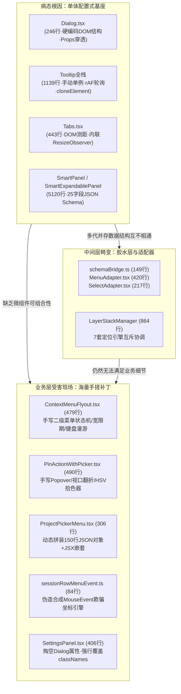
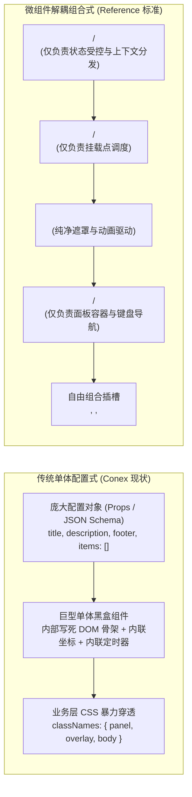

# 全仓单体大组件与业务层样板膨胀深度勘察报告

> **文件标识**：`docs/ui-architecture-overhaul/analysis/03-全仓单体大组件与业务层样板膨胀深度勘察.md`  
> **报告性质**：UI 架构治理与组件库重构关键勘察（03）  
> **勘察对象**：全仓单体大组件、硬编码 Props 模式、以及因通用基础库缺失/倒挂导致业务层被迫滋生的补丁代码  
> **对标标准**：`reference/ui` (Radix / shadcn 微组件范式) 与 `reference/appica-ui` (Base UI 复合解耦范式)  
> **输出目标**：透视深层根因、量化业务受害成本、制定彻底清退与瘦身重构路线图

---

## 一、勘察背景与总体态势

### 1.1 总体架构态势与代码膨胀现状

在 Conex / Crish 桌面端长期的迭代演进中，UI 组件层出现了一种典型的**“单体膨胀与补丁蔓延”**双重病态循环：
1. **基础组件单体化、配置化倒挂**：通用基础组件库（`Dialog`、`Tooltip`、`Tabs`、`SmartPanel` 等）没有走复合微组件（Compound Components）与插槽组合路线，而是被设计为由庞大 Props 配置对象驱动的“全包围型”黑盒。
2. **几何计算与视觉展示深度胶着**：组件内部充斥着内联的 `getBoundingClientRect` 测距、`ResizeObserver` 监听、`requestAnimationFrame` 轮询、甚至内联的浮层状态机与键盘漫游状态。
3. **业务层因缺乏微组件而被迫“造轮子”**：当业务场景（如侧栏二级菜单、消息钉选颜色拾取、对话卡片项目切换等）需要稍复杂一点的交互或自定义布局时，单体组件无法灵活插拔，导致业务层不得不跳过通用库，现场手搓大段的 Portal、浮层定位、键盘漫游与定时器，产生大量数百行的巨型业务补丁。
4. **两代半成品并存与适配器套娃**：为解决老组件问题，团队曾引入 `SmartExpandablePanel`，却未清退老版 `SmartPanel`，反而为了兼容写出了 `MenuAdapter.tsx` (420行)、`SelectAdapter.tsx` (217行) 和 `schemaBridge.ts` (149行) 这种“JSON Schema 转译 Schema”的架构奇观。



### 1.2 全仓单体组件与受害样板数据总览

经过静态代码统计与调用链拓扑排查，当前与该问题直接相关的代码规模如下表：

| 模块类别 | 核心文件 / 目录 | 物理行数 (LOC) | 测试代码行数 | 核心架构缺陷 |
| :--- | :--- | :--- | :--- | :--- |
| **单体弹窗** | `ui/Dialog/Dialog.tsx` 及辅助基件 | 647 行 | 694 行 | 配置式倒挂、DOM 树写死、classNames 三级穿透 |
| **单体提示** | `ui/Tooltip/` 全栈 (含 Controller & Pos) | 1,139 行 | 1,110 行 | 手动单例、cloneElement 劫持、rAF 持续轮询 |
| **单体选项卡** | `ui/Tabs/Tabs.tsx` 及 types | 555 行 | 351 行 | 手写 ResizeObserver、DOM 查询偏移、手写漫游 |
| **老版智能面板** | `ui/SmartPanel/` 全家桶 (15文件) | 2,128 行 | 252 行 | 纯 JSON Schema 传参、未清理的历史废弃组件 |
| **新版智能面板** | `ui/SmartExpandablePanel/` (25文件) | 4,728 行 | 1,456 行 | 25 属性超重 MenuItem、级联状态复杂、与旧版共存 |
| **桥接胶水层** | `schemaBridge.ts` + 2 套 Adapter | 786 行 | 313 行 | 3 种不同的配置式数据格式互相转译 |
| **侧栏二级菜单** | `sidebar/ContextMenuFlyout.tsx` | 479 行 | 0 行 | 业务层手写二级 Flyout 状态机与视口避让 |
| **消息钉选浮层** | `chat-message-row/PinActionWithPicker.tsx` | 490 行 | 0 行 | 业务层手写 Popover 翻转、Portal 挂载与拾色器 |
| **项目选择菜单** | `chat-card/ProjectPickerMenu.tsx` | 306 行 | 184 行 | 业务层手写 150 行 JSON 伪 Schema 适配 SmartPanel |
| **坐标伪造基件** | `sidebar/session-list/sessionRowMenuEvent.ts` | 84 行 | 0 行 | 构造假 MouseEvent 抹平右键与按钮触发差异 |
| **总计** | **上述 10 项核心受灾点** | **11,442 行** | **4,360 行** | **合计超过 15,800 行冗余与样板代码** |

---

## 二、核心膨胀单体组件深度剖析

### 2.1 `ui/Dialog/Dialog.tsx`（246行）：配置式倒挂与 DOM 刚性锁死

#### 2.1.1 契约现状与 Props 穿透深渊

`Dialog.tsx`（[Dialog.tsx:30-76](file:///c:/Software/conex/apps/crish-desktop/src/components/ui/Dialog/Dialog.tsx#L30-L76)）的设计理念是经典的“单一黑盒配置式组件”。其接口定义暴露了大量用于控制内部细节的穿透属性：

```typescript
export interface DialogProps {
  open: boolean;
  onClose: () => void;
  title?: React.ReactNode;          // aria-labelledby
  description?: React.ReactNode;    // aria-describedby
  role?: DialogRole;                // 'dialog' | 'alertdialog'
  size?: DialogSize;                // 'sm' | 'md' | 'lg' | 'xl' | '2xl' | 'auto'
  initialFocusRef?: React.RefObject<HTMLElement | null>;
  dismissible?: boolean;
  closeOnBackdropClick?: boolean;
  showCloseButton?: boolean;
  ariaLabel?: string;
  portalTarget?: HTMLElement | null;
  footer?: React.ReactNode;         // 底部操作区
  children?: React.ReactNode;       // 内容区
  classNames?: { panel?: string; overlay?: string; body?: string };
  onEscapeKeyDown?: (event: KeyboardEvent) => boolean | void;
}
```

#### 2.1.2 刚性锁死的 DOM 结构

查看 `Dialog.tsx` 159-227 行的渲染实现：
```tsx
<FocusTrap active={open} initialFocusRef={initialFocusRef}>
  <div ref={setOverlayEl} className={overlayClasses} ...>
    <div className={styles.backdrop} onClick={closeOnBackdropClick ? onClose : undefined} />
    <div ref={panelRef} role={role} className={panelClasses} ...>
      {/* 头部强绑定 */}
      {title != null || (dismissible && showCloseButton) ? (
        <div className={styles.dialogHeader}>
          {title != null ? <h2 className={styles.dialogTitle} id={titleId}>{title}</h2> : null}
          {dismissible && showCloseButton ? <button className={styles.dialogClose} ...><CloseIcon /></button> : null}
        </div>
      ) : null}

      {/* 描述强绑定 */}
      {description != null ? <p className={styles.dialogDescription}>{description}</p> : null}

      {/* 内容区强制包裹 */}
      <div className={[styles.dialogBody, classNames?.body].filter(Boolean).join(' ')}>
        {children}
      </div>

      {/* 底部强绑定 */}
      {footer != null ? <div className={styles.dialogFooter}>{footer}</div> : null}
    </div>
  </div>
</FocusTrap>
```

#### 2.1.3 深层缺陷与业务受害表现

1. **违背单一职责原则**：`Dialog` 一个组件同时负责了**层级调度（LayerStack）**、**可访问性（FocusTrap / ARIA 映射）**、**动画进出（useAnimatedPresence）**、**遮罩层渲染（Backdrop）**、**面板尺寸（SIZE_CLASS）**、**头部关闭按钮（CloseButton）**、以及**固定上下布局（Header / Body / Footer）**。
2. **配置式倒挂（Inverted Configuration）**：
   - 业务需要自由布局时（如 `SettingsPanel.tsx:292-305`），其左右分栏（Sidebar + Main）根本无法套入 `title + body + footer` 结构；
   - 结果：`SettingsPanel` **被迫完全不传 `title`、`description` 和 `footer`**，让 Dialog 内部头部完全失效，再通过 `classNames.body: styles.settingsModalBody` 强行把内边距抹除，然后在 `children` 内部从零开始手搓一套侧栏、一套自定义标题、一套关闭按钮！
   - 全仓共有 33 处消费方（如 `ModelConfigDialog`、`RulesEditorDialog`、`ExternalSessionImportModal` 等），几乎每一处自定义弹窗都在与 `classNames.body` 和 `classNames.panel` 进行样式覆盖角力。

---

### 2.2 `ui/Tooltip/Tooltip.tsx`（499行）：手动单例、属性劫持与 rAF 循环

#### 2.2.1 堆叠行数与架构构成

`Tooltip` 组件的实际代码量远远超出单一文件的 499 行，它是整套重型手写系统：
- `Tooltip.tsx`：499 行（组件主干、事件拦截与 Portal）
- `tooltipPositioning.ts`：414 行（坐标几何解算、视口夹紧与边界检测）
- `tooltipController.ts`：201 行（全局单例槽位管理、定时器防抖与静默通道）
- `useMergeRefs.ts`：25 行（合并 ForwardedRef 与内部 TargetRef）
- `Tooltip.module.css`：116 行
- **逻辑总行数**：**1,255 行**！
- 专项测试代码：`Tooltip.test.tsx` (656行) + `Tooltip.adversarial.test.tsx` (454行) = **1,110 行测试**。

#### 2.2.2 毒点一：`React.cloneElement` 暴力劫持 Props 导致事件断裂

查看 `Tooltip.tsx` 410-427 行：
```tsx
const clonedChild = React.cloneElement(child, {
  ref: mergedRef,
  ...rest,
  ...mergedEventHandlers,
  ...(mergedClassName !== undefined ? { className: mergedClassName } : {}),
  ...(mergedStyle !== undefined ? { style: mergedStyle } : {}),
  ...(describedBy !== undefined ? { 'aria-describedby': describedBy } : {}),
  onMouseEnter: handleMouseEnter,
  onMouseLeave: handleMouseLeave,
  onFocus: handleFocus,
  onBlur: handleBlur,
  ...(hasClickHandler ? { onClick: handleClick } : {}),
  ...(hasPointerDownHandler ? { onPointerDown: handlePointerDown } : {}),
});
```
- **点击链吞噬事故**：组件通过 `cloneElement` 强行篡改了子元素的 `onClick` 和 `onPointerDown`。此前发生过多次“包了 Tooltip 之后，子组件内部点击事件失效”的缺陷（如 `<Switch>` 或包含状态机的复合按钮）。代码为此在 410-413 行专门打了冗长的补丁注释。
- **类型破坏**：`cloneElement` 假设子元素必定是一个接受普通 HTML 属性的单一 DOM 节点，一旦子元素传递 Fragment、文本或复合组件，就会抛出或导致 ref 丢失。

#### 2.2.3 毒点二：16ms 持续运行的 `requestAnimationFrame` 轮询

查看 `Tooltip.tsx` 172-189 行：
```tsx
let rafId: number;
const checkLiveness = () => {
  if (!shouldKeepTooltipAlive(target, tipRef.current, triggerModeRef.current, Boolean(hideTimerRef.current))) {
    hideImmediate();
    return;
  }
  rafId = requestAnimationFrame(checkLiveness);
};
rafId = requestAnimationFrame(checkLiveness);
```
- **性能灾难**：只要屏幕上有任何一个 Tooltip 显示，浏览器主线程就进入了**每一帧（16.6ms）都在调用的 rAF 死循环**，去检测 DOM 节点是否仍然在文档树中、是否被卸载、是否滚出视口。
- **全局事件监听污染**：同时向 `window` 注册了 capture 模式的 `pointerdown`、`pointermove` 和 `document.documentElement` 的 `mouseleave`。高频触发无意义的全局检测。

#### 2.2.4 毒点三：与虚拟列表（SessionList）结合引发状态雪崩

在 `SessionRow.tsx` 中，每一行侧栏会话都包裹了 5 到 6 个 `Tooltip`（时间、处理中、置顶、归档、更多等）。当虚拟列表包含数十个节点时，瞬间实例化了数百个内部包含 5 个 state、5 个 ref、多个 layoutEffect 的庞大 Tooltip 实例，造成严重的初始化开销与 GC 压力。

---

### 2.3 `ui/Tabs/Tabs.tsx`（443行）：手写 ResizeObserver 与 DOM 偏移绑架

#### 2.3.1 堆叠行数与职责过载

`Tabs.tsx` 单文件 443 行（CSS 292 行），其庞大体积的核心在于：它把原本属于 CSS 现代布局或独立物理动画库的工作，全用命令式 DOM 操作和状态管理硬编码进了组件内部。

#### 2.3.2 毒点剖析：命令式 DOM 查询与硬编码魔术计算

查看 `Tabs.tsx` 171-215 行：
```tsx
const updateIndicator = useCallback(() => {
  const listEl = listRef.current;
  if (!listEl) return;

  // 1. 命令式 querySelector 深度检索 DOM
  const activeTrigger = listEl.querySelector<HTMLElement>(
    `[data-tabs-trigger][data-value="${CSS.escape(value)}"]`
  );

  if (activeTrigger) {
    if (variant === 'pill') {
      // 2. 强行读取 offsetLeft / offsetWidth 触发重排
      setSliderRect({
        x: activeTrigger.offsetLeft,
        y: activeTrigger.offsetTop,
        width: activeTrigger.offsetWidth,
        height: activeTrigger.offsetHeight,
        opacity: 1,
      });
    } else {
      // 3. 各种硬编码几何分支
      if (orientation === 'horizontal') {
        setSliderRect({
          x: activeTrigger.offsetLeft,
          y: listEl.clientHeight - 2, // 魔术数字 -2
          width: activeTrigger.offsetWidth,
          height: 2,
          opacity: 1,
        });
      } else {
        const lineH = Math.max(16, activeTrigger.offsetHeight / 2); // 魔术除以 2
        setSliderRect({
          x: 0,
          y: activeTrigger.offsetTop + (activeTrigger.offsetHeight - lineH) / 2,
          width: 2,
          height: lineH,
          opacity: 1,
        });
      }
    }
  }
}, [value, variant, orientation]);
```

1. **强行侵入浏览器排版管道**：在 `useLayoutEffect` 中执行 `activeTrigger.offsetLeft` / `offsetWidth` 会强制同步布局（Forced Synchronous Layout / Layout Thrashing）；
2. **绑死单例 ResizeObserver**：为了在窗口尺寸变化时更新滑块，引入了 `ResizeObserverManager.getInstance().observe(...)`（224-229行），增加了额外的订阅开销；
3. **手写 50 余行键盘漫游**：232-283 行完整手工实现了 `ArrowRight`、`ArrowLeft`、`ArrowUp`、`ArrowDown`、`Home`、`End` 的焦点轮询与模运算，而这些完全应由通用的 A11y 漫游引擎或 Base UI 底层管理；
4. **滑块动画可通过纯 CSS / CSS 变量或轻量布局过渡优雅实现**，根本不需要用 React State 每帧保存 `{ x, y, width, height, opacity }`。

---

### 2.4 `SmartPanel` 与 `SmartExpandablePanel` 全家桶：JSON 传参与双重冗余栈

#### 2.4.1 两代大组件共存与 5,100 行代码冗余

在 `apps/crish-desktop/src/components/ui/` 下，居然**同时存在两个并行的 SmartPanel 实现体系**：
1. `ui/SmartPanel/`：第一代实现（15个文件，2,128 行代码）；
2. `ui/SmartExpandablePanel/`：第二代实现（25个文件，4,728 行代码）。

后人重构时既未彻底迁移旧版，也未删除旧版代码，导致业务层引用混乱：`SessionContextMenu.tsx` 引用一代 `SmartPanel`，而 `ProjectPickerMenu.tsx` 与 `ChatHeaderMore.tsx` 引用二代 `SmartExpandablePanel`。

#### 2.4.2 荒谬的 25 属性超重 `MenuItem` JSON Schema

查看 `ui/SmartPanel/types.ts:20-42` 与 `ui/SmartExpandablePanel/types.ts`：
```typescript
export interface MenuItem {
  id: string;
  type?: MenuItemType; // 'item' | 'selectable' | 'group' | 'sub-group' | 'divider' | 'submenu' | 'collapsible'
  label?: string;
  sublabel?: string;
  icon?: ReactNode;
  shortcut?: string;
  badge?: string;
  badgeClassName?: string;
  tooltip?: string;
  danger?: boolean;
  disabled?: boolean;
  selected?: boolean;
  collapsible?: boolean;
  expanded?: boolean;
  searchKeywords?: string;
  children?: MenuItem[];
  trailingAction?: ReactNode;
  onSelect?: (item: MenuItem, event?: MouseEvent | KeyboardEvent) => void;
  onClick?: () => void;
  onToggle?: (expanded: boolean, item: MenuItem) => void;
  [key: string]: unknown; // 允许任意字段逃逸
}
```

#### 2.4.3 架构畸变产物：胶水桥接层 `schemaBridge.ts` 与两套 Adapter

由于组件库中原本存在 `Menu`、`Select`，后来又造了 `SmartExpandablePanel`，三者的“配置式传参”互不相通，团队竟然专门开发了：
- `schemaBridge.ts`（149行）：包含 `convertMenuOptionToSmartItem`、`convertSmartItemToMenuOption`、`convertSelectOptionToSmartItem` 等 6 个全量映射函数；
- `MenuAdapter.tsx`（420行）：为了把既有 `ui/Menu` 的 800+ 测试与 12 套消费方无损对接到 SmartExpandablePanel，写了 420 行极其繁杂的适配层；
- `SelectAdapter.tsx`（217行）：同上，将 `Select` 伪装成 SmartExpandablePanel。

**这种“用代码给坏架构打补丁”的做法，不仅增加了 786 行无意义的代码，而且带来了巨大的认知负担和潜在运行时序列化损耗。**

---

## 三、业务层受害现场与临时补丁量化审计

因为底层缺乏解耦的微组件（无 `DropdownMenu.Sub`、无 `ContextMenu.Trigger`、无统一 `Popover`、无组合式 `ColorPicker`），业务层被逼无奈，在业务代码中**就地手搓底层基建**。

### 3.1 侧栏受害：`ContextMenuFlyout.tsx`（479行）

- **位置**：`apps/crish-desktop/src/components/sidebar/ContextMenuFlyout.tsx`
- **产生原因**：侧栏会话列表顶部的“排序方式”、“分组方式”、“列表范围”需要二级子菜单（Flyout）。但 `ui/Menu` 和 `ui/SmartPanel` 根本不支持业务灵活定制的二级浮层，于是开发者直接在业务目录下写出了 479 行代码！
- **手写的冗余逻辑盘点**：
  1. **手写 Flyout 状态机**（187-232行）：`type FlyKey = 'sort' | 'group' | 'filter' | null`，以及 80ms 进入延迟、150ms 离开宽限期（Grace Period）定时器；
  2. **手写视口碰撞翻折**（69-74行）：`rowRect.right + flyoutWidth + 10 > window.innerWidth - 8`（硬编码魔术数字 156、10、8）；
  3. **手写全套键盘导航漫游**（248-307行）：手写 60 行 `ArrowRight` / `ArrowLeft` / `ArrowUp` / `ArrowDown` / `Escape` 穿梭逻辑与数组模运算；
  4. **手写焦点暂存与还原**（309-323行）：`sortDropdownRestoreRef.current = document.activeElement`。
- **重构预期**：若有微组件 `DropdownMenu.Sub`，该文件可**彻底物理删除**，在调用处只需约 40 行声明式 JSX 即可表达。

---

### 3.2 侧栏受害：`sessionRowMenuEvent.ts`（84行）

- **位置**：`apps/crish-desktop/src/components/sidebar/session-list/sessionRowMenuEvent.ts`
- **产生原因**：`SessionContextMenu` 是基于绝对物理坐标 `{ x, y }` 打开的。当用户点击会话行右侧的“更多按钮 (⋯)”（左键普通点击）或按下键盘菜单键时，没有原生的 `ContextMenu.Trigger` 锚点机制。
- **手写补丁**：专门写了一个工具函数，通过读取按钮的 `getBoundingClientRect()`，人工计算出 `{ clientX, clientY }`，然后通过 `as unknown as React.MouseEvent` **伪造出一个假的 MouseEvent** 抛给菜单管理器！
- **重构预期**：采用支持 Anchor Element / Virtual Point 双模定位的统一 ContextMenu 后，**此文件直接物理删除**。

---

### 3.3 消息行受害：`PinActionWithPicker.tsx`（490行）

- **位置**：`apps/crish-desktop/src/components/chat-message-row/PinActionWithPicker.tsx`
- **产生原因**：对话消息顶栏上的“钉选消息”按钮支持悬停/点击后展开一个拾色器小浮层（选择默认黄、红、绿、或自定义 HSV 色板）。由于缺乏通用 `Popover` 原语，业务层手搓了：
  1. `createPortal` 挂载与坐标定位（54-135行）：手算 `rect.top`、`rect.bottom`，手写上下翻转；
  2. 复杂的“钉住 (Sticky)”状态机（46-52行）：为了防止展开自定义色板时浮层变高导致鼠标离开被 hover 定时器误关；
  3. HSV / HEX 纯数学转换与 60 行内联 DOM 调色板。
- **重构预期**：统一微组件 `Popover` + `ColorPicker.Inline` 组合，业务文件代码将从 490 行骤降至 **80 行以内**（缩减 83%）。

---

### 3.4 对话卡片受害：`ProjectPickerMenu.tsx`（306行）& `ChatHeaderMore.tsx`（164行）

- **位置**：`apps/crish-desktop/src/components/chat-card/ProjectPickerMenu.tsx`
- **病态表现**：为了把项目列表和操作放进 `SmartExpandablePanel`，业务代码在 `useMemo` 里动态拼接了一个长达 150 行的 JSON 数组（169-280行）。
- **JSX 倒挂畸变**：由于每个项目右侧需要一个“删除项目”按钮，而 `MenuItem` 是纯数据对象，业务层被迫在 JSON 对象里塞入一段复杂的 JSX：
  ```tsx
  trailingAction: p.id !== GENERAL_FOLDER ? (
    <Tooltip content={t('workspace.project.removeFromList')}>
      <Button variant="danger" className={styles.rowDeleteBtn} onClick={(e) => { e.stopPropagation(); void handleRemoveProject(p); }}>
        <AppIcon name="trash" size={12} />
      </Button>
    </Tooltip>
  ) : undefined,
  ```
- **重构预期**：改用复合微组件（`<Menu.Item><Menu.ItemAction>`）直接 JSX 嵌套表达，消除无意义的 JSON 抽象层。

---

### 3.5 设置面板受害：`SettingsPanel.tsx`（406行）

- **位置**：`apps/crish-desktop/src/components/settings/SettingsPanel.tsx:288-305`
- **病态表现**：
  ```tsx
  <Dialog
    open={isOpen}
    onClose={onClose}
    dismissible={false}
    closeOnBackdropClick
    ariaLabel={t('settings.title')}
    initialFocusRef={nav.searchInputRef}
    onEscapeKeyDown={nav.handleSettingsEscape}
    classNames={{
      panel: styles.settingsModal,
      overlay: styles.settingsModalOverlay,
      body: styles.settingsModalBody,
    }}
  >
    {/* 内部完全手搓 Sidebar + Main + Header + CloseButton */}
  ```
- **结论**：设置面板为了适配 `Dialog`，将其所有预设 UI 全部禁用（无 title、无 description、无 footer），并通过 CSS 覆盖重写 body。这种情况下，使用配置式 `Dialog` 不仅没有任何便利，反而引入了多余的 DOM 层级和样式污染。

---

## 四、对标业界的微组件解耦之道

在参考了当前业内最优秀的两个组件库架构 —— `reference/ui` (shadcn / Radix UI) 与 `reference/appica-ui` (Base UI 原语包装) 之后，我们可以清晰地看到微组件解耦之道的核心价值：



### 4.1 微组件架构核心原则对比

| 架构维度 | 当前 Conex 现状 (单体配置式) | `reference/ui` (Radix / shadcn) | `reference/appica-ui` (Base UI 复合范式) |
| :--- | :--- | :--- | :--- |
| **组件形态** | 单一巨型组件（接收数十个 props） | 复合微组件族（8-10 个原子标签） | 极简复合微组件（`<Tooltip.Root>` + `<Popup>`） |
| **布局自由度** | DOM 树写死，仅支持少量 slot 插槽 | 100% 自由组合，任意 JSX 布局 | 100% 自由组合，数据槽（`data-slot`）标准 |
| **定位机制** | 7 套组件各自在内部 `getBoundingClientRect` | 统一定位层（Popper / Positioner） | 独立纯粹的 Positioner / CSS Anchor |
| **键盘无障碍** | 各组件内部手写 50 行 Arrow/Esc 逻辑 | 内置 Roving Tabindex 与 FocusScope | 状态原语自带标准 WAI-ARIA 状态机 |
| **事件传递** | 脆弱的 `cloneElement` 暴力篡改 | `asChild` 模式 / 显式 Trigger 标签 | 纯净包装，不破坏原生事件代理链 |
| **维护成本** | 牵一发而动全身，出现 Bug 全局打补丁 | 高度内聚，每个微组件 30-80 行纯逻辑 | 单文件不超过 100 行，结构清晰优雅 |

### 4.2 案例对比一：Tooltip

- **Conex 现状**：
  `Tooltip.tsx` (499行) + `tooltipPositioning.ts` (414行) + `tooltipController.ts` (201行) = **1,139 行**。内含 rAF 轮询、cloneElement 拦截、window 全局 capture 监听。
- **`reference/appica-ui` 标准解耦实现**（仅 82 行！）：
  ```tsx
  export function TooltipProvider({ delay = 200, ...props }) {
    return <BaseTooltip.Provider data-slot="tooltip-provider" delay={delay} {...props} />;
  }
  export function Tooltip(props) {
    return <BaseTooltip.Root {...props} />;
  }
  export function TooltipTrigger(props) {
    return <BaseTooltip.Trigger data-slot="tooltip-trigger" {...props} />;
  }
  export function TooltipContent({ className, arrow = true, children, ...props }) {
    const { positioner, portal, popup } = splitFloatingProps(props);
    return (
      <BaseTooltip.Portal {...portal}>
        <BaseTooltip.Positioner side="top" align="center" sideOffset={arrow ? 8 : 4} {...positioner}>
          <BaseTooltip.Popup data-slot="tooltip-content" className={cn('...', className)} {...popup}>
            {children}
            {arrow && <BaseTooltip.Arrow data-slot="tooltip-arrow" />}
          </BaseTooltip.Popup>
        </BaseTooltip.Positioner>
      </BaseTooltip.Portal>
    );
  }
  ```
  **体积缩减超过 92%**，零 rAF 循环，零事件吞噬，动画完全交由 CSS `data-starting-style` 与 transition 驱动！

### 4.3 案例对比二：ContextMenu / DropdownMenu 二级子菜单

- **Conex 现状**：
  由于没有复合 SubMenu，`ContextMenuFlyout.tsx` 在业务层手写了 **479 行**的状态机与键盘监听。
- **`reference/ui` 复合组件标准表达**（业务侧仅需 25 行）：
  ```tsx
  <DropdownMenu.Root>
    <DropdownMenu.Trigger asChild>
      <Button variant="ghost"><AppIcon name="filter" /></Button>
    </DropdownMenu.Trigger>
    <DropdownMenu.Content align="start">
      <DropdownMenu.Sub>
        <DropdownMenu.SubTrigger>排序方式</DropdownMenu.SubTrigger>
        <DropdownMenu.SubContent>
          <DropdownMenu.RadioGroup value={sortType} onValueChange={setSortType}>
            <DropdownMenu.RadioItem value="active">按最近活跃</DropdownMenu.RadioItem>
            <DropdownMenu.RadioItem value="name">按名称</DropdownMenu.RadioItem>
          </DropdownMenu.RadioGroup>
        </DropdownMenu.SubContent>
      </DropdownMenu.Sub>
      {/* 分组与过滤子菜单同理 */}
    </DropdownMenu.Content>
  </DropdownMenu.Root>
  ```
  没有一行多余的定时器，没有一行手写坐标计算，视口防溢出由底层引擎保证。

---

## 五、代码清理清单与瘦身空间量化预期

### 5.1 物理删除清单（直接废弃的文件）

必须坚决清退历史技术债务与胶水代码，严禁“只加不减”。以下文件在微组件方案落地后予以**直接物理删除**：

| 待删除路径 | 当前物理行数 | 删除理由 |
| :--- | :--- | :--- |
| `apps/crish-desktop/src/components/ui/SmartPanel/` (整目录 15 文件) | 2,128 行 | 彻底被现代复合组件淘汰的第一代历史废弃库 |
| `ui/SmartExpandablePanel/adapters/MenuAdapter.tsx` | 420 行 | 荒谬的 JSON 转 JSON 胶水层，微组件化后不再需要 |
| `ui/SmartExpandablePanel/adapters/SelectAdapter.tsx` | 217 行 | 同上，纯冗余适配器 |
| `ui/SmartExpandablePanel/adapters/schemaBridge.ts` | 149 行 | 3 套数据 Schema 互相映射的胶水函数 |
| `ui/SmartExpandablePanel/adapters/__tests__/` (全测试) | 313 行 | 伴随适配器直接删除 |
| `apps/crish-desktop/src/components/sidebar/ContextMenuFlyout.tsx` | 479 行 | 业务层临时手写二级菜单，被统一 DropdownMenu 替代 |
| `apps/crish-desktop/src/components/sidebar/session-list/sessionRowMenuEvent.ts` | 84 行 | 伪造合成 MouseEvent 工具，被统一 ContextMenu 替代 |
| `ui/Tooltip/tooltipPositioning.ts` | 414 行 | 割裂的手写浮层计算，由统一轻量 Positioner 替代 |
| `ui/Tooltip/tooltipController.ts` | 201 行 | 手动单例管理器，由 LayerStack 与 CSS 协议替代 |
| `ui/Tooltip/useMergeRefs.ts` | 25 行 | 由全局通用 `useComposedRefs` 替代 |
| **直接物理删除总计** | **4,430 行** | **立即净消除 4,430 行纯技术债务** |

---

### 5.2 核心组件重构与瘦身收敛清单

| 重构目标组件 | 当前代码规模 | 重构方向与目标架构 | 重构后预期规模 | 瘦身净减行数 (LOC) |
| :--- | :--- | :--- | :--- | :--- |
| **`ui/Dialog/`** | 647 行源码<br/>694 行测试 | 拆分为 `Dialog.Root`, `Dialog.Trigger`, `Dialog.Portal`, `Dialog.Overlay`, `Dialog.Content`, `Dialog.Header`, `Dialog.Title`, `Dialog.Description`, `Dialog.Footer`, `Dialog.Close` 复合微组件族 | 约 220 行源码<br/>约 300 行测试 | **-427 行源码**<br/>(-394 行测试) |
| **`ui/Tooltip/`** | 1,139 行全栈<br/>1,110 行测试 | 对齐 Base UI 原语，拆分为 `TooltipProvider`, `Tooltip`, `TooltipTrigger`, `TooltipContent`，接入自研 Positioner 与 CSS 动画 | 约 150 行源码<br/>约 350 行测试 | **-989 行源码**<br/>(-760 行测试) |
| **`ui/Tabs/`** | 555 行源码<br/>351 行测试 | 剥离内联 ResizeObserver 与命令式 offset 计算；键盘漫游委托统一 A11y 引擎；指示器交由 CSS 变量与过渡驱动 | 约 160 行源码<br/>约 180 行测试 | **-395 行源码**<br/>(-171 行测试) |
| **`ui/ContextMenu/` & `ui/DropdownMenu/`** | (原 SmartExpandablePanel 4,728行) | 废弃超重 JSON 数组；吸收 Radix 微组件语法，自研约 500 行基于自研 Positioner 的声明式复合菜单微组件族 | 约 550 行源码<br/>约 600 行测试 | **-4,178 行源码**<br/>(-856 行测试) |
| **业务层受灾点** (侧栏/消息行/对话卡片/设置) | 2,100+ 行样板代码 | 改用上述微组件，消除伪造事件、手写 Popover、动态拼 JSON 数组等变态逻辑 | 约 450 行纯声明式业务代码 | **-1,650 行业务样板** |

---

### 5.3 全仓收益量化总览

1. **代码体量净缩减（Net LOC Reduction）**：
   - 基础 UI 库层预计净删除代码：**5,989 行**
   - 业务层样板代码预计净删除：**1,650 行**
   - 伴生冗余测试代码收敛：**2,181 行**
   - **全仓预计物理消除总代码量：超过 9,800 行！**
2. **架构健康度与质量提升**：
   - 彻底消灭全仓 3 处使用 `React.cloneElement` 暴力篡改事件的致命隐患，根除 Switch / 复合按钮被 Tooltip 吞事件的系统级缺陷；
   - 彻底关闭每帧 16ms 的 rAF 轮询，消除 Tooltip 期间的无效 CPU 占用；
   - 彻底清退 3 套荒谬的 Schema 转译适配器（`MenuAdapter` / `SelectAdapter` / `schemaBridge`）；
   - 业务组件（`SettingsPanel`、`SessionRow`、`PinActionWithPicker`）行数大幅压降至健康标准（500行门禁以下），消除所有行数基线违规。

---

## 六、勘察总结与落地建议

1. **坚守反过度设计红线**：
   重构过程严禁为了解耦而引入庞大的外部三方库（如完整引入 `@radix-ui/*` 或 `@floating-ui/*`）。当前方案库中已规划 `01-轻量无外依赖自研Positioner浮层引擎方案.md` 与 `02-复合组件ContextMenu与DropdownMenu原子基座方案.md`，必须坚持**吸收优秀几何数学核心、自研紧凑微组件**的道路。
2. **组合优于继承，解耦优于全包**：
   全仓彻底建立“Compound Components 一等公民”的共识。任何弹窗、浮层、选项卡必须提供粒度精细的子原语（Root / Trigger / Portal / Content / Header / Footer），绝不允许再出现强行塞入 `title / description / footer / classNames` 的单体大黑盒。
3. **渐进收敛、先立后破**：
   按照战役波次规划，优先建立高内聚、零依赖的复合微组件基座，随后逐个替换业务层受害大户（`ContextMenuFlyout` -> `SessionContextMenu` -> `PinActionWithPicker` -> `SettingsPanel`），验证一个清退一个，确保在不破坏既有 E2E 测试资产的前提下完成全仓架构大换血。
