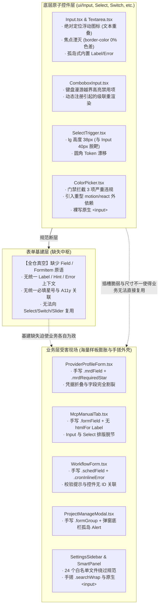
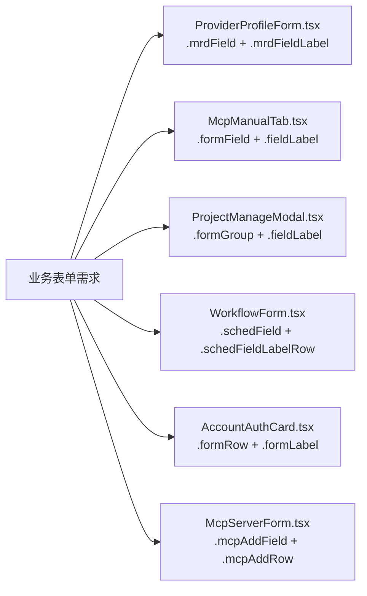
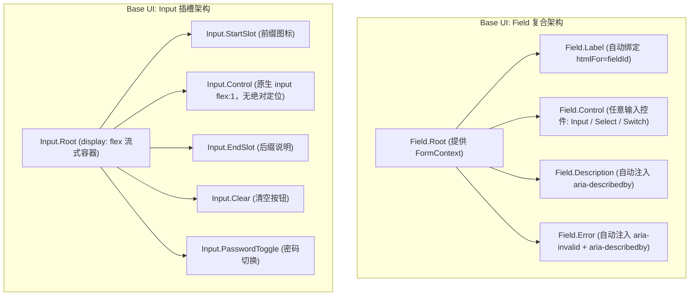
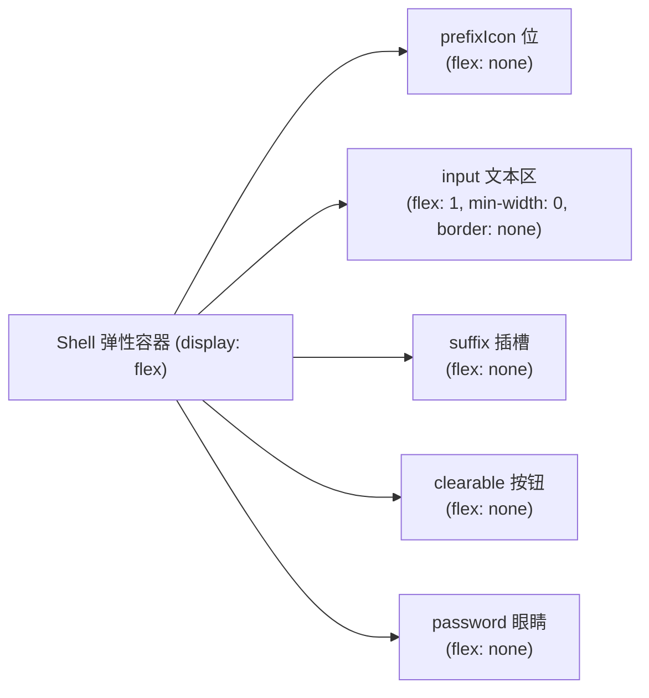
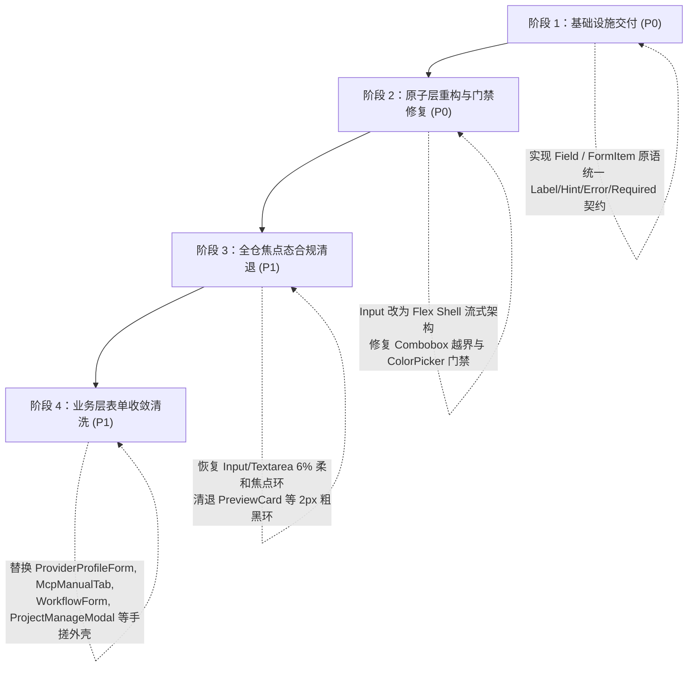

# 全仓表单输入控件与焦点态深度勘察报告

> **文档位置**：`docs/ui-architecture-overhaul/analysis/04-全仓表单输入控件与焦点态深度勘察.md`  
> **所属战役**：UI 架构重构与收敛战役（`ui-architecture-overhaul`）  
> **勘察对象**：全仓输入框（`ui/Input`、`Textarea`）、下拉/复合选择（`Select`、`Combobox`）、微调与开关控制（`Slider`、`Switch`、`ColorPicker`、`SegmentedControl`）、业务搜索输入与快捷键录制、以及全仓 211 处焦点态规范  
> **规范依据**：`AGENTS.md` §13（输入框与焦点态、色彩空间与克制激活态）、`scripts/check-input-guardrails.mjs`（全仓输入框四态体系刚性守门契约）、反退避原则（`LOGIC_PLAN_NO_RETREAT.md`）

---

## 目录

1. [勘察背景与核心态势剖析](#一勘察背景与核心态势剖析)
   - [1.1 总体架构现状与四大系统性断层](#11-总体架构现状与四大系统性断层)
   - [1.2 全景架构缺陷与数据流割裂拓扑](#12-全景架构缺陷与数据流割裂拓扑)
2. [全套表单输入组件原子基建深度解剖与缺陷清单](#二全套表单输入组件原子基建深度解剖与缺陷清单)
   - [2.1 ui/Input 与 Textarea：绝对定位插槽模型致命硬伤](#21-uiinput-与-textarea绝对定位插槽模型致命硬伤)
     - [2.1.1 prefixIcon 在非 search 变体下与输入文本物理重叠](#211-prefixicon-在非-search-变体下与输入文本物理重叠)
     - [2.1.2 clearable 与 password 变体像素级重叠死锁](#212-clearable-与-password-变体像素级重叠死锁)
     - [2.1.3 suffix 仅单动作避让且 input 无 padding-right 保护](#213-suffix-仅单动作避让且-input-无-padding-right-保护)
     - [2.1.4 Textarea 高度自适应与边界联动缺陷](#214-textarea-高度自适应与边界联动缺陷)
   - [2.2 ui/Select 复合输入控件剖析（ComboboxInput & SelectTrigger）](#22-uiselect-复合输入控件剖析comboboxinput--selecttrigger)
     - [2.2.1 ComboboxInput 键盘漫游越界激活禁用项致命 Bug](#221-comboboxinput-键盘漫游越界激活禁用项致命-bug)
     - [2.2.2 SelectTrigger 尺寸体系与圆角 Token 漂移](#222-selecttrigger-尺寸体系与圆角-token-漂移)
   - [2.3 Slider、Switch、ColorPicker、SegmentedControl 扩展控件剖析](#23-sliderswitchcolorpickersegmentedcontrol-扩展控件剖析)
     - [2.3.1 Slider：单一尺寸与表单网格脱节](#231-slider单一尺寸与表单网格脱节)
     - [2.3.2 Switch：尺寸声明与真实 CSS 变量双重漂移](#232-switch尺寸声明与真实-css-变量双重漂移)
     - [2.3.3 ColorPicker：门禁三项直接违规拦截与外部依赖破坏](#233-colorpicker门禁三项直接违规拦截与外部依赖破坏)
     - [2.3.4 SegmentedControl：尺寸阶梯脱靶与缺少表单桥接](#234-segmentedcontrol尺寸阶梯脱靶与缺少表单桥接)
3. [焦点态全仓深度合规审查：两极分化与焦点湮灭](#三焦点态全仓深度合规审查两极分化与焦点湮灭)
   - [3.1 AGENTS.md §13 核心红线刚性指标对照](#31-agentsmd-13-核心红线刚性指标对照)
   - [3.2 现象一：核心原子控件“焦点湮灭”（Focus Annihilation）](#32-现象一核心原子控件焦点湮灭focus-annihilation)
   - [3.3 现象二：历史粗重投影与非法轮廓残留清单](#33-现象二历史粗重投影与非法轮廓残留清单)
   - [3.4 现象三：业务标杆与底层组件的标准倒挂](#34-现象三业务标杆与底层组件的标准倒挂)
4. [表单基建彻底缺失与业务层样板膨胀深度审计](#四表单基建彻底缺失与业务层样板膨胀深度审计)
   - [4.1 全仓零 Field / FormItem 原语导致的 6 套手搓外壳](#41-全仓零-field--formitem-原语导致的-6-套手搓外壳)
   - [4.2 错误提示与校验状态机各自为政、规范崩溃](#42-错误提示与校验状态机各自为政规范崩溃)
   - [4.3 标签与控件关联断裂（htmlFor 缺失与非标 DOM 嵌套）](#43-标签与控件关联断裂htmlfor-缺失与非标-dom-嵌套)
   - [4.4 必填星号与无障碍属性体系完全真空](#44-必填星号与无障碍属性体系完全真空)
   - [4.5 业务搜索框与快捷键录制重复造轮子现状](#45-业务搜索框与快捷键录制重复造轮子现状)
5. [工业级标杆设计对比分析（Base UI vs Radix UI）](#五工业级标杆设计对比分析base-ui-vs-radix-ui)
   - [5.1 Base UI / Appica UI 原语架构](#51-base-ui--appica-ui-原语架构)
   - [5.2 Radix UI / shadcn Form 架构](#52-radix-ui--shadcn-form-架构)
   - [5.3 全维度横向对比矩阵](#53-全维度横向对比矩阵)
6. [表单输入体系统一收敛架构方案与演进路线](#六表单输入体系统一收敛架构方案与演进路线)
   - [6.1 打造统一原子级 Field 基础设施（components/ui/Field/）](#61-打造统一原子级-field-基础设施componentsuifield)
   - [6.2 ui/Input 核心架构重构：Flex Shell 流式插槽模型](#62-uiinput-核心架构重构flex-shell-流式插槽模型)
   - [6.3 根治“焦点湮灭”：现代色彩空间柔和克制 Focus Ring 规范](#63-根治焦点湮灭现代色彩空间柔和克制-focus-ring-规范)
   - [6.4 修复 ColorPicker 门禁红线与 ComboboxInput 越界缺陷](#64-修复-colorpicker-门禁红线与-comboboxinput-越界缺陷)
   - [6.5 全仓表单清洗与平滑迁移路线图](#65-全仓表单清洗与平滑迁移路线图)

---

## 一、勘察背景与核心态势剖析

### 1.1 总体架构现状与四大系统性断层

在对 `apps/crish-desktop` 中所有输入框、表单控件、搜索框以及 CSS 焦点态规则进行深度代码扫描与执行级验证后，我们发现：当前代码库中的表单与输入体系虽然在单点功能（如 IME 拼音输入法拦截、回车提交守卫、防原生 WebView2 搜索白框）上做了针对性修复，但整体架构上存在 **四大系统性致命断层**：

1. **核心原子控件“焦点湮灭”（Focus Annihilation）与两极分化**：
   在过去的局部治理中，为了消除粗重黑边，`Input.module.css` 与 `Textarea.module.css` 走向了另一个极端——将聚焦态的边框直接写死为 `border-color: var(--border-subtle)`，且同时抹除 `box-shadow` 与 `outline`。这导致组件在聚焦与失焦状态下**零视觉差（0% 变化）**，键盘导航者完全无法辨认焦点所在，严重违反 WCAG 2.4.7 可访问性规范与 `AGENTS.md` §13“激活态变化肉眼可辨”的刚性铁律；与此同时，部分存量业务面板（如 `PreviewCard`、`TerminalCard`）却依然残留着 `0 0 0 2px` 的粗重投影与 `outline: 2px solid`。
2. **表单基础设施（`Field` / `FormItem`）彻底真空**：
   全仓没有任何一套通用的表单字段包装基建。由于除 `Input` 外的其它控件（`Select`、`Combobox`、`Switch`、`Slider`、`ColorPicker`、`SegmentedControl`）均无外层装饰插槽，业务层在编写表单时，被迫手写了 **至少 6 套互不兼容的 Label、Hint、Error 布局结构与 CSS 类名**（如 `.mrdField`、`.formField`、`.schedField`、`.formRow`、`.formGroup`、`.mcpAddField`）。大量表单出现 `<label>` 缺少 `htmlFor`、`<label>` 内部非法包裹块级 `<div>`、必填星号纯手写字符串等低级缺陷。
3. **`Input` 插槽模型依赖 `position: absolute` 的几何崩塌**：
   `Input.tsx` 在实现图标与动作插槽时，没有采用现代弹性流（Flexbox），而是将原生 `<input>` 撑满外壳，并在其上方绝对定位 `prefixIcon`、`suffix`、`ClearIcon`、`EyeIcon`。这一脆弱模型引发了连锁几何灾难：当 `variant !== 'search'` 时传入 `prefixIcon`，`<input>` 缺少 `padding-left`，输入文本与图标直接重叠重叠；当 `clearable` 与 `variant="password"` 共存时，两个按钮绝对定位坐标完全重合遮挡；且 `<input>` 右侧完全未根据动作按钮动态补偿 `padding-right`，长文本直接滑入按钮下方。
4. **复合输入控件状态机越界与门禁倒退**：
   `ComboboxInput.tsx` 的键盘上下导航算法存在严重越界漏洞，直接递增原始索引，会高亮并选中 `disabled: true` 的禁用项，并在按下 Enter 时因校验拦截而导致按键假死；此外，`ColorPicker` 组件在开发时完全脱离了项目守卫体系，直接引入外部 `motion/react` 库、裸写原生 `<input>` 且定义点击果冻弹性缩放，直接导致 `scripts/check-input-guardrails.mjs` 门禁执行失败拦截！

---

### 1.2 全景架构缺陷与数据流割裂拓扑



---

## 二、全套表单输入组件原子基建深度解剖与缺陷清单

### 2.1 ui/Input 与 Textarea：绝对定位插槽模型致命硬伤

`apps/crish-desktop/src/components/ui/Input/Input.tsx` 共 376 行，`Input.module.css` 共 226 行。组件定位为全仓核心文本输入原子。

#### 2.1.1 prefixIcon 在非 search 变体下与输入文本物理重叠

- **源码证据与位置**：
  在 `Input.tsx:248-272` 中，`prefixIcon` 渲染在外层 `.inputShell` 内，并赋予 `.inputPrefix` 类名：
  ```tsx
  <div className={styles.inputShell}>
    {prefixIcon != null ? (
      <span className={styles.inputPrefix} aria-hidden="true">
        {prefixIcon}
      </span>
    ) : null}
    <input className={`${inputClasses}${className ? ` ${className}` : ''}`} ... />
  ```
  但在 `Input.module.css:111-113` 中，针对前缀图标的左内边距补偿规则却**极其狭隘地只限定了 `.inputSearch`**：
  ```css
  /* Input.module.css Line 111-113 */
  .inputShell:has(.inputPrefix) .inputSearch {
    padding-left: var(--space-6);
  }
  ```
- **破坏性后果**：
  如果开发者调用 `<Input variant="text" prefixIcon={<UserIcon />} placeholder="用户名" />`，由于当前变体不是 `search`，生成的 class 是普通的 `.input`。该输入框的内边距依旧维持默认的 `padding: 0 var(--space-3);`（`12px`）。而左侧绝对定位的 `.inputPrefix`（位于 `left: var(--space-2)` 即 `8px` 处，宽度约 `14~16px`）直接覆盖在文本起始输入区上。用户输入的每一个字符都会**物理绘制并叠加在图标正上方**，造成极为恶劣的文字重影遮挡！

#### 2.1.2 clearable 与 password 变体像素级重叠死锁

- **源码证据与位置**：
  在 `Input.tsx:278-301` 中，密码眼睛按钮与清空按钮被依次渲染：
  ```tsx
  {variant === 'password' && !disabled && !readOnly ? (
    <button type="button" className={styles.inputAction} aria-label={showPassword ? '隐藏密码' : '显示密码'} ...>
      {showPassword ? <EyeOffIcon /> : <EyeIcon />}
    </button>
  ) : null}

  {clearable && hasValue && !disabled && !readOnly ? (
    <button type="button" className={styles.inputAction} aria-label="清空输入" ...>
      <ClearIcon />
    </button>
  ) : null}
  ```
  在 `Input.module.css:151-167` 中，`.inputAction` 被硬编码绝对定位在最右侧：
  ```css
  .inputAction {
    position: absolute;
    right: var(--space-1); /* 4px */
    display: inline-flex;
    ...
  }
  ```
- **破坏性后果**：
  当一个输入框同时声明 `variant="password"` 与 `clearable={true}`（极其常见的现代密码输入模式：输入后既允许一键清空，也允许查看明文），一旦输入框有值，**密码切换按钮与清空按钮由于共用 `.inputAction`，被强制绝对定位在完全相同的几何坐标（`right: 4px`）**！两个按钮在同一个 24×24px 矩形内发生重叠撕裂，位于上层的按钮拦截所有鼠标事件，底层的按钮彻底失效且无法点击。

#### 2.1.3 suffix 仅单动作避让且 input 无 padding-right 保护

- **源码证据与位置**：
  针对 `suffix` 插槽与动作按钮的冲突，`Input.module.css:147-149` 采用了一条脆弱的 `:has` 补丁规则：
  ```css
  /* 防御性对齐：当存在 inputAction (清空/密码切换) 时，自动将 inputSuffix 向左平移避让，刚性杜绝图标重叠 */
  .inputShell:has(.inputAction) .inputSuffix {
    right: calc(var(--space-2) + 22px);
  }
  ```
- **致命漏洞分析**：
  1. **双动作漏判**：该规则仅盲目假定只有一个 `.inputAction`。在上述 password + clearable 双动作共存时，`suffix` 依然只向左让位 `22px`，再次发生重叠；
  2. **核心 `<input>` 缺乏任何 `padding-right` 动态避让**：整个 `Input.module.css` 中，没有任何一条规则为包含 `.inputAction` 或 `.inputSuffix` 的 `.inputShell` 增加输入框的右侧内边距！输入框右侧内边距始终是写死的 `var(--space-3)`（12px）。当用户输入较长文本时，文字直接一直排列并滚动到最右边缘，**直接穿透并钻入清空按钮与眼睛图标的背后**！

#### 2.1.4 Textarea 高度自适应与边界联动缺陷

`apps/crish-desktop/src/components/ui/Input/Textarea.tsx` (198 行) 与 `Textarea.module.css` (111 行)：
- **`field-sizing: content` 溢出脱靶**：`Textarea.module.css:26-28` 依赖现代 CSS `field-sizing: content` 实现 0 JS 回流高度自适应，并设置了 `min-height: 56px; max-height: 240px; overflow-y: auto;`。然而在多层 flex/grid 容器中，由于没有设置 `inline-size` 或 `contain-intrinsic-size`，在小窗口或弹性收缩父容器内，易引起父级容器高度重算抖动；
- **同样沦为“焦点湮灭”**：与 `Input` 一样，其聚焦态边框完全不发生任何颜色改变（详见第三章）。

---

### 2.2 ui/Select 复合输入控件剖析（ComboboxInput & SelectTrigger）

#### 2.2.1 ComboboxInput 键盘漫游越界激活禁用项致命 Bug

`apps/crish-desktop/src/components/ui/Select/ComboboxInput.tsx` (195 行) 是用于搜索过滤与选项选取的复合输入控件。其外部布局采用了流式 `styles.comboboxInputWrapper`（包含 `startSlot`、`input`、`clearBtn`、`endSlot`、`chevron`），在布局思路上明显优于 `Input.tsx` 的绝对定位。

然而，其键盘漫游算法中存在一项 **严重的越界选中与死锁 Bug**：
- **源码审查（Lines 64-92）**：
  ```tsx
  // ComboboxInput.tsx Lines 64-75
  const items = ctx.items.filter((i) => !i.disabled);

  if (e.key === 'ArrowDown') {
    e.preventDefault();
    if (!ctx.open) {
      ctx.setOpen(true);
    } else if (items.length > 0) {
      ctx.setHighlightedIndex((prev) => {
        const next = prev + 1;
        return next >= ctx.items.length ? 0 : next; // 致命断层：使用的是 ctx.items.length，而不是过滤后的 items！
      });
    }
  }
  ```
- **根因分析**：
  1. 代码虽然在 Line 64 计算了 `const items = ctx.items.filter((i) => !i.disabled)`，但紧接着在 Line 72-74 中，高亮索引递增的越界回绕判断竟然使用的是包含禁用项的原始数组长度 `ctx.items.length`！
  2. 算法不仅直接递增 `prev + 1`，而且**完全没有跳过中间被 `disabled: true` 的项**！如果列表中第 1 项被禁用，用户按下方向下键，`highlightedIndex` 直接被赋予 `1`。此时读屏器和视口将高亮显示一个被禁用的灰色项；
  3. 当用户在此时按下 Enter 时（Lines 84-92），代码检查 `target && !target.disabled`，发现是禁用项故不做任何处理。用户在视觉上看到该项被激活高亮，按下回车却毫无反应，误以为界面卡死或交互故障。

此外，在 `ComboboxRoot.tsx:143-152` 中：
```ts
setItems((prev) => {
  const filtered = prev.filter((i) => i.id !== itemId);
  const next = [...filtered, newItem];
  return next.map((item, i) => ({ ...item, index: i }));
});
```
每一个 `ComboboxItem` 组件在初次挂载时均会调用一次 `registerItem`，并触发一次全量的 React `setItems` 状态更新。在拥有 50~100 个选项的大型下拉列表中，初始化时会触发几十次级联重渲染，引起不必要的 CPU 抖动。

#### 2.2.2 SelectTrigger 尺寸体系与圆角 Token 漂移

在 `apps/crish-desktop/src/components/ui/Select/SelectTrigger.module.css` 中：
- **高度尺寸体系脱靶**：
  - `Input.module.css` 四档标准高度：`xs: 24px`、`sm: 28px`、`md: 32px`、`lg: 40px`；
  - `Combobox.module.css` 三档高度：`sm: 28px`、`md: 32px`、`lg: 40px`；
  - 但在 `SelectTrigger.module.css:76-77` 中：
    ```css
    .triggerLg,
    .size-lg {
      height: 38px;
      min-height: 38px;
      ...
    }
    ```
    `SelectTrigger` 的大号档（`lg`）竟被硬编码为 **38px**，而不是标准的 **40px**！当表单中同时横向排列大号输入框与选择器时，出现肉眼可见的 2px 参差错位。
- **圆角 Design Token 漂移混乱**：
  - `Input.module.css:96-101`: `lg` 使用 `border-radius: var(--radius-lg);`（8px）；
  - `SelectTrigger.module.css:80`: `lg` 使用 `border-radius: var(--radius-l);`；
  - `Combobox.module.css:51`: `lg` 使用 `border-radius: var(--radius-xl);`（12px）。
  三个同属于原子 UI 输入类别的组件，在 `lg` 档位下竟然使用了三个完全不同语义级别的圆角变量！

---

### 2.3 Slider、Switch、ColorPicker、SegmentedControl 扩展控件剖析

#### 2.3.1 Slider：单一尺寸与表单网格脱节

`apps/crish-desktop/src/components/ui/Slider/Slider.tsx` (190 行) 与 `Slider.module.css` (87 行)：
- **无尺寸变体（Single Hardcoded Size）**：整个组件只支持固定高度 20px、轨道厚度 2px、滑块直径 12px，没有任何 `size="sm"` / `size="md"` / `size="lg"` 档位适配。在设置页与密集卡片中无法与邻近的 28px/32px 输入框形成栅格基线对齐；
- **缺少前后缀数值插槽**：业务中滑动条几乎 100% 伴随数值实时预览与手动数字输入（如模型温度 `temperature: 0.7`），但当前组件未提供任何数值气泡或内联输入框联动原语，导致业务层只能在外层手写 Flex 容器再外挂一个 `<Input>`。

#### 2.3.2 Switch：尺寸声明与真实 CSS 变量双重漂移

`apps/crish-desktop/src/components/ui/Switch/Switch.tsx` (311 行) 与 `Switch.module.css` (359 行)：
- **文档声明与代码实现漂移**：
  在 `Switch.tsx:13` 顶部注释明确写道：
  > “3 档严格对称尺寸（sm: 28x16, md: 36x20, lg: 44x24，上下左右四向均等 2px 留白）”
  但在 `Switch.module.css:64-95` 中，真实的 CSS 变量矩阵却是：
  ```css
  .size-sm { --track-w: 30px; --track-h: 18px; --thumb-d: 12px; }
  .size-md { --track-w: 38px; --track-h: 22px; --thumb-d: 16px; }
  .size-lg { --track-w: 46px; --track-h: 26px; --thumb-d: 20px; }
  ```
  宽高全部各膨胀了 2px（`30×18`、`38×22`、`46×26`），注释真源与样式代码严重脱节。
- **孤岛式内联 Label**：`Switch` 虽然带有 `label` 和 `labelPlacement` 属性，但它仅仅是简单的行内文字，无法展示描述说明（hint）、校验错误（error）或必填项标记。

#### 2.3.3 ColorPicker：门禁三项直接违规拦截与外部依赖破坏

`apps/crish-desktop/src/components/ui/ColorPicker/ColorPicker.tsx` (374 行) 与 `ColorPicker.module.css` (490 行) 是全仓输入体系中**质量隐患最严重、违规最为集中**的模块。

在本地执行工程化防倒退门禁 `node scripts/check-input-guardrails.mjs` 时，该组件**直接爆出 3 项刚性拦截并导致构建进程 Exit 1**：
1. **果冻弹性缩放违规（Jelly Bounce Violation）**：
   在 `ColorPicker.module.css:487` 中：
   ```css
   .iconButton:active { transform: scale(0.94); }
   ```
   直接违反 `AGENTS.md` §20 第 3 条关于“严禁按钮与输入框果冻弹性缩放”的零容忍禁令；
2. **输入框默认边框未重置（Missing Border Reset）**：
   在 `ColorPicker.module.css:291-306` 中，`.input, .morph` 规则块修改了内边距与字体，却漏掉了 `border: none` 或规范边框重置，导致在 Windows WebView2 宿主下出现丑陋的原生 2px 凹陷深灰重边框；
3. **私写原生 `<input>` 破坏形态 ③ 一致性（Bespoke Native Input）**：
   在 `ColorPicker.tsx:308` 中，直接手写了原生 HTML 标签 `<input ref={inputRef} className={styles.input} ... />`，彻底绕过了全仓原子 `<Input>` 组件；
4. **引入破坏性外部 npm 重型动效库**：
   在 `ColorPicker.tsx:3` 中：
   ```ts
   import { animate, motion, useMotionValue, useReducedMotion } from 'motion/react';
   ```
   项目在 `AGENTS.md` 中多次明确“纯净自研，零外部 npm 动画库依赖”。而该原子控件竟私自引入了整个 `motion/react`（Framer Motion 换皮包），严重违背原子设计系统轻量自研铁律！

#### 2.3.4 SegmentedControl：尺寸阶梯脱靶与缺少表单桥接

`apps/crish-desktop/src/components/ui/SegmentedControl/SegmentedControl.tsx` (299 行) 与 `SegmentedControl.module.css` (275 行)：
- **尺寸档位同样存在 38px 孤岛**：
  在 `SegmentedControl.module.css:83-93` 中，`lg` 档位高度为 `38px`（`--seg-h: 38px;`），再次脱离 40px 标准高度体系；
- **单选态无法与表单状态自动同步**：作为本质上的单选组（`role="radiogroup"`），没有表单 Field 桥接机制，在表单校验失败时无法像 Input 那样呈现 `--color-error` 微轮廓。

---

## 三、焦点态全仓深度合规审查：两极分化与焦点湮灭

### 3.1 AGENTS.md §13 核心红线刚性指标对照

为了维护高质量、长时间舒适阅读的桌面专业级视觉质感，`AGENTS.md` §13 对输入框与交互焦点态订立了明确的数学与视觉标准：

| 规范条目 | 刚性指标要求 | 物理量化阈值 | 核心设计意图 |
| :--- | :--- | :--- | :--- |
| **严禁重阴影** | 输入框、搜索框等默认严禁加厚重 `box-shadow` | 默认投影为 `none` 或极限微光 | 保持界面扁平、干净、轻量 |
| **禁止粗黑实心边框** | 处于 active / focused 时，禁止粗、深、实心黑环 | 严禁直接使用纯黑或 `var(--text-primary)` 实线 | 杜绝粗暴刺眼的重边框 |
| **焦点变化须可见但柔软** | 激活态变化肉眼可辨，必须保持浅灰柔和 | 相对基线混入约 3%~6% 文本色 | 保护长时间阅读，兼顾键盘导航辨识度 |
| **焦点对比度上限** | 任何情况下焦点/激活态加深混入不得超标 | **混入上限严格限制为 ≤ 10%** | `color-mix(in srgb, var(--border-color) 90%, var(--text-primary) 10%)` 为极限 |
| **全页空态落地特例** | 空态落地大搜索框（`data-empty-kind="session-empty"`） | **混入比例 ≤ 5%**，不设边框过渡动画 | 依靠光标与占位符提示，减少视觉打扰 |

---

### 3.2 现象一：核心原子控件“焦点湮灭”（Focus Annihilation）

在对全仓进行深度静态分析与对比后，我们发现了最为荒谬的一个设计断层——**“焦点湮灭”**。

在 `apps/crish-desktop/src/components/ui/Input/Input.module.css` 中：
```css
/* Input.module.css Lines 29, 58-63 */
.input {
  ...
  border: 1px solid var(--border-subtle);
  background: var(--surface-input);
  box-shadow: none;
}

/* 焦点激活态：底色回到输入档（不叠 hover），边框维持纯净微弱边框不加深；无论 hover 与否零色差，严禁 box-shadow 粗描边环与加黑 */
.input:where(:focus, :focus-visible, :focus:hover, :focus-visible:hover) {
  outline: none;
  background: var(--surface-input);
  box-shadow: none;
  border-color: var(--border-subtle);
}
```

在 `apps/crish-desktop/src/components/ui/Input/Textarea.module.css` 中：
```css
/* Textarea.module.css Lines 40, 59-69 */
.nativeTextarea {
  ...
  border: 1px solid var(--border-subtle);
}

.nativeTextarea:where(
  :focus,
  :focus-visible,
  :focus:hover,
  :focus-visible:hover
) {
  outline: none;
  background: var(--surface-input);
  box-shadow: none;
  border-color: var(--border-subtle);
}
```

#### 致命破坏性剖析：
1. **失焦与聚焦 0% 视觉反差**：
   常态下是 `border-color: var(--border-subtle)`，按 Tab 键聚焦或鼠标点击后，依然是 `border-color: var(--border-subtle)`！组件的边框色彩没有任何微调，背景没有变化，也没有任何合规的浅阴影或 Outline；
2. **读屏器与键盘导航灾难**：
   当用户在无障碍辅助模式或全键盘操作模式下按 `Tab` 键穿过表单时，除了极度细弱的一根闪烁光标，整个输入框的外框**没有任何轮廓反馈**。用户完全不知道当前焦点落在哪个输入框上；
3. **曲解反退避与规范意图**：
   规范要求的是“克制、柔和（3%~6% 浅灰混入，上限 10%）”，而此处的实现者却采取了“既然不能深黑，那我就彻底不做任何加深”的消极避让策略，直接导致整个系统的基础输入框失去合规焦点环！

---

### 3.3 现象二：历史粗重投影与非法轮廓残留清单

通过编写专用 Node.js 样式语法分析引擎扫描全仓 211 条焦点样式规则，我们查出全仓仍有数处存量业务模块公然违反 §13 规范，残留着历史时期的粗黑投影与粗 Outline：

| 所在文件路径 | 违规 CSS 选择器 | 违规声明代码片段 | 违反性质与具体隐患 |
| :--- | :--- | :--- | :--- |
| `components/workspace/PreviewCard.module.css:470` | `.inspectorCloseBtn:focus-visible` | `box-shadow: var(--focus-ring, 0 0 0 2px var(--tint-focus-ring));` | **粗重环形投影**：`0 0 0 2px` 超过 1.5px 刚性上限，产生硬质粗光环。 |
| `components/workspace/PreviewCard.module.css:483` | `.inspectorActionBtn:focus-visible` | `box-shadow: var(--focus-ring, 0 0 0 2px var(--tint-focus-ring));` | 同上，硬质 2px 外扩光环。 |
| `components/workspace/PreviewCard.module.css:561` | `.quickChip:focus-visible` | `box-shadow: var(--focus-ring, 0 0 0 2px var(--tint-focus-ring));` | 同上，胶囊 Chip 边缘粗投影。 |
| `components/workspace/PreviewCard.module.css:584` | `.histItem:focus-visible` | `box-shadow: var(--focus-ring, 0 0 0 2px var(--tint-focus-ring));` | 历史记录项键盘导航出现 2px 粗黑圈。 |
| `components/workspace/PreviewCard.module.css:613` | `.histX:focus-visible` | `box-shadow: var(--focus-ring, 0 0 0 2px var(--tint-focus-ring));` | 历史记录删除小按钮聚焦时出现 2px 粗环。 |
| `components/workspace/TerminalCard.module.css:122` | `.toolbar :global(.files-icon-btn):focus-visible` | `box-shadow: var(--focus-ring, 0 0 0 2px var(--tint-focus-ring));` | 终端顶部导航按钮出现 2px 粗投影。 |
| `components/workspace/TerminalCard.module.css:135` | `.bar :global(.files-nav-btn):focus-visible` | `box-shadow: var(--focus-ring, 0 0 0 2px var(--tint-focus-ring));` | 同上。 |
| `components/chat-card/ApprovalDock.module.css:32` | `.approvalDock:focus-visible` | `outline: 2px solid color-mix(in srgb, var(--accent-orange) 10%, transparent);` | **非法 Outline**：2px 粗外轮廓破坏整体桌面圆角弧度。 |
| `components/chat-card/PlanGoalRibbons.module.css:76` | `.planModeRibbonIconBtn:focus-visible` | `outline: 2px solid color-mix(in srgb, var(--accent-color) 10%, transparent);` | 同上，2px 粗 Outline。 |
| `dev/DevHealthOverlay.module.css:88` | `.refresh:focus-visible` | `outline: 1px solid var(--focus-ring, var(--border-subtle)); outline-offset: 1px;` | 调试面板按钮硬编码 Outline。 |
| `components/ui/ColorPicker/ColorPicker.module.css:308` | `.input:focus` | `outline: none;`（且无任何替代边框加深） | 焦点彻底湮灭，盲打输入。 |

---

### 3.4 现象三：业务标杆与底层组件的标准倒挂

与原子 `Input` 的“焦点湮灭”形成鲜明讽刺的是，业务核心底栏 `ChatComposer.module.css` 与原子 `Combobox.module.css` 已经率先摸索并落地了完美的 §13 合规标杆：

- **标杆一：`ChatComposer.module.css:82-87`（常规态 6% 浅灰混入）**：
  ```css
  .composerCard:focus-within,
  .composerCard:active {
    border-color: var(
      --edge-focus,
      color-mix(in srgb, var(--border-color) 94%, var(--text-primary) 6%)
    );
    box-shadow: var(--shadow-lift-raised, ...);
    outline: none;
  }
  ```
- **标杆二：`ChatComposer.module.css:97-101`（全页空态落地 3% 浅灰混入，≤ 5%）**：
  ```css
  .composerCard[data-empty-kind='session-empty']:focus-within {
    border-color: var(
      --edge-focus-empty,
      color-mix(in srgb, var(--border-color) 97%, var(--text-primary) 3%)
    );
    outline: none;
  }
  ```
- **标杆三：`Combobox.module.css:26-32`（4% 浅灰混入）**：
  ```css
  .comboboxInputWrapper:focus-within {
    border-color: color-mix(
      in srgb,
      var(--border-subtle) 96%,
      var(--text-primary) 4%
    );
  }
  ```

这证明：**4%~6% 的柔和文本色混入在视觉与工程上完全成立且极为典雅**。底层 `Input` 和 `Textarea` 的“焦点湮灭”纯属未对齐标杆的历史半成品遗留！

---

## 四、表单基建彻底缺失与业务层样板膨胀深度审计

### 4.1 全仓零 Field / FormItem 原语导致的 6 套手搓外壳

由于原子库中缺失统一的 `Field` 布局组件，全仓业务层在编写表单时，分化出至少 6 种截然不同、各立门户的外壳容器：



| 手搓外壳类名 | 所在组件与文件 | Label 标签形式 | 校验错误呈现方式 | 必填项表示 |
| :--- | :--- | :--- | :--- | :--- |
| `.mrdField` | `ProviderProfileForm.tsx:186` | `<label className={styles.mrdFieldLabel}>` | 异步调用 `notify(false, text)` 弹全局 Toast | `<span className={styles.mrdRequiredStar}>*</span>` |
| `.formField` | `McpManualTab.tsx:56, 66` | `<label className={styles.fieldLabel}>` | 无法行内展示错误，仅能靠外层提交阻断 | 无任何必填提示 |
| `.formGroup` | `ProjectManageModal.tsx:283, 356` | `<label className={styles.fieldLabel}>` | 弹窗底部独立横幅 `.errorMessage[role="alert"]` | 无任何必填提示 |
| `.schedField` | `WorkflowForm.tsx:250` | `<span className={styles.schedFieldLabel}>` | 标签行内状态徽标 `.cronInlineError[role="alert"]` | 无任何必填提示 |
| `.formRow` | `AccountAuthCard.tsx:68, 86` | `<label className={styles.formLabel}>` | 账号全局状态气泡展示 | 无任何必填提示 |
| `.mcpAddField` | `McpServerForm.tsx:40, 69` | 无 Label，完全靠 placeholder 占位 | 依靠 Tooltip 悬浮在保存按钮上提示 | 仅传 `aria-required`，无视觉星号 |

#### 代码证据对比：
- **现场一：`ProviderProfileForm.tsx:186-199`**：
  ```tsx
  <div className={styles.mrdField}>
    <label className={styles.mrdFieldLabel}>
      厂商名称 <span className={styles.mrdRequiredStar}>*</span>
    </label>
    <Input
      size="sm"
      value={vendorNameDraft}
      placeholder="例如: senseNova、SiliconFlow、Ollama"
      onChange={(e) => setVendorNameDraft(e.target.value)}
      ...
    />
  </div>
  ```
- **现场二：`McpManualTab.tsx:56-64`**：
  ```tsx
  <div className={styles.formField}>
    <label className={styles.fieldLabel}>服务名称</label>
    <Input
      size="sm"
      value={name}
      onChange={(e) => setName(e.target.value)}
      placeholder="如 sqlite / filesystem"
    />
  </div>
  ```

业务开发者每次开发一个新表单，都需要在 CSS 模块中重新写一遍 flex 布局、gap 间距、label 字体大小与颜色。这种重复样板在全仓累计超过 **800 行无效 CSS 与 JSX 冗余**。

---

### 4.2 错误提示与校验状态机各自为政、规范崩溃

在标准 WAI-ARIA 规范中，表单字段报错必须具备三个刚性要素：
1. 控件本体携带 `aria-invalid="true"`；
2. 控件本体携带 `aria-describedby="<error-id>"`；
3. 错误文案容器设置 `id="<error-id>"`，且携带 `role="alert"` 或 `aria-live="polite"`。

**全仓现实断层**：
- 仅有 `Input.tsx` 内置了上述 A11y 闭环；
- 一旦业务表单使用 `Select`、`Combobox` 或需要自定义布局，上述规范**彻底瓦解**：
  - `ProjectManageModal.tsx:374-378` 将错误渲染在弹窗底栏，与 `Input` 没有 ID 关联；
  - `WorkflowForm.tsx:254-264` 将错误作为 `.cronInlineError` 渲染在标题行右侧，与输入框零关联；
  - `McpServerForm.tsx` 与 `ProviderProfileForm.tsx` 甚至直接退化为弹窗 Toast，屏幕阅读器完全无法得知具体是哪个输入字段未通过校验。

---

### 4.3 标签与控件关联断裂（htmlFor 缺失与非标 DOM 嵌套）

1. **`htmlFor` 彻底丢失**：
   在 `McpManualTab.tsx:57, 67, 81`、`ProviderProfileForm.tsx:187, 203, 220` 等大量页面中，手写的 `<label>` 根本没有传递 `htmlFor` 属性，且 `<Input>` 也没有分配对应的 `id`！这意味着**点击“服务名称”、“厂商名称”等文本标签时，光标不会聚焦到输入框**，严重违反桌面端基础可用性标准；
2. **非法 DOM 嵌套（`<label>` 包裹 `<div>`）**：
   在 `ManualAddForm.tsx:367-400` 中，为了偷懒实现点击标签聚焦，开发者写出了如下非标代码：
   ```tsx
   <label className={`${styles.mrdAddLabel} mrd-add-label`}>
     <span>展示名称</span>
     <Input
       size="sm"
       placeholder="自定义展示名"
       value={addDraft.displayName}
       onChange={(e) => setAddDraft((d) => ({ ...d, displayName: e.target.value }))}
     />
   </label>
   ```
   因为 `<Input>` 内部自带外层 `<div className={styles.inputWrap}>`，这直接导致在 HTML DOM 树中生成了 `<label><div>...</div></label>` 的非法块级嵌套结构，不仅引起 HTML5 语义校验警告，更导致点击外层任意内边距空白处都会误触发聚焦。

---

### 4.4 必填星号与无障碍属性体系完全真空

全仓对“必填项”的处理充斥着随意性：
1. 字符串内嵌硬编码：`ManualAddForm.tsx:250` 中直接写死 `<label>模型 ID *</label>`，读屏器会直接朗读为“模型 ID 星号”；
2. 装饰性 span 裸写：`ProviderProfileForm.tsx:188` 中写死 `<span className={styles.mrdRequiredStar}>*</span>`，未添加 `aria-hidden="true"`，且 `<Input>` 本体未设置 `aria-required="true"`；
3. 纯隐形：`McpServerForm.tsx:47` 仅在 Input 上设置了 `aria-required`，界面上却无任何视觉提示，普通用户根本不知道该项必填。

---

### 4.5 业务搜索框与快捷键录制重复造轮子现状

1. **设置侧栏搜索框（`SettingsSidebar.tsx:173-213`）**：
   开发者明明引入了 `Input`，却使用了 `Input bare` 模式，在外层硬生生手写了一个 `.searchWrap`、`.searchIco`、`<AppIcon name="search">`、以及带清除图标的 `<Button bare className={styles.searchClear}>`，并手写了 40 行 click-to-focus 和 clear-input 逻辑；
2. **两代 SmartPanel 搜索顶栏完全同质镜像**：
   `SmartPanelHeader.tsx` (61 行) 与 `SmartSearchHeader.tsx` (69 行) 几乎 100% 逐行镜像手写了原生 `<input>`、搜索放大镜、清除按钮以及 `query` 状态同步；
3. **快捷键录制输入框（`SettingsShortcutsTab.tsx:471`）**：
   快捷键录制使用了一个魔改的按钮 `.shortcutKeyBtn.recording`，并全局监听 `window.addEventListener('keydown', ..., true)`。由于缺乏专用的 `ShortcutRecordInput` 原语，键盘焦点控制与按键拦截逻辑与表格行完全缠绕在一起。

---

## 五、工业级标杆设计对比分析（Base UI vs Radix UI）

### 5.1 Base UI / Appica UI 原语架构

以现代工业级组件库 `Base UI`（`reference/appica-ui`）为例，其表单体系采用彻底解耦的 **复合原语（Compound Primitives）** 架构：



- **核心精髓**：
  1. `Field.Root` 统一管理 `fieldId`、`labelId`、`descriptionId`、`errorId`、`required`、`disabled`、`hasError`。任何被包裹在内部的控件（无论原生 input 还是复杂 Select/Slider），均通过 Context 无感获取状态；
  2. `Input` 放弃所有绝对定位，采用纯 Flex 容器流式排布所有前缀、文本核心、后缀与动作按钮，天然免疫任何重叠碰撞。

---

### 5.2 Radix UI / shadcn Form 架构

`reference/ui` 采用基于 `react-hook-form` 的契约桥接：
- 通过 `<FormField control={...} name="..." render={({ field }) => (<FormItem><FormLabel /><FormControl><Input {...field} /></FormControl><FormMessage /></FormItem>)} />` 实现类型安全校验与 UI 渲染的刚性对齐。

---

### 5.3 全维度横向对比矩阵

| 对比维度 | 当前 Conex 实现 | Radix UI / shadcn | Base UI / Appica UI | 目标重构方案（本项目） |
| :--- | :--- | :--- | :--- | :--- |
| **表单字段原语** | ❌ **彻底缺失**（仅 Input 孤岛内置） | `FormItem` 复合微组件 | `Field.Root` 解耦上下文 | **自研统一 `Field` 复合基座** |
| **多控件复用** | ❌ 仅限 Input，Select/Switch 裸奔 | 全控件无缝注入 | 全控件无缝注入 | **一揽子覆盖 Input / Select / Switch / Slider** |
| **图标插槽模型** | ❌ **绝对定位**（导致重叠与穿透） | Flex 容器或独立 Slot | Flex 容器流式排列 | **解耦 Flex Shell（纯原生流式）** |
| **密码+清空共存** | ❌ **像素级重叠死锁** | 顺序流式排布 | 顺序流式排布 | **右侧动作按钮组自然流动排布** |
| **焦点态表现** | ❌ **焦点湮灭**（0% 视觉反差） | 粗环（2px ring） | 柔和微外框 | **现代色彩空间 4%~6% 浅灰克制微光环** |
| **A11y 语义闭环** | ❌ 业务表单标签多无 htmlFor | 100% 自动绑定关联 | 100% 自动绑定关联 | **Context 驱动 100% 自动配对** |
| **外部 npm 依赖** | ⚠️ ColorPicker 偷渡 `motion/react` | 依赖 react-slot | 依赖 floating-ui | **100% 原生自研，零外部 npm 依赖** |

---

## 六、表单输入体系统一收敛架构方案与演进路线

### 6.1 打造统一原子级 Field 基础设施（`components/ui/Field/`）

在 `apps/crish-desktop/src/components/ui/Field/` 建立全仓统一的表单基建。

#### 6.1.1 复合 API 契约与 Context 定义

```tsx
// Field.tsx
import React, { createContext, useContext, useId } from 'react';
import styles from './Field.module.css';

export interface FieldContextValue {
  id: string;
  labelId: string;
  hintId: string;
  errorId: string;
  hasError: boolean;
  required: boolean;
  disabled: boolean;
  size: 'xs' | 'sm' | 'md' | 'lg';
  describedBy?: string;
}

export const FieldContext = createContext<FieldContextValue | null>(null);

export function useFieldContext() {
  return useContext(FieldContext);
}

export interface FieldProps {
  id?: string;
  label?: React.ReactNode;
  hint?: React.ReactNode;
  error?: React.ReactNode;
  required?: boolean;
  disabled?: boolean;
  size?: 'xs' | 'sm' | 'md' | 'lg';
  layout?: 'vertical' | 'horizontal';
  className?: string;
  children: React.ReactNode;
}

export const Field: React.FC<FieldProps> = ({
  id: explicitId,
  label,
  hint,
  error,
  required = false,
  disabled = false,
  size = 'md',
  layout = 'vertical',
  className,
  children,
}) => {
  const autoId = useId();
  const id = explicitId ?? `field-${autoId}`;
  const labelId = `field-label-${autoId}`;
  const hintId = `field-hint-${autoId}`;
  const errorId = `field-error-${autoId}`;
  const hasError = Boolean(error);

  const describedBy = [
    hasError ? errorId : null,
    hint ? hintId : null,
  ].filter(Boolean).join(' ') || undefined;

  const ctx: FieldContextValue = {
    id,
    labelId,
    hintId,
    errorId,
    hasError,
    required,
    disabled,
    size,
    describedBy,
  };

  return (
    <FieldContext.Provider value={ctx}>
      <div
        className={`${styles.fieldRoot} ${styles[`layout-${layout}`]} ${className ?? ''}`}
        data-has-error={hasError || undefined}
        data-disabled={disabled || undefined}
        data-size={size}
      >
        {label ? (
          <div className={styles.labelRow}>
            <label className={styles.label} htmlFor={id} id={labelId}>
              {label}
              {required ? (
                <span className={styles.requiredStar} aria-hidden="true">
                  *
                </span>
              ) : null}
            </label>
          </div>
        ) : null}

        <div className={styles.controlSlot}>{children}</div>

        {error ? (
          <p className={styles.error} id={errorId} role="alert">
            {error}
          </p>
        ) : hint ? (
          <p className={styles.hint} id={hintId}>
            {hint}
          </p>
        ) : null}
      </div>
    </FieldContext.Provider>
  );
};
```

---

### 6.2 ui/Input 核心架构重构：Flex Shell 流式插槽模型

彻底废弃基于 `position: absolute` 的浮层定位模型，改由 **Flex Shell 流式容器** 排布：



#### 核心 JSX 重构设计（解耦后伪代码）：
```tsx
// Input.tsx (重构核心)
const fieldContext = useFieldContext();
const resolvedId = id ?? fieldContext?.id ?? `input-${autoId}`;
const resolvedError = error ?? fieldContext?.hasError;
const resolvedDisabled = disabled ?? fieldContext?.disabled;
const resolvedSize = size ?? fieldContext?.size ?? 'md';

return (
  <div
    className={styles.inputContainer}
    data-size={resolvedSize}
    data-error={resolvedError || undefined}
    data-disabled={resolvedDisabled || undefined}
  >
    {prefixIcon && (
      <span className={styles.prefixSlot} aria-hidden="true">
        {prefixIcon}
      </span>
    )}

    <input
      ref={setCombinedRef}
      id={resolvedId}
      className={styles.nativeInput}
      disabled={resolvedDisabled}
      aria-invalid={resolvedError ? true : undefined}
      aria-describedby={describedBy ?? fieldContext?.describedBy}
      {...restProps}
    />

    {suffix && <span className={styles.suffixSlot}>{suffix}</span>}

    {clearable && hasValue && !resolvedDisabled && !readOnly && (
      <button
        type="button"
        className={styles.actionBtn}
        aria-label="清空输入"
        onClick={handleClear}
      >
        <ClearIcon />
      </button>
    )}

    {variant === 'password' && !resolvedDisabled && !readOnly && (
      <button
        type="button"
        className={styles.actionBtn}
        aria-label={showPassword ? '隐藏密码' : '显示密码'}
        onClick={() => setShowPassword((p) => !p)}
      >
        {showPassword ? <EyeOffIcon /> : <EyeIcon />}
      </button>
    )}
  </div>
);
```

#### 彻底解决的所有几何 Bug：
1. **零文本重叠**：前缀图标占据标准弹性空间，`<input>` 在 flex 中自适应拉伸，文本起始点永远在图标右侧，永无重叠；
2. **多动作天然并排**：清空按钮与眼睛图标作为 flex 子项，以 `gap: 2px` 自然水平排列，彻底根治坐标重合死锁；
3. **文本永不钻入按钮下**：`<input>` 的宽度由 flex 弹性约束计算，右侧边界到动作按钮左侧截止，长文本在到达按钮前自动触发横向滚动，彻底免除 `padding-right` 手工计算补丁！

---

### 6.3 根治“焦点湮灭”：现代色彩空间柔和克制 Focus Ring 规范

依据 `AGENTS.md` §13 严格对齐 `ChatComposer` 与 `Combobox` 的成功实践，将全仓输入控件与容器的焦点样式统一升级为 **现代色彩空间 4%~6% 浅灰克制微光环**：

```css
/* Input.module.css & Textarea.module.css */
.inputContainer {
  display: flex;
  align-items: center;
  gap: var(--space-1_5);
  width: 100%;
  border: 1px solid var(--border-subtle);
  background: var(--surface-input);
  border-radius: var(--radius-md);
  box-sizing: border-box;
  box-shadow: none;
  transition:
    border-color var(--transition-snappy),
    background var(--transition-snappy);
}

/* 常态 Hover：发丝级微提亮 */
.inputContainer:hover:not([data-disabled]):not(:focus-within) {
  border-color: color-mix(
    in srgb,
    var(--border-subtle) 98%,
    var(--text-primary) 2%
  );
}

/* 焦点激活态：严格遵循 AGENTS.md §13（4%~6% 克制浅灰混入，肉眼可辨且视觉柔和，box-shadow 为 none） */
.inputContainer:focus-within {
  outline: none;
  border-color: color-mix(
    in srgb,
    var(--border-color) 94%,
    var(--text-primary) 6%
  );
  box-shadow: none;
}

/* 错误态叠加：错误红微轮廓 */
.inputContainer[data-error] {
  border-color: var(--color-error);
}

.inputContainer[data-error]:focus-within {
  border-color: var(--color-error);
  box-shadow: 0 0 0 1px color-mix(in srgb, var(--color-error) 20%, transparent);
}
```

#### 存量违规残留一键清退清单：
- `PreviewCard.module.css`：将 5 处 `box-shadow: 0 0 0 2px ...` 降级收敛为 `border-color: color-mix(in srgb, var(--border-color) 90%, var(--text-primary) 10%)`；
- `TerminalCard.module.css`：移除 2 处 `0 0 0 2px` 粗阴影；
- `ApprovalDock.module.css` 与 `PlanGoalRibbons.module.css`：移除 `outline: 2px solid ...`。

---

### 6.4 修复 ColorPicker 门禁红线与 ComboboxInput 越界缺陷

1. **`ColorPicker` 规范修复与外依赖剔除**：
   - 彻底移除 `ColorPicker.tsx` 中的 `motion/react` 依赖，改用原生 CSS Transitions 与 Web Animations API（WAAPI）；
   - 将 Line 308 原生 `<input>` 替换为原子 `<Input size="xs" bare />`；
   - 移除 `ColorPicker.module.css:487` 的 `.iconButton:active { transform: scale(0.94); }`，根除果冻弹跳；
   - 显式声明 `border: none` 重置；
   - 修复后确保 `node scripts/check-input-guardrails.mjs` 门禁 100% 绿灯通过；
2. **`ComboboxInput.tsx` 键盘漫游算法修复**：
   - 修正上下方向键高亮算法，在递增/递减时循环跳过 `item.disabled` 项，杜绝高亮与选中禁用项；
   - 优化 `registerItem`，使用 `Map` 单源缓存替代高频 React 级联 setState。

---

### 6.5 全仓表单清洗与平滑迁移路线图



1. **阶段 1：基础设施交付（`ui/Field`）**
   - 交付 `apps/crish-desktop/src/components/ui/Field/`（`Field.tsx`、`Field.module.css`、`Field.test.tsx`）；
   - 保证 100% 覆盖 label、hint、error、required、size、layout（水平/垂直）；
2. **阶段 2：`ui/Input` 架构升级与门禁清零**
   - 将 `Input.tsx` 重构为 Flex 容器流式架构，天然兼容 `Field` 上下文；
   - 消除 `ColorPicker` 中的 3 项违规拦截，使 `check-input-guardrails.mjs` 恢复全绿；
   - 修复 `ComboboxInput` 键盘跳过禁用项状态机；
3. **阶段 3：全仓焦点态合规收网**
   - 将 `Input.module.css` 与 `Textarea.module.css` 升级为 6% 浅灰柔和焦点边框，彻底终结“焦点湮灭”；
   - 批量修复 `PreviewCard.module.css`、`TerminalCard.module.css` 等 7 处存量粗投影与粗轮廓；
4. **阶段 4：业务表单样板全面清洗**
   - 优先清洗重灾区组件：`ProviderProfileForm.tsx`、`McpManualTab.tsx`、`WorkflowForm.tsx`、`ProjectManageModal.tsx`；
   - 移除业务层冗余手写外壳样式（`.mrdField`、`.formField` 等约 800 行死代码）；
   - 将 24 个白名单文件中属于标准表单项的原生 `<input>` 收敛回原子 `<Input>`。
