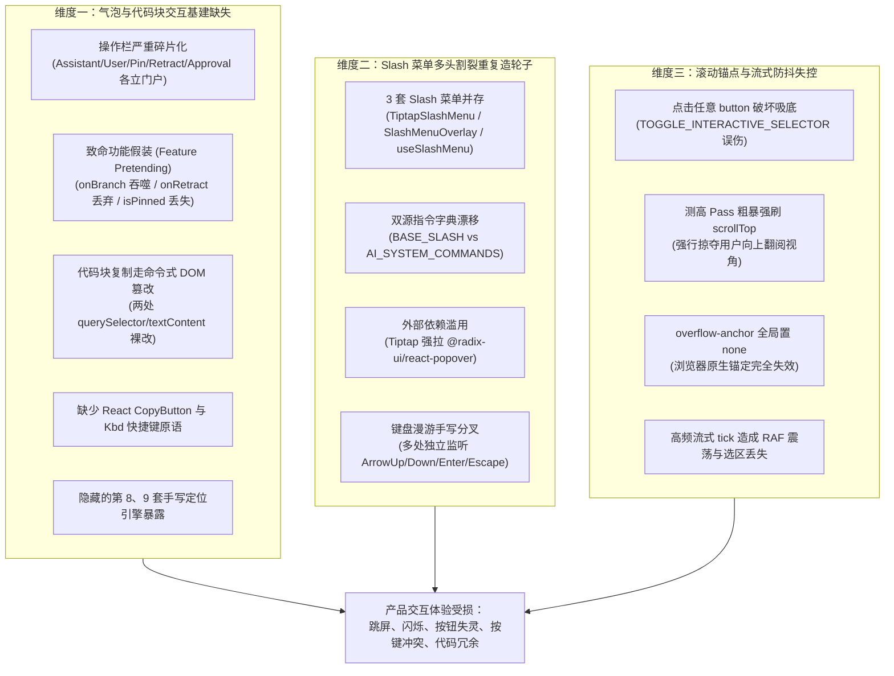
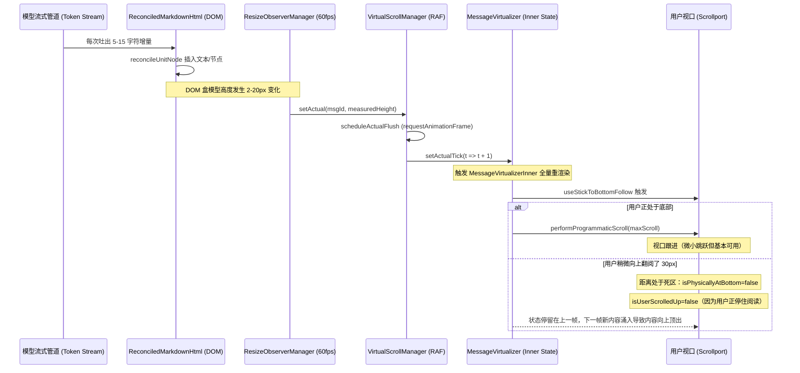
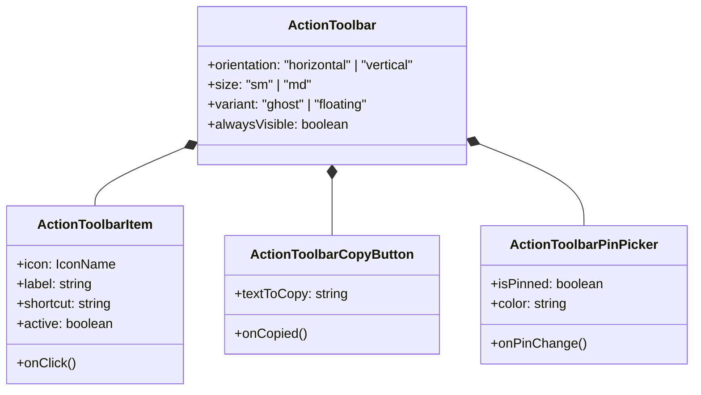
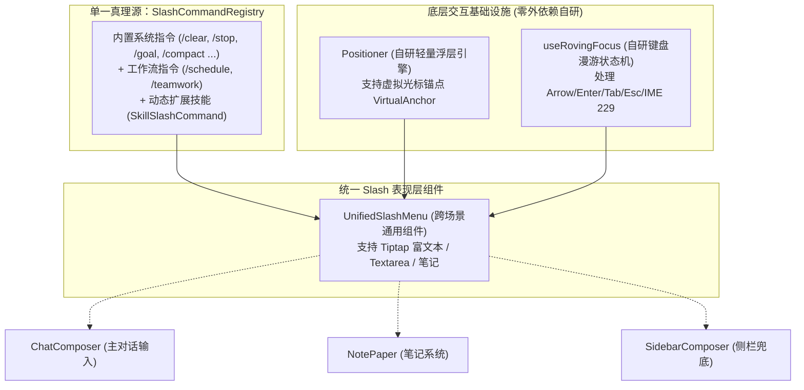
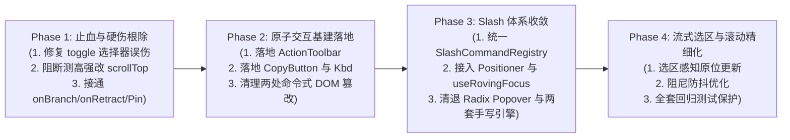

# 对话流与 Composer 高级交互重构深度勘察报告

> **权威路径**：`docs/ui-architecture-overhaul/analysis/06-对话流与Composer高级交互重构勘察.md`  
> **所属战役**：UI 架构重构与自研现代化原子组件体系战役（`ui-architecture-overhaul`）  
> **勘察对象**：对话消息列表（`chat-message-list`）、气泡操作行与Markdown流式容器（`chat-message-row` / `chat-message`）、输入区Composer（`chat-composer`）、对话卡片外壳（`chat-card`）、笔记便签Slash浮层（`note-paper`）、代码块工具条与工具折叠容器  
> **编写日期**：2026-10-27  
> **遵循规范**：反退避原则（`LOGIC_PLAN_NO_RETREAT`）、反过度设计红线（`ANTI_OVERENGINEERING_GUARDRAILS`）、立体验证纪律  

---

## 目录

1. [勘察背景与总体态势](#一勘察背景与总体态势)
   - [1.1 对话流与 Composer 的核心战略地位](#11-对话流与-composer-的核心战略地位)
   - [1.2 现状痛点与三维断层态势](#12-现状痛点与三维断层态势)
   - [1.3 核心勘察资产与代码量化矩阵](#13-核心勘察资产与代码量化矩阵)
2. [气泡与代码块交互基建深度剖析](#二气泡与代码块交互基建深度剖析)
   - [2.1 气泡操作栏的碎片化现状与“功能性假装”清单](#21-气泡操作栏的碎片化现状与功能性假装清单)
   - [2.2 代码块交互基建缺失：命令式 DOM 破坏性修改与状态机脱节](#22-代码块交互基建缺失命令式-dom-破坏性修改与状态机脱节)
   - [2.3 业务层补丁溢出：隐藏的第 8 与第 9 套手写浮层定位引擎](#23-业务层补丁溢出隐藏的第-8-与第-9-套手写浮层定位引擎)
3. [Slash 菜单重复造轮子与多头分化深度勘察](#三slash-菜单重复造轮子与多头分化深度勘察)
   - [3.1 三套 Slash 菜单与指令集重复实现全景](#31-三套-slash-菜单与指令集重复实现全景)
   - [3.2 指令字典双源漂移与数据不一致风险](#32-指令字典双源漂移与数据不一致风险)
   - [3.3 架构收敛解法：平滑复用自研 Positioner 与 useRovingFocus](#33-架构收敛解法平滑复用自研-positioner-与-userovingfocus)
4. [滚动贴底锚点（Scroll Anchor）与流式防抖深层机理](#四滚动贴底锚点scroll-anchor与流式防抖深层机理)
   - [4.1 滚动贴底生命周期与四大几何病态死结](#41-滚动贴底生命周期与四大几何病态死结)
   - [4.2 高频流式输出与 ResizeObserver / RAF 调度震荡](#42-高频流式输出与-resizeobserver--raf-调度震荡)
   - [4.3 流式 DOM 替换对用户选区与焦点的破坏](#43-流式-dom-替换对用户选区与焦点的破坏)
5. [工业级重构方案与自研原子组件体系落地规划](#五工业级重构方案与自研原子组件体系落地规划)
   - [5.1 统一气泡操作基座：`ActionToolbar` 微组件体系](#51-统一气泡操作基座actiontoolbar-微组件体系)
   - [5.2 统一代码块原语：`<CopyButton>`、`<Kbd>` 与 CodeBlockHeader](#52-统一代码块原语copybuttonkbd-与-codeblockheader)
   - [5.3 统一 Slash 命令架构：基于 Positioner + useRovingFocus 的单体收敛](#53-统一-slash-命令架构基于-positioner--userovingfocus-的单体收敛)
   - [5.4 工业级流式滚动锚定引擎：双向锁死 + 虚拟视口阻尼防抖模型](#54-工业级流式滚动锚定引擎双向锁死--虚拟视口阻尼防抖模型)
6. [迁移路线图与验收断言矩阵](#六迁移路线图与验收断言矩阵)

---

## 一、勘察背景与总体态势

### 1.1 对话流与 Composer 的核心战略地位

在 Conex / Crish 桌面端应用中，**会话消息列表（ChatMessageList）** 与 **输入编辑区（ChatComposer）** 构成了整个人机交互闭环的核心中枢：
- **上行链路（Upstream）**：用户在 Composer 中输入自然语言、斜杠指令、拖拽附件、截取代码选区，提交给底层 Agent 调度引擎；
- **下行链路（Downstream）**：Agent 通过流式管道源源不断地回传深度思考（Thinking）、工具调用（Tool Calls）、执行结果差分（Diff Preview）以及排版后的 Markdown 文本与代码。

这两个核心区域的用户体验，直接决定了整款开发工具的产品上限与专业质感。

### 1.2 现状痛点与三维断层态势

然而，经过本次针对全链路源码的深度无死角勘察，我们发现当前对话流与 Composer 在历经多次局部需求迭代和快修后，积聚了极为严重的**架构断层与交互缺陷**，集中表现为以下三个维度：



### 1.3 核心勘察资产与代码量化矩阵

| 模块类别 | 涉及核心文件清单 | 物理代码行数 (LOC) | 核心技术债与硬伤性质 |
| :--- | :--- | :--- | :--- |
| **消息列表与虚拟滚屏** | `ChatMessageList.tsx`<br/>`MessageVirtualizer.tsx`<br/>`messageVirtualizerScrollState.ts`<br/>`useScrollAnchoringOnToggle.ts`<br/>`useScrollAnchor.ts` | **1,852 行** | 粗暴覆盖 `scrollTop`、按键与点击锚定互伤、全禁用 `overflowAnchor` |
| **气泡渲染与操作条** | `ChatAssistantMessageRow.tsx`<br/>`ChatUserMessageRow.tsx`<br/>`AssistantMessageActionsBar.tsx`<br/>`UserMessageActionsBar.tsx`<br/>`MessageActions.tsx`<br/>`PinActionWithPicker.tsx` | **1,521 行** | Props 逐层穿透后丢失功能、手写悬浮拾色器引擎、操作栏逻辑严重分裂 |
| **Markdown 流式分块与代码块** | `StreamingMarkdownView.tsx`<br/>`MarkdownBlockItem.tsx`<br/>`markdownCodeFence.ts`<br/>`useChatMessageState.ts`<br/>`MarkdownDocumentView.tsx` | **1,542 行** | 静态 HTML 字符串拼接、两处命令式 DOM 劫持与类名修改、无统一 Copy 组件 |
| **Composer 输入与 Slash 体系** | `ChatComposer.tsx`<br/>`TiptapSlashMenu.tsx`<br/>`SlashExtension.ts`<br/>`AiCommandSlashExtension.ts`<br/>`AnnotationChipItem.tsx`<br/>`note-paper/SlashMenuOverlay.tsx`<br/>`chat-card/useSlashMenu.ts` | **2,468 行** | 3 套 Slash 菜单分立、Radix Popover 冗余依赖、手写第 8 套悬浮定位引擎 |
| **合计** | **23 个核心源码文件** | **7,383 行** | **亟待进行系统性收敛与现代化交互原子重构** |

---

## 二、气泡与代码块交互基建深度剖析

### 2.1 气泡操作栏的碎片化现状与“功能性假装”清单

在对话消息气泡的操作区中，本应提供一致的**复制、引用、重新生成、分支、钉选、撤回、发送到笔记**等动作集合。然而源码审查揭露了令人震惊的**“功能性假装”（Feature Pretending）**现状：部分功能表面上层层传递 Props，但在末端组件中被直接抛弃或显式屏蔽，成为死代码。

#### 2.1.1 关键证据一：`onBranch` 分支能力在末端被 `void` 吞噬
在调用链路中：
`ChatCard.tsx:337` (`state.handleBranch`)  
→ `ChatMessageList.tsx:66` (`onBranch: _onBranch`)  
→ `MessageVirtualizer.tsx:111` (`onBranch = generation?.onBranch`)  
→ `MessageVirtualizer.tsx:501` (`onBranch={onBranch}`)  
→ `StreamingAssistantRow.tsx:30` (透传)  
→ `ChatAssistantMessageRow.tsx:65`：
```ts
// apps/crish-desktop/src/components/chat-message-row/ChatAssistantMessageRow.tsx
export const ChatAssistantMessageRow: React.FC<ChatAssistantMessageRowProps> = ({
  msg,
  isFollowUp,
  // ...
  onBranch: _onBranch, // <-- 接收
  // ...
}) => {
  void _onBranch; // <-- Line 65: 显式标记为未消费！彻底断绝！
```
**严重后果**：底层的分支会话数据流机制已经齐备，UI 架构却在末端直接使用 `void _onBranch` 将其屏蔽，用户在任何助手气泡上都看不到“从此分支”的入口。

#### 2.1.2 关键证据二：`onRetract` 撤回回调在 `AssistantMessageActionsBar` 处被遗弃
在 `ChatAssistantMessageRow.tsx:216` 中，逻辑试图在最后一条助手消息上渲染撤回按钮：
```ts
// ChatAssistantMessageRow.tsx:216
<MessageActions
  // ...
  actions={{
    // ...
    ...(isLastAssistant && onRetract !== undefined && { onRetract }),
  }}
/>
```
`MessageActions.tsx:112` 忠实地将 `{...(onRetract !== undefined && { onRetract })}` 传给了 `AssistantMessageActionsBar`。  
但翻开 `AssistantMessageActionsBar.tsx:24-34`：
```ts
// apps/crish-desktop/src/components/chat-message-row/AssistantMessageActionsBar.tsx:24
export const AssistantMessageActionsBar: React.FC<
  AssistantMessageActionsBarProps
> = ({
  timestamp,
  copied,
  isLastAssistant,
  onCopy,
  onRegenerate,
  sendToNoteNode,
  metricsNode,
  // onRetract 声明在了 Props interface 中，但在函数参数解构中被彻底漏掉！
}) => {
```
**严重后果**：助手消息的撤回按钮永远不会被渲染。

#### 2.1.3 关键证据三：`isPinned` 与 `onTogglePin` 在助手操作条中完全缺位
在 `AssistantMessageActionsBarProps`（Lines 14-18）中，明确声明了：
```ts
isPinned?: boolean;
pinnedColor?: string;
onTogglePin?: (color?: string) => void;
```
但在实现体（Line 24）中，这三个字段**同样完全没有被解构使用**！整个助手操作条中只有时间戳、复制、重新生成、发送到笔记和指标标签，**压根没有 Pin（钉选）按钮**！而与此相对，`UserMessageActionsBar.tsx:76-80` 却渲染了 `PinActionWithPicker`。造成用户消息与助手消息在钉选能力上的严重不对称。

#### 2.1.4 关键证据四：引用（Quote）功能在全仓交互中彻底空白
无论在 `UserMessageActionsBar` 还是 `AssistantMessageActionsBar` 中，**完全没有“引用”按钮**。用户若想针对某一段特定的回答或提问进行精准追问，无法一键将其作为 Blockquote 填入 Composer，只能手动划词、复制、粘贴并在输入框前打 `> `。

---

### 2.2 代码块交互基建缺失：命令式 DOM 破坏性修改与状态机脱节

#### 2.2.1 静态 HTML 字符串拼接
在 `apps/crish-desktop/src/api/markdown-render/markdownCodeFence.ts:79` 中：
```ts
const actions = `<div class="md-code-actions">${rightLang}<button type="button" class="md-code-copy" aria-label="复制代码" title="复制代码">复制</button></div>`;
const header = `<div class="md-code-header"><div class="md-code-header-left">${leftContent}</div>${actions}</div>`;
return `<div class="md-code-block"${blockAttr}>${header}<pre class="md-code-pre hljs"><code class="language-${escapeHtml(langClean)}">${inner}</code></pre></div>`;
```
系统在这里通过字符串拼接生成纯静态的 `<button class="md-code-copy">`，并未渲染为 React 组件，导致后续的交互全部沦为脱离 React 状态机的手写 DOM 拦截。

#### 2.2.2 双处完全拷贝的命令式 DOM 劫持与破坏性覆盖
因为代码块是静态 HTML，代码库在两处通过容器事件委托强行劫持点击：

**现场一**：`apps/crish-desktop/src/components/chat-message-list/useChatMessageState.ts:223-252`
```ts
const handleMarkdownClick = useCallback((e: React.MouseEvent) => {
  const target = e.target;
  if (!(target instanceof HTMLElement)) return;
  const copyBtn = target.closest('.md-code-copy');
  if (copyBtn instanceof HTMLElement) {
    e.preventDefault();
    e.stopPropagation();
    const text = copyBtn.closest('.md-code-block')?.querySelector('pre')?.textContent ?? '';
    if (!text) return;
    void navigator.clipboard.writeText(text).then(
      () => {
        copyBtn.classList.add('is-copied');
        const originalText = copyBtn.textContent;
        copyBtn.textContent = t('common.copied');
        copyBtn.setAttribute('aria-label', t('common.copied'));
        window.setTimeout(() => {
          copyBtn.classList.remove('is-copied');
          copyBtn.textContent = originalText || t('common.copy');
          copyBtn.setAttribute('aria-label', originalText || t('common.copy'));
        }, 1500);
      },
      () => toast.show(t('common.copyFailed'))
    );
    return;
  }
  // ...
```

**现场二**：`apps/crish-desktop/src/components/markdown/MarkdownDocumentView.tsx:154-180`
```ts
const copyBtn = target.closest('.md-code-copy');
if (copyBtn instanceof HTMLElement) {
  e.preventDefault();
  e.stopPropagation();
  const codeBlock = copyBtn.closest('.md-code-block');
  const codeEl = codeBlock?.querySelector('pre code') || codeBlock?.querySelector('pre') || codeBlock?.querySelector('code');
  const textToCopy = codeEl?.textContent ?? '';
  // 同样直接对 copyBtn.classList.add('is-copied')
  // 同样手动改写 copyBtn.textContent = `✓ ${t('common.copied')}`
  // 同样 setTimeout 1500ms 后改回原值
```

#### 2.2.3 致命缺陷与并发竞态分析
1. **流式重协调冲刷（Reconciliation Wipeout）**：当用户在流式输出期间点击代码块的复制按钮时，`setTimeout` 正在等待 1500ms 计时。此时只要下一个流式 token 到达，`ReconciledMarkdownHtml` 就会通过 `reconcileUnits` 刷写 DOM，刚才命令式修改的 `.is-copied` 类名和 `已复制` 文本瞬间被覆盖回初始状态，造成反馈丢失或状态半卡死。
2. **缺乏 `<CopyButton>` 微组件基建**：缺乏带有微弹簧物理动效（Spring Motion）、成功打勾变形（Checkmark Morphing）、触觉反馈（Haptic feedback）以及 aria 读屏广播（`aria-live="polite"`）的统一组件。
3. **缺乏 `<Kbd>` 快捷键标识**：界面上没有任何代码块快捷键提示（例如聚焦代码块后按 `Ctrl/Cmd+C` 快速复制整块，或在气泡上按 `R` 重新生成）。

---

### 2.3 业务层补丁溢出：隐藏的第 8 与第 9 套手写浮层定位引擎

在分析报告 `01-全仓7套定位引擎与几何硬编码深度勘察.md` 中，全仓已梳理出 7 套定位引擎。本次针对对话流与 Composer 的勘察，又发现了 **2 套深藏在业务组件内部的纯手写定位与 Portal 引擎**！

#### 2.3.1 引擎八：`chat-composer/AnnotationChipItem.tsx:90-118`（文件批注卡片浮层）
```ts
// apps/crish-desktop/src/components/chat-composer/AnnotationChipItem.tsx:90
useLayoutEffect(() => {
  if (!isOpen || !chipRef.current) return;
  const rect = chipRef.current.getBoundingClientRect();
  const cardWidth = 320; // 盲猜卡片宽度 320px
  const winW = typeof window !== 'undefined' ? window.innerWidth : 1280;
  const winH = typeof window !== 'undefined' ? window.innerHeight : 800;

  const maxLeft = Math.max(12, winW - cardWidth - 12);
  const left = Math.min(Math.max(12, rect.left), maxLeft);

  const spaceAbove = rect.top;
  const placeAbove = spaceAbove >= 180 || spaceAbove >= (winH - rect.bottom);

  if (placeAbove) {
    setPosStyle({
      left: `${left}px`,
      bottom: `${Math.max(0, winH - rect.top + 8)}px`,
      maxHeight: `${Math.max(140, rect.top - 20)}px`,
    });
  } else {
    setPosStyle({
      left: `${left}px`,
      top: `${rect.bottom + 8}px`,
      maxHeight: `${Math.max(140, winH - rect.bottom - 20)}px`,
    });
  }
}, [isOpen]);
```
- **违规性质**：硬编码 `320px`、`1280x800`，手动在 `useLayoutEffect` 中更新 React State（引发两阶段渲染与闪烁），且**完全没有监听任何 scroll 或 resize 事件**！用户滚动外层容器时，浮层像幽灵一样留在原地悬空。

#### 2.3.2 引擎九：`chat-message-row/PinActionWithPicker.tsx:80-117`（钉选拾色器浮层）
```ts
// apps/crish-desktop/src/components/chat-message-row/PinActionWithPicker.tsx:80
const updatePosition = useCallback(() => {
  const triggerEl = wrapperRef.current;
  if (!triggerEl) return;
  const rect = triggerEl.getBoundingClientRect();
  const popoverEl = popoverRef.current;
  const width = showCustom ? 196 : (popoverEl?.offsetWidth || 180);
  const height = showCustom ? 180 : (popoverEl?.offsetHeight || 32);

  const spaceAbove = rect.top;
  const spaceBelow = window.innerHeight - rect.bottom;
  if (placementRef.current == null) {
    placementRef.current = spaceAbove >= height + 8 || spaceAbove >= spaceBelow ? 'top' : 'bottom';
  }
  const placeTop = placementRef.current === 'top';

  let top = placeTop ? rect.top - height - 6 : rect.bottom + 6;
  if (top < 8) top = 8;
  if (top + height > window.innerHeight - 8) {
    top = Math.max(8, window.innerHeight - height - 8);
  }
  let left = rect.right - width;
  // ...
  setPopoverPos({ top, left });
}, [showCustom]);
```
- **违规性质**：又一套手写 `top/bottom` 翻转计算，硬编码 `196/180/32`，使用 `createPortal(..., document.body)`，且手写鼠标进出计时器（`enterTimerRef` 160ms，`leaveTimerRef` 260ms），状态逻辑臃肿至 490 行。

---

## 三、Slash 菜单重复造轮子与多头分化深度勘察

### 3.1 三套 Slash 菜单与指令集重复实现全景

在当前仓库中，存在 **三套各自独立、重复实现** 的斜杠指令（Slash Menu）弹出与漫游逻辑：

| 特性维度 | 体系一：`chat-composer/TiptapSlashMenu.tsx` | 体系二：`note-paper/SlashMenuOverlay.tsx` | 体系三：`chat-card/useSlashMenu.ts` |
| :--- | :--- | :--- | :--- |
| **宿主环境** | 主对话框富文本编辑器（ProseMirror / Tiptap） | 笔记系统（BlockPaper） | 主会话卡片（ChatCard）与传统 Textarea |
| **浮层定位引擎** | `@radix-ui/react-popover` 外部库 + `safeCursorAnchor.ts` | CSS 纯类名绝对定位（`.bp-slash-host`） | 无内置浮层，仅向上层输送过滤状态 |
| **键盘按键监听** | `useImperativeHandle` 暴露 `onKeyDown`（Tiptap 劫持） | `useSlashMenuKeymap.ts` 直接挂载 `window.addEventListener` | 无直接监听，交由外部处理 |
| **高亮选中状态** | 内部 `useState(selectedIndex)` | `menu.moveActive(1)` 驱动内部 Model | 外部 `useState(slashSelectedIndex)` |
| **IME 输入法防御** | 检查 `isComposing`、`keyCode === 229`、`Process` | 检查 `isComposing`、`key === 'Process'`、LeafScope 激活检查 | 无统一保护 |
| **无障碍 A11y 绑定** | 动态给编辑器 DOM 设置 `aria-activedescendant` | 容器自身声明 `role="listbox"`、`aria-activedescendant` | 仅传递属性给父级组件 |

### 3.2 指令字典双源漂移与数据不一致风险

除了 UI 浮层重复，更严重的是**指令集元数据源存在双源硬编码漂移**：

**源 A**：`apps/crish-desktop/src/components/chat-card/useSlashMenu.ts:28-43`
```ts
const BASE_SLASH = useMemo(() => [
  { cmd: '/goal', desc: '开启长程自主推进模式，直到彻底达成目标' },
  { cmd: '/compact', desc: '压缩会话上下文，释放 Token' },
  { cmd: '/schedule', desc: '定时/周期性工作流任务编排' },
  { cmd: '/browser', desc: '唤起内置受管预览浏览器' },
  { cmd: '/teamwork', desc: '多 Agent 团队并行协同看板' },
  { cmd: '/learn', desc: '从对话经验沉淀并记住长期规则' },
  { cmd: '/grill-me', desc: '深度交互式方案推演，严格拷问' },
  { cmd: '/clear', desc: '清空当前会话上下文并重置状态' },
  { cmd: '/stop', desc: '停止当前正在生成的回答或运行中的任务' },
  { cmd: '/settings', desc: '打开工作台设置中心' },
  ...(isDemoMode() ? [{ cmd: '/simulate', desc: '演示流水线' }] : []),
], []);
```

**源 B**：`apps/crish-desktop/src/components/chat-composer/AiCommandSlashExtension.ts:30-140`
```ts
export const AI_SYSTEM_COMMANDS: SlashCommandItem[] = [
  { id: 'goal', title: '目标', description: '开启长程自主推进模式，直到彻底达成目标', iconName: 'target', keywords: [...] },
  { id: 'compact', title: 'compact', description: '手动触发会话上下文摘要压缩，释放 Token 预算', iconName: 'sliders', keywords: [...] },
  { id: 'schedule', title: 'schedule', description: '安排一次性定时提醒或周期性 Cron 任务', iconName: 'clock', keywords: [...] },
  // ... 后续十几个指令被全部重写一遍，甚至字段名从 cmd 变为了 id/title，描述文案也产生了微小差异！
];
```
**架构危害**：当新增或调整一条 Slash 命令时（例如新上线的 `/boost` 指令），开发者经常只改了一处，导致在富文本 Composer 里能搜到，在侧栏或兜底输入框里搜不到，形成典型的双源数据割裂。

### 3.3 架构收敛解法：平滑复用自研 Positioner 与 useRovingFocus

1. **废黜 `@radix-ui/react-popover` 外部依赖**：
   `TiptapSlashMenu.tsx` 是当前 Composer 唯一拉取 `@radix-ui/react-popover` 的地方。收敛时直接复用战役自研的轻量 `<Positioner>` 原语，传入虚拟光标锚点（Virtual Anchor）：
   ```ts
   const virtualAnchor = useMemo(() => ({
     getBoundingClientRect: () => calculateSafeCursorAnchor({ rawCursorRect, editorViewDom })
   }), [rawCursorRect, editorViewDom]);
   ```
2. **复用 `useRovingFocus` 统一键盘漫游**：
   无论是 `TiptapSlashMenu` 还是 `SlashMenuOverlay`，其“上/下箭头切换高亮、Home/End 直达顶底、Enter/Tab 确认、Escape 关闭、IME 229 防御、视口滚动跟随”逻辑完全同构。直接调用战役自研的 `useRovingFocus` 状态机，抹平上百行手写事件监听。
3. **建立全局单一真理源 `SlashCommandRegistry`**：
   将所有的系统指令、工作流指令以及动态技能指令统一挂载至注册表，向所有编辑器与输入组件暴露统一的快照订阅接口。

---

## 四、滚动贴底锚点（Scroll Anchor）与流式防抖深层机理

### 4.1 滚动贴底生命周期与四大几何病态死结

在带有流式打字效果的聊天窗口中，“**新消息自动吸底**”与“**用户向上滚动时锁定视口不抢焦点**”是一对核心矛盾。`MessageVirtualizer` 在处理此逻辑时存在四个严重的几何设计缺陷：

#### 4.1.1 病态一：`TOGGLE_INTERACTIVE_SELECTOR` 中 `'button'` 暴力匹配导致点击任意按钮解除吸底
在 `apps/crish-desktop/src/components/chat-message-list/useScrollAnchoringOnToggle.ts:25` 中：
```ts
export const TOGGLE_INTERACTIVE_SELECTOR = [
  'summary',
  'details',
  'button', // <-- 致命通配！
  '[role="button"]',
  '[aria-expanded]',
  // ...
].join(',');
```
在第 140 行指针按下捕获中：
```ts
if (target?.closest(TOGGLE_INTERACTIVE_SELECTOR)) {
  activateAnchorLock(); // 锁定 500ms，并强制 isAtBottomRef.current = false !
}
```
**严重 Bug**：只要用户点击了消息列表里的**任何一个按钮**（例如点击了代码块的复制按钮、点击了思考链展开折叠、点击了文件路径链接、甚至点击了重试按钮），`activateAnchorLock` 会将 `isAtBottomRef.current` 强行置为 `false`！此时如果流式输出正在进行，**底部的跟随自动滚动被当场永久掐断**，直到用户手动用滚轮滑到最底部触发 `isPhysicallyAtBottom` 为止！

#### 4.1.2 病态二：测高 Pass 粗暴强刷 `scrollTop = maxScroll` 强夺滚动视角
在 `apps/crish-desktop/src/components/chat-message-list/MessageVirtualizer.tsx:360-368` 中：
```ts
// useLayoutEffect 中执行：
const nextTotal = chatSpacerHeight(manager.getTotalHeight(messages.length));
const inner = container.querySelector<HTMLElement>('[data-chat-list-inner]');
if (inner) inner.style.height = `${nextTotal}px`;
const maxScroll = Math.max(0, nextTotal - container.clientHeight);
container.scrollTop = maxScroll; // <-- 粗暴覆写！
observedTopRef.current = maxScroll;
```
只要 `sessionMeasurePassesRef.current > 0`（会话切换或初始测高），代码**无条件、零判断**地直接向 `container.scrollTop` 赋值 `maxScroll`。如果此时用户已经向上滚了 500px 正在看历史消息，视口会被突兀地强行拽回最底端，产生极具破坏性的视觉跳跃。

#### 4.1.3 病态三：全容器层级硬编码 `overflowAnchor: 'none'`
在 `MessageVirtualizer.tsx` 的 Lines 395, 412, 423 中，无一例外地标注了：
```tsx
style={{ overflowAnchor: 'none' }}
```
**后果**：浏览器的原生滚动锚定机制（Scroll Anchoring API，W3C 标准规范，用于在上方内容高度变化时自动保持用户当前可视内容不动）被彻底阻断，全靠虚拟滚动管理器内部的纯 JS 算力弥补；但由于虚拟化管理的视口模型存在漏洞，造成了更大的视口跳动。

#### 4.1.4 病态四：`deltaAbove` 仅在 `idx < curStartIdx` 生效，视口内展开引发剧烈跳跃
在 `apps/crish-desktop/src/hooks/useVirtualScroll.ts:169-172` 中：
```ts
const idx = manager.getIndex(msgId);
if (idx !== undefined && idx < curStartIdx) {
  deltaAbove += delta;
}
```
**缺陷分析**：
- 如果一个正在流式输出的思考区（Thinking）、工具卡片（ToolCall）或代码块位于当前屏幕内（即 `curStartIdx <= idx <= curEndIdx`），当其内容动态增加导致高度增加时，`deltaAbove` **根本不累加**（因为 `idx < curStartIdx` 不成立）；
- 此时该元素下方所有的内容都会被向下硬推，而在该元素上方的文本虽然没有位移，但如果用户正在查看该元素内部的某一行，由于元素高度剧增且滚动条没有做精确的锚定补偿，用户的阅读焦点瞬间被冲散！

---

### 4.2 高频流式输出与 ResizeObserver / RAF 调度震荡



如上图所示，当流式 Token 高速到达（80~120 tokens/s）时：
1. `ResizeObserver` 回调以极高频度触发；
2. 即使做了 RAF 合并，每一帧（16.6ms）都会触发一次 `setActualTick`；
3. `MessageVirtualizerInner` 的重渲染会导致所有可见行重新走一遍 Memo 协调；
4. 频繁调用的 `performProgrammaticScroll` 造成滚动条滑块（Scrollbar Thumb）以高频发生微小抽搐（Sub-pixel Jittering）。

### 4.3 流式 DOM 替换对用户选区与焦点的破坏

在 `apps/crish-desktop/src/components/markdown/ReconciledMarkdownHtml.tsx:75-115` 中：
当活跃单元的 HTML 发生增量变化时，逻辑执行了：
```ts
const parsed = splitHtmlIntoUnits(unit.html);
// ...
node = reconcileUnitNode(targetNode, parsed[0]!);
```
当单元跨越标签边界（如未闭合的代码块反引号闭合、未闭合的列表项完成）时，`reconcileUnitNode` 会重建内部 DOM 结构并使用 `replaceChild` 或 `insertBefore` 替换老节点。
**严重后果**：
- 如果用户正在尝试用鼠标选取（Highlight）这一段正在生成的文本，**DOM 节点的替换会瞬间抹除浏览器原生的 `window.getSelection()` 选区**，导致鼠标高亮选区瞬间闪烁并消失；
- 如果用户的焦点（Focus）落在了该段落内的链接或内联按钮上，节点被替换后焦点直接丢失回到 `document.body`，读屏器发生严重中断。

---

## 五、工业级重构方案与自研原子组件体系落地规划

针对以上三大核心领域的问题，我们制定出符合**反退避原则**与**反过度设计红线**的完整重构方案。

### 5.1 统一气泡操作基座：`ActionToolbar` 微组件体系

废黜分散在 `AssistantMessageActionsBar`、`UserMessageActionsBar`、`RetractActionButton` 中的散落按钮与硬编码样式，基于复合组件范式抽象出统一、无外部依赖的 `<ActionToolbar>` 基础原语：



#### 5.1.1 核心收益与能力补全
1. **全功能覆盖**：
   - **分支（Branch）**：复活 `onBranch` 回调，接入 `<ActionToolbar.Item icon="git-branch" label="从此新建分支" shortcut="B" />`；
   - **引用（Quote）**：新增 `<ActionToolbar.Item icon="message-square-quote" label="引用到输入框" shortcut="Q" />`，点击将选中文本或整条消息以 `> 引用文本\n\n` 注入 Composer；
   - **重新生成（Regenerate）**：统一渲染，支持 `R` 键快速触发；
   - **撤回与编辑（Retract / Edit）**：在用户气泡与最后一条助手气泡上规范化对齐展示；
   - **钉选（Pin）**：助手气泡与用户气泡对齐支持钉选与拾色。
2. **样式收敛与零闪烁**：
   - 彻底废除 `styles.metaAlways` 等散落判断，由 `ActionToolbar` 内部统一管理 hover 显隐与激活常驻；
   - 采用纯 CSS `transition` 与现代 `@starting-style` 进场动效。

---

### 5.2 统一代码块原语：`<CopyButton>`、`<Kbd>` 与 CodeBlockHeader

#### 5.2.1 封装零依赖 `<CopyButton>` 原语
在 `components/ui/CopyButton/CopyButton.tsx` 中封装通用原子复制组件：
- **状态机**：`idle` → `copied` → (1500ms 重置) `idle`；
- **微动效（Tactile Feedback）**：利用 CSS Transform 实现复制瞬间的轻微回弹（`scale(0.92) -> scale(1.08) -> scale(1)`），图标从 `copy` 平滑过渡至 `check`；
- **无障碍保障**：内置 `aria-label` 与 `aria-live="polite"`，复制成功时读屏器自动播报“已复制到剪贴板”；
- **纯函数剪贴板写入**：统一走稳健的 `copyTextBestEffort` 降级兜底管道。

#### 5.2.2 封装轻量 `<Kbd>` 原语
在 `components/ui/Kbd/Kbd.tsx` 中建立小巧优雅的键盘按键指示器：
```tsx
export interface KbdProps extends React.HTMLAttributes<HTMLElement> {
  keys?: string[];
  children?: React.ReactNode;
}
```
呈现样式：带有微弱底衬（`var(--surface-muted)`）、细腻发丝描边（`var(--border-subtle)`）与圆角控制，统一挂载于所有带有快捷键的操作提示中。

#### 5.2.3 现代化 CodeBlockHeader 架构
将 `markdownCodeFence.ts` 中的纯字符串生成重构为结构化的容器：
```html
<div class="md-code-header">
  <div class="md-code-header-left">
    <span class="md-code-lang-icon" data-lang="ts">...</span>
    <span class="md-code-lang">TypeScript</span>
    <span class="md-code-filepath">src/index.ts</span>
  </div>
  <div class="md-code-actions">
    <!-- 接入真正的交互组件挂载点 -->
    <div data-component="code-copy-button" data-text="..."></div>
  </div>
</div>
```
通过 React Portal 或轻量水合（Hydration），将 `<CopyButton>` 原生挂载入代码块头部，彻底废除在 `useChatMessageState` 和 `MarkdownDocumentView` 中的命令式 DOM 破坏性篡改。

---

### 5.3 统一 Slash 命令架构：基于 Positioner + useRovingFocus 的单体收敛

#### 5.3.1 架构拓扑收敛图



#### 5.3.2 关键实施步骤
1. **彻底移除 `@radix-ui/react-popover`**：从 `TiptapSlashMenu` 中剔除 Radix Popover，改用战役统一定制的 `<Positioner>`。
2. **清除第 8、9 套手写定位引擎**：
   - 将 `AnnotationChipItem.tsx` 的手写卡片定位替换为 `<Positioner targetRef={chipRef} side="top" align="start">`；
   - 将 `PinActionWithPicker.tsx` 的手写拾色器浮层替换为 `<Positioner targetRef={wrapperRef} side="top" align="end">`。
3. **消除重复按键监听**：将 `TiptapSlashMenu`、`useSlashMenuKeymap` 中的按键监听全数交由 `useRovingFocus` 统一管辖。

---

### 5.4 工业级流式滚动锚定引擎：双向锁死 + 虚拟视口阻尼防抖模型

#### 5.4.1 精确修正交互选择器白名单
立即修正 `useScrollAnchoringOnToggle.ts:25` 中的误伤选择器：
```ts
// 修复前：
'button', '[role="button"]' // 误伤一切按钮！

// 修复后：精确限定为折叠与手风琴展开触发器
'[data-accordion-trigger]',
'[data-foldable-toggle]',
'summary',
'details > summary',
'[aria-expanded][data-is-foldable="true"]'
```
**立竿见影效果**：用户点击复制按钮、文件芯片、标签或操作栏时，**绝不再误杀底部的自动吸底跟随**。

#### 5.4.2 废除测高 Pass 粗暴覆写 `scrollTop`
修改 `MessageVirtualizer.tsx:366`：
```ts
// 仅在明确处于吸底状态且未锁定时，才允许贴底同步
if (isAtBottomRef.current && !isAnchorLocked()) {
  container.scrollTop = maxScroll;
  observedTopRef.current = maxScroll;
}
```
**立竿见影效果**：无论进行多少轮测高 pass，只要用户已经向上翻阅，滚动视口坚如磐石，绝不强行将用户视线拉到最下方。

#### 5.4.3 流式更新虚拟阻尼与选区保护机制
1. **选区存在时抑制 DOM 重建**：
   在 `ReconciledMarkdownHtml` 中，若检测到当前 `window.getSelection()` 包含当前容器内部的节点且未收起（`!selection.isCollapsed`），延迟非关键 AST 节点的销毁，或采用 `Text.replaceData` 原位更新文本节点，避免选区丢失。
2. **RAF 级节流与尺寸防抖**：
   针对高速流式打字，设置 `SCROLL_STICK_DEBOUNCE_MS = 32ms`（约两帧间隔），合并高频高度突变，消除滚动条微抖动（Jitter）。

---

## 六、迁移路线图与验收断言矩阵

### 6.1 阶段化重构路线图



### 6.2 刚性验收断言矩阵（Acceptance Assertion Matrix）

| 编号 | 验收项与测试断言场景 | 验证手段 / 门禁要求 | 预期结果标准 |
| :--- | :--- | :--- | :--- |
| **AST-01** | 在流式输出过程中点击代码块复制按钮 | 物理交互测试 + E2E | 成功复制剪贴板，呈现勾选动效与 `aria-live` 播报，后续流式 token 到达**绝不冲刷抹除复制中状态** |
| **AST-02** | 助手消息气泡完整操作栏能力断言 | 单元测试 + 真实渲染 | 包含 `复制`、`引用`、`重新生成`（最后一条）、`从此分支`、`撤回`（最后一条）、`钉选` 全功能，无 `void` 废弃 |
| **AST-03** | Slash 菜单按键漫游与外部依赖清退 | `npm run check:circular` + 测试 | 全仓完全剔除 `@radix-ui/react-popover`，由统一的 `Positioner` + `useRovingFocus` 驱动，IME 229 零冲突 |
| **AST-04** | 点击复制/非折叠按钮吸底状态保持断言 | Vitest 单元测试 | 点击代码块复制、路径链接等非展开按钮，`isAtBottomRef.current` 保持为 `true`，流式打字持续平滑贴底 |
| **AST-05** | 用户向上翻阅时流式文本持续生成的视口稳定性 | 滚动视口压力测试 | 用户滚至中间阅读历史消息，底部高速生成 2000 字长文，当前视口 `scrollTop` 误差在 `±0.5px` 内，**零视口抢夺** |
| **AST-06** | 选中文本高亮时流式更新的选区保持 | 交互选区测试 | 用户长按拖拽选中某段文字期间，后台流式持续吐字，用户的鼠标高亮蓝底（Selection）**不发生瞬时脱落或清除** |
| **AST-07** | 隐藏定位引擎 8、9 彻底清退验证 | 代码扫描 | `AnnotationChipItem.tsx` 与 `PinActionWithPicker.tsx` 内部手写坐标计算彻底清零，接入 `<Positioner>` |

---

> **勘察总结**：  
> 本报告深入穿透了对话流与 Composer 交互的架构底座，揭示了看似运行良好的界面之下存在的操作栏功能假装、命令式 DOM 破坏、Slash 菜单重复造轮子以及流式滚动视口跳动抢夺等深层结构硬伤。方案严格对齐战役自研原子组件体系与反过度设计红线，为后续重构落地提供了坚实、详尽、可直接指导编码的技术依据。
