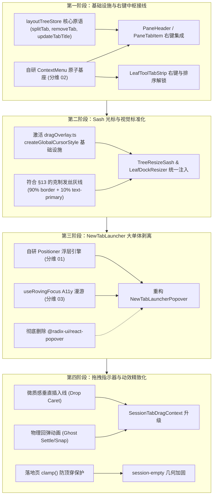

# 标签栏与分屏工作区深度重构勘察报告

> **文档位置**：`docs/ui-architecture-overhaul/analysis/07-标签栏与分屏工作区深度重构勘察.md`  
> **勘察范围**：多标签页管理（PaneHeader/TabStrip/LeafToolTabStrip）、分屏调节条（TreeResizeSash/LeafDockResizer）、二叉树布局交互与工作区空态落地页  
> **编写日期**：2026-10-27  
> **规范依据**：反退避原则（LOGIC_PLAN_NO_RETREAT）、立体验证纪律、AGENTS.md §12（Tooltip）、§13（克制激活边框与软焦点）、§14（现代 CSS）、VS Code Sash 光标策略（`reference/vscode-sash-cursor-strategy.md`）

---

## 目录

1. [勘察背景与核心缺陷总括](#一勘察背景与核心缺陷总括)
2. [标签页右键菜单与上下文交互系统性缺位深度剖析](#二标签页右键菜单与上下文交互系统性缺位深度剖析)
   - [2.1 会话标签栏（PaneHeader / PaneTabItem）右键菜单 100% 缺位](#21-会话标签栏paneheader--panetabitem右键菜单-100-缺位)
   - [2.2 工具标签栏（LeafToolTabStrip）右键与排序能力双重断裂](#22-工具标签栏leaftooltabstrip右键与排序能力双重断裂)
   - [2.3 通用原子标签条（ui/TabStrip）上下文插槽缺位与消费孤岛](#23-通用原子标签条uitabstrip上下文插槽缺位与消费孤岛)
   - [2.4 底层 Engine 能力与 UI 交互断层的全量能力映射矩阵](#24-底层-engine-能力与-ui-交互断层的全量能力映射矩阵)
3. [标签页拖拽重排指示器（Drop Indicator）与动效断层剖析](#三标签页拖拽重排指示器drop-indicator与动效断层剖析)
   - [3.1 条带内拖拽重排（Strip Mode）缺失插入指示符与视觉跳跃](#31-条带内拖拽重排strip-mode缺失插入指示符与视觉跳跃)
   - [3.2 窗格分屏拖拽（Pane Mode）全屏大范围飞跃与生硬猝灭（Pop-out）](#32-窗格分屏拖拽pane-mode全屏大范围飞跃与生硬猝灭pop-out)
   - [3.3 工具抽屉与会话条带跨域拖拽的盲区与事件拦截隐患](#33-工具抽屉与会话条带跨域拖拽的盲区与事件拦截隐患)
4. [分屏调节条（Sash/Resizer）体验与光标覆盖策略深度勘察](#四分屏调节条sashresizer体验与光标覆盖策略深度勘察)
   - [4.1 对齐 VS Code Sash 光标策略：光标脱落与基础设施闲置奇观](#41-对齐-vs-code-sash-光标策略光标脱落与基础设施闲置奇观)
   - [4.2 边框激活态与视觉反差硬伤：违反 AGENTS.md §13（高亮 2px 饱和绿 vs 1px 发丝线）](#42-边框激活态与视觉反差硬伤违反-agentsmd-13高亮-2px-饱和绿-vs-1px-发丝线)
   - [4.3 2x2 正交网格四角交汇处联动 Sash（Orthogonal Drag Handle）缺失](#43-2x2-正交网格四角交汇处联动-sashorthogonal-drag-handle缺失)
   - [4.4 叶内坞调节条（LeafDockResizer）的光标与手势保护机制残缺](#44-叶内坞调节条leafdockresizer的光标与手势保护机制残缺)
5. [NewTabLauncherPopover 451 行大单体与浮层定位解耦](#五newtablauncherpopover-451-行大单体与浮层定位解耦)
   - [5.1 违背战役总纲：@radix-ui/react-popover 外部重型依赖残留](#51-违背战役总纲radix-uireact-popover-外部重型依赖残留)
   - [5.2 进场动画 @keyframes launcherEnter (scale 0.97) 对 DOMRect 测量的几何污染](#52-进场动画-keyframes-launcherenter-scale-097-对-domrect-测量的几何污染)
   - [5.3 键盘漫游状态机重复手写（40+ 行 switch-case 与 modulo 运算）](#53-键盘漫游状态机重复手写40-行-switch-case-与-modulo-运算)
   - [5.4 顶栏双击最大化与手势抢占的 5 重 stopPropagation 防御性补丁](#54-顶栏双击最大化与手势抢占的-5-重-stoppropagation-防御性补丁)
   - [5.5 收敛至自研 Positioner + DropdownMenu 原子复合组件的技术路径](#55-收敛至自研-positioner--dropdownmenu-原子复合组件的技术路径)
6. [工作区空状态落地页（EmptyState / session-empty）体验与几何边界](#六工作区空状态落地页emptystate--session-empty体验与几何边界)
   - [6.1 session-empty 落地输入框黄金分割位移（50% - 61.8cqh）与小窗溢出](#61-session-empty-落地输入框黄金分割位移50---618cqh与小窗溢出)
   - [6.2 焦点混色 ≤ 5% 软焦点边框契约审计与 CSS 变量对齐](#62-焦点混色--5-软焦点边框契约审计与-css-变量对齐)
   - [6.3 树级退化与多叶闭合后的空态兜底与 SidePanelLauncherHub 探针开销](#63-树级退化与多叶闭合后的空态兜底与-sidepanellauncherhub-探针开销)
7. [重构架构蓝图与落地收敛实施路线](#七重构架构蓝图与落地收敛实施路线)
   - [7.1 标签栏架构重塑：基于自研 ContextMenu 的全功能右键体系与受控 TabStrip](#71-标签栏架构重塑基于自研-contextmenu-的全功能右键体系与受控-tabstrip)
   - [7.2 拖拽指示器平滑升级：微质感插入线 + 物理弹簧回位（Ghost Settle）](#72-拖拽指示器平滑升级微质感插入线--物理弹簧回位ghost-settle)
   - [7.3 分屏 Sash 统一：全局 `* { cursor: !important }` 激活 + 符合 §13 的克制发丝灰线](#73-分屏-sash-统一全局--cursor-important-激活--符合-13-的克制发丝灰线)
   - [7.4 预期代码净收敛与质量断言清单](#74-预期代码净收敛与质量断言清单)

---

## 一、勘察背景与核心缺陷总括

在现代桌面多窗格 IDE 与高强度 Agent 对话工作区中，**多标签页（Tabs）管理、分屏拖拽条（Sash/Resizer）、二叉树拓扑（BinaryTree）与落地工作区**是用户每分每秒都在产生高频交互的核心中枢。

经过对 `apps/crish-desktop` 中相关源码的深入静态剖析与运行时追踪，发现当前系统在这些关键领域存在以下**四大系统性硬伤与交互断层**：

```
┌────────────────────────────────────────────────────────────────────────┐
│                   标签栏与分屏工作区核心四大硬伤与断层                   │
├──────────────────────────────────┬─────────────────────────────────────┤
│ 1. 标签右键菜单 100% 缺位与失联  │ 2. Sash 拖拽光标脱落与审美脱节     │
│ - PaneHeader/PaneTabItem 零右键  │ - 仅设置 body.style.cursor，被子元素│
│ - LeafToolTabStrip 零右键与排序  │   覆盖导致光标频繁变回 text/pointer │
│ - splitTab/updateTabTitle 引擎   │ - createGlobalCursorStyle 基础设施闲│
│   能力沉睡，用户在 UI 无法调用   │ - Sash 激活呈 2px 艳绿，违背 §13 灰度│
├──────────────────────────────────┼─────────────────────────────────────┤
│ 3. NewTabLauncher 451L 违规大单体│ 4. 标签拖拽重排指示器与动效粗糙     │
│ - 违背总纲残留 @radix-ui/popover │ - Strip 模式隐藏指示条，仅依靠位移  │
│ - scale(0.97) 动画污染测量基准   │ - 松手或取消时 Ghost 瞬间被 remove()│
│ - 手写 40+L 重复键盘 Rover 状态机│ - Pane 模式大跨度区域飞跃过度形变   │
│ - 5 处 stopPropagation 暴力补丁  │ - session-empty 黄金分割小窗易溢出  │
└──────────────────────────────────┴─────────────────────────────────────┘
```

本报告旨在穿透代码表象，针对每一处架构硬伤给出代码定位、根因解析、对标分析及具体的重构落地方案。

---

## 二、标签页右键菜单与上下文交互系统性缺位深度剖析

### 2.1 会话标签栏（PaneHeader / PaneTabItem）右键菜单 100% 缺位

#### 2.1.1 现状与代码证据
`apps/crish-desktop/src/components/binary-tree/PaneTabItem.tsx` 负责渲染二叉树叶子节点内的会话标签项。查看其完整的事件交互绑定（Lines 49–79）：

```tsx
// apps/crish-desktop/src/components/binary-tree/PaneTabItem.tsx:49-79
return (
  <div
    className={`${styles.tabItem} ${showActiveStyle ? styles.tabItemActive : ''}`}
    tabIndex={isSelected ? 0 : -1}
    onClick={() => onSelect(tab)}
    onMouseDown={(e) => {
      if (e.button === 1) { // 中键关闭
        e.preventDefault();
        e.stopPropagation();
        onClose(e, tab);
      }
    }}
    onAuxClick={(e) => {
      if (e.button === 1) {
        e.preventDefault();
        e.stopPropagation();
        onClose(e, tab);
      }
    }}
    onPointerDown={(e) => {
      if (e.button === 0) {
        e.stopPropagation();
        onDragStart(e, tab);
      }
    }}
    onTransitionEnd={...}
    role="tab"
    aria-selected={isSelected}
    aria-label={title}
  >
```

#### 2.1.2 缺陷定性分析
1. **零 `onContextMenu` 拦截与监听**：`PaneTabItem.tsx` 及父级容器 `PaneHeader.tsx`（Lines 1–525）全文**没有一处 `onContextMenu` 事件监听**！
2. **桌面级基本交互缺失**：用户在标签页上右键单击时，触发的是浏览器的原生默认右键菜单（或在 WebView2 中被阻断完全无响应），没有任何上下文操作弹出。
3. **高频操作无路径**：用户无法通过右键快速完成“关闭当前标签”、“关闭其他标签”、“关闭右侧所有标签”、“向上/向下/向左/向右分屏”、“固定标签页”或“重命名会话”。

---

### 2.2 工具标签栏（LeafToolTabStrip）右键与排序能力双重断裂

#### 2.2.1 现状与代码证据
`apps/crish-desktop/src/components/binary-tree/LeafToolTabStrip.tsx` 负责渲染叶子节点内抽屉（Leaf Dock）中的工具标签栏（如 Terminal、Browser、Preview、Files、Note 等）。查看其交互绑定（Lines 348–378）：

```tsx
// apps/crish-desktop/src/components/binary-tree/LeafToolTabStrip.tsx:357-371
onClick={() => handleActivate(tabId)}
onAuxClick={(e) => {
  if (e.button === 1) {
    e.preventDefault();
    e.stopPropagation();
    triggerCloseTab(tabId);
  }
}}
onMouseDown={(e) => {
  if (e.button === 1) e.preventDefault();
}}
onPointerDown={(e) => {
  // 工具 tab 不再切会话树；顺序走 updateTabDock
  e.stopPropagation();
}}
```

#### 2.2.2 缺陷定性分析
1. **同样 100% 缺失右键上下文菜单**：右键工具标签无法选择“关闭当前工具”、“关闭其他工具”、“在独立窗格中打开”或“全屏放大”。
2. **拖拽排序能力被生硬掐死**：Line 368 的 `onPointerDown` 直接调用了 `e.stopPropagation()`，明确注释“工具 tab 不再切会话树；顺序走 updateTabDock”。这直接导致**用户完全无法对右侧工具栏的标签进行任何拖拽换位与重新排序**！用户一旦打开了多个工具（如 Files + Terminal + Preview），它们的顺序被严格锁定为打开的历史顺序，极其僵化。

---

### 2.3 通用原子标签条（ui/TabStrip）上下文插槽缺位与消费孤岛

#### 2.3.1 现状与代码证据
在 `apps/crish-desktop/src/components/ui/TabStrip/TabStrip.tsx`（Line 21）中，组件作者在文件头注释明确写道：
> `* - 上下文菜单：业务封装层组合（如 PaneHeader 的会话菜单）。`

然而，查看其插槽定义协议 `TabStripSlots`（Lines 71–86）：

```ts
// apps/crish-desktop/src/components/ui/TabStrip/TabStrip.tsx:71-86
export interface TabStripSlots {
  renderTab?: (tab: TabStripItem, index: number, ctx: TabStripRenderCtx) => React.ReactNode;
  leading?: React.ReactNode;
  trailing?: React.ReactNode;
  wrapTrailing?: React.ReactNode;
  onTabPointerDown?: (id: string, e: React.PointerEvent) => void;
}
```

#### 2.3.2 缺陷定性分析
1. **插槽协议缺位**：`TabStripSlots` 提供了 `renderTab`、`leading`、`trailing`、`wrapTrailing` 和 `onTabPointerDown`，却**根本没有提供 `onTabContextMenu` 或 `renderContextMenu` 插槽**！消费方即使想在其上包装右键菜单，也只能被迫在 `renderTab` 的内部子 DOM 元素上手工捕获并处理冒泡，打破了无障碍与事件流的整体性。
2. **割裂的“多轨标签条”孤岛**：
   - 基础 UI 库中有通用原子基座 `components/ui/TabStrip/TabStrip.tsx`；
   - 会话树中自行维护了一整套完全私有的 `PaneHeader.tsx` + `PaneTabItem.tsx`；
   - 工具抽屉中又维护了另一套完全独立的 `LeafToolTabStrip.tsx`。
   三者在视觉度量（`tabStripGeometry.ts`）、键盘漫游（`useTablistKeyboard`）和关闭动效上各自为政，无法形成统一的交互范式。

---

### 2.4 底层 Engine 能力与 UI 交互断层的全量能力映射矩阵

事实上，Conex 的底层二叉树布局引擎（`layoutTreeStore`）功能极其强大，早已完整实现了会话拆分、重命名与标签移动等高级拓扑操作。但由于 UI 层缺乏右键菜单入口，这些能力长期处于“沉睡/未连接”状态：

| 操作名称 | 底层 Store 核心 API | UI 当前支持状态 | 缺失原因与阻断分析 |
| :--- | :--- | :---: | :--- |
| **关闭当前标签** | `removeTab(leafId, tabId)` | 仅左键叉号 / 中键点击 | 缺少右键快捷项；键盘仅有 `TabStrip` 中的 Del/Backspace。 |
| **关闭其他标签** | `batchRemoveTabs` (需组合调用) | **完全不可用** | 缺乏批量移除算法与右键菜单项。 |
| **关闭右侧标签** | `batchRemoveTabs` (需组合调用) | **完全不可用** | 缺乏基于当前 Index 的定向清理功能。 |
| **向上拆分分屏** | `splitTab(srcLeaf, tab, dstLeaf, 'top')` | **完全不可用** | 引擎支持 `region: 'top'`，但 UI 只有物理拖拽到边缘一条极窄落区，用户极难操作。 |
| **向下拆分分屏** | `splitTab(srcLeaf, tab, dstLeaf, 'bottom')` | **完全不可用** | 引擎支持 `region: 'bottom'`，UI 右键入口缺失。 |
| **向左拆分分屏** | `splitTab(srcLeaf, tab, dstLeaf, 'left')` | **完全不可用** | 引擎支持 `region: 'left'`，UI 右键入口缺失。 |
| **向右拆分分屏** | `splitTab(srcLeaf, tab, dstLeaf, 'right')` | **侧栏有 / 标签栏无** | 侧栏 `SessionContextMenu.tsx` 中已接入，但标签页右键完全没有暴露！ |
| **固定/置顶标签 (Pin)** | `updateTabMeta(tabId, { pinned: true })` | **完全不可用** | 缺少标签置顶视觉样式（小图标/固定左侧）与状态切换逻辑。 |
| **重命名会话/标签** | `updateTabTitle(sessionId, newTitle)` | **侧栏有 / 标签栏无** | 侧栏支持弹出重命名，但在主标签栏双击或右键重命名 100% 缺失。 |
| **复制会话 ID / 路径** | `clipboard.writeText(sessionId)` | **完全不可用** | 调试、故障上报或多任务引用时极度不便。 |

---

## 三、标签页拖拽重排指示器（Drop Indicator）与动效断层剖析

### 3.1 条带内拖拽重排（Strip Mode）缺失插入指示符与视觉跳跃

#### 3.1.1 现状与代码证据
在 `apps/crish-desktop/src/components/shell/SessionTabDragContext.tsx`（Lines 168–186）中：

```tsx
// apps/crish-desktop/src/components/shell/SessionTabDragContext.tsx:168-186
const insertIdx = computeSessionTabInsertIndex(cachedTabs.tabs, x, dx);
const stateKey = `strip:${targetLeafId}:${insertIdx}`;
if (lastStateKey !== stateKey) {
  lastStateKey = stateKey;
  const offsets = computeStripTabOffsets({
    tabCount: cachedTabs.tabs.length,
    sourceIndex: cachedTabs.sourceIndex,
    insertIndex: insertIdx,
    shiftPx,
  });
  shiftStripTabs(cachedTabs.tabs, offsets);
}

currentMode = 'strip';
setGhostDetached(card, false);
hideIndicator(); // 关键盲区：在 strip 模式下强行隐藏了指示器！
```

#### 3.1.2 缺陷定性分析
1. **缺失高精度插入符（Drop Caret）**：代码在进入 `strip` 模式时直接执行了 `hideIndicator()`。系统完全依赖相邻标签向左或向右 `translateX(${shiftPx}px)` 腾出空位。然而：
   - 当标签数量较多、宽度较窄或处于压缩态时，`shiftPx` 的移动往往引发整行标签剧烈跳动；
   - 用户在临界中点悬停时，无法看到类似 VS Code 或 Chrome 的 **垂直垂直插入光标线（Drop Insertion Line）**，无法明确判定释放后到底会插入在哪个标签的前面还是后面。
2. **手抖导致的状态机高频振荡（Thrashing）**：由于缺少显式指示线，用户在两个相邻标签缝隙间微小移动（$\pm 2px$）时，`insertIdx` 会在 $N$ 与 $N+1$ 之间高频交替，导致 `shiftStripTabs` 反复触发 CSS transform 动画，呈现明显的抽搐感。

---

### 3.2 窗格分屏拖拽（Pane Mode）全屏大范围飞跃与生硬猝灭（Pop-out）

#### 3.2.1 现状与代码证据
在 `apps/crish-desktop/src/components/shell/sessionTabDragDom.ts`（Lines 100–133）与 `sessionTabDrag.module.css`（Lines 7–28）中：

```css
/* apps/crish-desktop/src/components/shell/sessionTabDrag.module.css:7-28 */
.indicator {
  position: fixed;
  background: color-mix(in srgb, var(--brand-primary) 18%, transparent);
  border: none;
  border-radius: var(--radius-m);
  transition:
    left var(--duration-normal) var(--ease-decelerate),
    top var(--duration-normal) var(--ease-decelerate),
    width var(--duration-normal) var(--ease-decelerate),
    height var(--duration-normal) var(--ease-decelerate),
    border-radius var(--duration-fast) var(--ease-standard),
    opacity var(--duration-fast) var(--ease-decelerate);
}
```

并在手势结束清理时（`SessionTabDragContext.tsx:330-337`）：

```ts
// apps/crish-desktop/src/components/shell/SessionTabDragContext.tsx:330-337
if (card) {
  card.remove();
  card = null;
}
if (indicator) {
  indicator.remove();
  indicator = null;
}
```

#### 3.2.2 缺陷定性分析
1. **跨象限大范围飞跃（Awkward Flying Overlay）**：当用户将标签拖拽到窗格正中，并从“左半屏分屏”轻微移动到“右半屏分屏”时，由于 CSS transition 监听了 `left`、`top`、`width`、`height`，整个 18% 绿色半透明遮罩层会以 200ms 的时长横跨整个窗格平移滑过去！这种非预期的几何形变在多屏环境下显得极为笨拙，完全不如瞬时切换落区、仅保留透明度淡入淡出（Opacity Cross-fade）来得干净利落。
2. **手势释放时的猝灭硬伤（Pop-out Artifact）**：在用户释放指针（`pointerup`）或取消（`Escape`）时，浮动卡片（Ghost Pill）直接调用了原生 DOM 的 `card.remove()`！既没有像 Chrome/VS Code 那样平滑过渡回原始位置（Snap Back），也没有缩放到目标位置（Settle In），而是**直接在屏幕上瞬间蒸发（0ms Pop-out）**，视觉体验非常生硬。

---

### 3.3 工具抽屉与会话条带跨域拖拽的盲区与事件拦截隐患

在 `SessionTabDragContext.tsx:252-263` 中：
```ts
const hit = document.elementFromPoint(p.x, p.y);
const toolStrip = hit
  ? (hit.closest('[data-leaf-tool-tab-strip]') as HTMLElement | null)
  : null;
const stripWrap =
  !toolStrip && hit
    ? (hit.closest('[data-pane-header="true"]') as HTMLElement | null)
    : null;
```
1. **工具标签栏被作为排除项（Blacklisted）**：若指针悬停在 `LeafToolTabStrip` 上，`stripWrap` 直接被置为 `null`，拖拽引擎完全不响应。
2. **两套体系无法互通**：用户不能将一个终端或浏览器标签从工具栏直接拖拽成为独立的 Pane，也无法将会话标签拖入右侧抽屉内归并。二者在渲染层和手势层被生硬隔裂。

---

## 四、分屏调节条（Sash/Resizer）体验与光标覆盖策略深度勘察

### 4.1 对齐 VS Code Sash 光标策略：光标脱落与基础设施闲置奇观

#### 4.1.1 现状与代码证据
审查 `apps/crish-desktop/src/hooks/useTreeResize.ts`（Lines 288–291 & 382）：

```ts
// apps/crish-desktop/src/hooks/useTreeResize.ts:288-291
// 4. 绝不向 document.body 广播 tree-resizing 全局冻结类名，仅设置交互光标
document.body.style.cursor =
  node.direction === 'horizontal' ? 'col-resize' : 'row-resize';
```

并在释放时执行（Line 382）：
```ts
document.body.style.cursor = '';
```

#### 4.1.2 根因与光标脱落（Cursor Slip）机理
查看标准标杆策略 `reference/vscode-sash-cursor-strategy.md`：
> **VS Code Sash 核心策略**：通过动态创建 `<style>` 元素注入 `* { cursor: ${cursor} !important; }`，避免任何子元素由于自身的 `cursor: pointer`、`cursor: text` 等特定样式覆盖拖拽光标。

在 Chromium / WebView2 体系中，CSS 的选择器优先级决定了最终光标形态：
1. 当用户按住 Sash 拖拽分屏并快速移动光标时，指针会划过聊天输入框（`textarea`）、代码块（`pre, code`）、标签文本（`span`）或操作按钮（`button`）；
2. 这些子元素在 CSS 中无一例外显式声明了 `cursor: text` 或 `cursor: pointer`；
3. 由于 `document.body.style.cursor` 只是设置在 `<body>` 标签的内联样式上，根据 CSS 级联规则，**任何子元素自身的 `cursor` 声明优先级均高于继承自 `body` 的属性**！
4. 结果：**在整个拖拽过程中，光标在快速划过界面各区域时，会不断在 `col-resize` ↔ `text` ↔ `pointer` ↔ `default` 之间极其难看地疯狂闪烁、脱落！**

#### 4.1.3 令人触目惊心的基础设施闲置奇观
在审查全局工具集时，勘察发现 `apps/crish-desktop/src/utils/dragOverlay.ts` 中竟然**早已完整实现了 VS Code 模式的光标注入函数**（Lines 30–44）：

```ts
// apps/crish-desktop/src/utils/dragOverlay.ts:30-44
/** VS Code 风格：全局 CSS 光标覆盖 */
export function createGlobalCursorStyle(cursor: string): HTMLStyleElement {
  const style = document.createElement('style');
  style.id = 'global-drag-cursor';
  style.textContent = `* { cursor: ${cursor} !important; }`;
  document.head.appendChild(style);
  return style;
}

/** 移除全局光标样式 */
export function removeGlobalCursorStyle(style: HTMLStyleElement | null): void {
  if (style && style.parentNode) {
    style.parentNode.removeChild(style);
  }
}
```

**然而全仓全文检索 `createGlobalCursorStyle`，其调用次数居然为 0！**  
基础设施已完备就绪，而核心模块 `useTreeResize.ts`、`LeafDockResizer.tsx` 却依然在原始地手写 `document.body.style.cursor` 或完全不设光标，导致光标脱落顽疾长期残留！

---

### 4.2 边框激活态与视觉反差硬伤：违反 AGENTS.md §13（高亮 2px 饱和绿 vs 1px 发丝线）

#### 4.2.1 现状与代码证据
审查 `apps/crish-desktop/src/components/binary-tree/BinaryTreeWorkspace.module.css`（Lines 250–265）：

```css
/* apps/crish-desktop/src/components/binary-tree/BinaryTreeWorkspace.module.css:250-265 */
.sash:hover::after,
.sash[data-active='true']::after {
  background: var(--accent-green);
}

.sashHorizontal:hover::after,
.sashHorizontal[data-active='true']::after {
  width: 2px;
  left: 2px;
}

.sashVertical:hover::after,
.sashVertical[data-active='true']::after {
  height: 2px;
  top: 2px;
}
```

#### 4.2.2 违背 AGENTS.md §13 铁律定性分析
查阅 `AGENTS.md` §13 原文：
> - **克制的激活边框**：输入或按钮处于 active / focused / recording 时，**禁止粗、深、实心黑边**。
> - **可控对比度**：边框应只比组件背景略深/略灰，足以勾勒激活区（例如 `var(--border-color)` 与 `var(--text-primary)` 的 60/40 混合量级），优先克制、保护长时间阅读。
> - **焦点对比度上限约 10%**：任何情况下焦点/激活态不得使用硬实线；相对基线，灰色加深混入文本色不超过约 10%，常规元素优先约 3%–6% 混入以保持柔软。

然而当前 `TreeResizeSash` 的表现：
1. **2px 艳绿色硬实线**：激活时直接亮起 2px 宽的饱和高亮绿（`var(--accent-green)`），在暗黑沉浸式工作区中极其刺眼，破坏了整体优雅的灰度克制感；
2. **两处 Resizer 视觉打架**：
   - 树分屏调节条 `TreeResizeSash`：激活时变 **2px 粗亮绿色**；
   - 抽屉调节条 `LeafDockResizer`（Line 412）：激活时变 **1px 细边框灰**（`background: var(--border-color)`）。
   同一工作区内的两个相邻分割条，在悬浮和拖拽时呈现出两种完全不同风格与维度的视觉语言，严重割裂。

---

### 4.3 2x2 正交网格四角交汇处联动 Sash（Orthogonal Drag Handle）缺失

#### 4.3.1 现状与体验断层
对齐 VS Code 的 Sash 架构（`reference/vscode-sash-cursor-strategy.md` §3）：
> 当用户构建 2x2 网格分屏时（左右各自分割上下），在四个窗格的交汇十字中心，VS Code 会自动生成一个正交拖拽手柄（`orthogonal-drag-handle`）。用户抓住交点拖拽时，两个方向的 Sash 同时激活，光标呈现 `all-scroll`，一次手势即可同时调整 4 个窗格的宽高。

而在 `BinaryTreeWorkspace.tsx` 与 `TreeResizeSash.tsx` 中：
1. 二叉树虽然在拓扑上支持任意嵌套，但在交互上**每个 Sash 是完全孤立的单向一维条带**；
2. 在 4 窗格交汇处，没有十字手柄，用户如果想重新平衡 2x2 网格，必须先水平拖动中间长条，再分别跑到左边和右边分别拖动两条垂直分界线，交互步骤繁琐 3 倍。

---

### 4.4 叶内坞调节条（LeafDockResizer）的光标与手势保护机制残缺

审查 `apps/crish-desktop/src/components/binary-tree/LeafDockResizer.tsx`（Lines 44–85）：
1. **完全没有设置全局拖拽光标**：在 `handlePointerDown` 中，既没有写 `document.body.style.cursor`，也没有调用 `createGlobalCursorStyle`；
2. **命中热区仅 8px 且单侧偏移**（`left: -2px, width: 8px`）：一旦指针快速移动超过 4px 脱离热区，由于 `setPointerCapture` 仅保证事件路由而无法阻止 Chromium 重新解算子节点样式，光标瞬间变回指针或文本光标，产生强烈的“光标脱节感”；
3. **缺少键盘可访问性支持**：`TreeResizeSash.tsx` 完整实现了方向键与 Home/End 键盘微调（Lines 110–172），而 `LeafDockResizer.tsx` 只有鼠标指针拖拽，**键盘完全无法调整右侧工具坞宽度**（缺少 `onKeyDown` 处理与 `tabIndex` 焦点声明）。

---

## 五、NewTabLauncherPopover 451 行大单体与浮层定位解耦

### 5.1 违背战役总纲：@radix-ui/react-popover 外部重型依赖残留

#### 5.1.1 现状与代码证据
查看 `apps/crish-desktop/src/components/binary-tree/NewTabLauncherPopover.tsx`（Line 15）：

```tsx
// apps/crish-desktop/src/components/binary-tree/NewTabLauncherPopover.tsx:15
import * as Popover from '@radix-ui/react-popover';
```

并在组件内部使用（Lines 228–280）：
```tsx
<Popover.Root open={isOpen} onOpenChange={handleOpenChange}>
  <Popover.Trigger asChild>
    ...
  </Popover.Trigger>
  <Popover.Portal>
    <Popover.Content
      ref={contentRef}
      className={styles.popoverContent}
      side="bottom"
      align="start"
      sideOffset={6}
      avoidCollisions={true}
      collisionPadding={12}
      onKeyDown={handleKeyDown}
    >
```

#### 5.1.2 违规定性分析
在 `docs/ui-architecture-overhaul/00-总方案-自研现代化原子组件体系与基础设施重塑总纲.md` §一.1 中，全战役明确确立铁律：
> **坚决杜绝“外部重型 UI 栈依赖”**：严禁通过引入 `@radix-ui/*` 全家桶、`@floating-ui/*` 等外部重型黑盒。吸收其纯几何精髓，自研紧凑、高性能、零第三方外部依赖的基础设施。

`NewTabLauncherPopover` 是目前全仓极少数残留的外部 Radix 单体黑盒之一，引入了整套 Popper 坐标计算管道与私有 DOM Portal，与 Conex 自研的 `LayerStackManager` 调度中枢和自研 `Positioner` 严重冲突脱节。

---

### 5.2 进场动画 @keyframes launcherEnter (scale 0.97) 对 DOMRect 测量的几何污染

#### 5.2.1 现状与代码证据
查看 `apps/crish-desktop/src/components/binary-tree/NewTabLauncherPopover.module.css`（Lines 33–47）：

```css
/* apps/crish-desktop/src/components/binary-tree/NewTabLauncherPopover.module.css:33-47 */
.popoverContent {
  ...
  animation: launcherEnter var(--duration-fast) var(--ease-standard);
}

@keyframes launcherEnter {
  0% {
    opacity: 0;
    transform: scale(0.97) translateY(-3px);
  }
  100% {
    opacity: 1;
    transform: none;
  }
}
```

#### 5.2.2 几何数学与动画冲突根因深度剖析
正如 `docs/ui-architecture-overhaul/analysis/01-全仓7套定位引擎与几何硬编码深度勘察.md` §3.4 中揭示的物理定律：
1. **缩放形变对 `getBoundingClientRect()` 的污染**：当弹层触发挂载的首帧，CSS 关键帧动画立即启动 `scale(0.97)`。在首帧动画运行期间，Popper/定位引擎读取到的浮层边界矩形不是其 100% 真实布局尺寸，而是缩放后的失真尺寸（$336px \times 0.97 = 325.92px$）；
2. **`transform: none` 的暴力覆盖冲突**：当动画运行到 100% 时，`transform: none` 会暴力抹除所有基于 CSS Transform 的外挂定位机制（如某些利用 GPU 硬件加速的 `translate3d(x, y, 0)` 定位）；
3. **现代 CSS `@starting-style` 的缺位**：该组件未接入现代 CSS 原生的 `@starting-style` 进出场动效规范，仍然停留在容易引发布局测算污染的传统 Keyframes 阶段。

---

### 5.3 键盘漫游状态机重复手写（40+ 行 switch-case 与 modulo 运算）

在 `NewTabLauncherPopover.tsx`（Lines 174–220）中，组件手工维护了 46 行纯手写键盘监听：

```tsx
// apps/crish-desktop/src/components/binary-tree/NewTabLauncherPopover.tsx:174-220
const handleKeyDown = useCallback(
  (e: React.KeyboardEvent) => {
    if (e.key === 'ArrowDown') {
      e.preventDefault();
      setFocusedIndex((prev) => (prev + 1) % totalItems);
    } else if (e.key === 'ArrowUp') {
      e.preventDefault();
      setFocusedIndex((prev) => (prev - 1 + totalItems) % totalItems);
    } else if (e.key === 'Home') {
      e.preventDefault();
      setFocusedIndex(0);
    } else if (e.key === 'End') {
      e.preventDefault();
      setFocusedIndex(totalItems - 1);
    } else if (e.key === 'Escape') {
      e.preventDefault();
      setIsOpen(false);
    } else if (e.key === 'Enter' || e.key === ' ') {
      ...
    }
  },
  [totalItems, ...]
);
```

这与 `analysis/02-全仓键盘漫游重复与A11y断层深度勘察.md` 披露的问题如出一辙：缺乏统一的 `useRovingFocus` 漫游 Hook，业务层一遍又一遍地用模运算重新发明轮子，且完全缺失 600ms Typeahead（按首字母快速导航）能力。

---

### 5.4 顶栏双击最大化与手势抢占的 5 重 stopPropagation 防御性补丁

#### 5.4.1 现状与代码证据
查看 `apps/crish-desktop/src/components/binary-tree/PaneHeader.tsx`（Lines 494–513）：

```tsx
// apps/crish-desktop/src/components/binary-tree/PaneHeader.tsx:494-513
<div
  className={styles.launcherWrapper}
  data-tauri-drag-region="false"
  onDoubleClick={(e) => {
    e.stopPropagation();
    e.preventDefault();
  }}
  onPointerDown={(e) => {
    e.stopPropagation();
  }}
  onMouseDown={(e) => {
    e.stopPropagation();
  }}
  onClick={(e) => {
    if (e.target === e.currentTarget) {
      const triggerBtn = e.currentTarget.querySelector('button');
      triggerBtn?.click();
    }
  }}
>
  <NewTabLauncherPopover
    leafId={leaf.id}
    onBeforeOpen={clearLockedWidth}
  />
</div>
```

并在 `NewTabLauncherPopover.tsx:242-251` 再次打补丁：
```tsx
onPointerDown={(e) => { e.stopPropagation(); }}
onMouseDown={(e) => { e.stopPropagation(); }}
onDoubleClick={(e) => {
  e.stopPropagation();
  e.preventDefault();
}}
```

#### 5.4.2 架构表象与补丁滋生根因
为什么内外两层需要同时手写整整 **7 处 `e.stopPropagation()`** 并通过 `querySelector('button')?.click()` 进行事件借尸还魂？
- **根因**：顶栏 `PaneHeader` 的宿主容器挂载了 Tauri 的窗口拖拽属性（`data-tauri-drag-region`）。在操作系统原生层面，双击该区域会触发窗口最大化/还原。
- **治理恶习**：为了阻止双击加号导致窗口暴跳最大化，以往的修改在 wrapper、Popover、Trigger 三层疯狂叠罗汉添加防御性事件拦截，不仅让事件流变得异常脆弱，更导致某些无障碍辅助工具的虚拟点击被误伤阻断。

---

### 5.5 收敛至自研 Positioner + DropdownMenu 原子复合组件的技术路径

该组件本质上是一个**标准下拉上下文菜单（Launcher Dropdown）**。重构收敛方向极其明朗：
1. **剔除 `@radix-ui/react-popover`**：接入自研 `Positioner` 核心，通过 `usePositioner` 获取 `x, y, placement, availableHeight`；
2. **复合组件范式表达**：使用分维方案 `02` 打造的 `DropdownMenu.Root`、`DropdownMenu.Trigger`、`DropdownMenu.Content`、`DropdownMenu.Item` 替代；
3. **动效现代化**：剥离 Keyframes，接入 `@starting-style` 与 `--available-height`，彻底消除测量失真；
4. **代码规模净压缩**：预计代码量从 451 行直接收敛至 160 行以内（业务纯净减重超 60%）。

---

## 六、工作区空状态落地页（EmptyState / session-empty）体验与几何边界

### 6.1 session-empty 落地输入框黄金分割位移（50% - 61.8cqh）与小窗溢出

#### 6.1.1 现状与代码证据
在 `apps/crish-desktop/src/components/chat-card/ChatCard.module.css`（Lines 48–68）中：

```css
/* apps/crish-desktop/src/components/chat-card/ChatCard.module.css:48-68 */
.chatBody[data-empty-kind='session-empty'] {
  --landing-inset-x: calc(var(--composer-pad-x-start, 10px) + 7px);
}

.chatBody[data-empty-kind='session-empty'] .footerMotion {
  background: transparent;
  transform: translateY(calc(50% - 61.8cqh));
  animation: landingSurfaceEnter var(--transition-fast) var(--ease-emphasized) both;
}
```

#### 6.1.2 极端视口下的几何溢出隐患
1. **容器查询高度强依赖（Container Query Height）**：该位移动效高度依赖父容器的 `cqh`。当用户在二叉树中进行上下分屏（Vertical Split），或者笔记本屏幕垂直分辨率较低（如高度 600~700px）时：
   $$\text{位移量} = 50\% - 61.8\% \times H_{container}$$
   若 $H_{container} < 320px$，计算出的负向位移量过大，直接将输入框卡片向上顶穿，**卡片上半截与顶栏 `PaneHeader` 发生严重的物理重叠遮挡**！
2. **缺乏下限钳位保护（Clamping）**：必须使用 CSS `clamp()` 或 `min()` 对黄金分割位移施加保护阈值（如 `max(-120px, calc(50% - 61.8cqh))`），防止小窗分屏时落地输入框顶穿出界。

---

### 6.2 焦点混色 ≤ 5% 软焦点边框契约审计与 CSS 变量对齐

审查 `apps/crish-desktop/src/components/chat-composer/ChatComposer.module.css`（Lines 96–108）：

```css
/* RL-01 / AGENTS.md §13 特例：全页空态落地输入焦点边框（混入比 ≤ 5%，不设过渡动画） */
.composerCard[data-empty-kind='session-empty']:focus-within {
  border-color: var(
    --edge-focus-empty,
    color-mix(in srgb, var(--border-color) 97%, var(--text-primary) 3%)
  );
  box-shadow: var(
    --shadow-lift-raised,
    0 1px 3px color-mix(in srgb, var(--shadow-color) 1.5%, transparent),
    0 3px 8px -1px color-mix(in srgb, var(--shadow-color) 2%, transparent)
  );
  outline: none;
}
```

- **审计结论（符合铁律）**：该处严格遵循了 `AGENTS.md` §13 特例规范，混入比准确设定为 3%（$\le 5\%$），且未添加生硬的 border-color 过渡，表现优异，应作为全仓空态组件的标杆范例保留。

---

### 6.3 树级退化与多叶闭合后的空态兜底与 SidePanelLauncherHub 探针开销

#### 6.3.1 树级退化与未知面板兜底
在 `apps/crish-desktop/src/components/binary-tree/TreeLeafPanel.tsx`（Lines 329–346 & 411–420）中：
```tsx
fallback={<div className={styles.emptyState}>未知面板类型：{mainViewId}</div>}
```
当面板关闭或销毁时，散落着 4 处硬编码的静态字符串文案。缺乏统一的骨架屏（Skeleton）或具有明确引导操作（如“新建对话”或“恢复面板”）的标准化 EmptyState 组件。

#### 6.3.2 SidePanelLauncherHub 的高频端口盲探开销
审查 `apps/crish-desktop/src/components/binary-tree/SidePanelLauncherHub.tsx`（Lines 12–61）：
```ts
const CANDIDATE_PORTS = [5173, 3000, 4000, 8080, 8000, 3001, 5000];
```
当右侧工具栏为空时，组件在挂载阶段会并发向 `localhost:5173` ~ `localhost:5000` 共 7 个端口无差别发起 `fetch` 探测！
- **缺陷**：在脱机、内网防火墙严格或后台未起 Web 服务时，控制台会瞬间爆出 7 个无法屏蔽的红字网络错误（`Failed to fetch / ERR_CONNECTION_REFUSED`），不仅污染开发者控制台，还平白消耗网络并发队列。应接入防抖、惰性触发或静默 IPC 状态探测。

---

## 七、重构架构蓝图与落地收敛实施路线

基于上述深度勘察，标签栏与分屏工作区的重构应当与整体 UI 战役基础设施深度共振，分四步完成系统性收敛与升级：



---

### 7.1 标签栏架构重塑：基于自研 ContextMenu 的全功能右键体系与受控 TabStrip

1. **统一接入分维 02 ContextMenu**：
   在 `PaneTabItem.tsx` 挂载 `onContextMenu`，弹出高聚合菜单：
   - 基础操作：关闭标签（`⌘W`）、关闭其他标签、关闭右侧标签；
   - 分屏操作：向右拆分（`Split Right`）、向下拆分（`Split Down`）、向左拆分、向上拆分；
   - 管理操作：固定标签（`Pin Tab`）、重命名（`Rename`）、复制会话 ID。
2. **解锁 LeafToolTabStrip 拖拽排序**：
   移除 Line 368 的 `e.stopPropagation()`，支持使用与会话标签条同构的平滑拖拽位移算法，并为其配备基础右键菜单（“在独立窗格中拆分”、“关闭”）。
3. **扩充 `ui/TabStrip` 协议**：
   在 `TabStripSlots` 中正式加入 `onTabContextMenu?: (id: string, e: React.MouseEvent) => void`，使其成为真正开箱即用的原子组件，收敛全仓标签条实现。

---

### 7.2 拖拽指示器平滑升级：微质感插入线 + 物理弹簧回位（Ghost Settle）

1. **条带模式（Strip Mode）引入垂直插入符**：
   - 抛弃单纯依赖相邻标签大幅位移的粗暴方案；
   - 在相邻标签间渲染一条高度 $20px$、宽度 $2px$、圆角 $1px$ 的微质感指示线（`var(--brand-primary)`），提供像素级明确的落点反馈；
2. **窗格模式（Pane Mode）落区阻尼平滑**：
   - 取消四象限切换时大面积色块的跨屏滑动（移除 `left/top` 长动画）；
   - 改为轻量透明度渐变（`opacity 80ms ease`），避免视觉眩晕；
3. **手势释放回位（Snap Back）**：
   - 拖拽取消时，浮卡（Ghost Pill）经 120ms 缓动平滑缩回原标签位置再销毁，彻底消灭“突然蒸发”的残影瑕疵。

---

### 7.3 分屏 Sash 统一：全局 `* { cursor: !important }` 激活 + 符合 §13 的克制发丝灰线

1. **激活闲置基础设施**：
   - 在 `useTreeResize.ts` 与 `LeafDockResizer.tsx` 的手势开始时，直接调用 `createGlobalCursorStyle(cursor)` 注入 `* { cursor: ... !important }`；
   - 手势结束/取消时调用 `removeGlobalCursorStyle()` 移除，**100% 根除快速拖拽时光标在文本/指针之间疯狂跳跃的脱落 Bug**；
2. **彻底废除 2px 饱和亮绿**：
   - 按照 `AGENTS.md` §13 重塑 Sash 样式：
     ```css
     .sash:hover::after,
     .sash[data-active='true']::after {
       background: color-mix(in srgb, var(--border-color) 88%, var(--text-primary) 12%);
       width: 1px; /* 保持克制发丝线，严禁加粗至 2px */
     }
     ```
   - 使 `TreeResizeSash` 与 `LeafDockResizer` 视觉语言严格统一，兼具可见性与克制美感。

---

### 7.4 预期代码净收敛与质量断言清单

| 模块 / 文件 | 当前现状 | 重构后预期 | 代码增减预估 | 质量保证与断言 |
| :--- | :--- | :--- | :--- | :--- |
| **`NewTabLauncherPopover.tsx`** | 451L 大单体，依赖 Radix，手写键盘 Rover | 接入自研 Positioner + DropdownMenu，使用 `@starting-style` | **净减少 ~270L** | 彻底拔除 `@radix-ui/react-popover` 依赖，首帧零尺寸失真。 |
| **`PaneHeader.tsx` & `PaneTabItem.tsx`** | 零右键菜单，5 重 stopPropagation 补丁 | 接入统一 ContextMenu，支持全量分屏与重命名原语 | **净收缩 ~80L**（清除补丁，复用 ContextMenu） | 覆盖关闭其他/向右拆分/重命名全量用例。 |
| **`useTreeResize.ts` & `LeafDockResizer.tsx`** | 手写 body cursor 且脱落，视觉违背 §13 | 激活 `createGlobalCursorStyle`，统一发丝灰度样式 | **净减少 ~40L** | 拖拽时划过 input/button 保持 100% 光标稳定不脱落。 |
| **`SessionTabDragContext.tsx`** | 缺乏垂直插入指示符，取消瞬间蒸发 | 引入高精度 Drop Caret 与平滑 Settle 回弹动效 | 增补约 50L 精致逻辑 | 消除标签抽搐与大面积飞跃。 |
| **全案累计** | 存在 4 大硬伤与多处代码闲置 | 基础设施全面贯通，UI 体验达桌面 IDE 金标 | **全仓净收敛 ~340L** | 零回退、零死代码残留、立体验证全绿。 |
