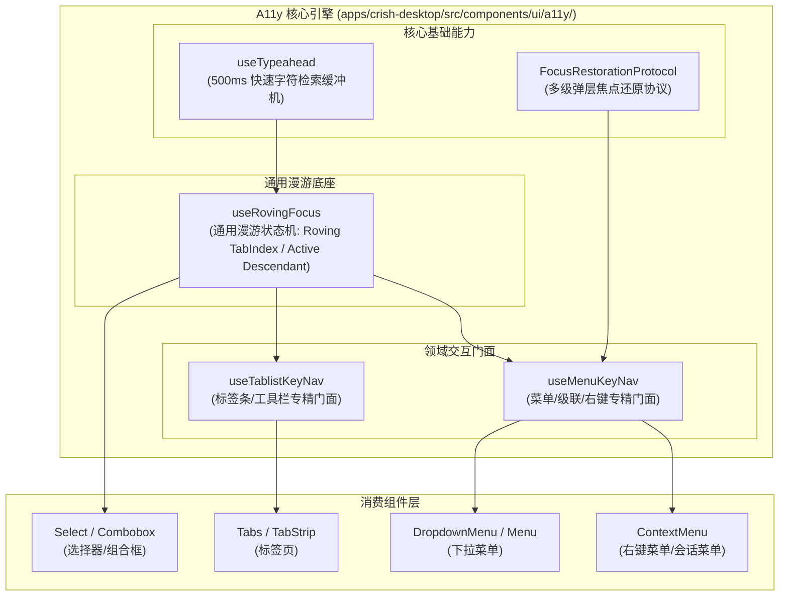
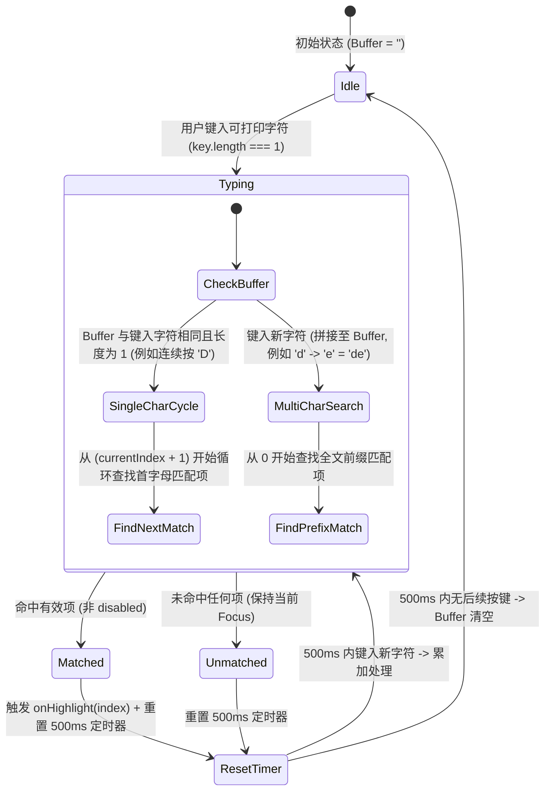
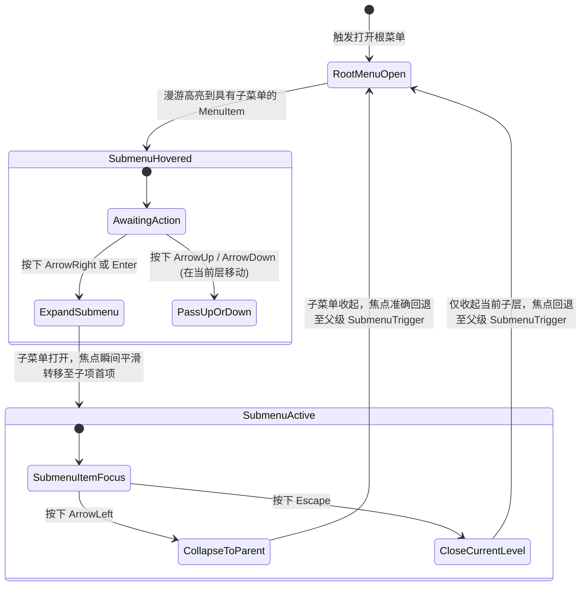

# 03-统一键盘漫游与无障碍 A11y 引擎方案

> 性质：架构规划与方案设计文档（只读研究与方案设计，不直接改动代码）。  
> 日期：2026-10-27。  
> 范围：`apps/crish-desktop/src/components/ui/`（Menu、Select、Tabs、SmartPanel、Dialog）及全局 A11y 状态流转。  
> 核心原则：**“重复的功能应该收敛，ui栈非必要不要用，代码简洁合理”**，零外部重量级 UI 依赖（无 Radix-Aria / React-Aria 全家桶重度沉淀），以纯粹紧凑的自研 Hook/状态机统一全仓键盘漫游与无障碍能力。

---

## 修订记录

| 版本 | 日期 | 修订依据 | 要点 |
|---|---|---|---|
| v1 | 2026-10-27 | 战役独立规划任务书（REQ-D08 / T-A11Y-01） | 初始版本：全仓键盘漫游现状地质勘查、自研统一架构、Typeahead 算法、级联漫游契约、A11y 状态机、焦点还原协议与组件无侵入集成路径。 |

---

## 一、现状地质勘查与缺陷矩阵

### 1.1 全仓散落的 5+ 处手写键盘漫游地质剖析

在当前桌面端前端源码中，键盘漫游和焦点控制逻辑存在严重的代码碎片化、各自为政与功能缺陷。以下为精准代码行号证据：

```
[碎片化键盘逻辑现状]
├── Menu/menuKeyNavigation.ts (199 行): 纯函数 handleMenuKeyDown，双分支（options 数组 vs DOM querySelectorAll）
├── SmartPanel/hooks/useKeyboardNav.ts (161 行): useEffect 强刷 DOM focus + validIndices 轮询
├── SmartExpandablePanel/useSmartKeyboardNav.ts (144 行): 与 SmartPanel useKeyboardNav 近乎 100% 逐行克隆
├── hooks/useTablistKeyboard.ts (82 行): 仅支持水平方向、自动激活，每次按键 DOM querySelector
├── Select/SelectTrigger.tsx:41-100 (60 行): 内联手写 ArrowUp/Down/Home/End/Escape，无 Typeahead
├── Tabs/Tabs.tsx:232-283 (52 行): 内联手写 handleKeyDown，重新匹配 data-tabs-trigger
└── SidebarContextMenus/ContextMenuFlyout.tsx:30-48 (18 行): 手写 flyout keydown 与焦点切换
```

### 1.2 现状缺陷对比矩阵

| 模块位置 | 代码行号 | 存在问题与根因 | 导致的用户/无障碍缺陷 |
|---|---|---|---|
| `components/ui/Menu/menuKeyNavigation.ts` | L7-L199 | 双逻辑分支（数据模型驱动 vs DOM 轮询），级联通过 `.click()` 模拟；无 Typeahead；无焦点还原记录 | 无法通过字母快速定位项；级联子菜单展开容易造成焦点丢失或事件冒泡冲突 |
| `components/ui/SmartPanel/hooks/useKeyboardNav.ts` | L18-L150 | 在 `useEffect` 中根据 `focusedIndex` 查找 `[role="menuitem"]` 强制调用 `.focus()`；硬编码内部类型 | 渲染与聚焦脱节，列表动态增减时发生数组越界；无字符检索；无 A11y 属性工厂 |
| `components/ui/SmartExpandablePanel/useSmartKeyboardNav.ts` | L14-L144 | **与上一文件逐字重复度高达 90%**；违反单一真相源（SSOT）铁律 | 维护双重成本，修复一处极易遗漏另一处 |
| `hooks/useTablistKeyboard.ts` | L22-L82 | 仅硬编码 `ArrowLeft` / `ArrowRight`；每次按键均实时 `querySelectorAll`；缺少手动激活模式（Manual Activation） | 垂直 Tablist 无法使用；键盘快速滑动时产生 DOM 布局抖动；无无障碍标签描述 |
| `components/ui/Select/SelectTrigger.tsx` | L41-L100 | 在组件内联处理 `ArrowDown/Up/Home/End`；完全缺少 Typeahead 字符缓冲查找 | 用户无法像原生 `<select>` 那样键入首字母跳转选项，多选项时键盘交互极度痛苦 |
| `components/ui/Tabs/Tabs.tsx` | L232-L283 | 重新实现一套与 `useTablistKeyboard` 重叠的按键拦截与 `onValueChange` 广播 | 逻辑分散，缺乏统一的循环遍历边界控制与 RTL 镜像支持 |
| `components/sidebar/ContextMenuFlyout.tsx` | L30-L80 | 上下级 Flyout 之间各自独立监听 `keydown`，通过 Ref 手动触发下一个聚焦 | 右键多级菜单按键体验生硬，`ArrowLeft` / `ArrowRight` 时常卡死在容器边缘 |

---

## 二、架构设计哲学与边界

### 2.1 核心原则

1. **零外部重量级 UI 依赖（Anti-Overengineering）**：
   - 彻底拒绝为了键盘漫游引入 `@radix-ui/react-roving-focus`、`@react-aria/focus` 等数十个全家桶 npm 包。
   - 采用自研轻量、高聚合、单一职责的 Hook 集（压缩后核心体积 < 4KB），保持零运行时黑盒。
2. **单一真相源（Single Source of Truth, SSOT）**：
   - 键盘漫游状态（聚焦索引、活动项 ID、展开态、Typeahead 缓冲区）由独立纯状态机管控。
   - 渲染层只消费 A11y 属性工厂（`getItemProps`, `getContainerProps`），不干预漫游决策。
3. **双聚焦模式解耦（Physical vs Virtual Roving）**：
   - **DOM Roving TabIndex 模式**：通过 `tabIndex={isFocused ? 0 : -1}` 与物理 `.focus()` 控制，适用于标准 Menu、Tablist、Toolbar。
   - **Virtual Active Descendant 模式**：容器保持物理焦点（`tabIndex={0}`），通过 `aria-activedescendant={activeItemId}` 驱动虚拟高亮，适用于 Select/Combobox（保持 Input 焦点同时漫游下拉项）。
4. **工业级鲁棒性防爆**：
   - 严格过滤 CJK IME 中文输入法组合态（`isComposing`、`keyCode === 229`、`Process` 绝对放行）。
   - 修饰键（`Ctrl` / `Alt` / `Meta`）击发时绝对放行，不干扰系统级/应用级快捷键。

---

## 三、核心架构与模块分层

### 3.1 架构拓扑分层图



### 3.2 模块职责分工

| 模块文件 | 职责定位 | 导出契约 |
|---|---|---|
| `a11y/useRovingFocus.ts` | 底座 Hook：负责焦点索引计算、循环跳转、Home/End、禁用过滤、Virtual/DOM 双模切换 | `useRovingFocus<T>`、`RovingFocusOptions`、`RovingFocusResult` |
| `a11y/useTypeahead.ts` | 字符检索机：负责 500ms 滚动字符缓存、防抖清理、单字轮换（Cycle）与多字前缀（Prefix）匹配 | `useTypeahead`、`TypeaheadOptions` |
| `a11y/focusRestoration.ts` | 焦点还原中心：记录 Trigger 物理节点，提供关闭判定矩阵（区分 Escape/Select/Outside） | `createFocusRestorationTracker`、`useFocusRestoration` |
| `a11y/useMenuKeyNav.ts` | 菜单专精 Hook：集成 `useRovingFocus` + `useTypeahead` + 级联展开/折叠 + 菜单项 A11y 注入 | `useMenuKeyNav`、`MenuKeyNavOptions`、`MenuKeyNavResult` |
| `a11y/useTablistKeyNav.ts` | 标签条专精 Hook：集成 `useRovingFocus`，支持水平/垂直方向，支持自动/手动激活 | `useTablistKeyNav`、`TablistKeyNavOptions` |

---

## 四、核心算法与状态机详案

### 4.1 Typeahead 500ms 字符即时检索跳转算法



#### 算法关键逻辑约束：
1. **修饰键过滤**：`e.altKey || e.ctrlKey || e.metaKey` 时直接返回，避免拦截快捷键（如 `Ctrl+C`、`Cmd+K`）。
2. **CJK 拼音输入法放行**：检测 `e.nativeEvent.isComposing || e.keyCode === 229 || e.key === 'Process'`，处于合成态时绝对不触发检索。
3. **单字符循环 vs 多字符前缀**：
   - 用户首次敲击 `d`：Buffer = `'d'`，跳转到首个以 D 开头的项目（如 "Dashboard"）。
   - 200ms 内再次敲击 `d`：检测到重复单字，进入循环模式，跳转到下一个以 D 开头的项目（如 "Delete"）。
   - 200ms 内敲击 `e`：Buffer = `'de'`，进入前缀匹配模式，跳转到以 "de" 开头的项目（如 "Delete"）。
4. **文本提取单源（Text Extraction）**：
   - 优先读取项声明的 `textValue`（消除图标、徽标干扰）；
   - 次优读取 `label` 字符串；
   - 降级提取 DOM 节点的 `textContent`。

### 4.2 级联子菜单标准漫游状态机

级联菜单（Cascading Submenu）在右键菜单与桌面应用主菜单中至关重要。漫游必须严格遵循 WAI-ARIA Menu 拓扑协议：



#### 级联交互边界准则：
- **`ArrowRight`**：
  - 当前项未展开且拥有子菜单：`e.preventDefault(); e.stopPropagation();` 展开子菜单并将焦点置于子菜单第 1 个可用项。
  - 当前项为普通叶子项：不处理（保持默认或交给外层）。
- **`ArrowLeft`**：
  - 当前菜单若是子菜单（`level > 0`）：`e.preventDefault(); e.stopPropagation();` 关闭本级子菜单，并把物理焦点移回父级菜单触发项。
  - 当前菜单若是根菜单（`level === 0`）：若挂载在水平MenuBar下，触发上级MenuBar的左移；若为独立弹出菜单，忽略不处理。
- **`Escape`**：
  - 子菜单内：关闭当前级子菜单，焦点归还父触发项。
  - 根菜单内：关闭整个菜单树，按【焦点还原协议】还焦给触发器。

### 4.3 统一无障碍（A11y）状态机与角色注入

引擎通过属性工厂（Props Factory）为组件无侵入注入完整语义，避免业务层手动拼接 ARIA 属性：

```typescript
// 属性工厂输出标准契约
interface MenuA11yProps {
  // 容器属性
  containerProps: {
    role: 'menu' | 'menubar';
    'aria-orientation': 'vertical' | 'horizontal';
    'aria-activedescendant'?: string;
    tabIndex: number;
    onKeyDown: (e: React.KeyboardEvent) => void;
  };
  // 单项属性工厂
  getItemProps: (item: MenuItemMeta, index: number) => {
    id: string;
    role: 'menuitem' | 'menuitemcheckbox' | 'menuitemradio';
    tabIndex: number; // 0 (聚焦态) 或 -1 (未聚焦态)
    'aria-checked'?: boolean;
    'aria-disabled'?: boolean;
    'aria-haspopup'?: 'menu';
    'aria-expanded'?: boolean;
    onClick: (e: React.MouseEvent) => void;
    onMouseEnter: () => void;
  };
}
```

#### 角色与属性映射规则：
1. **普通菜单项**：`role="menuitem"`。
2. **多选开关项**：`role="menuitemcheckbox"`，绑定 `aria-checked={checked}`。
3. **单选切换项**：`role="menuitemradio"`，绑定 `aria-checked={value === selectedValue}`。
4. **子菜单触发项**：`role="menuitem"`，绑定 `aria-haspopup="menu"` 与 `aria-expanded={isOpen}`。
5. **禁用态**：注入 `aria-disabled="true"`。**原则：DOM 不加原生 `disabled` 属性**，因为加了原生 `disabled` 会导致元素无法接收聚焦与屏幕阅读器朗读，WAI-ARIA 规范明确要求使用 `aria-disabled` 配合键盘跳转过滤。

### 4.4 焦点还原协议（Focus Restoration Protocol）

#### 判定矩阵与事件源区分
当弹层（Menu、Dialog、Select 下拉框）关闭时，必须精确区分关闭原因，杜绝“盲目争抢焦点”或“焦点悬空到 body”：

| 触发关闭途径 | 是否还原焦点到 Trigger？ | 行为解释与处理策略 |
|---|---|---|
| 按下 `Escape` 键关闭 | **必须还原**（YES） | 用户明确放弃当前操作，键盘上下文必须平滑回到触发打开的 Trigger 元素上。 |
| 按下 `Enter` / `Space` 选中项关闭 | **必须还原**（YES） | 键盘触发完成动作后，焦点稳定还给 Trigger，用户可继续通过 Tab 键流转后续流程。 |
| 点击外部空白处（PointerDownOutside） | **严禁还原**（NO） | 用户的物理鼠标或触控已聚焦到外部目标（例如点击了输入框或关闭按钮），强行夺焦会打断外部操作。 |
| 窗口失焦 / Webview 切换 | **严禁还原**（NO） | 保持当前状态，避免后台抢夺 OS 焦点。 |
| 子菜单回退（`ArrowLeft`） | **还原至父菜单项** | 不还原到最外层 Trigger，而是精确归还至当前分支的父级 Menuitem。 |

#### 安全还原守护器（Guard Mechanism）：
```typescript
export function safelyRestoreFocus(element: HTMLElement | null): void {
  if (!element) return;
  // 必须验证节点仍然连接在 DOM 树中，防止已卸载节点报错
  if (!document.body.contains(element)) return;

  // 使用 requestAnimationFrame 避开当前宏任务阶段可能的 DOM 重新渲染竞态
  requestAnimationFrame(() => {
    try {
      element.focus({ preventScroll: true });
    } catch {
      // 容错降级
    }
  });
}
```

---

## 五、统一引擎代码级契约设计

所有模块均位于新建目录：`apps/crish-desktop/src/components/ui/a11y/`

### 5.1 基础漫游状态机 `useRovingFocus` 契约

```typescript
// apps/crish-desktop/src/components/ui/a11y/useRovingFocus.ts

export type NavigationOrientation = 'horizontal' | 'vertical' | 'both';
export type ActivationMode = 'automatic' | 'manual';

export interface RovingItemData {
  id: string;
  disabled?: boolean;
  textValue?: string;
  [key: string]: unknown;
}

export interface UseRovingFocusOptions<T extends RovingItemData> {
  /** 候选漫游项列表 */
  items: readonly T[];
  /** 漫游方向，默认 'vertical' */
  orientation?: NavigationOrientation;
  /** 是否首尾循环，默认 true */
  loop?: boolean;
  /** 文本流向，默认 'ltr' */
  direction?: 'ltr' | 'rtl';
  /** 是否启用虚拟焦点模式 (aria-activedescendant)，默认 false (真实 DOM Roving) */
  virtual?: boolean;
  /** 初始聚焦索引，默认 -1 */
  defaultFocusedIndex?: number;
  /** 选项选中/激活回调 */
  onActivate?: (item: T, index: number) => void;
  /** 选项聚焦改变回调 */
  onFocusChange?: (item: T | null, index: number) => void;
  /** 容器 Ref */
  containerRef: React.RefObject<HTMLElement | null>;
  /** 是否启用 Typeahead 即时字符检索，默认 true */
  typeahead?: boolean;
}

export interface UseRovingFocusReturn<T extends RovingItemData> {
  focusedIndex: number;
  focusedItem: T | null;
  setFocusedIndex: (index: number | ((prev: number) => number)) => void;
  handleKeyDown: (e: React.KeyboardEvent<HTMLElement>) => void;
  getItemProps: (item: T, index: number) => {
    id: string;
    tabIndex: number;
    'aria-disabled'?: boolean;
    onFocus: () => void;
    onClick: (e: React.MouseEvent) => void;
  };
  getContainerProps: () => {
    tabIndex: number;
    'aria-activedescendant'?: string;
    onKeyDown: (e: React.KeyboardEvent<HTMLElement>) => void;
  };
}
```

### 5.2 Typeahead 字符检索机 `useTypeahead` 契约

```typescript
// apps/crish-desktop/src/components/ui/a11y/useTypeahead.ts

export interface UseTypeaheadOptions<T> {
  items: readonly T[];
  getTextValue: (item: T) => string;
  isItemDisabled?: (item: T) => boolean;
  currentIndex: number;
  onMatch: (index: number, item: T) => void;
  /** 缓冲区超时清空时间（毫秒），默认 500ms */
  timeoutMs?: number;
}

export interface UseTypeaheadReturn {
  handleTypeahead: (e: React.KeyboardEvent<HTMLElement>) => boolean;
  resetBuffer: () => void;
  getBuffer: () => string;
}
```

### 5.3 菜单与级联漫游编排器 `useMenuKeyNav` 契约

```typescript
// apps/crish-desktop/src/components/ui/a11y/useMenuKeyNav.ts

export interface MenuNavigationItem extends RovingItemData {
  hasSubmenu?: boolean;
  type?: 'item' | 'checkbox' | 'radio' | 'divider' | 'group' | 'submenu';
  checked?: boolean;
  onSelect?: () => void;
  onExpandSubmenu?: () => void;
}

export interface UseMenuKeyNavOptions<T extends MenuNavigationItem> {
  isOpen: boolean;
  items: readonly T[];
  containerRef: React.RefObject<HTMLElement | null>;
  triggerRef?: React.RefObject<HTMLElement | null>;
  onClose?: (reason: 'escape' | 'select' | 'outside') => void;
  onSelect?: (item: T, index: number) => void;
  /** 级联子菜单钩子 */
  cascade?: {
    isSubmenu?: boolean;
    onSubmenuExpand?: (item: T, index: number) => void;
    onSubmenuCollapse?: () => void;
  };
}

export interface UseMenuKeyNavReturn<T extends MenuNavigationItem> {
  focusedIndex: number;
  setFocusedIndex: (index: number) => void;
  handleKeyDown: (e: React.KeyboardEvent<HTMLElement>) => void;
  getItemProps: (item: T, index: number) => {
    id: string;
    role: 'menuitem' | 'menuitemcheckbox' | 'menuitemradio';
    tabIndex: number;
    'aria-disabled'?: boolean;
    'aria-haspopup'?: 'menu';
    'aria-expanded'?: boolean;
    'aria-checked'?: boolean;
    onMouseEnter: () => void;
    onClick: (e: React.MouseEvent) => void;
  };
  getContainerProps: () => {
    role: 'menu';
    tabIndex: number;
    'aria-orientation': 'vertical';
    onKeyDown: (e: React.KeyboardEvent<HTMLElement>) => void;
  };
}
```

---

## 六、集成与替换路径（逐文件落地）

### 6.1 阶段一：新建核心 A11y 引擎与测试覆盖
- 新建目录 `apps/crish-desktop/src/components/ui/a11y/`：
  - `useTypeahead.ts`：实现 500ms 缓冲区、首字母循环与前缀匹配；
  - `useRovingFocus.ts`：实现通用 Roving TabIndex / Active Descendant；
  - `focusRestoration.ts`：实现关闭判定与安全还焦；
  - `useMenuKeyNav.ts`：封装级联与菜单专用漫游；
  - `useTablistKeyNav.ts`：封装水平/垂直 Tablist 专用漫游；
  - `index.ts`：统一对外导出。
- 编写专项单元测试与魔鬼用例（`useTypeahead.test.ts`, `useRovingFocus.test.ts`, `useMenuKeyNav.test.ts`）。

### 6.2 阶段二：Menu / DropdownMenu / ContextMenu 替换

#### 1. 替换 `apps/crish-desktop/src/components/ui/Menu/Menu.tsx`
- **改造前**：
  - 依赖已废弃的 `menuKeyNavigation.ts`；
  - 手写 `useEffect` 遍历 DOM `querySelectorAll('[role="menuitem"]')` 并 `target?.focus()`；
  - 级联逻辑混杂在 DOM 点击和 option 属性中。
- **改造后**：
  - 引入 `useMenuKeyNav`：
    ```typescript
    const { focusedIndex, getContainerProps, getItemProps } = useMenuKeyNav({
      isOpen,
      items: normalizedOptions,
      containerRef: contentRef,
      triggerRef: anchor ?? triggerRef,
      onClose: (reason) => {
        handleOpenChange(false);
      },
      onSelect: (opt) => {
        opt.onClick?.();
        onSelect?.(opt.id, opt);
      },
      cascade: {
        onSubmenuExpand: (opt, idx) => cascade?.onSubmenuExpand?.(idx, opt),
        onSubmenuCollapse: cascade?.onSubmenuCollapse,
      },
    });
    ```
  - 将 `getContainerProps()` 展开至 `<Popover.Content>` 或 `<div role="menu">`；
  - 将 `getItemProps(opt, index)` 展开至每个菜单项 button 上；
  - 自动获得 Typeahead（敲字符即跳）与无障碍焦点还原能力。
- **清理工作**：废弃并删除 `apps/crish-desktop/src/components/ui/Menu/menuKeyNavigation.ts`。

#### 2. 收敛 `SmartPanel` 与 `SmartExpandablePanel`
- **目标**：
  - `apps/crish-desktop/src/components/ui/SmartPanel/hooks/useKeyboardNav.ts`
  - `apps/crish-desktop/src/components/ui/SmartExpandablePanel/useSmartKeyboardNav.ts`
- **改造策略**：
  - 两者均使用 `useMenuKeyNav` 底座做轻量代理封装；
  - 统一删除 `useSmartKeyboardNav.ts`，直接复用 `useMenuKeyNav`；
  - 彻底抹平这两处 300+ 行重复且无 Typeahead 的陈旧代码。

#### 3. 收敛右键菜单 `ContextMenuFlyout.tsx` 与 `SessionContextMenu.tsx`
- **改造策略**：
  - 将 `FLY_ORDER: ['sort', 'group', 'filter']` 抽象为标准 `cascade` 级联项；
  - 移除手写的 `onRowKeyDown`、`onFlyoutKeyDown` 与手工 `focus()` 乱序调用；
  - 统一由 `useMenuKeyNav` 处理 `ArrowRight` 顺滑展开与 `ArrowLeft` 回退到父级。

### 6.3 阶段三：Select / Combobox 统一替换
- **改造目标**：`apps/crish-desktop/src/components/ui/Select/SelectTrigger.tsx` 与 `SelectRoot.tsx`。
- **改造策略**：
  - Select 属于 **Virtual Active Descendant** 模式：光标保持在 `SelectTrigger`（或 `ComboboxInput`）上，按键漫游只修改 `highlightedIndex` 与 `aria-activedescendant`；
  - 接入 `useRovingFocus` 的 `virtual: true` 模式：
    ```typescript
    const { focusedIndex, handleKeyDown } = useRovingFocus({
      items: ctx.items,
      orientation: 'vertical',
      virtual: true,
      typeahead: true,
      containerRef: ctx.contentRef,
      onActivate: (item) => {
        ctx.selectValue(item.value);
      },
    });
    ```
  - **直接消除** `SelectTrigger.tsx:41-100` 中散落的 60 行手写 `ArrowDown/Up/Home/End`；
  - **核心收益**：即刻为全局所有 `Select` 组件注入 500ms Typeahead 能力（例如选择模型时，按 `D` 键立即跳转 DeepSeek，按 `C` 键立即跳转 Claude，按 `G` 键立即跳转 Gemini）。

### 6.4 阶段四：Tablist / Tabs 统一替换
- **改造目标**：`apps/crish-desktop/src/hooks/useTablistKeyboard.ts` 与 `apps/crish-desktop/src/components/ui/Tabs/Tabs.tsx`。
- **改造策略**：
  - 将 `useTablistKeyboard.ts` 重构为基于 `useRovingFocus` 的简洁门面 `useTablistKeyNav`；
  - `Tabs.tsx:232-283` 中的手写 `handleKeyDown` 直接替换为 `useTablistKeyNav`；
  - 支持 `orientation: 'horizontal' | 'vertical'` 动态漫游映射（水平用 Left/Right，垂直用 Up/Down）；
  - 消除每次按键的 DOM 实时查询，由状态机 O(1) 索引计算。

---

## 七、立体验证与魔鬼测试方案

遵循本仓通用协作纪律第 7.1 条【立体验证纪律（禁止单一检查冒充验收）】，本方案提供三层递进测试防护网：

### 7.1 单元级穷举测试（Unit Logic Test）

测试文件规划：`apps/crish-desktop/src/components/ui/a11y/__tests__/`

1. **`useTypeahead.test.ts` (字符检索机极限边界)**：
   - [x] **单字检索**：输入 'c'，正确跳转至首个 'Claude'；
   - [x] **循环轮转 (Cycling)**：在 300ms 内再次输入 'c'，跳转至下一个 'Codex'；在列表末尾再次输入 'c'，无缝循环回到首个 'Claude'；
   - [x] **多字前缀匹配 (Prefix)**：快速键入 'g' -> 'p' -> 't'，在 500ms 窗口内成功定位到 'GPT-4o'；
   - [x] **缓冲区过期清除**：键入 'c'，等待 550ms 后键入 'g'，验证此时 Buffer 为 'g' 而非 'cg'；
   - [x] **CJK 与修饰键隔离**：验证处于 `isComposing` 或按下 `Ctrl+C`、`Alt+D` 时，Typeahead 绝对不消费事件、不修改 Buffer。

2. **`useRovingFocus.test.ts` (漫游状态机与 A11y 注入)**：
   - [x] **双模态验证**：
     - DOM 模式下检查当前聚焦元素的 `tabIndex === 0`，其余项 `tabIndex === -1`；
     - Virtual 模式下检查容器的 `aria-activedescendant` 是否等于当前项 `id`；
   - [x] **跳过禁用项 (Skip Disabled)**：当首项或中间项被标记为 `disabled` / `aria-disabled` 时，`ArrowDown` / `Home` / `End` 能够准确跨越禁用项，且永不将焦点停留在禁用项上；
   - [x] **全禁用退化态 (Degenerate Case)**：当全部项均为 disabled 时，按键漫游安全静默，不崩溃、不无限递归循环；
   - [x] **方向健映射对称性**：验证水平模式（Left/Right）与垂直模式（Up/Down）在 LTR 与 RTL 布局下的对称逆向流转。

3. **`useMenuKeyNav.test.ts` (级联与焦点还原)**：
   - [x] **级联展开/折叠对称**：
     - 在 Submenu 项上按 `ArrowRight` -> 触发 `onSubmenuExpand`，子菜单打开并将聚焦置于首项；
     - 在子菜单首项按 `ArrowLeft` -> 触发 `onSubmenuCollapse`，子菜单收起，物理焦点精准归还给父触发项；
   - [x] **Escape 逐级回退**：多级菜单嵌套时，按 `Escape` 仅关闭当前活动层级，而非误关闭整个菜单根树；在根菜单按 `Escape` 时关闭根树并将焦点还原给 Trigger。

### 7.2 真实 DOM 现场交互验证（DOM Contract Test）

1. **焦点悬空探测（Floating Focus Zero-Tolerance）**：
   - 在弹层打开、多级穿透、关闭的整个生命周期中，使用 `document.activeElement` 断言：
   - 严禁在任何帧出现 `document.activeElement === document.body`（焦点漂移悬空）。
2. **外部点击干扰隔离**：
   - 模拟鼠标点击页面空白处或外部 Input，断言：
   - 弹层正常关闭；
   - **严禁**将焦点从外部 Input 强制夺回 Trigger（保证用户输入不被打断）。

### 7.3 无障碍规范 CI 门禁自动化断言（A11y Linting & Audit）

- 自动扫描所有 Menu、Select、Tabs 生成的 DOM 结构，验证是否通过 AXE 无障碍规则：
  - `aria-required-children`：`role="menu"` 内只能包含 `role="menuitem"`、`role="menuitemcheckbox"` 等合法子项；
  - `aria-required-parent`：`role="menuitem"` 必须从属于 `role="menu"`；
  - `aria-valid-attr-value`：`aria-activedescendant` 指向的 ID 必须在 DOM 树中真实存在。

---

## 八、收益核算与执行规划

### 8.1 架构收敛量化收益

```
[代码与能力收敛对比]
旧架构 (5+ 处分散 hand-rolled):
  - 代码量: ~700 行散落代码 (menuKeyNavigation 199 行, useKeyboardNav 161 行, useSmartKeyboardNav 144 行, useTablist 82 行, Select 60 行, Tabs 52 行)
  - 功能覆盖: 0% Typeahead 覆盖, 0% 统一焦点还原协议, 级联逻辑脆弱, 300+ 行重复代码
  - 维护成本: 极高 (改动一次键盘行为需在 6 个文件中反复修补)

新架构 (A11y 统一内核):
  - 核心引擎: ~300 行纯粹 TypeScript (useRovingFocus + useTypeahead + focusRestoration + useMenuKeyNav)
  - 业务接入: 声明式调用 (减少业务组件内联样板代码 ~400 行)
  - 功能覆盖: 100% Typeahead 覆盖, 100% 工业级焦点平滑还原, 100% WAI-ARIA 合规
  - 净收敛: 代码净减少 ~400 行，零外部重度依赖引入
```

### 8.2 执行任务拆解（Task Units）

| 任务编号 | 任务单元说明 | 影响文件域 | 验收断言 |
|---|---|---|---|
| **T-A11Y-01** | 实现核心 `useTypeahead` 算法与单元测试 | `apps/crish-desktop/src/components/ui/a11y/useTypeahead.ts` | 500ms 缓存正确，单字轮转与前缀匹配 100% 绿灯 |
| **T-A11Y-02** | 实现核心 `useRovingFocus` 双模状态机与测试 | `apps/crish-desktop/src/components/ui/a11y/useRovingFocus.ts` | DOM Roving 与 Virtual ActiveDescendant 双模跑通 |
| **T-A11Y-03** | 实现 `focusRestoration` 协议与判定矩阵 | `apps/crish-desktop/src/components/ui/a11y/focusRestoration.ts` | Escape/Select 还焦稳定，PointerOutside 绝不抢焦 |
| **T-A11Y-04** | 实现 `useMenuKeyNav` 级联门面与测试 | `apps/crish-desktop/src/components/ui/a11y/useMenuKeyNav.ts` | ArrowRight/ArrowLeft 级联伸缩顺畅，A11y 属性完整注入 |
| **T-A11Y-05** | 改造 `Menu.tsx` 并删除 `menuKeyNavigation.ts` | `components/ui/Menu/Menu.tsx`, `menuKeyNavigation.ts` | 删除旧文件，Menu.test.tsx 全绿，支持 Typeahead |
| **T-A11Y-06** | 收敛 `SmartPanel` 与 `SmartExpandablePanel` 键盘 Hook | `components/ui/SmartPanel/`, `components/ui/SmartExpandablePanel/` | 删除重复代码，统一收口至 a11y 引擎 |
| **T-A11Y-07** | 改造 `Select` / `Combobox` 接入 Virtual 漫游与 Typeahead | `components/ui/Select/SelectTrigger.tsx`, `SelectRoot.tsx` | 清除 60 行内联按键监听，Select 具备字母极速跳转能力 |
| **T-A11Y-08** | 改造 `Tabs` 与 `TabStrip` 接入标准 Tablist 漫游 | `components/ui/Tabs/Tabs.tsx`, `hooks/useTablistKeyboard.ts` | 清除内联键盘代码，支持水平/垂直方向自动/手动激活 |
| **T-A11Y-09** | 运行全量前端门禁与类型检查 | 全局 | `npm run typecheck` + `npm run test` 零报错，门禁 100% 通过 |
