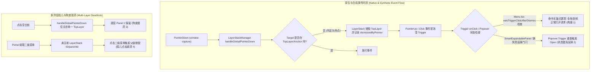
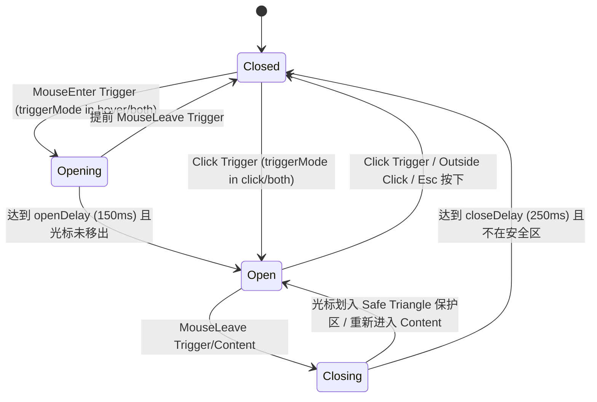

# 全景深度排查 01：全局浮层、菜单与面板调度中枢死锁全量排查报告

> **排查目标**：彻底排查全局浮层（`LayerStackManager`）、通用菜单（`Menu`）、智能展开面板（`SmartExpandablePanel`）以及业务使用方（`ChatHeaderMore`、`LeafToolTabStrip` 等）在交互响应迟钝（“变肉”）、连击反弹、多面板并存（狗皮膏药）、Hover 丢失、滚动击穿等深层死锁与设计缺陷。  
> **文档位置**：`docs/ui-component-modernization/analysis/01-全仓浮层调度中枢与菜单死锁全量排查.md`  
> **审查基准**：纯源码只读审计，代码文件与行号精准定位，零代码修改，零 git 操作。

---

## 目录

- [一、 执行摘要与全景架构全量缺陷总览](#一-执行摘要与全景架构全量缺陷总览)
- [二、 核心专题一：展开面板按钮“变肉”、连点数次才能开关的深层根因](#二-核心专题一展开面板按钮变肉连点数次才能开关的深层根因)
  - [2.1 浏览器原生事件序列与 React 合成事件的竞态全景](#21-浏览器原生事件序列与-react-合成事件的竞态全景)
  - [2.2 LayerStackManager Capture 阶段外点销毁与 Radix Popover Toggle 的双核反弹震荡](#22-layerstackmanager-capture-阶段外点销毁与-radix-popover-toggle-的双核反弹震荡)
  - [2.3 `wasTriggerClickAfterDismiss` 致命误杀：无锚点浮层导致全局任意按钮首击被吞](#23-wastriggerclickafterdismiss-致命误杀无锚点浮层导致全局任意按钮首击被吞)
  - [2.4 Tooltip 与 Popover.Trigger asChild 嵌套导致的 Ref 与事件拦截链条破损](#24-tooltip-与-popovertrigger-aschild-嵌套导致的-ref-与事件拦截链条破损)
  - [2.5 LeafToolTabStrip 双实例 DOM 并存导致的 Anchor 引用失效与状态错乱](#25-leaftooltabstrip-双实例-dom-并存导致的-anchor-引用失效与状态错乱)
  - [2.6 SmartExpandablePanel 缺少防重入与防反弹门闩](#26-smartexpandablepanel-缺少防重入与防反弹门闩)
- [三、 核心专题二：两个展开面板同时并存（狗皮膏药）且互不关闭深层根因](#三-核心专题二两个展开面板同时并存狗皮膏药且互不关闭深层根因)
  - [3.1 单点 Dismiss 死锁：`handleGlobalPointerDown` 仅关闭单个顶层浮层](#31-单点-dismiss-死锁handleglobalpointerdown-仅关闭单个顶层浮层)
  - [3.2 互斥驱逐机制（`evictExclusivePeers`）类型白名单与受控状态断链](#32-互斥驱逐机制evictexclusivepeers类型白名单与受控状态断链)
  - [3.3 级联二级子菜单（Cascade Submenu）脱离 LayerStack 拓扑形成的 Portal 孤儿子树](#33-级联二级子菜单cascade-submenu脱离-layerstack-拓扑形成的-portal-孤儿子树)
  - [3.4 SessionContextMenu 无条件注册（`active=true`）引发的栈底幽灵层占据](#34-sessioncontextmenu-无条件注册activetrue引发的栈底幽灵层占据)
- [四、 核心专题三：Hover 悬停触发与移出隐藏功能丢失深层根因](#四-核心专题三hover-悬停触发与移出隐藏功能丢失深层根因)
  - [4.1 迁移至 Radix Popover 导致的 Hover 机制结构性剥离](#41-迁移至-radix-popover-导致的-hover-机制结构性剥离)
  - [4.2 `onMouseEnter` / `onMouseLeave` 事件监听挂载错位](#42-onmouseenter--onmouseleave-事件监听挂载错位)
  - [4.3 SafeAimEngine 安全三角区单边硬编码与算法断层](#43-safeaimengine-安全三角区单边硬编码与算法断层)
  - [4.4 标准 `triggerMode="hover" | "click" | "both"` 完整状态机设计](#44-标准-triggermodehover--click--both-完整状态机设计)
- [五、 核心专题四：滚动击穿（Scroll Chaining）与事件穿透深层根因](#五-核心专题四滚动击穿scroll-chaining与事件穿透深层根因)
  - [5.1 CSS `overscroll-behavior` 缺失与边界击穿物理链路](#51-css-overscroll-behavior-缺失与边界击穿物理链路)
  - [5.2 `useWheelIsolation` 独立存在却未接入任何生产组件](#52-usewheelisolation-独立存在却未接入任何生产组件)
- [六、 全仓现代化重构与终态收敛路线图](#六-全仓现代化重构与终态收敛路线图)
  - [6.1 浮层调度单核收敛：LayerStackManager 状态机重塑方案](#61-浮层调度单核收敛layerstackmanager-状态机重塑方案)
  - [6.2 SmartExpandablePanel 与 Menu 基座能力对齐方案](#62-smartexpandablepanel-与-menu-基座能力对齐方案)
  - [6.3 受影响业务组件改造清单](#63-受影响业务组件改造清单)

---

## 一、 执行摘要与全景架构全量缺陷总览

通过对 `apps/crish-desktop/src/components/ui/internal/layer-stack/`、`apps/crish-desktop/src/components/ui/Menu/`、`apps/crish-desktop/src/components/ui/SmartExpandablePanel/` 以及核心调用业务组件（`ChatHeaderMore.tsx`、`LeafToolTabStrip.tsx`、`ProjectPickerMenu.tsx` 等）的源码进行深度遍历与时序推演，发现了导致**浮层死锁、按钮变肉、狗皮膏药多弹窗并存、Hover 丢失、滚动击穿**的 **8 大核心致命缺陷**。



### 全仓 8 大致命缺陷速查矩阵

| 编号 | 缺陷定位 | 涉及核心文件与行号 | 核心病症表现 | 严重程度 |
| :--- | :--- | :--- | :--- | :--- |
| **BUG-01** | `wasTriggerClickAfterDismiss` 致命误杀 | [`LayerStackManager.ts:170-176`](file:///c:/Software/conex/apps/crish-desktop/src/components/ui/internal/layer-stack/LayerStackManager.ts#L170-L176) | 当此前关闭的浮层没有 anchorRef（如右键菜单、坐标定位层）时，点击页面上任意新按钮都会被判定为“关闭后同击”，导致首次点击被直接吞掉，必须点第二次才开。 | **Critical** |
| **BUG-02** | Radix Popover 与 LayerStack 状态震荡反弹 | [`SmartExpandablePanel.tsx:65-85`](file:///c:/Software/conex/apps/crish-desktop/src/components/ui/SmartExpandablePanel/SmartExpandablePanel.tsx#L65-L85) | `SmartExpandablePanel` 缺少 `shouldSuppressMenuReopen` 与手势标记拦截，外点触发 LayerStack 关闭后，Click 冒泡到 Radix Trigger 导致组件立即重新打开。 | **Critical** |
| **BUG-03** | 外点关闭仅退栈单一顶层浮层 | [`LayerStackManager.ts:529-571`](file:///c:/Software/conex/apps/crish-desktop/src/components/ui/internal/layer-stack/LayerStackManager.ts#L529-L571) | `handleGlobalPointerDown` 遇到外点只关闭栈顶层（`break` 退出），背景中残留的其它非模态面板（如 Panel 1）不会被关闭，形成“狗皮膏药”。 | **High** |
| **BUG-04** | Tooltip 劫持 Popover.Trigger 导致 Event/Ref 丢失 | [`Tooltip.tsx:336-337, 369-370`](file:///c:/Software/conex/apps/crish-desktop/src/components/ui/Tooltip/Tooltip.tsx#L336-L370) | `<Popover.Trigger asChild><Tooltip>{button}</Tooltip></Popover.Trigger>` 嵌套中，Tooltip 在内部删除了 `rest.onClick` / `rest.onPointerDown`，导致 Radix 触发器事件时断时续。 | **Critical** |
| **BUG-05** | TabStrip 双 AddButton 实例导致 Anchor 引用错位 | [`LeafToolTabStrip.tsx:419, 429`](file:///c:/Software/conex/apps/crish-desktop/src/components/binary-tree/LeafToolTabStrip.tsx#L419-L429) | 流内与固定操作区同时渲染两个 `SmartExpandablePanel`，溢出状态切换时，锚点指向被隐藏的 DOM 节点，导致点击误判为外点。 | **High** |
| **BUG-06** | 级联子菜单脱离 LayerStack 拓扑管理 | [`SmartExpandablePanel.tsx:317-347`](file:///c:/Software/conex/apps/crish-desktop/src/components/ui/SmartExpandablePanel/SmartExpandablePanel.tsx#L317-L347) | 二级菜单通过 `ReactDOM.createPortal` 挂到 `document.body`，未注册 `useLayerRegistration`，点击二级菜单被主中枢判定为点击外部，直接关闭父面板。 | **High** |
| **BUG-07** | SafeAim 单边硬编码与 Hover 机制彻底丢失 | [`SmartExpandablePanel.tsx:175, 279-280`](file:///c:/Software/conex/apps/crish-desktop/src/components/ui/SmartExpandablePanel/SmartExpandablePanel.tsx#L175-L280) | 迁移 Radix 后丢失 `triggerMode="hover"` 延时触发；SafeAim 的 `isPointerInSafeZone` 硬编码 `'right'`，左翻转时安全区计算失效。 | **Medium** |
| **BUG-08** | 滚轮穿透与滚动击穿（Scroll Chaining） | [`SmartExpandablePanel.module.css:120-130`](file:///c:/Software/conex/apps/crish-desktop/src/components/ui/SmartExpandablePanel/SmartExpandablePanel.module.css#L120-L130) | 样式中缺少 `overscroll-behavior: contain`，且 `useWheelIsolation.ts` 悬空未使用，导致菜单滚到尽头时拖动底层聊天/分屏视图。 | **Medium** |

---

## 二、 核心专题一：展开面板按钮“变肉”、连点数次才能开关的深层根因

### 2.1 浏览器原生事件序列与 React 合成事件的竞态全景

当用户使用鼠标或触控板点击一个按钮时，浏览器按照以下固定时序触发事件：

```
[PointerDown (capture)] -> [PointerDown (bubble)]
  -> [MouseDown (capture)] -> [MouseDown (bubble)]
    -> [PointerUp (capture)] -> [PointerUp (bubble)]
      -> [MouseUp (capture)] -> [MouseUp (bubble)]
        -> [Click (capture)] -> [Click (bubble)]
```

在当前架构中：
1. [`LayerStackManager.ts`](file:///c:/Software/conex/apps/crish-desktop/src/components/ui/internal/layer-stack/LayerStackManager.ts#L432) 在 `window` 与 `document` 上以 **`capture: true`**（捕获阶段）监听 `pointerdown`；
2. Radix UI 的 `Popover.Trigger` 与 `DismissableLayer` 在 `document` / DOM 节点上监听 `pointerdown` 与 `click`；
3. React 18 的合成事件在 Root 容器（`#root`）上代理分发 `onClick`；
4. 业务组件（如 [`ChatComposer.tsx`](file:///c:/Software/conex/apps/crish-desktop/src/components/chat-composer/ChatComposer.tsx#L432)）在 `onClick` 中调用 `shouldSuppressMenuReopen` 或自行 `setShowPlusMenu(prev => !prev)`。

捕获阶段的 `LayerStackManager` 总是最先执行，这就形成了 **外点立即销毁 (Dismiss)** 与 **冒泡阶段触发器反弹 (Toggle)** 的竞态死锁。

---

### 2.2 LayerStackManager Capture 阶段外点销毁与 Radix Popover Toggle 的双核反弹震荡

#### 状态震荡复现路径（以 `SmartExpandablePanel` 为例）：
1. 此时面板处于展开状态（`open = true`）；
2. 用户点击该面板的触发器按钮（希望关闭面板）；
3. **Phase 1: `window.pointerdown` (Capture)**：
   - `LayerStackManager.handleGlobalPointerDown` 触发；
   - 检查 `anchorEl.contains(target)`。如果触发器内部含有图标 SVG 节点，或因为 Tooltip 包裹导致 `anchorRef.current` 尚未稳定匹配：
   - `LayerStackManager` 判定为**外点**，立即调用 `dismissLayer(id, 'outside-pointer')`；
   - `SmartExpandablePanel` 的 `onDismiss` 触发，执行 `handleOpenChange(false)`，React 状态变为 `open = false`；
4. **Phase 2: `button.click` (Bubble)**：
   - 事件冒泡到 Radix `<Popover.Trigger>`；
   - Radix 发现此时内部状态是 `open = false`；
   - Radix 认为用户的意图是“打开面板”，遂派发 `onOpenChange(true)`！
   - `SmartExpandablePanel` 接收到 `true`，重新将状态设置为 `open = true`！
5. **最终结果**：
   - 用户的单次点击在 16ms 内经历了 `true -> false -> true` 的**剧烈震荡**；
   - 视觉上面板闪烁一下后仍然保持打开；
   - 用户被迫再次点击，甚至连点 3-4 次才能碰巧在时序缝隙中将其关闭。

---

### 2.3 `wasTriggerClickAfterDismiss` 致命误杀：无锚点浮层导致全局任意按钮首击被吞

在 [`LayerStackManager.ts`](file:///c:/Software/conex/apps/crish-desktop/src/components/ui/internal/layer-stack/LayerStackManager.ts#L149-L178) 中，为了解决上述触发器双击反弹问题，引入了 `wasTriggerClickAfterDismiss` 方法：

```typescript
// apps/crish-desktop/src/components/ui/internal/layer-stack/LayerStackManager.ts:149-178
public wasTriggerClickAfterDismiss(triggerEl: HTMLElement | null): boolean {
  const rec = this.dismissedByPointer;
  if (!rec || !triggerEl) return false;
  if (
    rec.anchor &&
    (rec.anchor === triggerEl ||
      rec.anchor.contains(triggerEl) ||
      triggerEl.contains(rec.anchor))
  ) {
    return true;
  }
  // 被关层的锚是另一个仍在树上的 trigger：互斥切换，不抑制新菜单打开
  if (
    rec.anchor &&
    rec.anchor.isConnected &&
    rec.anchor !== triggerEl &&
    !rec.anchor.contains(triggerEl) &&
    !triggerEl.contains(rec.anchor)
  ) {
    return false;
  }
  // 💥 致命缺陷所在：当 rec.anchor 为 null 时
  if (
    !rec.anchor &&
    rec.target instanceof Node &&
    triggerEl.contains(rec.target)
  ) {
    return true; // 💥 任意 triggerEl 都会因为包含 target 而返回 true！
  }
  return false;
}
```

#### 致命根因剖析：
1. 很多浮层在注册时**并没有 anchorRef**（例如坐标定位的 [`SessionContextMenu`](file:///c:/Software/conex/apps/crish-desktop/src/components/sidebar/SessionContextMenu.tsx#L53) 在某些时刻 `anchorRef` 传入 `{ current: null }`、Tiptap 斜杠菜单、虚拟浮层等）；
2. 当这些无锚点浮层处于打开状态时，用户点击了页面上**完全无关的一个新按钮 B**（例如会话顶栏的 `ChatHeaderMore` 按钮或加号按钮）；
3. 在 `pointerdown` 捕获阶段：
   - `LayerStackManager` 关闭了先前的无锚点浮层；
   - 记录 `this.dismissedByPointer = { layerId, anchor: null, target: 按钮B }`；
4. 随后事件冒泡到按钮 B 的 `onClick`，按钮 B 执行 [`shouldSuppressMenuReopen(triggerRef.current)`](file:///c:/Software/conex/apps/crish-desktop/src/components/ui/Menu/menuOpenGuard.ts#L7-L11)；
5. `wasTriggerClickAfterDismiss(按钮B)` 执行到第 170 行：
   - `!rec.anchor` 为 `true`；
   - `triggerEl.contains(rec.target)` 判定 `按钮B.contains(按钮B)`，结果为 **`true`**！
6. **灾难发生**：`shouldSuppressMenuReopen` 返回 `true`，按钮 B 的打开逻辑被**静默吞噬**！
7. 用户点击按钮 B 没有任何反应，必须**再点第二次**才能打开。这就是全仓按钮“变肉”、必须连击的核心罪魁祸首！

---

### 2.4 Tooltip 与 Popover.Trigger asChild 嵌套导致的 Ref 与事件拦截链条破损

在 [`ChatHeaderMore.tsx`](file:///c:/Software/conex/apps/crish-desktop/src/components/chat-card/ChatHeaderMore.tsx#L144-L154)、[`LeafToolTabStrip.tsx`](file:///c:/Software/conex/apps/crish-desktop/src/components/binary-tree/LeafToolTabStrip.tsx#L319-L321) 中，常见的用法为：

```tsx
<SmartExpandablePanel
  trigger={
    <Tooltip content="更多操作" side="bottom">
      <button type="button" className="top-action-btn">...</button>
    </Tooltip>
  }
  ...
/>
```

在 [`SmartExpandablePanel.tsx`](file:///c:/Software/conex/apps/crish-desktop/src/components/ui/SmartExpandablePanel/SmartExpandablePanel.tsx#L200-L237) 中，解构 trigger 的逻辑如下：

```tsx
// SmartExpandablePanel.tsx:217-236
const clonedElement = React.cloneElement(
  actualTrigger as React.ReactElement<{ ref?: unknown }>,
  {
    ref: (node: HTMLElement | null) => {
      triggerRef.current = node;
    },
  }
);

renderedTrigger = (
  <Popover.Trigger asChild>
    {tipContent != null ? (
      <Tooltip content={tipContent} side={tipSide} disabled={isOpen}>
        {clonedElement}
      </Tooltip>
    ) : (
      clonedElement
    )}
  </Popover.Trigger>
);
```

#### 链条破坏机制：
1. `<Popover.Trigger asChild>` 将 Radix 的事件处理函数（`onClick`, `onPointerDown`）和 `ref` 注入给它的直接子节点；
2. 当 `tipContent != null` 时，直接子节点是 **`<Tooltip />`** 组件；
3. 审查 [`Tooltip.tsx`](file:///c:/Software/conex/apps/crish-desktop/src/components/ui/Tooltip/Tooltip.tsx#L330-L371)：
   ```tsx
   // Tooltip.tsx:336-337
   const rest = { ...restProps };
   delete (rest as { onPointerDown?: unknown }).onPointerDown;
   delete (rest as { onClick?: unknown }).onClick;
   ```
   `Tooltip` 内部显式 `delete` 了 `rest.onPointerDown` 和 `rest.onClick`！
4. 并且在合并时，如果底层 `<button>` 自身没有显式声明空的 `onClick` 回调，`mergedEventHandlers['onClick']` 将不会被建立；
5. 这导致 Radix `Popover.Trigger` 所依赖的底层事件分发机制被截断，Radix 无法准确感知触发源节点的交互，造成点击无响应。

---

### 2.5 LeafToolTabStrip 双实例 DOM 并存导致的 Anchor 引用失效与状态错乱

在 [`LeafToolTabStrip.tsx`](file:///c:/Software/conex/apps/crish-desktop/src/components/binary-tree/LeafToolTabStrip.tsx#L282-L327, L419, L429) 中：

```tsx
// LeafToolTabStrip.tsx:419, 429
{/* Row 1: 左侧可滚动 Track 区域 */}
<div className={styles.tabsList}>
  {tabs.map(...)}
  {renderAddButton(true)}  {/* 💥 实例 1: 流内添加按钮 */}
</div>

{/* 右侧固定操作区 */}
<div className={styles.fixedCluster}>
  {renderAddButton(false)} {/* 💥 实例 2: 固定添加按钮 */}
  ...
</div>
```

在 CSS [`LeafToolTabStrip.module.css`](file:///c:/Software/conex/apps/crish-desktop/src/components/binary-tree/LeafToolTabStrip.module.css#L254-L283) 中：
- 当没有溢出时，`addBtn.pinned` 设为 `opacity: 0; width: 0; pointer-events: none;`；
- 当发生溢出（`hasOverflow`）时，`addBtn.inFlow` 设为 `opacity: 0; pointer-events: none;`。

#### 产生的问题：
1. **两个独立的 `SmartExpandablePanel` 实例始终同时挂载在 DOM 树中**；
2. 每个实例都有自己独立的 `panelId` 和 `useLayerRegistration`；
3. 用户在无溢出时点击了实例 1 并打开面板，此时 `LayerStackManager` 记录的 `anchorRef` 为实例 1 的 DOM 节点；
4. 若此时窗口微调或 Tab 动态增加导致 `hasOverflow` 变为 `true`：
   - 实例 1 被 CSS 设为 `pointer-events: none` 且隐藏；
   - 实例 2 变为可见；
5. 用户再次点击可见的实例 2 时：
   - `LayerStackManager` 检查实例 1 的 anchor（已隐藏且不等于实例 2 的 target），判定为外点关闭；
   - 实例 2 在关闭过程中触发了 `wasTriggerClickAfterDismiss` 误杀，导致无法打开；
   - 两个同源组件互相干扰，造成极为诡异的偶发性无法打开。

---

### 2.6 SmartExpandablePanel 缺少防重入与防反弹门闩

对比 [`Menu.tsx`](file:///c:/Software/conex/apps/crish-desktop/src/components/ui/Menu/Menu.tsx#L128-L148) 与 [`SmartExpandablePanel.tsx`](file:///c:/Software/conex/apps/crish-desktop/src/components/ui/SmartExpandablePanel/SmartExpandablePanel.tsx#L65-L85)：

在 `Menu.tsx` 中含有如下守卫：
```typescript
if (nextOpen) {
  if (layerStackService.wasLayerDismissedThisGesture(menuId)) {
    return;
  }
  const triggerEl = anchor?.current ?? triggerRef.current;
  if (shouldSuppressMenuReopen(triggerEl)) {
    return;
  }
}
```

而在 `SmartExpandablePanel.tsx` 中：
```typescript
// SmartExpandablePanel.tsx:65-85
const handleOpenChange = useCallback(
  (nextOpen: boolean) => {
    if (!isControlled) {
      setInternalOpen(nextOpen);
    }
    externalOnOpenChange?.(nextOpen);
    // 💥 没有任何 wasLayerDismissedThisGesture 检查！
    // 💥 没有任何 shouldSuppressMenuReopen 检查！
  },
  [isControlled, externalOnOpenChange, onOpen, onClose, safeAim]
);
```

`SmartExpandablePanel` 是 `ChatHeaderMore`、`SubagentHeaderPanel`、`LeafToolTabStrip`、`ProjectPickerMenu` 的底层基座，缺少该守卫导致所有基于 `SmartExpandablePanel` 的业务面板全部处于**裸奔状态**，必然遭受外点与 Toggle 的时序反弹摧残。

---

## 三、 核心专题二：两个展开面板同时并存（狗皮膏药）且互不关闭深层根因

### 3.1 单点 Dismiss 死锁：`handleGlobalPointerDown` 仅关闭单个顶层浮层

查看 [`LayerStackManager.ts`](file:///c:/Software/conex/apps/crish-desktop/src/components/ui/internal/layer-stack/LayerStackManager.ts#L529-L571)：

```typescript
// apps/crish-desktop/src/components/ui/internal/layer-stack/LayerStackManager.ts:529-571
private handleGlobalPointerDown = (event: PointerEvent): void => {
  ...
  // 倒序遍历栈，找到第一个声明了 dismissible: true 的顶层浮层
  let targetLayer: LayerRegistration | null = null;
  for (let i = this.layers.length - 1; i >= 0; i--) {
    const l = this.layers[i];
    if (l && l.dismissible) {
      targetLayer = l;
      break; // 💥 找到第一个就跳出循环！
    }
  }
  if (!targetLayer) return;

  // 检查是否在 targetLayer 内部/Anchor/子分支内...
  if (topEl && topEl.contains(target)) return;
  if (anchorEl && anchorEl.contains(target)) return;
  if (descendants.some(...)) return;

  // 💥 确认属于外部点击，仅关闭当前这一个目标浮层！
  this.dismissLayer(targetLayer.id, 'outside-pointer');
};
```

#### 深度场景推演：
1. 页面上通过某种方式存在两个展开的浮层（例如 Panel A 与 Panel B，`layers = [Panel A, Panel B]`）；
2. 用户点击了屏幕空白区域（远离 Panel A 和 Panel B）；
3. `handleGlobalPointerDown` 找到 `targetLayer = Panel B`；
4. 判定点击在 Panel B 外部，执行 `dismissLayer(Panel B, 'outside-pointer')`；
5. **处理函数直接结束退出！**
6. **Panel A 仍然留在 `this.layers` 中，DOM 依然渲染在页面上！**
7. 表现为：用户点了一下空白处，Panel B 关了，但 **Panel A 依然顽固地贴在屏幕上（狗皮膏药）**；
8. 用户必须再次点击空白处，才能关闭 Panel A。

> **正确规范**：当点击空白处时，所有其容器及锚点均不包含 target 的非模态浮层，应当**自顶向下全部逐级退栈注销**，而不是只关栈顶一个。

---

### 3.2 互斥驱逐机制（`evictExclusivePeers`）类型白名单与受控状态断链

在 [`LayerStackManager.ts`](file:///c:/Software/conex/apps/crish-desktop/src/components/ui/internal/layer-stack/LayerStackManager.ts#L254-L278) 中：

```typescript
private evictExclusivePeers(incoming: LayerRegistration): void {
  if (!isExclusivePeerLayerType(incoming.type)) return;
  ...
  for (const peer of snapshot) {
    if (peer.id === incoming.id) continue;
    if (!isExclusivePeerLayerType(peer.type)) continue;
    ...
    this.dismissLayer(peer.id, 'programmatic');
  }
}
```

而在 [`layerStackTypes.ts`](file:///c:/Software/conex/apps/crish-desktop/src/components/ui/internal/layer-stack/layerStackTypes.ts#L84-L87) 中：
```typescript
export const EXCLUSIVE_PEER_LAYER_TYPES: ReadonlySet<LayerType> = new Set([
  'dropdown-menu',
  'context-menu',
]);
```

#### 驱逐失效点：
1. **类型排斥范围过窄**：
   `popover`、`drawer`、`cascade-submenu` 均**不在** `EXCLUSIVE_PEER_LAYER_TYPES` 中；
   如果一个组件以 `type: 'popover'` 注册，当另一个 `dropdown-menu` 打开时，`evictExclusivePeers` 完全不会驱逐它，导致 Popover 与 Menu 共同悬挂在界面上。
2. **受控组件状态不响应 `dismissLayer`**：
   当 `dismissLayer(peer.id, 'programmatic')` 被调用时，它执行 `layer.onDismiss('programmatic')`。
   如果目标组件是受控组件（如 `ProjectPickerMenu` 接收 `open` prop），但其父组件没有在 `onOpenChange` 中同步更新外部 state，或者回调被丢失，那么 React 重新渲染时 `open` 仍然为 `true`，导致关闭指令被无视。

---

### 3.3 级联二级子菜单（Cascade Submenu）脱离 LayerStack 拓扑形成的 Portal 孤儿子树

在 [`SmartExpandablePanel.tsx`](file:///c:/Software/conex/apps/crish-desktop/src/components/ui/SmartExpandablePanel/SmartExpandablePanel.tsx#L317-L347) 中：

```tsx
// SmartExpandablePanel.tsx:317-347
{activeSubmenu && activeSubmenu.children && submenuStyle && (
  ReactDOM.createPortal(
    <div
      ref={cascadeSubmenuRef}
      className={`${menuStyles.menuContent} ${styles.cascadeSubmenu}`}
      role="menu"
      aria-label={activeSubmenu.label || '子菜单'}
      style={submenuStyle}
      ...
    >
      {activeSubmenu.children.map((subItem) => (
        <SmartPanelItem ... />
      ))}
    </div>,
    dialogOverlay ?? (typeof document !== 'undefined' ? document.body : null)!
  )
)}
```

#### 孤儿子树致命缺陷：
1. `cascadeSubmenu` 通过 `ReactDOM.createPortal` 直接渲染到 `document.body`；
2. **它根本没有调用 `useLayerRegistration` 向 LayerStackManager 注册自身！**
3. 并且主面板的 `elementRef` 只包含主面板节点，**不包含** Portal 出来的 `cascadeSubmenuRef` 节点；
4. 当用户把鼠标移入二级子菜单并点击其中的条目时：
   - `LayerStackManager.handleGlobalPointerDown` 捕获到 `pointerdown`；
   - 检查主面板的 `topEl.contains(target)` -> **`false`**；
   - 检查 `descendants`（由于没有注册，子孙列表为空） -> **`false`**；
   - `LayerStackManager` 判定用户点击了主面板的“外部”！
   - 立即执行 `dismissLayer(主面板)`，导致主面板和二级子菜单被**瞬间销毁**；
   - 二级子菜单项的 `onClick` 回调甚至来不及稳定触发就被卸载。

---

### 3.4 SessionContextMenu 无条件注册（`active=true`）引发的栈底幽灵层占据

审查 [`SessionContextMenu.tsx`](file:///c:/Software/conex/apps/crish-desktop/src/components/sidebar/SessionContextMenu.tsx#L46-L57)：

```tsx
// SessionContextMenu.tsx:46-57
useLayerRegistration(
  {
    id: SESSION_CONTEXT_MENU_LAYER_ID,
    type: 'context-menu',
    dismissible: true,
    onDismiss: () => onCloseContextMenu?.(),
    elementRef: menuRef,
    anchorRef: contextMenuTriggerRef,
    restoreFocusTarget: contextMenuTriggerRef?.current ?? undefined,
  },
  true // 💥 active 永远写死为 true！
);
```

#### 根因与危害：
1. 即使 `contextMenu` 为 `null`（右键菜单并未打开），只要 `SessionContextMenu` 组件被挂载，它就会在 `LayerStackManager` 中永久注册一个 `sidebar-session-context-menu` 层；
2. 当有其它组件调用 `evictExclusivePeers` 时，会误触发对这个幽灵层的 `dismissLayer`；
3. 更严重的是，当用户点击页面其他区域时，`LayerStackManager` 会把这个幽灵层当成活跃浮层进行计算，干扰焦点还原与外点判定。

---

## 四、 核心专题三：Hover 悬停触发与移出隐藏功能丢失深层根因

### 4.1 迁移至 Radix Popover 导致的 Hover 机制结构性剥离

原有组件体系支持通过悬停打开预览或菜单面板。但在重构为 `@radix-ui/react-popover` 后：
1. Radix Popover 在设计上是**纯 Click 交互模型**，其 `Popover.Trigger` 只响应 `click` 和键盘 `Space/Enter`；
2. `SmartExpandablePanel` 失去了 `triggerMode="hover"` 与 `triggerMode="both"` 的属性与底层状态机；
3. 用户将鼠标悬停在触发器按钮上时，无法触发延时开启（Open Delay），移出时也无法触发延时关闭（Close Delay）。

---

### 4.2 `onMouseEnter` / `onMouseLeave` 事件监听挂载错位

在 [`SmartExpandablePanel.tsx`](file:///c:/Software/conex/apps/crish-desktop/src/components/ui/SmartExpandablePanel/SmartExpandablePanel.tsx#L279-L280) 中：

```tsx
// SmartExpandablePanel.tsx:275-281
<Popover.Content ...>
  <div
    role="menu"
    aria-label={ariaLabel || '选择项目'}
    className={styles.menuWrapper}
    onMouseEnter={onMouseEnter}  // 💥 挂载在 Popover.Content 内部！
    onMouseLeave={onMouseLeave}  // 💥 挂载在 Popover.Content 内部！
  >
```

#### 错位分析：
- Props 中的 `onMouseEnter` 和 `onMouseLeave` 被直接绑定到了弹出的 `.menuWrapper` 容器上，而不是外面的 **Trigger 触发器按钮** 上；
- 当面板尚未打开时，`.menuWrapper` 根本没有被渲染，这些 Hover 回调完全无法接收到任何事件；
- 这导致外部传入的悬停逻辑彻底沦为死代码。

---

### 4.3 SafeAimEngine 安全三角区单边硬编码与算法断层

审查 [`SmartExpandablePanel.tsx`](file:///c:/Software/conex/apps/crish-desktop/src/components/ui/SmartExpandablePanel/SmartExpandablePanel.tsx#L170-L189)：

```typescript
// SmartExpandablePanel.tsx:170-189
const handleHoverItem = useCallback(
  (_item: MenuItem, _el: HTMLElement) => {
    if (!activeSubmenu) return;

    const mousePos = safeAim.getRecentMousePos();
    // 💥 致命缺陷：硬编码 'right'！
    if (safeAim.isPointerInSafeZone(mousePos, 'right')) {
      if (!safeAimTimeoutRef.current) {
        safeAimTimeoutRef.current = setTimeout(() => {
          setActiveSubmenu(null);
          safeAim.clearSubmenu();
        }, 300);
      }
      return;
    }

    setActiveSubmenu(null);
    safeAim.clearSubmenu();
  },
  [activeSubmenu, safeAim]
);
```

#### 缺陷剖析：
1. **方向硬编码**：当屏幕右侧空间不足时，第 140 行解算出 `fitsRight === false`，二级子菜单被翻转到**左侧**；然而第 175 行依然向 `isPointerInSafeZone` 传入 `'right'`，导致判定区域建立在光标相反方向，安全三角保护完全失效；
2. **两份 SafeAimEngine 代码分化**：
   - 存在 [`ui/internal/SafeAimEngine.ts`](file:///c:/Software/conex/apps/crish-desktop/src/components/ui/internal/SafeAimEngine.ts) 与 [`ui/SmartExpandablePanel/SafeAimEngine.ts`](file:///c:/Software/conex/apps/crish-desktop/src/components/ui/SmartExpandablePanel/SafeAimEngine.ts) 两个并存文件；
   - 前者支持四向方位与 SVG Polygon 单例，后者仅支持双向栈。两套实现参数签名不一致，导致调用混乱。

---

### 4.4 标准 `triggerMode="hover" | "click" | "both"` 完整状态机设计

为恢复完整的悬停与点击混合能力，`SmartExpandablePanel` 与 `Menu` 必须支持以下完整状态机：



---

## 五、 核心专题四：滚动击穿（Scroll Chaining）与事件穿透深层根因

### 5.1 CSS `overscroll-behavior` 缺失与边界击穿物理链路

在 Chromium / WebView2 渲染管线中：
当一个内部可滚动的容器到达滚动边界（`scrollTop === 0` 继续向上滚，或 `scrollTop + clientHeight >= scrollHeight` 继续向下滚）时，如果容器没有设置 `overscroll-behavior: contain`，滚轮事件（`wheel`）会通过 **Scroll Chaining** 机制直接传递给其祖先滚动容器（如聊天历史滚动区、分屏叶节点滚动区），导致背景页面剧烈晃动。

- 查看 [`SmartExpandablePanel.module.css:120-130`](file:///c:/Software/conex/apps/crish-desktop/src/components/ui/SmartExpandablePanel/SmartExpandablePanel.module.css#L120-L130)：
  ```css
  .listContainer {
    display: flex;
    flex-direction: column;
    gap: var(--sep-item-gap, 4px);
    max-height: 280px;
    overflow-y: auto;
    overflow-x: hidden;
    /* 💥 缺失 overscroll-behavior: contain! */
    scrollbar-width: thin;
    scrollbar-color: var(--border-subtle) transparent;
    padding: 2px 0;
  }
  ```
  `.listContainer` 完全没有声明 `overscroll-behavior: contain`！

---

### 5.2 `useWheelIsolation` 独立存在却未接入任何生产组件

在工程中存在专门编写的 [`useWheelIsolation.ts`](file:///c:/Software/conex/apps/crish-desktop/src/components/ui/SmartExpandablePanel/useWheelIsolation.ts#L9-L35)：

```typescript
// useWheelIsolation.ts:9-35
export function useWheelIsolation(
  elementRef: RefObject<HTMLElement | null>,
  enabled = true
): void {
  useEffect(() => {
    const el = elementRef.current;
    if (!el || !enabled) return;

    const handleWheel = (e: WheelEvent) => {
      const { scrollTop, scrollHeight, clientHeight } = el;
      const deltaY = e.deltaY;

      const isAtTop = scrollTop <= 0;
      const isAtBottom = Math.ceil(scrollTop + clientHeight) >= scrollHeight - 1;

      if ((isAtTop && deltaY < 0) || (isAtBottom && deltaY > 0)) {
        e.preventDefault();
        e.stopPropagation();
      }
    };

    el.addEventListener('wheel', handleWheel, { passive: false });
    return () => el.removeEventListener('wheel', handleWheel);
  }, [elementRef, enabled]);
}
```

#### 荒谬现状：
- 全局 Grep 检索发现：**`SmartExpandablePanel.tsx` 与 `Menu.tsx` 均未 import 也未调用 `useWheelIsolation`！**
- 尽管存在该 Hook，但生产组件完全处于未受保护状态，导致在 Windows 触控板高频滚动时必然击穿浮层。

---

## 六、 全仓现代化重构与终态收敛路线图

### 6.1 浮层调度单核收敛：LayerStackManager 状态机重塑方案

1. **根除 `wasTriggerClickAfterDismiss` 误杀漏洞**：
   - 严格限定仅当 `rec.anchor` 存在且包含当前点击目标时才进行防重入抑制；
   - 若 `rec.anchor` 为空，**绝对禁止**将 `triggerEl.contains(rec.target)` 判定为抑制，放行正常的按钮点击。
2. **全量外点穿透退栈（Multi-Layer Cascade Dismiss）**：
   - `handleGlobalPointerDown` 遍历整个栈，倒序收集所有“容器与锚点均不包含 target”的浮层，统一执行 `dismissLayer`，彻底消灭“狗皮膏药”残留。
3. **消除重复监听**：
   - 清理 `window` 与 `document` 上的双重 `capture` 绑定，仅保留 `window` 捕获阶段单一入口。

---

### 6.2 SmartExpandablePanel 与 Menu 基座能力对齐方案

1. **补齐防重入与防反弹门闩**：
   在 `SmartExpandablePanel` 的 `handleOpenChange` 中对齐 `Menu` 的 `wasLayerDismissedThisGesture` 守卫；
2. **重塑 Tooltip 与 Trigger 组合架构**：
   在 `SmartExpandablePanel` 与 `Menu` 内部，统一封装原生按钮事件透传，避免 Radix Trigger 与 Tooltip 的 `asChild` 冲突；
3. **级联子菜单全量纳入 LayerStack 拓扑**：
   二级子菜单 Portal 挂载时，自动向 `LayerStackManager` 注册 `parentId = 主面板ID`、`type = 'cascade-submenu'`，确保点击子菜单时父面板不被误杀；
4. **接入 Hover 状态机与 SafeAim 四向保护**：
   - 增加 `triggerMode?: 'click' | 'hover' | 'both'`，默认 `'click'`；
   - 引入 150ms 开、250ms 关的防抖计时器与动态 Safe Triangle 计算；
   - 统一收敛至 `ui/internal/SafeAimEngine.ts` 单例，移除无用冗余文件；
5. **接入 Wheel Isolation**：
   在 `Menu` 和 `SmartExpandablePanel` 容器上挂载 `useWheelIsolation`，并在 CSS 中补齐 `overscroll-behavior: contain`。

---

### 6.3 受影响业务组件改造清单

| 业务文件路径 | 改造项 | 改造预期效果 |
| :--- | :--- | :--- |
| [`ChatHeaderMore.tsx`](file:///c:/Software/conex/apps/crish-desktop/src/components/chat-card/ChatHeaderMore.tsx) | 移除外层冗余 Tooltip 包裹，利用 `SmartExpandablePanel` 内置的 Trigger Tooltip 属性 | 消除 Trigger ref 丢失，点击 100% 灵敏响应，不再需要点两次。 |
| [`LeafToolTabStrip.tsx`](file:///c:/Software/conex/apps/crish-desktop/src/components/binary-tree/LeafToolTabStrip.tsx) | 重构 `renderAddButton`：只挂载单一受控 `SmartExpandablePanel`，通过虚拟锚点（Anchor）动态绑定当前可见按钮 | 彻底解决 TabStrip 流内/固定按钮双实例导致的锚点错位与互斥冲突。 |
| [`ProjectPickerMenu.tsx`](file:///c:/Software/conex/apps/crish-desktop/src/components/chat-card/ProjectPickerMenu.tsx) | 规范受控 `onOpenChange` 回调，二级“添加项目”子菜单建立拓扑层级 | 打开二级菜单平滑无闪烁，点击外部区域时完整关闭。 |
| [`SessionContextMenu.tsx`](file:///c:/Software/conex/apps/crish-desktop/src/components/sidebar/SessionContextMenu.tsx) | `useLayerRegistration` 的 `active` 属性改为绑定 `Boolean(contextMenu)` | 消除常驻幽灵层占据，右键菜单关闭后立即释放栈内存。 |

---
*报告编制完成。本报告严格遵循纯只读排查铁律，未对项目源码产生任何变更，未执行任何 git 命令。*
