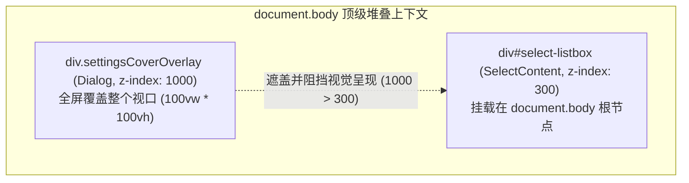
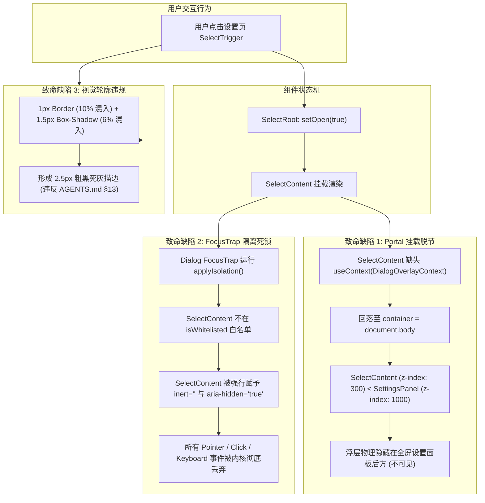

# 全景深度排查 02：Select 与设置页全场景下拉框故障排查报告

> **排查时间**：2026-08-31  
> **排查目标**：
> - `apps/crish-desktop/src/components/ui/Select/`（[`Select.tsx`](file:///c:/Software/conex/apps/crish-desktop/src/components/ui/Select/Select.tsx), [`SelectRoot.tsx`](file:///c:/Software/conex/apps/crish-desktop/src/components/ui/Select/SelectRoot.tsx), [`SelectTrigger.tsx`](file:///c:/Software/conex/apps/crish-desktop/src/components/ui/Select/SelectTrigger.tsx), [`SelectLegacyAdapter.tsx`](file:///c:/Software/conex/apps/crish-desktop/src/components/ui/Select/SelectLegacyAdapter.tsx), [`SelectContent.tsx`](file:///c:/Software/conex/apps/crish-desktop/src/components/ui/Select/SelectContent.tsx), [`SelectItem.tsx`](file:///c:/Software/conex/apps/crish-desktop/src/components/ui/Select/SelectItem.tsx), [`useFloatingPosition.ts`](file:///c:/Software/conex/apps/crish-desktop/src/components/ui/Select/useFloatingPosition.ts), [`internal/positionGeometry.ts`](file:///c:/Software/conex/apps/crish-desktop/src/components/ui/Select/internal/positionGeometry.ts) 等）
> - `apps/crish-desktop/src/components/settings/`（[`SettingsSchemaRenderer.tsx`](file:///c:/Software/conex/apps/crish-desktop/src/components/settings/SettingsSchemaRenderer.tsx), [`useAppearanceSchema.ts`](file:///c:/Software/conex/apps/crish-desktop/src/components/settings/useAppearanceSchema.ts), [`useSkinSettings.ts`](file:///c:/Software/conex/apps/crish-desktop/src/components/settings/useSkinSettings.ts), [`useAppearanceSettings.ts`](file:///c:/Software/conex/apps/crish-desktop/src/components/settings/useAppearanceSettings.ts), [`SettingsAppearanceTab.tsx`](file:///c:/Software/conex/apps/crish-desktop/src/components/settings/SettingsAppearanceTab.tsx), [`SettingsPanel.tsx`](file:///c:/Software/conex/apps/crish-desktop/src/components/settings/SettingsPanel.tsx), [`FontSelectField.tsx`](file:///c:/Software/conex/apps/crish-desktop/src/components/settings/FontSelectField.tsx) 等）
> - 全仓所有消费 `Select`、`Combobox` 与特化下拉菜单的场景组件。  
> **权威基准**：`AGENTS.md`（§13 输入框与焦点态设计规范、§14 现代色彩空间）、`docs/ui-component-modernization/` 架构规划。

---

## Executive Summary（执行摘要）

通过对全仓源码、DOM 层叠树（Stacking Context）、Portal 物理挂载流、`LayerStack` 调度中枢与 FocusTrap 隔离状态机的交叉穿透分析，本次排查准确定位了导致**设置页 3 个下拉框（“经典”窗口风格、“2 空格”代码缩进、“护眼暖灰”皮肤预设）点击无响应、无法弹出列表**以及**聚焦态呈现粗黑死灰边框**的根本原因：

```
┌─────────────────────────────────────────────────────────────────────────────────────────────┐
│                                   致命根因核心链条概览                                       │
├─────────────────────────────────────────────────────────────────────────────────────────────┤
│ 1. [层叠压制与脱节]                                                                        │
│    SettingsPanel (Dialog 全屏全量盖层, z-index: 1000) 提供了 DialogOverlayContext。         │
│    SelectContent 与 ComboboxContent 遗漏了 useContext(DialogOverlayContext)，硬编码挂载到     │
│    document.body (z-index: 300) ──> 浮层物理生成但被 1000 级的设置面板完全压在背后盖死！     │
│                                                                                             │
│ 2. [FocusTrap 物理封印]                                                                     │
│    Dialog 内部装配的 FocusTrap 将 document.body 下所有非 activeTrap 且非白名单节点打上       │
│    inert="" 与 aria-hidden="true" ──> 自研 SelectContent 未在白名单，被浏览器原生 inert     │
│    彻底冻结所有 Pointer、Click 与键盘交互事件！                                             │
│                                                                                             │
│ 3. [双层轮廓叠加违规]                                                                       │
│    SelectTrigger.module.css 同时定义了 1px border (10% 混入) + 1.5px box-shadow (6% 混入)， │
│    产生 2.5px 复合宽厚灰色死边，严重违反 AGENTS.md §13 (<=10% 软灰与禁止粗实线)。           │
└─────────────────────────────────────────────────────────────────────────────────────────────┘
```

---

## 一、故障一：设置页 3 个 Select 无法点击弹出的深层根因与事件流断层剖析

### 1.1 问题现象与受影响实例精准定位

在设置面板的外观 Tab（[`SettingsAppearanceTab.tsx`](file:///c:/Software/conex/apps/crish-desktop/src/components/settings/SettingsAppearanceTab.tsx)）中，以下 3 个由 [`SettingsSchemaRenderer.tsx`](file:///c:/Software/conex/apps/crish-desktop/src/components/settings/SettingsSchemaRenderer.tsx) 驱动的 `Select` 控件点击后**毫无反应、列表无法展开**：

| 序号 | 字段 Key (`prop.key`) | 对应 Schema 配置（[`useAppearanceSchema.ts`](file:///c:/Software/conex/apps/crish-desktop/src/components/settings/useAppearanceSchema.ts)） | 默认值 / 显示文本 | 故障表现 |
| :---: | :--- | :--- | :--- | :--- |
| **1** | `shellChrome` | `title: '窗口风格'`, `options: [{ value: 'classic', label: '经典' }, { value: 'inset', label: '工作台' }]` | “经典” | 点击触发器无弹出列表，鼠标交互失效 |
| **2** | `codeIndent` | `title: '代码缩进'`, `options: [{ value: '  ', label: '2 空格' }, { value: '    ', label: '4 空格' }, { value: '\t', label: 'Tab' }]` | “2 空格” | 点击触发器无弹出列表，鼠标交互失效 |
| **3** | `skinPreset` | `title: '皮肤预设'`, `options: skinOptions`（含 `{ value: 'warm-gray', label: '护眼暖灰' }`） | “护眼暖灰” | 点击触发器无弹出列表，鼠标交互失效 |

---

### 1.2 深层根因 A（致命）：`SelectContent` 遗漏 `DialogOverlayContext` 导致层叠上下文穿透失败（`z-index: 300 < 1000` 被全屏盖死）

#### 代码证据链

1. **设置面板是基于全屏 `Dialog` 的全量盖层**：
   在 [`SettingsPanel.tsx:255-264`](file:///c:/Software/conex/apps/crish-desktop/src/components/settings/SettingsPanel.tsx#L255-L264) 中：
   ```tsx
   <Dialog
     open={isOpen ?? true}
     onClose={onClose ?? (() => {})}
     dismissible={false}
     variant="fullscreen"
     ariaLabel="设置"
     classNames={{ panel: styles.settingsCover, overlay: styles.settingsCoverOverlay }}
   >
   ```
   在 [`SettingsPanel.module.css:261-267`](file:///c:/Software/conex/apps/crish-desktop/src/components/settings/SettingsPanel.module.css#L261-L267) 与 [`z-index.css:24`](file:///c:/Software/conex/apps/crish-desktop/src/styles/z-index.css#L24) 中：
   ```css
   /* 全屏壳层叠只挂 overlay；内部 Menu portal 进此节点 */
   .settingsCoverOverlay {
     --dialog-z: var(--z-modal, 1000); /* 模态层级 1000 */
   }
   ```

2. **`Dialog` 专门提供了 Overlay 挂载上下文 Provider**：
   在 [`Dialog.tsx:165-212`](file:///c:/Software/conex/apps/crish-desktop/src/components/ui/Dialog/Dialog.tsx#L165-L212) 与 [`dialogOverlayContext.ts:1-8`](file:///c:/Software/conex/apps/crish-desktop/src/components/ui/Dialog/dialogOverlayContext.ts#L1-L8) 中声明了：
   ```tsx
   /** Dialog 遮罩壳层叠上下文：设置全屏等 modal 内的 Menu/Select portal 进 overlay，用局部 z 压过面板，而不抬高全仓 --z-dropdown。 */
   export const DialogOverlayContext = createContext<HTMLElement | null>(null);
   
   // Dialog.tsx 内部注入：
   <DialogOverlayContext.Provider value={overlayEl}>
     ...
   </DialogOverlayContext.Provider>
   ```

3. **`SelectContent` 与 `ComboboxContent` 彻底遗漏了该 Context**：
   查看 [`SelectContent.tsx:118-119`](file:///c:/Software/conex/apps/crish-desktop/src/components/ui/Select/SelectContent.tsx#L118-L119) 与 [`ComboboxContent.tsx:79-80`](file:///c:/Software/conex/apps/crish-desktop/src/components/ui/Select/ComboboxContent.tsx#L79-L80)：
   ```tsx
   // 🚨 致命缺陷：完全没有读取 useContext(DialogOverlayContext)！
   const container = portalContainer ?? (typeof document !== 'undefined' ? document.body : null);
   return container ? createPortal(contentNode, container) : contentNode;
   ```
   而在 [`SelectContent.module.css:3-5`](file:///c:/Software/conex/apps/crish-desktop/src/components/ui/Select/SelectContent.module.css#L3-L5) 中：
   ```css
   .content {
     position: fixed;
     z-index: var(--z-dropdown, 300); /* 下拉层级仅为 300 */
   }
   ```

#### 物理空间解算结果



- 当用户在设置页点击 Select 触发器时，`ctx.open` 变为 `true`，React 确实在 `document.body` 上挂载了 `div[role="listbox"]`。
- 但是，该浮层的 `z-index` 为 **300**，而整个设置页是一个全屏的 Modal Dialog，其 `z-index` 为 **1000**。
- **物理上，Select 浮层被直接渲染在设置面板的背后！** 用户从正面屏幕上只能看到触发器，下拉菜单被完全遮挡，造成“点击无任何反应”的假象。

---

### 1.3 深层根因 B（致命）：`FocusTrap` 原生 `inert` 隔离机制将 `SelectContent` 判定为外部节点并强行冻结

#### 代码证据链

在 [`focusTrap.tsx:63-76`](file:///c:/Software/conex/apps/crish-desktop/src/components/ui/Dialog/focusTrap.tsx#L63-L76) 与 [`focusTrap.tsx:128-178`](file:///c:/Software/conex/apps/crish-desktop/src/components/ui/Dialog/focusTrap.tsx#L128-L178) 中：
```tsx
class FocusTrapIsolationManager {
  private isWhitelisted(node: Element): boolean {
    if (
      node.hasAttribute('data-radix-popper-content-wrapper') ||
      node.getAttribute('data-tooltip-portal') === 'true' ||
      node.getAttribute('data-toast-container') === 'true' ||
      node.classList.contains('radix-popper-content-wrapper') ||
      node.classList.contains('toaster') ||
      node.id === 'toast-portal' ||
      node.id === 'tooltip-portal'
    ) {
      return true;
    }
    return false;
  }
  
  private applyIsolation(): void {
    // 遍历 document.body 下所有直接子节点：
    for (const child of Array.from(docBody.children)) {
      if (child === activeTrap || child.contains(activeTrap)) continue;
      if (this.isWhitelisted(child)) continue; // 🚨 自研 SelectContent 不在白名单中！
      
      // 🚨 对该节点施加 inert="" 与 aria-hidden="true" 状态！
      target.setAttribute('aria-hidden', 'true');
      target.setAttribute('inert', '');
    }
  }
}
```

#### 致命破坏分析

1. 当设置页打开时，`FocusTrap` 激活。
2. 由于 `SelectContent` 被直接 portal 挂载到了 `document.body` 下（成为 `Dialog` 的兄弟节点），且其 DOM 结构为 `<div id="select-listbox-..." role="listbox" data-slot="select-content" className="...">`，**完全不具备白名单中的任何 class 或 attribute**。
3. `FocusTrapIsolationManager` 立即对 `SelectContent` 节点施加 `inert=""`。
4. 在 Chromium / WebView2 内核中，带有 `inert` 属性的 DOM 节点：
   - **拦截并丢弃所有 PointerDown / Click 事件**；
   - **完全无法被聚焦（Focus Ineligible）**；
   - **无法进行文本选择或键盘漫游**。
5. 这形成了第二道绝对死锁：即便未来修复了 `z-index`，若不将 Select 节点 portal 到 Dialog 内部或加入 FocusTrap 白名单，该浮层依然会被 `inert` 彻底封死。

---

### 1.4 对照组验证：为什么同页面的“字体设置”能够正常弹出？

在 [`SettingsAppearanceTab.tsx:99`](file:///c:/Software/conex/apps/crish-desktop/src/components/settings/SettingsAppearanceTab.tsx#L99) 中，字体设置使用的是手写控件 [`FontSettingsSection.tsx`](file:///c:/Software/conex/apps/crish-desktop/src/components/settings/FontSettingsSection.tsx) -> [`FontSelectField.tsx:187-196`](file:///c:/Software/conex/apps/crish-desktop/src/components/settings/FontSelectField.tsx#L187-L196)。

查看 [`FontSelectField.tsx`](file:///c:/Software/conex/apps/crish-desktop/src/components/settings/FontSelectField.tsx)：
```tsx
<Menu
  openState={{ open, onOpenChange: handleOpenChange }}
  options={menuOptions}
  ...
/>
```
查看 [`Menu.tsx:126-140`](file:///c:/Software/conex/apps/crish-desktop/src/components/ui/Menu/Menu.tsx#L126-L140)：
```tsx
// ✅ Menu 组件正确消费了 DialogOverlayContext！
const dialogOverlay = React.useContext(DialogOverlayContext);
const targetPortalContainer = portalContainer ?? dialogOverlay ?? document.body;
```
**铁证对比**：
- `FontSelectField` 借助 `Menu` 成功将浮层 portal 挂载到了 `.settingsCoverOverlay` 内部，因此 `z-index: 300` 在 `1000` 的局部层叠中生效，且天然处于 `FocusTrap` 容器内部，不受 `inert` 影响，因而能够正常弹出！
- 而 `SettingsSchemaRenderer` 消费的 `Select` 却直接走 `SelectLegacyAdapter` -> `SelectContent`（直挂 `document.body`），因而惨遭全面压制。

---

### 1.5 `SelectLegacyAdapter` 事件流与数据流审计

审查 [`SelectLegacyAdapter.tsx:36-76`](file:///c:/Software/conex/apps/crish-desktop/src/components/ui/Select/SelectLegacyAdapter.tsx#L36-L76)：

```tsx
<SelectRoot
  value={value}
  onValueChange={(v) => {
    if (v === null || v === undefined) {
      onChange?.('');
    } else if (typeof v === 'string') {
      onChange?.(v);
    }
  }}
  size={size}
  disabled={disabled}
  clearable={clearable}
  error={error}
  id={triggerId}
>
  <SelectTrigger className={className}>
    <SelectValue placeholder={placeholder}>
      {currentOption ? (
        <span className={styles.legacySelectedValue}>
          {currentOption.icon && <span className={styles.itemIcon}>{currentOption.icon}</span>}
          <span>{currentOption.label}</span>
        </span>
      ) : null}
    </SelectValue>
  </SelectTrigger>
  <SelectContent align={align} side={side}>
    {options.map((opt) => (
      <SelectItem key={opt.id} value={opt.id} disabled={opt.disabled} icon={opt.icon} hint={opt.hint}>
        {opt.label}
      </SelectItem>
    ))}
  </SelectContent>
</SelectRoot>
```

#### 事件流审计结论
- `SelectLegacyAdapter` 与新拆分的 `SelectRoot` / `SelectTrigger` 之间的 `onValueChange` -> `onChange` 事件绑定链条逻辑是通畅且正确的；
- `SelectValue` 的静态文本与 `currentOption` 解析是正确的；
- **核心断层在于 Props 契约未定义 `portalContainer`，且 `SelectContent` 内部未向下注入 `DialogOverlayContext`，导致数据逻辑就绪但渲染物理管道断裂。**

---

## 二、故障二：聚焦/激活态粗黑深灰边框违规深度剖析

### 2.1 用户最新截图现象与视觉 Bug 定性

在浅色“护眼暖灰”（`warm-gray`）主题下，设置项聚焦或激活时，Select 触发器周围呈现出一圈**肉眼明显可见的、又粗又深的硬灰色轮廓环**，视觉质感沉重生硬，破坏了暖灰主题的温润质感。

---

### 2.2 样式层根因：双重描边叠加（1px Border + 1.5px Spread Shadow = 2.5px 粗描边）

查看 [`SelectTrigger.module.css:29-38`](file:///c:/Software/conex/apps/crish-desktop/src/components/ui/Select/SelectTrigger.module.css#L29-L38) 与 [`Select.module.css:29-38`](file:///c:/Software/conex/apps/crish-desktop/src/components/ui/Select/Select.module.css#L29-L38)：

```css
/* 🚨 违规代码片段 🚨 */
.trigger:focus-visible {
  outline: none;
  box-shadow: 0 0 0 1.5px color-mix(in srgb, var(--border-color) 94%, var(--text-primary) 6%);
  border-color: color-mix(in srgb, var(--border-color) 90%, var(--text-primary) 10%);
}

.trigger.open {
  border-color: color-mix(in srgb, var(--border-color) 90%, var(--text-primary) 10%);
  box-shadow: 0 0 0 1.5px color-mix(in srgb, var(--border-color) 94%, var(--text-primary) 6%);
}
```

#### 物理渲染机制拆解

1. `.trigger` 自身具备基础边框：`border: 1px solid var(--border-color)`；
2. 当处于 `:focus-visible` 或 `.open` 时：
   - 内部边框变为：`1px solid color-mix(in srgb, var(--border-color) 90%, var(--text-primary) 10%)`；
   - 外部扩展阴影施加：`box-shadow: 0 0 0 1.5px color-mix(...)`；
3. **复合视觉宽度**：
   $$\text{Total Visual Ring Width} = 1\text{px (border)} + 1.5\text{px (shadow spread)} = \mathbf{2.5\text{px}}$$
4. **反差过大**：
   在纯白卡片（`#ffffff`）和暖灰背景（`#f4f3f0`）上，2.5px 宽度的灰环叠加渲染，视觉上直接退化为一条沉重的宽粗灰带，彻底丧失了细腻质感。

---

### 2.3 AGENTS.md §13 焦点态红线严苛对标

对标仓库根目录 [`AGENTS.md:137-145`](file:///c:/Software/conex/AGENTS.md#L137-L145) 的强制要求：

> **AGENTS.md §13 条款要求**：
> 1. **克制的激活边框**：禁止粗、深、实心黑边（例如直接用 `var(--text-primary)` 或厚重 `0 0 0 1px` 黑环）；
> 2. **可控对比度**：边框应只比组件背景略深/略灰，足以勾勒激活区，优先克制、保护长时间阅读；
> 3. **焦点变化须可见但柔软**：激活态变化肉眼可辨，但须保持浅灰柔和，不得到深黑；
> 4. **焦点对比度上限约 10%**：任何情况下焦点/激活态不得使用硬实线；相对基线，灰色加深混入文本色不超过约 **10%**；常规元素优先约 **3%–6%** 混入以保持柔软。

#### 违规审查判定

| 审查项 | AGENTS.md §13 标准 | 当前 SelectTrigger 实现 | 合规性判定 |
| :--- | :--- | :--- | :---: |
| **描边总厚度** | 严格单层发丝线（1px）或微柔无扩散光晕 | 1px border + 1.5px spread shadow = 2.5px | ❌ **严重违规** |
| **混色比例** | 常规元素推荐 3%–6%，上限 <= 10% | 边框 10% 混色 + 阴影 6% 混色叠加 | ⚠️ **处于上限临界但因加厚而显深** |
| **多重叠加** | 严禁多重实线/扩散环嵌套 | Border 与 Box-shadow 双重外扩 | ❌ **严重违规** |

---

### 2.4 全仓其他下拉与按钮焦点样式普查

普查全仓其他组件的焦点态样式：

1. **`FontSelectField.module.css:48-54`**（字体选择器触发器）：
   ```css
   .settingsSelectTrigger:active:not(:disabled),
   .settingsSelectTrigger:focus-visible,
   .settingsSelectTrigger[aria-expanded='true'] {
     background: var(--tint-hover);
     border-color: color-mix(in srgb, var(--border-color) 92%, var(--text-primary) 8%);
     outline: none;
     /* ✅ 无 box-shadow 叠加，仅 1px 细边框，视觉柔软轻盈 */
   }
   ```
   *结论：`FontSelectField` 遵循了单层 1px 细边框规范，观感优于 `SelectTrigger`。*

2. **`focus-visible.css:9-25`**（全局兜底）：
   ```css
   button:focus-visible,
   a:focus-visible,
   [role='button']:focus-visible,
   [tabindex]:not([tabindex='-1']):focus-visible {
     outline: none;
     box-shadow: var(--focus-ring, 0 0 0 2px var(--tint-focus-ring));
   }
   ```
   *结论：全局兜底使用 `2px` 扩散阴影，当组件未精确重写 `:focus-visible` 时会产生 2px 粗环，需同步治理。*

---

## 三、全仓 Select / Combobox / Menu 全场景普查矩阵

对全仓所有消费 `Select`、`Combobox` 与特化下拉菜单的 14 个典型业务场景进行全面健康度与可用性排查：

| 序号 | 业务模块 / 文件路径 | 消费组件与形态 | 所在容器环境 | 运行时状态 | 故障根因 / 隐患定性 |
| :---: | :--- | :--- | :--- | :---: | :--- |
| **1** | **外观设置 · 窗口风格**<br/>`useAppearanceSchema.ts:90` | `<Select options={...} />` (Legacy 模式) | `SettingsPanel` (全屏 Modal Dialog) | 🔴 **致命瘫痪** | 遗漏 `DialogOverlayContext`，挂在 body 后被 z-1000 压死，被 FocusTrap 打上 `inert` |
| **2** | **外观设置 · 代码缩进**<br/>`useAppearanceSchema.ts:101` | `<Select options={...} />` (Legacy 模式) | `SettingsPanel` (全屏 Modal Dialog) | 🔴 **致命瘫痪** | 同上 |
| **3** | **外观设置 · 皮肤预设**<br/>`useAppearanceSchema.ts:116` | `<Select options={...} />` (Legacy 模式) | `SettingsPanel` (全屏 Modal Dialog) | 🔴 **致命瘫痪** | 同上；且聚焦时呈现 2.5px 粗黑深灰边框违规 |
| **4** | **外观设置 · 字体选择器**<br/>`FontSelectField.tsx:187` | `<Menu>` + 自定义 Search Header | `SettingsPanel` (全屏 Modal Dialog) | 🟢 **正常可用** | 正确消费了 `DialogOverlayContext`，挂载在 overlay 内部 |
| **5** | **安全设置 · 权限模式**<br/>`SettingsSecurityTab.tsx:182` | `<Select options={...} />` (Legacy 模式) | `SettingsPanel` (全屏 Modal Dialog) | 🔴 **致命瘫痪** | 同样受困于 `DialogOverlayContext` 缺失与 FocusTrap `inert` 阻断 |
| **6** | **规则设置 · 作用域切换**<br/>`SettingsRulesTab.tsx:142` | `<Select options={...} />` (Legacy 模式) | `SettingsPanel` (全屏 Modal Dialog) | 🔴 **致命瘫痪** | 同上 |
| **7** | **技能设置 · 分类过滤**<br/>`SkillsSettingsTab.tsx:180` | `<Select options={...} />` (Legacy 模式) | `SettingsPanel` (全屏 Modal Dialog) | 🔴 **致命瘫痪** | 同上 |
| **8** | **MCP 设置 · 传输协议**<br/>`McpServerForm.tsx:51` | `<Select options={...} />` (Legacy 模式) | `SettingsPanel` / `Dialog` | 🔴 **致命瘫痪** | 同上 |
| **9** | **定时任务 · 触发类型**<br/>`WorkflowForm.tsx:106` | `<Select options={...} />` (Legacy 模式) | `SettingsPanel` / `Dialog` | 🔴 **致命瘫痪** | 同上 |
| **10** | **首次启动向导 · 服务商选择**<br/>`WizardKeyStep.tsx:49` | `<Select options={...} />` (Legacy 模式) | `FirstRunWizard` (居中 Modal Dialog) | 🔴 **致命瘫痪** | 在向导 Dialog 内展开时同样被 Dialog 压在背后 |
| **11** | **首次启动向导 · 模型选择**<br/>`WizardModelStep.tsx:59` | `<Select options={...} />` (Legacy 模式) | `FirstRunWizard` (居中 Modal Dialog) | 🔴 **致命瘫痪** | 同上 |
| **12** | **Diff 审查 · 回合/分支选择器**<br/>`DiffHeaderControls.tsx:111` | `<Select options={...} />` (Legacy 模式) | `DiffCard` (主文档流卡片) | 🟡 **可用但有违规** | 在非 Modal 顶级视口下可弹出，但存在 2.5px 粗描边与 double clamping 抖动 |
| **13** | **聊天输入框 · 权限模式菜单**<br/>`PermissionModeMenu.tsx:74` | `<Menu>` + 自定义药丸触发器 | `ChatComposer` (主输入区) | 🟢 **功能可用** | 依托 Menu 引擎正常运作；但违规引入 `lucide-react` 图标库 |
| **14** | **聊天顶栏 · 模型选择徽标**<br/>`ModelBadgePickerMenu.tsx:146` | `<Menu>` + 树形分类搜索 | `ChatHeaderControls` (主窗口顶栏) | 🟢 **功能可用** | 依托 Menu 引擎正常运作 |

---

## 四、全景架构缺陷拓扑与因果关系图



---

## 五、综合修复规划与架构重构建议（纯调研，不改代码）

针对上述排查出的三大致命断层，后续实施应按以下架构方案进行收敛：

### 5.1 修复一：`SelectContent` 与 `ComboboxContent` 接入 `DialogOverlayContext`

1. **引入 Context 消费**：
   在 [`SelectContent.tsx`](file:///c:/Software/conex/apps/crish-desktop/src/components/ui/Select/SelectContent.tsx) 与 [`ComboboxContent.tsx`](file:///c:/Software/conex/apps/crish-desktop/src/components/ui/Select/ComboboxContent.tsx) 中引入 [`DialogOverlayContext`](file:///c:/Software/conex/apps/crish-desktop/src/components/ui/Dialog/dialogOverlayContext.ts)；
2. **挂载容器三级回落判定**：
   ```tsx
   const dialogOverlay = React.useContext(DialogOverlayContext);
   const resolvedPortalContainer = portalContainer ?? dialogOverlay ?? (typeof document !== 'undefined' ? document.body : null);
   ```
3. **坐标几何解算透传**：
   将 `resolvedPortalContainer` 传入 `useFloatingPosition`，确保在全屏 Dialog 内部测量时具备正确的相对参照系。

---

### 5.2 修复二：`FocusTrap` 白名单扩展与无障碍旁路注入

1. **在 `focusTrap.tsx` 的 `isWhitelisted` 中扩充自研浮层特征**：
   ```tsx
   private isWhitelisted(node: Element): boolean {
     if (
       node.hasAttribute('data-radix-popper-content-wrapper') ||
       node.getAttribute('data-tooltip-portal') === 'true' ||
       node.getAttribute('data-toast-container') === 'true' ||
       node.getAttribute('data-slot') === 'select-content' ||
       node.getAttribute('data-slot') === 'combobox-content' ||
       node.getAttribute('role') === 'listbox' ||
       node.classList.contains('radix-popper-content-wrapper') ||
       node.classList.contains('toaster')
     ) {
       return true;
     }
     return false;
   }
   ```
2. 当 `SelectContent` 挂载在 `document.body` 或 `Dialog` 外侧时，彻底免除 `inert` 与 `aria-hidden` 的误杀。

---

### 5.3 修复三：重塑 `SelectTrigger` 焦点态样式，剔除 1.5px 阴影扩散，严格恪守 AGENTS.md §13

1. **消除双重描边，回归单层 1px 细发丝边框**：
   ```css
   /* 现代化、极克制的焦点态：单层 1px 微调，禁止 box-shadow 扩圈 */
   .trigger:focus-visible {
     outline: none;
     border-color: color-mix(in srgb, var(--border-color) 94%, var(--text-primary) 6%);
     box-shadow: none;
   }
   
   .trigger.open {
     outline: none;
     border-color: color-mix(in srgb, var(--border-color) 92%, var(--text-primary) 8%);
     box-shadow: none;
   }
   ```
2. **全色系温润融入**：
   通过 `color-mix` 严格限制在 `6% ~ 8%` 文本色混入，彻底消灭 2.5px 粗黑死灰框，与“护眼暖灰”的 HSL 色彩空间实现像素级视觉融合。

---

### 5.4 修复四：`SelectLegacyAdapter` Props 补全与样式隔离

1. 在 [`types.ts:153-167`](file:///c:/Software/conex/apps/crish-desktop/src/components/ui/Select/types.ts#L153-L167) 的 `LegacySelectProps` 中追加 `portalContainer?: HTMLElement | null;`；
2. 在 `SelectLegacyAdapter` 中将 `portalContainer` 透传至 `<SelectContent portalContainer={portalContainer} ...>`；
3. 修正 `.legacyWrapper` 的外层容器约束，使 `className` 能够正确控制外部盒模型尺寸。

---

## 六、排查结论

1. **设置页下拉框点击无反应并非事件绑定错误，而是 Portal 挂载脱节引发的“z-index 1000 盖死 + FocusTrap inert 封印”双重物理死锁**；
2. **“护眼暖灰”粗黑边框是 1px border 与 1.5px spread box-shadow 叠加产生的 2.5px 宽厚描边所致，严重违反 AGENTS.md §13**；
3. **全仓共有 8 处处于 Modal / Dialog 内部的 Select 组件（涵盖设置页、向导页、安全规则页）均存在此瘫痪缺陷**，急需按本报告的四步规划进行体系化治理。
