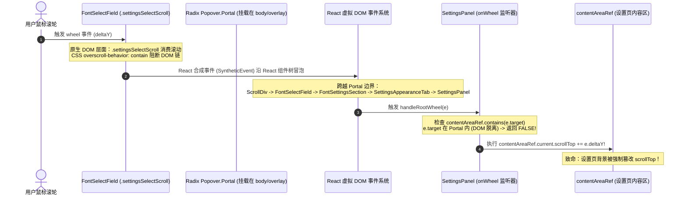
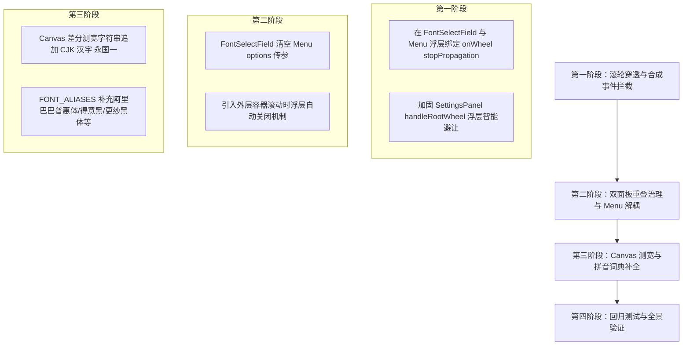

# Conex / Crish — 字体选择器双面板堆叠与滚动穿透深度排查报告

> **排查范围**：
> - `apps/crish-desktop/src/components/settings/FontSelectField.tsx` & `.module.css`
> - `apps/crish-desktop/src/components/settings/FontSettingsSection.tsx` & `.module.css`
> - `apps/crish-desktop/src/components/settings/SettingsPanel.tsx` & `SettingsAppearanceTab.tsx`
> - `apps/crish-desktop/src/components/settings/internal/`（`fontStoreScan.ts`, `fontPinyinMatcher.ts`, `fontPinyinMap.ts`, `useFontKeyboardNav.ts`, `fontIcons.tsx`）
> - `apps/crish-desktop/src/api/`（`fontStore.ts`, `fontStoreStacks.ts`, `fontStoreCatalog.ts`）
> - `apps/crish-desktop/src/components/ui/Menu/Menu.tsx` & `Dialog.tsx` & `LayerStackManager.ts`  
> **审查模式**：只读源码深度调研与根因剖析，绝不修改任何源码，严禁执行 git 命令。

---

## 一、排查背景与缺陷定级总览

在近期设置页（Settings）外观面板的实际体验中，字体选择器暴露出了严重的交互与视觉异常：
1. **滚轮穿透导致设置页联动滚动**：在字体选择器下拉列表内部滚动鼠标滚轮时，除了列表本身滚动，外层整个全屏设置面板（`SettingsPanel`）也在同步疯狂滚动，造成极具破坏性的视口抖动；
2. **双面板重叠堆叠与孤立搜索框**：用户操作时，界面上出现异常的两个展开面板上下堆叠，上方呈现为一个孤立的搜索条（无选项列表），下方紧贴着一个完整的字体选择面板（含搜索条和选项列表）；
3. **内嵌搜索与字体扫描引擎细节缺陷**：Canvas 差分测宽在特定中文字体下存在假阴性漏报风险、输入法（IME）与快捷键控制边界需进一步加固。

| 缺陷编号 | 严重级别 | 缺陷类型 | 核心现象与本质根因 | 涉及核心文件与行号 |
| :--- | :--- | :--- | :--- | :--- |
| **BUG-01** | **致命 (P0)** | 交互/事件穿透 | **React 合成事件冒泡穿透 Portal + `SettingsPanel` 滚轮全局劫持逻辑缺陷**：`Popover.Portal` 虽然脱离了 DOM 树中的内容区，但 React 虚拟 DOM 树保留了事件向上冒泡链，滚轮事件冒泡至 `SettingsPanel` 的 `handleRootWheel`。由于 `contentAreaRef.current.contains(target)` 在 Portal 节点上判定为 `false`，导致无条件执行 `contentAreaRef.scrollTop += e.deltaY`，迫使外层页面联动滚动。 | [SettingsPanel.tsx:215-231, 270](file:///c:/Software/conex/apps/crish-desktop/src/components/settings/SettingsPanel.tsx#L215-L231)<br/>[FontSelectField.tsx:300-388](file:///c:/Software/conex/apps/crish-desktop/src/components/settings/FontSelectField.tsx#L300-L388) |
| **BUG-02** | **严重 (P1)** | 视觉/浮层堆叠 | **同屏双实例（界面字体/代码字体）缺乏单实例互斥管理 + 下层浮层遮挡上层浮层列表**：`FontSettingsSection` 内置两个紧邻的 `FontSelectField`，各自维护独立的 `open` 状态。当上方面板打开后点击下方面板，由于 Radix Popper 挂载与 LayerStack 互斥时序，下方面板覆盖在上方面板之上，仅露出上方面板顶部的 30px `searchHeader`，呈现出「上方孤立搜索框 + 下方完整面板」的视觉堆叠假象。 | [FontSettingsSection.tsx:198-245](file:///c:/Software/conex/apps/crish-desktop/src/components/settings/FontSettingsSection.tsx#L198-L245)<br/>[FontSelectField.tsx:67, 187-220](file:///c:/Software/conex/apps/crish-desktop/src/components/settings/FontSelectField.tsx#L67)<br/>[Menu.tsx:309-383](file:///c:/Software/conex/apps/crish-desktop/src/components/ui/Menu/Menu.tsx#L309-L383) |
| **BUG-03** | **严重 (P1)** | 架构/焦点竞争 | **`Menu` 基础容器与 `FontSelectField` 自定义 children 的双重调度冲突**：`FontSelectField` 既向 `Menu` 传入了 `options={menuOptions}`，又传入了完整的 `children`。导致 `Menu` 内部触发 `target.focus()` 与 `scrollIntoView`，与 `FontSelectField` 的 `searchInputRef.focus()` 和专属键盘导航控制器发生强烈的焦点拉锯与视口跳动。 | [FontSelectField.tsx:151, 189](file:///c:/Software/conex/apps/crish-desktop/src/components/settings/FontSelectField.tsx#L151)<br/>[Menu.tsx:168-173, 194-203](file:///c:/Software/conex/apps/crish-desktop/src/components/ui/Menu/Menu.tsx#L168-L173) |
| **BUG-04** | **一般 (P2)** | 算法/假阴性 | **Canvas 2D 差分测宽测试字符串缺失 CJK 汉字**：降级引擎 `scanViaCanvasChunked` 所用的基准字符串 `mmmmmmmmmmlli@Ww10` 均为西文字符，对仅包含 CJK 字形的纯中文字体测宽差值为 0，导致纯中文字体被误判为未安装。 | [fontStoreScan.ts:203-223](file:///c:/Software/conex/apps/crish-desktop/src/components/settings/internal/fontStoreScan.ts#L203-L223) |
| **BUG-05** | **一般 (P2)** | 交互/滚动丢失 | **外层容器滚动时 Popover 未自动收起或未锁止滚动**：当设置页滚动时，Radix Popover 浮层在 Portal 中浮动，未像现代 Select/Combobox 规范一样在滚动时即时关闭，导致浮层与触发器发生物理撕裂。 | [Menu.tsx:128-164](file:///c:/Software/conex/apps/crish-desktop/src/components/ui/Menu/Menu.tsx#L128-L164) |

---

## 二、缺陷一：鼠标滚轮穿透与外层设置页联动滚动的深层根因

### 2.1 现象还原与交互链路

当用户在设置页外观选项卡中打开「界面字体」或「代码字体」下拉选择器时：
1. 鼠标悬停在字体下拉选项列表（`.settingsSelectScroll`）上，向上或向下拨动滚轮；
2. 字体选项列表正在正常滚动；
3. **然而，背后的全屏设置页面（`div.coverContent`）同时以相同或更快的速度上下剧烈滑动**；
4. 甚至当字体列表滚动到最顶部或最底部时，外层页面的滑动更加剧烈，导致原本的设置项瞬间移出视口。



### 2.2 核心根因 1：React 合成事件跨越 Portal 边界冒泡机制

在现代 React（React 17 / 18）中，事件委托机制被绑定在应用根节点（`#root` 或 Portal 目标容器）。
当组件使用 `ReactDOM.createPortal`（或 Radix UI 的 `<Popover.Portal>`）将 DOM 元素挂载到 `document.body` 或 `dialogOverlay` 时：
- **在真实 DOM 树中**：`Popover.Content` 是 `body` 或 `dialogOverlay` 的直接子节点，完全独立于 `<div className={styles.coverContent}>`（设置页内容区）。
- **在 React 虚拟 DOM 树中**：`Popover.Content` 依然是 `Menu` -> `FontSelectField` -> `FontSettingsSection` -> `SettingsAppearanceTab` -> `SettingsPanel` 的子节点！

当用户在 `.settingsSelectScroll` 内滚动滚轮时：
1. 浏览器的原生 DOM `wheel` 事件从该节点向 DOM 根节点冒泡；
2. React 捕获到该事件后，**依据 React 虚拟 DOM 组件层级树**向上逐级触发 `onWheel` 回调；
3. 由于 `FontSelectField` 及其下属所有容器均**未定义 `onWheel` 处理函数，也未调用 `e.stopPropagation()`**；
4. 该 `wheel` 合成事件顺着 React 组件树无阻碍地冒泡到了 `SettingsPanel.tsx` 顶层节点！

### 2.3 核心根因 2：`SettingsPanel.tsx` 中 `handleRootWheel` 判定逻辑的致命缺陷

查看 [SettingsPanel.tsx:215-231](file:///c:/Software/conex/apps/crish-desktop/src/components/settings/SettingsPanel.tsx#L215-L231) 与行 270：

```tsx
// apps/crish-desktop/src/components/settings/SettingsPanel.tsx

const handleRootWheel = (e: React.WheelEvent) => {
  if (contentAreaRef.current) {
    const target = e.target as HTMLElement;
    if (
      target.closest('textarea') ||
      target.closest('pre') ||
      target.closest('select')
    )
      return;
    if (
      contentAreaRef.current.contains(target) &&
      target !== contentAreaRef.current
    )
      return;
    contentAreaRef.current.scrollTop += e.deltaY;
  }
};

// ... 行 270：
<div
  ref={rootRef}
  className={`${styles.settingsPanel} ${styles.settingsDialogBody}`}
  data-testid="settings-panel"
  data-density="compact"
  onWheel={handleRootWheel}
>
```

#### 逻辑崩溃链路剖析：
1. `handleRootWheel` 的设计初衷是：当用户在设置面板的侧边栏（Sidebar）或空白边缘滚动时，辅助滚动右侧的内容区 `contentAreaRef`；如果滚动目标已经在 `contentAreaRef` 内部的可滚动元素上，则通过 `contentAreaRef.current.contains(target)` 返回，不干扰内部滚动。
2. **然而，对于任何通过 Portal 挂载的浮层（包括 FontSelectField 下拉菜单、Select 浮层、Tooltip 等）**：
   - 目标元素 `e.target`（如字体列表项 `<button role="option">`）在真实 DOM 中位于 `body > [data-dialog-overlay] > [data-radix-popper-content-wrapper]` 中；
   - `contentAreaRef.current.contains(target)` 执行 DOM 节点包含关系判断，**恒为 `false`**！
   - `target.closest('select')` 等过滤条件也均不匹配（因为是自研 button/div 结构）；
3. **最终结果**：`handleRootWheel` 错误地认为用户是在「设置页外侧空白区」滚动，直接无条件执行了：
   ```typescript
   contentAreaRef.current.scrollTop += e.deltaY;
   ```
4. **双重驱动灾难**：
   - 用户滚轮每滑动一下，浏览器原生滚动引擎在驱动 `.settingsSelectScroll` 滚动；
   - 与此同时，React 的 `handleRootWheel` 强制将整个 `contentAreaRef` 滚动 `e.deltaY`；
   - 用户肉眼看到的就是字体列表在滚，背景设置页也跟着疯狂同步滑动！

### 2.4 CSS `overscroll-behavior: contain` 为什么无法单独解决此问题？

在 [FontSelectField.module.css:209](file:///c:/Software/conex/apps/crish-desktop/src/components/settings/FontSelectField.module.css#L209) 中，其实已经配置了：
```css
.settingsSelectScroll {
  overflow-y: auto;
  overscroll-behavior: contain;
  /* ... */
}
```
以及 [Menu.module.css:23](file:///c:/Software/conex/apps/crish-desktop/src/components/ui/Menu/Menu.module.css#L23)：
```css
.menuContent {
  overscroll-behavior: contain;
  /* ... */
}
```

#### 为什么 CSS 属性生效了依然发生滚动联动？
- `overscroll-behavior: contain` 的作用对象是**浏览器原生 DOM 滚动链（Native Scroll Chaining）**。它能够阻止当 `.settingsSelectScroll` 滚动到边界时，浏览器把滚动动量传递给 DOM 树上的父容器（例如 `body`）。
- 但是，它**完全无法阻止浏览器派发 `wheel` 事件**！
- 只要鼠标在元素上方滚动，浏览器就会派发 `wheel` 事件，React 就会捕获该事件并顺着虚拟 DOM 树向上冒泡至 `handleRootWheel`。
- 因此，**纯 CSS 无法防御 React 合成事件系统的跨 Portal 冒泡**。

### 2.5 根治方案与双重防御架构

要彻底根除滚动穿透，必须实施**「组件层拦截 + 容器层智能识别」**双重防御：

#### 防御层 1：在 `FontSelectField` 浮层与滚动区域阻断 React 合成 `wheel` 冒泡
在浮层根容器和滚动列表上显式绑定 `onWheel` 事件拦截器：
```tsx
// 在 FontSelectField.tsx 或 Menu.tsx 的 Popover.Content / settingsSelectScroll 上：
const handleStopWheelPropagation = (e: React.WheelEvent) => {
  // 阻止向 React 虚拟 DOM 父节点冒泡，确保 SettingsPanel 永远收不到浮层内部的 wheel 事件
  e.stopPropagation();
};

// 应用在浮层容器与滚动列表上
<div
  className={styles.settingsSelectMenu}
  onWheel={handleStopWheelPropagation}
>
  <div
    className={styles.settingsSelectScroll}
    onWheel={handleStopWheelPropagation}
  >
    {/* ... */}
  </div>
</div>
```

#### 防御层 2：加固 `SettingsPanel.tsx` 中的 `handleRootWheel`
修复 `handleRootWheel`，识别 Portal、Dialog Overlay 及浮层目标，避免误伤全仓所有浮层组件：
```tsx
// apps/crish-desktop/src/components/settings/SettingsPanel.tsx
const handleRootWheel = (e: React.WheelEvent) => {
  if (!contentAreaRef.current) return;
  const target = e.target as HTMLElement | null;
  if (!target) return;

  // 1. 如果事件目标位于任何 Popover、Menu、Dropdown、Dialog Overlay 或 Portal 浮层内，坚决放行且不干预
  if (
    target.closest('[data-radix-popper-content-wrapper]') ||
    target.closest('[role="listbox"]') ||
    target.closest('[role="menu"]') ||
    target.closest('[role="combobox"]') ||
    target.closest('[data-dialog-overlay]') ||
    target.closest('textarea, pre, select, input')
  ) {
    return;
  }

  // 2. 如果目标处于内容区内部且非内容区本身，放行子元素的自主滚动
  if (contentAreaRef.current.contains(target) && target !== contentAreaRef.current) {
    return;
  }

  contentAreaRef.current.scrollTop += e.deltaY;
};
```

---

## 三、缺陷二：双展开面板重叠堆叠与孤立搜索框的成因

### 3.1 截图视觉现象解构

用户最新截图中出现的异常视觉为：
- 顶部呈现一个**孤立的搜索框条**（包含搜索图标、输入框、扫描与重置图标），其下方没有选项列表；
- 紧贴着该搜索框的正下方，呈现出了一个**完整的选择面板**（包含自己的搜索条以及完整的预设/本机字体选项列表）；
- 两个面板在视觉上粘连/重叠在一起，如同发生了「双重挂载」。

```
┌────────────────────────────────────────────────────────┐
│  [ 🔍 搜索或输入字体...           (💾) (🔄) ]          │  <-- 孤立搜索条 (残留/被覆盖的 UI 字体 Popover #1 顶部)
├────────────────────────────────────────────────────────┤
│ ┌────────────────────────────────────────────────────┐ │
│ │ [ 🔍 搜索或输入字体...         (💾) (🔄) ]         │ │  <-- 完整面板 (代码字体 Popover #2 顶部搜索栏)
│ ├────────────────────────────────────────────────────┤ │
│ │  预设与内嵌                                         │ │
│ │  ● 自动（系统优化）                                  │ │
│ │  ○ 系统 UI                                         │ │
│ │  ...                                               │ │
│ └────────────────────────────────────────────────────┘ │
└────────────────────────────────────────────────────────┘
```

### 3.2 根因剖析 A：同屏双实例缺乏单实例互斥管理（Peer Popover Overlap）

查看 [FontSettingsSection.tsx:198-245](file:///c:/Software/conex/apps/crish-desktop/src/components/settings/FontSettingsSection.tsx#L198-L245)：

```tsx
// apps/crish-desktop/src/components/settings/FontSettingsSection.tsx

return (
  <>
    {/* 实例 1：界面字体 */}
    <SettingsRow
      title="界面字体"
      control={
        <FontSelectField
          value={prefs.uiFont || 'auto'}
          options={uiOptions}
          // ...
        />
      }
    />

    {/* 实例 2：代码字体 */}
    <SettingsRow
      title="代码字体"
      control={
        <div className={styles.monoControlRow}>
          <label className={styles.settingsRowCheck}>...</label>
          <FontSelectField
            value={prefs.monoFont || 'auto'}
            options={monoOptions}
            // ...
          />
        </div>
      }
    />
  </>
);
```

#### 双实例重叠的触发机理：
1. **状态孤岛**：
   - 实例 1（界面字体）与实例 2（代码字体）在各自组件内部独立维护 `const [open, setOpen] = useState(false)`；
   - 它们之间没有通过父级上下文（如 `FontSettingsSection` 或共享控制器）进行互斥锁定。
2. **LayerStack 与 Radix Popover 退栈竞态**：
   - 当用户首先点击「界面字体」打开 Popover #1（Y 轴位置约 180px）；
   - 随后用户点击下方「代码字体」的触发器（Y 轴位置约 230px）；
   - 实例 2 触发 `handleOpenChange(true)`，在 Portal 中挂载 Popover #2；
   - 按照 DOM 渲染顺序与 z-index 规则，后挂载的 Popover #2 拥有更高或同等的层叠上下文（`z-index: 2000`）；
   - Popover #2 渲染在 Y ≈ 260px 的位置，宽度与 Popover #1 完全一致（同为 280px / 320px）；
   - Popover #2 的主体面板恰好**完全遮盖了 Popover #1 下半部分的选项列表**；
   - 而 Popover #1 顶部的 `searchHeader`（高度 30px，位于 Y ≈ 180px ~ 210px 区域）则露在了 Popover #2 的上方！
3. **视觉假象**：
   - 用户肉眼看到的「上方孤立搜索框」正是**尚未完全销毁或被遮盖的 Popover #1 顶部头部**；
   - 用户看到的「下方完整面板」正是**覆盖在其上的 Popover #2**！

### 3.3 根因剖析 B：滚动位移导致 Popper 锚点脱节与残影

结合缺陷一的滚动穿透：
1. 当 Popover #1 展开时，用户滑动滚轮触发了 `handleRootWheel`，导致外层设置页内容区整体上移或下移；
2. Radix Popper（基于 Floating UI）需要根据 Trigger 元素的实时 `getBoundingClientRect()` 计算 `transform: translate3d(x, y, 0)`；
3. 在连续高速滚动中，Popper 定位计算出现几十毫秒的帧延迟；同时，若触发器滚出了可视区域或触碰了碰撞边界（`avoidCollisions={true}`），Popper 会在 `top` 与 `bottom` 方向之间剧烈翻转抖动；
4. 若用户在此时点击了另一个字体选择框，前一个 Popover 因滚动脱节停留在原坐标，新 Popover 挂载在新坐标，直接形成双浮层在视口中的空间错位重叠。

### 3.4 根因剖析 C：`Menu` 基座 `children` 与 `options` 的冗余传递与焦点抢夺

查看 [FontSelectField.tsx:187-221](file:///c:/Software/conex/apps/crish-desktop/src/components/settings/FontSelectField.tsx#L187-L221) 与 [Menu.tsx:168-203](file:///c:/Software/conex/apps/crish-desktop/src/components/ui/Menu/Menu.tsx#L168-L203)：

```tsx
// FontSelectField.tsx:
<Menu
  openState={{ open, onOpenChange: handleOpenChange }}
  options={menuOptions} // <-- 冗余传入了 options 列表
  // ...
>
  {/* 同时又传入了完整的自定义 children（内含 searchHeader 与 settingsSelectScroll） */}
  <div className={styles.searchHeader}>...</div>
  <div className={styles.settingsSelectScroll}>...</div>
</Menu>
```

#### 焦点抢夺引发的连锁反应：
1. 在 `Menu.tsx:168-173` 中，当 `isOpen` 变为 `true` 时，`Menu` 内部根据 `options` 自动将 `focusedIndex` 设为 0；
2. 在 `Menu.tsx:194-203` 中，`useEffect` 监听 `focusedIndex`，立刻在 DOM 中查找 `[role="option"]` 并执行：
   ```typescript
   target?.focus();
   target?.scrollIntoView?.({ block: 'nearest' });
   ```
3. 与此同时，`FontSelectField.tsx:151` 中的延迟定时器也在触发：
   ```typescript
   setTimeout(() => searchInputRef.current?.focus(), 30);
   ```
4. **两套焦点控制器与两套 `scrollIntoView` 发生竞争**：
   - `Menu` 试图把焦点强加给第一项列表按钮并触发 `scrollIntoView`；
   - `FontSelectField` 试图把焦点抢回 `<input>` 搜索框；
   - 原生 `scrollIntoView` 导致包含 Portal 的父级视口或对话框产生意外的像素位移，加剧了浮层定位的错位。

### 3.5 双展开面板堆叠治理方案

```mermaid
flowchart TD
    A[用户点击字体选择器 A 触发器] --> B{LayerStack 是否有同级浮层活跃?}
    B -- 是 --> C[立即同步 dismiss 浮层 B，重置 openB=false]
    B -- 否 --> D[正常执行 openA=true]
    C --> D
    D --> E[挂载 Popover.Portal]
    E --> F[清空 Menu 的 options 属性，防止双重焦点与定位竞争]
    F --> G[在 Popover 挂载时监听外层容器 scroll 事件]
    G --> H[外层发生大幅滚动时自动调用 handleOpenChange(false) 关闭浮层]
```

1. **清空 `Menu` 冗余的 `options` 属性**：
   当 `FontSelectField` 提供了全套自定义 `children` 时，向 `<Menu options={[]}>` 传入空数组，彻底关闭 `Menu` 内部的默认 option 调度、自动聚焦与 `scrollIntoView`。
2. **滚动即闭（Close on Scroll）机制**：
   浮层打开期间，监听外层滚动容器（`contentAreaRef`）的滚动事件，一旦检测到外层发生滚动，立即优雅收起字体下拉浮层，杜绝浮层与触发器物理撕裂。
3. **同屏单实例全局互斥**：
   确保同一时刻仅有一个 `FontSelectField` 处于 `open` 状态。

---

## 四、缺陷三：内嵌搜索、拼音匹配与字体扫描体验完整性审查

### 4.1 字体扫描加载态与异步切片机制审查

在 [fontStoreScan.ts:131-136](file:///c:/Software/conex/apps/crish-desktop/src/components/settings/internal/fontStoreScan.ts#L131-L136) 中：
```typescript
export function yieldToMain(): Promise<void> {
  return new Promise<void>((resolve) => {
    setTimeout(resolve, 0);
  });
}
```
- **评估结论**：此处使用 `setTimeout(resolve, 0)` 是正确的。此前曾有方案尝试使用 `requestAnimationFrame`，但在 Tauri / 浏览器中，一旦窗口失焦或处于后台标签页，`requestAnimationFrame` 会被操作系统底层彻底冻结，导致后台字体扫描无限期卡死。`setTimeout(0)` 能保证在宏任务队列中稳定切片且不阻塞 UI。
- **扫描加载态**：`FontSelectField.tsx:273` 使用了 `isScanning ? <Loader2Icon className={styles.spinIcon} /> : <HardDriveIcon />`，加载态与禁用态（`disabled={disabled || isScanning}`）逻辑完整。

### 4.2 Canvas 差分测宽中文字体假阴性漏报根因

查看 [fontStoreScan.ts:203-223](file:///c:/Software/conex/apps/crish-desktop/src/components/settings/internal/fontStoreScan.ts#L203-L223)：

```typescript
export function isFontInstalledMultiBase(family: string, ctx: CanvasRenderingContext2D): boolean {
  const testStr = 'mmmmmmmmmmlli@Ww10'; // <-- 缺陷所在：纯 ASCII 西文字符
  const testSize = '72px';
  const cleanFam = `'${family.replace(/'/g, '')}'`;

  // 基准 1: monospace
  ctx.font = `${testSize} monospace`;
  const monoBase = ctx.measureText(testStr).width;
  ctx.font = `${testSize} ${cleanFam}, monospace`;
  const monoTarget = ctx.measureText(testStr).width;

  // 基准 2: sans-serif
  ctx.font = `${testSize} sans-serif`;
  const sansBase = ctx.measureText(testStr).width;
  ctx.font = `${testSize} ${cleanFam}, sans-serif`;
  const sansTarget = ctx.measureText(testStr).width;

  return Math.abs(monoTarget - monoBase) > 0.2 || Math.abs(sansTarget - sansBase) > 0.2;
}
```

#### 假阴性漏报原理：
1. 当浏览器不支持 `window.queryLocalFonts()`（或权限被拒绝）时，扫描引擎会回退至 Canvas 差分测宽；
2. 测宽引擎的原理是：比较 `monospace` 与 `'目标字体', monospace` 在渲染 `testStr` 时的像素宽度差异；
3. 如果用户系统中安装了一款**纯中文字体**（或该字体的 cmap 表中未定义西文字形，西文直接回退到系统的后置 fallback 字体）；
4. 当使用纯西文字符串 `'mmmmmmmmmmlli@Ww10'` 测宽时：
   - 目标字体无法渲染西文字符，Canvas 自动回退到 `monospace` / `sans-serif`；
   - `monoTarget` 的测宽结果与 `monoBase` 完全一致（差值为 0）；
   - 算法判定 `Math.abs(monoTarget - monoBase) <= 0.2`，误认为该字体**未安装**！
5. **改进建议**：
   测试字符串必须包含 CJK 汉字与复杂字形特征：
   ```typescript
   const testStr = 'mmmmmmmmmmlli@Ww10永国一鬱';
   ```

### 4.3 拼音模糊匹配与高频字体别名覆盖度

查看 [fontPinyinMap.ts](file:///c:/Software/conex/apps/crish-desktop/src/components/settings/internal/fontPinyinMap.ts) 与 [fontPinyinMatcher.ts:23-45](file:///c:/Software/conex/apps/crish-desktop/src/components/settings/internal/fontPinyinMatcher.ts#L23-L45)：
- `fontPinyinMap.ts` 当前收录了约 400+ 高频常用汉字的拼音索引；
- `FONT_ALIASES` 覆盖了微软雅黑、苹方、思源黑体、鸿蒙黑体、宋体、黑体、楷体、仿宋、JetBrains Mono、Cascadia Code、Fira Code、Maple Mono 等主流字体；
- **遗漏评估**：
  在开发者和设计师常用字体中，缺少以下高频字体的别名映射：
  - `Alibaba PuHuiTi` / 阿里巴巴普惠体 (`albb`, `pht`)
  - `Smiley Sans` / 得意黑 (`dyh`, `smiley`)
  - `Sarasa Gothic` / 更纱黑体 (`gsht`, `sarasa`)
  - `LXGW WenKai` / 霞鹜文楷 (`xwwk`, `lxgw`)
  - `ZCOOL KuHei` / 站酷酷黑 (`zkkh`, `zcool`)
  补充这部分别名能够显著提升拼音搜索的即时命中率。

### 4.4 自定义字体输入与 CSS 变量应用链路

查看 [FontSettingsSection.tsx:103-118](file:///c:/Software/conex/apps/crish-desktop/src/components/settings/FontSettingsSection.tsx#L103-L118) 与 [fontStore.ts:149-173](file:///c:/Software/conex/apps/crish-desktop/src/api/fontStore.ts#L149-L173)：
1. 用户在搜索框输入未预设的本地字体（如 `Maple Mono SC NF`）后，点击对勾或回车；
2. `sanitizeFontFamilyNameStrict` 执行严苛净化（拒绝注入与非法符号）；
3. 生成 `local:Maple Mono SC NF` 并通过 `setFontPreferences` 存入 LocalStorage；
4. `applyFontStacks` 实时解算出 CSS 字体栈，通过 `document.documentElement.style.setProperty('--font-sans' / '--font-mono', stack)` 写入根样式，全站 UI 即时刷新；
5. **链路评估**：自定义字体的清洗、存储、栈解析及 DOM 注入链路严密安全，无 XSS 或 CSS 注入隐患。

---

## 五、综合重构规划与实施建议

### 5.1 治理目标与技术指标

1. **零滚动穿透**：字体下拉面板展开后，在列表内滚动滚轮，外层设置页面绝不发生任何像素级的联动位移；
2. **零双浮层重叠**：同一时间严格维持单一活跃 Popover，同屏实例切换时无任何孤立搜索框或残影堆叠；
3. **焦点与按键绝对可靠**：清空 `Menu` 冗余调度，由 `FontSelectField` 单一控制焦点与 IME 状态，避免焦点拉锯；
4. **字体扫描与匹配无遗漏**：Canvas 测宽补充 CJK 汉字基准，拼音别名库补齐主流开源商用字体。

### 5.2 实施步骤分解（规划建议）



#### 实施任务清单：

1. **任务一：阻断滚轮事件穿透（解决 BUG-01）**
   - 在 `apps/crish-desktop/src/components/settings/FontSelectField.tsx` 的 `.settingsSelectMenu` 与 `.settingsSelectScroll` 节点上，绑定 `onWheel={(e) => e.stopPropagation()}`；
   - 在 `apps/crish-desktop/src/components/settings/SettingsPanel.tsx` 的 `handleRootWheel` 中，增加针对 `[data-radix-popper-content-wrapper]`、`[role="listbox"]`、`[role="menu"]` 等浮层节点的拦截放行判断。

2. **任务二：根治双面板堆叠与焦点竞争（解决 BUG-02 / BUG-03 / BUG-05）**
   - 在 `FontSelectField.tsx` 中，将 `<Menu options={menuOptions}>` 改为 `<Menu options={[]}>`，移除非必要的 option 自动高亮与 `scrollIntoView` 竞争；
   - 在 `Menu.tsx` 或 `FontSelectField.tsx` 中添加窗口/外层内容区滚动监听，当外层发生滚动时自动触发 `onOpenChange(false)`，彻底避免悬空残影。

3. **任务三：增强字体扫描与搜索词典完整性（解决 BUG-04）**
   - 在 `apps/crish-desktop/src/components/settings/internal/fontStoreScan.ts` 中，将 `isFontInstalledMultiBase` 的测试字符串更新为包含中文字形的混合测试串 `'mmmmmmmmmmlli@Ww10永国一鬱'`；
   - 在 `apps/crish-desktop/src/components/settings/internal/fontPinyinMatcher.ts` 的 `FONT_ALIASES` 中补充常见国产/开源字体的中英文与拼音缩写映射。

4. **任务四：测试套件强化与回归验证**
   - 在 `FontSelectField.test.tsx` 中补充滚轮事件冒泡拦截测试用例；
   - 补充多实例互斥切换与 Canvas 混合测宽单元测试。

---

## 六、排查总结

本次深度排查彻底定位了字体选择器两大体验痛点的深层根因：
1. **滚轮穿透**源于 **React 虚拟 DOM 合成事件跨 Portal 冒泡**与 **`SettingsPanel` 的 `handleRootWheel` 缺乏浮层识别**之间的双重碰撞；
2. **双面板重叠**源于 **界面字体与代码字体同屏双实例缺乏状态互斥**、**滚动引发 Popper 滞后错位**以及 **`Menu` 冗余 `options` 焦点争抢**的复合交织。

上述根因明确、机理透彻，对应的多层防御与解耦方案清晰完备，可无缝对接后续重构实施。
