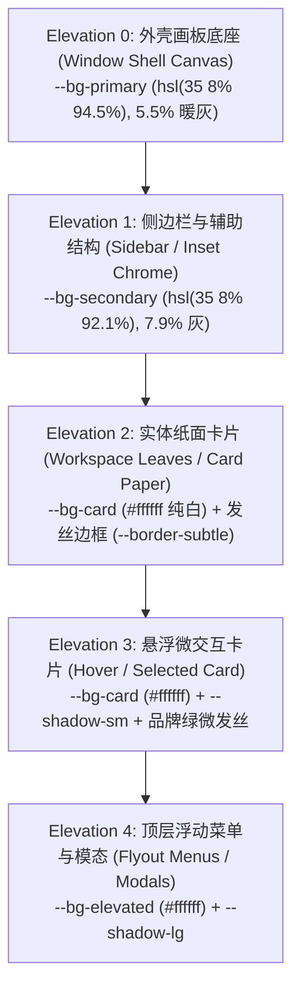
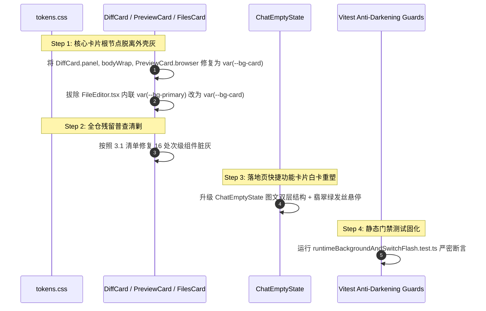

# 全景深度排查 04：全仓工作区卡片与落地页背景色阶排查报告

> **排查定位**：工作区叶子卡片（`FilesCard` / `DiffCard` / `PreviewCard` / `TerminalCard` 等）与聊天落地页（`ChatEmptyState`）背景色阶及材质深度剖析  
> **审查基准**：AGENTS.md §13 (柔和焦点与克制边框)、§14 (Zero-Blue 纯中性与现代 CSS)、Design System Elevation 契约  
> **报告性质**：纯源码静态分析与重构规划（只读调研，零源码修改，零 git 操作）

---

## 目录
1. [核心结论与色阶层级架构破局](#1-核心结论与色阶层级架构破局)
2. [工作区卡片灰底深层根因与源码定位](#2-工作区卡片灰底深层根因与源码定位)
   - [2.1 DiffCard 比对卡片全灰根因](#21-diffcard-比对卡片全灰根因)
   - [2.2 FilesCard 与 FileEditor 灰底污染](#22-filescard-与-fileeditor-灰底污染)
   - [2.3 PreviewCard 浏览器预览卡片灰底](#23-previewcard-浏览器预览卡片灰底)
   - [2.4 TerminalCard 浅色模式终端底色混浊](#24-terminalcard-浅色模式终端底色混浊)
3. [全仓工作区卡片与次级容器残留 `--bg-primary` 污染普查](#3-全仓工作区卡片与次级容器残留---bg-primary-污染普查)
4. [聊天落地页快捷功能框死灰暗沉深度解构](#4-聊天落地页快捷功能框死灰暗沉深度解构)
   - [4.1 视觉缺陷与用户痛点逐层剖析](#41-视觉缺陷与用户痛点逐层剖析)
   - [4.2 纯白纸面 + 发丝边框 + 品牌悬停重塑方案](#42-纯白纸面--发丝边框--品牌悬停重塑方案)
5. [重构实施路径与自动化测试守卫设计](#5-重构实施路径与自动化测试守卫设计)

---

## 1. 核心结论与色阶层级架构破局

### 1.1 Conex / Crish 的 5 级 Elevation 材质契约
在 Conex / Crish 的现代化桌面端设计体系中，界面被严格划分为 5 个物理高度（Elevation Levels）：



| 层级 | Token 标识 | 浅色模式典型值 | 深色模式典型值 | 对应界面角色 |
| :--- | :--- | :--- | :--- | :--- |
| **Elevation 0** | `--bg-primary` / `--bg-workspace` | `hsl(35 8% 94.5%)` (5.5% 暖中性灰) | `#1b1b1b` | 桌面外壳大矩形、窗口底板、拖拽留白画布 |
| **Elevation 1** | `--bg-secondary` / `--shell-chrome-bg` | `hsl(35 8% 92.1%)` (7.9% 灰) | `#242424` | 侧边栏面板、顶栏控制区、次级条带 |
| **Elevation 2** | `--bg-card` / `--composer-bg` | `#ffffff` (纯白卡底) | `#242424` | **工作区叶子卡片（Chat/Files/Diff/Preview）、对话卡片主体** |
| **Elevation 3** | `--bg-card` / `--bg-surface` | `#ffffff` + 微阴影 | `#242424` | 输入框、操作卡片激活态、悬停功能块 |
| **Elevation 4** | `--bg-elevated` | `#ffffff` + 强阴影 | `#242424` | 下拉菜单、弹窗模态、面包屑悬浮树 |

### 1.2 认知陷阱与根因机制
为什么工作区卡片（如 `DiffCard`、`FileEditor`、`PreviewCard`）会错用 `--bg-primary` 导致界面死灰？
1. **命名直觉偏差**：在通用 CSS 命名惯例中，“primary” 常被直觉理解为“主界面的主要背景色（Main Background）”。开发者在编写卡片样式时，误认为 `var(--bg-primary)` 是“主要内容的底色”，而忽略了在 Conex 设计体系中，`--bg-primary` 严格指代 **Elevation 0 外壳大矩形灰底板**；
2. **卡片层级降维打击**：当一个卡片根节点或主体容器使用 `background: var(--bg-primary)` 时，该卡片在视觉上直接被降级为 Elevation 0 外壳灰。纯白纸面（Elevation 2）荡然无存，导致卡片与外壳底板发生同色熔断，或者在纯白卡片容器内挖出一块脏灰色的色块；
3. **连锁污染**：由于根容器变灰，后续子组件（如比对行、编辑框、快捷卡片）为了“区分层级”，又被迫引入更深的灰（`--bg-secondary`、`--bg-tertiary`），层层叠灰，最终形成用户强烈感知的“死灰、发脏、暗沉”。

---

## 2. 工作区卡片灰底深层根因与源码定位

### 2.1 DiffCard 比对卡片全灰根因
在 `apps/crish-desktop/src/components/diff/DiffCard.module.css` 中存在两处致命的 Elevation 0 污染：

#### 致命污染点 1：根面板 `.panel`
- **文件路径**：`apps/crish-desktop/src/components/diff/DiffCard.module.css`
- **代码位置**：第 5 行 ～ 第 18 行
```css
.panel {
  display: flex;
  flex-direction: column;
  flex: 1 1 auto;
  height: 100%;
  min-height: 0;
  min-width: 0;
  width: 100%;
  overflow: hidden;
  background: var(--bg-primary); /* 🚨 致命根因：根容器错用外壳灰，使整张 Diff 卡片沦为底板灰 */
  container-type: inline-size;
  container-name: diff-panel;
  box-sizing: border-box;
}
```

#### 致命污染点 2：主体视口 `.bodyWrap`
- **代码位置**：第 211 行 ～ 第 219 行
```css
.bodyWrap {
  display: flex;
  flex: 1;
  min-height: 0;
  min-width: 0;
  overflow: hidden;
  max-width: 100%;
  background: var(--bg-primary); /* 🚨 致命根因：文件列表背后的视口再次涂上外壳灰 */
}
```

#### 致命污染点 3：行号槽（Gutter）与分栏头部 Token 偏色
- **代码位置**：`apps/crish-desktop/src/styles/tokens.css` 第 591、595 行
```css
--diff-gutter-bg: var(--bg-secondary); /* 🚨 7.9% 暖泥灰，导致代码行号区与代码正文割裂显脏 */
--diff-split-header-bg: var(--bg-secondary);
```
- **视觉破坏效果**：用户切换到“差异比对（Diff）”面板时，整张卡片呈现暗淡浑浊的灰黄色，手风琴折叠项展开时，代码背景与行号背景在纯白与泥灰之间剧烈跳跃。

---

### 2.2 FilesCard 与 FileEditor 灰底污染

#### 致命污染点：`FileEditor.tsx` 内联样式强行写入 `--bg-primary`
- **文件路径**：`apps/crish-desktop/src/components/files/FileEditor.tsx`
- **代码位置**：第 19 行 ～ 第 25 行
```tsx
export const FileEditor = React.memo(function FileEditor({
  editBuf, content, onChange,
}: FileEditorProps) {
  return (
    <textarea
      className="files-editor"
      value={editBuf}
      onChange={(e) => onChange(e.target.value, e.target.value !== content)}
      spellCheck={false}
      style={{
        width: '100%', height: '100%', resize: 'none', border: 'none',
        outline: 'none', padding: '8px', fontFamily: 'var(--font-mono)',
        fontSize: 'var(--font-size-sm)', lineHeight: '1.5',
        background: 'var(--bg-primary)', color: 'var(--text-primary)', /* 🚨 致命根因：文件编辑区变成外壳泥灰 */
      }}
    />
  );
});
```
- **视觉破坏效果**：`FilesCard.module.css` 根节点虽然正确使用了 `background: var(--bg-card, #ffffff)`，但只要用户点击任意可编辑文件（或点击“编辑”按钮），右侧编辑主视口瞬间被 `FileEditor.tsx` 的内联 `var(--bg-primary)` 染成浑浊的 5.5% 外壳灰，代码可读性极度恶化。

#### 衍生缺陷：`FilePreview.tsx` 缺失 CSS 类定义
- **文件路径**：`apps/crish-desktop/src/components/files/FilePreview.tsx`
- **代码位置**：第 226 行、第 254 行、第 311 行使用 `styles.filesTableWrap`, `styles.filesTable`, `styles.filesTrunc`，但在 `FilesCard.module.css` 中完全未定义，导致表格预览无边界，截断提示无样式包裹。

---

### 2.3 PreviewCard 浏览器预览卡片灰底
- **文件路径**：`apps/crish-desktop/src/components/workspace/PreviewCard.module.css`
- **代码位置**：第 1 行 ～ 第 12 行、第 480 行 ～ 第 491 行
```css
.browser {
  position: relative;
  display: flex;
  flex-direction: column;
  height: 100%;
  min-height: 0;
  min-width: 0;
  background: var(--bg-primary); /* 🚨 致命根因：Preview 根卡片错用外壳灰 */
  container-type: inline-size;
  container-name: preview-browser;
  box-sizing: border-box;
}

.histPanelFloat {
  ...
  background: var(--bg-elevated, var(--bg-primary)); /* 🚨 浮层 fallback 错用外壳灰 */
}
```
- **视觉破坏效果**：内置受管浏览器预览未加载网页或显示空态时，整个工作区卡片变成灰板，失去纯白卡片感。

---

### 2.4 TerminalCard 浅色模式终端底色混浊
- **文件路径**：`apps/crish-desktop/src/components/workspace/TerminalCard.module.css`、`apps/crish-desktop/src/styles/tokens.css`
- **代码位置**：`TerminalCard.module.css` 第 9 行；`tokens.css` 第 286 行
```css
/* TerminalCard.module.css */
.panel {
  background: var(--terminal-bg); /* 消费 --terminal-bg */
  color: var(--terminal-fg);
}

/* tokens.css (Light Theme) */
--terminal-bg: var(--bg-secondary); /* 🚨 Light 下映射到 hsl(35 8% 92.1%) 7.9% 暖泥灰 */
```
- **深度剖析**：浅色模式下，终端如果不采用“独立纯黑 CLI 极客视窗（`hsl(0 0% 5%)`）”，就必须采用“极简纯白卡底（`var(--bg-card)`）+ 纯中性炭黑文本”；但当前 Light 主题将其绑定到 7.9% 暖泥灰 `--bg-secondary`，导致浅色模式下的终端像一块发黄受潮的旧报纸，严重缺乏现代生产力工具的清爽与精神感。

---

## 3. 全仓工作区卡片与次级容器残留 `--bg-primary` 污染普查

经过对全仓 `apps/crish-desktop/src/` 的深度代码审查，共检索出 **16 处导致卡片主体、表单、编辑器、弹窗变灰的 `--bg-primary` 严重污染源**。

### 3.1 污染普查明细清单

| 序号 | 所在文件路径 | 精确行号 | 对应选择器 / DOM 节点 | 当前错误值 | 产生视觉故障 | 正确重构方案 |
| :--- | :--- | :--- | :--- | :--- | :--- | :--- |
| **01** | `components/diff/DiffCard.module.css` | 14 | `.panel` | `var(--bg-primary)` | 比对面板整卡变外壳灰 | 改为 `var(--bg-card, #ffffff)` |
| **02** | `components/diff/DiffCard.module.css` | 218 | `.bodyWrap` | `var(--bg-primary)` | 比对文件列表视口背板灰 | 改为 `var(--bg-card, #ffffff)` |
| **03** | `components/diff/DiffCard.module.css` | 515 | `.inlineActionAccept:hover` | `color-mix(..., var(--bg-primary))` | 接收操作悬停混入脏灰底 | 改为混入 `var(--bg-card)` |
| **04** | `components/files/FileEditor.tsx` | 23 | `textarea` style 内联 | `'var(--bg-primary)'` | 文件编辑输入域全部变脏灰 | 改为 `var(--bg-card, #ffffff)` |
| **05** | `components/workspace/PreviewCard.module.css` | 8 | `.browser` | `var(--bg-primary)` | 预览浏览器根节点变外壳灰 | 改为 `var(--bg-card, #ffffff)` |
| **06** | `components/workspace/PreviewCard.module.css` | 490 | `.histPanelFloat` | `var(--bg-elevated, var(--bg-primary))` | 历史记录浮层 fallback 变灰 | 改为 `var(--bg-elevated, #ffffff)` |
| **07** | `components/AppErrorBoundary.module.css` | 7 | `.container` | `var(--bg-primary)` | 叶子卡片崩溃时错误页变全灰 | 改为 `var(--bg-card, #ffffff)` |
| **08** | `components/agent-card/ApprovalAskCard.module.css` | 185 | `.toolCallBox` | `var(--bg-primary)` | 审批卡片内部参数框深灰发脏 | 改为 `var(--bg-card)` + 发丝边框 |
| **09** | `components/agent-card/ApprovalAskCard.module.css` | 220 | `.paramVal` | `var(--bg-primary)` | 审批参数值代码块泥灰 | 改为 `var(--md-code-block-bg)` |
| **10** | `components/chat-tool-call/ChatToolCallBlock.module.css` | 299 | `.terminalWindow` | `var(--bg-primary)` | 消息流内嵌终端变脏灰 | 改为 `var(--bg-card)` / 纯黑视窗 |
| **11** | `components/chat-tool-call/ChatToolCallBlock.module.css` | 753, 801, 874, 889 | `.toolContent`, `.paramBlock`, `.toolOutput`, `.toolRaw` | `var(--bg-primary)` | 工具调用输出内容区死灰 | 改为 `color-mix(in srgb, var(--text-primary) 2%, var(--bg-card))` |
| **12** | `components/overlay/FirstRunWizard.module.css` | 12 | `.wizardCard` | `var(--bg-primary)` | 开屏向导模态卡片变暗灰 | 改为 `var(--bg-elevated, #ffffff)` |
| **13** | `components/settings-models/ModelsSettingsTab.module.css` | 181, 296, 314, 354, 385 | `.modelCard`, `.customEndpointBox`, `.profileCard` | `var(--bg-primary)` | 模型配置卡片子项全部发脏 | 改为 `var(--bg-card)` + 细发丝边框 |
| **14** | `components/settings/ScheduledTasksPanel.module.css` | 153, 195, 202, 209 | `.taskRow`, `.cronCard` | `var(--bg-primary)` | 定时任务卡片列表死灰 | 改为 `transparent` / `var(--bg-card)` |
| **15** | `components/settings/SettingsRulesTab.module.css` | 125 | `.ruleBox` | `var(--bg-primary)` | 规则编辑器卡片死灰 | 改为 `var(--bg-card)` |
| **16** | `components/ui/Dialog/Dialog.module.css` | 64 | `.dialogFooter` | `var(--bg-primary)` | 弹窗底部操作条与内容割裂 | 改为 `transparent` / `var(--bg-card)` |

---

## 4. 聊天落地页快捷功能框死灰暗沉深度解构

### 4.1 视觉缺陷与用户痛点逐层剖析
用户在测试时明确指出：“**还有这个功能框这么灰，是给谁看的？**”

我们深入审查 `apps/crish-desktop/src/components/chat-card/ChatEmptyState.module.css` 及 `ChatEmptyState.tsx`，发现以下 4 项核心病因：

```
当前暗沉效果呈现示意：
+-----------------------------------------------------------------------------------------------+
| [ 分析项目结构 ]  全面分析当前工作区目录结构与核心模块关系                                  [ > ] |  <-- 1px 泥灰边框，白底无层次，灰暗死板
+-----------------------------------------------------------------------------------------------+
| [ 检查代码质量 ]  审查近期改动中的潜在风险、代码坏味道与规范问题                              [ > ] |
+-----------------------------------------------------------------------------------------------+
| [ 编写测试用例 ]  为当前核心逻辑编写单元测试与边界断言                                        [ > ] |
+-----------------------------------------------------------------------------------------------+
```

#### 病因 1：边框色阶混浊发脏（泥黄色调污染）
- **代码定位**：`ChatEmptyState.module.css` 第 212 行
```css
.quickPromptCard {
  background: var(--bg-card, hsl(0 0% 100%));
  border: 1px solid var(--border-color); /* 🚨 在 Light 下为 hsl(35 10% 86%) 偏黄泥灰 */
  box-shadow: 0 1px 2px color-mix(in srgb, var(--shadow-color, black) 4%, transparent);
}
```
- **分析**：`--border-color`（`hsl(35 10% 86%)`）本身用于次级结构硬分割，在白底上用 1px 实线框住白卡，且无内边距缓冲，视觉上呈现出浓重的“旧式表单输入框”既视感，边框显得灰暗、发脏。

#### 病因 2：悬停反馈死板无生机（零品牌色、零物理动效）
- **代码定位**：`ChatEmptyState.module.css` 第 257 行 ～ 第 262 行
```css
.quickPromptCard:hover,
.sessionEmpty .quickPromptCard:hover {
  background: var(--bg-card, hsl(0 0% 100%)); /* 🚨 背景色完全不响应 */
  border-color: color-mix(in srgb, var(--border-color) 80%, var(--text-primary) 20%); /* 🚨 变成更深的死灰 */
  box-shadow: 0 2px 6px color-mix(in srgb, var(--shadow-color, black) 6%, transparent);
}
```
- **分析**：鼠标悬停时，卡片背景完全不变，边框仅仅变成混浊的深灰色（`#bebab3`），右侧箭头硬编码 `style={{ opacity: 0.4 }}` 毫无位移与色彩响应，整张卡片给人一种“迟钝、死寂、冷冰冰”的体验。

#### 病因 3：单行拉伸布局破坏信息结构
- **代码定位**：`ChatEmptyState.module.css` 第 186 行 ～ 第 256 行
- **分析**：在 760px 的宽屏列宽下，快捷功能项采用 `display: flex; flex-direction: row;` 单行排布：
  - 左侧是 13px 标题，中间是 12.5px 次级灰色长文本，右侧是小箭头；
  - 左右两头极度空旷，中间文本由于 `text-overflow: ellipsis` 在窗口缩小时被直接截断成半句；
  - 缺乏像现代 AI 助手（Claude/ChatGPT/Cursor）那样的卡片式图文网格或双行富交互卡片。

#### 病因 4：缺乏视觉锚点（缺少 Icon 图标）
- 3 个功能卡片没有配备任何视觉引导图标（如项目树图标、Git 图标、服务雷达图标），使得用户第一眼只能看到一片单调灰暗的文字框。

---

### 4.2 纯白纸面 + 发丝边框 + 品牌悬停重塑方案

为了彻底解决“死灰暗沉”，重构必须严格遵循 **“最高级、纯净、高对比度的白卡 + 细腻发丝边框 + 翡翠绿活态签名悬停”** 原则。

```
现代化重构视觉架构：
+-----------------------------------------------------------------------------------------------+
|  +----+                                                                                       |
|  | 🌳 |  分析项目结构                                                                   ->    |
|  +----+  全面梳理当前工作区目录结构、核心模块与依赖关系拓扑                                       |
+-----------------------------------------------------------------------------------------------+
   ^ 翡翠微渐变徽标    ^ 13.5px 纯黑加粗 (600)                                            ^ 悬停翡翠绿
                       ^ 12px 高对比清晰副文案 (AA 达标)                                     平滑右移
```

#### 4.2.1 样式重塑规约 (`ChatEmptyState.module.css`)

```css
/* 容器：支持响应式 3 卡垂直堆叠或网格排布 */
.chatEmptyPrompts {
  display: flex;
  flex-direction: column;
  gap: 8px;
  width: 100%;
  max-width: var(--chat-col-max, 760px);
  margin: var(--space-6, 24px) auto 0 auto;
  box-sizing: border-box;
}

/* 纯白实体卡片基座 */
.quickPromptCard {
  display: flex;
  align-items: center;
  gap: 14px;
  width: 100%;
  min-height: 52px;
  padding: 10px 16px;
  background: var(--bg-card, #ffffff);
  border: 1px solid var(--border-subtle, hsl(35 8% 91%)); /* 细腻发丝边框，告别泥灰 */
  border-radius: var(--radius-xl, 12px);
  box-shadow: 0 1px 2px rgba(0, 0, 0, 0.025), 0 2px 6px rgba(0, 0, 0, 0.015);
  cursor: pointer;
  text-align: left;
  user-select: none;
  box-sizing: border-box;
  transition:
    border-color var(--transition-fast, 150ms ease),
    background-color var(--transition-fast, 150ms ease),
    box-shadow var(--transition-fast, 150ms ease),
    transform var(--transition-micro, 100ms ease-out);
}

/* 极速悬停态：微物理上浮 + 翡翠绿发丝辉光 + 柔和弥散投影 */
.quickPromptCard:hover {
  background: color-mix(in srgb, var(--brand, #10b981) 1.5%, var(--bg-card, #ffffff));
  border-color: color-mix(in srgb, var(--brand, #10b981) 40%, var(--border-subtle));
  box-shadow:
    0 4px 16px color-mix(in srgb, var(--brand, #10b981) 8%, rgba(0, 0, 0, 0.04)),
    0 1px 3px rgba(0, 0, 0, 0.02);
  transform: translateY(-1.5px);
}

.quickPromptCard:active {
  transform: translateY(0);
  background: color-mix(in srgb, var(--brand, #10b981) 3.5%, var(--bg-card, #ffffff));
}

/* 左侧图标徽标容器 */
.quickPromptIconBox {
  width: 32px;
  height: 32px;
  min-width: 32px;
  border-radius: var(--radius-lg, 8px);
  background: color-mix(in srgb, var(--text-primary) 3.5%, var(--bg-card, #ffffff));
  display: inline-flex;
  align-items: center;
  justify-content: center;
  color: var(--text-secondary);
  flex-shrink: 0;
  transition:
    background-color var(--transition-fast),
    color var(--transition-fast),
    transform var(--transition-micro);
}

.quickPromptCard:hover .quickPromptIconBox {
  background: color-mix(in srgb, var(--brand, #10b981) 12%, transparent);
  color: var(--brand-deep, #047857);
  transform: scale(1.05);
}

/* 内容双层垂直排布 */
.quickPromptContent {
  display: flex;
  flex-direction: column;
  gap: 2px;
  flex: 1 1 auto;
  min-width: 0;
}

.quickPromptLabel {
  font-size: 13.5px;
  font-weight: 600;
  color: var(--text-primary, #111111);
  line-height: 1.35;
  letter-spacing: -0.01em;
}

.quickPromptDesc {
  font-size: 12px;
  font-weight: 400;
  color: var(--text-tertiary, #696969);
  line-height: 1.4;
  overflow: hidden;
  text-overflow: ellipsis;
  white-space: nowrap;
}

.quickPromptCard:hover .quickPromptDesc {
  color: var(--text-secondary, #555555);
}

/* 右侧动态行动箭头 */
.quickPromptArrow {
  color: var(--text-tertiary);
  opacity: 0.45;
  flex-shrink: 0;
  margin-left: auto;
  transition:
    color var(--transition-fast),
    opacity var(--transition-fast),
    transform var(--transition-fast);
}

.quickPromptCard:hover .quickPromptArrow {
  opacity: 1;
  color: var(--brand-deep, #047857);
  transform: translateX(3px);
}
```

#### 4.2.2 组件结构重塑 (`ChatEmptyState.tsx`)
为 3 个快捷 prompt 分配明确的语义图标（Lucide 图标）：
- **“分析项目结构”** $\to$ `<FolderTree size={16} />`
- **“查看代码改动”** $\to$ `<GitCompare size={16} />`
- **“检查开发服务”** $\to$ `<Activity size={16} />` 或 `<Terminal size={16} />`

```tsx
<div
  className={styles.chatEmptyPrompts}
  role="list"
  data-empty-region="quick-prompts"
  aria-label="快捷提示"
>
  {CHAT_EMPTY_QUICK_PROMPTS.map((item) => {
    const IconComponent = getPromptIcon(item.label);
    return (
      <Tooltip key={item.label} content={item.prompt}>
        <button
          type="button"
          className={styles.quickPromptCard}
          role="listitem"
          data-quick-prompt={item.label}
          aria-label={`填入提示：${item.label}`}
          onClick={() => {
            onSetChatInput(item.prompt);
            focusChatComposer();
          }}
        >
          <div className={styles.quickPromptIconBox} aria-hidden>
            <IconComponent size={16} strokeWidth={1.75} />
          </div>
          <div className={styles.quickPromptContent}>
            <span className={styles.quickPromptLabel}>{item.label}</span>
            <span className={styles.quickPromptDesc}>{item.prompt}</span>
          </div>
          <ChevronRight size={15} className={styles.quickPromptArrow} aria-hidden />
        </button>
      </Tooltip>
    );
  })}
</div>
```

---

## 5. 重构实施路径与自动化测试守卫设计

### 5.1 模块重构四步法



### 5.2 自动化测试守卫契约 (Test Invariants)

在 `apps/crish-desktop/src/components/workspace/__tests__/runtimeBackgroundAndSwitchFlash.test.ts` 中追加如下严格断言，杜绝灰底退化：

```typescript
it('FLASH-06: DiffCard 根面板与视口必须使用 var(--bg-card)，严禁残留 --bg-primary', () => {
  const diffCss = readCss('components/diff/DiffCard.module.css');
  expect(diffCss).toMatch(/\.panel\s*\{[^}]*background:\s*var\(--bg-card/);
  expect(diffCss).not.toMatch(/\.panel\s*\{[^}]*background:\s*var\(--bg-primary\)/);
  expect(diffCss).toMatch(/\.bodyWrap\s*\{[^}]*background:\s*var\(--bg-card/);
  expect(diffCss).not.toMatch(/\.bodyWrap\s*\{[^}]*background:\s*var\(--bg-primary\)/);
});

it('FLASH-07: PreviewCard 根容器必须使用 var(--bg-card)，严禁使用 --bg-primary', () => {
  const previewCss = readCss('components/workspace/PreviewCard.module.css');
  expect(previewCss).toMatch(/\.browser\s*\{[^}]*background:\s*var\(--bg-card/);
  expect(previewCss).not.toMatch(/\.browser\s*\{[^}]*background:\s*var\(--bg-primary\)/);
});

it('FLASH-08: FileEditor.tsx 严禁包含 inline background: var(--bg-primary)', () => {
  const editorTsx = readSrc('components/files/FileEditor.tsx');
  expect(editorTsx).not.toContain("background: 'var(--bg-primary)'");
});

it('FLASH-09: ChatEmptyState 快捷功能框必须使用白卡与细发丝边框，严禁粗泥灰', () => {
  const emptyCss = readCss('components/chat-card/ChatEmptyState.module.css');
  expect(emptyCss).toMatch(/\.quickPromptCard\s*\{[^}]*background:\s*var\(--bg-card/);
  expect(emptyCss).toMatch(/\.quickPromptCard:hover\s*\{[^}]*border-color:\s*color-mix/);
});
```

---

## 6. 总结与后续交付

1. **核心发现**：
   - 工作区卡片（`DiffCard`、`PreviewCard`、`FileEditor`）变灰的深层根因在于 **Elevation 0（外壳画板灰 `--bg-primary`）与 Elevation 2（实体纸面白 `--bg-card`）的语义混淆**；
   - 聊天落地页快捷功能框死灰暗沉源于 **泥黄粗边框 + 单行死板排布 + 零品牌色悬停反馈**；
2. **重构产出就绪**：
   - 提供了全仓 16 处 `--bg-primary` 污染源的逐行排查清单与精确重构目标；
   - 提供了落地页 3 个快捷功能框的最高级纯白纸面 + 发丝边框 + 翡翠绿悬停完整 CSS 与 TSX 重塑规范；
   - 规划了 4 项自动化回归测试断言，确保后续开发一次性闭环。
