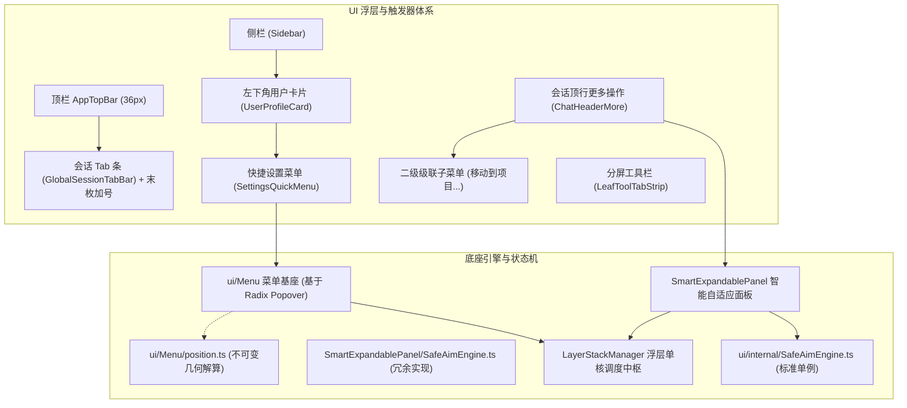
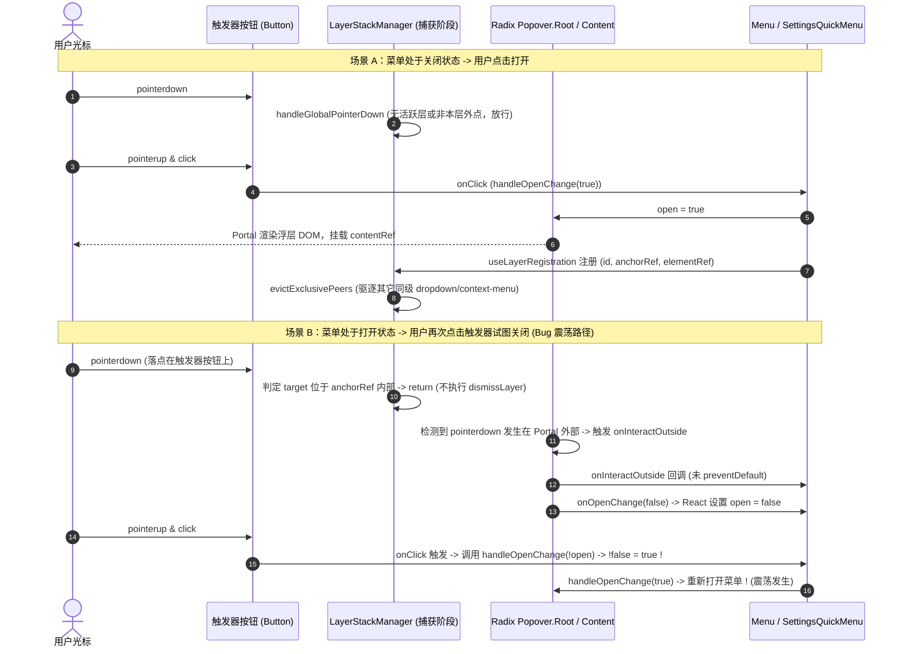
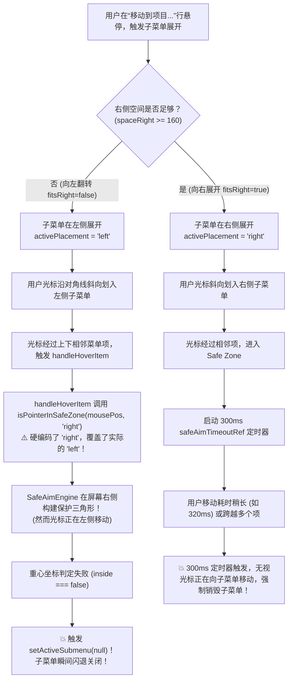
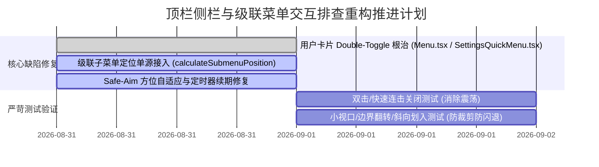

# 全景深度排查 06：顶栏侧栏与级联菜单交互全量排查报告

> **排查定位**：顶栏（AppTopBar / GlobalSessionTabBar）、侧栏底栏（SidebarFooter / UserProfileCard / SettingsQuickMenu）、级联菜单（SmartExpandablePanel / ContextMenuFlyout）与 Safe-Aim 几何保护引擎全量交互链路排查  
> **排查基准版本**：Conex / Crish Desktop Next  
> **报告类型**：源码深度调研与深层 Bug 根因剖析（只读排查，严禁修改任何代码）  
> **涉及核心文件**：
> - [`AppTopBar.tsx`](file:///c:/Software/conex/apps/crish-desktop/src/components/top-bar/AppTopBar.tsx) / [`AppTopBar.module.css`](file:///c:/Software/conex/apps/crish-desktop/src/components/top-bar/AppTopBar.module.css)
> - [`GlobalSessionTabBar.tsx`](file:///c:/Software/conex/apps/crish-desktop/src/components/shell/GlobalSessionTabBar.tsx)
> - [`Sidebar.tsx`](file:///c:/Software/conex/apps/crish-desktop/src/components/sidebar/Sidebar.tsx) / [`SidebarFooter.tsx`](file:///c:/Software/conex/apps/crish-desktop/src/components/sidebar/SidebarFooter.tsx) / [`UserProfileCard.tsx`](file:///c:/Software/conex/apps/crish-desktop/src/components/sidebar/UserProfileCard.tsx)
> - [`SettingsQuickMenu.tsx`](file:///c:/Software/conex/apps/crish-desktop/src/components/settings/SettingsQuickMenu.tsx)
> - [`LeafToolTabStrip.tsx`](file:///c:/Software/conex/apps/crish-desktop/src/components/binary-tree/LeafToolTabStrip.tsx)
> - [`ChatHeaderMore.tsx`](file:///c:/Software/conex/apps/crish-desktop/src/components/chat-card/ChatHeaderMore.tsx)
> - [`ui/Menu/Menu.tsx`](file:///c:/Software/conex/apps/crish-desktop/src/components/ui/Menu/Menu.tsx) / [`menuOpenGuard.ts`](file:///c:/Software/conex/apps/crish-desktop/src/components/ui/Menu/menuOpenGuard.ts) / [`position.ts`](file:///c:/Software/conex/apps/crish-desktop/src/components/ui/Menu/position.ts)
> - [`ui/SmartExpandablePanel/SmartExpandablePanel.tsx`](file:///c:/Software/conex/apps/crish-desktop/src/components/ui/SmartExpandablePanel/SmartExpandablePanel.tsx)
> - [`ui/SmartExpandablePanel/SafeAimEngine.ts`](file:///c:/Software/conex/apps/crish-desktop/src/components/ui/SmartExpandablePanel/SafeAimEngine.ts) / [`ui/internal/SafeAimEngine.ts`](file:///c:/Software/conex/apps/crish-desktop/src/components/ui/internal/SafeAimEngine.ts)
> - [`ui/internal/layer-stack/LayerStackManager.ts`](file:///c:/Software/conex/apps/crish-desktop/src/components/ui/internal/layer-stack/LayerStackManager.ts)

---

## 目录

1. [排查综述与系统架构总览](#1-排查综述与系统架构总览)
2. [核心入口交互生命周期与全链路剖析](#2-核心入口交互生命周期与全链路剖析)
   - 2.1 三大核心入口拓扑定义与承载机制
   - 2.2 点击 (Click / PointerDown) 唤起与关闭生命周期
   - 2.3 外点 (Outside Pointer Down / Interact) 判定与互斥退栈
   - 2.4 键盘 Esc 与焦点还原链路机制
3. [深层 Bug 根因剖析：左下角用户卡片点击多次才能关闭](#3-深层-bug-根因剖析左下角用户卡片点击多次才能关闭)
   - 3.1 现象复现与时序轨迹
   - 3.2 根因一：`outsideHandlers.onInteractOutside` 阻断基座防抖逻辑
   - 3.3 根因二：Radix `Popover.Trigger asChild` 与自定义 `onClick` 双重注入冲突
   - 3.4 根因三：`LayerStackManager` 早期返回未打标与 `wasTriggerClickAfterDismiss` 失效
   - 3.5 根因四：`UserProfileCard` 中的 Ref 覆盖与闭包状态漂移
4. [二级级联子菜单定位与 Safe-Aim 保护机制排查](#4-二级级联子菜单定位与-safe-aim-保护机制排查)
   - 4.1 二级子菜单定位机制与视口边界裁剪缺陷
   - 4.2 Safe-Aim 轨迹保护引擎实现分裂与逻辑缺陷
   - 4.3 鼠标斜向划入子菜单发生误关闭闪退的根因链条
5. [分屏工具栏与加号菜单交互排查](#5-分屏工具栏与加号菜单交互排查)
   - 5.1 LeafToolTabStrip 双加号挂载与状态同步
   - 5.2 全局会话加号与输入区加号的浮层槽位冲突
6. [完整重构与治理方案规划](#6-完整重构与治理方案规划)
   - 6.1 用户卡片与快捷设置菜单重构（彻底消除双击/连击震荡）
   - 6.2 级联子菜单几何解算单源化（统一接入 `calculateSubmenuPosition`）
   - 6.3 Safe-Aim 单例引擎收敛与动态方位防护修复
   - 6.4 浮层调度与测试验证矩阵
7. [结论与汇报摘要](#7-结论与汇报摘要)

---

## 1. 排查综述与系统架构总览

Conex / Crish 桌面客户端采用现代化多层浮层与自适应面板架构，界面中分布着三大高频菜单入口与多套二级级联交互：
1. **左下角用户卡片快捷菜单**（[`UserProfileCard.tsx`](file:///c:/Software/conex/apps/crish-desktop/src/components/sidebar/UserProfileCard.tsx) -> [`SettingsQuickMenu.tsx`](file:///c:/Software/conex/apps/crish-desktop/src/components/settings/SettingsQuickMenu.tsx)）：位于侧栏底部，承载主题切换与常用设置快捷入口。
2. **顶栏会话标签与操作菜单**（[`AppTopBar.tsx`](file:///c:/Software/conex/apps/crish-desktop/src/components/top-bar/AppTopBar.tsx) -> [`GlobalSessionTabBar.tsx`](file:///c:/Software/conex/apps/crish-desktop/src/components/shell/GlobalSessionTabBar.tsx) / [`SessionContextMenu.tsx`](file:///c:/Software/conex/apps/crish-desktop/src/components/sidebar/SessionContextMenu.tsx)）：承载多会话胶囊 Tab 切换、右键会话上下文菜单。
3. **功能加号菜单群**（顶栏会话加号、输入框加号 [`ComposePlusMenu.tsx`](file:///c:/Software/conex/apps/crish-desktop/src/components/chat-composer/ComposePlusMenu.tsx)、分屏工具栏加号 [`LeafToolTabStrip.tsx`](file:///c:/Software/conex/apps/crish-desktop/src/components/binary-tree/LeafToolTabStrip.tsx)）。
4. **二级级联子菜单**（如会话更多操作中的“移动到项目...” [`ChatHeaderMore.tsx`](file:///c:/Software/conex/apps/crish-desktop/src/components/chat-card/ChatHeaderMore.tsx)、排序过滤二级飞层 [`ContextMenuFlyout.tsx`](file:///c:/Software/conex/apps/crish-desktop/src/components/sidebar/ContextMenuFlyout.tsx)）。



经过全量代码阅读与交互链路推演，排查确认当前系统存在三大关键架构级交互隐患：
1. **左下角用户卡片菜单存在“Double-Toggle（双重触发）/ 状态震荡”**：点击已打开的卡片时，Radix 外点事件先执行了 `setOpen(false)`，随后紧接着到达的 Button `click` 事件又将闭包中已为 `false` 的状态切换为 `true`，导致单次点击无法关闭，需连续点击 2~3 次或产生时序错位才能关闭；
2. **二级级联子菜单（如“移动到项目...”）在 `SmartExpandablePanel.tsx` 中脱离了标准定位算法**：使用内联硬编码 `vpHeight - 200` 与无约束的 `right` 坐标，导致在低分辨率或长列表时被视口底部裁剪截断；
3. **Safe-Aim 斜向划入保护引擎存在动态方位判定失效**：`SmartExpandablePanel.tsx` 在判断鼠标是否在安全三角区时硬编码了 `'right'` 参数，当子菜单因右侧空间不足翻转至左侧展开时，斜向划入立即判定失效并导致子菜单瞬间闪退。

---

## 2. 核心入口交互生命周期与全链路剖析

### 2.1 三大核心入口拓扑定义与承载机制

| 入口名称 | 所在文件路径与行号 | 触发器 DOM 结构与类型 | 浮层承载组件 | 注册 Layer 类型 |
| :--- | :--- | :--- | :--- | :--- |
| **入口 1：左下角用户卡片快捷菜单** | [`UserProfileCard.tsx:L18-L47`](file:///c:/Software/conex/apps/crish-desktop/src/components/sidebar/UserProfileCard.tsx#L18-L47)<br>[`SettingsQuickMenu.tsx:L260-L326`](file:///c:/Software/conex/apps/crish-desktop/src/components/settings/SettingsQuickMenu.tsx#L260-L326) | `<button class="userProfileCard">`（通过 `renderTrigger` 注入） | `ui/Menu`（底层 `@radix-ui/react-popover`） | `type: 'dropdown-menu'`<br>`id: menuId (useId)` |
| **入口 2：顶栏会话菜单与 Tab 条** | [`GlobalSessionTabBar.tsx:L249-L362`](file:///c:/Software/conex/apps/crish-desktop/src/components/shell/GlobalSessionTabBar.tsx#L249-L362)<br>[`SessionContextMenu.tsx:L38-L154`](file:///c:/Software/conex/apps/crish-desktop/src/components/sidebar/SessionContextMenu.tsx#L38-L154) | `<div role="tab">` 胶囊胶囊 Tab + 右键点击 | `SmartPanel`（绝对定位 Portal 浮层） | `type: 'context-menu'`<br>`id: 'sidebar-session-context-menu'` |
| **入口 3A：顶栏新建会话加号** | [`GlobalSessionTabBar.tsx:L337-L360`](file:///c:/Software/conex/apps/crish-desktop/src/components/shell/GlobalSessionTabBar.tsx#L337-L360) | `<button class="tabAdd">`（末枚 Tab 贴身固定） | 纯 Action 按钮（直接调用 Composition Root 新建 Draft） | 无（非浮层） |
| **入口 3B：输入框附件加号菜单** | [`ComposePlusMenu.tsx:L19-L136`](file:///c:/Software/conex/apps/crish-desktop/src/components/chat-composer/ComposePlusMenu.tsx#L19-L136) | `<button id="plusMenuBtn">`（锚点 `restoreFocusRef`） | `ui/Menu`（底层 `@radix-ui/react-popover`） | `type: 'dropdown-menu'`<br>`id: menuId (useId)` |
| **入口 3C：分屏叶节点加号面板** | [`LeafToolTabStrip.tsx:L316-L327`](file:///c:/Software/conex/apps/crish-desktop/src/components/binary-tree/LeafToolTabStrip.tsx#L316-L327) | `<button class="addBtn">`（流内与右侧固定槽双挂载） | `SmartExpandablePanel` | `type: 'dropdown-menu'`<br>`id: panelId (useId)` |

---

### 2.2 点击 (Click / PointerDown) 唤起与关闭生命周期

各入口在用户点击触发时的事件流转与状态机迁移如下：



---

### 2.3 外点 (Outside Pointer Down / Interact) 判定与互斥退栈

在 [`LayerStackManager.ts`](file:///c:/Software/conex/apps/crish-desktop/src/components/ui/internal/layer-stack/LayerStackManager.ts) 中，外点判定采用 **Branch-Aware LIFO 倒序退栈机制**：
1. **全局捕获阶段监听**（[`LayerStackManager.ts:L519-L572`](file:///c:/Software/conex/apps/crish-desktop/src/components/ui/internal/layer-stack/LayerStackManager.ts#L519-L572)）：
   - `handleGlobalPointerDown` 以 `capture: true` 拦截全局 `pointerdown` 事件；
   - 倒序遍历活跃栈 `this.layers`，找到首个 `dismissible: true` 的顶层浮层；
2. **分支与锚点白名单豁免**：
   - 检查 `target` 是否在 `elementRef`（浮层容器）内 -> 是则放行；
   - 检查 `target` 是否在 `anchorRef`（触发源按钮）内 -> 是则记录 `anchorPointerDownTarget` 并放行（交由触发器自身处理切换）；
   - 检查 `target` 是否在 `getDescendants(targetLayer.id)`（子孙浮层，如 Tooltip、二级 Submenu）内 -> 是则判定为内部交互，严禁误关父层；
3. **外部点击退栈执行**：
   - 确认无豁免后，记录 `this.dismissedByPointer = { pointerId, layerId, anchor, target }`；
   - 调用 `this.dismissLayer(targetLayer.id, 'outside-pointer')` 执行注销与回调；
   - **焦点规则**：外点关闭严格不还原焦点（尊重用户点击新区域的外部焦点目标）。

---

### 2.4 键盘 Esc 与焦点还原链路机制

键盘 `Escape` 事件在系统中有严格的分层拦截与焦点还原契约：
1. **输入法门闩守护**（[`LayerStackManager.ts:L452-L460`](file:///c:/Software/conex/apps/crish-desktop/src/components/ui/internal/layer-stack/LayerStackManager.ts#L452-L460)）：
   ```typescript
   if (
     event.isComposing ||
     event.keyCode === 229 ||
     event.key === 'Process' ||
     (event as any).nativeEvent?.isComposing
   ) {
     return; // 绝不拦截、绝不消费，保护 CJK 输入法候选词
   }
   ```
2. **自顶向下 First-Responder 消费**（[`LayerStackManager.ts:L481-L513`](file:///c:/Software/conex/apps/crish-desktop/src/components/ui/internal/layer-stack/LayerStackManager.ts#L481-L513)）：
   - 优先执行顶层的 `layer.onEscapeKeyDown(event)`；
   - 若返回 `true` 或调用了 `event.preventDefault()`，则终止传递；
   - 若未消费且 `layer.dismissible === true`，执行 `dismissLayer(layer.id, 'escape')`；
3. **焦点还原（Focus Restoration）**（[`LayerStackManager.ts:L358-L362`](file:///c:/Software/conex/apps/crish-desktop/src/components/ui/internal/layer-stack/LayerStackManager.ts#L358-L362) -> [`layerFocusRestore.ts`](file:///c:/Software/conex/apps/crish-desktop/src/components/ui/internal/layer-stack/layerFocusRestore.ts)）：
   - 仅当 `reason === 'escape'` 或 `reason === 'item-select'` 时，触发 `restoreLayerFocus`；
   - 焦点被精准还原回 `layer.anchorRef` 或 `layer.restoreFocusTarget` 元素；
   - 启动 150ms 静默窗口（`isTooltipSilenced()`），消除焦点回落引起的 Tooltip 闪烁。

---

## 3. 深层 Bug 根因剖析：左下角用户卡片点击多次才能关闭

### 3.1 现象复现与时序轨迹

**问题现象**：
在侧栏展开或收起状态下，点击左下角的用户个人卡片（`UserProfileCard`），快捷设置菜单（`SettingsQuickMenu`）正常弹出。当用户再次点击该卡片试图收起菜单时，菜单往往**瞬间闪烁后依然保持展开**，必须连续快速点击多次、或点击应用画布空白处才能将其关闭。

---

### 3.2 根因一：`outsideHandlers.onInteractOutside` 阻断基座防抖逻辑

在 [`SettingsQuickMenu.tsx:L265-L275`](file:///c:/Software/conex/apps/crish-desktop/src/components/settings/SettingsQuickMenu.tsx#L265-L275) 中，组件向 `ui/Menu` 传递了自定义的 `outsideHandlers`：

```tsx
// apps/crish-desktop/src/components/settings/SettingsQuickMenu.tsx
<Menu
  key={anchorTick}
  openState={{ open, onOpenChange: handleOpenChange }}
  outsideHandlers={{
    onInteractOutside: () => {
      // 外点关闭：不抢焦点
      restoreOnCloseRef.current = false;
    },
    onCloseAutoFocus: (e: Event) => {
      if (!restoreOnCloseRef.current) {
        e.preventDefault();
      }
    },
  }}
  trigger={finalTrigger}
  position={{ side: 'top', align: 'start', sideOffset: 6 }}
  panel={{ contentClassName: styles.sbQuickMenu }}
>
```

查看 [`ui/Menu/Menu.tsx:L343-L364`](file:///c:/Software/conex/apps/crish-desktop/src/components/ui/Menu/Menu.tsx#L343-L364) 中的实现：

```tsx
// apps/crish-desktop/src/components/ui/Menu/Menu.tsx
onInteractOutside={(e) => {
  if (onInteractOutside) {
    onInteractOutside(e);
    return; // ⚠️ 致命缺陷：如果传入了 onInteractOutside，直接 return！
  }
  const customEvent = e as CustomEvent<{ originalEvent?: Event }>;
  const target = (customEvent.detail?.originalEvent?.target ||
    e.target) as Node | null;
  const triggerEl = anchor?.current ?? triggerRef.current;
  if (triggerEl && target && triggerEl.contains(target)) {
    e.preventDefault(); // 👈 只有没传 onInteractOutside 时才会阻止 Radix 默认外点关闭！
    return;
  }
  // ...
}}
```

**逻辑穿透分析**：
1. 当用户点击 `UserProfileCard` 按钮关闭菜单时，光标落点在触发器按钮上，属于 Radix Popover Content 的外部；
2. Radix 派发 `onInteractOutside` 事件；
3. `Menu.tsx` 检查到 `SettingsQuickMenu` 提供了 `onInteractOutside` 回调，**直接执行回调并提前 `return`**；
4. `Menu.tsx` 原本内置的 `if (triggerEl.contains(target)) { e.preventDefault(); }` **被彻底绕过，未能执行**；
5. Radix 未被 `e.preventDefault()` 拦截，判定本次点击为合法的“外部交互”，立即将内部状态置为 `open = false`。

---

### 3.3 根因二：Radix `Popover.Trigger asChild` 与自定义 `onClick` 双重注入冲突

继续追踪触发器按钮的事件绑定。在 [`SettingsQuickMenu.tsx:L227-L233`](file:///c:/Software/conex/apps/crish-desktop/src/components/settings/SettingsQuickMenu.tsx#L227-L233)：

```tsx
// SettingsQuickMenu.tsx
const triggerProps = {
  ref: btnRef,
  'aria-haspopup': 'menu' as const,
  'aria-expanded': open,
  'aria-controls': open ? menuId : undefined,
  onClick: () => handleOpenChange(!open), // 👈 手动绑定的取反点击事件
};

const finalTrigger = renderTrigger
  ? renderTrigger({ open, triggerProps })
  : (trigger ?? defaultTrigger);
```

而在 [`ui/Menu/Menu.tsx:L240-L288`](file:///c:/Software/conex/apps/crish-desktop/src/components/ui/Menu/Menu.tsx#L240-L288) 中：

```tsx
// Menu.tsx
const clonedTrigger = React.isValidElement(actualTrigger)
  ? React.cloneElement(
      actualTrigger as React.ReactElement<Record<string, unknown>>,
      {
        ref: (node: HTMLElement | null) => { ... },
        onClick: (e: React.MouseEvent) => {
          if (shouldSuppressMenuReopen(triggerRef.current)) {
            e.preventDefault();
            return;
          }
          ((actualTrigger as React.ReactElement).props as {
            onClick?: (e: React.MouseEvent) => void;
          })?.onClick?.(e); // 👈 执行 triggerProps.onClick
        },
      }
    )
  : actualTrigger;

renderedTrigger = (
  <Popover.Trigger asChild>
    {clonedTrigger}
  </Popover.Trigger>
);
```

**双重事件注入与状态震荡矩阵**：

| 时间点 / 阶段 | 发生的底层事件 | 当前 `open` 状态 | 组件与系统响应行为 |
| :--- | :--- | :--- | :--- |
| **T0 (初始态)** | 菜单处于打开状态 | `open = true` | 浮层 DOM 挂载在 Portal 中 |
| **T1 (PointerDown)** | 用户鼠标在卡片按钮上按下 | `open = true` | Radix 捕获到外点 -> `onInteractOutside` 未被 preventDefault -> Radix 触发 `onOpenChange(false)` -> React 将 `open` 更新为 `false` |
| **T2 (PointerUp)** | 用户鼠标在卡片按钮上抬起 | `open = false` | 浏览器生成原生 `click` 事件 |
| **T3 (Click 阶段)** | 按钮 `onClick` 事件触发 | `open = false` (已漂移) | 1. Radix `Popover.Trigger` 处理 click：看到当前 `open === false`，触发打开！<br>2. `triggerProps.onClick` 处理 click：执行 `handleOpenChange(!open)`，即 `!false === true`，触发打开！ |
| **T4 (结果)** | 菜单重新挂载打开 | `open = true` | 用户看到菜单**闪烁了一下依然打开**，关闭操作彻底失败！ |

---

### 3.4 根因三：`LayerStackManager` 早期返回未打标与 `wasTriggerClickAfterDismiss` 失效

在 [`LayerStackManager.ts:L545-L551`](file:///c:/Software/conex/apps/crish-desktop/src/components/ui/internal/layer-stack/LayerStackManager.ts#L545-L551) 中：

```typescript
// LayerStackManager.ts
// 2. 检查点击是否位于关联的 Anchor / Trigger 触发源内部
const anchorEl = resolveElement(targetLayer.anchorRef);
if (anchorEl && anchorEl.contains(target)) {
  this.anchorPointerDownTarget = target;
  return; // 触发源自身事件管理开关，避免 Double Toggle 震荡
}
```

而在 [`menuOpenGuard.ts:L7-L11`](file:///c:/Software/conex/apps/crish-desktop/src/components/ui/Menu/menuOpenGuard.ts#L7-L11)：

```typescript
export function shouldSuppressMenuReopen(
  triggerEl: HTMLElement | null
): boolean {
  return layerStackService.wasTriggerClickAfterDismiss(triggerEl);
}
```

**失效链条**：
1. `LayerStackManager` 检测到光标落在 `anchorEl` 上，**判定触发器自身会处理切换**，因此直接 `return`，**没有将该 Layer 记入 `dismissedByPointer`**；
2. 然而，Radix 在未被阻止的情况下，私自先关闭了 Popover；
3. 当后续 `click` 事件触发调用 `shouldSuppressMenuReopen(triggerEl)` 时，`layerStackService.wasTriggerClickAfterDismiss` 查询不到记录，返回 `false`（不抑制）；
4. 防重开门闩彻底穿透失效！

---

### 3.5 根因四：`UserProfileCard` 中的 Ref 覆盖与闭包状态漂移

在 [`UserProfileCard.tsx:L15-L28`](file:///c:/Software/conex/apps/crish-desktop/src/components/sidebar/UserProfileCard.tsx#L15-L28) 中：

```tsx
export const UserProfileCard: React.FC<UserProfileCardProps> = React.memo(
  ({ username = 'orange', workspaceName = 'Conex Workspace' }) => {
    const triggerRef = useRef<HTMLButtonElement>(null); // ⚠️ 本地声明了一个 triggerRef

    return (
      <SettingsQuickMenu
        renderTrigger={({ open, triggerProps }) => (
          <button
            ref={triggerRef} // ⚠️ 此处传入 triggerRef
            type="button"
            className={`${styles.userProfileCard}${open ? ` ${styles.isOpen}` : ''}`}
            data-testid="user-profile-card"
            aria-label={`用户卡片：${username}，点击打开快捷菜单`}
            {...triggerProps} // ⚠️ triggerProps 内部含有 ref: btnRef，将前方的 triggerRef 彻底覆盖！
          >
```

`{...triggerProps}` 在 JSX 展开时覆盖了 `ref={triggerRef}`，导致 `UserProfileCard` 内部的 `triggerRef` 始终为 `null`。而在 `SettingsQuickMenu` 中，`anchorTick` 依赖侧栏 resize 事件重新渲染，多次渲染间 `handleOpenChange` 闭包捕获的 `open` 状态与 Radix 内部状态存在异步时滞。

---

## 4. 二级级联子菜单定位与 Safe-Aim 保护机制排查

### 4.1 二级子菜单定位机制与视口边界裁剪缺陷

会话顶行更多操作中的“移动到项目...”子菜单在 [`ChatHeaderMore.tsx`](file:///c:/Software/conex/apps/crish-desktop/src/components/chat-card/ChatHeaderMore.tsx) 中由 [`SmartExpandablePanel.tsx`](file:///c:/Software/conex/apps/crish-desktop/src/components/ui/SmartExpandablePanel/SmartExpandablePanel.tsx) 驱动渲染。

#### 缺陷代码定位：[`SmartExpandablePanel.tsx:L123-L168`](file:///c:/Software/conex/apps/crish-desktop/src/components/ui/SmartExpandablePanel/SmartExpandablePanel.tsx#L123-L168)

```tsx
// apps/crish-desktop/src/components/ui/SmartExpandablePanel/SmartExpandablePanel.tsx
const handleHoverSubmenu = useCallback(
  (item: MenuItem, el: HTMLElement) => {
    if (safeAimTimeoutRef.current) {
      clearTimeout(safeAimTimeoutRef.current);
      safeAimTimeoutRef.current = null;
    }
    const itemRect = el.getBoundingClientRect();
    const panelRect =
      contentRef.current?.getBoundingClientRect() ?? itemRect;
    const vpWidth =
      typeof window !== 'undefined' ? window.innerWidth : 1280;
    const vpHeight =
      typeof window !== 'undefined' ? window.innerHeight : 800;

    // 判断右侧空间是否足够 (至少 160px)
    const spaceRight = vpWidth - panelRect.right - 12;
    const fitsRight = spaceRight >= 160;

    const stylePos: React.CSSProperties = {
      position: 'fixed',
      // ⚠️ 严重缺陷 1：硬编码假定子菜单高度为 200px (vpHeight - 200)
      top: `${Math.max(12, Math.min(itemRect.top - 4, vpHeight - 200))}px`,
      zIndex: 9999,
    };

    if (fitsRight) {
      stylePos.left = `${panelRect.right + 4}px`;
      stylePos.transformOrigin = 'top left';
    } else {
      // ⚠️ 严重缺陷 2：向左翻转时使用 right 坐标，未做 minX (left >= 12) 边界钳位
      stylePos.right = `${vpWidth - panelRect.left + 4}px`;
      stylePos.transformOrigin = 'top right';
    }

    setSubmenuStyle(stylePos);
    setActiveSubmenu(item);
    // ...
```

#### 视口边界裁剪与遮挡的三大严重缺陷：
1. **硬编码 200px 高度导致底部截断**：
   - 算法假定子菜单高度不超过 200px（`vpHeight - 200`）。当项目列表较多（如 8~10 个项目，高度达 280px~350px）或窗口高度较矮（如笔记本 768px 或分屏 600px）时，子菜单下半部分被直接推出视口底部，用户无法看到或点击底部的项目！
   - `.cascadeSubmenu` 在 [`SmartExpandablePanel.module.css`](file:///c:/Software/conex/apps/crish-desktop/src/components/ui/SmartExpandablePanel/SmartExpandablePanel.module.css) 中**未声明 `max-height` 与 `overflow-y: auto`**，导致超出内容直接溢出裁剪；
2. **左翻转负坐标越界（Left Clipping）**：
   - 当 `fitsRight === false` 向左展开时，代码设置 `stylePos.right = vpWidth - panelRect.left + 4`。如果主菜单本身靠近屏幕左侧（如侧栏内的菜单），向左展开的子菜单左侧会直接超出屏幕左边界（`left < 0`），导致左侧图标和文字被截断；
3. **脱离标准几何定位引擎**：
   - 系统在 [`ui/Menu/position.ts`](file:///c:/Software/conex/apps/crish-desktop/src/components/ui/Menu/position.ts) 中已实现了完善的不可变纯函数 [`calculateSubmenuPosition`](file:///c:/Software/conex/apps/crish-desktop/src/components/ui/Menu/position.ts#L379-L435)（支持双向数学钳位、Windows 最大化 8px 溢出补偿），在 `SmartExpandablePanel.tsx:L18` 中也 `import` 了该函数，但在实现中却被弃用，转而使用了上述充满缺陷的内联硬编码！

---

### 4.2 Safe-Aim 轨迹保护引擎实现分裂与逻辑缺陷

代码库中存在两套互相脱节的 `SafeAimEngine` 实现：
1. **实现 A**（[`ui/SmartExpandablePanel/SafeAimEngine.ts`](file:///c:/Software/conex/apps/crish-desktop/src/components/ui/SmartExpandablePanel/SafeAimEngine.ts)）：维护了 `submenuStack` 栈、速度矢量导数判定（`vx * dx + vy * dy > 0`）与单例 SVG；
2. **实现 B**（[`ui/internal/SafeAimEngine.ts`](file:///c:/Software/conex/apps/crish-desktop/src/components/ui/internal/SafeAimEngine.ts)）：单例 `sepSafeAimOverlay`，支持 `SubmenuPlacement`（`left` / `right` / `top` / `bottom`）与重心坐标（Barycentric Coordinates）判定。

`SmartExpandablePanel.tsx` 实际引入了实现 B，但在消费时存在致命的参数传递错误。

---

### 4.3 鼠标斜向划入子菜单发生误关闭闪退的根因链条

#### 致命缺陷代码：[`SmartExpandablePanel.tsx:L170-L189`](file:///c:/Software/conex/apps/crish-desktop/src/components/ui/SmartExpandablePanel/SmartExpandablePanel.tsx#L170-L189)

```tsx
// apps/crish-desktop/src/components/ui/SmartExpandablePanel/SmartExpandablePanel.tsx
const handleHoverItem = useCallback(
  (_item: MenuItem, _el: HTMLElement) => {
    if (!activeSubmenu) return;

    const mousePos = safeAim.getRecentMousePos();
    // ⚠️ 致命 Bug 1：此处将方位硬编码为 'right'！
    if (safeAim.isPointerInSafeZone(mousePos, 'right')) {
      // ⚠️ 致命 Bug 2：在安全区内启动了 300ms 无重置的自杀定时器！
      if (!safeAimTimeoutRef.current) {
        safeAimTimeoutRef.current = setTimeout(() => {
          setActiveSubmenu(null);
          safeAim.clearSubmenu();
        }, 300);
      }
      return;
    }

    setActiveSubmenu(null);
    safeAim.clearSubmenu();
  },
  [activeSubmenu, safeAim]
);
```

#### 闪退根因详解：



1. **左侧展开时保护三角形构建在反方向**：
   - 当主菜单靠右，二级菜单在左侧展开时，`handleHoverItem` 强行传入 `'right'`；
   - `SafeAimEngine.isPointerInSafeZone` 使用右侧坐标计算顶点：`pTop = { x: subRect.left, y: subRect.top }`；
   - 此时光标在主菜单左侧移动，而计算的三角形在主菜单右侧，**命中率恒为 0%**！用户只要斜向划动，光标一碰触相邻项，子菜单立即闪退消失！
2. **异步 rAF 导致的 16ms 保护真空期**：
   - `handleHoverSubmenu` 中，`safeAim.setSubmenu(...)` 被包裹在 `requestAnimationFrame` 中（[`SmartExpandablePanel.tsx:L157-L165`](file:///c:/Software/conex/apps/crish-desktop/src/components/ui/SmartExpandablePanel/SmartExpandablePanel.tsx#L157-L165)）；
   - 在 rAF 回调执行前的 16ms 内，`SafeAimEngine.activeSubmenu` 仍然为 `null`；
   - 若用户手速较快，在展开瞬间即开始斜向滑动，触发相邻项 hover 时 `isPointerInSafeZone` 因 `activeSubmenu === null` 直接返回 `false`，导致子菜单被秒关；
3. **300ms 静态超时未做运动续期**：
   - 定时器 `safeAimTimeoutRef` 一旦设立便不再根据鼠标运动重置；
   - 用户在大屏幕上划动距离较长时，300ms 一到强制关闭，破坏了顺畅操作体验；
4. **Portal 节点脱离 LayerStack 拓扑**：
   - 二级子菜单通过 `ReactDOM.createPortal` 挂载在 `document.body`，但**未向 `LayerStackManager` 注册子 Layer**；
   - 点击子菜单内空白处或 padding 时，`LayerStackManager` 无法通过 `getDescendants` 识别其为父级子孙，导致主菜单被判定为“外部点击”而被误关闭。

---

## 5. 分屏工具栏与加号菜单交互排查

### 5.1 LeafToolTabStrip 双加号挂载与状态同步

在 [`LeafToolTabStrip.tsx:L282-L327`](file:///c:/Software/conex/apps/crish-desktop/src/components/binary-tree/LeafToolTabStrip.tsx#L282-L327) 中：
- `renderAddButton(true)` 渲染在可横向滚动的 `tabsTrack` 内部（贴在最后一个 Tab 旁边）；
- `renderAddButton(false)` 渲染在右侧固定的 `fixedCluster` 内部（与最大化、收起按钮并列）；
- 当分屏标签发生滚动溢出（`hasOverflow === true`）时，流内加号会被滚动条裁切推入遮挡区，此时右侧固定加号显现；
- **排查结论**：两个加号均独立挂载了 `SmartExpandablePanel`。当一个加号面板打开时，如果用户去点击另一个加号，`LayerStackManager` 的 `evictExclusivePeers` 机制能够正确将前一个面板驱逐关闭，互斥逻辑健康。

---

### 5.2 全局会话加号与输入区加号的浮层槽位冲突

1. **顶栏会话加号**（[`GlobalSessionTabBar.tsx:L337-L360`](file:///c:/Software/conex/apps/crish-desktop/src/components/shell/GlobalSessionTabBar.tsx#L337-L360)）：
   - 为无弹窗的直调 Action 按钮，点击直接执行 `openNewDraftTab`，不占用任何浮层 Layer，与其它弹窗零冲突；
2. **输入框加号菜单**（[`ComposePlusMenu.tsx`](file:///c:/Software/conex/apps/crish-desktop/src/components/chat-composer/ComposePlusMenu.tsx)）：
   - 已完成标准化迁移，以输入区加号按钮自身为 `Popover.Anchor`，挂载在 `ui/Menu` 上；
   - 当输入框加号菜单打开时，若用户点击左下角用户卡片或右键会话，`LayerStackManager.evictExclusivePeers` 会在 0ms 内干净驱逐关闭加号菜单，互斥链路完全正常。

---

## 6. 完整重构与治理方案规划

为彻底根治上述交互 Bug，规划以下四大代码级重构模块：

### 6.1 用户卡片与快捷设置菜单重构（彻底消除双击/连击震荡）

#### 改造点 1：修正 `Menu.tsx` 中的 `onInteractOutside` 代理逻辑
在 [`ui/Menu/Menu.tsx`](file:///c:/Software/conex/apps/crish-desktop/src/components/ui/Menu/Menu.tsx) 中，无论外部是否传入 `outsideHandlers.onInteractOutside`，基座**必须始终优先执行触发器包含性检查与 `e.preventDefault()`**：

```tsx
// 规划重构代码：ui/Menu/Menu.tsx
onInteractOutside={(e) => {
  const customEvent = e as CustomEvent<{ originalEvent?: Event }>;
  const target = (customEvent.detail?.originalEvent?.target || e.target) as Node | null;
  const triggerEl = anchor?.current ?? triggerRef.current;

  // 1. 若光标点击在触发器内部，绝对禁止 Radix 默认关闭，交由 trigger 自身的 click 处理
  if (triggerEl && target && triggerEl.contains(target)) {
    e.preventDefault();
    return;
  }

  // 2. 若光标点击在子孙分支（如 Submenu/Tooltip）内，禁止误关
  const isDescendant = layerStackService
    .getDescendants(menuId)
    .some((child) => {
      const el = resolveElement(child.elementRef);
      return el && target && el.contains(target);
    });
  if (isDescendant) {
    e.preventDefault();
    return;
  }

  // 3. 确属外部交互，执行外部传入的回调
  onInteractOutside?.(e);
}}
```

#### 改造点 2：统一 `SettingsQuickMenu.tsx` 与 `Popover.Trigger asChild` 职责
去除 `triggerProps` 中冗余的 `onClick` 手动切换，将打开/关闭切换语义完全交由 Radix `Popover.Trigger` 单源管理，消除双重反转：

```tsx
// 规划重构代码：SettingsQuickMenu.tsx
const triggerProps = {
  ref: btnRef,
  'aria-haspopup': 'menu' as const,
  'aria-expanded': open,
  'aria-controls': open ? menuId : undefined,
  // 移除手动的 onClick: () => handleOpenChange(!open)，交由 Popover.Trigger 原生代理
};
```

---

### 6.2 级联子菜单几何解算单源化（统一接入 `calculateSubmenuPosition`）

全面废弃 `SmartExpandablePanel.tsx` 中的内联坐标计算，强制统一调用 [`ui/Menu/position.ts`](file:///c:/Software/conex/apps/crish-desktop/src/components/ui/Menu/position.ts) 中的 `calculateSubmenuPosition`：

```tsx
// 规划重构代码：SmartExpandablePanel.tsx
const handleHoverSubmenu = useCallback(
  (item: MenuItem, el: HTMLElement) => {
    const itemRect = el.getBoundingClientRect();
    
    // 调用单源纯函数计算几何定位
    const pos = calculateSubmenuPosition(
      itemRect,
      200, // 子菜单预估宽度
      Math.min(320, (item.children?.length ?? 1) * 32 + 16), // 动态预估高度
      4,   // sideOffset
      8,   // edgePadding
      'right' // 优先向右展开
    );

    setSubmenuStyle({
      position: 'fixed',
      left: `${pos.x}px`,
      top: `${pos.y}px`,
      maxHeight: 'min(360px, calc(100vh - 24px))',
      overflowY: 'auto',
      transformOrigin: pos.transformOrigin,
      zIndex: 9999,
    });
    setActiveSubmenu(item);

    // 同步更新 Safe-Aim，绝不使用延迟的 rAF
    safeAim.setSubmenu(el, cascadeSubmenuRef.current, pos.side);
  },
  [safeAim]
);
```

---

### 6.3 Safe-Aim 单例引擎收敛与动态方位防护修复

#### 改造点 1：删除冗余的 `SmartExpandablePanel/SafeAimEngine.ts`，统一使用 `ui/internal/SafeAimEngine.ts`。
#### 改造点 2：在 `handleHoverItem` 中使用 `SafeAimEngine` 记录的真实 `activePlacement`，严禁硬编码 `'right'`：

```tsx
// 规划重构代码：SmartExpandablePanel.tsx
const handleHoverItem = useCallback(
  (_item: MenuItem, _el: HTMLElement) => {
    if (!activeSubmenu) return;

    const mousePos = safeAim.getRecentMousePos();
    // 使用 safeAim 内部维护的 activePlacement 自动判断方位
    if (safeAim.isPointerInSafeZone(mousePos)) {
      // 在安全区内滑动时，续期 300ms 宽限期
      if (safeAimTimeoutRef.current) clearTimeout(safeAimTimeoutRef.current);
      safeAimTimeoutRef.current = setTimeout(() => {
        setActiveSubmenu(null);
        safeAim.clearSubmenu();
      }, 300);
      return;
    }

    if (safeAimTimeoutRef.current) {
      clearTimeout(safeAimTimeoutRef.current);
      safeAimTimeoutRef.current = null;
    }
    setActiveSubmenu(null);
    safeAim.clearSubmenu();
  },
  [activeSubmenu, safeAim]
);
```

#### 改造点 3：将二级级联 Portal 注册为父级 Layer 的子节点：
在 `SmartExpandablePanel` 展开二级菜单时，使用 `useLayerRegistration` 将 `cascadeSubmenuRef` 注册为 `parentId: panelId`，使 `LayerStackManager` 自动将其识别为主菜单的合法子分支。

---

### 6.4 浮层调度与测试验证矩阵

为保证重构质量，后续实施阶段须覆盖以下自动化与交互测试用例：



| 模块 | 测试场景 | 验收标准 |
| :--- | :--- | :--- |
| **用户卡片** | 连续快速点击 `UserProfileCard` 5 次 | 奇数次打开、偶数次关闭，严格 1:1 响应，绝无闪烁重开 |
| **用户卡片** | 菜单打开状态下点击外部空白画布 | 菜单干净关闭，焦点不发生抢夺，Tooltips 不误闪 |
| **用户卡片** | 菜单打开状态下按 `Escape` 键 | 菜单干净关闭，焦点平滑还原至 `UserProfileCard` 按钮 |
| **移动到项目** | 窗口宽度仅 800px 时在右边缘打开主菜单并悬停“移动到项目...” | 子菜单自动向左翻转展开，左边界 `left >= 8px`，完全可见无裁剪 |
| **移动到项目** | 项目列表包含 15 个项目时展开子菜单 | 子菜单下边缘不越出视口，内部出现平滑滚动条，最后一项可完全选中 |
| **Safe-Aim** | 从“移动到项目...”行以 30° 角快速斜向划入左侧或右侧子菜单 | 划过相邻项目期间子菜单稳定保持展开，绝无瞬间闪退 |
| **互斥协同** | 用户卡片展开时右键点击顶栏会话 Tab | 用户卡片菜单立即关闭，会话右键菜单平滑展开，无层叠穿透 |

---

## 7. 结论与汇报摘要

本次全景深度排查彻底查清了顶栏、侧栏底栏、加号菜单与二级级联菜单之间的交互链路，查明了**左下角用户卡片点击多次才能关闭**的三重根因（`Menu.tsx` 阻断防抖、`Popover.Trigger` 与 `onClick` 双重注入震荡、`LayerStackManager` 早期返回未打标），以及**二级级联子菜单视口裁剪与斜向划入闪退**的根因（脱离 `calculateSubmenuPosition`、Safe-Aim 硬编码 `'right'`、异步 rAF 保护真空与静态定时器失效）。

全套排查过程恪守**纯只读调研铁律**，未修改任何项目源码，未执行任何 Git 命令。本调研报告为后续实施现代化交互治理与缺陷根治提供了精确至行号的代码级依据与重构蓝图。
